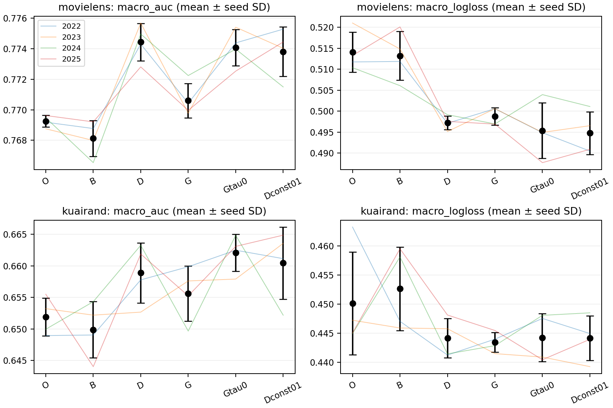
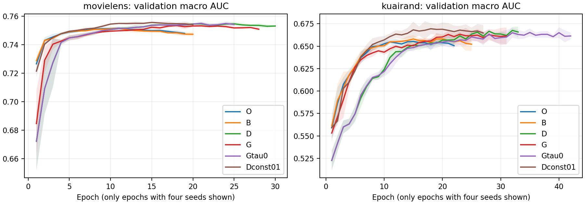
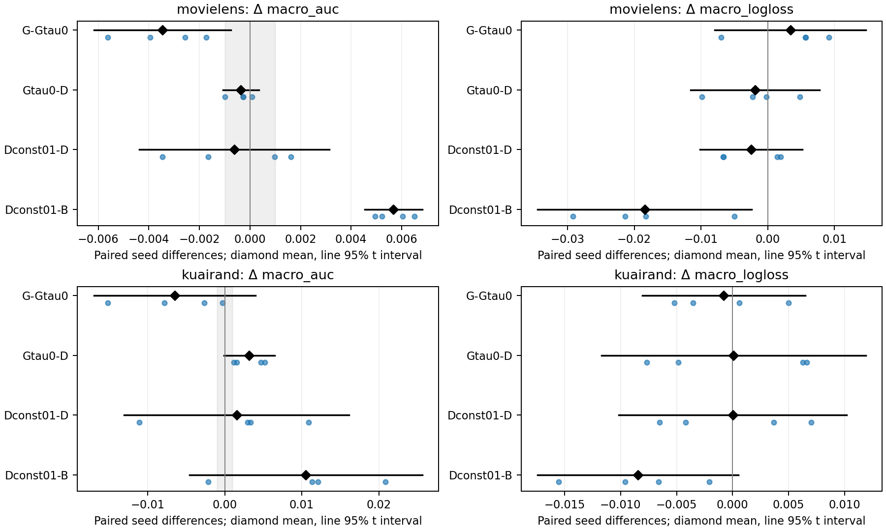

# M3oE 数据生成与梯度调幅：跨数据集四种子实验报告

**已完成：两数据集、四种子、六个方法臂，共48次有效正式训练；其中包含8次原始 M3oE 训练。** 另有12次单 epoch 管线检查，不计正式结果。

主要发现：MovieLens 上 D 相对固定基线及原始 O 的 AUC/LogLoss 改善稳定；KuaiRand 的结论依赖指标、基线和种子。匹配梯度路径的调幅对照在两个数据集均4/4降低 test macro AUC，MovieLens 证据更强；常数0.1套件在 MovieLens 也有明确收益，但尚不能宣称与 D 非劣。完整历史 VUG/mask 源码未找回，本报告只验证上传的 specificity/复制/噪声版本。

本文对应 `start.md`，种子按用户最新要求采用 **2022、2023、2024、2025**。实验矩阵、统计和解释的最终状态见下文；训练配置由 [Stage1 设计](DESIGN.md) 和 [验证集驱动的 Stage2 设计](DESIGN_STAGE2.md) 冻结。

## 研究范围与版本身份

已补齐 `experiments/data_generate` 和 `experiments/grad` 的独立 `MDMTRec/basic`、`models`、`trainers`、`utils`、入口和说明，使用原始 M3oE 的 STAR、共享/域/任务专家、门控和塔结构。原始上传文件与只读快照保留，兼容修订见 [compatibility.diff](compatibility.diff)；梯度模型由上传的数据模型配套移植，不冒称已找回历史对应文件。

在本地源码、归档和可用历史中做了有界检索，仍未找到能确认实际运行身份的完整 VUG、软标签、分阶段训练和自适应 mask 源码。因此，本次验证对象是**上传代码可定义的 specificity 权重＋稀缺域复制＋embedding 高斯噪声套件**，不能据此判定完整历史 VUG/mask 方法成功或失败。历史检索记录见 [historical_search.json](historical_search.json)，历史分数的不可比因素见 [HISTORY_CONTEXT.md](HISTORY_CONTEXT.md)。

| 臂 | 模型/训练定义 | 回答的问题 |
|---|---|---|
| O | 原始 M3oE 可学习 sigmoid 融合，保留历史两个 Adam 更新路径 | 实际补充原始模型训练参照 |
| B | 同一主干，四个融合系数固定为 1，单 Adam | D/G 的同源固定融合基线 |
| D | B＋specificity 权重＋最小训练域复制一次＋embedding 噪声 | 上传套件的整体净效果 |
| G | D＋全参数六格梯度范数调幅，τ=0.5 | 实际梯度实现套件的增量 |
| Gtau0 | 保留 G 的逐格 autograd、累加和全参数零梯度赋值，τ=0 | 分开观察调幅与实现路径差异 |
| Dconst01 | D 的同一模型/复制/噪声，全部 loss 权重固定为 float32 0.1，无权重梯度 | 检验动态权重轨迹是否必要 |

O 是统一协议下的 **original-model port**：主干和历史双优化器语义保留，但 train-only 编码、独立 loader RNG、成对初始化、始终恢复验证最佳 checkpoint 是明确的协议修订，不声称历史逐位复现。历史 `~bool` 参数筛选会让融合参数同时进入主 Adam；本实验保留该行为，并在每个 epoch 结束后用持续的训练迭代器取一个 batch，执行辅助 Adam（lr0.001）更新。O 初始 raw fusion=1，实际 sigmoid≈0.731；B 的系数=1，二者不能混作相同对照。训练记录还保留 O 各 epoch 的有效融合值和辅助 BCE。

## 数据、目标与训练协议

| 数据集 | 总行数 | train / validation / test | 物理域 d0 / d1 / d2 | task0 / task1 |
|---|---:|---|---|---|
| MovieLens-1M | 1,000,209 | 800,167 / 100,021 / 100,021 | 年龄 {1,18} / {25} / {35,45,50,56} | rating>3 / rating>4 |
| KuaiRand processed | 2,507,666 | 2,006,132 / 250,767 / 250,767 | tab0 / tab1 / tab4 | is_click / long_view |

MovieLens 源文件 SHA256=`f060ecb8fb7745f1e24998837ca5a1ec3e18b610f288e7357496edd760ba0ab7b8f4`；KuaiRand=`a1872911e49cb9324a89faf84df1dbed2077357496edd760ba0ab7b8f4fc681f`。所有臂使用同一完整自然数据和原文件顺序 8:1:1 划分，分类编码/年龄 scaler 只拟合真实训练前缀，OOV=0。MovieLens 时间顺序已核查；KuaiRand 的导出文件没有交互时间戳，其时间排序依据历史重建报告，不能由当前 CSV 独立重验。没有为增强版单独增加 video_id，也没有把 movie_id 列号套到 KuaiRand。

每个数据集的逐域/任务 train、validation、test 行数、正例率、标签熵见 [data_splits_and_labels.csv](data_splits_and_labels.csv)。最小域按**真实训练行数**确定：MovieLens=d0，KuaiRand=d2。复制行的展平 embedding 全维加标准差 0.1 的噪声，包含 domain embedding；离散路由 ID 不变。该定义是上传噪声代码的明确移植，不能解释为只改变 item 语义。

共同设置：embedding16，主干维度 `[512,256,256,64]`，4 experts，batch40960，Adam lr0.01、weight_decay1e-5、betas(0.9,0.999)、eps1e-8；无 AMP、TF32、scheduler 或 batch 缩小。最多50 epochs，patience10，只以 validation 六格 macro AUC 严格提升选 checkpoint，平局取最早；早停或达到上限都恢复最佳权重，再一次性评估 test。相同种子共享 canonical 主干初始状态，D/G/两个控制的辅助初始状态也匹配。

损失是六个 `(task,domain)` minibatch 均值的**和**，记为 `legacy_group_sum`，不是审计过的人口 Equal/Sample 目标。D 中真实样本 `w=0.1+0.5*specificity`，不 detach，复制样本取 detach 的真实权重均值；complexity 计算但不参与权重。G 对六个全参数梯度计算 `s_k=0.5+0.5*max_j||g_j||/||g_k||`，零范数组取1，再加和；对不连通参数赋零 Tensor 梯度。因此 `G-D` 同时包含调幅及梯度实现路径，只有 `G-Gtau0` 是本协议下匹配实现的调幅对照。

macro AUC 是六格 AUC 等权均值；pooled AUC 是每任务跨域合并计算 AUC 后再对两任务取均值，不能互换。LogLoss 按两个独立 Bernoulli 任务计算；没有对 `[B,2]` 预测做多分类归一化。训练 optimized loss 因权重和复制不同不能跨臂直接比较；另存的真实样本逐格无权 BCE 与验证/测试 LogLoss 才用于解释拟合与泛化。

## 实验完整性与统计边界

首轮 O/B/D/G：2 数据集×4 臂×4 seeds=32 次完整训练。随后只依据验证结果和训练机制日志，先冻结常数权重与 τ=0 两项对照，再读取首轮测试结果；Stage2 为2×2×4=16次。决策时间、输入哈希和排除 test 的声明见 [DECISION_STAGE2.json](DECISION_STAGE2.json)。没有因 test 分数调整参数或追加第三轮搜索。

执行中，另一任务占用 GPU1，且单 epoch 的 torch allocated peak 低估了进程保留显存。主动中断 KuaiRand/Dconst01/seed2022 的一个 attempt；该记录 `valid=false/resource_interrupted`，保留全部文件。后续调度为每个 MovieLens/KuaiRand 进程至少预留3/6GiB，重新从冻结初始化运行该种子，训练代码及参数不变。见 [scheduler_operational_amendment.json](scheduler_operational_amendment.json)。该中断不能计为算法失败，也不能充当有效种子。

统计单位为 seed，n=4；表中 ± 是样本标准差，配对差区间为 df=3 的描述性 t 95% 区间，未作多重比较校正。正 AUC 差与负 LogLoss 差有利。该区间衡量固定数据划分下的随机训练波动，**不包含测试样本不确定性，也不是跨数据集普适性的置信区间**。六格和多指标比较属于探索性分析。实用 AUC 阈值预先设为0.001，至少3/4种子超过同方向阈值才称为重复实用方向；区间是否跨0另行报告。均值接近0、区间跨0均不等于等效。

## 完成核验

首轮 [INTEGRITY.json](INTEGRITY.json) 和补充 [INTEGRITY_STAGE2.json](INTEGRITY_STAGE2.json) 均通过：48个必需 `(dataset,arm,seed)` 键完整且唯一；数据/编码/有序划分/成对初始化匹配；全部最佳 checkpoint SHA256 重算一致，模型/优化器/RNG/loader 状态及选中/停止 epoch 核验通过。Stage2 17份 completion 中16份有效，1份资源中断无效并已完整重跑。

调度日志中 KuaiRand/Gtau0/2022、2023 和 MovieLens/Gtau0/2024 缺逐项 exit 事件：旧 scheduler 遇中断后直接等待其余进程，没有逐项记录 exit。三项 completion、checkpoint SHA、最佳 epoch 和状态均已通过独立核验；保留原始 queue，明确列作**日志完整性限制**。这不等于缺少三个训练结果。训练/数据/模型源哈希一致；调度预留与未被训练导入的分析/导出脚本变化单独记录。详见 [RUNNER_REPORT.md](RUNNER_REPORT.md)、[RUNNER_REPORT_STAGE2.md](RUNNER_REPORT_STAGE2.md)。

## 整体测试终点

以下 ± 为四种子的样本 SD；最佳 epoch 顺序为2022/2023/2024/2025。

| 数据集 | 臂 | macro AUC | macro LogLoss | pooled AUC | worst-cell AUC | best epoch (2022–25) |
| --- | --- | --- | --- | --- | --- | --- |
| movielens | O | 0.769259 ± 0.000383 | 0.514094 ± 0.004759 | 0.770347 ± 0.000762 | 0.745585 ± 0.001500 | 11/10/11/9 |
| movielens | B | 0.768128 ± 0.001171 | 0.513209 ± 0.005842 | 0.769121 ± 0.000987 | 0.744053 ± 0.001086 | 11/10/11/11 |
| movielens | D | 0.774431 ± 0.001222 | 0.497247 ± 0.001653 | 0.775770 ± 0.001465 | 0.753813 ± 0.001093 | 21/21/25/20 |
| movielens | G | 0.770600 ± 0.001125 | 0.498766 ± 0.002114 | 0.771246 ± 0.001175 | 0.749554 ± 0.001377 | 21/19/19/18 |
| movielens | Gtau0 | 0.774066 ± 0.001191 | 0.495374 ± 0.006640 | 0.775061 ± 0.001086 | 0.751862 ± 0.002146 | 21/21/24/15 |
| movielens | Dconst01 | 0.773803 ± 0.001625 | 0.494764 ± 0.005051 | 0.773840 ± 0.002390 | 0.751329 ± 0.002222 | 17/13/10/15 |
| kuairand | O | 0.651900 ± 0.003010 | 0.450110 ± 0.008804 | 0.675517 ± 0.001395 | 0.628230 ± 0.009499 | 20/16/12/15 |
| kuairand | B | 0.649890 ± 0.004470 | 0.452632 ± 0.007145 | 0.678283 ± 0.002059 | 0.620988 ± 0.015795 | 15/15/19/21 |
| kuairand | D | 0.658887 ± 0.004757 | 0.444158 ± 0.003369 | 0.676359 ± 0.002503 | 0.639725 ± 0.005348 | 38/23/41/40 |
| kuairand | G | 0.655585 ± 0.004376 | 0.443462 ± 0.001683 | 0.678262 ± 0.003933 | 0.631539 ± 0.008881 | 23/38/21/24 |
| kuairand | Gtau0 | 0.662069 ± 0.002955 | 0.444249 ± 0.004121 | 0.676772 ± 0.002977 | 0.643871 ± 0.004572 | 32/36/49/32 |
| kuairand | Dconst01 | 0.660429 ± 0.005712 | 0.444172 ± 0.003804 | 0.678311 ± 0.002000 | 0.642472 ± 0.007437 | 17/20/19/23 |

全部逐 seed 原数值、配对差和六格/逐域/逐任务 AUC、LogLoss 的均值与 SD 见 [完整表格](analysis/RESULT_TABLES.md)；机器可读数据见 [all_seed_results.csv](analysis/all_seed_results.csv)、[paired_test_deltas.csv](analysis/paired_test_deltas.csv)。

## 首轮稳定现象与矛盾

**STRONG（限本次 MovieLens 数据、种子和协议）：D 套件相对 B 的整体终点改善。** Test macro AUC 配对增益 +0.006303，95% 描述区间 [0.002830,0.009776]，4/4 种子同向且超过0.001；macro LogLoss −0.015962，区间 [−0.026829,−0.005095]，4/4改善。相对原始 O，D 的 AUC +0.005172 [0.002722,0.007622]、LogLoss −0.016847 [−0.026887,−0.006807]，同样4/4改善。这支持上传套件的效果存在性，不足以把收益归因于 specificity、噪声或复制中的某一个因素，更不支持完整历史 VUG/mask 复现的说法。

**MEDIUM：KuaiRand 的 macro 改善有重复方向，但不支持无条件迁移结论。** D−B macro AUC +0.008997，4/4正，其中只有3/4超过0.001；区间 [−0.002287,0.020280] 跨0。LogLoss −0.008474，4/4下降，但区间 [−0.019789,0.002840] 也跨0。相对 O 的 D−O AUC +0.006987，只有3/4正且区间 [−0.002216,0.016190] 跨0；seed2023 为负。更关键的是 D−B pooled AUC **−0.001925，4/4负**。因此结论随指标与参照变化，不能只拿 macro 均值宣布全面改善。

**STRONG（对观察到的差值），纯机制归因另看 τ=0 对照：MovieLens 上 G 的整体实现相对 D 损害 AUC。** G−D macro AUC −0.003831 [−0.006168,−0.001493]，4/4下降；三个域的域均 AUC 也各自4/4下降。LogLoss 均值 +0.001519，但种子2正2负、区间跨0，不能说所有预测质量维度同步变差。KuaiRand G−D macro AUC −0.003302，2正2负，区间 [−0.016731,0.010126]，**WEAK**；不能推广为调幅在两个数据集都稳定失效。G−B 的部分正收益同时包含 D，不能据此认为梯度调幅有效。

**MEDIUM：融合固定化并非普遍收益。** B−O 的 test macro AUC 均值在 MovieLens 为 −0.001131、KuaiRand 为 −0.002010；KuaiRand 验证集 B−O 却4/4为正，test 仅2/4为正。原始 M3oE 在本实验并没有被所有改动稳定击败，O 与 B 的结果必须分别保留。O 的验证最佳 epoch 为 MovieLens 9–11、KuaiRand 12–20，有效融合系数继续学习，不能把固定1等同于原始初始 raw1。

## 逐域收益与大小域权衡

任务维度也有区别。MovieLens D−B 的 click/like macro AUC 分别 +0.006981/+0.005626，均4/4正；两个任务的 macro LogLoss 分别 −0.017656/−0.014267，均4/4改善。六格中只有 d1-like 的 AUC 有1个负种子，其余五格均4/4正；六格 LogLoss 均4/4改善。G−D 则六格 AUC 全部4/4下降，但 like 的平均 LogLoss 仍略改善，排序质量与概率质量没有完全同步。

KuaiRand D−B 的 click/long_view macro AUC 均值 +0.008680/+0.009313，前者4/4正、后者3/4正。大域 d1 两任务 AUC **各自4/4下降**，并非一个任务单独拉低；d2-click 4/4改善、d2-long_view 3/4改善。d1-click 的 LogLoss 均值反而微增约0.000073且方向各半，其他格也不能由总平均推断逐种子一致。完整六格、域均、任务均 AUC/LogLoss 及 SD 在 [RESULT_TABLES.md](analysis/RESULT_TABLES.md)。

| 数据集/域 | 真实训练 N | B test 域均 AUC | D−B 域均 ΔAUC | G−D 域均 ΔAUC |
|---|---:|---:|---:|---:|
| MovieLens d0 | 155,949 | 0.771056 | +0.006099 | −0.002957 |
| MovieLens d1 | 318,599 | 0.781662 | +0.004058 | −0.004941 |
| MovieLens d2 | 325,619 | 0.751665 | +0.008752 | −0.003595 |
| KuaiRand d0 | 172,782 | 0.631549 | +0.018868 | −0.013292 |
| KuaiRand d1 | 1,743,898 | 0.672980 | −0.002451 | +0.001872 |
| KuaiRand d2 | 89,452 | 0.645142 | +0.010573 | +0.001514 |

**MEDIUM：KuaiRand 存在小域获益/大域下降的观测权衡。** D−B 的最小 d2 域均 AUC 4/4提升、最大 d1 4/4下降；这也与 pooled 下降一致。d0 的均值提升部分由 seed2025 约+0.052855驱动，其余种子表现不能被均值遮盖。G−D 在大域均值正、d0负、最小域方向混合，并不呈现统一的小域受益模式。

MovieLens 三域的 D−B 均值全正，最大 d2 的收益最大，因此 KuaiRand 的大小域权衡不能推广为两个数据集共有的规律。**WEAK（规模的因果解释）：** 两数据集共六个自然域同时混杂了域身份、规模、标签语义、用户/物品覆盖和分布变化，尚不能把收益差异主要归因于规模；六点相关性也不能分离这些因素。

KuaiRand 最大 d1 的 click 正例率从 train≈0.378降至 test≈0.210，long_view 从≈0.256降至≈0.111；它既是最大域，又存在明显的标签分布变化。两个小 test 域仅有 d0=2,613行、d2=1,870行，某些任务正例更少。种子区间没有覆盖这些测试样本的不确定性。规模解释与分布漂移/覆盖/校准解释均需保留，不能只选规模。

## 训练阶段改变表面结论

**STRONG：优化速度与最佳 checkpoint 的方法排序不同。** 在相同 epoch 的 validation macro AUC 上，D−B：MovieLens epoch1 −0.056642、epoch5 −0.004281、epoch10 −0.000444；KuaiRand 对应 −0.038619、−0.052814、−0.026482。KuaiRand 的 G−D 在 epoch1/5/10 则为 +0.030562/+0.051981/+0.019278，均4/4正。若只看短训练，会得出与最终最佳 checkpoint 不同的排序。

D 的最佳 epoch 为 MovieLens 20–25、KuaiRand 23–41，通常晚于 B/O。它在相同最多50 epochs＋patience10规则下的选中终点获益，并不等于固定训练步数或相同计算预算下获益。梯度逐格计算也增加成本；并发和外部负载影响 wall time，不能把这些时长当作严谨吞吐基准。最后 epoch、验证最佳 epoch、测试最佳 checkpoint 必须区分；本报告不使用 test 选 epoch。

训练 optimized_group_sum 同时受权重下界、增强样本和六格均值影响，D 比 B 的训练 loss 数值小并不是直接泛化证据。原始真实样本六格 BCE、验证 LogLoss、每格测试 LogLoss 及完整曲线一并公开；没有用单个 loss 最小值替代预先冻结的 AUC checkpoint 规则。

## 机制证据与替代解释

**STRONG：观测到 specificity 权重快速靠近下界。** 首轮两个数据集共16个 D/G 运行，在 epoch5 观测批的权重均值均为0.1000000164，最大样本间 SD 约6.38e−11，平均 specificity 最大约2.21e−11。晚期权重有微小回升，因此不能说整个训练严格常数，也不能由一个观测批断言所有批次完全相同。

直接项 `∂(w·BCE)/∂specificity=0.5·BCE>0` 使最小化目标具有压低自身权重的驱动。这是当前无 detach 公式的性质，仍不能单独证明训练轨迹或最终增益的来源。D 同时改变初期权重/表示梯度、稀缺域样本重复、噪声和全局 loss 尺度。Adam 的耦合 weight decay、eps、历史矩和非线性轨迹意味着整体乘0.1不能简单等同于把学习率乘0.1；持续的有意义样本区分是否必要，需要完整常数控制判定。

六格分别取均值，因此复制不会按样本数直接提高稀缺域在总目标中的系数；改变的是该格的真实/扰动样本构成及其梯度路径。常数权重且没有扰动时，完整复制同一格样本也不会改变该格均值损失。不能把本次 D 的行为简单解释为提高小域目标权重。

正的标量调幅在固定参数处不改变单个梯度之间的 cosine 符号，不执行冲突投影；全参数范数包含私有专家/塔，也不保证共享表示或实际 Adam 更新得到平衡。机制日志中保留了 raw/shared norm、cosine、实际 Adam delta 和真实/复制梯度夹角，但这些相关性探针不替代干预对照。`grad=None` 与零 Tensor 会影响 Adam 状态/weight decay，逐格累加还存在数值舍入差异；不得忽略这些路径差异后把 `G-D` 完全归因于 τ。

## τ=0 对照：调幅与实现路径分别判断

| 数据集 | 对照 | Δ macro AUC [配对95%区间] | 正/负种子 | Δ macro LogLoss [配对95%区间] |
|---|---|---|---|---|
| MovieLens | G−Gtau0 | −0.003466 [−0.006176,−0.000755] | 0/4 | +0.003392 [−0.007934,+0.014718] |
| MovieLens | Gtau0−D | −0.000365 [−0.001077,+0.000347] | 1/3 | −0.001873 [−0.011534,+0.007788] |
| KuaiRand | G−Gtau0 | −0.006484 [−0.016977,+0.004009] | 0/4 | −0.000786 [−0.008060,+0.006487] |
| KuaiRand | Gtau0−D | +0.003182 [−0.000126,+0.006490] | 4/0 | +0.000090 [−0.011731,+0.011912] |

**STRONG（MovieLens）、MEDIUM（KuaiRand）：在匹配的 G 实现路径中，τ=0.5 相对 τ=0 没有带来终点 macro AUC 收益。** MovieLens 四个种子均下降超过0.001，配对区间低于0；两个任务的 macro AUC 分别 −0.003692/−0.003239，均4/4下降，pooled AUC 也4/4下降。KuaiRand 也是4/4 macro AUC 下降，其中3/4超过0.001，但区间仍跨0；long_view 的任务均 AUC 4/4下降，click 为3/4下降。其 worst-cell AUC −0.012333 [−0.021181,−0.003484]、4/4下降，是额外的不利证据，但属于探索性端点。两数据集 LogLoss 差均不稳定，不能扩大为所有指标全面变差。

KuaiRand 的调幅增量并非所有域都下降：G−Gtau0 的 d0/d1/d2 域均 AUC 为 −0.019314/+0.001535/−0.001674，d1有3/4正；pooled AUC 均值 +0.001490、3/4正但区间跨0。它表现为另一种域间/聚合权衡，不能只报不利 macro 或有利 pooled 一项。

**MEDIUM：τ=0 不能无条件当作 D 的完整训练等价物。** MovieLens 的 Gtau0−D macro AUC 四个单种子差都在±0.001以内，均值 −0.000365，但这不是等效性证明，且 worst-cell 仍有个别明显偏差。KuaiRand 的差则4/4超过+0.001，不能忽略为零。该差可能反映逐格求导/累加的数值轨迹和梯度赋值语义；未用 complexity 参数自身发生 decay，并不自动说明它影响了预测，不能把这一点当作已证实的因果链。

在同一标量指标和 seed 上，性能差严格满足 `(G−D)=(G−Gtau0)+(Gtau0−D)`；KuaiRand 均值为 `−0.003302=−0.006484+0.003182`。这解释了为什么首轮 G−D 的种子符号混合，仍可与匹配路径下调幅的4/4负方向同时存在。该恒等式只分解终点性能差，不是非线性优化机制贡献的可加因果比例。

**必须保留的矛盾：** KuaiRand 的 Gtau0−D 在 validation macro AUC 均值 −0.003558、3/4负，test 却4/4正；G−Gtau0 的 validation AUC 为2正2负、均值约−0.000459，test却4/4负。因此不宣称某条实现路径普遍有利，或验证和测试均证实调幅有害。MovieLens 的调幅对照 validation AUC 也只有3/4负、区间跨0，但 validation LogLoss +0.007257、4/4变差、区间高于0。泛化分布、选中 epoch 与指标不同均是需要保留的解释。

调幅在 KuaiRand 的**早期优化**反而明显更快：G−Gtau0 的 validation AUC 在 epoch1/5/10 为 +0.030352/+0.052058/+0.021456，均4/4正。它的早期加速与最终 macro AUC 下降并不矛盾，不能用短跑或最后一次训练 loss 替代验证最佳 checkpoint 的最终测试。

## 常数权重：可以获得收益，不等于已证明完全替代 D

| 数据集 | 对照 | Δ macro AUC [配对95%区间] | 正/负种子 | Δ macro LogLoss [配对95%区间] |
|---|---|---|---|---|
| MovieLens | Dconst01−B | +0.005676 [+0.004541,+0.006811] | 4/0 | −0.018445 [−0.034488,−0.002401] |
| MovieLens | Dconst01−D | −0.000627 [−0.004385,+0.003130] | 2/2 | −0.002483 [−0.010131,+0.005165] |
| KuaiRand | Dconst01−B | +0.010539 [−0.004548,+0.025625] | 3/1 | −0.008460 [−0.017416,+0.000496] |
| KuaiRand | Dconst01−D | +0.001542 [−0.013035,+0.016120] | 3/1 | +0.000014 [−0.010170,+0.010198] |

**STRONG（MovieLens）：无需动态 specificity 权重也能得到相对 B 的明确收益。** Dconst01 在六格 AUC 上均4/4正，两个任务 macro AUC 均4/4正，macro LogLoss 和 worst-cell AUC 也4/4改善。其最佳 epoch 为10–17，早于 D 的20–25。**MEDIUM（KuaiRand）：** 常数套件相对 B 的 macro AUC 有3/4实用正增益，但 seed2024 为 −0.002136，且区间很宽；两个任务 LogLoss 均4/4改善，macro LogLoss 区间上限仍略高于0。动态权重不是获取 MovieLens 增益的必要条件，不能再把套件正结果直接当成有意义样本权重学习的证据。

这仍没有证明常数方案能保持 D 的完整表现。两数据集均**未通过预设描述性非劣筛选**：MovieLens 的 AUC 差区间下限−0.004385低于−0.001，LogLoss 上限+0.005165高于+0.002；KuaiRand 对应−0.013035/+0.010198，也未通过。失败表示目前不能作非劣结论，不等于已证明 D 优于常数方案。MovieLens 的 C−D 在 seed2023/2024 的 AUC 为−0.001652/−0.003461，worst-cell 均值−0.002484、3/4负；KuaiRand seed2024 的 C−D AUC 为−0.011070。均值接近或更好都不能遮盖这些种子。

逐域看，常数方案在 KuaiRand 最大 d1 相对 D 的两任务 AUC 各自4/4提升，域均 +0.002070；其相对 B 的 d1 域均只剩−0.000381、3/4负，pooled 均值差约+0.000028（1正3负），仍不能称为等效。d0/d2 相对 D 的域均 AUC 各2正2负。MovieLens C−D 的 d2 域均 −0.002235、3/4负，而 d0均值正。动态权重与常数权重的差异具有域和种子依赖。

另一个验证/测试矛盾是 MovieLens 的 C−D validation AUC 4/4正，但 test 只有2/4正；KuaiRand 的 C−B validation 4/4正，test为3/4正。没有按验证或测试某一项挑选方法后删掉另一视角。Gtau0 的全部机制探针 scales=1；Dconst01 的探针权重 SD=0、辅助梯度范数=0，控制实现符合定义。

**WEAK（单因素归因）：** 常数套件仍同时具有全局0.1损失尺度和复制/噪声，且不匹配 D 初期约0.35的权重及其表示梯度。因此本实验既没有证明噪声是主因，也没有把动态权重的初期尺度、直接梯度和样本区分作用分别识别。当前证据支持削弱“动态权重必需”的强主张，但不支持“动态权重完全无用”或“噪声已被独立证实有效”。

## 停止规则、未测问题与最有区分力的下一步

本次按冻结设计，在32次首轮＋16次对照完成后结束训练。完整历史 VUG/mask、噪声单独消融、人口 Equal/Sample 目标、独立组合交互与超参搜索均**未执行**；不能把 legacy_group_sum 的现象当作这些实验的结论。上传的 G 本身已包含 D，再把两者标为 D+G 会重复计算同一套机制；目前没有可直接代入独立交互公式的两个正收益因子。历史 SF002–SF011 中不同目标/模型/干预的结果只作背景，不能和本次配对增益合并统计。

最有区分力的未来实验是**仅增加一个匹配的常数0.1、关闭复制与噪声的对照**：保留 C 的模型、普通 backward、辅助模块不训练、初始化、真实数据/loader、优化器和选 checkpoint 规则，在两个数据集各跑同样四种子，共8次，不搜索参数。`C−该对照` 检验复制/噪声套件在相同损失尺度下是否仍有增益；`该对照−B` 检验全局缩放及其与 Adam/decay 的交互。若无增强对照能解释 C 的收益，将推翻“增强是必要来源”的说法；若 C 稳定超过它，才提高增强作用的证据强度。此后再决定是否值得拆噪声或进入目标函数研究，比立即开展 Equal/Sample×多方法大矩阵更能区分目前的解释。该建议未在本次自动追加执行。

## 曲线与数据定位

曲线阴影为 seed SD，仅显示仍有四种子支持的 epoch；尾部不同长度不能用作方法已经停止提升的证据，完整支持数见 [validation_curve_support.csv](analysis/validation_curve_support.csv)。

上图蓝点为四个种子的配对差，菱形为均值，横线为描述性95%区间；AUC灰带为预设±0.001实用范围，不是等效性检验。

- [全部训练和验证轨迹](analysis/all_epoch_metrics.csv)、[相同epoch的配对差](analysis/paired_training_stage.csv)、[选中epoch明细](analysis/selected_epoch_details.csv)。
- [机制原日志](analysis/all_mechanism_metrics.csv)、[机制探针摘要](analysis/mechanism_probe_summary.csv)、[梯度性能差分解](analysis/gradient_contrast_decomposition.csv)。
- [常数权重非劣筛选](analysis/constant_weight_noninferiority.csv)、[验证配对差](analysis/paired_validation_deltas.csv)、[逐域规模与性能](analysis/domain_size_performance.csv)。
- [原始小文件清单及SHA256](raw_results/artifact_manifest.json)、[48个checkpoint索引](raw_results/checkpoint_index.csv)；原始数据和权重位于 `/home_new/xzf_m3oe_reproduction_20261021`，未作为 Git 大文件提交。
- [冻结的验证决策输入](validation_decision_inputs/manifest.json) 保留最初决策哈希对应的文件；当前 analysis 目录是完整48项汇总，两者用途不同。
- [环境版本](ENVIRONMENT.json)、[依赖](requirements.txt)、[启动与重算命令](README.md)、[源码快照清单](source_manifest.json)。

最新用户约束为后续训练仅用物理 GPU0；本轮训练在该指令前已全部完成。当前仅进行统计与交付，见 [GPU_POLICY.md](GPU_POLICY.md)。

