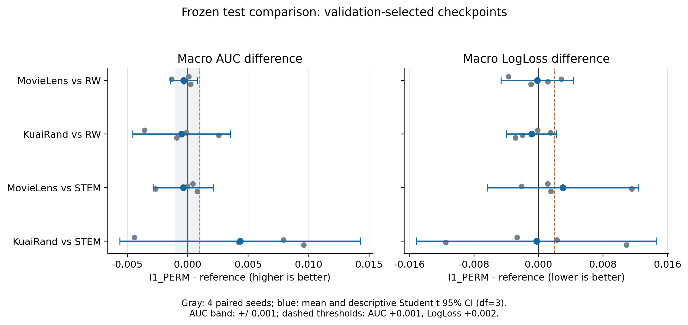

# MDMT-NEXT 本轮最终研究报告

> 本次按“仅上传实验报告”发布。配套CSV/JSON、配置、日志、源码、原始数据、预测和模型权重均未纳入本次提交；正文中的运行工件路径指原服务器归档。数值、统计口径和研究结论保持原报告内容。
> 原始报告SHA256：`13a2cd6b64c5450a79550d8a62f5b8c9f9696f8115971688c9c8cf845c73b94f`。

本轮已完成规定的 P0→S1→S2→所晋级包的 S3/S4→分析。**当前 I1_PERM 的预注册 selected ranking 主张未获支持，状态为 VERSION_NOT_SUPPORTED；这不构成所有权限机制均无效或与固定规则等效的证明。** B_CONT/C_CTRL 未通过开发阶段晋级，I3/I5 的保存轨迹重放没有形成超越强简单对照的稳定增量。所有结果、失败启动、负结果和未执行问题均保留。

## 1. 本阶段回答了什么

自然 MovieLens-1M/KuaiRand 三域两任务、严格 fit-only 词表/scaler，原外层 validation/test 保持不变。探索 seeds2022/2023；正式 seeds2024–2027。主训练自然样本×两个任务 BCE 均值，Adam lr=.001、耦合weight_decay=1e-5、有效/微批40960、FP32。没有复制、噪声增强或改变域采样比例。当前行序协议未证明时间外或用户互斥，不扩展这些泛化措辞。

正式矩阵为两数据集×四seed×(I1_OFF/I1_RO/I1_RW/I1_PERM/STEM_DOMAIN_TASK)=40轨迹。max50/patience10，validation macro AUC严格改善、平局最早，eligible≥10；selected为主，final和预算内选点为次。I1最佳固定对照RW由seed2022 validation选定，两数据集一致，正式阶段未重选。全部40训练完成后才统一解锁Q_confirm/test。

全过程包括8条S1 warmup、21个S1探测任务（404个主分支更新+9个回滚检查更新）、44条主pilot、16个5epoch静态校准分支、18个预定时间锚点的I3/I5重放、4条STEM适配pilot、40条正式训练和40个统一评价任务。S1/S2/正式阶段分别记账，未用名称相似冒充免费baseline复用。

## 2. 主要比较结果

以下Δ均为I1_PERM−reference。95%区间为4个配对seed的描述性Student t区间(df=3)，条件于本次固定数据；未把六格/epoch/重复标签访问扩张为独立n，也不据此报告未经多重性处理的显著性p值。

### 2.1 预注册selected主结果

| 数据 | 对照 | Δmacro AUC | 描述性95%区间 | 正方向/实用方向seed | Δmacro LL | LL描述性95%区间 |
|---|---|---:|---|---|---:|---|
|movielens|I1_RW|-0.000334|[-0.001449, +0.000781]|2/4；0/4|-0.000167|[-0.004648, +0.004315]|
|movielens|STEM_DOMAIN_TASK|-0.000366|[-0.002860, +0.002128]|2/4；0/4|+0.003028|[-0.006376, +0.012433]|
|kuairand|I1_RW|-0.000513|[-0.004545, +0.003518]|1/4；1/4|-0.000860|[-0.003968, +0.002248]|
|kuairand|STEM_DOMAIN_TASK|+0.004329|[-0.005616, +0.014274]|3/4；3/4|-0.000243|[-0.015146, +0.014660]|

预注册实用方向为AUC≥+.001，LL伤害带为+.002。主对照RW上，ML只有2/4个正方向且0/4达到实用带；KR只有1/4个正方向且1/4达到实用带。两数据集的selected AUC均值为负、区间均跨0，**没有重复的实用ranking优势**；这同时不支持“已证明劣于”或“已证明等效”的强表述。描述性非劣筛选(AUC下界>−.001且LL上界<+.002)两数据集均未通过。

### 2.2 逐seed原始配对差

| 数据 | 选点 | 指标 | 2024 | 2025 | 2026 | 2027 |
|---|---|---|---:|---:|---:|---:|
|movielens|best|macro_auc|+0.000079|-0.001325|-0.000321|+0.000231|
|movielens|best|macro_logloss|-0.003719|+0.002809|+0.001161|-0.000917|
|movielens|last|macro_auc|+0.000918|+0.000708|+0.000688|+0.000378|
|movielens|last|macro_logloss|-0.002877|-0.005199|-0.002089|+0.001529|
|kuairand|best|macro_auc|-0.003582|-0.000135|+0.002576|-0.000913|
|kuairand|best|macro_logloss|-0.000092|+0.001502|-0.001992|-0.002859|
|kuairand|last|macro_auc|+0.001420|+0.003345|-0.001733|+0.001348|
|kuairand|last|macro_logloss|-0.007027|-0.006088|-0.013944|-0.006441|

### 2.3 全arm的selected test绝对分数

| 数据 | arm | macro AUC均值±seed SD | macro LL均值±seed SD | selected epochs (2024–2027) |
|---|---|---|---|---|
|movielens|I1_OFF|0.757888 ± 0.001270|0.521093 ± 0.004230|13, 12, 18, 17|
|movielens|I1_RO|0.758068 ± 0.001238|0.520295 ± 0.006608|13, 12, 18, 17|
|movielens|I1_RW|0.758326 ± 0.000816|0.520139 ± 0.006113|13, 11, 18, 17|
|movielens|I1_PERM|0.757992 ± 0.001270|0.519973 ± 0.006576|13, 12, 18, 17|
|movielens|STEM_DOMAIN_TASK|0.758357 ± 0.001288|0.516944 ± 0.003336|20, 24, 24, 28|
|kuairand|I1_OFF|0.664215 ± 0.006167|0.450515 ± 0.005360|25, 18, 19, 21|
|kuairand|I1_RO|0.665401 ± 0.002906|0.449548 ± 0.008682|19, 18, 19, 21|
|kuairand|I1_RW|0.664959 ± 0.005896|0.450881 ± 0.010234|24, 20, 20, 21|
|kuairand|I1_PERM|0.664445 ± 0.006561|0.450020 ± 0.008757|25, 20, 19, 21|
|kuairand|STEM_DOMAIN_TASK|0.660116 ± 0.003284|0.450264 ± 0.008531|43, 31, 40, 35|

KR的固定RO均值(.665401)也高于动态PERM(.664445)，所以PERM相对STEM的正点估计不能独占归因于动态权限。该外部比较有3/4个seed超过+.001，标签为MEDIUM、方向积极但区间宽；它未弥补主要匹配对照RW上的失败。

### 2.4 selected/final与人口差异

| 数据 | 选点 | ΔAUC vs RW | AUC95%区间 | ΔLL vs RW | LL95%区间 |
|---|---|---:|---|---:|---|
|movielens|best|-0.000334|[-0.001449, +0.000781]|-0.000167|[-0.004648, +0.004315]|
|movielens|last|+0.000673|[+0.000319, +0.001027]|-0.002159|[-0.006600, +0.002282]|
|kuairand|best|-0.000513|[-0.004545, +0.003518]|-0.000860|[-0.003968, +0.002248]|
|kuairand|last|+0.001095|[-0.002246, +0.004436]|-0.008375|[-0.014315, -0.002435]|

ML final AUC四seed同为正，但全部低于+.001实用带；属于MEDIUM的有限方向证据。KR final LL四seed均改善且超过−.002，区间全负，按预定证据规则为**STRONG（只限本协议final LL副指标）**。没有用这项副指标或final选点替代selected ranking主标准。

Q_confirm selected上，PERM−RW的AUC为ML +.000371、KR −.000735，区间均跨0；外层test分别为−.000334/−.000513。对STEM，KR validation差为−.007534，Q_confirm差为+.003265，test差为+.004329。反馈/验证/确认/外层人口的方向明显不同，不合并这些角色寻找统一正数。

40条模型的best_within_budget结果均与best质量指标一致，预注册epoch10审计没有替换任何runner预算检查点。这说明本轮冻结预算没有改变主要判定，不证明各方法实际花费相等。

全角色、全arm、逐seed、selected/final/预算内结果见 raw_summary.csv（`analysis/FORMAL/raw_summary.csv`，服务器留存），六格见 raw_cells.csv（`analysis/FORMAL/raw_cells.csv`，服务器留存），逐域/任务见 raw_groups.csv（`analysis/FORMAL/raw_groups.csv`，服务器留存），全部原始配对差及区间见 test ANALYSIS.json（`analysis/FORMAL/test/ANALYSIS.json`，服务器留存）、Q_confirm（`analysis/FORMAL/Q_confirm/ANALYSIS.json`，服务器留存）、validation（`analysis/FORMAL/validation/ANALYSIS.json`，服务器留存）。

## 3. 机制是否连通、域大小与训练阶段

### 3.1 selected六格与域大小

| 数据 | 域 | fit行数 | RW基准test域AUC均值 | PERM−RW域AUC | PERM−RW域LL |
|---|---:|---:|---:|---:|
|movielens|0|124759|0.760846|-0.000764|+0.001647|
|movielens|1|254879|0.772710|-0.000109|-0.001321|
|movielens|2|260495|0.741421|-0.000129|-0.000826|
|kuairand|0|138225|0.638238|-0.001732|+0.003141|
|kuairand|1|1395118|0.702794|+0.000066|-0.003388|
|kuairand|2|71561|0.653843|+0.000125|-0.002333|

| 数据 | cell(q×3+d) | ΔAUC均值 | AUC正向seed数 | ΔLL均值 |
|---|---:|---:|---:|
|movielens|0|-0.001171|0/4|+0.003443|
|movielens|1|-0.000201|3/4|-0.000566|
|movielens|2|-0.000082|1/4|-0.001213|
|movielens|3|-0.000358|2/4|-0.000149|
|movielens|4|-0.000016|3/4|-0.002075|
|movielens|5|-0.000176|1/4|-0.000439|
|kuairand|0|-0.003878|0/4|+0.003592|
|kuairand|1|+0.000092|2/4|-0.003764|
|kuairand|2|+0.000622|2/4|-0.001615|
|kuairand|3|+0.000414|2/4|+0.002690|
|kuairand|4|+0.000040|2/4|-0.003013|
|kuairand|5|-0.000371|1/4|-0.003051|

两个数据集d0/task0的AUC四seed均退化，均值ML −.001171、KR −.003878，是值得保留的MEDIUM有限重复现象（逐格多重比较为描述性）。KR d0的LL平均恶化+.003141，最大域d1则改善−.003388；最小域d2也改善−.002333。ML d0的LL恶化+.001647，较大d1/d2改善。**未观察到普遍“小域改善/大域下降”交换；当前存在较小d0受损、较大域LL改善的反向交换。** d2的反例和任务差异使域大小不足以单独解释结果。

ML较小d0的基准AUC高于接近两倍大小的d2，因此小域不等于困难域。KR d0/task0 test仅228正例、task1仅120，d2虽更小却分别1100/827正例；样本量、标签支持、难度和域语义混杂。没有自然大小干预证据证明“大小是主要因果变量”，此项解释强度WEAK。

自然人口LL的PERM−RW均值为ML −.000346、KR −.003312，而macro LL为−.000167/−.000860；大域权重解释了汇总差异，但不能隐藏d0代价。pooled task-mean AUC差仍为ML −.000525、KR −.000232。最差cell AUC差分别−.000082/−.003878；最差cell指标与最差逐格退化是不同对象，完整逐格表均保留。

### 3.2 控制器确实执行到哪一步

ML seed2024/2025 selected在epoch13/12，只有5/4锚点、0次边决策，部署模式均为全RO；这两条selected没有检验成熟动态权限。ML另两seed selected作4/3次决策。KR selected作27/17/15/19次决策，已越过bootstrap；其中2026的selected模式为全RO，其余有OFF/RO/RW混合。不能把KR的主要比较失败也全部归于“从未激活”。final各seed有更多决策，但selected仍是冻结的主对象。

8组公共warmup×三个分支共24次fork逐一校验同一SHA。P_update真实面板的独立RNG和保存query哈希在8个正式PERM run全部吻合。每run真正访问的唯一风险行数ML5112–6140、KR9189–10231；重复访问计数与两任务targets另列，没有当作新增独立模型重复。见 POLICY_STATES（`analysis/FORMAL/POLICY_STATES.json`，服务器留存）、FEEDBACK_ROWS（`analysis/FORMAL/FEEDBACK_ROWS.csv`，服务器留存）。

### 3.3 竞争解释

可竞争的解释包括：LL监督与AUC/验证选点的目标失配；内部反馈人口与外层人口差异；早期selected尚未完成critic bootstrap；稀少正例和有限面板造成效用噪声；边级异质的常量模式已足够，而不必依赖状态NN；共享收益是owner/target利益转移。现有结果尚未独立识别这些因果机制。固定对照是预注册的全局OFF/RO/RW，并不覆盖729种任意固定边组合，不能声称排除了所有静态策略。

## 4. 最近方法、简单基线与成本

STEM_TASK和STEM_DOMAIN_TASK在seed2022、两数据集各完成固定20epoch pilot。只按两数据集validation最佳AUC等权均值全局选出DOMAIN_TASK(.707768对.704970)，所有正式seed使用同一变体。它保留官方共享/私有embedding、专家图和其他任务只读语义，六head按q×3+d映射，每行只监督本域两个真实标签，无伪造负例。网络采用官方Python默认宽度，不冒称复现TikTok八共享专家大配置或原论文AUC。

I1预测器参数数为ML780270/KR1621550，STEM为3313047/4114407；critic状态另存。外部比较容量与架构不同，同协议质量对比有意义，机制归因主要依赖同容量I1固定对照。保留的不可变官方源码、提交、许可证与数值核对见 方法适配收据（`../../mdmt_next_20261024/baselines/METHOD_ADAPTER_RECEIPT.json`，服务器留存），完整结构决策见 STEM_VARIANT_DECISION（`STEM_VARIANT_DECISION.json`，服务器留存）。

| 数据 | arm | selected累计成本均值s | 完整轨迹累计成本均值s | final epochs |
|---|---|---:|---:|---|
|movielens|I1_RO|190.571|394.423|23, 22, 28, 27|
|movielens|I1_RW|183.414|396.892|23, 21, 28, 27|
|movielens|I1_PERM|262.280|491.279|23, 22, 28, 27|
|movielens|STEM_DOMAIN_TASK|156.585|221.079|30, 34, 34, 38|
|kuairand|I1_RO|887.367|1339.150|29, 28, 29, 31|
|kuairand|I1_RW|969.029|1333.541|34, 30, 30, 31|
|kuairand|I1_PERM|936.103|1290.816|35, 30, 29, 31|
|kuairand|STEM_DOMAIN_TASK|580.402|697.908|50, 41, 50, 45|

计时含不同并发/共租负载，不能从KR PERM/RO均值小于1推导算法更快，亦不把模型小当作整体P95加速。PERM实际额外真实probe更新ML120–150、KR300–360次/轨迹；固定臂无此项，还存在额外P_update监督。完整F/B、更新、复制、验证、critic、峰值显存与原始时间见 full_run_costs（`analysis/FORMAL/full_run_costs.csv`，服务器留存）。部署成本计一次warmup；实际研究执行共享warmup节省单列，不重复声称免费部署。

预算内参照固定为ML943.237610s/KR2206.763503s，由S2 RO实测warmup10+4×后10epoch成本、跨两seed取较大值生成，不随正式收益调整。相同曝光上限和相同成本上限是两张评价表，均附实际花费，未称同算力。S2 reserve按实测而非名义计费，包含额外BASE分支、完整/中断重放、四条STEM pilot，保守扣账70.355982/320单位；不同数据集的native epoch秒数分别保留，不将单位简单解释成相同GPU时间。

## 5. 异常、重复现象与证据强度

40正式训练及40统一评价均exit0；360份指标与2160条六格记录完整，source/data/config/lock身份全部匹配。无正式OOM/NaN，无缩小有效batch、删seed、改超参或看test后补弱基线。全部40训练终止的审计收据早于首条test评价。

早期扩展启动发生ImportError和glob局部遮蔽两次机械错误，均只修执行包装脚本。ML重放完整工件存在但父进程未捕获exitcode，保持unknown；KR部分3锚点保留并重跑全部10锚点，未测尾部耗时以保守上界扣账。详见REPLAY_LAUNCH_INCIDENT/REPLAY_DISPATCH_INCIDENT。原始P0失败启动亦保留；这些不是科学负结果。

证据分层：selected主要ranking优势为WEAK、未被支持；KR相对STEM的ranking方向为MEDIUM但不确定；ML final AUC方向为MEDIUM且未达实用带；KR final LL为限定副指标的STRONG；域大小的因果解释为WEAK。没有用正负方向的单一叙事覆盖这些矛盾。

## 6. 研究决策与停止条件

B_CONT：VERSION_NOT_SUPPORTED（当前默认版本未胜恰当DIRECT对照形成重复优势）。C_CTRL：VERSION_NOT_SUPPORTED（两seed/两数据集validation最佳静态更强，KR query优势翻向）。I3_event/I5_two_fidelity：保存轨迹范围内VERSION_NOT_SUPPORTED，未进入真实反馈formal。

I1_PERM：**VERSION_NOT_SUPPORTED，限定预注册selected ranking增量主张。** 正式新seed没有确认对最佳开发固定规则的实用AUC优势，当前版本不再加种子或按test调整critic/权限/选点。保留final LL与阶段效应作为独立后续问题；未证明任意动态权限不可能，也未证明与固定规则等效。

本轮已完成获准包的全部正式训练、近期方法适配、统一评价与分析，满足完整流程的完成条件。未晋级包按预定证据规则停止，未要求耗尽所有上限；未运行的UNIT/I2/I4 joint问题保持OPEN，不当成失败。

## 7. 下一有限任务与开放问题

最有区分力的下一包是预注册同信息的“边级冻结常量、在线均值、状态NN”三臂比较：共享warmup、相同P_update与H5支持、相同自然人口和预算，检验额外状态建模是否真正必要。一个强简单对照追平NN即可推翻状态NN增量解释。选点成熟性（全家族统一critic-ready选点/固定停点）和P_cal校准能否消除final LL差分别登记，避免同时改一堆因素。

这些是下一次有限campaign的假设，当前未追加训练或把当前test再用于选新规则。真正确认新版本须预先冻结并使用未见确认数据；本次test已见的事实不能被重新包装为独立确认。OPEN_QUESTIONS保留全部问题、已测范围与下一判别，没有以资源未用满为由扩张矩阵。

## 8. 可复现收据与工件索引

- source：`777ad7131d913268e5a51b708b012263059d557aaccde10d8589d85ab59f974d`；本地Git无HEAD，未冒称历史仓库提交已核实。
- MATRIX_LOCK：`ca0d1d89eb5831a367c8da1a7d7ede41570a9b954695675e85c44d7294def742`，40个具体config/seed/data身份及比较全部在首次保留集评价前冻结。
- 预评价身份审计（`PRE_EVALUATION_AUDIT.json`，服务器留存）、共同快照审计（`FORMAL_COMMON_WARMUP_AUDIT.json`，服务器留存）、正式实施review（`FORMAL_IMPLEMENTATION_REVIEW.json`，服务器留存）、评价review（`FORMAL_EVALUATION_REVIEW.json`，服务器留存）。
- P0（`P0/P0_RECEIPT.json`，服务器留存）、[S1判断](S1_REPORT.md)、[S2判断](S2_REPORT.md)、[I3/I5判断](REPLAY_REPORT.md)、reserve账（`EXTENSION_RESERVE_LEDGER.json`，服务器留存）。
- 原始逐seed汇总（`analysis/FORMAL/raw_summary.csv`，服务器留存）、六格（`analysis/FORMAL/raw_cells.csv`，服务器留存）、配对六格（`analysis/FORMAL/paired_cells.csv`，服务器留存）、非劣筛选（`analysis/FORMAL/noninferiority.csv`，服务器留存）、完整成本（`analysis/FORMAL/full_run_costs.csv`，服务器留存）。
- 所有job的CONFIG/DATA/SOURCE/PARAMETER_MANIFEST、full checkpoints、epoch/utility/label访问、stdout/stderr保留于results与logs；全部评价含锁身份的FORMAL_EVALUATION_RECEIPT。
- 并发规则按所选单卡独立memory≤85%且power<85%，无固定进程上限。正式训练的已加载调度器另保留了保守预计显存余量；评价与后续脚本已去掉该额外门槛，仅检查实际两项阈值。两版脚本、哈希和生效边界保留，未打断有效训练或操作其他用户进程。
- [图PNG](figures/paired_selected.png) / 图PDF（PDF未随本次报告发布）；完整文件清单和关键SHA见ARTIFACT_INDEX.json，包与运行包装脚本身份分开记录。
