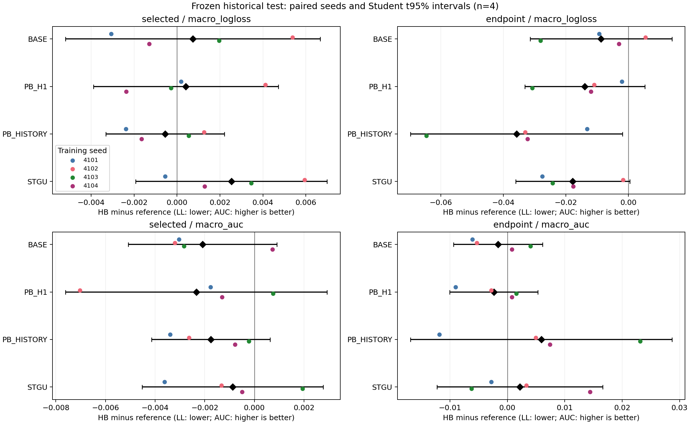
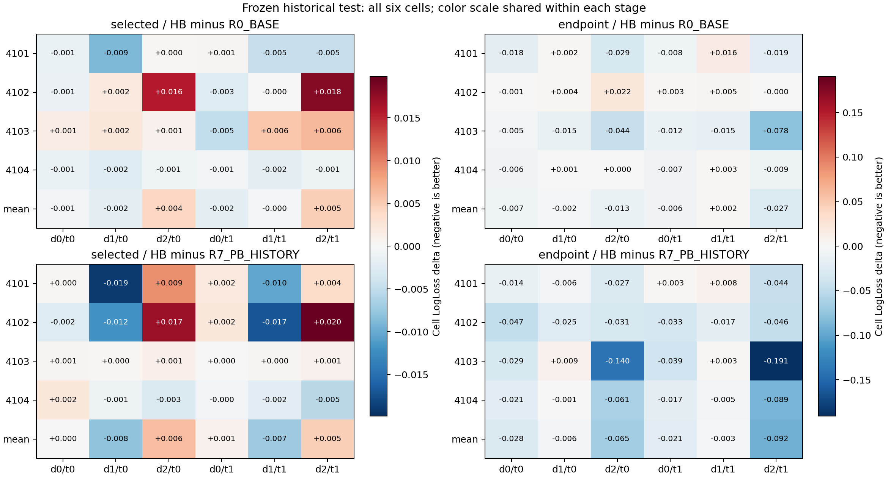

# 正式四 seed 预定比较摘要

候选始终为R6_PB_HB，差为候选减参照；LL负、AUC正有利。每行四个差按4101–4104排序。主评价是benchmark_test_exposed的selected macroLL；其余角色/终点/指标单独保留。df=3配对t95%区间刻画固定旧样本上的训练seed变化，不提供新增数据独立性。

## benchmark_test_exposed

| reference | view | metric | paired_deltas | mean_delta | sample_sd_delta | median_delta | favorable_direction_count | paired_t95_low | paired_t95_high |
| --- | --- | --- | --- | --- | --- | --- | --- | --- | --- |
| R0_BASE | selected | macro_auc | [-0.0030335540, -0.0031997670, -0.0028372408, +0.0007276363] | -0.0020857314 | +0.0018814221 | -0.0029353974 | 1 | -0.0050794938 | +0.0009080310 |
| R0_BASE | selected | macro_logloss | [-0.0030736574, +0.0053766385, +0.0019595193, -0.0012995023] | +0.0007407495 | +0.0037277873 | +0.0003300085 | 2 | -0.0051909919 | +0.0066724910 |
| R0_BASE | endpoint | macro_auc | [-0.0060803953, -0.0052951257, +0.0040470565, +0.0007945794] | -0.0016334713 | +0.0048767022 | -0.0022502731 | 2 | -0.0093933927 | +0.0061264502 |
| R0_BASE | endpoint | macro_logloss | [-0.0093242428, +0.0054831312, -0.0281310719, -0.0030449261] | -0.0087542774 | +0.0142721818 | -0.0061845844 | 3 | -0.0314645035 | +0.0139559488 |
| R5_PB_H1 | selected | macro_auc | [-0.0017700180, -0.0070257322, +0.0007484841, -0.0012959869] | -0.0023358132 | +0.0033120786 | -0.0015330025 | 1 | -0.0076060693 | +0.0029344428 |
| R5_PB_H1 | selected | macro_logloss | [+0.0001936237, +0.0041087679, -0.0002768758, -0.0023726692] | +0.0004132116 | +0.0027044844 | -0.0000416261 | 2 | -0.0038902265 | +0.0047166498 |
| R5_PB_H1 | endpoint | macro_auc | [-0.0089939455, -0.0027875174, +0.0015748716, +0.0008004175] | -0.0023515435 | +0.0048188232 | -0.0009935500 | 2 | -0.0100193665 | +0.0053162795 |
| R5_PB_H1 | endpoint | macro_logloss | [-0.0020757736, -0.0109742301, -0.0307717799, -0.0119529842] | -0.0139436920 | +0.0120666573 | -0.0114636072 | 4 | -0.0331444364 | +0.0052570525 |
| STGU_DOMAIN_ADAM | selected | macro_auc | [-0.0036171471, -0.0013213699, +0.0019432829, -0.0004931853] | -0.0008721049 | +0.0022954363 | -0.0009072776 | 1 | -0.0045246563 | +0.0027804466 |
| STGU_DOMAIN_ADAM | selected | macro_logloss | [-0.0005603139, +0.0059386801, +0.0034602436, +0.0012905170] | +0.0025322817 | +0.0028030216 | +0.0023753803 | 1 | -0.0019279512 | +0.0069925146 |
| STGU_DOMAIN_ADAM | endpoint | macro_auc | [-0.0027909666, +0.0033166474, -0.0062493824, +0.0144058276] | +0.0021705315 | +0.0090650881 | +0.0002628404 | 2 | -0.0122540466 | +0.0165951095 |
| STGU_DOMAIN_ADAM | endpoint | macro_logloss | [-0.0275228356, -0.0017500787, -0.0242557524, -0.0176544185] | -0.0177957713 | +0.0114576229 | -0.0209550855 | 4 | -0.0360274061 | +0.0004358635 |
| R7_PB_HISTORY | selected | macro_auc | [-0.0033878405, -0.0026272469, -0.0002194983, -0.0007760544] | -0.0017526600 | +0.0014992287 | -0.0017016506 | 0 | -0.0041382675 | +0.0006329475 |
| R7_PB_HISTORY | selected | macro_logloss | [-0.0023868597, +0.0012559341, +0.0005450012, -0.0016506220] | -0.0005591366 | +0.0017364248 | -0.0005528104 | 2 | -0.0033221760 | +0.0022039028 |
| R7_PB_HISTORY | endpoint | macro_auc | [-0.0118332964, +0.0049346025, +0.0231344678, +0.0074117880] | +0.0059118905 | +0.0143144870 | +0.0061731953 | 3 | -0.0168656526 | +0.0286894336 |
| R7_PB_HISTORY | endpoint | macro_logloss | [-0.0131804350, -0.0330702326, -0.0646260910, -0.0322559662] | -0.0357831812 | +0.0213119600 | -0.0326630994 | 4 | -0.0696952654 | -0.0018710971 |

## Q_legacy_confirm_exposed

| reference | view | metric | paired_deltas | mean_delta | sample_sd_delta | median_delta | favorable_direction_count | paired_t95_low | paired_t95_high |
| --- | --- | --- | --- | --- | --- | --- | --- | --- | --- |
| R0_BASE | selected | macro_auc | [-0.0033772335, +0.0032274126, -0.0018529790, +0.0012787181] | -0.0001810204 | +0.0029866077 | -0.0002871305 | 2 | -0.0049333797 | +0.0045713388 |
| R0_BASE | selected | macro_logloss | [+0.0024758809, +0.0031450661, +0.0010587259, +0.0005023856] | +0.0017955146 | +0.0012246398 | +0.0017673034 | 0 | -0.0001531606 | +0.0037441898 |
| R0_BASE | endpoint | macro_auc | [+0.0027117204, -0.0004525481, -0.0000743129, +0.0055393447] | +0.0019310510 | +0.0027888025 | +0.0013187037 | 2 | -0.0025065560 | +0.0063686581 |
| R0_BASE | endpoint | macro_logloss | [-0.0114818014, -0.0006350032, -0.0134246883, -0.0039540462] | -0.0073738848 | +0.0060716561 | -0.0077179238 | 4 | -0.0170352445 | +0.0022874749 |
| R5_PB_H1 | selected | macro_auc | [-0.0027386575, -0.0012467711, -0.0041351757, -0.0015069107] | -0.0024068787 | +0.0013232384 | -0.0021227841 | 0 | -0.0045124464 | -0.0003013111 |
| R5_PB_H1 | selected | macro_logloss | [+0.0036148593, +0.0062277857, +0.0023581028, +0.0009474802] | +0.0032870570 | +0.0022429084 | +0.0029864811 | 0 | -0.0002819108 | +0.0068560249 |
| R5_PB_H1 | endpoint | macro_auc | [+0.0009015557, +0.0001896811, +0.0007128091, +0.0077846297] | +0.0023971689 | +0.0036042412 | +0.0008071824 | 4 | -0.0033379831 | +0.0081323209 |
| R5_PB_H1 | endpoint | macro_logloss | [-0.0104527575, -0.0028798704, -0.0121392385, -0.0065733504] | -0.0080113042 | +0.0041392374 | -0.0085130539 | 4 | -0.0145977546 | -0.0014248537 |
| STGU_DOMAIN_ADAM | selected | macro_auc | [-0.0058714022, +0.0100331017, -0.0049245490, +0.0080296850] | +0.0018167089 | +0.0083797731 | +0.0015525680 | 2 | -0.0115173801 | +0.0151507979 |
| STGU_DOMAIN_ADAM | selected | macro_logloss | [+0.0024387941, +0.0028942096, -0.0041630763, -0.0058648483] | -0.0011737302 | +0.0044922617 | -0.0008621411 | 2 | -0.0083219210 | +0.0059744606 |
| STGU_DOMAIN_ADAM | endpoint | macro_auc | [+0.0052157694, +0.0108661256, +0.0007561826, +0.0080246681] | +0.0062156864 | +0.0043090995 | +0.0066202187 | 4 | -0.0006410525 | +0.0130724254 |
| STGU_DOMAIN_ADAM | endpoint | macro_logloss | [-0.0196400904, -0.0061805009, -0.0173036683, -0.0122559726] | -0.0138450580 | +0.0059669929 | -0.0147798205 | 4 | -0.0233398754 | -0.0043502407 |
| R7_PB_HISTORY | selected | macro_auc | [+0.0020556263, +0.0025988895, +0.0000146493, +0.0010133180] | +0.0014206207 | +0.0011451638 | +0.0015344721 | 4 | -0.0004015905 | +0.0032428319 |
| R7_PB_HISTORY | selected | macro_logloss | [+0.0012727298, +0.0018818945, +0.0003448010, +0.0004626988] | +0.0009905310 | +0.0007233577 | +0.0008677143 | 0 | -0.0001604925 | +0.0021415546 |
| R7_PB_HISTORY | endpoint | macro_auc | [+0.0034620165, +0.0054403549, +0.0102514769, +0.0073906729] | +0.0066361303 | +0.0028951075 | +0.0064155139 | 4 | +0.0020293681 | +0.0112428925 |
| R7_PB_HISTORY | endpoint | macro_logloss | [-0.0170032170, -0.0219033929, -0.0541689143, -0.0239265176] | -0.0292505104 | +0.0168646384 | -0.0229149552 | 4 | -0.0560859135 | -0.0024151073 |

## Q_explore

| reference | view | metric | paired_deltas | mean_delta | sample_sd_delta | median_delta | favorable_direction_count | paired_t95_low | paired_t95_high |
| --- | --- | --- | --- | --- | --- | --- | --- | --- | --- |
| R0_BASE | selected | macro_auc | [-0.0026034820, +0.0033440700, -0.0087801808, +0.0025802228] | -0.0013648425 | +0.0056053209 | -0.0000116296 | 2 | -0.0102841589 | +0.0075544739 |
| R0_BASE | selected | macro_logloss | [+0.0026241111, +0.0030103319, +0.0022582095, -0.0003226940] | +0.0018924896 | +0.0015083800 | +0.0024411603 | 1 | -0.0005076796 | +0.0042926588 |
| R0_BASE | endpoint | macro_auc | [+0.0055052330, -0.0048279682, -0.0024467788, -0.0003888699] | -0.0005395960 | +0.0044192819 | -0.0014178243 | 1 | -0.0075716597 | +0.0064924678 |
| R0_BASE | endpoint | macro_logloss | [-0.0121800711, +0.0009649149, -0.0164009848, -0.0018544823] | -0.0073676558 | +0.0082580706 | -0.0070172767 | 3 | -0.0205080890 | +0.0057727773 |
| R5_PB_H1 | selected | macro_auc | [-0.0030469860, +0.0049889347, -0.0135030083, +0.0010736398] | -0.0026218550 | +0.0079615961 | -0.0009866731 | 2 | -0.0152905310 | +0.0100468210 |
| R5_PB_H1 | selected | macro_logloss | [+0.0038507213, +0.0049776616, +0.0037017201, -0.0002947761] | +0.0030588317 | +0.0023071619 | +0.0037762207 | 1 | -0.0006123778 | +0.0067300412 |
| R5_PB_H1 | endpoint | macro_auc | [+0.0064176492, -0.0008107071, -0.0080996321, +0.0026461346] | +0.0000383611 | +0.0061763973 | +0.0009177138 | 2 | -0.0097896652 | +0.0098663875 |
| R5_PB_H1 | endpoint | macro_logloss | [-0.0133786826, -0.0039283418, -0.0091171418, -0.0047251645] | -0.0077873327 | +0.0043703650 | -0.0069211531 | 4 | -0.0147415586 | -0.0008331067 |
| STGU_DOMAIN_ADAM | selected | macro_auc | [-0.0084879003, +0.0088918668, -0.0124901043, +0.0007052960] | -0.0028452104 | +0.0095782567 | -0.0038913021 | 2 | -0.0180863542 | +0.0123959334 |
| STGU_DOMAIN_ADAM | selected | macro_logloss | [+0.0032255077, +0.0033323197, -0.0010593986, -0.0062822689] | -0.0001959600 | +0.0045440027 | +0.0010830546 | 2 | -0.0074264824 | +0.0070345623 |
| STGU_DOMAIN_ADAM | endpoint | macro_auc | [-0.0019359832, +0.0026314713, -0.0072635846, -0.0037940881] | -0.0025905462 | +0.0041224475 | -0.0028650357 | 1 | -0.0091502800 | +0.0039691877 |
| STGU_DOMAIN_ADAM | endpoint | macro_logloss | [-0.0170383973, -0.0001441690, -0.0087025094, -0.0101740469] | -0.0090147806 | +0.0069404031 | -0.0094382781 | 4 | -0.0200585108 | +0.0020289495 |
| R7_PB_HISTORY | selected | macro_auc | [-0.0041909797, +0.0032593610, -0.0006327174, +0.0018871846] | +0.0000807121 | +0.0032722818 | +0.0006272336 | 2 | -0.0051262184 | +0.0052876426 |
| R7_PB_HISTORY | selected | macro_logloss | [+0.0018979887, +0.0021615741, +0.0006807308, -0.0004277511] | +0.0010781356 | +0.0011932621 | +0.0012893597 | 1 | -0.0008206107 | +0.0029768819 |
| R7_PB_HISTORY | endpoint | macro_auc | [-0.0008009511, +0.0043181005, +0.0055770063, +0.0003564195] | +0.0023626438 | +0.0030653551 | +0.0023372600 | 3 | -0.0025150202 | +0.0072403078 |
| R7_PB_HISTORY | endpoint | macro_logloss | [-0.0103764259, -0.0221095305, -0.0514500558, -0.0246452078] | -0.0271453050 | +0.0173544012 | -0.0233773691 | 4 | -0.0547600301 | +0.0004694201 |

## 图

配对图中的彩点是seed，黑点及横线为均值与t区间；六格图按阶段各用一个对称色标，不能跨列只比较颜色深浅。数值均为实际差，不是标准化效应。

所有主指标、naturalLL、两个task-pooledAUC、最差cell及完整身份另见两个exposed索引和Q数值附录。
