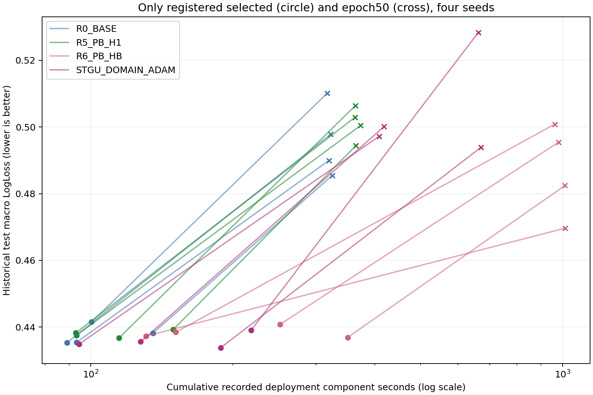

# 正式预定检查点的质量与累计已记录成本

只使用预定的validation-selected与epoch50既存检查点。横轴为审查通过的独立部署组件账中，截至该epoch的last检查点提交时间的自身已记录分量，加上其必要共享warmup分量。它保留真实重启费用，剥离已有明确标记的研究评分/推理/删除等分量，不按推测补时间。HISTORY的部分父状态前缀无法精确拆分，已知分量不等于完整成本；保留数值，图中不将其纳入完整成本曲线。历史test已暴露，选点仍只用validation。没有用额外epoch寻找有利效率点，没有训练等成本新模型。

| method | seed | view | epoch | macro LL | macro AUC | 累计已记录分量秒 | 完整组件重建可解 | CP SHA256 |
| --- | --- | --- | --- | --- | --- | --- | --- | --- |
| R6_PB_HB | 4101 | selected | 13 | 0.4384370481 | 0.6576595631 | 151.422145 | True | cdd423b42557a0956ddf9f554e6582c88bd8614a16b0b7f29647a1735afa29e1 |
| R6_PB_HB | 4101 | endpoint | 50 | 0.5008378254 | 0.6312968853 | 961.849862 | True | 3e74c5bf13f16e91c21909ec5ae7a7abdf8870831c583e3b4c599d7d5f0ae57d |
| R0_BASE | 4101 | selected | 15 | 0.4415107055 | 0.6606931171 | 100.413964 | True | 5b2fbf272b9b69d4b9aa774d222c4bc00ed56fffc66992c41195ff89e88659f8 |
| R0_BASE | 4101 | endpoint | 50 | 0.5101620681 | 0.6373772806 | 317.215018 | True | 19d8988b740fed3d1e081a76b9dedd0e20269cdccc856f4ee5ba6d607f93c9bd |
| R5_PB_H1 | 4101 | selected | 13 | 0.4382434244 | 0.6594295811 | 93.030734 | True | ca1853323f8fc7dfcf875df421081f01ac97723beee6843da2e710b5c5984aed |
| R5_PB_H1 | 4101 | endpoint | 50 | 0.5029135989 | 0.6402908308 | 363.089674 | True | f81e5be4ff3440fc64d2c65c1d246f6e37ed7385a5e8323c9896555b43c56353 |
| R7_PB_HISTORY | 4101 | selected | 12 | 0.4408239078 | 0.6610474036 | 34.185791 | False | 57afbcd2544649bc76eac13a1ba36e529d5c2a30efd888baea8b5637ed9558c5 |
| R7_PB_HISTORY | 4101 | endpoint | 50 | 0.5140182604 | 0.6431301817 | 921.455553 | False | 55ab77b1fa3282e980d30f8e898b949f300433ecb746c97bcc93ae305f322486 |
| STGU_DOMAIN_ADAM | 4101 | selected | 16 | 0.4389973620 | 0.6612767102 | 218.584604 | True | d8916b764f36de316940db0c39a1db2799651bdca2d31572f2a288a3cafe22cb |
| STGU_DOMAIN_ADAM | 4101 | endpoint | 50 | 0.5283606609 | 0.6340878519 | 662.673919 | True | 21e04d428cef06f7367bb4c10bd6afe0660f30aca3d727d73271644cc2230bf0 |
| R6_PB_HB | 4102 | selected | 18 | 0.4407986388 | 0.6636105615 | 251.917250 | True | 0c1acf1eb5be9edbc426a55d969a69d8757e2823cae5e3029446c0b427cd3f03 |
| R6_PB_HB | 4102 | endpoint | 50 | 0.4954538535 | 0.6495573137 | 980.272606 | True | 2dd17269164ab6ec1f56ef1ac8dbdd8c155675769faff923a6da767ff00a8fd6 |
| R0_BASE | 4102 | selected | 15 | 0.4354220003 | 0.6668103285 | 93.361881 | True | 3d3747904282da5956588fef17370bd3caf93f1dc8b2b80d624a3d74c5bdba32 |
| R0_BASE | 4102 | endpoint | 50 | 0.4899707223 | 0.6548524393 | 319.770532 | True | 0ce318747edf319023bb14bd1cb43dd87dd2844957affa5596652de14b9dbf6f |
| R5_PB_H1 | 4102 | selected | 17 | 0.4366898710 | 0.6706362937 | 114.733899 | True | 01dfe7cae0eaa0c39525dd17896d232339ffb3dc18353e771c9dfa0e5036fbdb |
| R5_PB_H1 | 4102 | endpoint | 50 | 0.5064280836 | 0.6523448311 | 363.711297 | True | ba0f810ec3c4d618d075caa5180911a4933ca6fc4dcd23c56f288cd68428740f |
| R7_PB_HISTORY | 4102 | selected | 12 | 0.4395427048 | 0.6662378084 | 34.564673 | False | 823756e4861559037a85e79457c7099f9274fadc32dfe310a8eb618de58d9f40 |
| R7_PB_HISTORY | 4102 | endpoint | 50 | 0.5285240862 | 0.6446227111 | 938.084316 | False | 6007d1625bbbd481c3c56274c046086017fe72a37fc98e9551293894ff9cc33a |
| STGU_DOMAIN_ADAM | 4102 | selected | 12 | 0.4348599587 | 0.6649319314 | 94.449345 | True | 80e268430d5c512e699dc02afca44f2d7f85be6b8fa8b8d461a04e09a26f19cf |
| STGU_DOMAIN_ADAM | 4102 | endpoint | 50 | 0.4972039322 | 0.6462406662 | 408.368716 | True | 7702848898c9deadc6230bee4d83dba9edba342a0ca9db14d9238d8b6d571384 |
| R6_PB_HB | 4103 | selected | 12 | 0.4372640981 | 0.6709918858 | 130.910742 | True | 740f196c6db7c9014b845c3d7d8672992b55a061222cbbc2fd780896eb7b2d90 |
| R6_PB_HB | 4103 | endpoint | 50 | 0.4696605819 | 0.6544453342 | 1012.742378 | True | e5cba85cb9382b5db37b2529faf1acf339492aca5ec38d620d8c34b956472297 |
| R0_BASE | 4103 | selected | 14 | 0.4353045788 | 0.6738291266 | 89.083117 | True | b62b7d3b8147c39fecba7011a486c3f93bd73a639bf94a0789d716bfc70b03a4 |
| R0_BASE | 4103 | endpoint | 50 | 0.4977916538 | 0.6503982777 | 322.161409 | True | b665730089a7bd3246cfb4c74ecb6a117fec62b54ec3763de80df8395a96bbc7 |
| R5_PB_H1 | 4103 | selected | 14 | 0.4375409740 | 0.6702434016 | 93.348411 | True | 0d1667a2b9b27c34a79244391451b958925dfead3c5847ed7a4b9741932e332c |
| R5_PB_H1 | 4103 | endpoint | 50 | 0.5004323618 | 0.6528704626 | 372.964608 | True | 74e3135697f1fa58010c0aacc50a0ad7a6cb974df7ee6f4e1ba5a1f6ce6ca593 |
| R7_PB_HISTORY | 4103 | selected | 12 | 0.4367190969 | 0.6712113841 | 33.991491 | False | ca253c1f00dfec437ccde6b456a6c1006ff2bbbe2cff460cf6b8bb42b686b121 |
| R7_PB_HISTORY | 4103 | endpoint | 50 | 0.5342866729 | 0.6313108664 | 963.970821 | False | 51ee7cf1fad20c7e71dbb4dc3b441abe7ab52d854bdd548513eb0e7d2bcdb129 |
| STGU_DOMAIN_ADAM | 4103 | selected | 15 | 0.4338038545 | 0.6690486029 | 188.615532 | True | 9cfdd392ca8ee9abbe7151c8a41a47662b3129209a3bf52ade68416d048f5da9 |
| STGU_DOMAIN_ADAM | 4103 | endpoint | 50 | 0.4939163343 | 0.6606947166 | 671.326258 | True | 6d1d1e023197c2e8ecc95e75a5b06196edf08f7bdf8947bf450dcc343c77d706 |
| R6_PB_HB | 4104 | selected | 21 | 0.4368914131 | 0.6658088598 | 350.350172 | True | be2ad0e412ac4d07284782c6868c5bf487ab05634e11374b602455994140a92b |
| R6_PB_HB | 4104 | endpoint | 50 | 0.4824282179 | 0.6507694104 | 1010.460623 | True | c2b91c6fa8477155f575ce5fae767e659cb18d39bf6f2527bedbe604b35d86fa |
| R0_BASE | 4104 | selected | 21 | 0.4381909154 | 0.6650812234 | 135.551198 | True | 49c613698af7b3d9bae49a6d74d44388672f90fc158273b5eef694588c500964 |
| R0_BASE | 4104 | endpoint | 50 | 0.4854731439 | 0.6499748310 | 324.841005 | True | 0b70dc90a5cb544f9837ba1625887431d3e5ee4e73b1a085cea5abc4013f09d0 |
| R5_PB_H1 | 4104 | selected | 21 | 0.4392640822 | 0.6671048467 | 149.578762 | True | c5d67554f6e2024ed86b51eb2cb9ece37b9340dbde2d5258affb5ed626c8a4a6 |
| R5_PB_H1 | 4104 | endpoint | 50 | 0.4943812021 | 0.6499689930 | 364.653020 | True | 25a92cf55000d8d7e48bca5cc1d36bd40f7c92f233ae48f6608c9af99d5d52c8 |
| R7_PB_HISTORY | 4104 | selected | 21 | 0.4385420350 | 0.6665849142 | 244.417860 | False | 4bba6d7791907a283ec6bb010cf92d9d293e05021142cba53cd2107e89229302 |
| R7_PB_HISTORY | 4104 | endpoint | 50 | 0.5146841841 | 0.6433576224 | 678.032410 | False | 59d4e01bfd6a20e4e01699892f04ffcf2d7a4a9b86387ce2e63cee302554ddbc |
| STGU_DOMAIN_ADAM | 4104 | selected | 15 | 0.4356008961 | 0.6663020451 | 127.648792 | True | 9a0568c5cf367d31fdeccf31e1f8683329f8792feb4967553d7f3d36236192b0 |
| STGU_DOMAIN_ADAM | 4104 | endpoint | 50 | 0.5000826364 | 0.6363635829 | 417.977563 | True | aa141e16fb6c201f2d088a422665a65650a642b3f370873fede1e66caf49549d |

各线连接同方法同seed的两个实际观测点，不是连续可用的效率前沿；未测中间质量不插值。未独占整机、共享负载和记录缺项仍限制跨方法计时解释，所有秒数均不可称GPU小时。
