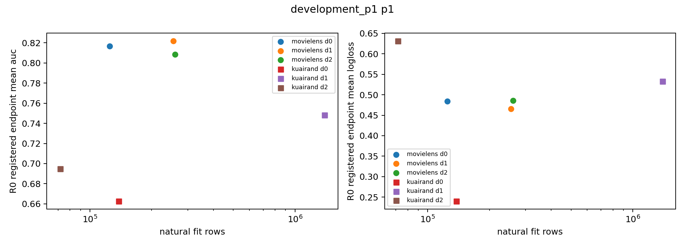

# LPS 形成与读取报告

## 开发主比较

L0–L5×两数据×seed3101/3102，共24条24epoch轨迹完成；L0另保留独立MONO和FEATURE评分。主selected为epoch≥12 validation macro AUC最大值，平局最早。以下为Q_explore的AUC候选减参照，正数有利；不以LL最佳别名替换AUC主选点。

| 数据 | 比较（候选−参照） | seed3101 | seed3102 | 均值 | SD | 配对 t95% CI |
|---|---|---:|---:|---:|---:|---|
| kuairand | L4_BLOCK_META-L2_BLOCK_UNIFORM | +0.00229584 | -0.00023837 | +0.00102874 | 0.00179196 | [-0.01507139, +0.01712886] |
| movielens | L4_BLOCK_META-L2_BLOCK_UNIFORM | +0.00001513 | +0.00199079 | +0.00100296 | 0.00139700 | [-0.01154863, +0.01355454] |
| kuairand | L4_BLOCK_META-L3_SCALAR_META | +0.00039076 | +0.00031174 | +0.00035125 | 0.00005588 | [-0.00015078, +0.00085328] |
| movielens | L4_BLOCK_META-L3_SCALAR_META | -0.00001279 | +0.00201979 | +0.00100350 | 0.00143725 | [-0.01190969, +0.01391668] |
| kuairand | L4_BLOCK_META-L0_FEATURE | +0.00910548 | +0.00561199 | +0.00735873 | 0.00247027 | [-0.01483573, +0.02955320] |
| movielens | L4_BLOCK_META-L0_FEATURE | -0.00069987 | -0.00018644 | -0.00044316 | 0.00036305 | [-0.00370501, +0.00281869] |
| kuairand | L4_BLOCK_META-L5_BLOCK_CONSTANT | +0.00241311 | -0.00003824 | +0.00118743 | 0.00173337 | [-0.01438627, +0.01676114] |
| movielens | L4_BLOCK_META-L5_BLOCK_CONSTANT | -0.00146676 | -0.00017774 | -0.00082225 | 0.00091147 | [-0.00901149, +0.00736698] |

L4对L2、L3分别满足全数据3/4方向、两数据均值正、至少一数据≥.0005的开发归因条件，因而CAL_PROB_CLIP、OWNER_META、GEOM各两数据3101，共6条P2必须完成。L4对FEATURE在ML两个seed均负，全数据正式门槛失败；KR的L4对L2有一个seed为负，单数据正式门槛也失败。不能借ML对L2的阳性补足KR复现、再仅用KR对FEATURE的阳性晋级。LPS50为NO_START；P2中的胜者不能替换L4来获取缺失开发seed。

## 普通读取与粒度参照

L2相对L0_OWN在KR selected的AUC两seed分别+.00307811/+.00185070（均值+.00246441），LL分别−.00092868/−.00070107（均值−.00081487）；共同24的AUC也两seed上升（均值+.00200701），但LL只有一个seed改善。ML selected方向异向，不能跨数据概括。这为当前KR普通连续foreign读取提供MEDIUM开发证据，且不需要L4的形成元步；不自动晋级L2为本轮正式主方法。

L2相对来源整体粗门L1，selected AUC均值ML+.00077901、KR+.00022078，但每数据都只有一个seed为正；共同24的AUC均值反为ML−.00004202、KR−.00016324，仍各一胜一负。LL在ML共同24两seed更低（均值−.00069106），KR共同24却两seed更高（+.00148869）。因此更细读取粒度没有稳定排序优势，证据WEAK，不能仅从块数增加宣称功能组织有效。L1回答来源整体读取，旧K1/K4×aux回答旧组织，两者不混为同一消融。

## AUC与LL的矛盾、阶段与条件读取

KR selected的L4−L3 AUC均值+.000351（两seed正），但LL均值+.001370（两seed坏）；共同epoch24 AUC约−.000449（两seed坏）。L4−L2 KR AUC均值+.001029（仅一seed正），LL+.000347（两seed坏）。任务0相对L2的AUC约+.002434、LL−.000453，任务1 AUC−.000377、LL+.001146，说明宏AUC增益包含任务取舍与校准恶化。不能宣布概率风险整体改善。

ML相对FEATURE AUC均值−.000443，LL+.001903，两seed同向较差。KR相对FEATURE AUC均值+.007359但LL平均仍+.000671且seed异向；额外局部特征修正的强弱依赖数据，未被统一优势压倒。

L4相对L5在ML的AUC约−.000822、LL+.001015，两seed均较差；KR AUC约+.001187但只有一seed正，LL+.000451两seed均坏。不同训练轨迹的L4/L5差不能独自归因为条件门；同bank常量删除/替换诊断另行保留selected及24，不能将常量门当成欠拟合的全新基线。门输出或phi梯度非零只证明执行。

同bank对照给出更窄的事实：ML的条件门对常量门，selected AUC两seed分别高.00015079/.00013018、LL低.00013663/.00021345；共同24 AUC也两seed较高（约.00018/.00012），但一个seed LL略坏。KR selected的条件门AUC一胜一负，LL两seed均较坏；共同24同样AUC异向而LL两seed均坏。因而ML有小幅固定状态条件排序机会（MEDIUM），KR未支持条件门同时改善排序与风险（WEAK）。这一局部ML机会与全轨迹L4输给L5并不矛盾：bank/形成和后续主训练会随轨迹改变，不能把同bank边际差当成长期收益。

把所有foreign读取关闭，在全部8个L4快照的AUC都下降约.000057–.000307，LL在7/8变坏，仅KR3101终点LL改善。它说明这些快照中foreign内容有小的实际排序贡献（MEDIUM）；不证明学习形成或样本门本身必要，也不抹去FEATURE、CAL、OWNER和GEOM的完整轨迹反证。完整六格、17种删除和预定无标签门值群组见APPENDIX_LPS_FIXED_STATE_DIAGNOSTICS。

## 域规模与难度

KR最小域2的L4−L3 selected AUC均值约−.000895、LL+.004757（两seed LL均坏），直接反驳LPS普遍帮助最小域的概括。域0、域1和两个任务的收益需结合基线、标签基率及阶段检查。规模与域身份未分离，不能推断规模因果；小域改善／大域下降标记是描述事实，不是普遍规律。全部六格和每任务原始数值见附录。

## 形成主张的当前证据

相对同预算scalar或uniform有开发AUC机会（MEDIUM），但LL和终点反例、跨seed异向、FEATURE与constant对照显著收缩主张。额外监督/元查询、读取容量和风险校准均是竞争解释。对“跨目标需求塑造来源内容”普适有效的证据WEAK。最有判别力的是已触发的概率等价读取、同owner元目标与无标签固定几何对照，而非继续加深模型或挑选最好P2变体。

## 六条条件实验

六条条件轨迹均完整24epoch；如下为匹配seed3101的差，AUC正/LL负有利于L4。n=1不能提供seed置信区间，不能把两个数据集当作重复seed。

| 数据 | 比较（L4−条件臂） | view | ΔAUC | ΔLL |
|---|---|---|---:|---:|
|movielens|LPS_CAL_PROB_CLIP|selected|+0.0000010387|+0.0000950204|
|movielens|LPS_CAL_PROB_CLIP|endpoint|+0.0001463923|+0.0016941772|
|movielens|LPS_OWNER_META|selected|+0.0000205846|-0.0000648551|
|movielens|LPS_OWNER_META|endpoint|+0.0000904953|+0.0027301006|
|movielens|LPS_GEOM|selected|-0.0014777447|-0.0000126258|
|movielens|LPS_GEOM|endpoint|+0.0005794543|+0.0007366888|
|kuairand|LPS_CAL_PROB_CLIP|selected|-0.0001048728|+0.0002795225|
|kuairand|LPS_CAL_PROB_CLIP|endpoint|+0.0001559431|+0.0026089381|
|kuairand|LPS_OWNER_META|selected|-0.0000875060|+0.0014688023|
|kuairand|LPS_OWNER_META|endpoint|+0.0003718828|+0.0020506513|
|kuairand|LPS_GEOM|selected|+0.0003857435|-0.0006695333|
|kuairand|LPS_GEOM|endpoint|+0.0003596549|+0.0022316423|

CAL的selected AUC在ML与L4仅差+.00000104、KR则高于L4约.00010487；CAL的selected LL两数据均低于L4，终点LL优势更大。这削弱“连续块读取不可被可达区间内的概率修正替代”的必要性主张；不证明两种训练动力学严格等价。实际clipped风险选择和最小L2约束已独立核验，原始head未clip评分没有替代实际部署评分。CAL仍保留同样的bank/形成过程，并用真实foreign残差决定可达区间；匹配L4只削弱独特块读门的必要性，不能据此声称完全去除foreign也等价。OWNER同样保留真实foreign读取，只改变形成外目标；GEOM的聚类不读标签，但整条主训练仍正常使用fit监督。

OWNER_META的selected AUC在ML与L4差约+.00002058、KR高于L4约.00008751，KR LL低.00146880；ML LL仅高约.00006486。相同72元步和查询预算下，同owner额外监督已经匹配当前排序结果，未支持跨目标外损失的独立必要性。终点两数据LL均比L4低。此结论为单seed机制反证，强度WEAK，不推广为任何数据上跨目标都无效。

GEOM没有phi、元步或P_form支持/查询，其固定中心只由fit特征决定。它在ML selected AUC高于L4约.00147774、LL近似；KR L4 selected AUC高.00038574且LL低.00066953。但终点两数据L4虽AUC稍高、LL均更差。固定无标签几何并未被学习形成统一压倒；成本和信息预算不同须如实比较，不把它伪装成72步元学习。

最有价值的反证已经完成，本版停止扩大形成矩阵。LPS50仍NO_START，STATE/C14/PAIR未触发；不通过追加第二个条件seed或把某一P2胜者改名为主方法来追逐阳性。

## 真实形成信号与有限杠杆

四条L4开发轨迹各完成72个元步，真实bank/Adam在虚拟阶段的前后摘要一致；每步超梯度均非零。这为实现确实执行提供STRONG证据，不等同于有效性。ML两seed的超梯度范数均值约1.17e-5/2.38e-5，KR约1.24e-5/8.70e-6。其形成梯度与uniform的平均余弦为.99707/.99571/.99557/.99946，当前虚拟一步相对uniform的查询utility均值约8.86e-8/5.17e-7/7.19e-7/2.36e-8。

末期源/任务块均值权重已偏离1，实际gate也有接近0/1的输出，因而不能说allocator完全没有学习或门始终OFF。但高梯度余弦和很小的一步查询风险差提示：当前优化器/状态下，形成重权的可用杠杆可能有限；该解释为WEAK，不能排除微小变化长期累积。查询utility、输出差异与Q排序/校准并非同一量，不能把它们当作性能证据。完整1152元步及3456逐source权重汇总另列附录，不公开原始支持/查询row_id数组。

## 重复的六格下降与共同终点

KR最小域2的task1（stored_long_view）在selected时，L4−L2的LL分别+.00225796/+.00305092；对scalar的共同24，域0/task0 AUC分别−.00222766/−.00197361。ML相对FEATURE的selected域2/task1，AUC分别−.00228272/−.00167110，LL+.00247974/+.00448420。它们是两seed同向的具体反例，不应被宏AUC提升抵销为“各任务均改善”。

相对FEATURE的共同24，ML六格中五格在两个seed都出现LL上升>.002；KR域2/task0 LL分别+.01351799/+.00587104，域0/task1也两seed上升>.002。LL恶化不专属于大域，最小域和中等域也会发生。该描述性重复证据MEDIUM，不能推断域规模是原因。全部提示标记、原始数值和最差cell定义保留，未因其不利而改选checkpoint。

## CAL边界裁剪与几何执行范围

完整Q缓存的CAL自身未clip头落在可达区间的比例，ML selected/24分别29.2442%/4.5728%，KR为6.4372%/9.3912%。其余落在上下界；ML selected上界饱和约57.60%，KR selected下界饱和约79.42%。最小L2 solver误差约1e-16，部署FP32修正误差在这些快照不超过5.55e-8。等价比例指CAL同状态自身未clip头，不指与独立L0_FEATURE预测一致。

因此不能把CAL分数匹配L4解释成“大多数样本上无约束FEATURE与读取完全等价”。更窄的结论是：大量受来源残差边界约束的概率修正仍匹配L4，可能存在边界收缩/校准这类竞争解释；source残差和形成过程仍保留，不能据此说foreign无用。系数为0的比例约一半不意味着前向跳过计算或已有稀疏加速。

GEOM两数据×三source各使用20000个fit特征，六个几何fit的熵目标均可达并达到.69314718，未出现不可达或KMeans警告；中心/tau固定而当前a随主模型变化，因此样本责任不一定永久固定。该事实支持对照确实执行，不证明聚类语义正确或算法普适有效。完整标量、hash及裁剪日志另列附录，原始行号/中心数组保留服务器。

## 冻结后的两个历史基准角色

以下保留开发两seed的完整训练和原AUC选点，不因为test方向改变晋级条件。每格是L4减参照的均值；逐seed、SD、n=2宽置信区间、六格与共同24另见exposed完整附录。

### benchmark_test_exposed / selected

| dataset | reference | metric | paired_deltas | mean_delta | favorable_direction_count |
| --- | --- | --- | --- | --- | --- |
| movielens | L2_BLOCK_UNIFORM | macro_auc | [+0.000018836, +0.000447169] | +0.000233002 | 2 |
| movielens | L2_BLOCK_UNIFORM | macro_logloss | [+0.000045890, +0.005380766] | +0.002713328 | 0 |
| kuairand | L2_BLOCK_UNIFORM | macro_auc | [-0.005907750, -0.004305701] | -0.005106725 | 0 |
| kuairand | L2_BLOCK_UNIFORM | macro_logloss | [+0.011524544, -0.002089823] | +0.004717360 | 1 |
| movielens | L3_SCALAR_META | macro_auc | [-0.000059635, +0.000469499] | +0.000204932 | 1 |
| movielens | L3_SCALAR_META | macro_logloss | [-0.000150584, +0.005347039] | +0.002598227 | 1 |
| kuairand | L3_SCALAR_META | macro_auc | [-0.000687998, +0.000054443] | -0.000316777 | 1 |
| kuairand | L3_SCALAR_META | macro_logloss | [+0.003939189, +0.002513149] | +0.003226169 | 0 |
| movielens | L0_FEATURE | macro_auc | [-0.001348481, -0.001985284] | -0.001666882 | 0 |
| movielens | L0_FEATURE | macro_logloss | [+0.005834085, +0.012024836] | +0.008929461 | 0 |
| kuairand | L0_FEATURE | macro_auc | [+0.000589073, +0.000321583] | +0.000455328 | 2 |
| kuairand | L0_FEATURE | macro_logloss | [+0.011630813, +0.001065204] | +0.006348008 | 0 |
| movielens | L5_BLOCK_CONSTANT | macro_auc | [+0.000215914, -0.000590860] | -0.000187473 | 1 |
| movielens | L5_BLOCK_CONSTANT | macro_logloss | [-0.006579397, +0.002642950] | -0.001968224 | 1 |
| kuairand | L5_BLOCK_CONSTANT | macro_auc | [-0.007061036, -0.000096333] | -0.003578684 | 0 |
| kuairand | L5_BLOCK_CONSTANT | macro_logloss | [+0.014177161, -0.000953121] | +0.006612020 | 1 |

### Q_legacy_confirm_exposed / selected

| dataset | reference | metric | paired_deltas | mean_delta | favorable_direction_count |
| --- | --- | --- | --- | --- | --- |
| movielens | L2_BLOCK_UNIFORM | macro_auc | [+0.000001763, +0.002584568] | +0.001293165 | 2 |
| movielens | L2_BLOCK_UNIFORM | macro_logloss | [-0.000021633, -0.001810306] | -0.000915970 | 2 |
| kuairand | L2_BLOCK_UNIFORM | macro_auc | [+0.001111830, -0.004814184] | -0.001851177 | 1 |
| kuairand | L2_BLOCK_UNIFORM | macro_logloss | [+0.000607099, +0.002563614] | +0.001585357 | 0 |
| movielens | L3_SCALAR_META | macro_auc | [-0.000025129, +0.002598110] | +0.001286491 | 1 |
| movielens | L3_SCALAR_META | macro_logloss | [-0.000004731, -0.001859562] | -0.000932147 | 2 |
| kuairand | L3_SCALAR_META | macro_auc | [+0.000444468, -0.001094544] | -0.000325038 | 1 |
| kuairand | L3_SCALAR_META | macro_logloss | [+0.001144104, +0.003368254] | +0.002256179 | 0 |
| movielens | L0_FEATURE | macro_auc | [-0.000882709, -0.000455836] | -0.000669273 | 0 |
| movielens | L0_FEATURE | macro_logloss | [+0.002108020, +0.002067987] | +0.002088003 | 0 |
| kuairand | L0_FEATURE | macro_auc | [+0.004192871, -0.000405936] | +0.001893468 | 1 |
| kuairand | L0_FEATURE | macro_logloss | [+0.001055643, +0.004558985] | +0.002807314 | 0 |
| movielens | L5_BLOCK_CONSTANT | macro_auc | [-0.001473628, -0.000103443] | -0.000788536 | 0 |
| movielens | L5_BLOCK_CONSTANT | macro_logloss | [+0.000912461, +0.000868274] | +0.000890367 | 0 |
| kuairand | L5_BLOCK_CONSTANT | macro_auc | [+0.001381561, -0.003321716] | -0.000970078 | 1 |
| kuairand | L5_BLOCK_CONSTANT | macro_logloss | [+0.000168855, +0.002496239] | +0.001332547 | 0 |

test上KR相对L2的selected AUC两个seed分别−.00590775/−.00430570（均值−.00510673），与Q开发均值+.00102874直接矛盾；相对scalar AUC均值−.00031678，LL两个seed都较坏。legacy对L2 AUC一胜一负、均值−.00185118，LL两个seed坏。形成主张没有跨角色稳定优势（MEDIUM反证，有限两seed范围），不能继续以Q的有利AUC均值作为完整有效性的代表。

ML相对FEATURE在test的selected AUC−.00166688、LL+.00892946，两个seed均坏；legacy AUC−.00066927、LL+.00208800，也两个seed均坏。共同24的test LL差进一步达+.02858346，两个seed均坏。没有foreign的额外特征预测修正是稳定强解释。KR虽在test相对FEATURE selected AUC两seed微增（均值+.00045533），LL两seed更差（+.00634801），而且相对L2排序已经下降，不能以FEATURE一个比较保住形成优势。

test selected的KR域0两个任务相对L2 AUC均在两个seed下降超过.001；域2/task1 AUC差−.00200681/−.00467503、LL+.00790325/+.00459211。ML相对FEATURE域0/task0 AUC−.00289461/−.00252611、LL+.01183479/+.01175283；损害同时出现在小域与其他域。KR相对FEATURE域2两个任务LL也均在两个seed增加>.008。这些重复cell代价不能被宏AUC抵销。

阶段反例同样保留：KR共同24对L2的test LL两个seed更低（均值−.00615510），对scalar AUC两个seed更高（+.00198027）；ML共同24对scalar AUC两个seed更低。部分终点收益不修复selected主张，也不支持简单的全程阴性或全程阳性。

六条P2保持n=1。在test selected，L4−CAL的AUC为ML+.00027764/KR+.00040024，但LL为+.00176604/+.00089711，CAL以较低LL匹配近似排序；OWNER的AUC差为−.00001755/−.00004216、LL也更低。GEOM在KR test selected同时更好（L4−GEOM AUC−.00300759、LL+.00604096），与Q/legacy该比较的有利L4方向相反；ML test L4的LL又明显低于GEOM，说明没有单一变体统治所有角色。

CAL的终点也存在明确矛盾：test上L4 LL两数据反而低于CAL（−.00546505/−.00317251），Q和legacy却均高于CAL。OWNER/GEOM终点同样随角色和指标改变。上述是描述性WEAK归因，足以反对形成机制普适必要的强主张，不能据此宣布CAL在任意条件都最优。仍不补开LPS50、不换主方法、不新增组合。

## 自然规模与观测基线

横轴只是自然fit数量，纵轴是已观测baseline；该图不识别规模因果，不把最低AUC与最高LL视为同一难度定义。
