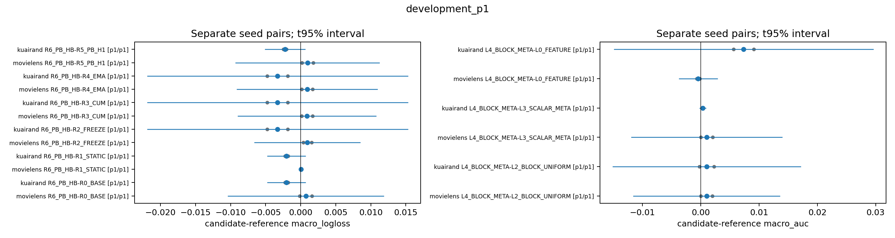
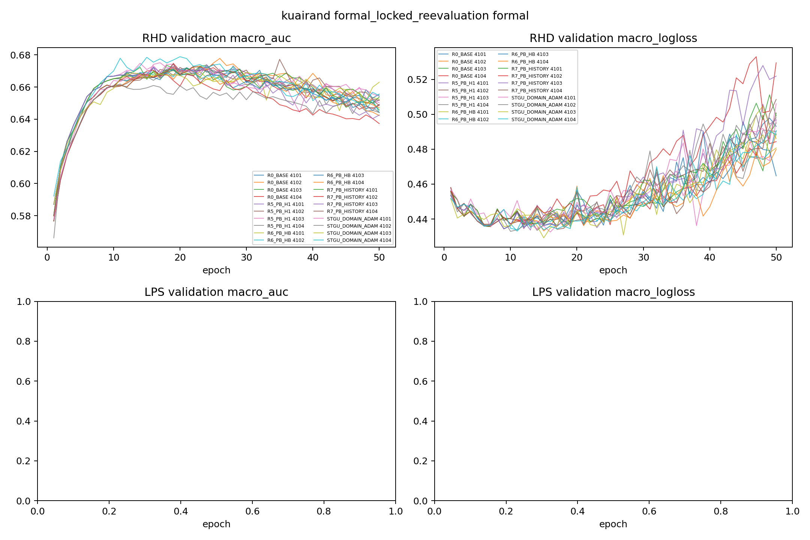

# RHD 完整闭环报告

## 开发包与主要结果

R0–R6×两数据×seed3101/3102，共28条24epoch逻辑轨迹完成。native warmup可以共享物理计算，每条独立部署成本仍补回其完整前缀。检查点只按epoch≥12的validation macro LL最小值、精确平局最早epoch选取。下表评价Q_explore；负差有利。这是开发性比较，不是未见测试确认。

| 数据 | 比较（候选−参照） | seed3101 | seed3102 | 均值 | SD | 配对 t95% CI |
|---|---|---:|---:|---:|---:|---|
| kuairand | R6_PB_HB-R0_BASE | -0.00224545 | -0.00182366 | -0.00203456 | 0.00029825 | [-0.00471424, +0.00064513] |
| movielens | R6_PB_HB-R0_BASE | +0.00160664 | -0.00013744 | +0.00073460 | 0.00123325 | [-0.01034569, +0.01181489] |
| kuairand | R6_PB_HB-R1_STATIC | -0.00224545 | -0.00182366 | -0.00203456 | 0.00029825 | [-0.00471424, +0.00064513] |
| movielens | R6_PB_HB-R1_STATIC | +0.00002070 | +0.00004934 | +0.00003502 | 0.00002025 | [-0.00014695, +0.00021699] |
| kuairand | R6_PB_HB-R2_FREEZE | -0.00184437 | -0.00476466 | -0.00330451 | 0.00206496 | [-0.02185742, +0.01524839] |
| movielens | R6_PB_HB-R2_FREEZE | +0.00154231 | +0.00036063 | +0.00095147 | 0.00083558 | [-0.00655589, +0.00845883] |
| kuairand | R6_PB_HB-R3_CUM | -0.00184437 | -0.00476466 | -0.00330451 | 0.00206496 | [-0.02185742, +0.01524839] |
| movielens | R6_PB_HB-R3_CUM | +0.00168540 | +0.00013770 | +0.00091155 | 0.00109439 | [-0.00892117, +0.01074426] |
| kuairand | R6_PB_HB-R4_EMA | -0.00184437 | -0.00476466 | -0.00330451 | 0.00206496 | [-0.02185742, +0.01524839] |
| movielens | R6_PB_HB-R4_EMA | +0.00170990 | +0.00013770 | +0.00092380 | 0.00111172 | [-0.00906457, +0.01091216] |
| kuairand | R6_PB_HB-R5_PB_H1 | -0.00202037 | -0.00246794 | -0.00224416 | 0.00031648 | [-0.00508759, +0.00059928] |
| movielens | R6_PB_HB-R5_PB_H1 | +0.00177604 | +0.00016508 | +0.00097056 | 0.00113912 | [-0.00926400, +0.01120513] |

KuaiRand的两个seed对全部R0–R5均下降，平均下降超过.0005，满足单数据预算晋级条件；MovieLens相对STATIC两个seed均微小变差，对简单历史及H1也均变差。全数据晋级不成立，只限定KR。门槛用于有限计算分配，n=2的置信区间很宽，不能把门槛通过称为统计确认。KR效应证据为MEDIUM，跨数据通用优势的证据为WEAK且存在直接反例。

## 训练阶段、AUC与控制事实

KR selected相对BASE的macro AUC均值提高.003901、LL下降.002035；共同epoch24的AUC差仅约+.000083、LL差约−.002247，各只有一个seed有利。ML selected相对BASE AUC约−.000686、LL约+.000735；相对STATIC LL约+.000035。ML共同24epoch相对STATIC LL均值约−.001345但只一seed有利。选点和共同终点回答不同问题，不能用终点有利均值替换主要selected比较。

R6在ML两seed分别接受7/28、9/28个控制事件，非STATIC主步56/224、72/224；KR为7/28、6/28，非STATIC主步140/560、120/560。H1接受更多事件却在KR selected LL更差，排除了“动作改变越多收益越大”的简单解释。改变动作、非零当前效用或通过P_cal均不等于最终泛化增益。

KR seed3101的FREEZE/CUM/EMA均全程采用Equal动作；seed3102的后两者后期变化，但其相同selected评分发生在分叉前。仅由评分相同不能推断全部训练状态相同。BASE与STATIC另有完整模型/Adam/梯度/RNG的配对身份检查；最佳简单法按validation两seed均值精确平局再比较独立部署成本，按冻结独立部署成本估计锁为R0_BASE。

## 域、任务与规模

KR selected相对BASE，域0/1/2的AUC均值分别约+.004244/+.001106/+.006353；LL约−.001381/−.001582/−.003141。域0的LL只一seed改善，域1/2两seed改善。ML三个域AUC平均均下降，LL域0/1恶化、域2混合下降，不能归结为“所有域同向”或普遍小域获益。

自然fit数量ML为124759/254879/260495，KR为138225/1395118/71561。规模没有被独立干预，域身份、标签基率和native难度混杂，规模作为主要原因的证据WEAK。KR中等规模域0基线AUC更难，最小域2并非最低AUC；ML两个规模近似的大域表现也不同。完整六格、每任务、最差cell与规模取舍标记见数值附录，不能用宏均值遮蔽损害。KR R6对BASE的最小域AUC两seed均改善，最大域只有seed3102下降；同一比较两域LL均改善，不支持稳定的“以大域换小域”通则。

BASE selected域级AUC：ML域0/1/2为.808845/.813740/.803745；KR为.660101/.744854/.688928。KR对应LL为.239119/.536091/.625183，排序最难的域0反而LL最低，表明标签基率影响LL尺度，不能只按绝对loss给域难度排队。

## 机制边界与竞争解释

P0同状态前缀机会不能替代本次闭环结论。可能解释包括短程探测到主序列的分布差异、选点/校准和后期过拟合、当前反馈相对历史的增量不足、候选集遗漏，以及域任务聚合冲突。Hblock相对H1还使用更多shadow更新、重复fit标签与计算，效用差不能与这项计算增量完全分离，成本不能按相同计算预算描述。STATE缺少直接可比的已观测Hblock遗漏证据，C14没有跨seed/阶段稳定重复的同域任务反向证据，均NO_TRIGGER，不把缺失动作效用填成0。

已完成PB_HISTORY及KR四新seed50epoch复评，结果见末节及锁定报告。固定ML反转锚点均为STATIC候选，两逻辑分支同一动作；其规定回放无法辨别反转，不改锚点寻找阳性。

## 条件实验与锁定复评

KR3101的PB_HISTORY完整24epoch已完成。它与R6共享一次完整C8初始化及10.0→10.5首主块，此后从揭示当前反馈前锁定动作，当前测量仅更新未来历史。两条轨迹分叉后各自测标签，不借用R6未来响应。

| 视图 | R6−HISTORY AUC | R6−HISTORY LL |
|---|---:|---:|
| validation selected | +.0027440638 | −.0037744044 |
| epoch24 | +.0005264247 | −.0110265243 |

R6 selected为epoch24、HISTORY为epoch12，需同时看各自合法选点与共同终点。selected的域0LL R6较坏+.002365、域1/2较好−.008753/−.004935；终点域1反而较坏+.001513，域2贡献较大−.031284。不能把宏收益当成每域改善，也不能以单seed归因宣称当前验收已确认有独立价值。该候选证据WEAK，足以让预定KR四seed包检验其可重复性，没有事后增设数值门槛。

两个固定ML锚点按规定各执行16个主batch回放，共32步。候选与STATIC同为动作5，初始完整状态/RNG、行序列与延续动作一致；1/8/16步的两逻辑风险差严格0。原P_cal未访问，未伪造cal对比，也未新增Q评分。此结果是DEGENERATE_IDENTICAL_ACTIONS，不能辨别效用反转；不改快照或选择非STATIC落败候选制造对比。

正式KR包固定R6、R0_BASE、R5、R7、fresh STGU×4101–4104，共20条50epoch，加4条共享native10warmup。具体锁定、四seed结果及暴露评价见FORMAL_LOCKED_REEVALUATION。

ML共同24相对BASE的最小域0/task1（rating>4）AUC在两个seed分别下降.00238193/.00215406，进一步说明终点宏LL均值与个别任务排序的方向可以不同。完整重复下降表见APPENDIX_REPEATED_CELL_DECLINES，不把task当独立重复。

## 全部正式结果与冻结后的开发角色复评

KR20条正式轨迹均完整50epoch。主要历史test selected LL：HB−BASE均值+.00074075，HB−H1+.00041321，HB−STGU+.00253228，均没有平均优势；对HISTORY−.00055914、仅2/4有利，AUC却4/4更低。legacy selected对BASE/H1/HISTORY的LL均4/4更高。开发两seed阳性不能视为已稳定迁移，主目标的独立增量证据WEAK。

共同50的HB−HISTORY test LL均值−.03578318、四seed均好；legacy/Q也均4/4好，支持MEDIUM的晚期相对风险减损。全部方法终点LL均高于自己的selected，故这是相对较小的后期恶化。对H1终点四seed好而selected无优势，跨度收益依赖阶段，并与更多shadow计算混杂。完整置信区间、域任务反例和四seed原值见[锁定复评](FORMAL_LOCKED_REEVALUATION.md)。

ML冻结后test selected的HB−STATIC LL为−.00009079/−.00024486，与Q开发两seed微小变差相反；HB−BASE为−.00464183/+.00132881，仍异向。共同24对BASE的test LL两个seed均较高（+.00226711/+.00443352）。legacy selected对H1两个seed均较差。评价角色与阶段改变方向，不能用冻结后的test重新晋级ML。

正式test selected域0相对BASE LL四seed较低而AUC四seed较低，是明确排序/校准取舍。最小域2 selected LL平均变差、终点对HISTORY却大幅改善，阶段和基线行为比单一规模故事更能覆盖当前证据；这仍是竞争解释，未做规模因果干预。

## 开发与正式验证轨迹图

上图仅Q_explore开发n=2，不与正式n=4合并。

曲线来自validation，主选点规则固定；图中的每个epoch不是独立重复。
