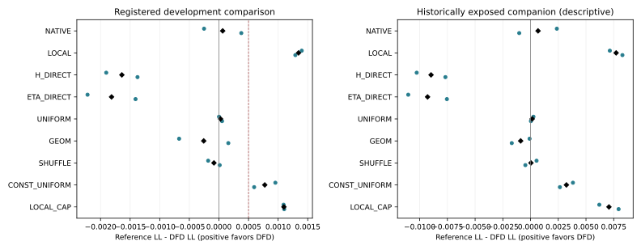

# 完整流水线：MovieLens P2 与冻结后角色比较

ML两开发seed的十个规定输出全部完成（20/20）。native来自本seed预定validation LL-selected状态，pilot固定12pass，五种形成库固定12pass；软reader为P_form20→P_read10，整组六头只由P_cal选OFF/pass0–10。H_DIRECT/ETA_DIRECT为完整强概率对照，CONST_UNIFORM通过固定simplex近优验收。没有因为先完成某个对照而取消剩余输出。

## 注册开发主表：Q_explore，所选预测器

| 输出 | 5101 LL | 5101 AUC | 5102 LL | 5102 AUC |
| --- | --- | --- | --- | --- |
| NATIVE | 0.475896634 | 0.808474173 | 0.475792612 | 0.808486555 |
| LOCAL | 0.477546761 | 0.808106932 | 0.476705834 | 0.808660140 |
| H_DIRECT | 0.474243947 | 0.808625214 | 0.474039006 | 0.808738090 |
| ETA_DIRECT | 0.473928205 | 0.808872806 | 0.474006026 | 0.808861047 |
| UNIFORM | 0.476149857 | 0.808808772 | 0.475467232 | 0.809116080 |
| GEOM | 0.475475301 | 0.809024876 | 0.475573317 | 0.809150887 |
| SHUFFLE | 0.475966032 | 0.808714876 | 0.475427564 | 0.809058974 |
| CONST_UNIFORM | 0.477101176 | 0.808531474 | 0.476009753 | 0.808803681 |
| LOCAL_CAP | 0.477240379 | 0.808336663 | 0.476517265 | 0.808692891 |
| DFD | 0.476147727 | 0.808703374 | 0.475414545 | 0.809128013 |

## 九项配对晋级，逐项公开

G=reference LL−DFD LL（正有利），ΔAUC=DFD−reference；最差格列严格先对同一cell跨seed平均再取max。

| reference | G5101 | G5102 | 平均G | 平均ΔAUC | max mean ΔLL cell | 全部条件 |
| --- | --- | --- | --- | --- | --- | --- |
| NATIVE | -0.000251093 | +0.000378068 | +0.000063487 | +0.000435330 | 0.002049331 | FAIL |
| LOCAL | +0.001399034 | +0.001291290 | +0.001345162 | +0.000532162 | 0.001147262 | PASS |
| H_DIRECT | -0.001903781 | -0.001375539 | -0.001639660 | +0.000234031 | 0.003768237 | FAIL |
| ETA_DIRECT | -0.002219522 | -0.001408519 | -0.001814021 | +0.000048769 | 0.003986548 | FAIL |
| UNIFORM | +0.000002130 | +0.000052687 | +0.000027408 | -0.000046737 | 0.000156541 | FAIL |
| GEOM | -0.000672426 | +0.000158772 | -0.000256827 | -0.000172182 | 0.000900456 | FAIL |
| SHUFFLE | -0.000181695 | +0.000013019 | -0.000084338 | +0.000028771 | 0.000435538 | FAIL |
| CONST_UNIFORM | +0.000953449 | +0.000595209 | +0.000774329 | +0.000248117 | 0.000771965 | PASS |
| LOCAL_CAP | +0.001092652 | +0.001102720 | +0.001097686 | +0.000400925 | 0.001356057 | PASS |

仅LOCAL、CONST_UNIFORM、LOCAL_CAP三项整体通过；其余六项失败，**P2 FAIL，P3/P4 NO_START**。全部AUC保护通过；H_DIRECT、ETA_DIRECT同时超过.003的逐格LL保护，最差cell均为domain0/task0。非退化条件为真，不能把负结果归为全OFF或责任恒定。

DFD对UNIFORM的G为+.000002130/+.000052687，均值+.000027408，远低于注册.0005资源尺度。对GEOM、SHUFFLE方向不稳定；对两直接概率头的LL两seed都更坏。DFD胜LOCAL/LOCAL_CAP时仍未稳定超越NATIVE；LOCAL自身在Q上的LL比NATIVE两seed更坏，胜过它部分是在弥补额外pilot阶段的退化。

## 冻结后的伴随角色

下面全为平均ΔLL=DFD−reference，负有利。test/legacy均为历史暴露数据，不重新触发训练，也不覆盖开发失败。

| reference | Q_explore | validation | test_exposed | legacy exposed |
| --- | --- | --- | --- | --- |
| NATIVE | -0.000063487 | +0.001637934 | -0.000674858 | -0.000504218 |
| H_DIRECT | +0.001639660 | +0.006306078 | +0.008976175 | +0.000705753 |
| ETA_DIRECT | +0.001814021 | +0.006516925 | +0.009290476 | +0.000961213 |
| UNIFORM | -0.000027408 | -0.000420667 | -0.000146290 | -0.000028207 |
| GEOM | +0.000256827 | +0.000335182 | +0.000891728 | +0.000297028 |
| SHUFFLE | +0.000084338 | +0.000034734 | -0.000035954 | +0.000045752 |
| LOCAL_CAP | -0.001097686 | -0.003631587 | -0.007071467 | -0.001262571 |

test_exposed中DFD对H_DIRECT的ΔLL为+.010269921/+.007682428，对ETA_DIRECT为+.011033980/+.007546972，且AUC相对两者也两seed下降。与UNIFORM的LL方向在四角色两seed均略好，但规模仍小，AUC在Q/legacy不一致；不能宣布等效，也不能据这些小收益翻转原晋级规则。GEOM的平均LL在四角色均低于DFD。SHUFFLE的配对LL跨seed/角色反向，特定样本需求对应关系没有稳定增量。

Q上DFD相对H_DIRECT的AUC两seed略高，test上却两seed更低；风险/排序与角色变化必须同时报告。两个直接概率对照不受五候选概率凸包约束，也实质使用同一目标标签；该竞争解释仍成立。ETA_DIRECT含source pilot特征，H_DIRECT只额外读完整h/native logits，native本身已有多域训练历史。

所有完整六格、domain/task、natural LL、pooled AUC和seed t95见[tables](tables/)。每seed/每角色/所选与固定read10状态均按原始用户1000次共同权重bootstrap，所有cell和macro重新计算；与正式4seed确认无关。fixed read10表的NATIVE/LOCAL/常量项保留固定定义，原生epoch24另见PREFIX表；不能把不同阶段终点当成共同训练时点。

## 机制信息边界

PF OOF分组、source责任/支持、全部raw预测及权重摘要存在。Q/outer冻结μ分组遗漏，见[缺项登记](PROCESS_REVISIONS.md)及审查附录，不能声称该机制分层已完成。它不改变本页注册门控或直接对照的原始结果。P3函数替换/U_BUDGET/POOL未触发，均未运行，不由删除某路径或参数距离补造功能证据。
