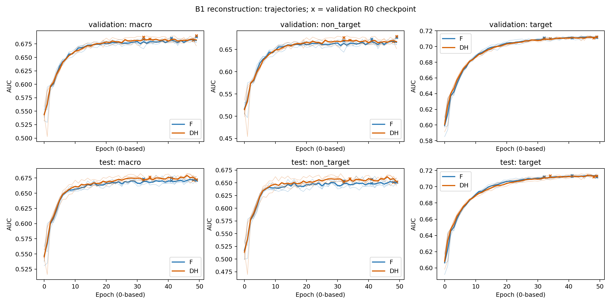
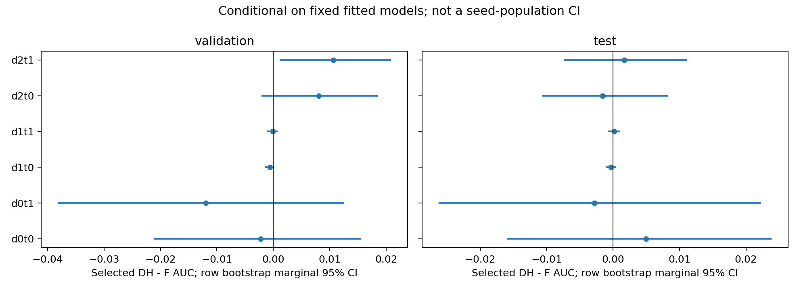
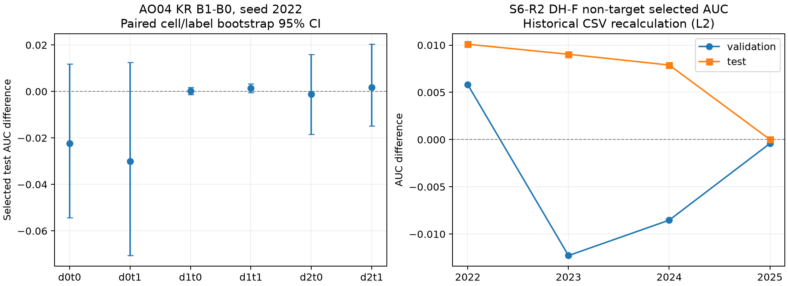

# 实验结果报告（2026-10-16最终分析）

新B1重建8/8完整运行及数值核验已完成；原历史结果保留身份，未混入新矩阵。完整逐seed/epoch/cell AUC与loss、bootstrap、校准和窗口表见[B1结果索引](B1_reconstruction_20261016/scientific_analysis.md)及[数值凭据](B1_reconstruction_20261016/analysis/analysis_receipt.json)。

## B1主要结果（DH−F）

| R0主规则 | validation均值±seed SD | test均值±seed SD | test正向seed |
|---|---:|---:|---:|
| macro AUC | +0.000637±0.004224 | +0.000363±0.003997 | 2/4 |
| non-target AUC | +0.001134±0.006140 | +0.000579±0.005486 | 2/4 |
| target AUC | −0.000356±0.001093 | −0.000069±0.001159 | 1/4 |
| macro logloss | −0.000581±0.005595 | +0.001053±0.002420 | 1/4改善 |
| target logloss | +0.003516±0.007319 | +0.004007±0.007150 | 1/4改善 |

R0选点F/DH依次为2022 32/32、2023 41/49、2024 41/48、2025 49/34。R0主结果没有稳定实用增益，未复现旧S6-R2 R0 test ΔN约+0.006757且4/4正的组合；历史初始化和lineage不同，不据此判旧结果错误。

R1/R4敏感度test macro/non-target AUC均值+0.007856/+0.011584，4/4正，但3/4非目标差达到+.003；target logloss均值+0.006006。R1/R4选中完全相同checkpoint，不是独立复制。R2/R3 test非目标均值+0.001086/+0.004030，分别2/4、3/4正。没有观察test后替换主要规则。

各域两任务、F绝对baseline、train loss、selected/common/final、双锚点timing、seed2024反例、最差cell和校准成本完整写入科学分析。六个R0 test cell的固定模型均值AUC边际bootstrap区间均含0；这不等于严格等效或所有seed区间均含0。时间依赖、用户聚类和seed总体不由该行bootstrap覆盖。

表格索引：[逐cell绝对均值](B1_reconstruction_20261016/interpretation/r0_cell_means.csv)、[逐seed选点比较](B1_reconstruction_20261016/interpretation/r0_selected_comparisons.csv)、[阶段seed统计](B1_reconstruction_20261016/interpretation/stage_summary.csv)、[所有规则与分解](B1_reconstruction_20261016/analysis/selected_timing_decomposition.csv)、[400个状态核验](B1_reconstruction_20261016/analysis/state_checks.csv)。完整optimizer/预测大工件本地留存，机器表/manifest可追溯。

## 原计划范围

C2.1固定θoracle8cases完成，结果在本文原有末节及其独立报告；未运行C2训练。B2/C1/D1/E1与历史原件缺口见[逐项条件判定](final_scope_decisions.md)。没有新方法，因此没有编造其baseline或消融结果。

## 历史产物与早期阶段复核记录

以下保留原报告；其“新增训练0”仅指当时历史审计阶段，不能用于描述上述已完成的新研究。历史L2/L3及缺失原始工件的限制维持原样。

# 实验结果：历史产物独立算术复核

> 续执行结果另增C2.1固定θ数值oracle，见本文末节。新增正式训练仍为0，C2.1不是预测性能复现。

本轮新增训练为0。下列数字来自可访问的历史工件，不能计为新的训练复制。证据等级：L2=从保存CSV重算；L3限定为保存预测与当前hash匹配原CSV、row IDs、labels、域映射验证后的指标重算；L4/L5未达到。统计分析为retrospective，不是未使用test上的确认。

## AO04 R2（不等于 S6-R2）

KuaiRand B0/2022、B0/2023、B1/2022 的7个checkpoint、6个cell共126行，逐cell AUC/LogLoss最大绝对残差分别为 2.22e-16 / 2.22e-16。原样本哈希与配置一致，保存test row IDs唯一且在界内，labels与原数据逐行一致。四份可用完整epoch CSV重新选点均匹配manifest：KR B0/2022=32、B0/2023=36、B1/2022=33；ML B0/2022=7。AO04源码28项config hash核验一致。全链执行复现仍未达到，不能把这些核验叫作整个矩阵已完成。

保存validation数组缺row IDs；其NPZ SHA匹配manifest，但不能把labels相等当成唯一行身份。因此validation配对差值保留L2，未提升为L3。MovieLens缺失五个完成run的原预测/manifest；可用aggregate CSV仍可算术复核。

| dataset | seed | split | contrast | delta_macro_auc | delta_macro_logloss |
| --- | --- | --- | --- | --- | --- |
| kuairand | 2022 | test | B1-B0 | -0.008385 | -0.000543 |
| kuairand | 2022 | validation | B1-B0 | 0.001494 | -0.005557 |
| movielens | 2022 | test | B1-B0 | -0.000076 | 0.001153 |
| movielens | 2022 | test | B1-B2 | 0.000004 | 0.000558 |
| movielens | 2022 | validation | B1-B0 | -0.000062 | 0.000623 |
| movielens | 2022 | validation | B1-B2 | -0.000009 | 0.000387 |
| movielens | 2023 | test | B1-B0 | 0.000107 | 0.000088 |
| movielens | 2023 | test | B1-B2 | -0.000029 | -0.000211 |
| movielens | 2023 | validation | B1-B0 | 0.000073 | -0.000421 |
| movielens | 2023 | validation | B1-B2 | -0.000005 | 0.000018 |

MovieLens两seed均值：B1−B0 validation macro ΔAUC=0.000005765；B1−B2=-0.000006842。只支持该设定无实用量级优势，不能证明B1普遍无效。

### KuaiRand单seed配对不确定性

selected B1−B0，seed2022；同一row的两臂配对，在每cell内分别按正/负标签重抽，固定analysis RNG=20261015、1000次，百分位95% marginal CI。此为固定训练seed的行抽样变异，不是训练seed置信区间。未做familywise校正；时间相关样本不满足独立同分布时，这些CI不能代表全部时间泛化不确定性。没有把不同任务独立bootstrap结果拼成macro CI。

| domain | task | n | n_pos | delta_auc | ci95_low | ci95_high |
| --- | --- | --- | --- | --- | --- | --- |
| 0 | 0 | 2613 | 228 | -0.022434 | -0.054358 | 0.011814 |
| 0 | 1 | 2613 | 120 | -0.030011 | -0.070624 | 0.012511 |
| 1 | 0 | 246284 | 51847 | 0.000234 | -0.001240 | 0.001683 |
| 1 | 1 | 246284 | 27415 | 0.001420 | -0.000424 | 0.003273 |
| 2 | 0 | 1870 | 1100 | -0.001211 | -0.018430 | 0.015860 |
| 2 | 1 | 1870 | 827 | 0.001690 | -0.014863 | 0.020334 |

六个cell的区间均覆盖0；这表示数据不足以在该检验下区分零，不能判为两臂等价，也不能消除已观测的点估计下降。d0两任务仅228/120正例，宏观不确定性不能只用训练seed方差替代。原epsilon=1e-12，另有1e-7诊断列，未混合定义。

每run selected/final/common的macro、eval-row-weighted（按当前evaluation样本频率加权cell AUC，不等于pooled AUC）、worst-cell、worst-domain、分任务/分域AUC和LL见 `ao04_test_aggregates_recalc.csv`；逐cell见 `ao04_test_metric_recalc.csv`。历史aggregate中的W不自动视为当前evaluation频率权重。

## S6-R2 F/DH selected（L2）

Δ=DH−F；M=six-cell macro，T=target两任务均值，N=其余四cell均值。KuaiRand target=d1，MovieLens target=d2，不能交换物理域身份。四个seed均为2022–2025。

| dataset | split | metric | count | mean | std | positive_seeds | min | max |
| --- | --- | --- | --- | --- | --- | --- | --- | --- |
| kuairand | test | M | 4 | 0.004366 | 0.002890 | 4 | 0.000517 | 0.007507 |
| kuairand | test | N | 4 | 0.006757 | 0.004586 | 4 | 0.000011 | 0.010095 |
| kuairand | test | T | 4 | -0.000416 | 0.003134 | 2 | -0.004650 | 0.002330 |
| kuairand | validation | M | 4 | -0.002683 | 0.006384 | 2 | -0.009723 | 0.004484 |
| kuairand | validation | N | 4 | -0.003851 | 0.008127 | 1 | -0.012277 | 0.005815 |
| kuairand | validation | T | 4 | -0.000346 | 0.003202 | 2 | -0.004614 | 0.002382 |
| movielens | test | M | 4 | 0.000022 | 0.002928 | 2 | -0.003725 | 0.002606 |
| movielens | test | N | 4 | -0.000002 | 0.003132 | 2 | -0.003883 | 0.002903 |
| movielens | test | T | 4 | 0.000069 | 0.002551 | 2 | -0.003408 | 0.002014 |
| movielens | validation | M | 4 | -0.001558 | 0.001599 | 0 | -0.003883 | -0.000416 |
| movielens | validation | N | 4 | -0.002336 | 0.002063 | 0 | -0.005302 | -0.000901 |
| movielens | validation | T | 4 | -0.000003 | 0.000753 | 2 | -0.001046 | 0.000680 |

KuaiRand test N均值正且4/4同向，但seed2025约+0.000011，4/4同向不等于4/4达到+0.003。validation N仅1/4正，均值负。MovieLens test M/N近0且符号混合，构成外推限制。当前支持“保存CSV内存在反转”，不支持“反转机制已证明”。

所有domain×task、per-seed、选中epoch与R0–R4差值在 `s6r2_paired_recomputed.csv`，汇总在 `s6r2_summary.csv`。R0为原selected端点；其他规则只有test_available=1时才计算，缺值不补齐。A-grid替代选点test结果仍为grid sensitivity；不能以同方向升级为exact-selected robustness。S6原NPZ/checkpoint/manifest缺失，无法对这批F/DH做原预测复算、paired row bootstrap、分数校准或精确同epoch/timing分解。AO04的bootstrap不替代S6-R2的bootstrap。

## S5 Equal四臂（L2）

selected ΔAUC，每cell4seeds；模型M3OE、KuaiRand natural，d1为target。下表从保存paired CSV重算，不仅抄写原报告。

| contrast | domain | task | count | mean | std | min | max |
| --- | --- | --- | --- | --- | --- | --- | --- |
| DH-F | 0 | 0 | 4 | 0.007671 | 0.010890 | -0.004754 | 0.016972 |
| DH-F | 0 | 1 | 4 | 0.011365 | 0.012851 | -0.003670 | 0.027711 |
| DH-F | 1 | 0 | 4 | 0.000875 | 0.004001 | -0.004236 | 0.005383 |
| DH-F | 1 | 1 | 4 | 0.000821 | 0.003168 | -0.003046 | 0.004406 |
| DH-F | 2 | 0 | 4 | 0.002883 | 0.004946 | -0.000792 | 0.009960 |
| DH-F | 2 | 1 | 4 | 0.001695 | 0.007534 | -0.009148 | 0.008300 |
| HT-F | 0 | 0 | 4 | -0.006705 | 0.024793 | -0.038157 | 0.014199 |
| HT-F | 0 | 1 | 4 | -0.006369 | 0.020277 | -0.029620 | 0.017733 |
| HT-F | 1 | 0 | 4 | 0.041085 | 0.003266 | 0.037818 | 0.045515 |
| HT-F | 1 | 1 | 4 | 0.040528 | 0.003733 | 0.035859 | 0.044888 |
| HT-F | 2 | 0 | 4 | 0.014991 | 0.005863 | 0.007542 | 0.021780 |
| HT-F | 2 | 1 | 4 | 0.019234 | 0.004140 | 0.015227 | 0.024011 |
| T-F | 0 | 0 | 4 | -0.027338 | 0.015821 | -0.041454 | -0.004967 |
| T-F | 0 | 1 | 4 | -0.037392 | 0.009558 | -0.050732 | -0.028898 |
| T-F | 1 | 0 | 4 | 0.041426 | 0.003309 | 0.037878 | 0.045238 |
| T-F | 1 | 1 | 4 | 0.042254 | 0.003635 | 0.038497 | 0.046197 |
| T-F | 2 | 0 | 4 | -0.004570 | 0.017842 | -0.029574 | 0.009329 |
| T-F | 2 | 1 | 4 | -0.000168 | 0.009106 | -0.012313 | 0.008266 |

LL同步见 `s5_recomputed_delta_logloss.csv`；完整selected/final/common contrasts见 `s5_recomputed_delta_auc.csv`，四臂绝对AUC/LL及validation指标见 `s5_absolute_recomputed.csv`。原始CSV来源均在inventory可追踪；没有完整optimizer原状态，暂不将此L2重算升级为状态机制复现。

## 图表和数据

图左为AO04单seed selected test配对区间，图右为S6-R2四seed selected非目标反转；两图不是同一个实验。PDF版 `forensic_evidence.pdf`。原数据类别计数、split rowhash、特征schema分别见 `split_cell_counts.csv` 和 `dataset_preflight_*.json`。

## C2.1 固定参数目标估计器检查（新数值运行，0 training）

两数据集×4seeds完成8/8cases。完整结果与科学解释见 [C2数值分析](C2_numeric_oracle_20261016/numeric_analysis.md)，96行估计器统计、288行分区统计、16行全坐标目标检查分别在该目录的 `estimator_moments.csv`、`partition_moments.csv`、`target_checks.csv`。44份原始产物已校验。

相同α的精确期望梯度最大相对残差1.865e-16，实际整批autograd交叉检查残差2.685e-7，MC loss/坐标梯度最大标准化残差2.894/3.026 SE，Adam一步公式与torch实测最大绝对残差1.113e-16。当前C分区Balanced/Natural方差trace比值四seed均值：KR Equal 0.214720、Sample 2.497026；ML Equal 0.133501、Sample 2.334679。这里只比较同目标内q变化。

AUC与训练后selected loss本轮未测，不记为0。模型仅在初始化，pool每域16个不同row，B16/128；C2训练仍未触发。图表见 `C2_numeric_oracle_20261016/analysis/fixed_theta_covariance_ratios.pdf`。这些结果不替代B1正式0/8待运行的矩阵。
