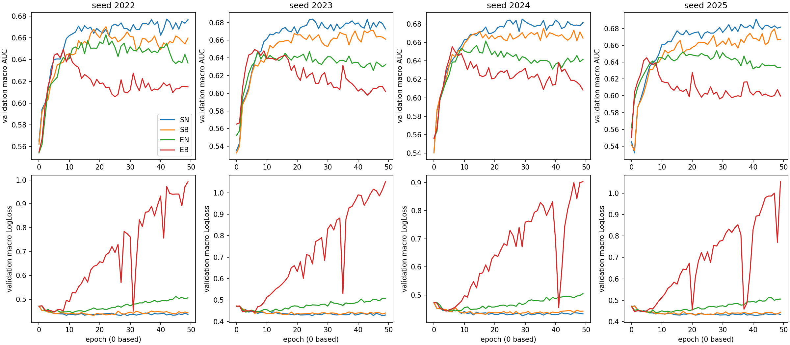

# Stage2D 实验结果

16个新正式run完成并通过逐行数值核验。主比较均未获得实用收益：**SB−SN validation-selected macro AUC = −0.010406，四seed全部负向；EB−EN = −0.006547，仅1/4正向。** 这否定本设置下“直接Balanced+importance即可改善强Sample基线”的候选收益，不否定同目标不同q能够产生性能差异。

全部数值来自 `analysis/` 和各 `runs/` 原始产物。SD为四个配对训练seed的样本标准差，不是标准误、CI或p-value。主终点是validation选中的six-cell macro AUC；test均为已开发数据的forensic读数。

## 主比较与绝对基线

| seed | validation SB−SN | validation EB−EN | test SB−SN | test EB−EN |
|---|---:|---:|---:|---:|
| 2022 | −0.007053 | −0.013295 | −0.020813 | −0.000197 |
| 2023 | −0.012883 | +0.001598 | −0.003047 | −0.012641 |
| 2024 | −0.009933 | −0.006173 | −0.016815 | +0.000478 |
| 2025 | −0.011757 | −0.008316 | −0.010019 | +0.001504 |
| mean ± SD | −0.010406 ± 0.002545 | −0.006547 ± 0.006196 | −0.012674 ± 0.007813 | −0.002714 ± 0.006655 |

| split / arm | macro AUC mean ± SD | macro LogLoss mean ± SD |
|---|---:|---:|
| validation SN | 0.684353 ± 0.005732 | 0.429635 ± 0.003433 |
| validation SB | 0.673947 ± 0.004261 | 0.436380 ± 0.001554 |
| validation EN | 0.656377 ± 0.006973 | 0.455700 ± 0.009348 |
| validation EB | 0.649831 ± 0.004124 | 0.449397 ± 0.004029 |
| test SN | 0.670085 ± 0.002018 | 0.436336 ± 0.002407 |
| test SB | 0.657411 ± 0.006359 | 0.444837 ± 0.003118 |
| test EN | 0.639657 ± 0.004550 | 0.463799 ± 0.015219 |
| test EB | 0.636943 ± 0.004497 | 0.456476 ± 0.001981 |

SN是本次固定IID协议的Sample/标准Adam强对照，不声称等于旧shuffle基线。Equal−Sample改变alpha，只作secondary interaction。validation-selected q效应的Equal−Sample difference-of-differences约+0.003860；final epoch变为−0.014879，说明interaction读数依赖训练阶段和selection functional，不是固定方向的通用结论。

## 域、任务、cell和损失

下表为四seed的selected平均差；正AUC/负LogLoss有利。

| split / contrast | ΔAUC d0 | ΔAUC d1 | ΔAUC d2 | ΔLL d0 | ΔLL d1 | ΔLL d2 |
|---|---:|---:|---:|---:|---:|---:|
| validation SB−SN | −0.012457 | −0.009193 | −0.009569 | +0.002312 | +0.007699 | +0.010224 |
| test SB−SN | −0.017826 | −0.008134 | −0.012062 | +0.005181 | +0.007210 | +0.013112 |
| validation EB−EN | −0.021827 | −0.006779 | +0.008967 | +0.000618 | +0.006709 | −0.026236 |
| test EB−EN | −0.009270 | −0.006110 | +0.007237 | −0.000946 | +0.006570 | −0.027592 |

| split / contrast | ΔAUC click | ΔAUC long_view | Δmacro LogLoss |
|---|---:|---:|---:|
| validation SB−SN | −0.008070 | −0.012743 | +0.006745 |
| test SB−SN | −0.012111 | −0.013236 | +0.008501 |
| validation EB−EN | −0.004815 | −0.008278 | −0.006303 |
| test EB−EN | −0.004065 | −0.001364 | −0.007323 |

Sample下六个cell的平均AUC差在两个split均为负，但并非每seed、每cell都负：例如2022 validation d2域平均+0.002903，2025 test d0约+0.001287。Equal下d2的平均AUC/LL改善与d0/d1损伤并存；d2 validation域平均3/4正，d0四seed均负。不能把某一域收益扩展为全部小域收益。

完整逐cell AUC/LL、n/n_pos、四seed独立数据见 [selected_cell_metrics.csv](analysis/selected_cell_metrics.csv)、[selected_paired_differences.csv](analysis/selected_paired_differences.csv)、[seed_summary.csv](analysis/seed_summary.csv)。其中所有 `positive_seeds` 只是数值正号；对LogLoss，正号是损伤，不能当作“改善seed数”。

SN绝对域AUC均值：validation d0/d1/d2=0.675985/0.706922/0.670152，test=0.640732/0.708123/0.661399；其validation click/long_view=0.673179/0.695527。最低域的排序跨split改变，不能凭样本量定义困难度。selected worst-cell AUC均值：validation SN/SB/EN/EB=0.653802/0.645307/0.637501/0.636692；test=0.632390/0.615876/0.616705/0.611953。

训练p权重的cell-AUC加权差：validation SB−SN=−0.009491、EB−EN=−0.007373；test=−0.009144/−0.005787。按实际split域频率加权：validation=−0.009231/−0.006825，test=−0.008264/−0.006044。这些是**cell AUC加权平均，不是跨域pooled AUC**；不能和pooled排序问题混同。

## 预注册阈值与guards

两contrast均为0/4 seed达到+.003，均值也未达实用+.003或strong+.005。SB−SN的最差cell均值−0.015483、单seed最差cell−0.030320、最大cell平均LL损伤+0.012809：三项nonharm guards全部不通过。EB−EN相应为−0.025597、−0.037334、+0.007823：两个AUC guards不通过，LL guard通过。详见 [frozen_threshold_readout.json](analysis/frozen_threshold_readout.json)。这些是探索阈值，不是显著性或部署判据。

## 轨迹、相同epoch与selection

| epoch (0-based) | validation SB−SN | validation EB−EN | test SB−SN | test EB−EN |
|---|---:|---:|---:|---:|
| 9 | −0.013238 | −0.006043 | −0.003462 | −0.012016 |
| 19 | −0.008214 | −0.028856 | −0.005328 | −0.029479 |
| 29 | −0.014417 | −0.028630 | −0.012340 | −0.038916 |
| 39 | −0.011853 | −0.029165 | −0.002445 | −0.039390 |
| 49 / final | −0.014939 | −0.029818 | −0.007814 | −0.040257 |

上表是四seed均值，不表示每个seed每个epoch都同向。EB的选中点均在epoch5–8；final validation macro LL均值0.999968、d2 LL达2.219800，而EN为0.506300/0.834347。EB的后期损伤没有被只报selected结果隐藏。selected时EB−EN LL改善，final/common时明显恶化，是训练阶段和指标不同的真实反例，不把低LL自动写成高AUC。

以baseline自己的validation selected epoch作锚，恒等式 `selected delta = same-epoch delta + candidate timing contribution` 对8组比较均核验。SB−SN平均为−0.010406=−0.021476+0.011069；EB−EN为−0.006547=−0.033823+0.027277。候选独立选点减轻损伤，不能据此断言选点是负效应的唯一原因。2023 EB−EN的selected小正值+0.001598，在baseline选点同epoch是−0.000431，timing项+0.002030。

Common五点val-test macro AUC的Spearman跨run为0.0–1.0，只有5点，且共同学习趋势混入；见 [common_epoch_val_test_ranking.csv](analysis/common_epoch_val_test_ranking.csv)。未利用test选择共同点或最佳规则。

## 曝光与状态描述

首epoch Natural平均unique main rows=1,268,006.75，Balanced=813,510.25；相同main曝光数下不同q的unique支持和重复率不同。Balanced首epoch平均覆盖d0/d1/d2约169154.5/554955.75/89400行，Natural约109336.25/1102157.75/56512.75行。按q推算每可用row每epoch平均曝光：Natural三域均1，Balanced约3.87/0.383/7.48。到epoch49，两种q都覆盖全部2,006,132行，但频率和历史已不同；不能将重复行称为新增独立数据。

Epoch49 theta/m/v的同目标跨轨迹向量差非零：Sample的C theta相对baseline差范数1.320–1.369、cosine0.099–0.129；Equal为1.458–1.523、cosine0.063–0.070。A_arch theta相对差较小但m/v并不相同。分区维数和状态幅度差异很大，不能由范数比推断C/A充分性或m/v因果。完整数据见 [common_state_vector_differences.csv](analysis/common_state_vector_differences.csv) 和 [optimizer_observations.csv](analysis/optimizer_observations.csv)。这些比较的theta不同，不是同theta causal probe。

末epoch在线训练objective均值SN/SB约0.4864/0.4946、EN/EB约0.4031/0.2705。它们是训练过程中不同theta的采样平均，不是选中模型的full-train loss；不同alpha之间也不能直接比较“谁更优”。EB低在线objective与高后期validation LL相容于重复曝光/过拟合/shift等解释，但不能以此计算精确generalization gap。

## 条件row bootstrap

1000次逐cell、按标签分层、same-row配对；相同row权重用于全部四seed模型，估计**给定四个已训练模型平均cell效应**的不确定性。不是把4N当独立样本，不包含训练seed总体、选择规则、user/time聚类和多重比较不确定性；validation区间不是经过selection校正的CI。任务分别分层，不编造macro CI。原始draws与48行结果见 [selected_row_bootstrap.csv](analysis/selected_row_bootstrap.csv)、[bootstrap_receipt.json](analysis/bootstrap_receipt.json)。

- d1两个任务的AUC条件区间，在两contrast、两split中均完全负向；例如SB−SN test click [−0.009332,−0.007550]、long_view [−0.008983,−0.006835]。
- d0 long_view只有validation101/test120个正例。SB−SN AUC区间分别约[−0.042621,+0.008913]/[−0.050387,+0.006734]，不能把其宏点估计当精确的单cell定论。
- Equal的d2 AUC改善在两任务、两split的条件区间都跨0，例如test long_view [−0.000536,+0.020037]；但对应LL改善区间不含0。该trade-off对排序收益的证据弱于对给定模型校准/损失差的证据。

Test区间只是历史forensic，不升级为新方法独立确认。

## 可复查入口

[全部聚合指标](analysis/aggregate_metrics.csv)、[same-epoch配对](analysis/common_epoch_paired_differences.csv)、[选点时序分解](analysis/validation_timing_decomposition.csv)、[objective×sampling interaction](analysis/objective_sampling_interaction.csv)、[曝光与训练loss](analysis/exposure_and_loss.csv)、[32份预测重算及400hash核验](analysis/receipt.json)、[统一run schema](analysis/unified_selected_run_schema.csv)。科学证据强度、竞争解释及后续门见 [机制分析](mechanism_analysis.md)。
