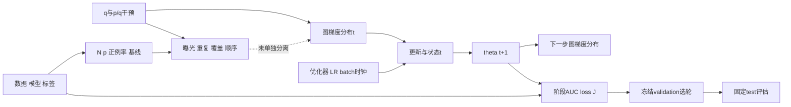

# 2026-10-16 v3 实验终局报告

## 1. Executive conclusion

本轮最终知道的是：在同一Sample经验目标及既有stop-gradient图导数字段下，改变q会改变有限batch估计器与训练路径；性能影响依赖模型配置、优化器/LR、域任务、训练阶段、预算及selection规则。不存在当前证据支持的统一“小域=困难域”、稳定课程收益或唯一必要中介。全部规定实验和触发分支已按实际结果闭合；方法化决定为 **NO_GO**。

- **core phenomenon，MEDIUM**：固定参考SGD.1与Adam.01的共同早期诊断AUC四seed负，校准后存在明确反例；下面给出冻结test实际结果。
- **mechanism**：同均值不同协方差身份STRONG；C的局部selection AUC路径与whole-state映射影响MEDIUM，长期必要性和唯一中介未识别。
- **boundary**：ORDER长预算反向、V8指标/阶段不单调、ML配置束/窗口差异、state floor及健康/差距冲突均保留。
- **selection/overfitting**：二者会修饰结论；共同轮次/早期反例阻止普遍selection-only/late-only解释；onset仅操作性分类。
- **optimizer**：无动量SGD足以提供Adam通用必要性的反例；calibrated interaction触发并完成全部V11，fixed-reference interaction不触发。
- **novelty/method**：一般sampling/order/memory已有覆盖；没有唯一MDMT必要机制或新方法四seedprimary endpoint且全单元无害的证据。

冻结test确认的是有条件效应：固定SGD.1共同早期50轮AUC差SB−SN=−.001430（四负，95%seed CI[−.002317,−.000862]），校准Adam.003共同22轮−.009821（四负），校准SGD.3共同37轮则+.001614（四正）；AUC自选test分别−.002518、−.008698、−.000972。固定SGD早期LL差−.000411与AUC方向相反，不能称全面退化。固定SGD/校准Adam的common-SN/common-SB选择读数也保留负向，故selection不是普遍唯一解释。

测试同时限制机制外推：ORDER固定50轮交互−.000123、CI跨零，而AUC自选交互+.003419四正伴SN绝对下降；V8强mask最终d2交互+.003823四正，与诊断−.013904四负相反，两臂绝对test AUC下降；AdaTask早期交互+.003887四正却自选交互−.010219四负。ML共同16轮+.003015四正，固定50轮−.000986四负、自选+.000539为1正3负。阶段、评价人口、选择与绝对健康不能混成一个统一优势。

四seed配对20kbootstrap与精确符号随机化分别报告；n4双侧最小p=.125，不能将四个同号写p<.05。历史test曾被使用，本轮条件冻结后的读数不宣称全新pristine holdout。

## 2. Historical correction

S5–S8的已闭合结果属于Equal-specific条件下的Adam历史/late-overfitting rescue；换成Sample objective后原selected rescue不再保留，late-only damper不优于旧best的路线已STOP。本轮不复活该路线，也不把同目标q问题重命名为旧方法成功。历史结果用于纠错与范围限定，不计为本轮独立复现；见[V0](V0_decision.json)。

## 3. Objective equivalence

\[
J(\theta)=\sum_d p_d\frac1{N_d}\sum_{i\in d}\frac{\ell_{i0}(\theta)+\ell_{i1}(\theta)}2,\qquad
\widetilde G^*(\theta)=\sum_d p_d\widetilde G_d(\theta).
\]
\[
\mathbb E[\widehat g_{SN}]=\mathbb E[\widehat g_{SB}]=\sum_d q_d(p_d/q_d)\widetilde G_d=\widetilde G^*.
\]

routing输入保留`emb.detach()`，故G̃是该相同计算图的导数字段，不声称普通全routing导数。SN取q=p、权重1；SB取均匀域q、权重p/q。共同weight_decay=1e−5独立于前向数据J；不能以数据J平台证明全局收敛。模型/数据/标签/初始化/损失与图都匹配；估计器分布和covariance不同。

16个固定θ的完整1,614,254坐标及512批/q审计，直接完整经验图梯度分解残差最大约3.35e−7；covariance trace比SB/SN为2.3155–2.7522。可控exact对照同路径距离0，而随机估计路径不同。代数身份与MC不拒绝分开；点状95%覆盖155/160不是FWER证明。PERM的无条件固定θ边际不能直接当适应性历史下条件无偏性。详见[V1](V1_decision.json)、[Q28及问题全集](question_registry.json)。

## 4. Trajectory vs selection vs overfitting

宏AUC为六个物理域×任务AUC的等权均值，不是pooled AUC；sample-count和train-p加权单元均值作为独立备选指标保留。定义Δ(t)=AUC_SB(t)−AUC_SN(t)，Δ_selected使用各臂冻结selection规则选轮；两者是不同估计量。固定SGD.1共同pre50诊断AULC差−.003043四负，固定Adam.01共同pre27−.006980四负；校准SGD.3 pre37仅−.000493且1正3负。固定SGD.1的原v2/v3选轮差异已以19600batch损失/16参数快照逐值身份和评价人口/重选分解解释（Q32），并非训练实现改变。

以下为selection macroAUC选轮后的**实际冻结test**；LL使用同一所选轮次。各组最终实际预算不同，不能把自选端点当同训练时钟。

|组|n|SN AUC|SB AUC|AUC差距 SB−SN|95%seed CI|正/负|LL差距|
|---|---:|---:|---:|---:|---|---|---:|
|fixedAdam_001|4|0.668646|0.661577|-0.007069|[-0.018602,+0.003197]|2/2|+0.003156|
|fixedSGD_01|4|0.623050|0.620532|-0.002518|[-0.004312,-0.000882]|0/4|+0.003058|
|calAdam_0003|4|0.664174|0.655476|-0.008698|[-0.012818,-0.005096]|0/4|+0.011079|
|calSGD_03|4|0.636117|0.635145|-0.000972|[-0.001453,-0.000527]|0/4|+0.006018|
|batch2SGD_03|4|0.621480|0.621228|-0.000253|[-0.002401,+0.002265]|1/3|+0.000944|
|MovieLensSGD_03|4|0.573755|0.574293|+0.000539|[-0.001331,+0.003391]|1/3|-0.001695|
|AdaTask_0003|4|0.667236|0.648319|-0.018917|[-0.022075,-0.015759]|0/4|+0.016408|

[七组test宏观差距图](figures/final_test_selected_macro_gaps.png)（同目录PDF）；[六单元图](figures/final_test_all_six_cells.png)和[全部画图数值](archive/formal/final_test_selected_all_six_cell_plot_values.csv)。

所有固定轮5/10/15/20/30/40/50/100（实际有支持才输出）、final、四selection及common-SN/common-SB选轮、AULC10/20/50/共同pre均在[14cohort测试索引](test_summary_verifier_manifest.json)。final_epoch与selected_fixed_budget是同一端点别名，不能双计；固定100的n2/n3按预算资格有条件描述，不写成四seed无条件效应。1000重选区间是冻结拟合轨迹条件下的validation row不确定性，与test row和训练seed区间不同。

|组|seed|diagnostic AUC下降 onset SN/SB|confirmed onset SN/SB|
|---|---:|---|---|
|fixedAdam_001|2022|未检出/未检出|未检出/未检出|
|fixedAdam_001|2023|41/未检出|43/未检出|
|fixedAdam_001|2024|未检出/未检出|未检出/未检出|
|fixedAdam_001|2025|未检出/28|未检出/28|
|fixedSGD_01|2022|未检出/未检出|未检出/未检出|
|fixedSGD_01|2023|未检出/未检出|未检出/未检出|
|fixedSGD_01|2024|未检出/未检出|未检出/未检出|
|fixedSGD_01|2025|未检出/未检出|未检出/未检出|
|calAdam_0003|2022|31/46|31/46|
|calAdam_0003|2023|23/44|23/44|
|calAdam_0003|2024|26/34|26/34|
|calAdam_0003|2025|未检出/28|未检出/28|
|calSGD_03|2022|未检出/未检出|未检出/未检出|
|calSGD_03|2023|未检出/未检出|未检出/未检出|
|calSGD_03|2024|未检出/未检出|未检出/未检出|
|calSGD_03|2025|未检出/38|未检出/38|
|batch2SGD_03|2022|未检出/未检出|未检出/未检出|
|batch2SGD_03|2023|未检出/未检出|未检出/未检出|
|batch2SGD_03|2024|未检出/未检出|未检出/未检出|
|batch2SGD_03|2025|未检出/未检出|未检出/未检出|
|MovieLensSGD_03|2022|未检出/未检出|未检出/未检出|
|MovieLensSGD_03|2023|17/27|未检出/未检出|
|MovieLensSGD_03|2024|未检出/33|未检出/未检出|
|MovieLensSGD_03|2025|未检出/未检出|未检出/未检出|
|AdaTask_0003|2022|15/32|15/32|
|AdaTask_0003|2023|74/41|74/41|
|AdaTask_0003|2024|34/24|34/24|
|AdaTask_0003|2025|未检出/29|未检出/29|

“未检出”不等于无过拟合；onset扫描没有已证明的同时FWER。完整56臂记录含selection onset与选轮，见[CSV](archive/formal/final_baseline_onsets_and_selection_56arm_rows.csv)。

学习速度另列：B0/B2同轮处理样本相同但49/25步；1225步四seed交互−.003588、CI跨零，2450步仅seed25 AUC交互+.007950。2448首次hit记录中1082达到、1366右删失；没有把censor记预算+1或虚构并行墙钟速度。V4自身B0/B2最终50/50/50/100，V5/V8的350属于另一个匹配问题，不能改写V4预算。见[V4](V4_final_budget_and_learning_speed_analysis.md)。

## 5. Sampling decomposition

|项|实际control|observation|decision/残余不确定性|
|---|---|---|---|
|exposure|每轮总examples/更新数匹配；q与p/q冻结，逐域任务实际draw计数|SN/SB域曝光不同，同目标期望仍相同|总q干预可识别；曝光不是独立于采样高阶矩的单一中介|
|repetition|WR/PERM保持每q的物理域序列/配额|全部40最终训练4200臂轮/205800批完成；PERM仍重复|固定E,N有R=E−U≥max(0,E−N)，SB小域E>N不能零重复同配额，必要性不可唯一识别|
|coverage|unique/first-seen/cumulative/repeat hist逐批审计|最终350 sampler1400比较臂轮、6300coverage行、50400遥测行；共同50累计coverage全1|覆盖和重复代数耦合，不是独立必要性反事实|
|order|精确同batch multiset/每row次数，仅执行次序置换|E50 ORDER AUC交互+.005816四正，最终均值−.006792；seed25最终交互−.041913|MEDIUM阶段路径敏感性；IID非数据依赖置换不是curriculum；若所有batch等大小且IID，置换保持联合规律，条件路径差异不能自动当总体策略收益。实际964/1000臂轮移动短尾，content与size-clock未分离|
|composition/weights|每批实际域计数、p/q矩、ESS、short-tail位置|SN ESS/n=1；SB约.4357、最大权重2.60785；新公式误差1.024e−15|STRONG身份；不证明scalar variance唯一原因；批内域组成仍随q改变|

Adam PERM最终匹配50/100/100/50，SGD WR/PERM/ORDER50/50/50/350。SGD ORDER自选AUC交互+.007723四正，却SN绝对AUC四负；不是稳定两臂改善。PERM早期/最终CI跨±.003，未用于等效零或必要性排除，额外seed规则不触发。22个最终350来源的规定中间前缀全部完成并逐值等于父前缀。

[V5 SGD](V5_SGD_final_matched_analysis.md)、[V5 Adam](V5_Adam_final_matched_analysis.md)、[最终批次审计](V5_all40_final_batch_weight_tail_primary_verification.json)。

## 6. Gradient mechanism

完整均值与covariance trace见第3章。[完整冻结谱图](figures/final_frozen_covariance_spectra.png)及[PDF](figures/final_frozen_covariance_spectra.pdf)展示全部16固定θ的两q谱与累计解释率；[所有CPRE/ALL的81920个已存特征值](archive/formal/final_V1_all_frozen_eigenvalues_81920.csv)逐条可导出。曲线为各固定θ条件结果，不是8个独立训练seed或总体谱；末端近零值有浮点误差。SGD E10 effective-rank比SB/SN=.7681–.8987四seed低于1、anisotropy比1.0290–1.1376四seed高于1，描述重复性MEDIUM；Adam rank比.8878–1.0061有反例。经验谱秩≤511是512批向量的有限样本谱，不是模型潜在总体谱。

固定θ中心化IID lag1/2/5 ALL cosine，Adam约−.000484/+.003080/−.002916、SGD−.005441/+.002653/+.000987。真实移动θ校准E10的C前6批相邻cosine四seed均负，SGD SN−.9849..−.9610、SB−.9751..−.9359；无Adam也可强交替。固定θ来自参考LR、移动轨迹来自校准LR，不能当同θ配对。轮内lag1/2/5仅5/4/1对；跨轮原lag1实际44步（Q35），不称整epoch时间相关。

CPRE和两任务完整梯度身份均完成。p加权task cosine SGD .1111–.2880、Adam .2738–.4262均正，局部域/块可负；不支持“所有任务普遍冲突”。q同时改变trace/shape/direction/高阶矩和后续θ，尚无独立trace-matched shape必要性干预，Q21不可识别。几何与downstream的联系只有共同干预路径及局部块作用，不能以相关性声称谱中介已确认。

最后254归档快照、756800遥测行恢复corrected m并保留旧mixed范数，compact实际1016组；前缀/克隆不是新seed。8个实际Adam/AdaTask块状态oracle已验证恢复公式。大raw本地保留并按SHA索引。[V6详表/谱](V6_geometry_observational_analysis.md)、[最终矩遥测](Q34_final_all_training_moment_refresh_primary_verification.json)。

## 7. Shared/private

源码及六单元梯度支持确认C/E共享，R的gates/towers为domain-task-private，P混合。不能把R再私有化包装成阻断共享R的实验。CPRE距离/协方差是correlation，必要性需要真正干预。

V7全部12同θ/状态局部、7条件完成。**C在E10/E40的selection AUC四seed均衰减≥50%，筛选为阳性。** E10的selection loss/train J衰减均四正；E40两者各2正2负、平均衰减均负。冻结规范额外要求loss/J方向一致，故完整条件未满足、full-training NOT_TRIGGERED。没有事后改变AUC50%/四seed/两阶段门槛，也不能写所有局部阴性。P/R/E没有AUC合格阶段。

E10 selection的C相对SB AUC四seed改善，diagnostic仅2正2负；E40缩小正AUC gap会降低本来有利的SB AUC。MEDIUM局部C路径效应，WEAK长期健康恢复或唯一必要性；Q6/Q22不可识别，Q46保留指标冲突。每θ每q一个预定大batch而非额外独立模型。最能证伪局部到长期外推的是另行预注册AUC-only容量/初值/预算匹配C私有化与全单元健康；本轮不事后放宽联合门槛。[完整V7](V7_local_counterfactual_analysis.md)。

## 8. Domain/task factors

训练N为d0=172782、d1=1743898、d2=89452。实际train正例率(task0/task1)分别.090889/.041214、.377832/.256083、.616867/.484807；diagnostic人口与训练标签率不同。每个draw同时贡献两task标签；p/q、实际域/正例曝光、重复和unique均已记录。六个KR baseline家族中SN固定50的d0常比最小d2更低AUC，因此小域不是困难域的定义。

2x/4x物理行别名复制保持WR empirical distribution和耦合更新完全相同，未引入新独立支持，不识别真实新样本N因果。V8三强度最终50/200/50/350，seed23/25的1200/2100批物理SHA、六单元支持/标签与共同阶段曝光身份完成。目标d2 SN平均AUC随mask下降，但E50 mild loss比clean略好，q差距随阶段/强度不单调；跨severity是不同J_c、只有一个固定嵌套mask，不是纯自然困难度。CPRE范数仅移动θ前6批，未测逐域范数就不能编造“小域梯度更大”。

以下给全部baseline的冻结selected test域/任务边际，完整CI、LL与六cell逐seed同目录可追溯。

|组|边际|SN test AUC|SB test AUC|差距|正/负|
|---|---|---:|---:|---:|---|
|fixedAdam_001|d0_auc|0.644930|0.631321|-0.013609|1/3|
|fixedAdam_001|d1_auc|0.705659|0.699496|-0.006162|1/3|
|fixedAdam_001|d2_auc|0.655349|0.653913|-0.001435|2/2|
|fixedAdam_001|t0_auc|0.657065|0.652037|-0.005028|2/2|
|fixedAdam_001|t1_auc|0.680226|0.671116|-0.009110|1/3|
|fixedSGD_01|d0_auc|0.603501|0.597120|-0.006381|1/3|
|fixedSGD_01|d1_auc|0.650031|0.649124|-0.000907|2/2|
|fixedSGD_01|d2_auc|0.615619|0.615352|-0.000267|2/2|
|fixedSGD_01|t0_auc|0.612711|0.610777|-0.001934|1/3|
|fixedSGD_01|t1_auc|0.633390|0.630288|-0.003102|0/4|
|calAdam_0003|d0_auc|0.631242|0.626787|-0.004454|1/3|
|calAdam_0003|d1_auc|0.705161|0.696904|-0.008258|0/4|
|calAdam_0003|d2_auc|0.656118|0.642736|-0.013382|0/4|
|calAdam_0003|t0_auc|0.654507|0.646430|-0.008077|0/4|
|calAdam_0003|t1_auc|0.673841|0.664522|-0.009319|0/4|
|calSGD_03|d0_auc|0.621401|0.618537|-0.002864|2/2|
|calSGD_03|d1_auc|0.659472|0.657618|-0.001854|1/3|
|calSGD_03|d2_auc|0.627478|0.629281|+0.001803|3/1|
|calSGD_03|t0_auc|0.625869|0.624692|-0.001177|1/3|
|calSGD_03|t1_auc|0.646364|0.645598|-0.000766|2/2|
|batch2SGD_03|d0_auc|0.603587|0.603504|-0.000083|2/2|
|batch2SGD_03|d1_auc|0.645035|0.644903|-0.000131|2/2|
|batch2SGD_03|d2_auc|0.615820|0.615276|-0.000544|1/3|
|batch2SGD_03|t0_auc|0.612851|0.612215|-0.000636|2/2|
|batch2SGD_03|t1_auc|0.630110|0.630241|+0.000131|2/2|
|MovieLensSGD_03|d0_auc|0.576780|0.576987|+0.000207|1/3|
|MovieLensSGD_03|d1_auc|0.568782|0.572330|+0.003547|1/3|
|MovieLensSGD_03|d2_auc|0.575701|0.573563|-0.002138|1/3|
|MovieLensSGD_03|t0_auc|0.576369|0.576070|-0.000299|1/3|
|MovieLensSGD_03|t1_auc|0.571140|0.572517|+0.001377|2/2|
|AdaTask_0003|d0_auc|0.638597|0.609656|-0.028941|0/4|
|AdaTask_0003|d1_auc|0.704529|0.697279|-0.007249|0/4|
|AdaTask_0003|d2_auc|0.658582|0.638023|-0.020560|0/4|
|AdaTask_0003|t0_auc|0.657212|0.639220|-0.017993|0/4|
|AdaTask_0003|t1_auc|0.677260|0.657419|-0.019841|0/4|

[全部test单元](analysis/test_baseline7_summary/seed_cell_test_readouts.csv)、[单元统计](analysis/test_baseline7_summary/test_cell_seed_summary.json)、[576支持/曝光/训练性能上下文](analysis/V8_final_domain_task_context/domain_task_context.csv)、[384稀疏CPRE范数](analysis/V8_final_domain_task_context/sparse_block_gradient_context.csv)。

**最终test反例：** strong own-final d2交互+.003823四正，诊断却−.013904四负；test绝对SN−.030257/SB−.026434，两臂均受损。mild selected宏交互+.006399四正，但目标d2两臂也受损。此评价人口/阶段反例按Q8保留，不反向增加训练条件。

域规模为主要解释的证据WEAK，因果N驱动不可识别。V5 E50 ORDER SB平均d0+.006111/d1−.000469/d2+.003281有局部大小取舍，但早期/最终反例均存在；V8与ML同样无普遍小域改善/大域下降。只有3物理域，不能伪造高自由度回归或把域/任务当独立seed。

## 9. Optimizer

Adam不是通用必要条件：固定无动量SGD.1早期及selected有四seed负向AUC。校准Adam.003相对SGD.3共同22的q-gap交互−.013910四负、CI[−.017713,−.010107]，实际触发V11；固定参考.01/.1不触发，为LR边界。interaction本身不等于历史必要性。

V11四seed三状态六臂最终250/150/100/200；全部12最终+27历史配对和156000次重选检查完成。v-only原始22交互+.012912四正，SN绝对−.012157四负，主要靠SN下降；联合4窗口下SN均值变为+.001180、2正2负，说明估计量依赖cohort窗口（Q44）。共同E50两臂AUC均四seed改善，交互不稳定。β2=0最终两q AUC=.5且LL/J很高，为破坏性floor；m-only长期学习，AUC/loss不总同向。

12个以native SN θ为锚的同θ影子历史/范数对照及1740方向行完成；结论条件于该锚，不是SB自然路径上的间接效应。全局等范数不能固定CPRE块幅度（swap_v的R/P/E约1.48/1.35/1.18倍），不识别纯方向或唯一m/v机制。局部E10 m/full-state映射可改善两q绝对AUC但gap仍负。MEDIUM条件状态映射作用，长期唯一必要性未识别。当前不继续Adam-specific新方法路线；不宣称所有状态方法、LR/eps调参都无效。

AdaTask同目标组件固定.003的最终50/100/50/50仍有q敏感性；最终gap相对native更负可同时伴两臂绝对AUC改善、LL交互四seed改善。不将gap一项当整体方法输赢。[V11完整](V11_fullstate_final_diagnostic_analysis.md)、[V10](V10_final_vs_calAdam_analysis.md)。

## 10. Cross-environment

|Question|KuaiRand|MovieLens第二环境|Final status|
|---|---|---|---|
|SB−SN exists|固定SGD.1/Adam.01等明确配置早期四负；calSGD阶段敏感|SGD.3早期自身16均值+.001391、CI跨零|配置边界；无稳定同向宏观损害跨环境复现|
|pre-overfit|calSGD自身37−.000493；共同16+.0000776|共同16+.001391、CI跨零|不同窗口不能直接相减（Q41）|
|repetition|WR/PERM完整四seed控制；必要性受E,N结构约束|预设深层机制复制未触发|不宣称已跨环境复制该中介|
|order|相同multiset完整训练，阶段反转/短尾clock边界|条件分支未触发|KR局部路径敏感性不能无条件外推|
|geometry|完整固定θ谱/块/任务方向；非唯一必要性|条件分支未触发|不编造第二环境几何证据|
|shared block|C局部AUC阳性但联合loss门槛失败|条件分支未触发|长期必要性未识别|

KR每轮49步、ML5步（batch40960），同epoch不等同进度。ML四seed同时改变训练子集与优化随机性（同seed SN/SB人口一致），不是固定人口的纯optimizer方差；validation/encoder/scaler固定。KR p约(.0861,.8693,.0446)、ML(.184,.016,.8)，大小比19.5/50与Σp²排序也不同，不能将一个imbalance标量当唯一因果。冻结test提供同规则读数，不反向新增预冻结未触发训练。**实际test边界：** 冻结test共同16轮：KR +.001185（3正1负）、ML +.003015（四正）；E50分别+.001075（2正2负）/−.000986（四负）；AUC自选分别−.000972（四负）/+.000539（1正3负）。ML E50出现负向但early为正，不能遗漏也不能反向改动冻结前基于diagnostic early判据而未触发的深层复制分支。49/5步、数据/标签/子集配置束和总体评价人口依然限制归因。 [V9](V9_final_cross_environment_analysis.md)。

## 11. Existing work

| 工作 | 同目标？ | 同干预？ | 已有覆盖及当前边界 |
|---|---|---|---|
| [D3，2024](https://ojs.aaai.org/index.php/AAAI/article/download/28699/29354) | 完整DBO的学习复杂度/特异度权重一般改变目标 | 同时改变权重与架构，不是仅改变q并做p/q校正 | Eq15–19权重机制不能作为相同经验目标的机制等价解释；常数退化关闭其权重机制，不是完整复现。未构造虚假D3替身。 |
| [SAF，2026](https://ojs.aaai.org/index.php/AAAI/article/download/38491/42453) | Eq11–14的学习权重乘积一般改变目标 | 权重、门控与任务优化共同变化 | 不能因同叫sample weighting便声称等价；完整方法可以是另一个目标下的性能方法，不能直接关闭本轮同目标q问题。 |
| [AdaTask，2023](https://arxiv.org/abs/2211.15055) | 接入组件保留任务半和原始梯度，L2各半 | 同目标改变task-wise优化历史，属于相关状态对照 | 已实际做四种子native/AdaTask匹配预算50/100/50/50。早期1–14仍有AUC gap−.007839，三负一正；最终预算gap四负，但两臂绝对AUC优于native。只说明该组件、该固定LR未使q不敏感，不能外推最优完整论文方法普遍无效。 |
| [Importance Sampling for Minibatches，2018](https://www.jmlr.org/papers/v19/16-241.html) | 重要性校正同目标 | 改变采样/mini-batch | 同目标不同q可改变方差和收敛已被覆盖；不能把该一般事实当作新机制。 |
| [Not All Samples Are Created Equal，2018](https://proceedings.mlr.press/v80/katharopoulos18a.html) | 校正每样本梯度 | 梯度范数采样与方差降低 | scalar variance与有限预算速度作用是已有内容；当前CPRE相关谱差异不自动提供新增必要性证据。 |
| [Optimizer Memory Makes Shuffle Order a First-Order Source of Fine-Tuning Noise，2026](https://arxiv.org/html/2606.29554v1) | 相同multiset的局部比较 | 顺序与扩展优化器状态 | 已覆盖一般order-memory路径依赖。局部窗口/暖启动分析不能自动确定从头MDMT的长期唯一mediator；本轮局部m/v影响也不能因场景不同即称创新。 |
| [AdamCB，2025](https://arxiv.org/html/2512.06795v1) | 含无偏估计构造，需保持其约定 | 自适应组合batch选择与Adam | 采样和Adam收敛交互已存在相关先例；不能把二者联合出现当作新颖性。 |
| [Random Reshuffling Dominates Stochastic Gradient Descent，2026](https://arxiv.org/abs/2606.32005) | 同一有限和 | reshuffling与随机采样 | 指定光滑凸设置的结果不是本轮非凸、stopped-routing图梯度的自动推论；重复/顺序主题已有覆盖。 |
| [DIDS，2025](https://arxiv.org/html/2504.13227v1) | 已审查章节未建立本轮逐样本p/q身份 | 自适应域配比/域内采样 | 不能假定改变data mixing就是相同目标。只能记录相关覆盖，不能在未核对目标时声称同构。 |

文献截止启动日2026-10-16，九项原文/公式与路径见[literature_source_receipt](literature_source_receipt.json)。D3/SAF完整目标改变为STRONG公式边界，不等于性能方法无效；固定AdaTask组件残差不是完整论文全调参失败。一般重要性采样方差、顺序与optimizer memory已有覆盖，当前没有独特MDMT必要机制已识别的证据；Q12/Q13/Q25为BOUNDARY/MEDIUM，不宣称检索穷尽或普遍新颖性。

## 12. Final decision

**唯一总分类：BOUNDARY-CONFIRMED**

**方法决定：NO_GO。** 十项GO要求未同时满足：明确配置有共同早期和非普遍selection-only证据（MEDIUM），并得到测试确认；跨环境存在可描述边界，局部C和整体状态映射有条件反事实作用。但唯一长期必要中介、对速度/coverage/repetition/short-tail clock等替代的独立排除、独特现有工作缺口均未成立，也没有本轮新方法在真实primary endpoint、四seed稳定且所有域任务/原目标无损的完整证据。C局部AUC阳性和loss/J冲突如实保留，未触发原完整联合训练门槛；不以宽CI证明零效应，不从test生成候选或调参。NO_GO只关闭本轮方法化，不宣称所有未来方法失败。

[V13十项终局证据](V13_final_method_decision.md)逐项说明：pre-overfit/非普遍selection-only有配置内支持，环境有明确边界；但非纯速度的普遍排除、唯一必要mediator、主要替代的独立排除、真正新方法primary endpoint/四seed稳定/全域任务无损未同时成立。NO-GO不以C局部AUC失败为理由，也不以低功效null证明不存在机制。

这是时间展开的候选因果/流程图：q的总干预与部分局部映射已受控，不能把图中每条中介边都当作已经独立识别。

[V12六CF终局](V12_final_causal_synthesis.md)保留同J改q、同q改optimizer/域内sampler、同multiset改order、同θ改块、2B/exact。额外2026–2029未触发，因为核心关闭没有依赖覆盖±.003的关键等效零；不是随意减少seed。除按冻结条件未触发分支外，没有剩余必做实验；归档/推送完成后才结束用户任务。

## 13. Unlimited new-question section

# Newly Exposed Questions

全部Q28–Q46共19项逐条保留，不限制新增问题数量；每项保留原始observation、未解释原因、阻塞范围、已完成最小实验、boundary、下一最小判别实验。

### Q28：routing 的 stop-gradient 边界

- **原始 observation：** 固定 M3OE 的 gate 输入使用 `emb.detach()`；两臂共享这一既有计算图。
- **为何仍有边界：** 前向损失的普通全导数与该 stop-gradient 图的导数字段不同，不能把后者称完整 routing 全导数。
- **是否阻塞核心：** 不阻塞同图、同目标的受控 q 比较；阻塞不加限定的普通梯度理论外推。
- **已完成：** 源计算图、精确经验图梯度、同批次权重身份及固定点期望审计。
- **当前 boundary：** BOUNDARY，STRONG。同前向目标及同图导数字段期望成立；不能静默移除 detach。
- **下一最小实验：** 只有全导数 routing 新架构本身成为问题时，才另行冻结并比较移除 detach 的架构。当前无需改算法。

### Q29：参数块名称与实际共享支持

- **原始 observation：** 六个 gate/tower 按域任务索引；slots 域特定但任务共享；固定 expert fusion 使 E 跨单元使用。
- **为何仍有边界：** 块位移或距离不代表共享必要性；张量共享与实际批次下坐标稀疏也不同。
- **是否阻塞核心：** 不阻塞正确命名后的分析；禁止把已经私有的 R 再包装成共享 R 的新私有化实验。
- **已完成：** 四seed、六cell逐参数梯度支持审计与源码 masking/fusion 对照。
- **当前 boundary：** RESOLVED，STRONG。C/E 为共享张量，R/gates/towers 为单元私有，P 混合共享与私有部分；性能必要性仍属于 Q6/Q22。
- **下一最小实验：** 本轮12个V7局部已完成；C的AUC筛选阳性，但第二阶段loss/J冲突使原完整联合门槛未满足。若研究新的AUC-only长期必要性，再另行预注册匹配共享C架构控制，不能事后放宽本轮门槛。

### Q30：Adam 学习率赢家位于网格下边界

- **原始 observation：** 两pilot种子中，Adam 在 .003/.01/.03/.1 中选 .003；SGD 在 .03/.1/.3/1 中选 .3。
- **为何仍有边界：** 有限网格及短pilot不识别连续学习率空间的全局最优。
- **是否阻塞核心：** 不阻塞固定配置的采样对照；阻塞“optimizer 已各自全局最优”的主张。
- **已完成：** 16个规定pilot、冻结规则、四seed finalist与独立保留的固定参考配置。
- **当前 boundary：** BOUNDARY，STRONG。只能称预设网格赢家；不同 LR/阶段的相反结果保留。
- **下一最小实验：** 若需检验更低邻点，须以新预设 validation-only 设计验证；一个邻点也不能证明连续全局最优。

### Q31：pilot 与 finalist 种子重合

- **原始 observation：** pilot 的2022/2023包含在finalist的2022–2025中；新目录不会制造新独立种子。
- **为何仍有边界：** 固定轨迹或四seed CI 不包含外层学习率选择不确定性。
- **是否阻塞核心：** 不阻塞条件于冻结 LR 的对比；阻塞把全部四seed说成独立超参确认。
- **已完成：** 实际初始参数、数据、源码与前20轮批次前缀身份核验；固定参考 LR 结果另行分析。
- **当前 boundary：** BOUNDARY，STRONG。实际相同的pilot前缀依赖被保留，未计作额外重复。
- **下一最小实验：** 若外层调参泛化是必要目标，使用独立 tuning/confirmation 种子或真正外层重采样；重复已有轨迹无效。

### Q32：历史固定 SGD 数字变化来自哪里

- **原始 observation：** 旧完整validation自选自评均值−.00210445，新selection半区自选自评−.00021110；新selection选轮、diagnostic评价另为−.00484873。
- **为何仍有边界：** 不同评价人群和选择规则对应不同估计对象，不能混成一项效应。
- **是否阻塞核心：** 训练实现漂移解释已关闭；人口泛化与最终测试仍须按各自协议分析。
- **已完成：** 八轨迹19,600个batch损失、16个模型快照与同epoch预测核对；参数和预测差均为0。完整人口切换与重选分解已完成。
- **当前 boundary：** RESOLVED，STRONG。人口贡献+.00192320、重选贡献−.00002984、训练数值贡献0；独立diagnostic的负结果不能被selection半区小均值替换。
- **下一最小实验：** 无需训练修复；完成已规定冻结测试，并在所有表中标明选择与评价人群。

### Q33：只用 SN 调 LR 的估计对象

- **原始 observation：** 16个 LR pilot 均用 SN；每optimizer的SN赢家用于两q臂。
- **为何仍有边界：** 控制相同 LR 的 q 干预，不等于比较 SN/SB 各自单独调优后的最好性能。
- **是否阻塞核心：** 不阻塞共同 LR 的采样效应；阻塞全局方法优劣及纯状态的唯一归因。
- **已完成：** 全部pilot/finalist配置与实际来源审计，保留固定参考 LR 敏感性。
- **当前 boundary：** BOUNDARY，STRONG。当前结果条件于共同配置；q 与 LR 响应可能相互作用。
- **下一最小实验：** 只有独立调优优劣成为目标时，给SB同预算预设网格和独立确认种子；不能用diagnostic/test静默调参。

### Q34：一阶矩遥测混入二阶矩范数

- **原始 observation：** `exp_avg`前缀匹配同时选到`exp_avg_sq`，旧列实际为 \(\sqrt{\|m\|^2+\|v\|^2}\)。
- **为何仍有边界：** 原列不能直接解释为纯一阶矩范数；范数修复也不识别状态因果机制。
- **是否阻塞核心：** 已修正遥测解释，最终254归档快照756800行统一刷新完成；不影响真实更新和性能。
- **已完成：** 原始80000行与实际Adam/AdaTask八块检查点oracle通过；最终所有254快照756800行恢复并复核，compact1016组，155.7MiB raw本地SHA索引保留。旧22.51%为初始快照，最终含破坏性状态时最大相对修正99.973%，不能沿用初始范围。
- **当前 boundary：** RESOLVED，STRONG。只使用`corrected_m_norm`和`v_norm`；旧列继续如实标为混合范数。
- **下一最小实验：** 本轮最小修正和最终刷新均完成，无需重训。只有新状态解释需要时再从对应真实检查点独立读取m/v。

### Q35：稀疏遥测 lag 与真实 step lag

- **原始 observation：** 每轮只记前六批次；跨轮保存的历史使 KuaiRand 的观测lag1跨44步，而非1步。
- **为何仍有边界：** 稀疏观测间距不能解释为完整生产轨迹的优化时间自相关。
- **是否阻塞核心：** 不影响训练、预测或指标；阻塞未过滤 lag 的记忆机制解释。
- **已完成：** batch/step列核对与轮内`batch_index>=lag`过滤，lag1/2/5每轮实际只有5/4/1对。
- **当前 boundary：** RESOLVED，STRONG。只报告对应真实步距及支持数量，不推断整轮平稳噪声过程。
- **下一最小实验：** 当前限定读数不需重训；若整轮相关性成为核心，需另行预设完整连续观测。

### Q36：onset 程序不提供全族错误率保证

- **原始 observation：** 冻结程序使用点估计prefix peak，扫描许多三轮窗口；没有同时置信带或FWER校准。
- **为何仍有边界：** 逐点bootstrap不自动包含自适应peak/window选择不确定性。
- **是否阻塞核心：** 不阻塞预设操作性分类与预算执行；阻塞正式全局过拟合保证或“未过拟合”的证明。
- **已完成：** 实际源码/哈希审计；保留不依赖onset的固定epoch和AULC10/20读数。
- **当前 boundary：** BOUNDARY，STRONG。阈值和停止规则未改；共同pre窗口是操作定义。
- **下一最小实验：** 若要全局错误率主张，需在新训练前校准新的同时程序；当前不以额外矩阵修补措辞。

### Q37：IID 批次置换与课程策略

- **原始 observation：** ORDER预先生成批次，再按seed/epoch置换，不读取标签、梯度或已实现难度；同批次集合身份已核验。
- **为何仍有边界：** 条件于已实现批次集合的非交换更新路径差，不等于数据依赖的课程策略收益。
- **是否阻塞核心：** 不阻塞真实 ORDER 对照；阻塞唯一顺序政策或课程必要性的叙事。
- **已完成：** 四seed实际batch multiset、顺序耦合和只读源码审计；IID等大小置换分布推导保留其条件。
- **当前 boundary：** BOUNDARY，STRONG。生产中另有短尾batch，等大小IID不变性不能证明整个ORDER分布等价。
- **下一最小实验：** 只有策略因果主张成为核心时，另行预设依赖数据的政策及对照；当前先完成全部实际ORDER性能。

### Q38：ORDER 也移动短尾批次

- **原始 observation：** 每轮48个40960批次加一个40052尾批次；旧500个arm-epoch中478次移动尾部，同q配对位置一致。
- **为何仍有边界：** 控制同multiset保留了暴露，却未固定batch-size随step的时钟。
- **是否阻塞核心：** 不阻塞整个ORDER干预；阻塞纯内容顺序且固定大小时钟的唯一归因。
- **已完成：** 历史500/478保留；最终40训练4200臂轮205800批全部核验。ORDER实际1000臂轮964次移动短尾：旧前三seed286/300，新seed25 678/700。
- **当前 boundary：** BOUNDARY，STRONG。最终计数为964/1000；短尾40052相对完整40960虽仅约2.22%差异，也不能证明因果效应可忽略。
- **下一最小实验：** 本轮最终六条350权重/尾部审计已完成；仅当提出纯内容顺序必要性新主张时，再预注册固定尾部位置或同大小批之间的顺序控制。

### Q39：GPU 跨预算前缀数值复用

- **原始 observation：** 同50轮CPU/GPU与同预算投影通过，但单靠同T检验不能排除CUDA宽度变化的浮点差。
- **为何仍有边界：** 小数值差可能影响离散选轮或onset，不能先假定跨T位相同。
- **是否阻塞核心：** 实际跨T oracle 已解除复用阻塞；所有后续父子来源仍需物理校验。
- **已完成：** AdaTask23真实GPU100父投影至不可变CPU50；全1000/200数组误差至多3.33e−16，4000次选轮及所有onset/预算类别相同。
- **当前 boundary：** RESOLVED，STRONG。支持严格缓存前缀复用，不称所有CPU/GPU普遍位相同，也不增加独立重复。
- **下一最小实验：** 对每个实际最终父执行既定模型/预测/轨迹/config身份检查；seed25现有22对前缀义务仍须遵守实际最终父的要求，实际300完整父仅作中间阶段，不能提前据此关闭旧前缀。

### Q40：状态消融的健康、幅度和学习进度

- **原始 observation：** 四seed共同50轮selection读数中β2=0接近随机AUC且训练J很大，m-only学习不足；v-only两臂绝对AUC更好。seed22更长阶段又出现m-only改善与β2=0非单调损失。
- **为何仍有边界：** 同名义LR下不同状态映射的实际步幅和学习进度不同；差距小可能来自性能下限，不能直接称历史必要。
- **是否阻塞核心：** 阻塞正向长期状态必要性主张；不阻塞其他实验及保守边界结论。
- **已完成：** 四seed共同50健康、全部局部性能和方向、多个最终/中间完整读数；seed22实际200的24阶段记录、精确选择1000确认与原始4000行复核；seed25最终200的β2=0两臂selection/diagnostic AUC均为.5、绝对loss/J很高，20行阶段健康表已物理追溯。
- **当前 boundary：** **BOUNDARY / MEDIUM。** 四seed最终预算250/150/100/200、全部39对最终和历史读出已完成。β2=0最终两臂四seed AUC均.5；m-only继续学习但AUC落后；v-only固定50两臂AUC均改善，却未稳定缩小gap。局部全局范数匹配仍改变块间尺度；不能从gap归零识别长期必要历史。
- **下一最小实验：** 当前最小健康/预算/前缀控制已完成，保持BOUNDARY并完成全任务冻结后测试；只有新的正向长期必要性主张才需另行冻结健康保留的块范数/学习进度匹配控制，不从结果改LR/eps。

### Q41：自身早期窗口造成的环境表观翻转

- **原始 observation：** SGD自身窗口KR1–37为−.00049257、ML1–16为+.00139069；统一1–16后KR+.00007759、ML+.00139069，均3正1负。
- **为何仍有边界：** 窗口、每轮step、数据/标签/输入维度共同变化；同epoch不等于同优化进度。
- **是否阻塞核心：** 阻塞单独数据环境导致符号翻转的主张，不阻塞明确配置/阶段边界。
- **已完成：** 八个最终完整1000/200配对、共同窗口与自身窗口直接点值复核。
- **当前 boundary：** BOUNDARY，MEDIUM。KR/ML统一16轮分别784/80步；未复现稳定ML宏负效应，但未识别唯一规模、难度或数据集驱动。
- **下一最小实验：** 若唯一驱动解释成为必要目标，须独立改变数据/支持/标签因子并匹配可匹配时钟；当前保留所有窗口及反例。

### Q42：全局等范数没有隔离角度与块尺度

- **原始 observation：** 第10轮swap_v全局匹配比为1，但R/P/E块相对native范数仍约1.48/1.35/1.18；方向与块幅度同时改变。
- **为何仍有边界：** 一个全局范数约束不能固定四块范数，缺少交叉反事实就无法单独识别纯角度贡献。
- **是否阻塞核心：** 不阻塞局部整个状态更新的效应；阻塞纯方向唯一必要机制。
- **已完成：** 四seed三锚点、1740行完整坐标几何、12个物理检查点、重放0误差及范数分解恒等式核验。
- **当前 boundary：** NOT_IDENTIFIABLE_WITH_CURRENT_DESIGN，MEDIUM。当前不是纯角度干预。
- **下一最小实验：** 固定锚点/q/batch，保留条件方向并逐块匹配native范数，预先规定零块处理；只有核心主张确需该分解时再做，不能用额外种子修复结构识别缺失。

### Q43：MovieLens 的 seed 同时改变训练子集

- **原始 observation：** ML四seed有四个训练行指纹，域N和p相同；同seed SN/SB数据相同，validation/encoder/scaler跨seed固定。KR训练人口跨seed相同。
- **为何仍有边界：** 既有`RandomState(seed*10+domain)`训练子集与优化seed耦合，四个对角组合不能分离两种方差成分。
- **是否阻塞核心：** 不阻塞同seed配对q比较；阻塞称ML区间为固定训练人口上的纯优化seed不确定性。
- **已完成：** 16个KR/ML实际配置及当前生产者SHA、训练行指纹、正例数、配对身份和源抽样代码核验；未新增训练或test性能。
- **当前 boundary：** BOUNDARY，STRONG。ML区间描述这一耦合训练流程的seed变化，不唯一归因优化器随机性。
- **下一最小实验：** 只有方差分量成为必要目标时，固定一份训练行列表改变优化seed，再交叉独立子集seed；当前有限效应/配置边界不要求新增矩阵。

追溯入口：`question_registry.json`逐项证据字段、Q43物理审计、Q40阶段健康报告，以及各问题独立审计文件。最终报告不得删除本附录中的任何问题，也不得把本工作稿当作全部流程已完成。

### Q44：破坏性控制改变共同早期窗口

- **原始 observation：** 加入β2=0后四组共同早期窗口为4，而原native触发窗口为22。v-only对SN的绝对诊断AUC差在joint4均值+0.001180、2正2负，在既定固定22均值−0.012157、四负；SB则从四正+0.008938变为2正2负+0.000755。两窗口interaction仍都四正，没有interaction符号翻转。
- **为何仍有边界：** 冻结的共同最小窗口规则对其4轮estimand有效；控制臂较早失败会改变该estimand，不能将其健康收益外推至原22轮，也不能据此改写原native门控。
- **是否阻塞核心：** 阻塞不加窗口限定的健康rescue和长期必要性主张，不阻塞有限状态/阶段边界结论及其余实验。
- **已完成：** 全16完整父、32生产者；预先规定的joint4、固定10/20/22/50与各自final/绝对健康；15008指标、14336对比、3584汇总重建通过，最大误差8.9e−15。八行seed/窗口原始对比及哈希已归档。
- **当前 boundary：** BOUNDARY，MEDIUM。分别报告两个estimand；保留原22门控、固定阶段和所有反例。不同控制集合的“共同早期”不能当成同一时间目标。
- **下一最小实验：** 当前最小窗口敏感性已完成；若另提学习进度匹配必要性问题，须事先冻结独立于消融失败的外部时钟/进度规则，不能按所需符号选窗口。

### Q45：长时钟读数只有预算条件下的部分种子支持

- **原始 observation：** V5 Adam最终50/100/100/50使第100轮仅seed2023/2024可用；V8最终50/200/50/350仅seed2023/2025可用。冻结测试序列器按每对实际预算逐条输出，因此四seed条件的某些长轮次表只有n=2。76条实际预算/父收据记录已核验，未读取新test性能。
- **为何仍有边界：** 可用种子由适足预算/停止规则决定，不是随机缺失；部分种子的固定100轮均值不能代表完整四seed固定100轮效应，也不能把四seed队列名称当成每个endpoint的样本数。
- **是否阻塞核心：** 不阻塞共同50轮、全四seed自选及各自实际最终预算的有限条件结论；阻塞未限定的四seed第100轮复现或随机缺失假设。
- **已完成：** 所有五个主要cohort清单共76个配对预算/收据SHA审计，固定14943程序逐预算支持路径检查；冻结前另存v2核验器，按原公式支持n1–4并保留n/seed值/资格标签，旧版本与旧审查保留。没有新增训练或测试endpoint。
- **当前 boundary：** BOUNDARY，STRONG（实际支持事实）。部分n2/n3结果只作预算资格条件下描述，比较仅取真实支持交集；n1和阶段别名不增加独立重复。各seed最终时钟50/200/50/350仍须显示。
- **下一最小实验：** 仅当未来必须主张完整四seed共同100轮效应时，预先规定缺失seed/条件的匹配100轮敏感性训练，并复用已完成模型；当前有限主张不要求新增未注册延长矩阵。

实际最终审计更新：V5全部40训练4200臂×epoch、205800批次已核验；ORDER共1000臂×epoch，实际短尾移动964次（新350来源678/700）。Q38的内容顺序/短尾clock不可独立识别边界仍成立，旧快照不代表最终计数。V5全部12前缀48000次重选核验完成，V7已实际启动，未读取任何本轮test性能。

### Q46：局部C的AUC阳性与loss/J冲突

- **原始 observation：** C在E10/E40的selection AUC衰减四seed均≥50%，但E40的selection LL和train J各2正2负、平均衰减为负。
- **为何仍有边界：** AUC、校准loss和J不是同一估计量；局部单draw作用不推出长程必要性或绝对收益。
- **是否阻塞核心：** 不阻塞有限局部路径和配置边界结论；阻塞“统一健康恢复/长期共享C必要性”的强主张。
- **已完成：** 12局部、7条件、3249组全量重建；依原联合要求判断，未改变任何AUC门槛。
- **当前 boundary：** BOUNDARY/MEDIUM。明确保留C的AUC筛选阳性；完整门槛因第二阶段loss冲突未触发full-training，不宣称无机制。
- **下一最小实验：** 若研究新AUC-only必要性，先另行预注册匹配容量/初值/预算C私有化与全部健康读数，不临时放宽本轮联合门槛。

最终完成范围补充：Q34已完成254归档快照756800行刷新（compact1016组），Q38最终964/1000次尾部移动；Q29/Q6/Q22规定V7已完成，C的AUC阳性与联合loss失败按Q46保留；全部冻结test读出与数值重建完成。旧“下一实验/待执行”只在提出更强新主张时适用，均不构成本轮遗留必做项。

## 14. Final scientific statement

本研究确认：同一Sample经验目标及既有stop-gradient图导数字段期望下，q改变有限batch估计器协方差并可改变训练路径和性能；性能效应只在明确的优化器/LR、阶段、选择规则、评价人口和域任务条件下成立（MEDIUM），同图/同均值与采样身份为STRONG。普遍Adam必要、全部selection-only、全部late-only及“小域等于困难域”的解释被反例限制；课程或动量的普遍收益、N主因和统一小域改善/大域损害取舍没有证据。C局部AUC路径为阳性，但联合loss/J不一致，重复/coverage、形状/trace、内容/尾批时钟和状态/进度未独立分离，唯一长期必要中介仍未识别。既有importance sampling、order和optimizer-memory工作部分覆盖一般主题，D3/SAF完整目标不同，固定AdaTask组件残差不代表原论文方法普遍失败。唯一终局分类为BOUNDARY-CONFIRMED，方法决定NO_GO；所有本轮规定且触发的实验、最小控制和冻结测试均已完成，未触发分支与更强未识别主张逐项保留。

全部Q1–Q46状态、证据等级、最小实验与剩余边界见[机器可读登记](question_registry.json)和[逐问题终局表](final_question_closure.md)。最终test核验实际覆盖748376个数值，最大误差5.773159728050814e-15；14cohort和13500原生模型轮次以及36精确前缀按真实来源归档，未冒充独立重复。运行/失败修复/原始产物索引见[执行报告](execution_report.md)，主要表图见[结果报告](experiment_results.md)，证据/竞争解释见[机制报告](mechanism_analysis.md)。
