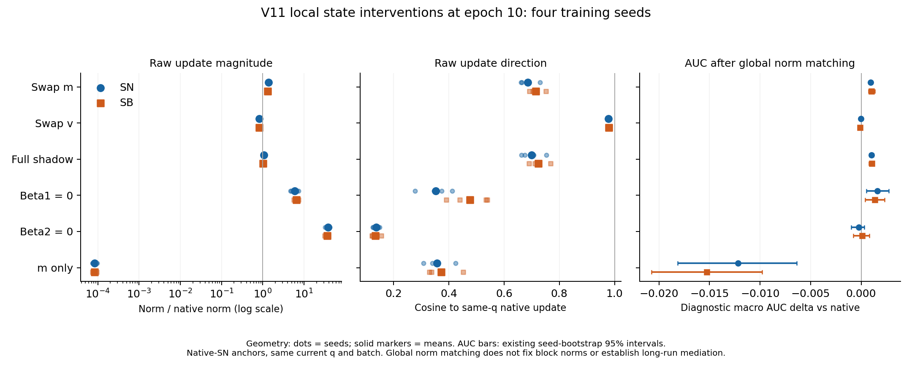

# V11 局部状态交换：完整方向与范数补充

四个种子2022–2025、锚点1/10/40轮、两种当前抽样和所有7种更新条件的方向补充全部完成。**MEDIUM：局部状态干预会改变更新，部分性能变化在全局范数匹配后仍存在；WEAK：现有结果不足以唯一确定方向机制或长期必要中介。** 本报告补足原局部报告的方向读数，不代替仍在继续的完整状态训练，也不提前关闭 Q4/Q40。

## 同轨迹与完整性

补充复用原生 SN 参数路径、原有 shadow 历史和同一组预先保存的当前批次，未重新计算性能。四个父实验在三个锚点的参数、一阶矩、二阶矩重放误差均为0；12个物理检查点、所有生产者/父CSV/子输出哈希通过。共1740行完整坐标方向读数，派生2610行描述汇总。平方距离恒等式最大相对残差2.57e−15，C/P/R/E不相交块的平方范数合计残差1.20e−15。全局范数匹配后的方向与同条件原始更新一致，余弦偏离1的最大误差8.89e−16；零更新 BASE 的余弦保留为空，未写成0或1。

`cosine_to_native` 比较的是相同当前 q 下、相同锚点及当前批次的条件更新与其原生更新；它不是 SN 与 SB 两个更新之间的余弦，也不是与 exact gradient 的余弦。所有锚点均沿原生 SN 路径，不能把它们当作所有可能训练路径的平均。

## 第10轮：幅度、方向与局部 AUC 同时报告

范数比和余弦为四种子原始更新的均值，括号为四种子余弦范围；AUC是全局范数匹配后，相对同当前q原生更新的诊断宏AUC变化，来自此前已经逐项复核的局部性能统计。范数比和余弦是描述量，没有用这张表重做机制筛选。

|条件|当前q|原始全局范数比|与原生更新余弦（种子范围）|匹配范数后AUC变化|AUC种子95%区间|正/负种子|
|---|---|---:|---|---:|---|---|
|swap_m|SN|1.36139|0.685955 (0.661920–0.730176)|+0.000917|[+0.000765, +0.001084]|4/0|
|swap_m|SB|1.30359|0.714433 (0.691944–0.750912)|+0.001032|[+0.000738, +0.001352]|4/0|
|swap_v|SN|0.828397|0.977260 (0.972987–0.979707)|-0.000023|[-0.000135, +0.000090]|1/3|
|swap_v|SB|0.817476|0.979501 (0.975745–0.980832)|-0.000112|[-0.000263, +0.000051]|1/3|
|full_shadow|SN|1.06046|0.699594 (0.662876–0.752659)|+0.001020|[+0.000821, +0.001210]|4/0|
|full_shadow|SB|1.01079|0.724484 (0.691107–0.768062)|+0.001067|[+0.000760, +0.001267]|4/0|
|beta1_zero_v_only|SN|5.91618|0.352684 (0.278156–0.412470)|+0.001618|[+0.000508, +0.002729]|4/0|
|beta1_zero_v_only|SB|6.48787|0.475778 (0.390082–0.538730)|+0.001344|[+0.000387, +0.002301]|4/0|
|beta2_zero|SN|38.1092|0.136218 (0.124682–0.149259)|-0.000221|[-0.000994, +0.000317]|2/2|
|beta2_zero|SB|36.7467|0.133797 (0.121587–0.154728)|+0.000089|[-0.000784, +0.000826]|2/2|
|m_only|SN|8.36302e-05|0.357160 (0.308749–0.424290)|-0.012182|[-0.018158, -0.006365]|0/4|
|m_only|SB|8.35175e-05|0.372074 (0.330149–0.451411)|-0.015278|[-0.020741, -0.009816]|0/4|

交换 m 在第10轮产生的方向变化较大（两种q平均余弦约0.686/0.714），交换 v 则更接近原生方向（约0.977/0.980）。这是这组真实历史和当前批次下的几何差异，不是“m普遍比v重要”的证明。全 shadow 交换在两种q下的四种子平均原始范数比分别约1.06/1.01（单种子仍有差异），方向余弦约0.700/0.724；归一到同一全局范数后，两种q的诊断宏AUC分别提高0.001020/0.001067，均四种子为正。它说明仅用全局步长差异无法完整描述该局部比较。

但这不是特定的差距修复：第10轮全 shadow 全局范数匹配后，SB−SN宏AUC差距仍约−0.000259，四种子均负；相对原生差距的交互约+0.000047，2正2负。两臂一起改善与采样差距消失是不同结论。全部J、选择/诊断损失和6个单元的变化见原统计报告，不因宏AUC改善而删除反例。

m-only 的原始步长只有原生约0.000084倍，原始差距接近0可以来自几乎不更新。匹配全局范数后，第10轮它的两臂AUC均四种子下降，训练J分别上升约0.187668/0.163104，均四种子为正；不能把无差距当作成功。beta1=0 条件移除的是一阶历史平滑，并非把当前梯度置零；它在全局范数匹配后的局部AUC两臂均改善，而训练J的平均变化为正。指标并不总是同向。beta2=0 的原始步长约37–38倍、方向余弦约0.13，进一步限制了对其完整训练饱和现象的唯一归因。

图仅可视化上表已核验读数：几何散点为四种子，AUC区间复用既有种子bootstrap；全局范数匹配不固定各块步长，也不识别长期中介。源CSV、图数据12行及SHA见figures/V11_shadow_epoch10_geometry_and_auc_receipt.json。

## 阶段反例

|锚点|当前q|全shadow与原生余弦均值|全局范数匹配后AUC变化|95%种子区间|正/负种子|
|---|---|---:|---:|---|---|
|1|SN|0.914818|-0.000176|[-0.000471, +0.000113]|2/2|
|1|SB|0.917295|-0.000189|[-0.000462, +0.000046]|1/3|
|10|SN|0.699594|+0.001020|[+0.000821, +0.001210]|4/0|
|10|SB|0.724484|+0.001067|[+0.000760, +0.001267]|4/0|
|40|SN|0.669623|+0.000704|[-0.000147, +0.001570]|3/1|
|40|SB|0.688352|+0.000809|[-0.000016, +0.001620]|3/1|

效果与阶段相关；不得把第10轮局部正结果外推为整个训练历程的稳定收益。这里的区间按4个训练种子计算；最小双侧符号随机化p值为0.125。原局部统计的众多区间是逐项描述，未提供全族错误率保证。新的方向汇总只给四种子均值、范围和原始种子值，没有增加独立样本数。

## 全局范数匹配的边界：新增 Q42

相同全局范数并未固定每个块的范数。以下为第10轮 `swap_v` 全局范数匹配后，各块范数相对原生同块范数的四种子均值：

|块|SN|SB|
|---|---:|---:|
|ALL|1.000000|1.000000|
|C|0.978691|0.980722|
|E|1.178783|1.185739|
|P|1.345132|1.359091|
|R|1.475865|1.476120|

全局比为1时，R仍约1.48倍、P约1.35倍，E约1.18倍。C/E为共享块，R已是域任务私有块，P混合共享与私有部分；不能把所有CPRE统一称共享。欧氏恒等式只给 `||delta||² = Σ_b ||delta_b||²` 的一个约束，不会给四个块各自的等范数约束。因此，现有交换识别的是局部整个状态更新的效果，不能把它拆成“纯方向”与“块间步长重分配”的独立效果。该问题新增为 **Q42，NOT_IDENTIFIABLE_WITH_CURRENT_DESIGN，MEDIUM**，详见独立证明文件。它阻塞纯方向必要性主张，不阻塞当前保守的局部状态效应和边界结论。

最小区分控制是在预先固定的同锚点、同当前q、同批次上，保留条件的各块方向，同时将每个块的范数匹配至原生同块范数，并与全局匹配比较；对零范数块需事先规定无信息处理。当前核心结论不依赖方向的唯一性，故不为这一非阻塞问题追加未经规划的矩阵。

## 追溯

`V11_shadow_geometry_all4_primary_verification.json`、`analysis/V11_shadow_geometry_all4/{all4_geometry.csv,descriptive_summary.csv,receipt.json}` 保留全部方向读数和输入证明。性能仅来自未改动的四个父实验及 `analysis/V11_shadow_statistics/`。前一报告 `V11_shadow_local_statistics_analysis.md` 保留绝对AUC、损失、训练J、域任务、种子和阶段反例。完整训练的匹配预算及选择确认仍在执行，未用局部方向读数替代。
