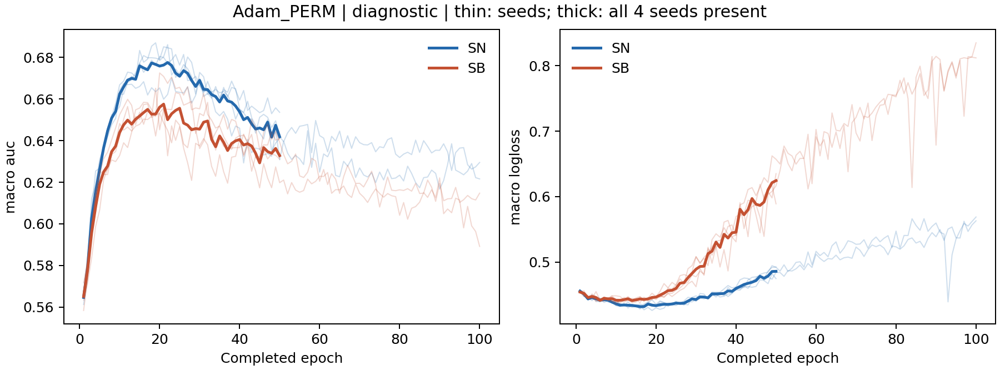

# V5 Adam 抽样方式对照：完整匹配预算的四种子结果

本报告完成 V5 的 Adam 部分；SGD 的 WR/PERM/ORDER 对照仍等待第2025种子满足预算规则。这里不宣布整个 V5 或 v3 完成，也不据此提前启动依赖完整 V5 分析的 V7。全部统计来自选择半集或诊断半集，尚未读取本轮测试性能。

## 定义与实际预算

KuaiRand、M3OE、固定学习率0.003的 Adam；种子2022/2023/2024/2025，WR 与 PERM 各包含 SN、SB。四个种子的匹配实际轮数为 **50/100/100/50**。第2024种子的原始50轮结果保留；其四个条件均从相同原始轨迹连续延长至100轮。100轮 WR-SN 最后两段五轮训练目标相对改善0.010443726，尚未达0.005平台阈值，但完整1000次选择重抽样确认了预定过拟合条件；另三个条件均达平台期。因此按冻结规则停止，无150轮要求。选择和诊断的重抽样数仍为1000/200。

这是本抽样因子的匹配预算；原生 Adam 在 V4 的独立最终预算仍为50/100/50/50。两种预算回答不同问题，不混称同一组“最终 Adam”。共同早期窗口由两组所有配对收敛到 **1–22轮**，对所有域、任务和单元统一应用；未按某个域单独挑选检查点。终轮比较在种子内完全匹配，但种子之间轮数不同。

PERM 在各域中使用连续随机排列循环，保留各 q 的实际域序列。它同时改变覆盖、重复出现位置、相邻批次相关性和时序；耗尽池后会重复，不能称为绝对无重复。实际16个生产者、600个比较臂轮、3600个域覆盖行和物理批次哈希已验证，见 `V5_Adam_all4_sampler_actual_primary_verification.json`。固定非自适应参数下位置边际均匀，也不等价于适应历史条件下的无偏梯度论断。

## 总体 AUC 与损失

下表为诊断半集，差值均为 SB−SN；AUC负值、损失正值分别表示 SB 较差。置信区间为四个训练种子的配对 bootstrap 95% 区间，非行重抽样区间，亦未覆盖外层学习率选择不确定性。

|读数|条件|SN AUC|SB AUC|差值|种子95%区间|正/负种子|
|---|---|---:|---:|---:|---|---|
|共同1–22轮均值|Adam_WR|0.648158|0.634207|-0.013951|[-0.018133, -0.009769]|0/4|
|共同1–22轮均值|Adam_PERM|0.650890|0.634539|-0.016351|[-0.020191, -0.010503]|0/4|
|固定50轮|Adam_WR|0.636728|0.630150|-0.006578|[-0.014455, +0.001299]|1/3|
|固定50轮|Adam_PERM|0.641871|0.632791|-0.009081|[-0.019115, +0.003194]|1/3|
|匹配终轮|Adam_WR|0.629971|0.625819|-0.004152|[-0.011077, +0.003062]|1/3|
|匹配终轮|Adam_PERM|0.636462|0.619001|-0.017462|[-0.032775, -0.008288]|0/4|
|选择集宏AUC选点|Adam_WR|0.667745|0.655343|-0.012402|[-0.025439, -0.002588]|1/3|
|选择集宏AUC选点|Adam_PERM|0.677490|0.655705|-0.021784|[-0.026917, -0.014277]|0/4|
|选择集宏损失选点|Adam_WR|0.662609|0.645540|-0.017070|[-0.028238, -0.005901]|0/4|
|选择集宏损失选点|Adam_PERM|0.673903|0.644700|-0.029203|[-0.034336, -0.024071]|0/4|

|读数|条件|SN损失|SB损失|差值|种子95%区间|正/负种子|
|---|---|---:|---:|---:|---|---|
|共同1–22轮均值|Adam_WR|0.441825|0.447043|+0.005218|[+0.004387, +0.006547]|4/0|
|共同1–22轮均值|Adam_PERM|0.438387|0.445185|+0.006798|[+0.006590, +0.007044]|4/0|
|固定50轮|Adam_WR|0.500107|0.606483|+0.106377|[+0.098088, +0.117792]|4/0|
|固定50轮|Adam_PERM|0.485739|0.624430|+0.138692|[+0.119507, +0.160897]|4/0|
|匹配终轮|Adam_WR|0.533655|0.658868|+0.125213|[+0.103250, +0.147176]|4/0|
|匹配终轮|Adam_PERM|0.524685|0.717827|+0.193141|[+0.128564, +0.257719]|4/0|
|选择集宏AUC选点|Adam_WR|0.442012|0.449405|+0.007393|[+0.000621, +0.014166]|3/1|
|选择集宏AUC选点|Adam_PERM|0.436050|0.448532|+0.012482|[+0.006352, +0.021947]|4/0|
|选择集宏损失选点|Adam_WR|0.434805|0.439986|+0.005181|[+0.002601, +0.008150]|4/0|
|选择集宏损失选点|Adam_PERM|0.430599|0.440042|+0.009443|[+0.007797, +0.011369]|4/0|

**MEDIUM：在这一定义下，PERM 没有消除 SB 的早期劣势。** 共同1–22轮，两个抽样条件的宏 AUC 差值均四种子为负，宏损失差值均四种子为正。PERM 经宏 AUC 选点后差值亦四种子为负。这是该配置的重复现象，不是所有优化器、训练阶段或评估规则下的必然规律。

**WEAK：不能认定 PERM 对差距的作用为零。** 共同早期 AUC 差距交互为−0.002400，3负1正，区间跨零；固定50轮有2正2负。种子与阶段不一致允许多种解释，未达到等效性证明。宏AUC选点的交互为−0.009382，3负1正，且两抽样条件中的选点轮数一般不同；它同时反映轨迹及选择行为，不是同轮的纯优化效应。

## 配对差距交互与绝对效果

交互定义为 `(SB−SN)_PERM − (SB−SN)_WR`。两条绝对变化分别报告，以免把两个臂一起改善或下降误称为专门的差距修复。

|读数|AUC交互|种子95%区间|正/负种子|PERM−WR：SN|PERM−WR：SB|
|---|---:|---|---|---:|---:|
|共同1–22轮均值|-0.002400|[-0.007119, +0.001825]|1/3|+0.002732|+0.000332|
|固定50轮|-0.002503|[-0.019469, +0.016297]|2/2|+0.005144|+0.002641|
|匹配终轮|-0.013309|[-0.035339, +0.002657]|2/2|+0.006491|-0.006818|
|选择集宏AUC选点|-0.009382|[-0.018588, -0.000177]|1/3|+0.009745|+0.000363|
|选择集宏损失选点|-0.012134|[-0.021786, -0.002223]|1/3|+0.011294|-0.000840|

共同早期 PERM 的 SN/SB AUC 分别平均提升0.002732/0.000332，选点后为0.009745/0.000363。因此“差距更负”不等同于“两个模型都变差”。损失提供不同约束：固定50轮的损失交互+0.032315、匹配终轮+0.067928均四种子为正；固定50轮 PERM 相对 WR 的 SN 损失下降0.014368，而 SB 损失上升0.017947。这是明确的臂间差异，仍不能从捆绑的抽样干预中唯一识别重复、覆盖或时序的原因。

## 域、任务、域规模与难度

下表沿用全局共同1–22轮窗口，未做域内重新选择。训练域规模 d0=172782、d1=1743898、d2=89452。

|变量|WR差值|WR正/负种子|PERM差值|PERM正/负种子|交互及种子95%区间|
|---|---:|---|---:|---|---|
|d0_auc|-0.021447|0/4|-0.026921|0/4|-0.005474 [-0.023609, +0.010363]|
|d1_auc|-0.011156|0/4|-0.012616|0/4|-0.001460 [-0.002744, -0.000468]|
|d2_auc|-0.009251|0/4|-0.009517|0/4|-0.000266 [-0.009174, +0.007389]|
|t0_auc|-0.011782|0/4|-0.013971|0/4|-0.002188 [-0.005082, +0.001719]|
|t1_auc|-0.016120|0/4|-0.018732|0/4|-0.002612 [-0.009434, +0.003839]|

早期所有三个域、两个任务在 WR 与 PERM 下均四种子 AUC 差值为负。大域 d1 的 PERM 差距交互四种子为负；两个小域的交互均2正2负。宏AUC选点时，PERM 的 d0、d1、d2 差值依次为−0.036509、−0.013619、−0.015226。共同早期 PERM-SN 的三个域基线 AUC 为0.619286、0.687228、0.646156：最小域 d2 的表现并不最差，d0 表现更低，规模不能直接当作难度。

**WEAK：没有稳定的小域提升／大域下降交换。** 此处早期大、小域均有 SB 劣势，两个小域相对 WR 的交互也未同向。匹配终轮 d1 在两种抽样条件下的平均差值转正（WR +0.006517、PERM +0.004618），但最小域 d2 仍四种子为负。域规模是可能影响重复、覆盖的背景变量，现有三域还同时有标签率、任务、特征和基线难度差异，不能作为单一因果主解释。

## 证据边界与下一项判别实验

可重复现象：该 Adam 配置的早期 SB 劣势在改变为 PERM 后保留；早期三个域、两个任务均出现这一模式；后期损失有明显臂间分化。反例：单个种子在50轮可转正，PERM 的差距交互在不同种子和阶段可转号；绝对 AUC 改善与差距扩大可以同时发生。四种子的符号随机化检验最小双侧值0.125，许多域／任务区间是逐项描述，不作家族错误率保证。

竞争解释包括共享块中的梯度路径、抽样覆盖与时间相关性的捆绑改变、Adam 历史状态、训练进度及选择时点。本报告支持在当前定义下重复的结果，未排除任何一个机制成为局部贡献因素，亦未据宽区间宣称等效。预定 V7 在完整 V5 分析后以同一参数与优化器状态交换指定块更新，较能区分共享块路径解释；它依然不单独分离覆盖与时序。V11 的状态交换与全局范数匹配补充可区分一部分幅度和状态效应；需保留阶段差异。若将来结论确实需要唯一识别“重复”，应另行设计固定覆盖和时序的独立干预；本轮不为一个当前不主张的唯一机制扩大矩阵。

## 产物与验证

- `V5_Adam_final_matched_aggregate_manifest.json`：8个实际配对输入，原始配对均含1000次重选记录。
- `analysis/V5_Adam_final_matched_aggregate/`：所有原始域任务轨迹、种子读数、选择不确定性、训练阶段以及图。
- `analysis/V5_Adam_final_matched_joint_marginals/`：所有6单元、域、任务、宏、样本量和训练目标加权读数，四种子区间及完整逐种子值。
- `analysis/V5_Adam_final_matched_contrasts/`：配对差距交互和两个臂的绝对变化；通用工具对所有 `selected_` 标签保守标为未匹配，但本报告的 `selected_fixed_budget` 实际在种子内匹配50/100/100/50，已单独核对。
- `V5_Adam_final_matched_primary_verification.json`：当前生产者、全部配对输出哈希、原始单元轨迹、所有边际／选择读数／交互以及全部种子区间和符号统计独立重算，104064个数值，最大误差5.35e−16。`independent_review=false`，为主agent自审，非独立agent审查。

图中细线为各种子；粗线仅在四种子均有观测时绘制，因此停止于50轮，不把仅两个种子的后50轮均值伪装成四种子结果。

## 补充：PERM 实际阻断了多少重复

这是同一组已验证的3600个覆盖行的描述汇总，没有新增实验。下表为四种子第1轮均值；比例为域内不同样本覆盖率。

|q|域|WR重复抽取次数|PERM重复抽取次数|WR覆盖率|PERM覆盖率|
|---|---|---:|---:|---:|---:|
|SN|d0|63675.25|230.00|0.632799|0.999997|
|SN|d1|641614.50|72.50|0.632008|0.999886|
|SN|d2|32835.50|50.50|0.631766|0.998276|
|SB|d0|499882.50|496255.00|0.979005|1.000000|
|SB|d1|113450.50|0.00|0.318227|0.383283|
|SB|d2|579288.75|579236.75|0.999419|1.000000|

**STRONG（计数与约束）：SB 对两个小域的抽取配额远超域内独立支持量。** 因而 PERM 仍有约49.6万和57.9万次重复抽取；这是固定配额下不能消除的部分。PERM 明显减少了 SN 三域及 SB 大域的重复，但不能作为“所有重复被阻断”的干预。第50轮 PERM 的 SB 大域仍平均重复63401.75次，表明连续循环跨轮边界也可产生重复，即使单轮配额小于域支持量。

因此，本结果只反驳“把抽样改为这一 PERM 定义即可消除差距”的预测；它既不能证明重复完全不重要，也不能把剩余效应归因于唯一其他机制。固定 E 和 U 下 R=E−U 是恒等式，单靠此矩阵无法独立识别覆盖和重复。四种子第1/50轮全部实际均值见 `archive/formal/V5_Adam_all4_E1_E50_mean_coverage_repetition.csv`。
