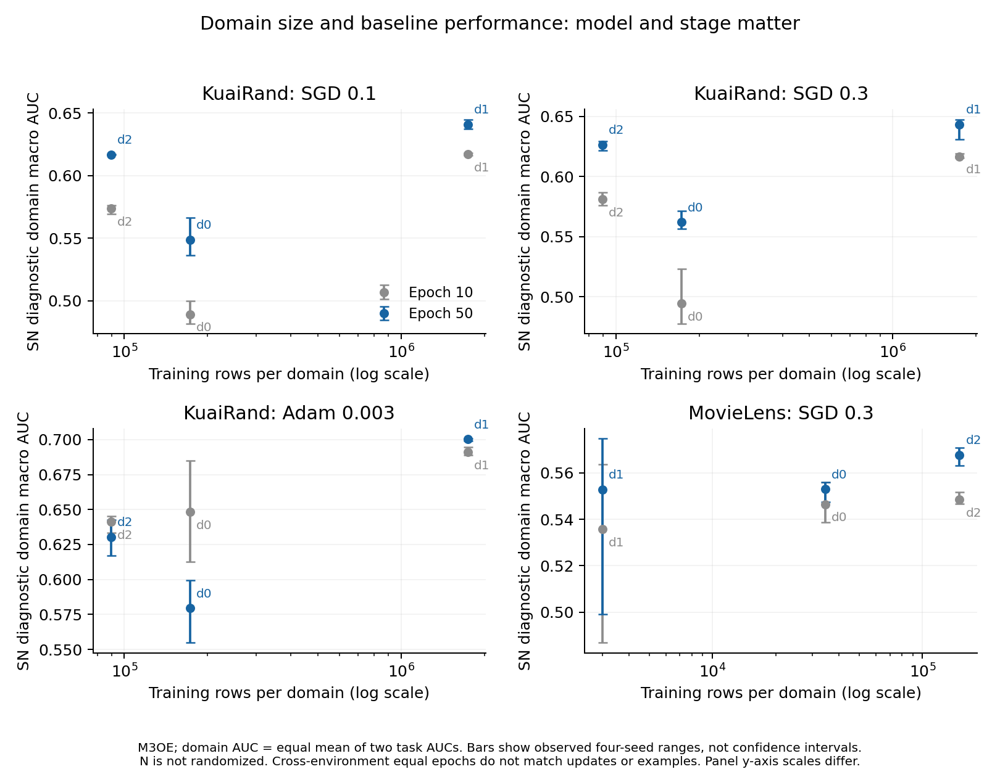

# 域规模、标签率与基线表现：固定阶段描述

已完成七种基线、四seed、两q、固定epoch10/50的672个diagnostic六cell读数与126组域/任务描述汇总。主agent逐项独立复算最大误差2.22e−16，配置/生产者/输出SHA通过；无新训练、无新bootstrap或筛选门槛，未读取新test性能。全量表保留七种配置，下面仅展示预先选定的四个跨optimizer/环境配置。

|配置|域|训练N|SN域宏AUC|SN域宏LL|SB−SN AUC|负差seed数|
|---|---|---:|---:|---:|---:|---:|
|fixedSGD_01|d0|172782|0.548811|0.230847|-0.012895|4/4|
|fixedSGD_01|d1|1743898|0.641023|0.452529|-0.000570|2/4|
|fixedSGD_01|d2|89452|0.616933|0.666724|+0.000409|2/4|
|calSGD_03|d0|172782|0.562054|0.230168|-0.011013|4/4|
|calSGD_03|d1|1743898|0.643238|0.444222|+0.001357|3/4|
|calSGD_03|d2|89452|0.626402|0.663953|-0.001869|3/4|
|calAdam_0003|d0|172782|0.579562|0.280468|+0.005036|2/4|
|calAdam_0003|d1|1743898|0.700172|0.443240|+0.003697|0/4|
|calAdam_0003|d2|89452|0.630449|0.776613|-0.028468|4/4|
|MovieLensSGD_03|d0|34500|0.553005|0.603648|+0.001322|0/4|
|MovieLensSGD_03|d1|3000|0.552749|0.613767|-0.001368|2/4|
|MovieLensSGD_03|d2|150000|0.567673|0.609670|-0.000623|3/4|

域宏AUC/LL为两个任务各自指标的等权平均，不是pooled AUC。以上是同epoch50，而不是各条件selected或各自适足终点。图中的竖线是四seed观测范围，不是CI；各面板纵轴刻度不同。

**STRONG，限于这些实际描述读数：** 六个KuaiRand基线配置在SN固定50轮时均是d0的域宏AUC最低，但d0有172,782行，接近最小域d2的89,452行的两倍。最大域d1为1,743,898行且此时AUC较高。这反驳“最小域必定最难”的简单同一性，不识别样本量的独立因果效果，也不证明规模完全无关。

训练阶段也改变难度代理：calAdam的SN d0域宏AUC由第10轮0.648168到第50轮0.579562，d2则从0.641247到0.630449。不能把某一轮的绝对AUC当作固定的内在域难度。低AUC也不总伴随高LL：KuaiRand d0正例率较低，LL跨域受到标签分布/熵影响；本报告并列指标，不用单个标量取代困难度。

|环境|域|训练N|任务0正例率范围|任务1正例率范围|
|---|---|---:|---:|---:|
|kuairand|d0|172782|0.090889–0.090889|0.041214–0.041214|
|kuairand|d1|1743898|0.377832–0.377832|0.256083–0.256083|
|kuairand|d2|89452|0.616867–0.616867|0.484807–0.484807|
|movielens|d0|34500|0.556899–0.560580|0.229942–0.236551|
|movielens|d1|3000|0.558333–0.570667|0.203333–0.232000|
|movielens|d2|150000|0.602067–0.603320|0.239107–0.239713|

KuaiRand训练人口跨seed固定；MovieLens训练子集随既有seed抽样改变，域N和p固定，每seed内SN/SB人口严格相同，validation/encoder/scaler跨seed固定。故ML四seed分布同时包含训练子集与优化随机性，不能称固定训练人口下纯优化seed不确定性；新增Q43及物理配置证明见Q43_MovieLens_seed_population_scope_audit.json。该边界不破坏配对q比较，也不需要重新训练来支持当前有限结论。

**WEAK/未识别：** N是否为主解释变量、内在难度的唯一原因，以及跨配置稳定的小域受益/大域受损交换。固定SGD的最小域均值略有利但仅2/4为负/2/4为正；calAdam固定50最大域四seed有利而最小域四seed不利，与统一早期各域负差形成阶段反例。不得选一个配置或epoch补成稳定权衡故事。V8已规定的corruption最终敏感性仍须完成，以实际SN基线AUC/LL检查遮蔽是否增加该阶段困难度，mask强度本身不是结果。

下一项有判别力的证据仍是已注册的V8三强度匹配训练、V7同theta块干预及V11完整状态；若未来必须分离规模因果，需要改变真实独立支持而固定标签/身份/模型与暴露，不能用别名重复池当新信息。

追溯：baseline_domain_context_scope.json、baseline_domain_context_primary_verification.json、analysis/baseline_domain_context/两CSV及receipt；原始来源V3_selection_baselines_final_aggregate/cell_trajectory.csv与所有当前生产者配置。
