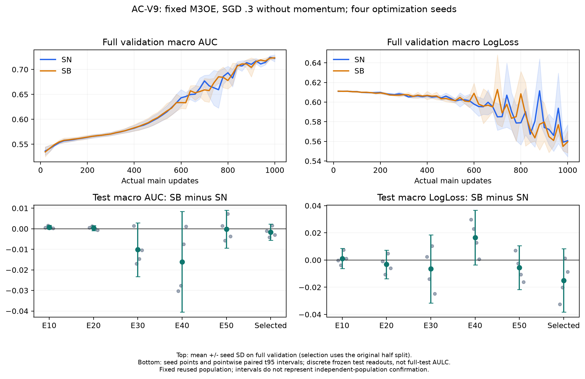
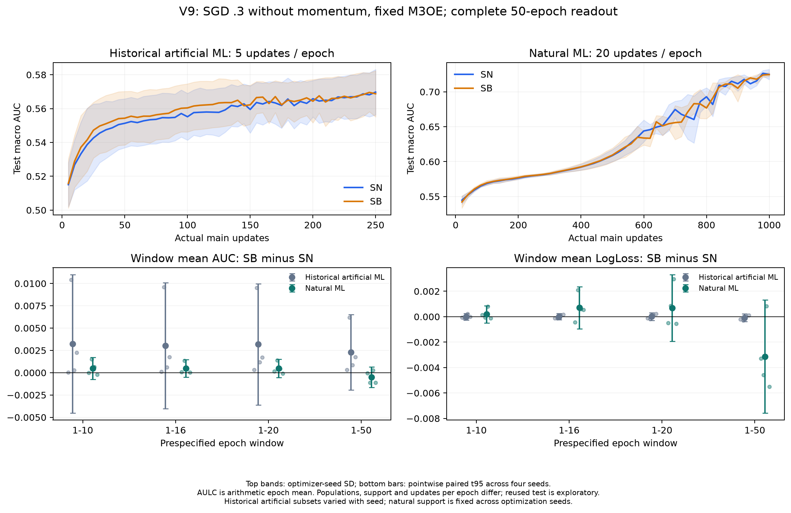

# AC-V9：自然MovieLens无动量SGD性能分析

状态：八次训练及原定 selected/final/公共检查点评价全部完成。56份预测、336个cell指标复算通过（AUC/LogLoss残差<1e−12）。**按[规范](V9_TRAJECTORY_READOUT_SPEC.md)完成8个只读任务：400个冻结模型、400份全轮次预测、2400个cell逐指标复算，误差<1e−12；与原公共点/selected/final一致。全部receipt为COMPLETE、optimizer_updates=0、绑定同一freeze SHA。** 整项研究仍在进行。

## 协议与证据

原v3 fixed M3OE，Sample经验目标，SGD lr=.3、momentum=0、耦合WD=1e−5、B=40960。SN q=p；SB q=1/3并以p/q校正。自然训练人口固定800167，d0/d1/d2=155949/318599/325619；优化seed2022–2025不改变人口。每run完整50轮、1000步、40,008,350样本曝光。原SHA/joint-label半验证集选轮规则保留，严格最早最大selection macro AUC；test不参与调参。

对比历史人工MovieLens，每轮5步、50轮250步、9,375,000曝光，旧训练子集还随seed变动。两人口有支持、p、标签/特征与进度共同差异。没有本SGD .3协议内的匹配N/步数组，AC-2D/N17的不同模型或优化器对照不能替代它。新test仍为反复使用的人口上的探索性复现。

来源：[自然逐seed指标](analysis/core/AC-V9/seed_macro_metrics.csv)、[预测复算](analysis/core/AC-V9/prediction_metric_recalculation.csv)、[配对统计](analysis/core/AC-V9/paired_summary.csv)、[历史原CSV索引](analysis/v9_history/source_index.csv)。区间为四个配对seed的点态t95%，未做全族多重性确认。

## 主结果与阶段边界

以下均为六cell宏平均；Δ=SB−SN。E50和final是同一模型，不算两份独立证据。

|阶段|SN AUC|SB AUC|Δ AUC|正/负seed|AUC点态t95%|Δ LogLoss|LL改善seed|
|---|---:|---:|---:|---|---|---:|---:|
|E10|.576443|.577204|+.000761|4/0|[−.000189,+.001712]|+.001157|2/4|
|E20|.592155|.592547|+.000392|3/1|[−.000842,+.001627]|−.003217|3/4|
|E30|.643936|.633799|−.010136|1/3|[−.023236,+.002963]|−.006505|2/4|
|E40|.692897|.676832|−.016065|1/3|[−.040499,+.008370]|+.016562|0/4|
|E50/final|.724842|.724685|−.000157|2/2|[−.009384,+.009071]|−.005543|3/4|
|selected|.727801|.726186|−.001615|1/3|[−.005590,+.002360]|−.014968|3/4|

E10四正并不延续到E30/E40；E40均值明显负，但四seed区间宽，E50又接近零。不能据final近零宣称轨迹相同，不能据一个中间负点宣称普遍有害。selected AUC的区间跨零，也不足以证明精确等价。selected LL改善与AUC均值下降并存，不能把排序与概率风险混成一个效果。

SN selected轮次49/49/49/50；SB为50/49/49/49。两臂选中点靠近预算末端，E40→E50绝对AUC仍大幅提高，现有50轮不证明收敛。此事实不授权结果后延长V9预算，须保留原完整预算的有限阶段结论。

[PDF](analysis/core/AC-V9/v9_stage_trajectory.pdf)。上排是每轮完整validation（选模仍用原半集）的四seed均值±SD；下排是离散test配对点与点态t95%，没有将五个公共点插值冒充全test曲线或AULC。

## 逐域任务、规模与困难度

selected的SN基线和Δ如下：

|cell|SN AUC|Δ AUC|Δ LogLoss|
|---|---:|---:|---:|
|d0 task0|.717321|−.001097|−.026625|
|d0 task1|.733394|−.002205|−.021125|
|d1 task0|.734281|−.000976|−.015847|
|d1 task1|.762601|−.000333|−.015961|
|d2 task0|.698238|−.002298|+.001685|
|d2 task1|.720969|−.002781|−.011932|

六cell平均Δ均负，但不是每个seed均负。两个任务的宏Δ为−.001457/−.001773，各仅1/4正。final task0为−.000471、task1为+.000158，各2/4正。具体分布见 [逐cell配对](analysis/core/AC-V9/paired_cell_deltas.csv)。

最大d2的固定SN基线反而最低，因此规模不能作为困难度代理。所有已读公共点/selected/final，“最小d0改善而最大d2下降”条件均为0/4；更严格的两个较小域均改善也0/4。这限定了本配置可报告的交换现象，不证明任何配置都不可能交换。d1在旧人工人口是最小域，在自然人口已是中等域，物理域与大小角色不能混称。

## 历史对应及目前能回答的部分

从八份历史原test CSV重新聚合（未重读旧模型/预测）：

|人工MovieLens读数|SN AUC|SB AUC|Δ|正/负seed|
|---|---:|---:|---:|---|
|E1–16算术均值|.544913|.547928|+.003015|4/0|
|E50|.569751|.568765|−.000986|0/4|
|selected|.573755|.574293|+.000539|1/3|

历史早期AULC与末轮方向相反、selected均值为正但仅1个正seed的矛盾完整保留。新自然selected均值转负，末轮四负一致性消失；完整曲线的预设窗口结果见下节。共同16轮对应旧80步、新320步，窗口对齐不代表优化进度对齐。

自然V2 SGD .1 的selected SN/SB=.643088/.638829，与本SGD .3相比基线明显不同。LR、选模半验证/全验证规则等协议不同，不能据V2低AUC归结为M3OE或SGD必然在困难域失败。无动量反例继续限制“Adam历史状态是采样效应必要条件”的一般主张，但这里没有分离该配置所有轨迹差异的来源。

## 完整冻结曲线与预设窗口

AULC定义为窗口内每轮六cell宏AUC的算术均值，不是pooled AUC、插值积分或从图中挑选窗口。所有窗口1–10/16/20/50在全曲线读取前冻结。

|自然窗口|SN / SB AUC均值|ΔAUC [点态t95]|正/负seed|ΔLL|LL改善seed|
|---|---:|---|---|---:|---:|
|1–10|.565929 / .566409|+.000480 [−.000763,+.001723]|2/2|+.000186|2/4|
|1–16|.571613 / .572086|+.000473 [−.000512,+.001459]|4/0|+.000708|1/4|
|1–20|.575120 / .575590|+.000471 [−.000557,+.001499]|3/1|+.000692|2/4|
|1–50|.628514 / .628011|−.000504 [−.001664,+.000657]|1/3|−.003140|3/4|

早期1–16 AUC四正的方向在自然人口复现，幅度从旧+.003015降至+.000473；新旧区间均跨零。自然该窗口LL均值反而上升，3/4变差。不能称稳定的联合AUC/风险收益，也不能据更短1–10的2/2结果称所有早期窗口均四正。自然全程1–50 AUC均值为负、3/4负，而旧人工1–50为+.002291、四正；两者末轮AUC都接近零或偏负，却有不同的累计窗口方向。**MEDIUM有限阶段模式，WEAK跨人口幅度与单一机制解释。**

1–16六cell ΔAUC依d0t0/d0t1/d1t0/d1t1/d2t0/d2t1为+.000826/+.001112/+.000261/+.000432/+.000067/+.000142，正seed数3/3/3/2/2/2；所有均值正不等于每cell四正。对应LL差+.000614/+.000316/+.000845/+.000808/+.000867/+.000797，六cell均值均差。task0/task1 AUC差+.000385/+.000562，各三正一负；LL+.000776/+.000641，各三差一好。

1–50六cell AUC差+.000097/−.000988/−.000020/−.001311/−.000421/−.000379，仅d0t0均值正，但它也只有1/4正；两个任务宏差−.000115/−.000893，各一正三负。LL各cell均值都改善。严格两较小域改善/最大域下降在三个早期窗口各1/4，全50窗口0/4；先前公共点/selected/final的0/4结论保持，其适用读数不能扩展为全部窗口从未出现。

[PDF](analysis/v9_history/v9_full_trajectory.pdf)。上排分别用各自实际主更新数作横轴，不叠成相同训练时钟；均值±seed SD。下排为各窗口四seed点与点态t95。原公共点评价不与新增全轨迹当作独立训练重复。来源：[逐轮cell](analysis/v9_history/all_epoch_cell_metrics.csv)、[窗口逐seed](analysis/v9_history/paired_seed_deltas.csv)、[窗口逐cell](analysis/v9_history/paired_cell_deltas.csv)、[400份预测复算](analysis/v9_history/new_prediction_recalculation.csv)。

## 证据与竞争解释

- **STRONG**：完整预算、冻结人口、采样系数及逐预测指标的身份；公共点存在阶段变化的数值事实。
- **MEDIUM**：本固定人口、四seed、此SGD .3模型下，早期离散点正、后期部分点负、selected与loss不一致的条件现象；不构成跨总体确认。
- **WEAK**：规模、失衡、模型几何或纯学习速度是唯一主因的解释。人口和时钟共同变化；点态区间宽、历史test复用，不能唯一归因。

预设全轨迹零更新评价已完成，反驳“早期收益一直持续”的叙述：自然early 1–16正差并未延续为全50正差，LL方向也不同。它不能识别人口与进度的独立原因，不因其出现新符号再挑窗口。若这种归因成为下一项核心问题，应在本SGD .3内部固定模型和选模、匹配更新/支持并预定新总体，而不是事后选择窗口或更换学习率恢复某个符号。
