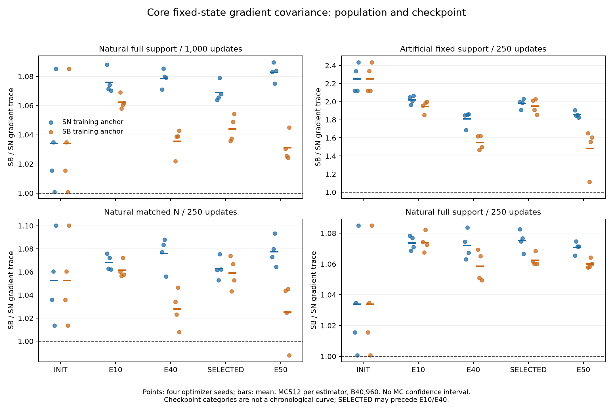

# Core固定点机制分析：160项完整闭环

## 1. 完成范围与主要判断

原冻结AC-2D四人口/预算×SN/SB两训练路径×四seed×五检查点，共160项离线诊断全部完成，无失败。每项保持原模型、原生checkpoint及routing detach；每个估计器512个B40960 IID batch，全坐标统计。五点是INIT、E10、E40、validation-selected、E50；selected不是时间曲线上晚于E40的下一点。没有新增训练或根据效应符号追加抽样。

**MEDIUM：人工比例条件下明显较大的SB梯度trace，在自然比例条件下明显减弱，但没有完全消失。** 人工40个登记锚的SB/SN为1.112995–2.434795，自然全支持两预算80个为1.000672–1.089654，均高于1；自然匹配N为.987818–1.100270，39/40高于1。唯一低于1的是SB训练路径、seed2025、E50。这里的计数是相关检查点描述，不是160个独立重复；初始化及部分selected状态有重复，完整四seed分组见附表。512-draw的trace MCSE没有保存，接近1的符号不能被包装为总体排序确认。

**STRONG（设计/有限数值身份）：同一人口同alpha的SN/SB维持相同原生训练导数字段期望；该字段与重新连接routing后的函数风险导数不同。** 有限96行oracle的相对浮点残差约5.34e−8–9.84e−8；全部160项risk clone前向差严格为0，但导数差不为0。它们不证明完整人口的MC均值已解析相等，也不识别长期风险中介。

**WEAK：标量梯度trace、单个m/v范数或局部公式位移能唯一解释最终AUC/LL。** 完整支持250步的SB selected AUC均值更高，人工及另两控制均值更低，而这些selected锚的trace比均大于1。方差与风险之间仍缺方向投影、实际优化映射及长期路径识别。

## 2. 人口、训练目标及统计单位

自然base train800167=[155949,318599,325619]，人工固定2022为187500=[34500,3000,150000]，自然匹配N187500=[36543,74656,76301]。完整支持匹配预算仍使用800167支持，每macro-epoch187500 draws；全预算1000main/50arch，匹配250main/50arch。实际arch曝光均2,009,934，主/arch比20:1与5:1，故两预算不是纯主时钟控制。优化seed固定2022–25，不改变基础人口。

诊断只覆盖Sample目标的SN/SB路径，不包含EN/EB固定点MC。BCE为每行两任务均值，MC梯度不含L2；合成Adam网格另保留原生耦合WD。SN q=p，SB q=1/3且w=3p。完整坐标trace含C、P和A_arch，而实际main optimizer排除A_arch；全trace不是实际Adam更新方差。记录的是全坐标对角二阶矩及其trace，没有保存稠密非对角协方差矩阵。

四人口内相同seed初始化tensor身份已核对；相同初始化不消除人口支持、标签/特征分布及Sample目标p变化。SN/SB训练路径后续theta/state不同，跨路径的锚对照仍需分别解释。同一θ上的两个诊断估计器使用固定种子，完整人口部分共享随机数；四训练seed也不是独立数据人口。

## 3. 全人口梯度trace：逐路径、阶段与四seed

下表每行四seed，min/max是描述范围，above_one是高于1的个数，不是MC置信区间。没有根据四seed或160相关锚构造总体显著性结论。

|population|budget|arm|checkpoint|mean|min|max|above_one|
|---|---|---|---|---|---|---|---|
|movielens_artificial_d2_fixed2022|full50|SB|epoch09.pt|1.94741|1.85051|2.00061|4|
|movielens_artificial_d2_fixed2022|full50|SB|epoch39.pt|1.55142|1.46846|1.62058|4|
|movielens_artificial_d2_fixed2022|full50|SB|epoch49.pt|1.48179|1.11299|1.65204|4|
|movielens_artificial_d2_fixed2022|full50|SB|initial_state.pt|2.25364|2.12168|2.43479|4|
|movielens_artificial_d2_fixed2022|full50|SB|selected_state.pt|1.95078|1.85567|2.02619|4|
|movielens_artificial_d2_fixed2022|full50|SN|epoch09.pt|2.0214|1.96475|2.0644|4|
|movielens_artificial_d2_fixed2022|full50|SN|epoch39.pt|1.81248|1.6864|1.85984|4|
|movielens_artificial_d2_fixed2022|full50|SN|epoch49.pt|1.85726|1.82511|1.90463|4|
|movielens_artificial_d2_fixed2022|full50|SN|initial_state.pt|2.25364|2.12168|2.43479|4|
|movielens_artificial_d2_fixed2022|full50|SN|selected_state.pt|1.98018|1.90904|2.03143|4|
|movielens_natural|full50|SB|epoch09.pt|1.06237|1.05798|1.06906|4|
|movielens_natural|full50|SB|epoch39.pt|1.0356|1.02195|1.04285|4|
|movielens_natural|full50|SB|epoch49.pt|1.03121|1.02411|1.04489|4|
|movielens_natural|full50|SB|initial_state.pt|1.03402|1.00067|1.08508|4|
|movielens_natural|full50|SB|selected_state.pt|1.044|1.03562|1.05422|4|
|movielens_natural|full50|SN|epoch09.pt|1.07594|1.07023|1.08815|4|
|movielens_natural|full50|SN|epoch39.pt|1.07876|1.07098|1.08531|4|
|movielens_natural|full50|SN|epoch49.pt|1.08284|1.075|1.08965|4|
|movielens_natural|full50|SN|initial_state.pt|1.03402|1.00067|1.08508|4|
|movielens_natural|full50|SN|selected_state.pt|1.06908|1.06385|1.07889|4|
|movielens_natural|matched250|SB|epoch09.pt|1.07411|1.06747|1.08228|4|
|movielens_natural|matched250|SB|epoch39.pt|1.05873|1.04941|1.0694|4|
|movielens_natural|matched250|SB|epoch49.pt|1.06006|1.05784|1.06423|4|
|movielens_natural|matched250|SB|initial_state.pt|1.03402|1.00067|1.08508|4|
|movielens_natural|matched250|SB|selected_state.pt|1.06253|1.06006|1.06838|4|
|movielens_natural|matched250|SN|epoch09.pt|1.07368|1.06859|1.07829|4|
|movielens_natural|matched250|SN|epoch39.pt|1.07219|1.06313|1.08372|4|
|movielens_natural|matched250|SN|epoch49.pt|1.07077|1.06549|1.07475|4|
|movielens_natural|matched250|SN|initial_state.pt|1.03402|1.00067|1.08508|4|
|movielens_natural|matched250|SN|selected_state.pt|1.07516|1.06654|1.08269|4|
|movielens_natural_matched_n187500|full50|SB|epoch09.pt|1.06168|1.05662|1.07217|4|
|movielens_natural_matched_n187500|full50|SB|epoch39.pt|1.02794|1.00791|1.04646|4|
|movielens_natural_matched_n187500|full50|SB|epoch49.pt|1.02535|0.987818|1.04525|3|
|movielens_natural_matched_n187500|full50|SB|initial_state.pt|1.05257|1.01357|1.10027|4|
|movielens_natural_matched_n187500|full50|SB|selected_state.pt|1.05919|1.04332|1.07382|4|
|movielens_natural_matched_n187500|full50|SN|epoch09.pt|1.06833|1.06208|1.07594|4|
|movielens_natural_matched_n187500|full50|SN|epoch39.pt|1.07616|1.05605|1.08802|4|
|movielens_natural_matched_n187500|full50|SN|epoch49.pt|1.07755|1.06427|1.09336|4|
|movielens_natural_matched_n187500|full50|SN|initial_state.pt|1.05257|1.01357|1.10027|4|
|movielens_natural_matched_n187500|full50|SN|selected_state.pt|1.06305|1.05294|1.07536|4|

完整人口同目标MC均值差范数/(两个RMS误差尺度之和)为.185879–.509699。非零范数有有限MC正值基底；小于1既不是无偏性的数值证明，也不是预注册置信区间。相同目标期望由估计器身份支持，MC读数只提供有限一致性信息。

### 参数块与规模解释

|population|budget|partition|trace_ratio_min|trace_ratio_max|ratios_above_1|SN_trace_share_min|SN_trace_share_max|
|---|---|---|---|---|---|---|---|
|movielens_artificial_d2_fixed2022|full50|A_arch|1.52904|2.88352|40|8.40464e-06|0.000756066|
|movielens_artificial_d2_fixed2022|full50|C|1.01688|2.46416|40|0.438992|0.904252|
|movielens_artificial_d2_fixed2022|full50|P|1.97448|2.39131|40|0.0956825|0.560855|
|movielens_natural|full50|A_arch|0.88089|1.15054|33|1.05892e-05|0.000631693|
|movielens_natural|full50|C|0.996373|1.10178|38|0.544308|0.950719|
|movielens_natural|full50|P|1.00694|1.10046|40|0.0491193|0.455681|
|movielens_natural|matched250|A_arch|0.971906|1.1557|38|1.05892e-05|0.000720254|
|movielens_natural|matched250|C|0.996373|1.10178|38|0.424346|0.714355|
|movielens_natural|matched250|P|1.00694|1.099|40|0.285407|0.575373|
|movielens_natural_matched_n187500|full50|A_arch|0.962176|1.16911|33|1.02375e-05|0.00066182|
|movielens_natural_matched_n187500|full50|C|0.981564|1.11662|38|0.450451|0.945012|
|movielens_natural_matched_n187500|full50|P|1.02127|1.08249|40|0.0548926|0.549287|

人工C/P/A三个块的trace比均高于1。自然full50的C只有38/40高于1、P为40/40、A为33/40；全支持matched250的C为38/40、P40/40、A38/40。自然匹配N的C为38/40、P40/40、A33/40。因此全坐标排序不等于每个参数块排序。A占SN trace最大不足.076%，但它仍被如实计入。

自然full50的P梯度trace份额约4.91%–45.57%，不能与N17 P的约.11%–.20% **Adam更新**trace份额直接比较：模型/块定义、θ、估计对象和优化映射均不同。不能由某个小块的排序推广至全部更新或风险。

人工与自然匹配N总N/250主步/50arch一致，trace放大仍明显不同，削弱“总N或主更新数单独足以解释差异”的解释。域比例、逐域N、实际支持和标签/特征组成同时改变，唯一比例/规模因果仍为WEAK。完整自然250/1000步的trace幅度也随锚路径与阶段变化，说明θ/state是实质条件。

## 4. 有限96行oracle与MC不能混为完整人口

每域取原训练顺序前32行，共96行；目标是按原alpha加权的三个域均值，不是96行简单均值，也不是完整训练人口的解析结果。row-gradient与oracle均值保留float32运算，期望加权部分再用float64，因此存在小浮点残差。有限pool的512次multinomial计数抽样和完整人口512次实际batch抽样分列。

|estimator|identity_relative_error_min|identity_relative_error_max|MC_over_exact_min|MC_over_exact_max|MC_mean_error_over_RMS_min|MC_mean_error_over_RMS_max|
|---|---|---|---|---|---|---|
|SB|5.4981e-08|9.84222e-08|0.939125|1.07402|0.308341|1.39375|
|SN|5.34108e-08|9.82015e-08|0.952026|1.035|0.562896|1.29401|

有限pool MC/exact trace约.939–1.074；MC均值误差/RMS可高于1，这本身不构成错误，RMS不是确定上界或置信区间。有限线性期望身份与约1e−7的相对残差为STRONG有限数值证据；完整人口trace的精确相等/大小和风险结论不从该pool继承。

## 5. 同baseline m/v/current八格：有交互，不是历史必要性

每锚使用同一theta及原生optimizer状态，梯度取上述96行pool的域均值。先注入一次full/target合成历史事件，再注入full/target当前事件，theta两事件间不移动，bias correction为t+2；只算C块公式更新范数，没有安装新参数、浮点storage位移或风险评价。不同m/v来源的格子不保证对应同一普通Adam梯度历史。

以下是去掉INIT后128个相关锚的逐因子切换target/full范数比；每个锚和每四seed分组也都保存，汇总计数不提供128个独立统计重复。

|switched_factor|held_sources|norm_ratio_min|norm_ratio_max|ratios_above_1|ratios_below_1|
|---|---|---|---|---|---|
|current_source|m_source=full,v_source=full|0.661111|0.998515|0|128|
|current_source|m_source=full,v_source=target|1.1905|7.14138|128|0|
|current_source|m_source=target,v_source=full|0.65006|1.09345|16|112|
|current_source|m_source=target,v_source=target|0.61231|1.06658|11|117|
|m_source|v_source=full,current_source=full|0.614683|1.00203|1|127|
|m_source|v_source=full,current_source=target|0.597325|1.10347|16|112|
|m_source|v_source=target,current_source=full|0.589589|0.996507|0|128|
|m_source|v_source=target,current_source=target|0.0808392|0.839277|0|128|
|v_source|m_source=full,current_source=full|1.00183|1.21978|128|0|
|v_source|m_source=full,current_source=target|1.19446|10.8694|128|0|
|v_source|m_source=target,current_source=full|0.973549|1.16998|121|7|
|v_source|m_source=target,current_source=target|0.966289|1.10204|111|17|

固定full-m/full-v时，当前梯度full→target的C公式范数128/128下降（比.661111–.998515）；固定full-m/target-v时，同一当前切换128/128上升（1.190505–7.141380）。固定full-m时，v历史事件full→target在两个当前源下都128/128放大范数，但幅度不同。这是MEDIUM有限合成映射交互，不是哪个切换对风险更好，更不是m单独必要性。

INIT的full-m/target-v/target-current最大范数47058.46，而全full格所有锚为1.355768–6.006474。这个极端值来自未保证普通历史可达性的因子配对，只计算公式、没有真实训练一步；不能称为发生了训练发散，也不能拿它与S5/S6实际轨迹位移直接等同。保留此读数，而非删除不利或极端格子。

## 6. 同函数值的routing风险导数与实际训练场

deep clone仅将gate输入emb.detach重新连接，160/160固定pool前向预测差严格为0。下表是 ||risk_derivative−native_training_derivative|| / ||native_training_derivative|| 的范围。

|population|budget|relative_derivative_difference_min|relative_derivative_difference_max|
|---|---|---|---|
|movielens_artificial_d2_fixed2022|full50|0.000888263|0.266659|
|movielens_natural|full50|0.00167855|0.164266|
|movielens_natural|matched250|0.000200331|0.17766|
|movielens_natural_matched_n187500|full50|0.00264266|0.349066|

全部锚范围.000200–.349066；差异平方范数的C份额为81.1724%–接近100%，P为接近0–18.8276%，A严格0。相同函数值并不意味着autograd路径相同；重新连接导数不是原系统实际使用的训练场。这项有限pool前向身份为STRONG，导数差及其阶段范围为MEDIUM，完整人口风险梯度或长期收益归因为WEAK。

## 7. 与同配置性能、域任务和基线对照

下表来自已完成AC-2D test性能分析，不由本次MC或网格重算推导。均为SB−SN；LL正值代表更差，区间是四优化seed点态t95，无多重比较校正。

|population|budget|checkpoint|metric|reference_mean|candidate_mean|mean|ci95_low|ci95_high|positive|negative|
|---|---|---|---|---|---|---|---|---|---|---|
|movielens_artificial_d2_fixed2022|full50|final|macro_auc|0.692109|0.689139|-0.00296958|-0.0197569|0.0138177|3|1|
|movielens_artificial_d2_fixed2022|full50|final|macro_logloss|0.791588|0.871282|0.0796944|-0.0716635|0.231052|3|1|
|movielens_artificial_d2_fixed2022|full50|selected|macro_auc|0.731579|0.724503|-0.00707531|-0.00893848|-0.00521213|0|4|
|movielens_artificial_d2_fixed2022|full50|selected|macro_logloss|0.562675|0.580906|0.0182309|-0.0467768|0.0832385|2|2|
|movielens_natural|full50|final|macro_auc|0.74377|0.741013|-0.00275684|-0.00746403|0.00195036|1|3|
|movielens_natural|full50|final|macro_logloss|0.618451|0.625975|0.00752382|-0.0145069|0.0295545|3|1|
|movielens_natural|full50|selected|macro_auc|0.767673|0.767625|-4.72533e-05|-0.00273122|0.00263672|2|2|
|movielens_natural|full50|selected|macro_logloss|0.513288|0.51647|0.00318197|-0.00148897|0.00785291|3|1|
|movielens_natural|matched250|final|macro_auc|0.766507|0.767554|0.00104651|-0.00129781|0.00339083|3|1|
|movielens_natural|matched250|final|macro_logloss|0.510327|0.508368|-0.00195902|-0.00681886|0.00290081|1|3|
|movielens_natural|matched250|selected|macro_auc|0.766009|0.76727|0.00126054|-0.00125352|0.0037746|3|1|
|movielens_natural|matched250|selected|macro_logloss|0.506601|0.507093|0.000491886|-0.011164|0.0121477|3|1|
|movielens_natural_matched_n187500|full50|final|macro_auc|0.707413|0.705843|-0.00157047|-0.00630366|0.00316272|1|3|
|movielens_natural_matched_n187500|full50|final|macro_logloss|0.728371|0.729138|0.000766711|-0.013885|0.0154184|3|1|
|movielens_natural_matched_n187500|full50|selected|macro_auc|0.740092|0.738423|-0.00166948|-0.00457621|0.00123725|1|3|
|movielens_natural_matched_n187500|full50|selected|macro_logloss|0.527162|0.534835|0.00767304|-0.0206582|0.0360043|3|1|

自然完整支持250步selected SB−SN AUC约+.001260（三正一负），同时LL+.000492（三差一好）；人工selected AUC−.007075四负，LL+.018231但种子混合。自然1000步selected AUC近零、末轮负差；相同梯度trace排序不足以给出这些AUC/LL方向。这不排除协方差的方向结构或Adam非线性参与，只是否定从标量trace直接推出性能。

逐域逐任务及全部seed见[AC-2D性能报告](AC2D_PERFORMANCE_ANALYSIS.md)和[逐cell差](analysis/core/AC-2D/paired_cell_deltas.csv)。自然SN selected的d0两任务AUC约.763494/.777115，d1 .770953/.790253，最大d2 .744434/.759787；最小域不是最难域的代理。AC-2D同配置SB−SN、EN−SN等selected/final预定四对照的严格“两较小域均改善/最大域下降”均0/4。S5 full HT−F final却为4/4、DH则六cell均改善；参照、目标、模型和训练阶段都不可省略。本机制诊断没有保存逐任务协方差分解，不能用两任务平均梯度替代逐任务机制证据。

## 8. 重新裁定与最有辨别力的下一步

1. **保留，STRONG条件身份**：同一人口/alpha下的重要性校正同目标训练场；routing detach边界、实际main/A_arch分组与有限pool身份。
2. **缩小，MEDIUM**：人工MovieLens较大的SB梯度trace放大在自然比例下明显减弱，接近1的个别符号及子块不完全一致。不是普遍SB高方差定律，也不是域大小的唯一因果。
3. **不成立为充分证据，WEAK机制归因**：仅凭trace或m/v范数宣称完整性能变化、m必要性、共享中介必要性或小域救援。S5/S6实际持久状态控制与本次合成网格不是同一实验。
4. 最有辨别力的后续候选应固定同一theta/state、预注册实际风险投影与可达的状态/位移对照，首先尝试反驳“标量方差/分母放大足以解释风险”。若研究S5取舍，则同人口轮换物理TARGET，比继续将域大小与TARGET身份绑定更能区分解释。若研究进度，则固定main:arch相对频率。这些是后续问题，不自动新增本次冻结预算。

本core子阶段已完成；N19/CM19迁移及整体最终报告仍待完整结果，不能以本报告代替整项研究交付。

## 9. 复查工件

- [160来源及checkpoint实际SHA](analysis/core_mechanism/source_index.csv)、[完成状态](analysis/core_mechanism/analysis_status.json)。
- [全部诊断JSON快照gzip](analysis/core_mechanism/raw_diagnostic_snapshots.jsonl.gz)、[归档SHA/解释边界](analysis/core_mechanism/summary_receipt.json)。
- [全人口读数](analysis/core_mechanism/covariance.csv)、[块份额](analysis/core_mechanism/partition_trace_shares.csv)、[有限pool误差](analysis/core_mechanism/finite_pool_relative_errors.csv)。
- [八格原读数](analysis/core_mechanism/same_baseline_adam_grid.csv)、[逐因子切换](analysis/core_mechanism/same_baseline_grid_switches.csv)、[四seed分组](analysis/core_mechanism/four_seed_grid_switch_summary.csv)。
- [函数导数差](analysis/core_mechanism/functional_derivative_relative_differences.csv)、[独立图PDF](analysis/core_mechanism/gradient_trace_ratios.pdf)。
