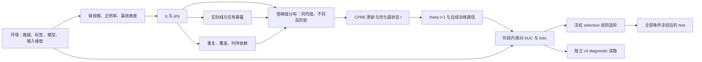

# V12 反事实综合工作稿：尚未终局

这是截至已验证产物的因果综合，不能作为最终停止证书。V5最终匹配读数、V7、完整状态预算与方向补充、冻结后test及最终归档仍须完成。所有结论保留配置、种子、模型、训练阶段、评价人群和指标范围。

## 目标、图梯度与时间顺序

数据目标是

\[
J(\theta)=\sum_d p_d\frac1{N_d}\sum_{i\in d}\frac{\ell_{i0}(\theta)+\ell_{i1}(\theta)}2.
\]

代码包含 routing 的 `emb.detach()`；本轮估计器采用相同forward与相同计算图导数字段 \(\widetilde G_d=\widetilde\nabla J_d\)，不把它等同于对routing全部路径求普通全导数。WR固定theta下

\[
\mathbb E_q[\hat g_q]=\sum_d q_d(p_d/q_d)\widetilde G_d
=\sum_d p_d\widetilde G_d=\widetilde G^*.
\]

两臂前向数据目标相同、图梯度期望相同，不要求各batch梯度、协方差或更新路径相同。两臂优化器还包含同样weight_decay=1e−5；数据目标平台并不证明正则化目标全局收敛。不能不加条件套用普通光滑梯度SGD定理。PERM固定非自适应theta的无条件位置边际，与自适应历史条件下剩余池均值不同；原WR条件无偏性不能直接搬到PERM轨迹。

这是候选路径图，不是每条箭头都已单独识别。状态的反馈通过时间下标展开，不以同一时间的相关性代替干预。环境是共同变化的配置束，不是唯一数据集因果变量。模型参数支持已实查：C/E共享、R的gates/towers为domain-task-private、P混合共享/私有，不能把R重命名为共享模块。

## 六项规定反事实

| 反事实 | 实际对照与当前状态 | 能识别什么 | 不能据此识别什么 |
|---|---|---|---|
| CF1 同目标改变q | V1全部身份/完整梯度审计PASS；V2/V4多LR四种子完整诊断完成；新test待冻结 | 该实现中的q总干预改变估计器、训练路径及配置/阶段依赖的性能 | 不唯一识别暴露、重复、谱或共享结构中介 |
| CF2 同q改变optimizer | fixed/calibrated Adam与无动量SGD均四种子；实际LR校准、预算/2B、AdaTask均完成 | Adam不是所有采样敏感性的必要条件；calibrated早期interaction存在，固定参考反例保留 | 不把两种optimizer的差异全归于历史；学习率、映射及优化进度也不同 |
| CF3 同q改变域内sampler | WR/PERM训练及大部分读数完成，seed25/Adam24最终匹配读数仍在完成 | 在相同目标/配额下，域内采样方案这个整体干预 | PERM同时改变覆盖、重复位置和条件依赖，不能单独称纯repetition intervention或完全无重复 |
| CF4 同q、同batch multiset改顺序 | 四种子精确multiset/计数验证；最终匹配性能待V5 | 固定实现、已抽batch集合的条件路径敏感性 | 短尾batch也被移动，size-clock没固定；非数据依赖的IID置换不等于curriculum策略因果收益 |
| CF5 同theta替换参数块 | 12个实际native检查点SHA核验PASS，清单prepared；必须V5分析后执行 | 条件于theta/状态/当前draw的局部块直接效应；达预定门槛后才可能触发完整训练 | 未执行前不能称必要；即便局部阳性也不是长期自然间接效应，R不构成共享R必要性 |
| CF6 2B/确定性对照 | B0/B2完整适足预算、相同examples与精确step读数完成；可控子集exact优化与随机比较完成 | 移除抽样噪声时同一路径身份；batch大小与step-clock敏感性 | 2B改变优化步数/时钟，不能单独当作只改变scalar covariance；toy不是完整模型真实泛化训练 |

V11已完成四种子同theta影子历史统计，属于CF2/CF5旁支中的直接状态干预：第10轮m/full-shadow在两个当前q的下一步绝对AUC改善，同时q AUC gap仍四负。范数匹配还出现loss/阶段方向反例。该结果支持局部历史有影响，不支持唯一长期必要中介；完整状态训练、方向余弦及适足预算仍须完成。

## 竞争解释与证据

| 解释 | 支持或反证 | 强度与剩余限制 |
|---|---|---|
| objective实现不一致 | 同batch权重/分解、精确完整图梯度身份、16固定点MC与可控exact路径均PASS | STRONG同图身份；routing全导数边界Q28必须保留，MC点状区间不是FWER证明 |
| 完全由selection制造 | fixed SGD等共同轮次/共同早期已有差值；112,000次重选记录与全部规则已核验 | MEDIUM反对“所有现象仅selection”；selected方向受规则/种子显著影响，新test未完成 |
| 全部仅late-overfit rescue | 两套Adam以及固定SGD在冻结早期已有现象 | MEDIUM范围反证；onset为操作分类，不证明不存在潜在overfit，不能推广所有配置 |
| 只有Adam历史才有现象 | 无动量SGD固定LR早期及selected四种子负 | MEDIUM反对通用必要性；校准后interaction早期强而固定参考不触发，必须保留配置边界 |
| 完全由速度解释 | 2B/延长预算可改变末轮符号；calSGD seed25从50到100追上，而selected/早期仍有不同表现 | 仅配置/阶段边界MEDIUM；实用平台不等于全局收敛，不能全局排除或全局确认速度唯一性 |
| repetition唯一解释 | 需V5最终配对性能，但PERM联合改变其他因素 | 暂待实际性能；无论结果何种方向都不能从该联合干预唯一归因 |
| coverage独立因果 | 固定E,N时R=E−U，重复次数与unique coverage受代数约束 | 当前设计不可独立识别，Q20；时间分布仍有描述差异 |
| pure content-order唯一解释 | 实际ORDER保存同multiset，但短尾位置改变，478/500原始arm-epoch移动尾部 | STRONG实现边界Q37/38；最终性能仍需完成，不能凭2.22%大小差就断言尾部无效 |
| covariance shape优于trace | 谱形状有描述信息，SGD秩/各向异性变化重复，Adam有反例；q同时改变trace/shape | Q21不可识别；没有独立trace-matched shape干预，不做伪回归或唯一中介声明 |
| shared/routing是核心 | 支持图审计和CPRE几何已完成；V7尚未执行 | 当前必要性证据不足；距离/协方差不替代干预 |
| 小域是困难域/主因 | 自然域基线不按大小排序；别名2x/4x精确身份；ML早期最小域有利但后期反例 | 名义重复池大小不是新支持，不能推出真样本规模因果；V8难度最终合成仍待完成 |
| AdaTask/D3/SAF已完全覆盖或必定未覆盖 | D3/SAF目标改变；AdaTask预定组件仍有残余q敏感性；一般sampling/order/memory已有先例 | Q12/Q25 BOUNDARY MEDIUM；既不宣布普遍失败，也不从残差推断创新 |

## 下一项真正有判别力的证据

继续已经规定、且仍可能改变结论的V5完整匹配性能、V8三强度和cell核验、V7局部块及条件触发的完整训练、V11完整状态/范数/方向。不能用提前的NO-GO直觉跳过这些。若某个关键零效应且区间覆盖±.003被用于核心关闭，才按冻结规则补2026–2029匹配种子；没有用描述性不显著结果证明等效零。

核心问题关闭后冻结所有新test来源、summary/reuse清单与规则哈希；test仅评估固定定义。最终证据分类与GO/NO-GO必须依据全部完成项，当前工作稿不作终局选择。
