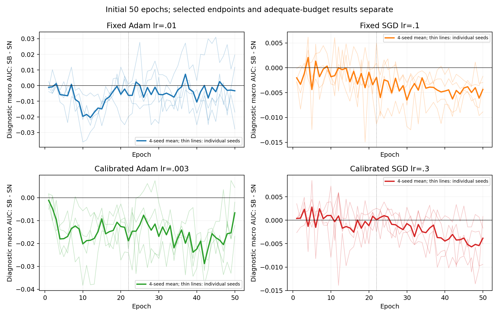

# 实验结果报告（进行中：只纳入已完成并复核的读出）

当前仅有下列配置完成四种子初始50轮的全部数值读出和主agent复算。本报告持续更新，不能将它视作全任务或充分预算的最终结果。表内差值统一为 SB−SN；AUC正值更好、LogLoss负值更好。CI为训练种子重采样95%区间，selection行重采样与diagnostic行重采样另见各配对文件。n=4时双侧精确符号随机化p最小为.125，CI和同号不等于高功效显著性。原始逐seed数值、两臂绝对值、SD、中位数、CI、符号p均保留在 `analysis/completed_primary_summary_snapshot.csv` 及原聚合目录。

## 已完成配置：共同pre窗口

共同pre窗口由冻结的AUC下降规则对各arm/seed分类后取交集，不以偏好的效果选择。以下窗口因配置不同而不同；本表不是V11的共同全局窗口interaction估计。

| 配置 | 初始窗口 | SN宏AUC | SB宏AUC | ΔAUC [seed95%CI] | 正/负seed | ΔLogLoss [seed95%CI] |
|---|---|---:|---:|---|---|---|
| KuaiRand / Adam .01（固定参考） | 1–27 | 0.634198 | 0.627218 | -0.006980 [-0.011226,-0.002734] | 0/4 | +0.001383 [+0.000646,+0.002293] |
| KuaiRand / Adam .003（初始50） | 1–22 | 0.648158 | 0.634207 | -0.013951 [-0.018133,-0.009769] | 0/4 | +0.005218 [+0.004387,+0.006547] |
| MovieLens / SGD .3 | 1–16 | 0.538007 | 0.539398 | +0.001391 [-0.000131,+0.003849] | 3/1 | -0.000013 [-0.000058,+0.000010] |

两个KuaiRand Adam配置在共同pre窗口均四种子AUC下降且LogLoss变差，支持受当前配置限定的早期效应，证据MEDIUM；它不只由独立checkpoint选择或规则所定义的晚期过拟合产生。MovieLens的宏AUC区间跨零，不能以本表声称跨环境稳定同方向。

## 固定50与独立selection-selected readout

| 配置 | readout | SN宏AUC | SB宏AUC | ΔAUC [seed95%CI] | 正/负seed |
|---|---|---:|---:|---|---|
| KuaiRand / Adam .01（固定参考） | common_epoch50 | 0.659421 | 0.656117 | -0.003304 [-0.022347,+0.015740] | 2/2 |
| KuaiRand / Adam .01（固定参考） | selected_macro_auc | 0.663948 | 0.654629 | -0.009319 [-0.021036,+0.003670] | 1/3 |
| KuaiRand / Adam .003（初始50） | common_epoch50 | 0.636728 | 0.630150 | -0.006578 [-0.014455,+0.001299] | 1/3 |
| KuaiRand / Adam .003（初始50） | selected_macro_auc | 0.667745 | 0.655343 | -0.012402 [-0.025439,-0.002588] | 1/3 |
| MovieLens / SGD .3 | common_epoch50 | 0.557809 | 0.557586 | -0.000223 [-0.001553,+0.001107] | 2/2 |
| MovieLens / SGD .3 | selected_macro_auc | 0.561441 | 0.561682 | +0.000241 [-0.001222,+0.001127] | 3/1 |

固定参考Adam在固定50为2正2负、selected为3负1正且区间跨零；校准Adam也有固定50反向seed与selected微正seed。不能从早期四种子一致下降跳到“最终必然更差”。校准Adam seed23最终预算100，其余三seed为50；最终共同预算/selected解释必须等待100轮完整读出，不能把本表初始50视为全部充分训练。

## 域、任务、大小与阶段

校准Adam共同pre22：三个域的平均ΔAUC分别为d0 −.021447、d1 −.011156、d2 −.009251，各域均4/4负；两个任务分别−.011782/−.016120，均4/4负。最大训练域d1与最小d2未形成稳定一正一负交换。d0的SN基线AUC低于最小d2，不能将小域等同困难域。五个domain-task cell为四seed同负，另一个cell有反例。详细绝对值与种子统计见 `V4_calAdam_until050_analysis.md` 和对应marginal目录。

MovieLens最小训练域d1在pre16平均ΔAUC +.00527041，四seed均正，CI[+.00174322,+.00916846]，两个任务也均四seed改善；该域固定50平均−.00136779且符号不一致。最大域d2 pre16平均−.00116193、CI跨零，故“稳定小域改善、大域退化”的联合证据WEAK。MovieLens每轮5step、KuaiRand每轮49step，标签定义及域定义也不同；相同epoch不等于相同optimizer step阶段。见 `V9_diagnostic_analysis.md`。

## 正在计算的数据不得作为完成结果

校准SGD初始50的固定horizon点轨迹已完整，暂存 `analysis/V4_calSGD_fixed_horizons_provisional/`：AULC1–10平均+.00079036（4/4正），AULC1–20平均−.00009218（3正1负），固定50平均−.00384147（3负1正）。这些仅为预先规定horizon的训练种子统计；1000/200行重采样、共同pre分类和seed25充分预算未结束，未用于触发V11、宣称SGD早期必要性或判定最终预算。

V5已经验证前三种子600个arm-epoch的操纵身份，但四seed性能仍未完整。V8污染12条初始训练完成，seed23要求同clean/mild/strong六臂延长100；seed25条件已匹配最终100预算入队。AdaTask初始八条训练完成、完整selection读出尚待，seed23匹配100已运行。局部参数干预、条件状态分解、最终test均未完成，缺失数据不会用估计数填补。

## 数据与图表入口

- `analysis/V2_fixedAdam_aggregate_until050/`：全部逐seed/规则/epoch、六cell、domain-task轨迹与图。
- `analysis/V4_calAdam_aggregate_until050/`：校准Adam初始50的同类数据。
- `analysis/V9_aggregate_until050/`：MovieLens完整初始配对结果。
- `analysis/V1_full_coordinate_geometry.csv`、`V1_paired_geometry.csv` 及对应谱图：固定参数完整坐标几何。
- `analysis/V6_geometry_synthesis_initial50/`：真实轮内lag、更新与纠正m/v范数，含逐seed和主agent核验。
- `archive/formal/`：各已完成预算的紧凑生产者文件与append-only SHA索引；完整大产物留在本地runs。

所有新v3 test readout仍未读取。统计解释与限制见 `bootstrap_uncertainty_scope.md`。后续混合50/100预算图保留所有个体轨迹，但粗均值只显示全seed都有观测的epoch，支持数量单独输出。

推断边界Q36：共同pre窗口由冻结操作性classifier产生；没有同时峰值/窗口检验的familywise保证。不能把未检测到onset等同没有潜在过拟合，亦不把“confirmed”写成强于既定程序的统计证明。固定horizon反例和一致结果继续完整报告。

更新：V8 seed23共同污染预算已由冻结规则要求至少150，150训练实际启动；中间100全套快照保持不变。AdaTask seed22/23初始配对读出已完成并复算，另两seed仍在进行，故本报告尚未加入四seedAdaTask结论。

更新：校准SGD四组初始50完整读出及正式V11门槛已完成，见 `V4_calSGD_initial50_and_V11_actual_analysis.md`。共同pre22交互−.01391006、4/4负、CI排除0并超过.003，实际触发状态实验；这是LR特定optimizer交互，尚无状态因果结论。SGD早期1–10小正、1–20不稳定、固定50/selection-selected转负的阶段反例完整保留。V5/V8 seed25因非平台且不能确认selection过拟合，整组最低150；100产物不覆盖，V4自己baseline100仍独立。所有新test仍未读取，任务继续。

更新：固定SGD.1四组完整读数已核验，pre50宏AUC平均−.00304265、4负，宏LogLoss却略改善；固定LR参考交互NOT_TRIGGERED，与校准组TRIGGERED形成配置敏感性反例。详见 `V2_fixedSGD_and_interaction_sensitivity_analysis.md`。Q3“Adam普遍必要”被反驳，仍需继续Q4已触发的状态机制条件实验，未泛化所有LR/optimizer。

校准交互的统一1–22窗口域/任务分解已实际完成并核验，见 `V11_joint_early_domain_task_interaction_analysis.md`。三个域及两个任务的平均AUC交互均4/4负；cell层保留d0t1、d2t0单seed反例。该结果仍是LR配置特定交互，状态因果拆解正在运行。

初始50轮轨迹图：

图中粗线为4seed均值、细线为个体seed；22虚线为跨配置描述窗口，各面板纵轴刻度不同。延长训练充分预算及selected终点另行分析，不能把本图视为最终充分预算结论。

状态实验的首个seed2022初始50出现明确退化，已登记Q40，详见V11_state_seed2022_single_seed_health_observation.json。beta2zero的SN/SB selection AUC约0.5，训练J分别40.68/13.99；m-only AUC约0.56014且学习较慢。当前只有单seed描述，证据WEAK，不将gap收缩解释为状态必要性。继续预注册四seed、共同theta状态交换/范数控制；不擅自调LR/eps，操作性plateau不等于全局收敛。

AdaTask四seed初始50匹配分析已完成并主核验，见V10_initial50_vs_calAdam_analysis.md：共同pre14 q-gap−.00783937（3负1正、CI排除0），未消除早期敏感性；减弱交互+.00628296的CI跨±.003，不能宣称稳定救援或等价。epoch50 gap反而更负但两arm绝对AUC平均均优于native；AUC与logloss阶段方向不同，全部反例保留。最终匹配100 selected比较尚待native23完整readout，test仍未读。

V4 B2初始50：jointpre37 AUC交互−.00112517四负，而两臂绝对AUC下降；exact1225step交互−.00358827两负两正、CI跨零。V10最终匹配50/100/50/50：early14AdaTaskgap−.00783937，3负1正，缓解交互+.00628296区间宽；最终预算Adagap−.01916006四负，但绝对SN/SB均优于Adam。完整数值、域任务、损失和反例分别见V4_B2_initial50_analysis.md及V10_final_vs_calAdam_analysis.md。新test仍未读取。

V4完整预算B0selected−.003907三负一正、B2selected−.002849四负；完整等步数20条和首次达到2448条全核验。V9统一1–16时KR+.0000776、ML+.0013907，均三正一负，保留窗口/进度边界Q41。

## 四种子影子性能反事实完成，完整状态实验继续

四个原始影子回放及其19,836行绝对指标、71,820行对比、17,955组四种子统计均实际完成、主代理核验PASS（最大4.1e−16）。局部第10轮m/full-shadow改善两臂绝对AUC，但当前q的AUC差距仍四负；范数与阶段对loss/AUC影响不同。详见`V11_shadow_local_statistics_analysis.md`及图表，局部影响MEDIUM，长期唯一必要机制未识别。方向补充4回放已注册第41GPU队列，匹配延长22到100/23到150/25到100与24初始选择判据仍待完成。Q40已保留四种子beta2饱和和m-only学习不足，也保留v-only两臂较好的反例。Adam24四个actual100输入PASS，CPU2完整读数进行中；WR_SN尚须selectionbootstrap确认预算。新test仍未读取，未达到终局停止条件。
