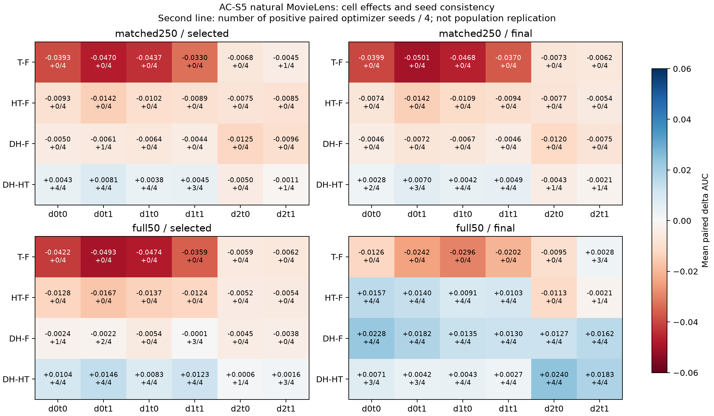
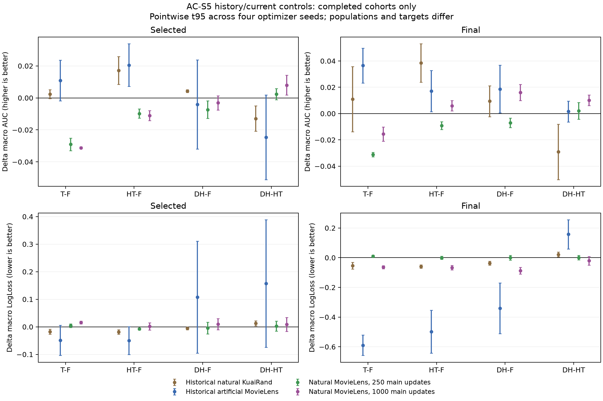

# AC-S5：自然人口Equal目标下历史/当前梯度控制完整分析

**状态：matched250与full50各16/16，合计32/32完整配置已完成。** 选模与配置冻结后，224份测试预测的1344个逐域任务指标已由主代理重新计算，误差均小于1e−12。本阶段训练/评价完成，整项研究及其他族的规定机制任务尚未全部完成。原历史CSV没有重载旧checkpoint/预测，证据层级分开。

## 1. 实际协议与控制身份

自然训练人口800167行，d0/d1/d2=155949/318599/325619；目标物理域固定d2。自然d2占40.694%，是最大域；旧人工d2占80%。两个任务仍为rating>3/rating>4。

原learned-fusion M3OE，两Adam主.01/arch.001、coupled L2=1e−5，50轮。普通拼接loader逐轮shuffle、无放回；matched250每轮取187500行，250主更新、9,375,000次主样本曝光，另50次architecture更新。full50逐轮扫描800167行，1000主更新、40,008,350次主曝光、50次architecture更新。两预算各自architecture实际曝光均2,009,934行，含原loader短尾；“匹配预算”指主更新/主曝光及arch步数，不能声称新旧全部样本曝光完全相同。

Equal每域α=1/3，三个逐行权重为1.710318/.837173/.819124，保留原per-row mean目标，不对target部分另行归一化。四臂在共享C和architecture A上控制：

|臂|进入持久Adam状态的梯度|用于参数位移的同前状态假想梯度|
|---|---|---|
|F|FULL|FULL|
|T|TARGET|TARGET|
|HT|TARGET|FULL|
|DH|FULL|TARGET|

保留原T的target-only shared访问、原持久optimizer step及HT/DH参数覆盖公式；private参数始终按FULL更新。这里同时改变m/v的长期历史，且共享/arch控制均存在，不能称为只改变一阶动量。

同seed两预算共八个run的初始参数SHA相同；每seed/预算内全部300或1050个实际批次（250或1000main+50arch）的row-ID哈希和domain counts在四臂完全相同。公式最大绝对残差约1.97e−6，loss分解≤2.99e−8，所有已测共享/arch步骤target梯度非零。原状态中的None条件均由producer强制检查。见[配对初始化](analysis/core/AC-S5/paired_initialization_identity.csv)、[跨预算初始化](analysis/core/AC-S5/cross_budget_initialization_identity.csv)、[批次身份](analysis/controlled_updates/paired_batch_identity.csv)、[公式记录](analysis/controlled_updates/control_formula_and_none_context.csv)。

matched250主训练累计独立支持，seed2022/23/24/25分别为800163/800167/800165/800166行；每轮无重复，跨轮有重复。相对于可用800167行，末轮仍未见主样本的行数分别4/0/2/1。可用人口与实际曝光分列，见[实际预算](analysis/controlled_updates/realized_main_arch_budgets.csv)、[逐域支持](analysis/controlled_updates/realized_main_support_by_domain.csv)。

## 2. 匹配预算结果：F的排名表现优于三种控制

所有数字为四优化seed均值，宏指标等权平均六cell，非pooled AUC。

|臂|selected宏AUC / LL|final宏AUC / LL|
|---|---:|---:|
|F|.767579 / .510646|.767067 / .509515|
|T|.738540 / .515196|.735865 / .520167|
|HT|.757820 / .503020|.757892 / .509035|
|DH|.760251 / .505755|.759977 / .509308|

|比较|selected ΔAUC [点态t95]|正/负seed|selected ΔLL（改善seed）|final ΔAUC|final ΔLL|
|---|---|---|---:|---:|---:|
|T−F|−.029039 [−.032993,−.025085]|0/4|+.004551（1/4）|−.031202|+.010652|
|HT−F|−.009759 [−.012592,−.006926]|0/4|−.007626（4/4）|−.009175|−.000480|
|DH−F|−.007328 [−.012798,−.001859]|0/4|−.004891（3/4）|−.007090|−.000207|
|DH−HT|+.002430 [−.001049,+.005909]|4/0|+.002735（2/4）|+.002085|+.000273|

T/HT/DH相对F的final宏AUC也均4/4下降；HT/DH final LL各2改善2变差。HT selected在四seed均以较低LL伴随较低AUC，不能说“完全无效”，也不能按排名损害推出训练目标损失一定变差。四seed区间仅描述固定人口的优化差异，未校正多重比较，历史test已复用。

### 公共训练阶段没有消除负差

|宏AUC差|完成E10|E20|E30|E40|E50|
|---|---:|---:|---:|---:|---:|
|T−F|−.023442|−.025507|−.028063|−.028797|−.031202|
|HT−F|−.005306|−.007323|−.009988|−.009838|−.009175|
|DH−F|−.003768|−.004838|−.008834|−.007389|−.007090|

以上15个比较各为四seed全负，因此本预算下的负差并非只由不同selected轮次造成。F/T/HT/DH的选中完成轮次，按2022–2025顺序分别为43/48/46/31、43/48/36/32、47/42/50/49、48/44/48/50。原文件`common09`表示完成E10，`common49`与final是同一E50模型，不能当独立重复证据。

## 3. matched250的target、non-target与逐任务反例

F selected的域平均AUC为d0=0.768629、d1=0.782360、d2=.751748；最大d2的基线最低，大小不是困难度的定义。

|比较|selected target d2 ΔAUC|selected non-target ΔAUC|task0宏ΔAUC|task1宏ΔAUC|
|---|---:|---:|---:|---:|
|T−F|−.005644|−.040737|−.029928|−.028151|
|HT−F|−.008006|−.010635|−.008987|−.010530|
|DH−F|−.011061|−.005462|−.007959|−.006698|
|DH−HT|−.003055|+.005173|+.001029|+.003832|

前三种控制相对F的target和non-target域平均AUC各4/4下降，两个任务宏AUC也各4/4下降。HT−F的六个cell在四seed中全部AUC下降：

|cell|F selected AUC|HT−F ΔAUC|HT−F ΔLL|
|---|---:|---:|---:|
|d0t0|.761630|−.009267|−.022225|
|d0t1|.775629|−.014170|−.018961|
|d1t0|.773373|−.010174|−.004253|
|d1t1|.791347|−.008930|−.009660|
|d2t0|.744056|−.007521|+.007282|
|d2t1|.759441|−.008491|+.002060|

HT相对F的target LL在四seed变差（域平均+.004671），non-target LL在四seed改善（−.013775）。风险与排名的分布并不相同。[完整逐cell](analysis/core/AC-S5/paired_cell_deltas.csv)、[逐域](analysis/core/AC-S5/paired_domain_deltas.csv)、[逐任务](analysis/core/AC-S5/paired_task_deltas.csv)保留全部臂、阶段及seed。

“小域改善/大域下降”也必须按比较定义：T/HT/DH相对F的selected/final严格“两较小域均改善、最大域下降”均0/4；但DH−HT在selected为3/4、final为2/4。这个候选之间的条件取舍确实出现，不能据前三个0/4推不存在任何取舍；DH与HT的宏AUC又都低于F，不构成整体新方法收益。

## 4. 全预算：selected仍下降，末轮与逐域取舍发生反转

### 4.1 宏结果及基线后期变化

|臂|selected宏AUC / LL|final宏AUC / LL|选中完成轮次（2022–2025）|
|---|---:|---:|---|
|F|.772135 / .501806|.743962 / .619058|13/11/14/12|
|T|.740972 / .517492|.728406 / .555415|13/13/18/21|
|HT|.761098 / .503368|.749927 / .552714|15/17/18/16|
|DH|.769065 / .511791|.760022 / .531980|32/19/26/24|

|比较|selected ΔAUC（正/负seed）|selected ΔLL|final ΔAUC [点态t95]|final ΔLL|
|---|---:|---:|---|---:|
|T−F|−.031164（0/4）|+.015686|−.015556 [−.021001,−.010111]|−.063643|
|HT−F|−.011038（0/4）|+.001562|+.005965 [+.002098,+.009833]|−.066344|
|DH−F|−.003070（1/3）|+.009985|+.016059 [+.009962,+.022157]|−.087078|
|DH−HT|+.007968（4/0）|+.008422|+.010094 [+.006136,+.014053]|−.020734|

full50的HT/DH相对F，final宏AUC均4/4改善、宏LL均4/4改善；T final宏AUC仍4/4下降，LL却4/4改善。selected则HT AUC四负、DH只有一正，T/DH宏LL均四seed变差，HT宏LL三差一好。不能用末轮正差掩盖selected负差，也不能按selected负差删掉末轮稳定救援。

F从selected .772135/.501806变为final .743962/.619058；DH也由自己的selected .769065/.511791降为final .760022/.531980。末轮相对F的改进与F后期风险升高并存，不是DH取得更高selected最优值。这里未把损失变化分解为校准、分辨率或具体失活机制。

### 4.2 HT的宏改善包含稳定的域间取舍

full50 HT−F selected六cell AUC仍各4/4下降；两个任务宏差−.010560/−.011515，也各四负。final task0/task1宏差转为+.004540/+.007390，分别3/4与4/4正。更关键的是：

|比较/阶段|target d2 ΔAUC / LL|non-target ΔAUC / LL|
|---|---:|---:|
|HT−F selected|−.005280 / +.003415|−.013916 / +.000636|
|HT−F final|−.006671 / +.046714|+.012283 / −.122873|
|DH−F selected|−.004144 / +.006112|−.002533 / +.011921|
|DH−F final|+.014459 / −.065956|+.016860 / −.097638|

HT final的target AUC四负、LL四差；non-target AUC四正、LL四改善。逐cell final AUC差，d0t0/d0t1/d1t0/d1t1为+.015736/+.013987/+.009149/+.010261，各四正；d2t0/d2t1为−.011263/−.002078，分别0正4负、1正3负。严格“两较小域均改善、最大域下降”在HT−F final为**4/4**。自然人口中这一条件取舍确实存在，并不是只存在于人工比例；它依赖干预与阶段，不由域大小单独解释。

DH final相对F的六cell AUC全部4/4改善，两个任务宏AUC+.016331/+.015787、宏LL−.105236/−.068919均四seed同向。因此full50末轮存在不需要上述AUC取舍的控制。DH−HT的严格取舍在selected为2/4、final为0/4，与matched250的3/4、2/4不同。所有对照统一保存在[取舍表](analysis/core/AC-S5/domain_size_tradeoffs.csv)，不可只选一种参照概括。

[逐cell图PDF](analysis/core/AC-S5/controlled_cell_effects.pdf)。统一色标，第二行表示四个配对优化seed中正差个数，不是独立总体重复数。

### 4.3 从公共阶段与同人口预算交互辨别解释

|full50宏AUC差|完成E10|E20|E30|E40|E50|
|---|---:|---:|---:|---:|---:|
|T−F|−.031067|−.027748|−.024771|−.020555|−.015556|
|HT−F|−.013278|−.008013|−.003845|+.000632|+.005965|
|DH−F|−.009241|−.000843|+.005414|+.012650|+.016059|

HT在E10/E20/E30四负，E40三正一负，E50四正；DH在E30/E40/E50均四正。与matched250所有公共点前三臂四负不同，训练进度确实改变了本人口下的相对现象。

同seed、同初始模型、同自然人口的full50−matched250：

|臂|selected ΔAUC|final ΔAUC|final ΔLL|
|---|---:|---:|---:|
|F|+.004556|−.023105|+.109543|
|T|+.002432|−.007459|+.035248|
|HT|+.003277|−.007965|+.043679|
|DH|+.008815|+.000045|+.022672|

selected AUC四臂各4/4增加；final F/T/HT各4/4下降，DH只有1/4增加；final LL四臂均各4/4变差。末轮HT−F的预算交互为+.015140 [+.009772,+.020508]，DH−F为+.023150 [+.014475,+.031824]，均四正，见[交互表](analysis/core/AC-S5/control_by_budget_interaction_summary.csv)、[绝对预算效应](analysis/core/AC-S5/paired_budget_effect_summary.csv)。

这表明“同一自然人口的干预收益与预算无关”不符合数据。两预算main/arch步数比从5:1变20:1，主样本曝光比4.267557，主/辅助相对时钟也改变，仍不能唯一归因纯主更新时钟。F后期恶化、不同控制对拟合速度/步幅/目标的影响和共享/arch耦合是竞争解释。

## 5. 与旧自然KR、人工ML逐项对应

旧selected宏AUC差：

|比较|旧自然KR|旧人工ML d2_large|新自然ML matched250|新自然ML full50|
|---|---:|---:|---:|---:|
|T−F|+.002369（4/4正）|+.010839（4/4正）|−.029039（4/4负）|−.031164（4/4负）|
|HT−F|+.017127（4/4正）|+.020527（4/4正）|−.009759（4/4负）|−.011038（4/4负）|
|DH−F|+.004218（4/4正）|−.004047（2正2负）|−.007328（4/4负）|−.003070（1正3负）|

旧HT−F selected的target AUC差在KR/人工ML分别+.040806/+.016132，均4/4正；新自然matched250/full50为−.008006/−.005280，各4/4负；full50末轮HT target仍−.006671、四负。旧人工ML末轮HT target也曾为−.004041（1正3负），原target救援本就具有阶段边界。原“保留当前FULL、改变历史能救援target”的selected经验现象，在两种自然预算下没有复现；旧受控数据结果保留，其跨自然环境的一般化必须缩限。

matched250与旧ML主更新均250，主曝光预算相同，不能只用“自然总是多训练了”说明这一对照的方向差异。不过可用支持、域比例、域内ID/标签分布、重要性权重、arch短尾曝光及历史初始化身份仍非单因素控制；旧source/init/state缺口也不能由新初始化SHA填补。原F人工selected基线.718728，新F=.767579，反例需连同基线条件解释，而不是归为小域/困难域的普遍规律。详见[历史/新统一表](analysis/controlled_history/paired_summary.csv)。

[PDF](analysis/core/AC-S5/controlled_population_stage.pdf)。误差棒为四优化seed的点态t95；不同环境target物理含义不同，没有合并成独立重复。

## 6. 实际m/v、位移与竞争解释

matched250的新full-coordinate遥测在HT的C块E41–50显示，四seed的平均实际位移范数相对F为2.512–2.778倍；持久m范数比.392–.521，v范数比.225–.419。输入持久状态的target梯度较小，较小v与FULL假想当前位移放大兼容；但是参数路径、m/v、正则和architecture一起变化，以上比值没有唯一识别v或m的因果中介。full50对应HT位移范数比进一步为3.225–3.745，m比.508–.576、v比.123–.321，四seed同向；但其final只救援non-target，target更差。一个全局范数不能替代逐域功能方向。

新遥测是拼接全部坐标的L2范数、step后状态；原probe的持久范数是step前按tensor范数求和，不能将两个同名列直接比较。[逐seed窗口比值](analysis/controlled_updates/paired_seed_window_state_norm_context.csv)及[完整窗口统计](analysis/controlled_updates/seed_window_gradient_state_summary.csv)分列了记录来源。位移变大与AUC变好没有一一对应关系。

- **MEDIUM**：固定自然人口、四seed下，HT selected六cell负差在两预算重复；matched250的selected AUC/LL冲突、full50的末轮宏救援/target损害和预算交互均有数值支持。DH full50末轮六cell AUC四正也是稳定反例，不能只保留阴性。
- **STRONG（实施身份）**：四臂初始/批次一致、持久状态和覆盖公式按原协议执行；这不是算法收益强证据。
- **WEAK**：由新旧方向变化唯一归因人口规模、比例、Adam一阶历史或某个共享子模块。自然目标梯度的信号与权重、支持/频率以及相对优化时钟均是竞争解释。

本阶段已经用full50反证预算无关的解释，并发现末轮宏救援/target损害与selected负差共存。接下来完成既定Sample负边界S6及固定点诊断，判断Equal目标是否构成必要条件；不能在未完成前预写结论。后续若要区分m、v与瞬时步幅，需要预先设计同状态因子控制及冻结评价，不能由当前长期联合控制事后宣称已识别，也不在本次结果后自动增加训练。
