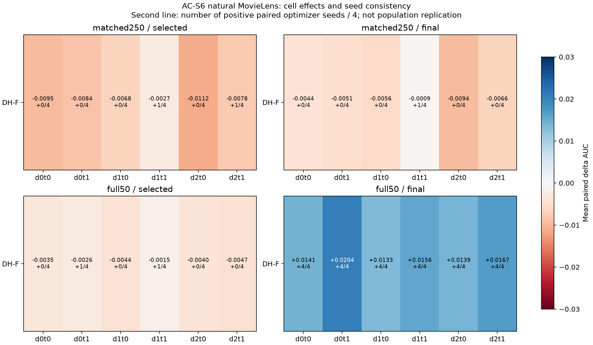
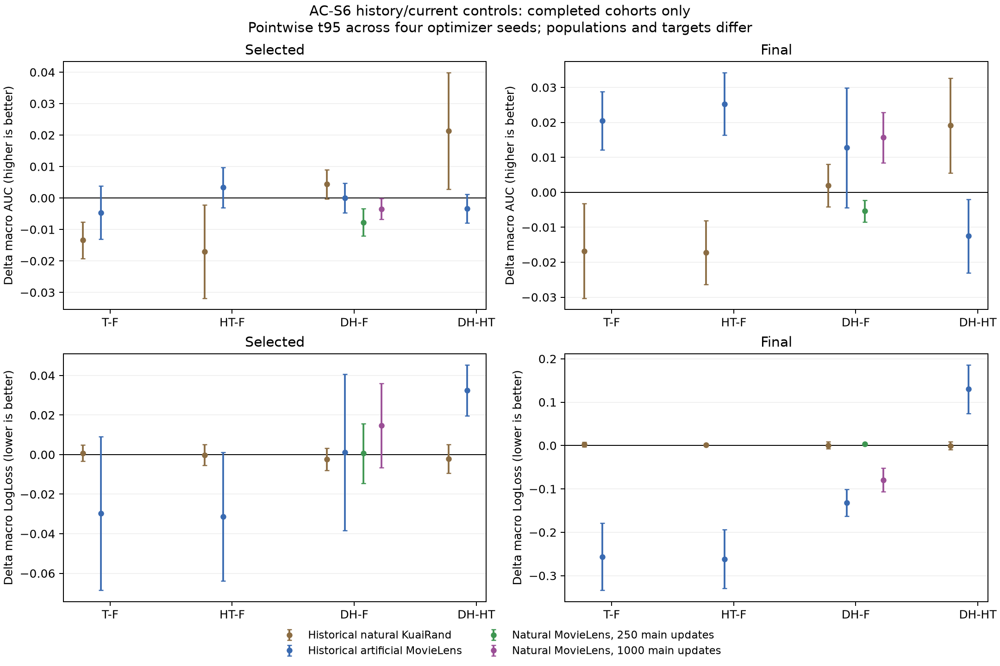

# AC-S6：Sample目标下FULL历史/TARGET当前控制（两预算完整完成）

**状态：matched250及full50各8/8，全部16配置完成。** 主代理只纳入完整四种子组，112份测试预测的672个cell已重算，误差<1e−12。S6阶段训练/性能分析完成；整项研究及其它机制任务仍在执行。

## 1. 协议、干预强度和实施身份

自然完整人口800167行，物理域d0/d1/d2=155949/318599/325619，target=d2；两任务rating>3/rating>4。保留原learned-fusion M3OE、主Adam .01/architecture Adam .001、coupled L2=1e−5，完整50轮。Sample目标α=p、逐行权重1，普通无放回shuffle；matched250每轮取187500行，250主更新、9,375,000主曝光；full50每轮完整自然人口，1000主更新、40,008,350主曝光。两组各50arch更新、实际2,009,934行arch曝光；main/arch次数比5:1与20:1不同。

F将FULL梯度写入持久状态并应用FULL假想位移；DH也写入FULL，但对共享C和architecture A应用同前状态的TARGET假想Adam位移；private仍FULL。target部分保留全batch平均口径，不重新归一化。这不是只改变m，也不是取消历史状态的实验。

Sample中target预期损失系数为p2：旧人工人口.8、新自然.406939；每个target cell系数为.4与.203469。它是目标系数，不是实际梯度/参数位移的范数比。新旧协议保留同一公式，人口变化也改变了干预的相对强度，不能把差异唯一归于总N或域内难度。Equal S5的target系数仍1/3，不能将这个Sample特有的系数变化当作全部S5/S6差异的唯一解释。

每seed两臂初始参数SHA相同，每预算300/1050个main/arch批次row-ID SHA及实际域计数一致；完整状态、持久更新和覆盖公式已记录。loss分解残差≤2.99e−8，history/applied公式最大1.943e−6，private FULL残差≤8.43e−7；记录的target零梯度步骤为0。matched250主训练累计独立支持按2022–2025为800163/800167/800165/800166行，每轮无重复，跨轮重复；可用支持、独立覆盖和曝光不是同一个量。来源见[实施身份](analysis/controlled_updates/control_formula_and_none_context.csv)、[批次](analysis/controlled_updates/paired_batch_identity.csv)、[支持](analysis/controlled_updates/realized_main_support_by_domain.csv)。

## 2. 匹配预算的宏结果和训练阶段

|读数|F AUC / LL|DH AUC / LL|ΔAUC [四seed点态t95]|ΔLL [点态t95]|
|---|---:|---:|---|---|
|selected|.767585 / .509071|.759869 / .509691|−.007716 [−.012099,−.003333]|+.000620 [−.014512,+.015753]|
|final|.766854 / .509872|.761512 / .513175|−.005342 [−.008429,−.002254]|+.003304 [+.000535,+.006073]|

AUC两个读数均0正4负；selected LL两好两差，final LL四seed均变差。train-p加权cell AUC差selected/final为−.007481/−.005485，均四负；它仍是cell AUC的加权平均，不是pooled AUC。

完成E10/E20/E30/E40/E50的宏AUC差为−.001989/−.004927/−.006741/−.006382/−.005342；E10一正三负，E20以后均四负。不能说从初始化起所有阶段都严格同号，也不能仅用selected轮次差解释后续公共点的负差。

F的选中完成轮次为45/42/50/50，DH为48/50/48/49。接近预算末端不证明收敛。DH final测试AUC高于其selected测试AUC，不改变预先按validation选择的规则；没有按test重新选点。原common49与final同为E50，不能当独立重复。

## 3. 匹配预算的逐域任务和难度

F selected的域平均AUC为d0约.770457、d1约.780881、d2约.751416；最大域d2的基线最低，不能用大小定义难度。

|cell|F selected AUC|DH−F selected ΔAUC / LL|DH−F final ΔAUC / LL|
|---|---:|---:|---:|
|d0t0|.762947|−.009459 / −.000406|−.004356 / +.000023|
|d0t1|.777967|−.008442 / −.003999|−.005149 / +.000878|
|d1t0|.772525|−.006785 / +.016407|−.005636 / +.012375|
|d1t1|.789236|−.002656 / −.011671|−.000903 / +.001658|
|d2t0|.744081|−.011183 / +.003590|−.009379 / +.004167|
|d2t1|.758750|−.007771 / −.000199|−.006627 / +.000722|

六cell平均AUC差均为负，但selected的d1t1/d2t1各有1个正seed，final d1t1有1个正seed，不能改写为每个cell全部四负。两个任务宏AUC差selected为−.009142/−.006290、final为−.006457/−.004226，各四seed全负。selected task0 LL+.006530（三差一好），task1 LL−.005290（三好一差），任务损失方向不同。

selected target/non-target AUC差−.009477/−.006835、final −.008003/−.004011，全部各四负。final target LL+.002445（三差一好），non-target LL+.003734（四差）。selected/final严格“两较小域均改善、最大域下降”均0/4。完整seed和公共阶段见[逐cell](analysis/core/AC-S6/paired_cell_deltas.csv)、[逐任务](analysis/core/AC-S6/paired_task_deltas.csv)、[历史/新target表](analysis/controlled_history/paired_summary.csv)。

[PDF](analysis/core/AC-S6/controlled_cell_effects.pdf)。第二行是正差seed数，不是独立总体确认。

## 4. 旧结果与本次自然边界

|条件|selected Δ宏AUC|selected Δnon-target AUC|final Δ宏AUC / LL|
|---|---:|---:|---:|
|原自然KR S6|+.004366（4/4正）|+.006757（4/4正）|+.001927 / +.000848|
|原人工ML S6|+.000022（2正2负）|约−.000002（2正2负）|+.012765 / −.131834|
|旧自然KR B1重建，主R0|+.000363（2正2负）|+.000579（2正2负）|另见原完整阶段表|
|新自然ML matched250|−.007716（4/4负）|−.006835（4/4负）|−.005342 / +.003304|
|新自然ML full50|−.003445（4/4负）|−.003011（4/4负）|+.015659 / −.079539|

旧人工ML的selected近零并非已证明严格等效，末轮还存在三seed正AUC、四seed LL改善。KR原S6与B1重建身份/初始化不同；B1的R1/R4还保留non-target正线索，它们不是新自然S6本次执行的选模规则。原历史数据、法证重建、新自然人口分别报告，不能混成一组四seed或指认旧报告因此错误。详见[历史重建](HISTORICAL_NUMERIC_RECONSTRUCTION.md)。

自然S5 Equal matched250的DH−F selected/final AUC为−.007328/−.007090，各四负；Sample S6也四负。**MEDIUM**：本自然人口/预算下的DH排名损害不限于Equal目标。它没有识别哪个状态变量必要；完整预算后期在Equal与Sample下都出现DH相对救援，不能将匹配组负差外推到全部预算。

[PDF](analysis/core/AC-S6/controlled_population_stage.pdf)。旧KR target=d1，新ML target=d2；不同环境没有充当独立模型重复。

## 5. 完整自然预算：selected与final相反

|读数|F AUC / LL|DH AUC / LL|ΔAUC [四seed点态t95]|ΔLL [点态t95]|
|---|---:|---:|---|---|
|selected|.772478 / .501591|.769032 / .516323|−.003445 [−.006726,−.000164]|+.014732 [−.006525,+.035990]|
|final|.743109 / .620141|.758767 / .540602|+.015659 [+.008430,+.022887]|−.079539 [−.106656,−.052423]|

selected AUC四负、LL四差；final AUC四正、LL四好。train-p加权cell AUC差为−.003537/+.015329，同样四负/四正。F选中轮次17/11/14/12，DH28/29/23/21；各自选中指标不可当作共同theta反事实。F从selected到final明显下降，DH也下降，但幅度较小。final相对F的改善不代表DH有更高的最佳可选性能。

共同E10/E20/E30/E40/E50宏AUC差−.007853/−.001030/+.006247/+.015141/+.015659；方向seed数依次0/4、2/4、4/4、4/4、4/4为正。相应LL差+.007408/−.004383/−.031469/−.056440/−.079539，E30以后均四好。这是在共同轮次/不同theta的长期干预结果，不是选点差异单独制造的反转。

### 完整预算的逐cell与目标域

|cell|selected ΔAUC / LL|final ΔAUC / LL|
|---|---:|---:|
|d0t0|−.003491 / +.007564|+.014129 / −.106485|
|d0t1|−.002579 / +.009888|+.020395 / −.072656|
|d1t0|−.004441 / +.023172|+.013296 / −.085345|
|d1t1|−.001535 / +.015142|+.015572 / −.054603|
|d2t0|−.003950 / +.018138|+.013865 / −.092831|
|d2t1|−.004677 / +.014490|+.016695 / −.065316|

final六cell AUC及LL均各四seed改善。selected六cell平均AUC均负，但d0t1/d1t1各1个seed正，其余四cell全负；不要把平均同号写成全部24点同号。selected两个任务宏AUC差−.003961/−.002930均四负、LL+.016291/+.013174均四差；final两个任务AUC差+.013763/+.017554均四正、LL−.094887/−.064192均四好。

selected target/non-target AUC差−.004313/−.003011均四负；final+.015280/+.015848均四正。selected target LL+.016314（三差一好）、non-target+.013941四差；final−.079073/−.079772均四好。selected/final严格两较小域改善而最大域下降均0/4。E20公共点有1/4满足该符号，不能据此宣称从未出现；晚期DH改善主要是三个域共同改善，不同于S5 HT的晚期target代价。

### 预算×干预交互

full−matched selected宏AUC，F+.004893、DH+.009164，均四正；final F−.023745（四负）、DH−.002745（一正三负）。final LL full−matched F+.110269、DH+.027426，均四差。完整预算提高可选AUC，并不同时改善末轮风险。

DH−F的预算交互(full差减matched差)：selected AUC+.004271，四正，点态t95[+.000209,+.008332]；final+.021000，四正，[+.011969,+.030031]。final LL交互−.082843，四好，[−.108578,−.057108]。两预算同seed初始参数一致、各自F/DH实际批次一致；仍同时改变main次数/曝光与main:arch比例，故不能唯一称为纯优化步数或moment时钟的因果效应。见[预算配对](analysis/core/AC-S6/paired_budget_effect_summary.csv)、[交互](analysis/core/AC-S6/control_by_budget_interaction_summary.csv)。

## 6. 更新遥测、证据强度及解释边界

matched250的C块E41–50中，DH/F实际位移范数比.840–.970（四seed更小），持久m范数比1.112–1.771（四seed更大），v范数比.988–1.145（一低三高）。较大m或较小位移都不是有效训练的充分指标。两个长期路径的theta和后续状态已不同；这些量不是同theta的单一中介检验。新遥测为step后拼接全坐标L2，与原probe的step前tensor范数求和分开。见[逐seed窗口](analysis/controlled_updates/paired_seed_window_state_norm_context.csv)。

full50的同一C窗口，DH/F位移范数比.964–1.057（两低两高），m比1.190–1.587（四高），v比.385–.545（四低），raw gradient比.570–.699（四低）。matched与full均有较大的m，但性能方向不同；full末轮AUC/LL救援不要求实际位移范数四seed一致缩小或放大。v差异与路径性能相关，尚不是同状态v必要性证明。

- **STRONG**：固定人口的Sample/target系数、配对初始化/实际批次身份与更新公式。它们是实施/算术证据。
- **MEDIUM**：matched250 selected/final宏、两任务及target/non-target AUC四负，末轮宏LL四差，且E20后的公共点保持负差。
- **MEDIUM**：full50 selected宏/任务/target/non-target AUC下降，而E30后至final AUC与LL改善，且final六cell均四seed改善；两预算final交互四seed同号。该重复现象足以反驳“DH在自然ML所有阶段必然有害”，也没有支持selected泛化稳定收益。
- **WEAK**：把跨人口方向变化唯一归因N、target份额、共享结构、m或v。重要性权重在Sample始终为1，仍不排除实际梯度几何、干预相对强度、独立支持和训练进度的改变。

既定full50已实际区分出“匹配组所有后期点负差”与“完整预算后期救援”：S5与S6均保留selected较差、末轮较好的DH现象，旧人工S6也有selected近零/final正差，故阶段性不是自然数据独有。剩余规定机制/训练继续执行，不自动扩展本组矩阵。最有判别力的后续研究应先固定同theta/同m,v与当前batch，因子化TARGET当前分子与历史预条件，而非按test搜更有利LR。若要另检验Sample target强度，应在新结果前设计固定人口/显式目标系数控制；本次不事后改写target归一化。
