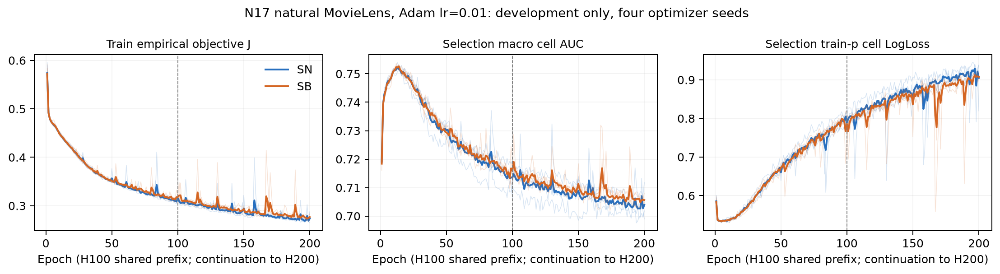

# N17 H100/H200训练与开发记录（未读test）

**本版范围：64个正式H100及8个条件H200配置全部完整；N2/N3及test闭锁尚待后续规定流程。** 原16pilot单列N17_PILOT_ANALYSIS，不混入正式四seed。本文件不报告测试效果，也不根据开发结果改变候选或预算。

## 完整预算核对

formal .0003/.001/.01×双q×四seed共24，quota .01×双q×四seed共8：每配置100轮、2000主更新、80,016,700曝光。matched-budget与matched-N各16：每配置100宏轮/轮、500更新、18,750,000曝光。64配置合计原始训练receipt均COMPLETE_TRAINING_TEST_DEFERRED，100轮有限轨迹与每轮六cell selection指标一致，earliest maximum选点及累计更新/曝光与receipt一致。没有使用不完整seed组。

## selection-only q差异

Δ=SB−SN，数值是**曾用于选模的selection半集**；不能作为独立测试确认。每行两种读数各4seed，所有点态t95 AUC区间均跨零。

|人口/预算，LR|selected ΔAUC（正/负seed）|final ΔAUC（正/负seed）|
|---|---:|---:|
|完整自然，.0003|+.000400（3/1）|−.001189（2/2）|
|完整自然，.001|−.000261（2/2）|+.000547（2/2）|
|完整自然，.01共同/own|+.000481（3/1）|+.002420（4/0）|
|完整支持匹配曝光，.0003|−.000388（1/3）|−.000032（1/3）|
|完整支持匹配曝光，.001|−.000284（2/2）|+.000575（3/1）|
|匹配N，.0003|+.000057（2/2）|+.001811（3/1）|
|匹配N，.001|+.000097（3/1）|+.000571（2/2）|
|完整自然quota，.01|−.000458（1/3）|−.000727（1/3）|

## .01正式共同LR的阶段背景

|q/读数|selection AUC|selection LL|完整训练经验目标J|完成epoch均值|
|---|---:|---:|---:|---:|
|SN selected|.752435|.539590|.439341|13.00|
|SB selected|.752917|.540163|.438487|13.50|
|SN final|.713541|.787096|.315269|100|
|SB final|.715961|.796934|.318188|100|

SN选轮13/13/14/12，SB14/14/14/12。训练J继续下降、selection风险上升与排名下降并存，说明按训练J定义的平台门控和验证选点回答不同问题；H200若按J规则触发仍须执行，不能因这里已过selection峰值取消。已冻结H200门控实际触发：SN平均rho=.030705、SB=.020324，两个q均4/4正且均超过.005；全部8个共同LR配置继续到200轮。主代理从原完整训练J独立复算八个rho（残差<1e−12），保留[原门控](analysis/n17_development/plateau_frozen.json)、[追加配置](analysis/n17_development/H200_manifest.json)与[逐seed复算](analysis/n17_development/plateau_rule_recalculation.csv)。H100原件保留，8个H200现已完整完成；详见后节。

**STRONG**：当前完整预算、选点身份与有限开发记录事实。**WEAK**：开发半集中的差异代表总体泛化、或quota的gap变化由计数噪声单独造成。这里的每臂selected是各自验证峰值，点态区间未修正选择和多重性；common/own均.01为同一组模型，不算两次复现。逐cell/test、同状态机制及多预算比较仍按原冻结流程完成。

来源：[逐seed开发读数](analysis/n17_development/seed_selection_readouts.csv)、[完整训练/selection轨迹](analysis/n17_development/training_and_selection_trajectories.csv)、[四seed配对表](analysis/n17_development/selection_q_contrast_summary.csv)、[源文件SHA](analysis/n17_development/source_index.csv)。分析器没有打开任何test工件，状态JSON明确test_read=false、recipes_changed=false。

## 相同权重的概率风险与重加权分解

训练J为人口权重下的经验风险，selection表主LL为六cell等权；直接相减不是已识别的过拟合机制。按**固定train p**重新加权同一selection预测，SN selected/final LL为.540765/.789881，SB为.540836/.785877；selection实际域比加权则SN .540116/.788597、SB .540470/.792108。不同权重均保留了末轮风险升高，权重差不足以解释全部阶段变化；校准、分布差异与表示/优化仍未独立识别。

同一组formal .01 final预测的SB−SN：宏LL+.009838（三差一好），train-p加权LL−.004005（三好一差），selection实际域比加权LL+.003511（三差一好），三者点态t95均跨零。域平均LL差d0+.076212、d1−.016541、d2−.030157；train-p将d0权重从1/3降至.194896，造成均值符号改变。固定预测下这是可精确计算的评价函数变化，**STRONG有限算术事实**，不是改变训练或证明某一种评价正确。该验证半集已参与选模，正式test结果及泛化含义仍待闭锁后评价。新分析CSV同时保存宏/指定人口cell AUC与LL，不将加权cell AUC写成pooled。

## H200条件延长：训练目标与开发性能分离

八配置均为原H100的**续训**，累计200轮、4000主更新、160,033,400曝光；不是八个独立从头200轮复现。父receipt、selection和门控SHA保持一致；前100轮六项轨迹逐项残差0，前100个模型索引SHA逐一相同。见[前缀身份](analysis/n17_development/H200_prefix_identity.csv)；这是索引绑定核对，测试冻结还将独立检查实际模型bytes。

|q|E200 selection AUC / LL|E200训练J|E200−E100 AUC（t95）|E200−E100 LL（t95）|
|---|---:|---:|---:|---:|
|SN|.703946 / .902135|.273634|−.009595 [−.018539,−.000652]|+.115040 [.033861,.196218]|
|SB|.705633 / .925512|.276745|−.010329 [−.016875,−.003782]|+.128579 [.066876,.190281]|

每个q均4/4 AUC下降、4/4 LL升高，同时4/4训练J下降，平均J变化SN−.041634、SB−.041443。固定train-p重加权selection LL也分别升高+.114973/+.121552，均4/4且点态t95不含零；不能仅用宏权重差解释。两臂所有选点仍在各自H100前缀（SN13/13/14/12，SB14/14/14/12），更长训练没有改变本组已选模型。

E200 SB−SN AUC+.001687（三正一负，t95[−.008524,.011898]），LL+.023377（三差一好，t95[−.069571,.116326]）。H100末轮AUC差四正不能外推成随训练单调增强的稳定收益；E200更不支持概率风险普遍获益。所有18个预定selection AUC点态q比较区间均跨零，未修正多重性。

**STRONG**：有限训练轨迹、前缀身份与预算事实。**MEDIUM**：固定人口和四优化seed上，额外100轮使训练风险与selection表现持续背离，且不因上述风险权重变化消失。**WEAK**：将其推广为总体过拟合原因、校准机制或任何采样器的普遍优劣。表示拟合/优化时钟、训练与selection分布差异、概率校准均是竞争解释；既定匹配预算/支持与后续逐cell测试是当前矩阵中的区分证据，不追加结果驱动搜索。

来源：[续训逐seed差](analysis/n17_development/H200_minus_H100_seed_readouts.csv)、[四seed差值区间](analysis/n17_development/H200_minus_H100_summary.csv)、[完整四seed读数](analysis/n17_development/selection_readout_summary.csv)。分析状态为72/72正式配置准入、无缺失、test_read=false。

[可导出PDF](analysis/n17_development/H200_development_trajectories.pdf)；[绘图数据](analysis/n17_development/H200_plot_data.csv)。
