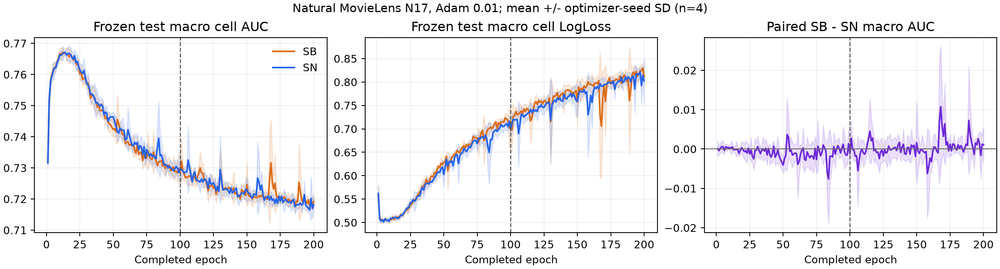

# N17自然MovieLens完整阶段分析

## 1. 完成范围、协议与证据单位

本阶段规定训练和触发追加均完成：16pilot、64正式H100、8条件H200；N2/N3基础48项及精度追加14项完成；72正式配置全部冻结后执行零更新test，pilot不进入正式test。模型真实bytes SHA冻结、配置/选模绑定和receipt见[冻结目录](analysis/n17_freeze/release_receipt.json)。8000个epoch预测（含H200共享前缀）及48000个记录cell已保存；主代理独立复算selected/final共864个预测cell，残差<1e−12。没有宣称8000个预测都由第二套指标实现重算。[分析凭证](analysis/n17/analysis_receipt.json)、[全部测试工件](analysis/n17_test_artifacts/index_status.json)。

模型为原N17固定融合结构、单Adam及耦合WD1e−5；本轮未另拟合ML校准器。任务为rating>3/>4，Sample目标α=p，IID SN q=p/SB q=uniform；quota按原整数配额归一化。自然base人口800167，三域155949/318599/325619，优化seed固定人口；正式四seed2022–25，pilot2030/31。LR对称grid由pilot冻结共同/两侧own赢家均.01，处于grid上界，不能称全局最优。common/own指向同组模型，不算独立重复。

H100完整人口2000更新、80,016,700曝光；matched-budget与matched-N各500更新、18,750,000曝光，同为100个macro epoch。matched-N187500保留自然比例；matched-budget使用完整支持。控制只注册.0003/.001，不能用赢家.01对控制做纯人口归因。H200复制且保持H100前缀，新增100轮/2000步/80,016,700曝光，累计200轮/4000步；[实际新增预算](analysis/n17_training_accounting/accounting_status.json)避免重复计算前缀。

每cell独立算AUC，再等权或指定p加权，不是pooled AUC。区间为固定人口下四优化seed的点态描述性t95，没有多重比较校正；相关模型、bank、cell与H200前缀都不是新的独立总体重复。历史test已反复暴露，本轮为探索性复现。

## 2. 全部同LR q比较

差值SB−SN；括号AUC为正/负seed、LL为变差/改善seed。下列18个AUC点态区间全部跨0，不能等同于严格等效或不存在任何轨迹效应。

|条件|阶段|SN AUC|SB AUC|ΔAUC（正/负）|t95|ΔLL（差/好）|
|---|---|---:|---:|---|---|---|
|formal_sameLR0.0003_SB-SN|selected|0.761950|0.762467|+0.000516（3/1）|[-0.001351,+0.002384]|-0.001656（0/4）|
|formal_sameLR0.0003_SB-SN|final|0.741064|0.741874|+0.000811（3/1）|[-0.002094,+0.003715]|-0.000108（3/1）|
|formal_sameLR0.001_SB-SN|selected|0.762752|0.762879|+0.000127（2/2）|[-0.004902,+0.005155]|-0.000661（1/3）|
|formal_sameLR0.001_SB-SN|final|0.719539|0.718253|-0.001286（0/4）|[-0.002955,+0.000384]|+0.014578（3/1）|
|formal_sameLR0.01_SB-SN|selected|0.767539|0.767283|-0.000256（1/3）|[-0.001016,+0.000503]|+0.001775（2/2）|
|formal_sameLR0.01_SB-SN|final|0.729910|0.728723|-0.001187（1/3）|[-0.003607,+0.001233]|+0.016585（3/1）|
|matched_budget_sameLR0.0003_SB-SN|selected|0.762065|0.762431|+0.000366（3/1）|[-0.000919,+0.001651]|-0.002472（2/2）|
|matched_budget_sameLR0.0003_SB-SN|final|0.760994|0.761503|+0.000509（3/1）|[-0.000976,+0.001993]|-0.001220（1/3）|
|matched_budget_sameLR0.001_SB-SN|selected|0.763433|0.763131|-0.000302（2/2）|[-0.003002,+0.002397]|-0.004533（0/4）|
|matched_budget_sameLR0.001_SB-SN|final|0.759339|0.760515|+0.001176（4/0）|[-0.000229,+0.002581]|-0.000460（2/2）|
|matched_n_sameLR0.0003_SB-SN|selected|0.743916|0.744336|+0.000420（3/1）|[-0.000623,+0.001463]|+0.001131（3/1）|
|matched_n_sameLR0.0003_SB-SN|final|0.714739|0.715493|+0.000754（3/1）|[-0.002388,+0.003897]|+0.005000（2/2）|
|matched_n_sameLR0.001_SB-SN|selected|0.743913|0.743790|-0.000123（2/2）|[-0.002266,+0.002019]|+0.003119（4/0）|
|matched_n_sameLR0.001_SB-SN|final|0.690954|0.687019|-0.003936（1/3）|[-0.011612,+0.003740]|+0.017210（3/1）|
|quota_sameLR0.01_SB-SN|selected|0.767658|0.766754|-0.000904（1/3）|[-0.003322,+0.001514]|+0.005308（3/1）|
|quota_sameLR0.01_SB-SN|final|0.726298|0.727314|+0.001016（2/2）|[-0.001609,+0.003642]|+0.003246（3/1）|
|H200_sameLR0.01_SB-SN|selected|0.767539|0.767283|-0.000256（1/3）|[-0.001016,+0.000503]|+0.001775（2/2）|
|H200_sameLR0.01_SB-SN|final|0.718136|0.719219|+0.001083（3/1）|[-0.006079,+0.008245]|+0.009069（2/2）|

共同LR .01选中SN .767539、SB .767283，Δ−.000256（一正三负）；test宏LL .510430/.512205，Δ+.001775（二差二好）。H100末轮q差AUC−.001187（一正三负）、LL+.016585（三差一好）。开发selection相同选中模型q差约+.000481（三正一负），末轮约+.002420（四正）；test对应为负，不能把开发正号推广为独立总体收益，也不能仅据不显著把它们视为相等。

.001末轮AUC四负（−.001286），但区间仍跨0；.0003选中LL四seed改善（−.001656），区间也跨0。不同指标、LR与阶段均保留。旧人工ML共同.001 selected−.010392、8/8负，末轮+.002114、5/8正且LL更差；新自然对应selected+.000127二正二负、末轮−.001286四负。旧KR Adam selected−.005203（一正七负）亦不是本轮−.000256的等价环境。旧formal ML种子2032–39，未与新2022–25伪造跨人口配对；旧人工主步/支持及pilot赢家也不同，不能唯一归因于p。

## 3. 预设时间窗口与quota

AULC严格使用已完成epoch指标的算术均值，未事后更换窗口。

|条件|窗口|ΔAUC（正/负）|t95|ΔLL（差/好）|
|---|---|---|---|---|
|formal_sameLR0.0003_SB-SN|AULC1_20|+0.000468（4/0）|[-0.000008,+0.000944]|+0.000153（3/1）|
|formal_sameLR0.0003_SB-SN|AULC1_100|-0.000230（2/2）|[-0.002875,+0.002415]|+0.001311（3/1）|
|formal_sameLR0.001_SB-SN|AULC1_20|-0.000286（1/3）|[-0.000933,+0.000360]|+0.000510（3/1）|
|formal_sameLR0.001_SB-SN|AULC1_100|-0.000894（2/2）|[-0.004499,+0.002710]|+0.008266（4/0）|
|formal_sameLR0.01_SB-SN|AULC1_20|+0.000066（2/2）|[-0.000495,+0.000628]|+0.000036（2/2）|
|formal_sameLR0.01_SB-SN|AULC1_100|-0.000832（1/3）|[-0.002712,+0.001049]|+0.006265（3/1）|
|quota_sameLR0.01_SB-SN|AULC1_20|-0.000012（2/2）|[-0.000592,+0.000567]|-0.000504（1/3）|
|quota_sameLR0.01_SB-SN|AULC1_100|+0.000229（3/1）|[-0.000705,+0.001162]|+0.003080（3/1）|
|H200_sameLR0.01_SB-SN|AULC1_200|-0.000241（1/3）|[-0.001841,+0.001358]|+0.006098（3/1）|

.0003早期1–20 AUC+.000468四正，但区间约[−.000008,+.000944]仍含0；共同.01早期+.000066二正二负，1–100−.000832一正三负。没有跨LR普遍早期收益。H200的1–100与H100完全同源，不当新重复。

quota不是通用改进：SN quota−IID selected AUC+.000119（二正二负），final−.003612（一正三负）；SB selected−.000529、final−.001409（均一正三负）。SN的1–100 AUC差−.001316四负、LL+.004692四差，后者点态区间[+.000607,+.008778]；早期1–20 AUC却+.000275四正且LL+.001781四差。quota×q交互1–100 AUC+.001060四正、区间约[−.000006,+.002126]，LL−.003185四改善、区间跨0。计数项局部小不能推出quota无任何时间效应，更不能把消除计数波动等同于性能改善。[交互全表](analysis/n17/quota_by_q_interaction_summary.csv)。

## 4. 更新/曝光与支持控制

下面均保持相同LR、同q配对；matched-N−matched-budget同时改变支持和单样本重复频率，不是单独改变抽象N。formal−matched-budget保持完整支持，但增加更新/曝光并改变选模轮次对应的优化时钟。

|对照|阶段|ΔAUC（正/负）|t95|ΔLL（差/好）|
|---|---|---|---|---|
|matched_n-minus-matched_budget_SN_lr0.0003|selected|-0.018149（0/4）|[-0.019057,-0.017242]|+0.012316（4/0）|
|matched_n-minus-matched_budget_SN_lr0.0003|final|-0.046256（0/4）|[-0.051605,-0.040906]|+0.131593（4/0）|
|formal-minus-matched_budget_SN_lr0.0003|selected|-0.000115（2/2）|[-0.002402,+0.002172]|-0.000036（2/2）|
|formal-minus-matched_budget_SN_lr0.0003|final|-0.019931（0/4）|[-0.025468,-0.014394]|+0.116052（4/0）|
|matched_n-minus-matched_budget_SN_lr0.001|selected|-0.019520（0/4）|[-0.024323,-0.014717]|+0.006020（4/0）|
|matched_n-minus-matched_budget_SN_lr0.001|final|-0.068385（0/4）|[-0.074661,-0.062109]|+0.429049（4/0）|
|formal-minus-matched_budget_SN_lr0.001|selected|-0.000681（2/2）|[-0.003631,+0.002268]|-0.001214（2/2）|
|formal-minus-matched_budget_SN_lr0.001|final|-0.039801（0/4）|[-0.044814,-0.034787]|+0.286953（4/0）|
|matched_n-minus-matched_budget_SB_lr0.0003|selected|-0.018095（0/4）|[-0.020100,-0.016090]|+0.015919（4/0）|
|matched_n-minus-matched_budget_SB_lr0.0003|final|-0.046010（0/4）|[-0.049195,-0.042825]|+0.137814（4/0）|
|formal-minus-matched_budget_SB_lr0.0003|selected|+0.000036（1/3）|[-0.001901,+0.001972]|+0.000779（3/1）|
|formal-minus-matched_budget_SB_lr0.0003|final|-0.019629（0/4）|[-0.024042,-0.015216]|+0.117165（4/0）|
|matched_n-minus-matched_budget_SB_lr0.001|selected|-0.019341（0/4）|[-0.022356,-0.016326]|+0.013673（4/0）|
|matched_n-minus-matched_budget_SB_lr0.001|final|-0.073497（0/4）|[-0.077430,-0.069564]|+0.446719（4/0）|
|formal-minus-matched_budget_SB_lr0.001|selected|-0.000252（1/3）|[-0.003368,+0.002863]|+0.002658（2/2）|
|formal-minus-matched_budget_SB_lr0.001|final|-0.042262（0/4）|[-0.046269,-0.038256]|+0.301990（4/0）|

相同500步/18.75M曝光下，matched-N的selected宏AUC比完整支持低约.0181–.0195、所有四seed负；final低约.0460–.0735。完整支持formal加到2000步后，selected变化小且区间跨0，final则低约.0196–.0423、各四负。由此完整支持与较少训练可同时优于N匹配或更长训练条件；总N、每行重复、ID支持/标签条件与优化时钟均是竞争变量。由于两种自然人口比例近乎相同，比例变化不能解释这些控制内部差异；但不能把支持差等同于仅由N造成的因果效应。

## 5. H200：训练继续优化与末轮风险恶化

预注册rhoJ平台门控已触发，两q四seed额外100轮均完整执行；选中模型仍为原12–14轮。训练J各四seed下降约.041，test selected保持同一模型、差值精确0。

|E200−E100|Δtest AUC（正/负）|t95|Δtest LL（差/好）|t95|
|---|---|---|---|---|
|SN|-0.011774（0/4）|[-0.018059,-0.005490]|+0.102583（4/0）|[+0.023637,+0.181529]|
|SB|-0.009504（0/4）|[-0.017629,-0.001380]|+0.095068（4/0）|[+0.059423,+0.130713]|

所有domain均值的续训AUC各四负、LL各四差；任务均值LL同样两q各四差。AUC任务边界：SB task1为三负一正，其余三个q×task均四负，不能写为所有任务都四负。47/48 seed×cell AUC下降，47/48 LL升高：SN2022 d0/task1 LL反而−.028988（AUC−.000695）；SB2023 d2/task1 AUC+.005686但LL+.032913。

开发阶段LL 48/48升高，故当时逐配置任意非负cell权重的恶化身份成立；test仅47/48，不能把该“逐配置任意权重”命题直接搬过来。四seed均值层面的12个q×cell LL差仍全正（最小+.059420），所以固定四seed平均风险在任意非负归一化cell权重下仍升高；这个有限算术结论与每个seed的结论不同。**STRONG**有限权重身份，**MEDIUM**固定人口的阶段恶化，**WEAK**唯一校准/过拟合原因。[逐cell计数](analysis/n17/H200_test_continuation_cell_status.json)。

图为四优化seed均值±seed SD，虚线为E100共享前缀边界；不是独立总体置信区间，也未按test重选模型。

## 6. 物理域、任务、基线与取舍

共同.01的q差按两个任务等权汇总如下；d0最小，d2最大，d1/d2规模接近，大小不是难度定义。

|读数|d0 ΔAUC/ΔLL|d1 ΔAUC/ΔLL|d2 ΔAUC/ΔLL|
|---|---|---|---|
|formal_commonLR_SB-SN/selected|-0.000975/+0.005439|+0.000055/+0.002408|+0.000151/-0.002523|
|formal_commonLR_SB-SN/final|-0.007803/+0.079300|+0.002752/-0.009221|+0.001490/-0.020324|
|H200_sameLR0.01_SB-SN/final|-0.007656/+0.101957|+0.006148/-0.037794|+0.004759/-0.036955|

H100末轮最小域d0 AUC−.007803、四负，LL+.079300四差；d1/d2 AUC均值反而正，各三正一负。严格“两较小域改善且最大域下降”共同LR selected/final均0/4；反向的“d0下降、d1和d2都上升”末轮2/4。H200末轮q差仍是d0四负、d1/d2各三正；不能统一描述为小域受益/大域受损。selected两个task的q差分别−.000565（三负一正）/+.000052（二正二负），final−.001614（二正二负）/−.000760（一正三负），宏符号不能代替任务结论。

selected六cell中d1/task1 AUC+.000877四正，d2/task0+.000582四正，其他cell方向混合；末轮d0两个task各四负，d2/task1 LL四改善。这些是相关且未经多重校正的局部边界，不能挑出两格写成总体收益。[全部cell区间](analysis/n17/four_seed_cell_summary.csv)、[所有配方大小取舍](analysis/n17/domain_size_tradeoffs.csv)。

按原SN选中模型的逐域/任务绝对AUC与LL保留于all_test_cell_metrics，结合paired表baseline_auc判断难度；本轮最大域没有因规模大就保证最佳基线，也不把四seed误当独立域样本。更完整支持显著提高绝对性能而q差仍小且阶段依赖，使域大小/支持成为绝对性能的合理解释变量之一，但不足以作为采样效果的唯一主解释。

## 7. 指标权重可改变方向，不能据此选结果

共同.01 H100 final宏cell AUC q差−.001187，固定train-p加权cell AUC却+.000181（二正二负）；eval-p仍−.000560。各区间跨0，权重改变的有限算术事实不建立算法普遍收益。该final宏LL与train-p LL都为正（+.016585/+.003513），不能沿用开发阶段formal末轮的LL翻转。

另一个预先规定条件quota final的SB−SN宏LL+.003246（三差一好），train-p LL−.009701、四改善、点态区间[−.016955,−.002447]；eval-p−.002130、两差两好。共同IID的1–100宏LL+.006265、train-p−.000525也异号。必须一并报告，不能结果后挑权重；训练p、evaluation p及宏cell是不同目标，不是互相纠错的同一指标。[全权重原表](analysis/n17/paired_summary.csv)。

## 8. 机制重评、证据与后续辨别

N2/N3已在[N17机制报告](N17_MECHANISM_ANALYSIS.md)及[逐域任务补表](N17_CELL_MECHANISM_SUPPLEMENT.md)完整分析：自然人口仍有梯度trace的q差，计数项不是B40960 trace主量；固定previous-v线性映射已经反转P块更新方差排序，不能说当前分母非线性必需；P仅占总更新trace约.11%–.20%。N3 C_full一步AUC微小且区间跨0，追加到64/bank仍有精度不足，不能建立长期C/history必要性。旧N2是KR，不能把旧新trace差唯一归为ML人口调整。

**稳定重复现象 / MEDIUM**：同人口完整支持与匹配N的绝对性能差，以及同q继续训练末轮AUC下降/LL升高；q效应依赖LR、阶段、评价权重与cell。**矛盾 / 保留**：旧人工selected强负未在自然共同/同LR条件复现，开发/测试q均值方向也不同；早期、选中、末轮及quota并不统一。**STRONG**：同目标重要性恒等式、共享前缀身份、固定预测上的权重算术。**WEAK**：p为唯一因果变量、Adam历史必要性、严格等效或全局算法胜负。

竞争解释包括支持与重复频率、标签/特征分布、更新/曝光及选择时钟、坐标预条件与局部风险几何。当前控制已反驳“只由p/q标量或单个trace解释全部差异”，未唯一分离所有因素。若另设下一轮，优先在固定支持/同状态下预注册风险投影和坐标预条件对照，以可反证的端点检验机制；不要追逐本轮最优子块或延长到出现正号。本轮N4未自动触发新拓扑，冻结范围均已完成。

本报告完成N17阶段闭环；整项任务仍须core机制、AO04 test和N19/CM19完整实验，不能以本阶段替代全研究完成。

## 附表：共同LR选中模型test绝对基线

|cell|SN AUC/LL|SB AUC/LL|
|---|---|---|
|d0/task0|0.762385/0.606391|0.760876/0.616665|
|d0/task1|0.777053/0.421308|0.776612/0.421912|
|d1/task0|0.771117/0.588669|0.770349/0.590816|
|d1/task1|0.789401/0.391763|0.790278/0.394433|
|d2/task0|0.745279/0.602039|0.745862/0.600515|
|d2/task1|0.759999/0.452414|0.759719/0.448892|
