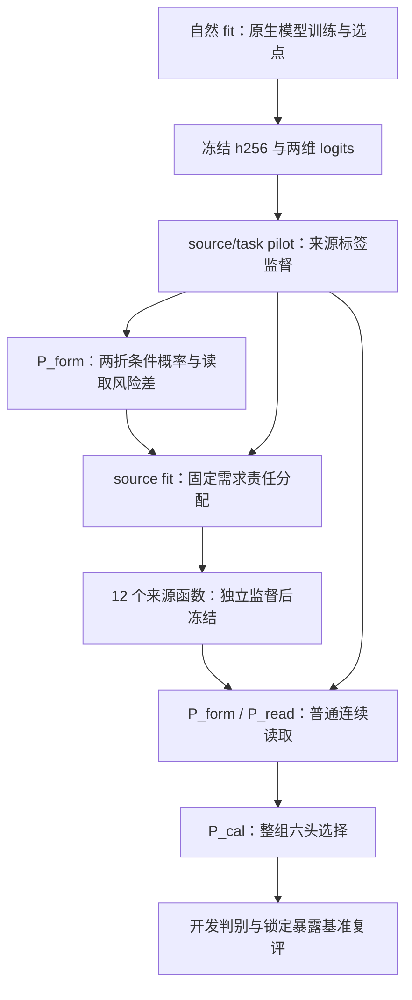

# MDMT 研究重设计：需求条件来源函数形成

**版本：DFD-v4.0｜日期与文献截止：2026-10-26｜阶段：研究设计完成，新训练尚未执行。**

本方案以 `2026-10-25_15-56-04` 分支的 v3 完整实验为主要依据，对上轮 RHD/LPS 假设作重新判断，选定一条主线并给出可直接交付 Codex 的实现、实验和停止规范。目标发布目录为 `research_plans/2026-10-26/`；上传任务第九节的目录仅为建议，第十节的明确发布目录在此采用。

## 1. 这轮最重要的决定

**唯一完整主线：需求条件来源函数形成（Demand-conditioned Function Development，DFD，暂定工作名）。**

它研究的不是再增加一个 gate，而是：同一目标域内部可预测的知识需求，能否组织来源域自身的监督学习，形成在相同普通读取器下更有用的函数？新方法冻结原生表示，先建立来源监督 pilot；用目标条件概率解析读取风险差；将需求转换成每个来源样本在两个意图函数间的责任；保持每行总责任不变；形成后冻结函数库，再用普通连续概率混合读取。

RHD 保留有限的共享/私有更新四叉诊断，不列为第二条完整研究线。旧 PB 的晚期风险减损仍值得解释，但正式 selected 结果没有支持其最佳可用模型优势，当前信息与更保守的动作占用率也没有分开。

## 2. 从 v3 得到的五项重新认识

1. **较好终点与较好选点是不同目标。** KR 正式 PB_HB−BASE 的 selected test 平均 ΔLL 为 `+0.00074075`；epoch50 为 `−0.00875428`。所有20条正式轨迹终点都比自己的合法selected风险更高。因此晚期“少恶化”不能直接改写为最佳泛化提升。[正式结果](https://github.com/Caelestis1903/My-Research-Project/blob/8a4b3b296ca5dc7349956fae9eca5e202aefe2c0/research_reports/2026-10-25_v3/FORMAL_LOCKED_REEVALUATION.md)
2. **可读、可条件读取和值得重新形成，是三个命题。** 普通foreign读取有有限开发收益，固定bank条件读也有小机会；但L4完整形成未稳定超过简单方法。不能因删除来源会变差就断言元形成必要。[LPS结果](https://github.com/Caelestis1903/My-Research-Project/blob/8a4b3b296ca5dc7349956fae9eca5e202aefe2c0/research_reports/2026-10-25_v3/LPS_FORMATION_REPORT.md)
3. **形成机制执行了，不等于科学假设成立。** 元梯度非零、高梯度余弦、非零Adam位移差和很小的一步查询收益需要分别解释；目前没有证据支持把失败简单归于代码完全失活或Adam完全抵消。[数值边界见01](01_实验事实复盘与机制分析.md)
4. **强简单对照必须获得完整输入与有效监督。** bank和native共用h256，旧FEATURE却只用压缩u34。新方案加入H_DIRECT、ETA_DIRECT和更强LOCAL_CAP，直接检验是否只是普通条件概率拟合、表示或容量收益。η本身直接预测若足够，绕道形成就没有独立实用增量。
5. **需求外推是新方案最脆弱的假设。** 目标P_form上的折外需求可预测，不保证它对source行仍有同样含义。DFD必须经过UNIFORM、GEOM、分层SHUFFLE、POOLED来源替换和真实成本检验，不能靠函数名称、权重熵或门控热图证明知识分工。

完整事实、竞争解释、历史10/24反证和证据范围均在01；上述最后两项包含本轮推导与拟议设计，不是已运行的新实验结论。

## 3. 算法信息流

target标签只通过冻结需求责任间接影响source形成，source函数的直接梯度来自source标签；reader使用单独规定的目标标签。每行/任务的两个形成责任之和固定为2，区别于总体样本重权；真实梯度、Adam位移与各函数最优解并不因此保持不变。

## 4. 八份文件与阅读顺序

| 文件 | 主要内容 |
|---|---|
| [00_README.md](00_README.md) | 决策、入口、证据身份、总体执行与边界 |
| [01_实验事实复盘与机制分析.md](01_实验事实复盘与机制分析.md) | RHD/LPS/v3数值与机制、自批判、历史反证和五层证据 |
| [02_相关研究与创新定位.md](02_相关研究与创新定位.md) | 2024—2026近邻、发表状态、方法级区别、全文缺口与可证伪贡献 |
| [03_研究方向重新设计与决策.md](03_研究方向重新设计与决策.md) | 两条旧线的建设性重构、六类候选、为何选择DFD及备用线重启条件 |
| [04_核心算法与Codex实现规范.md](04_核心算法与Codex实现规范.md) | 数学、维度/参数、训练日程、梯度/Adam、对照、真实代码边界、接口与验收 |
| [05_完整实验矩阵与研究决策.md](05_完整实验矩阵与研究决策.md) | P0–P4、全部臂与seed、晋级/停止、外部基线精确配置、成本与统计 |
| [06_CODEX_START.md](06_CODEX_START.md) | 可直接复制给Codex的完整执行任务，要求实现→实验→分析→报告 |
| [07_开放问题与研究风险.md](07_开放问题与研究风险.md) | 需求外推、条件概率替代、有限容量、支持迁移、近邻缺口与负结果解释 |

首次完整阅读00→01→02→03→04→05→07；实施时从06启动，仍须读取其余七份。数学/实现语义以04为准，矩阵/资源/晋级以05为准；若发现实质矛盾先修正文档，不按实验结果选择有利解释。

## 5. 执行范围与正常终止

| 阶段 | 工作 | 决定 |
|---|---|---|
| P0 | 核实际源码、数据、角色、必要数值/权限与预算 | 实现条件成立后继续；旧工件缺失不伪造 |
| P1 | 两数据×5101/5102，完成native/pilot及折外需求对常量、logit-only和普通gate比较 | 通过数据集进入形成实验；失败关闭本版该数据集 |
| P2 | 10个完整输出，包含5种函数库训练、常量读取、两个直接概率强对照与前缀导出 | 必须超过9个预定对照并守住AUC/逐格保护 |
| P3 | U_BUDGET、POOL、固定决策下内容替换和成本 | 判定特定需求与来源组织是否必要 |
| P4 | 通过数据集×6101–6104；全部内部对照和STEM/AutoIFS项目适配 | 锁定后不再按seed筛选；完整评价旧test和legacy |

最大28条24epoch大模型轨迹包含4条开发native、8条正式native和16条外部训练；不同缓存头导出的逻辑预测器不等同完整大模型重训。AutoIFS明确search10 + rewind到完成9轮 + reuse逻辑10–24，共25次物理遍历、24个有效predictor epoch。所有实际费用与额外标签访问另计；这里没有声称新方法更快。

主指标新设为macro LL，AUC与逐格LL有预设保护。P1/P2/P3有明确门槛和NO_START出口；正式阶段不能再筛选新seed。所有负结果保留，只有全部所需支持成立才提出相应层级主张。

## 6. 仓库与证据身份

本次设计开始时已读取远端分支及完整递归树，而非只采用上传任务中的历史SHA：

| 对象 | 已核身份 |
|---|---|
| 仓库 | `Caelestis1903/My-Research-Project` |
| 当时main | `55afd053d7a65ea782487d703f189615e296fd3e` |
| 证据分支 | `2026-10-25_15-56-04` |
| 证据分支head | `8a4b3b296ca5dc7349956fae9eca5e202aefe2c0` |
| 与当时main差异 | ahead3、behind0；证据分支内容尚未整体进入main |
| v3主要目录 | [research_reports/2026-10-25_v3](https://github.com/Caelestis1903/My-Research-Project/tree/8a4b3b296ca5dc7349956fae9eca5e202aefe2c0/research_reports/2026-10-25_v3) |
| 新目录初始状态 | main中尚无 `research_plans/2026-10-26/` |

源报告主要是Markdown与汇总附录。服务器训练源码、checkpoint和逐行预测当前并未全部提供；01中“报告称核验通过”与本次独立检查严格区分。报告引用的 `research_plans/26-10-25_v2/` 未在证据树中找到，实际以可读的v3 DESIGN_SPECIFICATION/SPEC_RESOLUTION核对。历史事实一律链接固定SHA，避免新main缺少那些报告时产生断链。

本次发布从提交时最新main创建独立方案分支，只加入本目录八份文档；不合并历史实验分支，不包含checkpoint、原始数据或本轮尚未实现的训练代码。实际PR和最终merge SHA由发布操作回执与Git历史确认；本文不嵌入一个会因自身提交而循环变化的merge SHA。

## 7. 贡献与限制

DFD不是已证明优于现有研究的方法。候选贡献是：将目标可预测需求用于source有限容量函数的监督分配，并用同读取器和强直接概率对照检验其增量。SDSP、AREAD、CESAA、AutoIFS、STEM等已覆盖相关选源、形成、门控或权限机制；PRP全文缺口仍保留。本轮不保证首创，也不因为存在这些近邻就放弃可判别的研究问题。

当前计划可以完整执行并产出有意义的负结果。唯一不能靠本轮锁定新seed解决的限制是**新数据确认**：旧test、旧Q_confirm都已暴露；如果没有真正新的数据工件，最终结论的范围必须停留在这个基准与这些来源/任务条件内。
