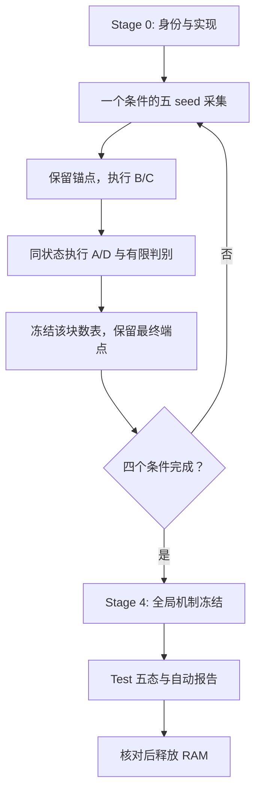

# Codex 总执行入口：固定 EMA 收益的因果与功能归因

日期：2026-11-10（Asia/Shanghai）。研究ID：`EMA_CAUSAL_20261110`。

**当前交付状态为 DESIGN_ONLY：只有规划文档；未实现新实验包，未启动训练。** 本目录供后续明确接手执行任务的 Codex 使用。不得把下面的拟实现命令描述成当前已存在或已经执行的命令。

## 1. 任务终点与不可改变的边界

目标是把固定 EMA 的已知 AUC 收益解释成一条可核验链：**哪些真实参数/历史修正 → 哪个网络函数部分变化 → 哪些正负pair被纠正及破坏 → 净AUC变化 → 具体训练问题 → 下一步A/B/C/D选择。**

不再证明固定EMA有效；不进行PUB性能修复、不新增自适应算法、不做普通HPO。继承五seed、自然人口、完整Validation六格Macro AUC选点、Test封存。小域不是困难域；不把域样本数用作困难度代理。

只有20条正式轨迹：ML/KR × Clean/Gaussian D0 × seeds2022–2026，每条50epoch；O/F、各参数替换和预测集成都共享同一在线轨迹。主优化器和源训练语义不变，干预均不反馈训练。

## 2. 文件导航与定义优先级

| 文件 | Codex必须取得的内容 |
|---|---|
| [01_RESEARCH_CONTEXT.md](01_RESEARCH_CONTEXT.md) | 已接受事实、旧机制与自适应失败、不能重复的研究 |
| [02_THEORY_AND_HYPOTHESES.md](02_THEORY_AND_HYPOTHESES.md) | R的分解、因果对象、函数与排序的数学关系 |
| [03_CAUSAL_EXPERIMENT_DESIGN.md](03_CAUSAL_EXPERIMENT_DESIGN.md) | A–D实际状态与干预、H桥接、有限追加 |
| [04_EXPERIMENT_MATRIX.md](04_EXPERIMENT_MATRIX.md) | 20轨迹、rho/step、数据身份、锚点与Test五态 |
| [05_IMPLEMENTATION_SPEC.md](05_IMPLEMENTATION_SPEC.md) | 已有模块、未来接口、伪代码、RNG/精度/状态管理 |
| [06_SCHEDULER_AND_RESOURCES.md](06_SCHEDULER_AND_RESOURCES.md) | RAM流水化、预算、成本、恢复与释放 |
| [07_METRICS_AND_STATISTICS.md](07_METRICS_AND_STATISTICS.md) | 精确pair计数、交互、五seed统计与表schema |
| [08_ANALYSIS_AND_DECISION.md](08_ANALYSIS_AND_DECISION.md) | 固定桥接feature定义、Q1–Q5及A/B/C/D裁定 |
| [09_CODEX_TASKS.md](09_CODEX_TASKS.md) | 可执行开发任务与逐项验收 |
| [10_SOURCE_EVIDENCE.md](10_SOURCE_EVIDENCE.md) | 固定SHA证据、实际数值与资产可复用性 |
| [11_PLAN_REVIEW.md](11_PLAN_REVIEW.md) | 交付前识别能力与工程可行性检查 |

定义冲突时：本次用户指令最高；训练事实以固定source实际实现/协议为准；矩阵以04为准；状态构造以03/05为准；统计及表名以07为准；桥接特征和决策以08为准。若发现实质不一致，先记录并修复本次新包/新规格，不改原报告掩盖冲突。

## 3. 先准备正确执行底座

main已归档报告和规划，**未合并所有实验实现**。不得只在main尝试import新旧实验包。固定实现底座是：

- `26-11-07`，SHA `ffa3de067fcda5a1293af83a465d741e069493f1`。
- 本次main读取基准：`a646c5a29b74d4f3d731a8ae2c13038b06f5250f`。
- 本目录的实际交付commit由执行时 `git rev-parse origin/main` 后核对目录确定，并写入SOURCE_RECEIPT；不得把上述旧main SHA误当本规划提交。

后续Codex在已有本地仓库内执行以下准备操作，不覆盖已有工作树：

```bash
git status --short
git fetch origin main 26-11-07
EMA_CAUSAL_PLAN_REF=$(git rev-parse origin/main)
git cat-file -e "$EMA_CAUSAL_PLAN_REF:research_plans/26-11-10_ema_causal_attribution/00_EXECUTION_RUNBOOK.md"
git cat-file -e ffa3de067fcda5a1293af83a465d741e069493f1
git worktree add -b research/26-11-10-ema-causal-attribution ../phase0-3_ema_causal_20261110 ffa3de067fcda5a1293af83a465d741e069493f1
git -C ../phase0-3_ema_causal_20261110 restore --source "$EMA_CAUSAL_PLAN_REF" -- research_plans/26-11-10_ema_causal_attribution
```

若目标分支/目录已存在，检查其source、plan hash和任务状态后复用或使用未占用的新名字；不删除重建。原工作树有未提交修改也不影响建立隔离工作树，但不能丢弃它们。

实现时只新增 `experiments/ema_causal_20261110/` 及本次必要文档/测试，不改变源模型、loss、Adam、旧数据管线或旧报告。先完整执行09中的实现任务，完成工程smoke后才运行下面的正式队列。

## 4. 阶段输入、输出与执行依赖

| 逻辑阶段 | 输入 | 主要操作 | 必须输出 | 完成条件 |
|---|---|---|---|---|
| Stage0 | 源SHA、三份main上下文、原协议/数据/模型 | 复用审计、真实组支持、数学恒等式、纯度/资源smoke | SOURCE_RECEIPT、RESOLVED_PROTOCOL、DATA/PANEL/GROUP manifests、OBSERVATION_SCHEDULE、SMOKE、RESOURCE_ESTIMATE | 数据/源码正确；两数据工程检查通过；资源准入可行 |
| Stage1 | 冻结20 jobs | 源训练；O/F选点；每step分数EMA；稀疏历史状态 | epoch事务、Validation曲线、RAM anchor/selected包、面板预测 | 每条件五seed满50epoch，34,500真实Adam总步完整 |
| Stage2 | 当前条件五seed活参数包 | B/C核心、五seed预算选择、有限细化 | INTERVENTION_METRICS、FACTORIAL/TEMPORAL_EFFECTS、选择记录 | 核心五seed覆盖、状态/指标闭合；未展开项有原因 |
| Stage3 | 同一活包及已保存预测 | A精确pair；D历史组合/接口/融合；必要来源与H2匹配 | PAIR/FUNCTIONAL/FUSION/SOURCE/BRIDGE tables、闭合记录 | 参数→功能→同pair排序链可核验，不只相关性 |
| Stage4 | 四条件冻结数表与端点包 | 汇总H1/H2/H3与Q1–Q5，冻结解释后Test | MECHANISM_FINDINGS、MECHANISM_FREEZE、SELECTION_FROZEN、ENDPOINTS、FINAL_REPORT、RELEASE_RECEIPT | 完整五seed；研究主决定明确；原报告未覆盖 |

**物理调度不能按“20条都结束→释放状态→Stage2/3”执行。** 正确顺序是：



块顺序 ML-C→KR-C→ML-G→KR-G。块内最多两个worker，实际受GPU/host RAM/payload准入约束；需要时自动串行。所有核心组/时间/功能对照都不能因首seed结果不好而删掉后四seed。

## 5. 未来CLI的规范启动流程

下列命令在09实现完成后才可执行。环境默认沿用已审计的 `phase0-3-env`；路径不同可选同依赖环境并记录版本，不能自动升级核心依赖。`0 1`是设备例子，须由preflight验证。

```bash
set -euo pipefail
EMA_CAUSAL_PY=/home_new/xzf/envs/miniconda3/envs/phase0-3-env/bin/python
EMA_CAUSAL_PLAN=research_plans/26-11-10_ema_causal_attribution
EMA_CAUSAL_OUT=artifacts/ema_causal_20261110/attempt1

"$EMA_CAUSAL_PY" -m experiments.ema_causal_20261110.run audit --plan-dir "$EMA_CAUSAL_PLAN" --out "$EMA_CAUSAL_OUT"
"$EMA_CAUSAL_PY" -m experiments.ema_causal_20261110.run prepare --plan-dir "$EMA_CAUSAL_PLAN" --out "$EMA_CAUSAL_OUT" --ml-csv /home_new/xzf/datasets/ml-1m/ml-1m.csv --kr-csv /home_new/xzf/datasets/kuairand/processed/kuai_rand.csv
"$EMA_CAUSAL_PY" -m experiments.ema_causal_20261110.run smoke --plan-dir "$EMA_CAUSAL_PLAN" --out "$EMA_CAUSAL_OUT" --dataset movielens
"$EMA_CAUSAL_PY" -m experiments.ema_causal_20261110.run smoke --plan-dir "$EMA_CAUSAL_PLAN" --out "$EMA_CAUSAL_OUT" --dataset kuairand
"$EMA_CAUSAL_PY" -m experiments.ema_causal_20261110.run run --plan-dir "$EMA_CAUSAL_PLAN" --out "$EMA_CAUSAL_OUT" --devices 0 1 --max-workers 2

for EMA_CAUSAL_STAGE in 1 2 3 4; do
  "$EMA_CAUSAL_PY" -m experiments.ema_causal_20261110.run analyze --plan-dir "$EMA_CAUSAL_PLAN" --out "$EMA_CAUSAL_OUT" --stage "$EMA_CAUSAL_STAGE"
done

"$EMA_CAUSAL_PY" -m experiments.ema_causal_20261110.run freeze --plan-dir "$EMA_CAUSAL_PLAN" --out "$EMA_CAUSAL_OUT"
"$EMA_CAUSAL_PY" -m experiments.ema_causal_20261110.run evaluate --plan-dir "$EMA_CAUSAL_PLAN" --out "$EMA_CAUSAL_OUT"
"$EMA_CAUSAL_PY" -m experiments.ema_causal_20261110.run report --plan-dir "$EMA_CAUSAL_PLAN" --out "$EMA_CAUSAL_OUT"
"$EMA_CAUSAL_PY" -m experiments.ema_causal_20261110.run release --plan-dir "$EMA_CAUSAL_PLAN" --out "$EMA_CAUSAL_OUT"
```

Codex将这一顺序实现为新包内 `run_all.sh` 或等价可恢复队列，放入tmux执行。`run`负责活状态block最终化，包括条件判别；`analyze`只汇总已采集结果，不能在旧状态释放后临时请求新参数实验。`freeze`验证全局研究规则与解释已固定；`evaluate`独立加载Test。

已有可信cache时，`prepare`可额外接 `--cache-root ABS_PATH`，但必须通过源数组/编码/hash核对。每次新attempt必须新目录；不能覆盖旧的失败证据。

## 6. 检查与恢复

```bash
"$EMA_CAUSAL_PY" -m experiments.ema_causal_20261110.run status --plan-dir "$EMA_CAUSAL_PLAN" --out "$EMA_CAUSAL_OUT"
"$EMA_CAUSAL_PY" -m experiments.ema_causal_20261110.run resume --plan-dir "$EMA_CAUSAL_PLAN" --out "$EMA_CAUSAL_OUT" --devices 0 1 --max-workers 2
```

`status`至少输出条件×seed覆盖、当前epoch/step、活packet、已冻结block、未完成依赖、真实Adam/虚拟读出计数、GPU与RAM、磁盘预算、重启/重放次数。`resume`读取已冻结PREPARED，不重新搜索配置。

worker失败且guardian仍活：恢复最后完整epoch事务，重放未提交部分。guardian丢失：参数不可从数表恢复，按同seed/同数据/同随机流从初始化确定性重放，每job最多一次完整重放。完成的scalar/prediction外键与hash核对后去重；重放不增加n。再次失败记工程阻塞，保留其余四seed但不能作五seed否决。

没有checkpoint落盘。所有参数、Adam、EMA、R、梯度、可恢复运行状态只能驻RAM；预测/数表/身份允许按预算落盘。原源码和报告只读。

建议退出码：0=完成或按规则未触发；2=数据/源码/协议冲突；3=数值或轨迹污染；4=资源阻塞；5=五seed/阶段依赖未齐；6=状态丢失且恢复预算耗尽。错误日志必须指向具体job/epoch/状态，不把工程失败写成科学阴性。

## 7. 成本预算与优先级

来源旧任务同样20轨迹，实际队列墙钟约9980秒，累计训练worker时间13226秒；这只是估算锚点，不能冒充本轮实测。本轮增加逐step面板读出、精确pair计数、功能干预，需要用Stage0真实人口smoke校准。初步排期可预留单设备8–16小时、两设备4–10小时；最终以06的分项实测预算和当前设备可用性为准。

不为了“长程”故意增加训练。优先级为：20轨迹与完整人口AUC → B/C核心与D真实功能链 → 桥接与有决定价值的有限判别 → 图表。资源压力先降并行、调整evaluation microbatch、流式精确计数、压缩冗余观察；不减seed、不改训练batch、不将完整AUC替换为采样估计。

## 8. 最终交付与退出条件

未来实验交付到新的 `research_reports/2026-11-10_ema_causal_attribution/`，包含FINAL_REPORT、关键逐seed表、数据/源码/选点/状态收据、成本与恢复记录。大预测数组按本地预算保存并在报告列明位置与hash，不推Git；模型状态不写盘。

不能修改旧研究报告结论，也不自动把新算法加入正式baseline。对main长期上下文的更新应作为之后独立明确的整合任务，不在本次runner中隐式覆盖。

本轮完成必须能回答：固定F的主要组/时间/功能来源；哪些真实pair构成净收益；已识别的训练问题；旧自适应在哪个环节失效；A/B/C/D的主选择。允许有明确边界的联合机制；不要求每项消融达到+.003，不要求每seed同向，不要求找到新算法。

