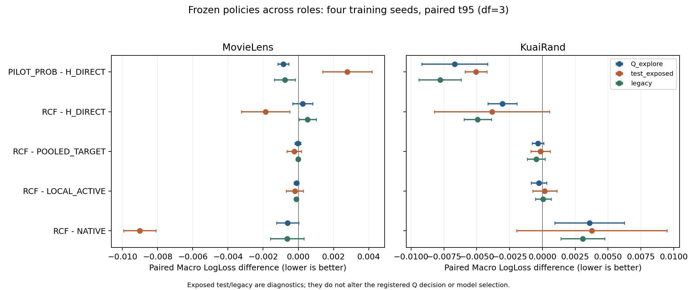

# RCF-v1：强目标预测后的来源增量与预算内功能形成

## 科研结论与行动

当前证据不支持把RCF作为具有完整实用增量的新方法继续扩展。MovieLens应保留简单读取路线，概率读出为Q/legacy候选，但不跨角色支配直接头；KuaiRand中形成确实能修复较弱的重拟合头，但普通锚定微调/目标再拟合解释尚未排除，开发Q上更强的原生预测与概率读取仍构成反例。按登记分支，ML为SIMPLE_READER_SUFFICIENT，KR为ORDINARY_ANCHORED_FINETUNING并保留TARGET_REFITTING_EXPLANATION；两数据S4均NO_START。证据强度 MEDIUM，范围限当前表示、角色、预算及历史暴露基准，不能推广成“所有来源共享无用”。

本轮已实际完成两数据各四个开发训练种子5201–5204：S1为104条方法完成收据，S2新增24条，KR必要S3新增8条，共136条。独立SCALE完成两数据×2022–2025八条训练。每个效果比较条件均至少四独立训练seed；OOF折、任务、群体、epoch、bootstrap和异常后的同seed重放均不增加n。6201–6204没有启动，不以开发种子冒称独立锁定验证。

全部八context的原始导出已PASS，136个完整raw-X预测器最大概率误差均为0，5328个预测文件复算PASS；135/136方法实例取得真实3+10推理计时，唯一KR5201 RANDOM_FEATURE融合parity拒绝保留。四seed核算均PASS，未依据外层结果挑模型。最终清理与发布身份以实际交付收据为准。

## 1. 固定来源内容：有用的读出与无法独立归因的来源机制

Q_explore上PILOT_PROB相对H_DIRECT，ML平均ΔLL −0.00085427、ΔAUC +0.00086860，KR为−0.00669022、+0.01974137；两数据两指标均四seed同向。简单读法保留了可重复价值，证据 MEDIUM。

这不等于证明来源监督的净增量。PILOT_PROB保留Native Z候选及非线性gate，FULL/RCF的B_refit背景与线性内容类不同；f(H)虽不增加给定(H,Z)的信息，却能改变有限样本、有限容量的读取路径。不能把类差异直接归为新增信息。

重要反例是KR：概率读取相对NATIVE平均LL仅−0.00006085、只有2/4改善，AUC反而−0.00332392且4/4下降；LOCAL相对NATIVE AUC四seed改善、LL只有2/4。B_refit/H的较弱结果不能替代真正的强原生基线。ML的PILOT_PROB相对NATIVE则LL/AUC均四seed改善，显示迁移边界，不强行给两数据同一叙事。

ML的FULL_SOURCE/FULL_TARGET/RANDOM_FEATURE均四seed精确选OFF；FULL_SOURCE_ALL均选择λ=.1，但不优于H_DIRECT。KR的FULL_SOURCE优于随机特征，却不优于同监督本地FULL_TARGET；FULL_SOURCE_ALL对H也更差。因此，“完整来源线性空间必胜直接头”和“只要给更多目标拟合就稳定更好”均未获支持。H_DIRECT_EFFORT采用同初始化、更多PF训练，结果更差；这只否定本轮固定额外努力，不否定所有更长训练。

## 2. 功能形成：完整门槛未过，有限阳性不删除

Q上的RCF−参照四seed均值如下；LL负、AUC正更好。

| 数据 | 参照 | ΔMacro LL | ΔMacro AUC |
|---|---|---:|---:|
| MovieLens | H_DIRECT | +0.00024518 | −0.00051304 |
| MovieLens | FULL_SOURCE_ALL | −0.00026890 | +0.00036383 |
| MovieLens | POOLED_TARGET | −0.00002949 | −0.00000381 |
| MovieLens | LOCAL_ACTIVE | −0.00010966 | +0.00005739 |
| KuaiRand | H_DIRECT | −0.00304660 | +0.01119579 |
| KuaiRand | FULL_SOURCE_ALL | −0.00980991 | +0.01558490 |
| KuaiRand | POOLED_TARGET | −0.00033626 | +0.00111838 |
| KuaiRand | LOCAL_ACTIVE | −0.00026485 | +0.00097558 |

登记主指标要求四seed LL均改善、平均改善至少.0005，同时AUC和同cell保护通过；不是统计等效检验。ML没有超过H，KR对POOLED虽四seed LL改善，平均幅度低于门槛，且对LOCAL方向不齐。KR相对NATIVE的LL +0.00358277、AUC −0.01186950，相对PILOT_PROB的LL +0.00364362、AUC −0.00854558，进一步限制方法价值。

必要S3的局部阳性应保留：KR RCF相对重新训练K1_WIDE，LL平均−0.00060349、AUC +0.00172312，两指标均4/4改善；但两项配对t95区间仍跨0，seed5203的LL差只有−0.00000621。相对SOURCE_INIT_RANDOM为LL −0.00042272、AUC +0.00186072，同样4/4改善，LL区间不跨0但平均未达实用幅度。来源隐藏初始化和两个函数在本框架有有限作用，证据 MEDIUM；不是来源标签全部价值、群体形成或新方法必要性的证明。

RCF/K1/Random的总query标签访问一致、总参数接近；每参数暴露、steps尾批、FLOPs和实际S仍不同。Q上没有四seed重复并超过POOLED/LOCAL/GROUP_CAL的功能交叉优势；ML test另有一个局部profile，后文完整保留。非零参数、不同函数、删槽退化均不足以建立不可替代性。没有完整增量，所以ASSIGN_SHUFFLE、ANCHOR_OFF、source-label shuffle及谱/RRR等完整归因未触发；它们是NOT_RUN，不是无效结果。局部阳性不允许重开S4或临时增加K。

Q的细分也反驳单一大小域解释：ML的RCF对NATIVE在最小域0 AUC四seed下降，域1/2 LL四seed改善；task1 AUC却四seed下降。KR的RCF在三个域AUC平均均下降，两任务AUC均4/4下降，task1 LL亦4/4恶化。ML简单概率读取两个任务AUC/LL均4/4改善，KR两任务AUC均4/4下降。规模、任务基率、原生基准损伤及读取路径必须共同考察；见`tables/Q_four_seed_main_contrasts_domain_task.csv`。

## 3. 预算确实执行，但不能作分布外保证

ML/KR的RCF各48函数实例、POOLED各48、LOCAL_ACTIVE各96，主S2全部c=1，没有c=0或终态缩放。因此当前失败不能归为所有δ被投影抹掉。所有训练终态满足source S≤.001及foreign残差均方R≤.25（两个foreign域等权合并的RMS≤.5）；训练样本上的实现证据 STRONG。c=1不能推出KL/dual在训练时无效。

KR RCF在P_cal/Q/validation分别11/10/12个函数超source LL预算，POOLED为22/17/17，分母均为48函数实例；没有把函数当独立seed。source owner冻结、训练后继预算和完整预测器source域性能是不同对象。外层超界限制的是保留泛化主张，不授权用Q重新选择epsilon或OFF。

需求背景漂移也真实存在：B_OOF与B_refit的平均绝对logit差为ML .17774609、KR .43324637。P_form固定函数动作效用有跨背景换符号。它支持“后继修补半折背景误差”的竞争解释，但后续reader可校准/关闭，故不是已证实唯一根因；A与δ已看P_form，不能称全链OOF。

## 4. 独立SCALE：修正基线解释，保留人口权衡

固定c的Adam等价关系在冷/对应热状态实际通过：`cL,wd,eps`对应`L,wd/c,eps/c`，lr/betas相同并对应缩放m/v。公式与数值证据 STRONG；不是lr乘c，也不推广到任意动态c。本轮未分别识别wd与eps，不声称发现课程或动量机制。

四seed暴露test中，Dconst01_NO_AUG−B的ML平均AUC +.00404890、LL −.00924025，两指标均4/4；KR为AUC +.00758835（4/4）、LL −.00655322（3/4），区间宽。增强Dconst01−NO_AUG的ML AUC3/4、LL4/4改善，KR仅3/4、2/4。常数尺度解释了部分历史收益；增强残差的普遍稳定性尤其在KR证据 WEAK。历史增强未重新训练，四seed原结果逐项匹配身份后使用；旧raw p缺失，未伪造配对row bootstrap。

KR NO_AUG的大域1占test约98.2%，其AUC四seed下降，平均−.00486585；两个小域平均改善。这使macro AUC改善与sample-weighted cell AUC −.00451560、pooled AUC −.00445033同时存在；人口pooled LL平均也更差。大域LL却有3/4seed改善，不能把排序交换写成稳定LL交换。ML最大域反而平均AUC增量最大，不重复同一大小域模式。

因此特定KR对照的大小域排序权衡证据 MEDIUM，域大小作为跨数据主要因果解释的证据 WEAK。标签基率、支持、目标/有效正则、模型和训练阶段都是竞争解释。SCALE与RCF目标、角色、学习率及选点不同，绝对分数不直接混比。合法selected与实际停止端点也不同；更晚终点变差不能取代所选结果。

## 5. 证据强度、最有判别力的下一步

STRONG限于数学等价、实际训练样本约束/权限和通过的数值验收；不把工程PASS升级成算法有效。MEDIUM包括当前四seed下的简单概率读取、KR K2/初始化局部作用、主线未满足完整实用门槛与特定尺度对照。跨新数据、源内容纯因果归因、群体多功能语义与大小因果主张均WEAK或未建立。

下一步按04调整问题而非继续救RCF：先在所有比较中保留相同Native Z候选/非线性gate，真实foreign内容对零/固定打乱内容，每臂重新训练相同gate且至少四seed，其他角色/容量/选择不变。真实内容仍有稳定增量才进一步研究来源组织；若零内容已恢复多数收益，则优先改强目标基线。当前未运行这个建议，不以建议当证据。

四seed少、历史测试暴露、KR原始user缺失和外部SOTA未完成限制外推。bootstrap提供同seed内配对不确定性，不能替代训练seed，也不能把多个任务/群体当新增独立重复。未证明M3oE必然在困难域失败，未把小域等同困难域，未测试课程学习或动量有效性。

## 6. 冻结外层：应保留的反例与边界

以下是统一冻结后test_exposed的四seed均值，不用于重选模型、参数或S4路线：

| 方法 | ML Macro LL | ML Macro AUC | KR Macro LL | KR Macro AUC |
|---|---:|---:|---:|---:|
| NATIVE | .51301412 | .75659244 | .43785363 | .66212177 |
| H_DIRECT | .50586755 | .75920271 | .44546178 | .64785319 |
| PILOT_PROB | .50865396 | .75914675 | .44039289 | .66001369 |
| FULL_SOURCE_ALL | .50572716 | .75836209 | .45298556 | .64022083 |
| RCF | .50400528 | .75930274 | .44162620 | .65461924 |
| POOLED_TARGET | .50424263 | .75907924 | .44176043 | .65405412 |
| LOCAL_ACTIVE | .50419937 | .75900679 | .44144802 | .65492526 |

ML有真实适配阳性：RCF−H的test LL −.00186226四seed改善，t95[−.00323622,−.00048830]，AUC+.00010003为3/4；相对NATIVE两指标均4/4改善。它与Q/legacy不同，legacy RCF−H却LL+.00053092、AUC−.00069649，两项4/4恶化。POOLED/LOCAL在test也得到相近收益，RCF对两者仅−.00023734/−.00019409，LL均3/4、区间均跨0，不能证明独特群体形成。

简单概率读取同样不能写成跨角色唯一赢家：ML的PILOT_PROB−H在Q/legacy均四seed改善，test LL却+.00278641且4/4恶化；对NATIVE则三个角色两指标都4/4改善。KR的PILOT_PROB−H跨角色仍稳定改善，但test相对NATIVE LL+.00253926、AUC−.00210808，两项4/4恶化。这里支持保留读取/原生旁路问题，尚未隔离纯来源内容作用。

KR RCF−NATIVE test AUC−.00750254四seed下降，LL+.00377258只有1/4改善；legacy两项均4/4恶化。对LOCAL_ACTIVE的test LL+.00017818、legacy+.00005707，方向均2/4；对POOLED的test LL −.00013422（3/4）、legacy−.00047181（4/4），未建立跨角色完整实用差。K2对重训K1的test LL降至−.00025960、3/4，随机初始化对照test LL仅2/4改善；Q与legacy局部阳性保留，稳定迁移主张降级。

## 7. 功能、支持、难度和阶段

同一登记功能准则在ML test找到1个四seed重复且超过GROUP_CAL/POOLED/LOCAL的profile：source1/task0→target2低/高原生logit组。k0在P_form低组更好、高组更差，test四seed恰好反转。Q/validation/legacy与KR各角色均没有重复profile。它证明不能把当前结果说成完全没有函数差异；但多角色探索、方向反转和ML未触发重训K1限制其机制解释。描述性重复MEDIUM，跨角色功能语义/多函数必要性WEAK；不会重开S3/S4。逐seed四列差值与完整profile表见FUNCTION_FORMATION_REPORT。

ML test user-seen中RCF−H的LL/AUC均4/4改善，user-unseen中AUC却4/4恶化，LL只有3/4改善且区间跨0；改善并非专门修复未见user。PILOT_PROB−NATIVE在seen和unseen中两指标都4/4改善，因此也不能反向说简单读取只在已见user有效。KR没有可信原始user/item，编码OOV仅42个test行，不能把Missing身份当无冷启动或把OOV当唯一退化原因。

KR的fit/Q与validation/test域1基率约为click .378对.210、long_view .256对.111，角色域占比也不同。它与模型/目标/背景拟合共同构成竞争解释。RCF−NATIVE在test最大域1的LL+.01606344四seed恶化，两个小域LL均值改善但仅各2/4；AUC域0/1都4/4下降。ML形成的test改善也不是SCALE的普遍大小域定律。规模作为主要因果解释仍WEAK。

最差格不能隐藏：ML test RCF的平均最差cell AUC .73430064低于H的.73509920，最差LL .59685462则优于H的.59990497；KR RCF/NATIVE最差AUC为.61157587/.62435964，最差LL为.65285320/.65738165。排序、校准与不同任务方向分别报告，完整六格/任务/预定组可复核。

主线Native epoch24−合法selected：ML test LL+.02966084为4/4恶化、AUC3/4下降；KR test AUC+.00353742为4/4改善，却LL+.01065865为4/4恶化。训练阶段与选点目标不能混用，也不因test AUC更好改选epoch24。SCALE的停止端点与主线epoch24另有语义。

外层来源保留限制继续存在：KR RCF test14/48、legacy10/48函数实例超S预算，POOLED为18/48、12/48；ML对应0/48，foreign均方R均无超界。训练内可行不产生分布外source保留保证。函数实例不是独立训练seed。

主线还存在参照相关的人口权衡：KR test RCF−H的MacroLL −.00383557（4/4），自然样本LL却+.00195334（4/4恶化）；域0/1/2 LL差为−.00611024/+.00211073/−.00750721，两小域4/4改善、最大域4/4恶化。加权cell AUC −.00056021、pooled AUC −.00076385，方向各2/4下降。相对NATIVE，KR自然LL+.01573680、pooled AUC−.00691806均4/4恶化；ML相对NATIVE却自然LL−.00853362、pooled AUC+.00378509均4/4改善。当前H参照下的大小域LL交换证据MEDIUM，跨数据/模型的大小因果解释仍WEAK。完整人口表另列，主Macro指标未更换。

## 8. 额外成本与结论价值

批量4096的真实raw-X→p计时，四seed每seed10次median的均值：RCF为ML7.432ms/KR8.314ms，H为2.672/3.184，PILOT_PROB为4.441/5.016，NATIVE为1.965/2.555。RCF与LOCAL/POOLED接近，但未获得稳定完整实用增量；KR K1为6.214ms。RCF部署参数为ML923148/KR1764428，H为822900/1664180，NATIVE为772974/1614254。训练的RCF形成+reader额外组件均值约56.245s/157.210s，不含共享prefix/B、需求与未分配诊断时间；不冒称隔离端到端总墙时。

因此当前证据不足以证明RCF额外复杂性具有普遍成本收益。特定ML test的LL收益仍应保留；更便宜的强直接头、普通适配和原生旁路使来源组织贡献尚未分离。ML继续简单读取路线，KR先保护Native Z路径并把锚定微调作为普通对照。没有新增封存确认、外部SOTA或新骨干排名主张。

## 9. 交付与可复现范围

全部效果条件均四训练seed；CORE/SUPPORT/COST/CROSSOVER/SCALE核算收据及逐seed、SD、配对t95、六格、域任务、群体、支持、参数、成本与原始10次计时齐备。主RCF四参照的每seed1000次配对bootstrap共96条，无invalid replicate；它不替代四训练seed，其他配对的区间明确使用seed t。所有raw-X与原始预测校验保留1e-6硬阈值。

工作根始终是`/home/xzf/Code/phase0-3`；逻辑代理名称`/root`不是写入路径。新代码在`experiments/mdmt_rcf_20261026/`，报告在本目录；本轮原始预测/φ/δ/请求/政策/日志保留于`artifacts/mdmt_rcf_20261026/v2_four_seed/`，独立SCALE位于同任务`v1/scale/`。大数据不进Git，实际位置/SHA/保留状态见`ARTIFACT_INDEX.json`。

用户禁止保存模型与checkpoint，模型/Adam/RNG全程仅在RAM；未来新前向、未导出local/initial表示或重训reader可能需要重建prefix。八context RAM已实际释放，已按manifest删除17591个临时rowcache文件、101602861308字节，原始研究数据及旧v1保留；实际清理结果见`CLEANUP_RECEIPT.json`，完整导出验收见`EXPORT_ACCEPTANCE.json`。发布目标为原方案分支`research-plan/2026-10-26-v2-mechanisms`，实际远端提交与逐blob验证结果以`PUBLICATION_RECEIPT.json`为准。

完整分报告：SOURCE_INCREMENT_REPORT、FUNCTION_FORMATION_REPORT、SCALE_REPORT、COST_REPORT、DATA_AND_IDENTITY、IMPLEMENTATION_REVIEW与OPEN_QUESTIONS；原始表在`tables/`，大表以无损gzip CSV发布，服务器原CSV同时保留。所有负结果、角色矛盾与局部正结果均保留，没有以测试反向修改冻结规则。
