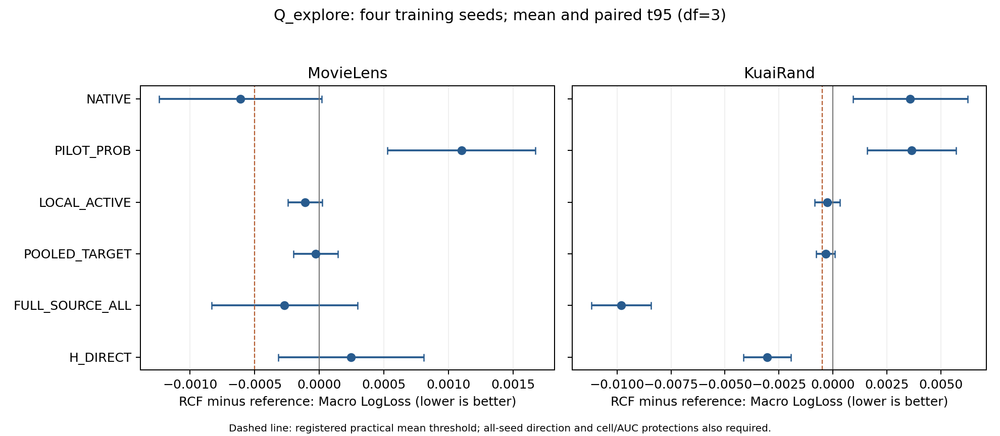

# 功能形成：四种子S2与必要归因

状态：S0/S1/S2/S3全部实际比较条件已齐四个训练种子，136条方法—种子完成证据经冻结验收PASS。S4两数据均按门槛NO_START。四种子Q、冻结后的暴露角色及完整推理/重建验收现已完成；最终临时缓存清理收据另见总交付。

## 当前能支持的主张

当前RCF没有在任一数据集建立完整实用增量。Q上ML不优于H_DIRECT，KR虽然明显改善重拟合小头，却未超过登记门槛要求的POOLED_TARGET/LOCAL_ACTIVE增量，且比NATIVE/PILOT_PROB更弱。资源规则分别归SIMPLE_READER_SUFFICIENT与ORDINARY_ANCHORED_FINETUNING，后者同时保留TARGET_REFITTING_EXPLANATION。结论是当前新增形成层未证明必要，不能外推为所有来源共享无用。证据强度 MEDIUM，范围限固定暴露基准、表示、角色和预算。

## Q_explore配对结果（四个训练seed）

Δ=RCF−参照，LL负更好、AUC正更好。实用晋级要求全部四seed LL改善、平均ΔLL≤−.0005、平均ΔAUC≥−.0005、最差同cell平均ΔLL≤.003；这是资源规则，不是显著性或等效检验。

| 数据 | 参照 | 平均ΔLL | 平均ΔAUC | 登记实用门槛 |
|---|---|---:|---:|---|
| movielens | H_DIRECT | +0.00024518 | -0.00051304 | 未过 |
| movielens | H_DIRECT_EFFORT | -0.00267312 | +0.00182228 | PASS |
| movielens | FULL_SOURCE_ALL | -0.00026890 | +0.00036383 | 未过 |
| movielens | POOLED_TARGET | -0.00002949 | -0.00000381 | 未过 |
| movielens | LOCAL_ACTIVE | -0.00010966 | +0.00005739 | 未过 |
| movielens | PILOT_PROB | +0.00109945 | -0.00138164 | 未过 |
| movielens | NATIVE | -0.00060949 | -0.00057868 | 未过 |
| kuairand | H_DIRECT | -0.00304660 | +0.01119579 | PASS |
| kuairand | H_DIRECT_EFFORT | -0.03905159 | +0.03909386 | PASS |
| kuairand | FULL_SOURCE_ALL | -0.00980991 | +0.01558490 | PASS |
| kuairand | POOLED_TARGET | -0.00033626 | +0.00111838 | 未过 |
| kuairand | LOCAL_ACTIVE | -0.00026485 | +0.00097558 | 未过 |
| kuairand | PILOT_PROB | +0.00364362 | -0.00854558 | 未过 |
| kuairand | NATIVE | +0.00358277 | -0.01186950 | 未过 |

ML的RCF对LOCAL_ACTIVE四seed LL均有小幅改善，平均−0.00010966，低于预定实用幅度；对POOLED平均仅−0.00002949且不是四seed一致。KR对POOLED的LL四seed均改善，平均−0.00033626、AUC平均+0.00111838，属于应保留的小幅重复现象；它仍未达到预定主指标幅度，不能把未晋级写成严格等效或完全零效应。对LOCAL_ACTIVE则非四seed同向。

更强反例是KR相对NATIVE的ΔLL +0.00358277、ΔAUC −0.01186950，以及相对PILOT_PROB的ΔLL +0.00364362、ΔAUC −0.00854558。赢过受损的B/H拟合路径不等于提高已有模型。ML相对NATIVE虽LL四seed改善，但平均AUC下降−0.00057868；需要同时保留排序和校准方向。完整逐seed/六格/配对区间见表，不能只报宏均值。

## A、槽与功能必要性

群体始终由target fit原生logit中位切点定义，A用P_form的B_OOF剩余风险响应、校准剔除及共同source φ metric产生，之后冻结。所有source/任务的风险响应、分配和支持将在最终raw导出中保留。后继是256→32→1残差，source隐藏复制加固定微扰、输出精确零，最终只读δ；F=f0+δ仅用于source保留。

预登记Q上，两个数据集都没有同时超过GROUP_CAL、LOCAL_ACTIVE、POOLED且在四seed按P_form对齐后重复的功能交叉证据。暴露test有一项局部反例，见后文。不同参数、非零输出、非零reader系数和删槽退化均不能单独建立多功能必要性。K1_WIDE是重新训练/重新读取的必要性控制；其四seed结果见后文，未将删槽诊断替代重训控制。

POOLED独立使用合格foreign整域、名义两个槽，不继承RCF的低支持/无请求关闭；LOCAL_ACTIVE每target/task四个头，总24个头比RCF12个头更多。它们有更强的容量/监督机会。相同12passes不代表相同query更新或label-pass；小幅差异仍可能来自剂量或优化，而非群体组织。当前没有完整实用增量，不为微小差异无限追加矩阵。

## 约束与缩放的真实记录

下表将四seed的函数实例合并作实现计数，独立统计重复数仍为4，绝不把48/96函数当作48/96训练seed。LOCAL没有source S约束，NA不能填0。

| 数据 | 方法 | 四seed函数实例 | c=0 / c<1 | 最大训练后S | 最大训练后R |
|---|---|---:|---:|---:|---:|
| movielens | RCF | 48 | 0 / 0 | -0.00052947 | 0.10600746 |
| movielens | POOLED_TARGET | 48 | 0 / 0 | -0.00124632 | 0.02940376 |
| movielens | LOCAL_ACTIVE | 96 | 0 / 0 | NA | 0.01526437 |
| kuairand | RCF | 48 | 0 / 0 | 0.00078445 | 0.17325306 |
| kuairand | POOLED_TARGET | 48 | 0 / 0 | 0.00001721 | 0.14355363 |
| kuairand | LOCAL_ACTIVE | 96 | 0 / 0 | NA | 0.16046476 |

这里R为两个foreign域各自残差均方的等权平均，LOCAL为其target支持上的残差均方；R≤.25不意味着每个foreign域单独都≤.25。

全部实际形成函数c=1，没有约束坍缩到0，也没有终态缩放触发。因此当前阴性结果不能归为“所有函数被投影抹掉”。但c=1只说明最后可行缩放未约束，不能据此声称KL/dual加权source监督在训练中没有作用；没有运行的ANCHOR_OFF不能当阴性证据。训练内S≤.001、残差均方R≤.25（两个foreign域等权合并的RMS≤.5）的数值可行性已在四seed逐函数核对，属于当前训练样本上的 STRONG 实现证据，不是分布外保证。

KR的来源保留存在具体外层边界：RCF在P_cal/Q/validation分别有11/10/12个函数实例超出source LL预算，POOLED分别22/17/17；分母各角色48函数实例，对应foreign均方R未见超界。ML这些开发角色没有对应超界。超界不授权用Q重新选OFF或修改ε；应缩限保留主张。原owner参数冻结、每个后继source训练预算、完整多域预测器的域性能是三个不同对象，不能相互替代。

## OOF到refit的需求漂移

四seed平均 |B_OOF−B_refit|：ML 0.17774609、KR 0.43324637；对应RMS均值0.24120052、0.55983848。它们是logit差，不是LL增益。RCF在P_form的48个预定义函数×foreign群体固定正动作中，OOF/refit效用符号变化按seed分别为ML 19/48、9/48、12/48、10/48，KR 10/48、6/48、11/48、4/48。

这些函数/群体对不独立，且包含assigned和unassigned组；它们是背景漂移诊断，不能当作额外重复数或单独证明因果失败。现有漂移支持“后继可能修补半折基准错误，而最终refit需求已经不同”的竞争解释，但reader能重新校准/选择，故不能把漂移当唯一原因。A/形成已经使用P_form标签，全链不称OOF。

## 已完成的四种子S3与停止规则

KuaiRand的K1_WIDE与SOURCE_INIT_RANDOM均在5201–5204完成；MovieLens没有S3触发。S3有应保留的局部阳性结果，不能因主方法未晋级而抹掉：

| RCF−控制，Q_explore | 平均ΔLL | LL改善seed | 配对t95 ΔLL | 平均ΔAUC | 登记实用规则 |
|---|---:|---:|---|---:|---|
| K1_WIDE | −0.00060349 | 4/4 | [−0.00126711,+0.00006013] | +0.00172312 | PASS |
| SOURCE_INIT_RANDOM | −0.00042272 | 4/4 | [−0.00072080,−0.00012463] | +0.00186072 | 幅度未过 |

两项AUC均4/4改善。K1比较通过资源门槛但LL/AUC描述性t区间仍跨0，seed5203的LL差只有−0.00000621。四seed同向与少量seed下区间宽应同时报告，不能将资源PASS改称统计证明。随机初始化比较的LL区间不跨0，但平均幅度未达预定0.0005，亦不能见区间有利而改晋级规则。

这是两个函数相对单宽函数、以及来源隐藏初始化在当前框架内的有限重复作用，证据 MEDIUM。它没有建立群体语义互补：Q上四seed超过POOLED/LOCAL/GROUP_CAL的功能交叉证据仍缺失，POOLED与LOCAL主对照已解释大部分目标拟合机会；真实source φ请求、teacher与S/K仍存在，SOURCE_INIT_RANDOM不等于删除全部来源知识。

RCF/K1/Random在四seed合计target query label visits完全相同，均11555136；有效Adam steps为22800/22752/22800。RCF为每prefix12个32隐层头，K1为6个64隐层头，参数分别99084和99078；总参数与总标签访问接近，不代表每参数暴露、FLOPs、Adam状态或实际source保留水平完全相同。原K=1/0按规范复用，不伪称新训练。

三种方法都没有c=0坍缩；RCF、K1全部c=1，Random有1/48函数因R预算缩放。最大训练后R分别0.17325306/0.14932690/0.25，最大S均在0.001以内。K1实际S更保守，单宽与双头是不同保留—适配工作点，不用相同ε符号代替公平性论证。Random的四seed微小劣势不能全归因于仅一个函数的缩放，亦不能孤立解释成来源标签的全部因果价值。

原S2完整实用增量在两数据均未成立，因此S3的局部阳性不允许重新开启S4；实际S3决定complete=true、两data s4=false，run-locked已返回NO_START。ANCHOR_OFF、SOURCE_LABEL_SHUFFLE、ASSIGN_SHUFFLE及谱/RRR没有触发，不当作失败或无效的实验证据。固定四seed、λ、K、预算和所有负结果均保留。

## 暴露外层与实际导出边界

所有方法清单统一冻结后已完成test/legacy评价，没有根据外层效果更换模型或挑seed。首次ML5201 FULL_SOURCE_ALL raw-X差2.1977e-6高于1e-6；仅修订完整role/原设备/分块与FP32舍入重建。实际全部八context、136个完整预测器均PASS且max_probability_error=0，5328个预测文件重算PASS；136训练收据及模型/Adam/RNG/选点均未改，容差未放宽。135/136方法实例取得真实推理计时，唯一KR5201 RANDOM_FEATURE融合计时仍真实拒绝，与原模型完整预测PASS分开。

## 复现与表

- [S2完成证据](evidence/runtime/S2_EXECUTION_RECEIPT.json)、[阶段决定](REGISTERED_STAGE_DECISIONS.json)。
- [逐seed](tables/S2_Q_four_seed_per_seed.csv)、[六格](tables/S2_Q_four_seed_six_cells.csv)、[配对区间](tables/S2_Q_four_seed_paired_summary.csv)、[逐seed差](tables/S2_Q_four_seed_paired_differences.csv)。
- [训练约束](tables/S2_four_seed_training_constraints.csv.gz)、[开发角色source保留](tables/S2_four_seed_source_retention_development.csv)、[OOF/refit](tables/S2_four_seed_oof_refit_drift.csv)、[函数效用漂移](tables/S2_four_seed_single_function_utility_drift.csv.gz)。

- [S3逐seed](tables/S3_Q_four_seed_per_seed.csv)、[S3配对区间](tables/S3_Q_four_seed_paired_summary.csv)、[S3实际约束/剂量](tables/S3_four_seed_training_constraints.csv)。

图中虚线只代表平均实用幅度，不能替代四seed同向与AUC/同cell保护；横轴区间是seed配对t95。

## Q上的域、任务与规模边界

ML的RCF−NATIVE在最小域0的AUC四seed均下降，平均−0.00136331；LL平均+0.00030819（3/4恶化）。域1/2的LL各4/4改善、平均−0.00037726/−0.00175939；域2的AUC却只有2/4改善。这与“小域一定获益、大域一定下降”方向相反。两个任务LL均4/4改善，但task1 AUC四seed下降−0.00097394；task0 AUC虽3/4改善，均值−0.00018342由另一个seed反向影响。不能只用同向种子计数或只用均值下结论。

KR的RCF−NATIVE在域0/1/2平均AUC为−0.01864606/−0.00864874/−0.00831371，下降seed数4/4、4/4、3/4；LL则三个域平均均更差。两个任务的AUC均4/4下降，平均−0.01144698/−0.01229202；task1 LL也4/4恶化。这说明当前形成对强原生模型的退化横跨大小域，不能只归于“大域牺牲”；与SCALE小域排序改善/大域下降的特定模式不同，模型、目标、基准路径与训练阶段均需区分。

完整域任务与方向/区间见[四seed配对表](tables/Q_four_seed_main_contrasts_domain_task.csv)。这些诊断未触发额外矩阵或改变S4决定。

## 冻结外层：形成收益与唯一必要性分开

| 数据/角色 | RCF−参照 | ΔMacro LL | ΔMacro AUC | LL改善seed |
|---|---|---:|---:|---|
| ML test | H_DIRECT | −0.00186226 | +0.00010003 | 4/4 |
| ML legacy | H_DIRECT | +0.00053092 | −0.00069649 | 0/4 |
| ML test | POOLED_TARGET | −0.00023734 | +0.00022350 | 3/4 |
| ML test | LOCAL_ACTIVE | −0.00019409 | +0.00029595 | 3/4 |
| ML legacy | POOLED_TARGET | −0.00001421 | +0.00000218 | 2/4 |
| ML legacy | LOCAL_ACTIVE | −0.00011154 | +0.00008350 | 4/4 |
| KR test | H_DIRECT | −0.00383557 | +0.00676605 | 4/4 |
| KR test | POOLED_TARGET | −0.00013422 | +0.00056512 | 3/4 |
| KR test | LOCAL_ACTIVE | +0.00017818 | −0.00030602 | 2/4 |
| KR legacy | POOLED_TARGET | −0.00047181 | +0.00098423 | 4/4 |
| KR legacy | LOCAL_ACTIVE | +0.00005707 | −0.00044856 | 2/4 |

ML在test相对H的LL改善真实且区间[−.00323622,−.00048830]；legacy却四seed LL/AUC更差，LL区间[+.00004350,+.00101835]。RCF test也四seed改善NATIVE两指标，LL −.00900883、AUC+.00271030。不能把这些阳性抹掉，也不能只用test反过来推翻预登记Q门槛。POOLED/LOCAL在test与RCF都提供接近的普通适配，二者差值t95均跨0、平均幅度不足.0005；legacy也没有稳定完整群体组织增量。

KR RCF对弱H/FULL_ALL的改善持续，但对NATIVE test AUC −.00750254为4/4下降，LL+.00377258只有1/4改善；legacy LL+.00306822、AUC−.01170657，两者4/4恶化。对PILOT_PROB test AUC四seed下降、LL只有1/4改善，legacy两项均4/4恶化。完整主张仍不成立，证据MEDIUM；未过门槛不称统计等效。

S3局部结果也存在外层边界：KR RCF−K1 test LL −.00025960仅3/4改善，t95[−.00086251,+.00034331]，AUC+.00183892为4/4；legacy LL −.00068751、AUC+.00161243均4/4，但区间仍跨0。RCF−随机初始化test LL −.00013883仅2/4、AUC+.00138266仅3/4；legacy LL −.00033198四seed改善、AUC3/4。故来源初始化/K2作用限具体角色/度量，不能提升为跨角色稳定功能机制。外层未用于再开S4。

## 任务、最差单元、支持和保留

ML test相对LOCAL_ACTIVE，task0 LL −.00053523四seed改善且AUC四seed改善，task1 LL却+.00014706且仅2/4改善；macro不能遮掉任务差异。RCF的平均最差cell AUC .73430064低于H的.73509920，最差LL .59685462则好于H的.59990497。KR对应最差AUC为RCF .61157587、NATIVE .62435964；最差LL为.65285320/.65738165，排序与校准仍不同向。最差格先逐seed求，不与“均值最差的固定格”混用。

ML test user-seen中RCF−H LL −.00226401、AUC+.00043317，两者4/4改善；user-unseen中AUC−.00134112为4/4恶化，LL −.00025459只有3/4且CI跨0。因此test总改善不能归为“专门修复未见user”。unseen中RCF相对LOCAL的AUC又4/4小幅改善+.00037488而LL近零；保留这种局部阳性，但不把不同参照混为同一个结论。source-specific overlap与原生低/高组的完整逐行支持/指标另存表，不按有利人群重选政策。

来源预算在外层确实有边界。ML的RCF/POOLED在test/legacy均0/48个函数实例超S预算，R亦无超界；KR RCF test为14/48、legacy10/48，POOLED为18/48、12/48。KR最大test S分别.00867514/.00635910，超过训练.001；foreign均方R仍无超预算。函数计数不当作训练seed，不把训练内可行宣称为分布外保留保证。

## Native训练阶段与跨角色矛盾

主线epoch24−validation所选：ML的Q AUC+.00736088（4/4）但LL+.00178633（3/4恶化），test AUC−.00117795（3/4恶化）、LL+.02966084（4/4恶化）。KR test AUC+.00353742（4/4）而LL+.01065865（4/4恶化）；legacy AUC+.00742708（4/4）而LL均值约−.00000084、方向3/4改善。继续训练的排序/校准方向不必一致，合法selected始终由validation MacroLL决定，不改用test挑epoch24。该阶段与SCALE的AUC选点/early-stop另论。

完整证据：[冻结核算](CORE_FOUR_SEED_ANALYSIS_RECEIPT.json)、[所有角色配对](tables/CORE_four_seed_paired_summary.csv.gz)、[原生阶段](tables/CORE_four_seed_native_epoch24_minus_selected.csv)、[最差格](tables/CORE_four_seed_worst_cells.csv)、[逐组函数](tables/CORE_four_seed_group_function_profiles.csv.gz)、[外层S/R](tables/CORE_four_seed_source_retention.csv)、[支持分层](tables/SUPPORT_four_seed_paired_summary.csv.gz)。

## 必须保留的ML test功能交叉反例

以相同已审查的Q判别准则逐角色复核，ML test有1个跨四seed、充分支持且逐组胜GROUP_CAL/POOLED/LOCAL的预定义profile：source1、task0、target2的原生logit低/高组；Q、validation、legacy均0个，KR各角色均0个。不能因此继续写“所有角色完全没有互补功能”。这是固定动作+1的两个函数风险比较，不是用test重新训练或选择reader。

Δ=函数k0风险−k1风险，负值表示k0更好：

| seed | P_form低组ΔLL | P_form高组ΔLL | test低组ΔLL | test高组ΔLL |
|---|---:|---:|---:|---:|
| 5201 | −0.00019359 | +0.00017994 | +0.00132690 | −0.00053960 |
| 5202 | −0.00124468 | +0.00120677 | +0.00093389 | −0.00217940 |
| 5203 | −0.00003499 | +0.00071488 | +0.00114974 | −0.00240836 |
| 5204 | −0.00073349 | +0.00029339 | +0.00036174 | −0.00063868 |

可见功能分工存在，但低/高组的优胜函数恰与P_form相反。它支持“函数相对适用范围会随角色变化”的描述，不证明训练请求的语义分工稳定迁移。该profile来自完整预定义组合和多个角色中的探索性检查，没有新增封存数据，也没有在ML触发重训K1的必要性控制。因此描述性重复证据MEDIUM，跨角色机制/多函数必要性证据WEAK；不更改已冻结的Q决定，不借它重开ML S3/S4。

[逐seed全部交叉记录](tables/CROSSOVER_four_seed_per_seed.csv)、[每seed计数](tables/CROSSOVER_four_seed_counts.csv)、[同准则四seed复核收据](CROSSOVER_FOUR_SEED_ANALYSIS_RECEIPT.json)均保留，避免只展示这一正例或隐藏反例。

## 自然人口指标：主线也有参照相关的大小域交换

KR test的RCF−H_DIRECT虽然Macro LL −.00383557（4/4改善），自然样本平均LL却+.00195334（4/4恶化，seed t95[−.00025443,+.00416112]）。域0/1/2 LL差为−.00611024/+.00211073/−.00750721，两个小域4/4改善，最大域4/4恶化。AUC域0/2平均改善，域1方向2/4；sample-weighted cell AUC −.00056021、两任务pooled AUC均值−.00076385，方向各2/4下降。这里确有当前H参照下的LL大小域交换，描述性证据MEDIUM；区间宽和test角色限制仍在。

但改以NATIVE为参照，KR自然LL+.01573680、加权cell AUC−.00702754、pooled AUC−.00691806，均4/4恶化；ML的RCF−NATIVE则自然LL−.00853362、加权cell AUC+.00261631、pooled AUC+.00378509，均4/4改善。ML RCF−H的自然LL也4/4改善−.00167037，但加权cell AUC与pooled AUC均仅2/4改善。这说明交换取决于参照、指标、数据/角色与模型，不是域大小的通用因果律。

主指标仍是预登记六格MacroLL，未按结果切换为人口指标；同时也不把Macro改善写成自然人口总体改善。sample-weighted cell AUC不是pooled AUC。[逐seed人口指标](tables/CORE_population_four_seed_per_seed.csv)、[配对均值/SD/t95](tables/CORE_population_four_seed_paired_summary.csv.gz)、[独立核算口径](POPULATION_FOUR_SEED_ANALYSIS_RECEIPT.json)均明确分开。

## 实际来源KL位置

K是source行为KL，训练中权重.1，不是另一个硬阈值。四seed每seed12函数的source-role KL均值（先各seed内均值再平均，等同48实例描述均值）在P_form上，ML RCF/POOLED为.00091698/.00147977，KR为.00129492/.00157543；test为ML .00097947/.00160021、KR .00126918/.00154951。test最大单函数K分别ML .00262966/.00427659、KR .00533515/.00582385。

RCF平均K更小仍可有更大的source S超预算；LL变化、KL、foreign R与组合预测器风险不互相等价。相同lambda/epsilon没有对齐实际保留工作点；ANCHOR_OFF未触发，因此这些位置是描述性比较，不证明KL或dual是收益原因。逐函数/seed/role的S/K/R/c在`CORE_four_seed_source_retention.csv`原数保留，不把48函数当作48独立seed。
