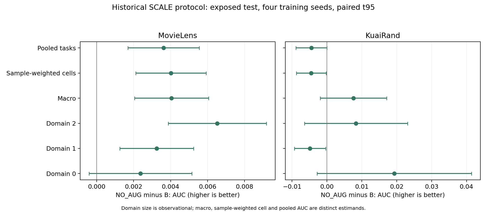

# SCALE：常数尺度与原增强套件的四种子证据

状态：两数据集各四种子2022–2025的Dconst01_NO_AUG已完成；主矩阵训练结束并统一冻结后，已实际重算八条新run的暴露test selected/停止端点预测。B与Dconst01是身份逐项匹配的历史四种子对照，本轮没有冒称重跑历史增强。

## 数值桥与可归因边界

本分支使用 c5618e281785a4b7063ff9bf2a61cf38d4faf1be 的真实历史配置：fixed1、六个 domain×task 均值之和（不除6）、coupled Adam lr=.01、wd=1e-5、eps=1e-8、physical batch40960；最长50epoch，validation Macro AUC 严格改善且平局取早、patience10后还原最佳。它与 RCF 的自然fit子角色、Sample BCE/.001/24epoch/validation MacroLL选点不同，绝对分数不跨两分支直接相减。

固定正数 c 下，`cL,wd,eps` 与 `L,wd/c,eps/c` 在相同 lr/betas、对应的 m/v/step 状态下有同一 Adam 更新：总梯度前者是后者的 c 倍，m缩放c、v缩放c²，eps须同时缩放。这不是lr乘c，也不适用于时变c、非对应历史、clip或AMP。冷/热状态数值桥实际通过，公式级证据 STRONG。c=.1 对应未缩放目标下 wd=.0001、eps=.0000001；本轮没有另外分离wd与eps的独立贡献。

因此无增强常数臂的结果是基线/有效正则尺度修正证据，不能包装成动态样本重要性、课程或动量机制成功。与原Dconst01比较的剩余差异属于整套历史增强路径，不能拆称某个单独噪声组件的因果效果。最新自然数据要求下，本轮没有新运行人工增强臂。

## 四种子身份与统计单位

全部八条新完成收据与 ALL_EIGHT_FROZEN_MANIFEST 的SHA逐一相符。对历史 B、Dconst01 的每个对应seed，都核对raw/array/split行与指纹、features、自然域数量、canonical backbone、batch/lr/wd/betas/eps/FP32；Dconst01 的完整初态也匹配。详见 [SCALE_VALIDATION_FOUR_SEED_ANALYSIS_RECEIPT.json](SCALE_VALIDATION_FOUR_SEED_ANALYSIS_RECEIPT.json)。

每个数据集、每个条件n=4，独立统计单位是训练seed。旧对照原始配对p未取得，只有公开汇总与逐epoch验证记录；允许作同seed指标差和seed区间，不伪造row/user配对bootstrap。新NO_AUG的真实raw预测保存在服务器v1/scale各seed目录。

| validation 对比（候选−参照） | 数据集 | ΔMacro AUC均值 | AUC改善seed数 | ΔMacro LL均值 | LL改善seed数 |
|---|---|---:|---:|---:|---:|
| Dconst01_NO_AUG−B | movielens | +0.00299757 | 4/4 | -0.00831534 | 4/4 |
| Dconst01−Dconst01_NO_AUG | movielens | +0.00127564 | 4/4 | -0.00335695 | 4/4 |
| Dconst01−B | movielens | +0.00427321 | 4/4 | -0.01167229 | 4/4 |
| Dconst01_NO_AUG−B | kuairand | +0.00442646 | 4/4 | -0.00422597 | 3/4 |
| Dconst01−Dconst01_NO_AUG | kuairand | +0.00762207 | 3/4 | -0.00286654 | 3/4 |
| Dconst01−B | kuairand | +0.01204853 | 4/4 | -0.00709251 | 4/4 |

## 稳定性、矛盾与强度

ML无增强常数尺度相对B的AUC/LL四种子同向，配对t95分别为AUC[+0.00256439,+0.00343074]、LL[−0.01296359,−0.00366710]；历史增强相对NO_AUG也四种子同向，AUC区间[+0.00068136,+0.00186993]、LL区间[−0.00493498,−0.00177892]。在当前固定历史协议的validation内证据 MEDIUM，尚不代表新增未见数据确认。

KR不能照搬ML的稳定性结论。NO_AUG相对B的AUC四种子改善，但配对t95[−0.00142512,+0.01027804]包含0；LL只有3/4改善，区间也跨0。历史增强相对NO_AUG的AUC/LL同向数均3/4，AUC区间[−0.00142834,+0.01667249]、LL[−0.01122788,+0.00549481]。扩至四种子后须保留这一反例，不能继续用最初两种子同向作为普遍增强收益主张。KR独立增强增量的稳定性证据 WEAK；Dconst01相对B的LL四种子改善仍可单独记录。

初始2022/2023资源扩展规则在只看validation、冻结规则后触发2024/2025；这只是历史执行来源，不当成两种子正式科学结论。最新用户要求生效后，本报告只在所有条件已有四训练种子后撰写，四种子没有按结果更换、筛选或追加。

## 冻结后的暴露test复评

以下均来自冻结后的四seed指标重算；旧对照只有汇总，因此CI仍是训练seed配对区间，未虚构逐行配对。训练选点始终仅看validation，不因这些test结果更改参数或开启额外分支。

| 对比（候选−参照） | 数据 | ΔMacro AUC | AUC改善 | ΔMacro LL | LL改善 |
|---|---|---:|---:|---:|---:|
| Dconst01_NO_AUG−B | movielens | +0.00404890 | 4/4 | -0.00924025 | 4/4 |
| Dconst01−Dconst01_NO_AUG | movielens | +0.00162688 | 3/4 | -0.00920454 | 4/4 |
| Dconst01−B | movielens | +0.00567578 | 4/4 | -0.01844479 | 4/4 |
| Dconst01_NO_AUG−B | kuairand | +0.00758835 | 4/4 | -0.00655322 | 3/4 |
| Dconst01−Dconst01_NO_AUG | kuairand | +0.00295028 | 3/4 | -0.00190699 | 2/4 |
| Dconst01−B | kuairand | +0.01053863 | 3/4 | -0.00846021 | 4/4 |

ML的NO_AUG−B仍四种子AUC/LL改善，AUC配对t95 [+0.00204763,+0.00605017]、LL [−0.01778456,−0.00069594]。增强−NO_AUG在test的AUC降为3/4同向且区间[−0.00137847,+0.00463223]，LL虽4/4改善、区间[−0.02245754,+0.00404847]仍宽；不能把validation的稳定增量直接泛化到排序的每个暴露角色。证据 MEDIUM，非新数据确认。

KR的NO_AUG−B为AUC四seed改善、LL 3/4，但两个macro区间均跨0；增强−NO_AUG的AUC 3/4、LL仅2/4。增强总套件Dconst01−B平均改善不等于每个组成机制单独稳定成立。小样本区间宽且标签相关性未由历史rawp核查，细粒度归因证据 WEAK。

## 域规模、基线难度和人口权衡

SCALE自然train域0/1/2计数为ML 155949/318599/325619，KR 172782/1743898/89452。它们与RCF的fit子角色不同；并未为这次对照改变采样比例。ML中规模相近的域1、域2，其B的test AUC均值分别0.78166167和0.75166464；最大的域2反而比最小域0的0.77105619更低。规模不是预测难度的同义词。KR域0的B AUC最低0.63154945，而LL也最低0.23918490，说明标签基率使AUC与LL的“难度”排序不能简单混用。

KR常数无增强对B存在特定的排序权衡：域0/1/2平均ΔAUC为+0.01931013/−0.00486585/+0.00832076，最大域1的AUC四种子均下降（t95 [−0.00935100,−0.00038070]），两个较小域分别4/4和3/4改善。LL域1平均+0.00333963，但只有一个seed恶化、其余三个改善，均值被较大个体变化影响；不能宣称稳定的LL大小域交换。域0/2平均LL分别−0.00470869/−0.01829061。

这个权衡在不同评价权重下改变总体结论。KR test自然计数为2613/246284/1870，域1约98.2%。NO_AUG−B虽然Macro AUC +0.00758835、MacroLL −0.00655322，样本加权cell AUC却−0.00451560、两任务pooled AUC均值−0.00445033、人口pooled LL +0.00309446。Macro、加权cell与pooled是不同指标，不能互称，也不能见结果后切换主指标。

ML的NO_AUG在三个域、两个任务的平均AUC/LL都改善，最大域2的AUC增量+0.00652312反而最大；它不符合“小域获益、大域必受损”的普遍解释。ML增强残差主要集中域0，域2的AUC平均约−0.00000564、LL仍改善，不应把这个近零排序变化夸大成全面大域损害。KR增强残差主要修复最大域的排序，进一步说明方向取决于具体干预。

因此，域规模是KR该尺度对照的一个可讨论相关变量，但不足以成为跨模型/目标/角色的主要因果解释。有效wd/eps、标签基率、支持、模型拟合阶段及基线风险是竞争解释；规模因果主张的证据 WEAK。这里的域/任务/epoch没有当成新增训练重复数。

## 选点与训练阶段

NO_AUG的ML选择epochs为11/12/10/11，停止于21/22/20/21；KR选择15/16/20/15，停止25/26/30/25。终态是各自实际early-stop末轮，不是共同epoch50。

停止端点−validation所选模型的test变化：ML平均ΔAUC −0.00275641、ΔLL +0.00931329，两项均4/4恶化；KR平均ΔAUC −0.00532046（4/4恶化）、ΔLL +0.00466742（3/4恶化）。这个阶段现象不能拿来替代合法selected性能，也不能为某方法在test上改选终点。

## 行动与未区分解释

常数尺度/有效正则组合已在当前历史协议内提供实质对照，修正了把全部收益归于动态样本重要性的叙述。数值桥不能单独分离wd和eps，增强残差也不能证明某个噪声组件独立有效。没有超出这些解释的稳定新机制证据，本分支结束于基线/解释修正；不恢复动态D/G大矩阵，不新开课程或动量算法。

四训练seed、历史测试暴露、对照rawp不可得与选点角色差异仍限制外推。下一步若需要新的方法主张，应先在新封存数据和匹配的有效正则下检验真正的相对权重/增强增量；本轮不因这些开放问题再扩大训练。

## 原始与核算证据

- [冻结后四seed核算收据](SCALE_FOUR_SEED_ANALYSIS_RECEIPT.json)，含16组历史身份核对、八组真实预测重算和全局冻结SHA。
- [逐seed全部指标](tables/SCALE_four_seed_metrics.csv)、[长表](tables/SCALE_four_seed_metrics_long.csv)、[逐seed配对差](tables/SCALE_four_seed_paired_differences.csv)、[均值/SD/seed t95](tables/SCALE_four_seed_paired_summary.csv)。
- [训练epoch/steps/成本](tables/SCALE_four_seed_costs.csv)、[停止端点与所选模型差](tables/SCALE_four_seed_stopped_minus_selected.csv)。
- 新原始预测、配置与收据保留于服务器 `artifacts/mdmt_rcf_20261026/v1/scale/<dataset>/Dconst01_NO_AUG/seed2022..2025/`，模型/优化器/检查点从未落盘；旧对照原始p未取得，不伪造其bootstrap。

[独立PDF图](figures/SCALE_domain_population_four_seed_intervals.pdf)保留域与人口评价的差异；图中区间以四训练seed计算，不以域为重复数。
