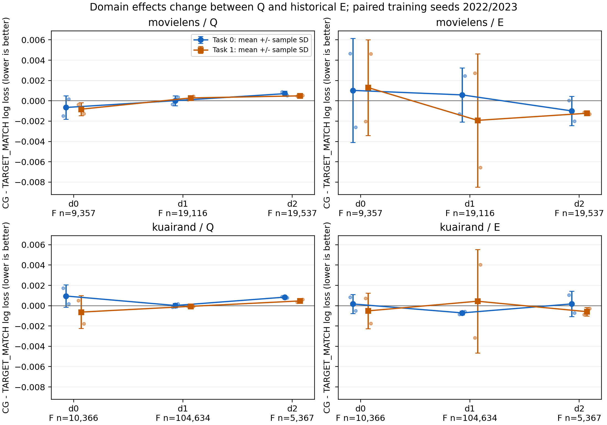

# BASP-A 完整实验报告｜2026-10-28

本轮完成 BASP-A 六模块实现、独立审查、两自然数据集的固定核心矩阵与读取干预，以及冻结后的历史 E 复评。正式矩阵为 **2 数据集 × 6 臂 × 2 开发 seed = 24 条适配轨迹**，480 轮适配、20,496 次主更新，另有 4 份共同前缀各 native 24 轮及 source pilot 12 pass。最终产生 48 份适配 selected/final E 评估和 4 份 native E 评分。

**研究决定：停止当前固定小容量 BASP-A 版本的结构与全模型扩展，两数据集按预定 Q 规则均保留 TARGET_MATCH。证据强度：MEDIUM。** 收益分组和关系组合未超过强目标适配的预定实用门，收益预测没有超过 F 拟合的域内常量基准，需求软路由接近均匀。P2–P5未进入；动态分裂、对比、foreign写入、低秩与B/C的真实处理效果未估计。上述模块已实现并按合同验收，条件候选与正式复评的状态逐项列于 [EXPERIMENT_REGISTRY.json](EXPERIMENT_REGISTRY.json)。

E 上两个数据集的 CG 平均 LogLoss 小幅改善，但每个数据集都仅1/2 seed改善，95%配对区间跨0。KuaiRand的Q排序改善与概率风险变差并存；MovieLens的域规模效应在Q与E间反向。结果支持当前版本缺少稳定实用增量，收益信号的可学习性和连续共享的潜力仍需独立判别。

**协议与身份。** 执行设计、口径及审查见 [设计](DESIGN_SPECIFICATION.md)、[干预附录](ADDENDUM_READ_INTERVENTIONS.md)、[局部门定义](LOCAL_GATE_DEFINITION.md)、[核心审查](REVIEW_REPORT.md)、[运行修复复审](RUNTIME_FIX1_REVIEW.md)、[干预审查](INTERVENTION_REVIEW.md)。当前工作目录原无Git元数据，固定参考为 `26-10-27@03c338092008a71b2d360a61b06d985eac551ec7`，main为`8eb461f5e0abc9c06385a4e8239e9621cae87ef8`；34份非空参考源码/JSON与远端直接内容比较相同，见 [来源收据](REFERENCE_SOURCE_AUDIT.json)。

原规划7101/7102及8101–8104被入口规则覆盖：开发使用2022/2023，预留锁定seed为2024–2026。本轮未触发P5，统计单位始终为两个独立训练seed；区间为95%配对t区间、df=1，任务/域/epoch不充当额外重复。静态合同21项通过，核心与运行回归29项、干预3项分别独立通过。

native为固定融合M3oE、单Adam、无learned fusion和AutoML/DARTS；T0训练24轮、batch40960、lr=.001、weight_decay=1e-5，V在12–24每轮选macroLL最小。pilot为owner真实标签12 pass，两个任务各256→32→1，按T0_s标准化拼64维phi。适配为ADAPTER_JOINT：native/pilot冻结，目标/需求/读出联合训练，来源后继接受owner监督；P1的foreign写、CL、动态分裂和低秩均关闭。当前结论对应冻结底座适配阶段。

适配20轮、batch2048、自然无放回顺序及尾批；主目标为自然有效标签平均logit BCE。第6/10/14轮各8个匹配更新，ML每轨迹504步、KR每轨迹1204步。辅助系数、权限、teacher/G、source投影按合同；V从5–20选macroLL最小完整状态，final固定为20。所有配置、selected/final的epoch/step、角色和动作版本均有记录；[全局冻结](GLOBAL_FREEZE.json)保存所有四worker及48个适配状态身份，E在该冻结后统一释放。

**数据人口与标签权限。** MovieLens 1,000,209行，T0/F/S/Q/V/E分别640133/48010/32007/40008/100021/100021；KuaiRand 2,507,666行，对应1604904/120367/80246/100307/250767/250767。legacy Q_confirm单独保留。raw→编码/标签、原固定roles、T0词表与缩放逐值一致。F主训练未重采样或增强；每域最多1024的等域probe只用于辅助测量。ML probe/fold/S按原始user_id分组，KR按row；三S窗不跨组。本轮无合格结构事务，S未消费。历史E已暴露，只在冻结后复评。

Q与E来自既定行序人口：MovieLens Q三个域的user_id OOV均0，E分别18.72%、17.96%、21.69%；KR最大域d1的份额由F约86.93%升至E约98.21%。角色间标签率和域组成也不同，详见 [DATASET_PROFILES.csv](analysis/DATASET_PROFILES.csv)。这些观测支持人口/覆盖差异作为Q–E翻转的竞争解释；其因果贡献尚未分离。

**预定比较与最终E结果。** C=CLUSTER_ONLY，G=RELATION_ONLY，CG=CLUSTER_RELATION。STATIC_LOCAL使用非收益几何责任；FIXED_READ使用固定读取；TARGET_MATCH是width41强目标残差。每项比较保留同seed配对；LL负差为改善、AUC正差为改善。C*从TARGET_MATCH/FIXED_READ/非收益容量控制按Q选定，两数据均为TARGET_MATCH。

| 数据 | 角色 | ΔmacroLL | 95% CI | ΔmacroAUC | 95% CI | LL改善seed | AUC改善seed |
| --- | --- | --- | --- | --- | --- | --- | --- |
| movielens | Q | +0.00000169 | [-0.00157285, +0.00157624] | -0.00005492 | [-0.00061250, +0.00050266] | 1/2 | 0/2 |
| movielens | E | -0.00020543 | [-0.00899247, +0.00858161] | -0.00001955 | [-0.00498868, +0.00494959] | 1/2 | 1/2 |
| kuairand | Q | +0.00026319 | [-0.00330614, +0.00383253] | +0.00074319 | [-0.00850150, +0.00998787] | 1/2 | 2/2 |
| kuairand | E | -0.00017147 | [-0.00283001, +0.00248707] | +0.00054782 | [-0.02380375, +0.02489938] | 1/2 | 1/2 |

CG−TARGET_MATCH的逐seed原始差如下。E没有改变已锁定C*、方法或checkpoint。

| 数据 | 角色 | seed | ΔmacroLL | ΔmacroAUC | ΔnaturalLL |
| --- | --- | --- | --- | --- | --- |
| kuairand | E | 2022 | -0.00038070 | -0.00136869 | -0.00195711 |
| kuairand | E | 2023 | +0.00003776 | +0.00246433 | +0.00168454 |
| kuairand | Q | 2022 | +0.00054411 | +0.00001561 | +0.00003804 |
| kuairand | Q | 2023 | -0.00001772 | +0.00147076 | +0.00000643 |
| movielens | E | 2022 | +0.00048613 | -0.00041063 | +0.00048316 |
| movielens | E | 2023 | -0.00089698 | +0.00037153 | -0.00108002 |
| movielens | Q | 2022 | -0.00012223 | -0.00001104 | +0.00004841 |
| movielens | Q | 2023 | +0.00012561 | -0.00009880 | +0.00026673 |

E selected均值±sample SD；NATIVE_RAW为共同native selected评分。全部方法V/Q/E、selected/final、配对差与区间见 [完整汇总](analysis/METRIC_SUMMARY.csv)、[逐seed指标](analysis/SEED_METRICS_LONG.csv)、[配对汇总](analysis/PAIRED_SUMMARY.csv)。

| 数据 | 方法 | macro AUC | macro LogLoss | natural LogLoss |
| --- | --- | --- | --- | --- |
| movielens | NATIVE_RAW | 0.75665835 ± 0.00003139 | 0.51666346 ± 0.00579771 | 0.51467365 ± 0.00538117 |
| movielens | TARGET_MATCH | 0.75980057 ± 0.00026493 | 0.50608562 ± 0.00058396 | 0.50426297 ± 0.00051465 |
| movielens | STATIC_LOCAL | 0.75947887 ± 0.00036251 | 0.50511915 ± 0.00038328 | 0.50304119 ± 0.00025539 |
| movielens | CLUSTER_ONLY | 0.75985976 ± 0.00005833 | 0.50553265 ± 0.00039497 | 0.50369099 ± 0.00058564 |
| movielens | FIXED_READ | 0.75916763 ± 0.00052182 | 0.50498676 ± 0.00028973 | 0.50291901 ± 0.00032064 |
| movielens | RELATION_ONLY | 0.75938546 ± 0.00047005 | 0.50520209 ± 0.00019478 | 0.50310726 ± 0.00001536 |
| movielens | CLUSTER_RELATION | 0.75978103 ± 0.00028814 | 0.50588019 ± 0.00039404 | 0.50396454 ± 0.00059069 |
| kuairand | NATIVE_RAW | 0.65894252 ± 0.00579536 | 0.43828450 ± 0.00214720 | 0.42296383 ± 0.00994868 |
| kuairand | TARGET_MATCH | 0.66029735 ± 0.00102045 | 0.43776585 ± 0.00073071 | 0.43017364 ± 0.00199008 |
| kuairand | STATIC_LOCAL | 0.66178211 ± 0.00378534 | 0.43780011 ± 0.00024083 | 0.42983833 ± 0.00080434 |
| kuairand | CLUSTER_ONLY | 0.66091931 ± 0.00376736 | 0.43743107 ± 0.00051251 | 0.42945513 ± 0.00047770 |
| kuairand | FIXED_READ | 0.65943532 ± 0.00237716 | 0.43822056 ± 0.00007556 | 0.42991862 ± 0.00137806 |
| kuairand | RELATION_ONLY | 0.66112723 ± 0.00327196 | 0.43788093 ± 0.00024876 | 0.42972539 ± 0.00092880 |
| kuairand | CLUSTER_RELATION | 0.66084517 ± 0.00373081 | 0.43759438 ± 0.00043481 | 0.43003735 ± 0.00058496 |

**重复与矛盾。** Q上CG−TARGET_MATCH的LL方向在两数据集都各一正一负；ML的macro AUC两seed均下降，KR两seed均上升。到了E，两数据的LL和AUC都各有1/2 seed改善。KR selected的Q平均AUC增益+0.000743，epoch20 final变为−0.000432，final Q LL两seed均恶化、均值+0.001161。ML selected的Q LL均值约0，final为+0.000076。训练终点没有稳定消除selected比较中的风险问题。

当前主优化量为自然BCE，选点量为六格macroLL，AUC为排序指标。KR selected Q的平均cell Brier差+0.000115、平均绝对概率偏差差+0.003070；ML分别+0.000036/+0.002505。它们支持概率质量与排序可能异向，详见 [校准诊断](analysis/PAIRED_CALIBRATION.csv)。KR的Q排序均值收益主要集中在d0/task1，任务与seed间波动较大；跨域pooled AUC与域内macro也不同。检查目标、校准、checkpoint后，仍保留原LL推进规则。

| 数据 | 角色 | 任务 | Δ任务macroAUC | Δ任务pooledAUC | Δ任务macroLL |
| --- | --- | --- | --- | --- | --- |
| movielens | Q | 0 | -0.00007678 | -0.00014312 | +0.00002067 |
| movielens | Q | 1 | -0.00003306 | -0.00021721 | -0.00001728 |
| movielens | E | 0 | +0.00009029 | -0.00048732 | +0.00020512 |
| movielens | E | 1 | -0.00012938 | -0.00018451 | -0.00061598 |
| kuairand | Q | 0 | -0.00023236 | +0.00000500 | +0.00060305 |
| kuairand | Q | 1 | +0.00171874 | +0.00002047 | -0.00007666 |
| kuairand | E | 0 | -0.00059000 | -0.00035325 | -0.00012262 |
| kuairand | E | 1 | +0.00168564 | -0.00011365 | -0.00022032 |

ML的FIXED_READ在E上的LL均值0.504987优于TARGET_MATCH的0.506086，同时AUC均值0.759168低于0.759801；它在Q上的LL却较差。C在E上的LL均值也优于CG（ML 0.505533对0.505880；KR 0.437431对0.437594）。因此当前证据没有建立收益关系对收益分组的额外必要性。匹配组件差见 [MATCHED_COMPONENT_SUMMARY.csv](analysis/MATCHED_COMPONENT_SUMMARY.csv)。NONE/GAIN四格增加整条来源路径，纯C×G交互需C_FIXED_READ；该有条件归因未触发。

**域规模、难度与交换关系。** 下表为历史E的TARGET_MATCH基线及CG配对均值。难度用同任务基线AUC/LL及标签支持描述；域大小本身不充当难度。

| 数据 | 域 | 任务 | F行数 | E行数 | E正例率 | 基线AUC | 基线LL | ΔAUC | ΔLL |
| --- | --- | --- | --- | --- | --- | --- | --- | --- | --- |
| kuairand | 0 | 0 | 10,366 | 2613 | 0.08726 | 0.622563 | 0.290261 | -0.001154 | +0.000169 |
| kuairand | 0 | 1 | 10,366 | 2613 | 0.04592 | 0.621694 | 0.185424 | +0.004284 | -0.000510 |
| kuairand | 1 | 0 | 104,634 | 246284 | 0.21052 | 0.684457 | 0.510568 | -0.000265 | -0.000710 |
| kuairand | 1 | 1 | 104,634 | 246284 | 0.11131 | 0.710705 | 0.350600 | -0.000085 | +0.000439 |
| kuairand | 2 | 0 | 5,367 | 1870 | 0.58824 | 0.650295 | 0.646930 | -0.000351 | +0.000173 |
| kuairand | 2 | 1 | 5,367 | 1870 | 0.44225 | 0.672071 | 0.642812 | +0.000858 | -0.000590 |
| movielens | 0 | 0 | 9,357 | 27687 | 0.51580 | 0.755605 | 0.598196 | +0.000605 | +0.001026 |
| movielens | 0 | 1 | 9,357 | 27687 | 0.17929 | 0.768911 | 0.414874 | -0.000394 | +0.001302 |
| movielens | 1 | 0 | 19,116 | 41434 | 0.53270 | 0.764101 | 0.583981 | -0.000241 | +0.000582 |
| movielens | 1 | 1 | 19,116 | 41434 | 0.16969 | 0.784497 | 0.393853 | -0.000126 | -0.001924 |
| movielens | 2 | 0 | 19,537 | 30900 | 0.58573 | 0.736960 | 0.597980 | -0.000093 | -0.000992 |
| movielens | 2 | 1 | 19,537 | 30900 | 0.20466 | 0.748730 | 0.447630 | +0.000131 | -0.001226 |

ML在Q上d0两任务平均LL改善约0.000656/0.000823、d2恶化0.000703/0.000489；E上d0恶化0.001026/0.001302，d2改善0.000992/0.001226。KR最小域d2在Q两任务均恶化，E上task0略恶化而task1改善；最大域d1也呈任务异向。当前数据支持局部交换和人口/阶段交互，跨数据集稳定的“小域获益、大域下降”规律未形成。**域规模作为主要单一解释的证据：WEAK。** 同域跨角色反向以及标签率、OOV和基线难度的共变削弱单因子解释。



图中实点为两个训练seed的均值，误差条为sample SD，浅点为逐seed；域标签同时给出自然F行数。

**收益表示、关系和来源形成。** 下表将合法的F拟合域内常量与冻结μ在Q上比较。原始导出也保留Q经验均值常量skill；两种口径均未显示预测增量。收益单位由已保存RMS恢复至最近FP32尺度，并与原记录MSE逐项核对。所有动作保持真实目标domain输入、任务轴、带符号BCE差和OFF参照。

| 数据 | 方法 | seed | F预测器两折skill | Q μ对F常量skill | Q μ单动作收益 | Q F常量单动作收益 |
| --- | --- | --- | --- | --- | --- | --- |
| movielens | CLUSTER_ONLY | 2022 | -0.44046 | -0.00141 | -0.0003068 | -0.0004032 |
| movielens | CLUSTER_ONLY | 2023 | -0.63593 | -0.00157 | -0.0001620 | +0.0001749 |
| movielens | CLUSTER_RELATION | 2022 | -0.48678 | -0.00176 | -0.0005957 | -0.0006603 |
| movielens | CLUSTER_RELATION | 2023 | -0.52398 | -0.00187 | -0.0002603 | +0.0000158 |
| kuairand | CLUSTER_ONLY | 2022 | -0.18693 | -0.00132 | -0.0000932 | -0.0001235 |
| kuairand | CLUSTER_ONLY | 2023 | -0.20499 | -0.00601 | -0.0002701 | -0.0002524 |
| kuairand | CLUSTER_RELATION | 2022 | -0.18541 | -0.00514 | -0.0002602 | -0.0003122 |
| kuairand | CLUSTER_RELATION | 2023 | -0.21762 | -0.01156 | -0.0004571 | -0.0003925 |

μ和F常量单动作均按冻结输出选含OFF的最大预测收益动作，收益正值代表真实Q BCE改善；这是同状态诊断，部署仍使用原凸组合政策。两折仅划分F上的收益预测器，前缀、来源和读出保持共同训练状态。C/CG的8份selected Q预测相对F域内常量skill均为负。ML C/CG需求责任相对0.5的最大偏离分别约0.000956/0.000145，KR约0.001214/0.001637。硬分组人数可不同，实际soft预测几乎等质量。C与CG合计32个预定F诊断窗口均无合格提议；局部共同分区比较没有通过入口。

CG的Q平均NULL权重ML为0.991304/0.992406，KR为0.993000/0.996541；E仍在0.988743–0.999442。source硬投影γ全为1，未实际缩放来源更新。共享trunk辅助cap在KR CG约99.72%/99.91%的joint步生效、平均γ约0.2367/0.2028；ML约94.30%/69.52%、平均γ0.5462/0.7150。标签噪声与状态漂移、有限probe的高维估计、辅助cap，以及owner-only来源形成是具体竞争解释。低μ振幅也可反映带噪收益的条件均值收缩；评价依据是留出预测和真实政策风险。

**读取依赖与再适配分开。** 以下均为selected Q；正LL差表示移除/替换使风险增加。固定ALL_NULL相对KEEP_FIXED；OFF/ROOT短训相对同8步KEEP_READAPT。每seed的p*由F自然加权依赖事前选定，四个worker共24个状态诊断，576次额外reader更新单列成本。所有分支从相同原Adam出发，只更新既有w，原模型/Adam/RNG/游标/teacher/G恢复parity通过。

| 数据 | 方法 | 固定全NULL ΔmacroLL | p* OFF再适配 ΔmacroLL | p* ROOT再适配 ΔmacroLL |
| --- | --- | --- | --- | --- |
| movielens | FIXED_READ | +0.00033403 | +0.00002401 | -0.00000023 |
| movielens | RELATION_ONLY | +0.00000828 | +0.00000386 | +0.00000001 |
| movielens | CLUSTER_RELATION | -0.00000132 | -0.00000055 | +0.00000002 |
| kuairand | FIXED_READ | -0.00030428 | -0.00009231 | -0.00000099 |
| kuairand | RELATION_ONLY | -0.00002246 | -0.00001066 | -0.00000026 |
| kuairand | CLUSTER_RELATION | -0.00003168 | -0.00001620 | -0.00000002 |

固定读取具有可测当前依赖；CG依赖幅度更小，ROOT替换影响也很小。固定状态依赖、相同reader预算下的替代能力、相对TARGET_MATCH的完整方法增量分别回答不同问题。各seed的p*可不同，原路径、逐cell/原型、三臂结果和成本保存在对应INTERVENTION_PLAN与FUNCTION_INTERVENTIONS中，见 [干预汇总](analysis/FUNCTION_INTERVENTION_SUMMARY.csv)。未入选路径的短训替代能力记UNMEASURED。

**阶段与证据强度。**

- STRONG：在已运行的配置和快照中，收益μ留出MSE未超过常量、soft需求接近均匀、显式CG读取主要为NULL、硬source投影未绑定；原始统计可复算。
- MEDIUM：当前固定K BASP-A缺少超过强目标适配的稳定实用增量。两数据各仅两个训练seed，方向随seed、任务、选点和评价人口变化，配对区间较宽。
- WEAK：把结果解释为真实条件共享信号不存在，或解释为域大小决定成败；现有实验未分离这些机制。

P0实现与验收完成；P1全部24轨迹和干预完成。P2因没有通过F可部署分区/收益可预测性/跨seed局部实用入口而未启动；P3的纯交互、B/C、连续、语义置乱、来源库及机会分配候选未进入；P4无保留A配置；P5未达全局/局部门，2024–2026未训练。辅助cap频繁生效允许后续固定辅助权重诊断，本轮已满足“强目标适配匹配收益且成本更低”的停止条件，未据此追加训练。CL、foreign写、动态分裂和FULL_MODEL_JOINT的处理效应保持未测。决定已在E前锁定于 [STAGE_DECISION.json](STAGE_DECISION.json)。

**最有区分力的下一实验。** 固定同一native/source动作库、F角色和主更新预算，仅将共享trunk辅助梯度系数从当前cap改为预先固定的γ=1，与当前CG配对；不新增CL/结构/元控制器。先检验F预测器fold和合法Q上的域内常量skill及政策风险，再检验macroLL/AUC。如果收益预测改善而推荐仍无增量，瓶颈更接近政策/容量价值；两者都不改善则削弱“主要被cap压制”的解释。该实验需独立注册，当前历史E只作已有配置的锁定报告。

**参数与成本。** 参数表按实际forward类别区分训练工具与部署参数；非收益臂未使用的48个center参数从部署图排除。native冻结参数ML772974、KR1614254，共同pilot49542；显式读取部署需要49344个pilot隐藏参数及标准化状态，source-free部署跳过该前缀。G、固定投影/中心、标准化和teacher数据另计状态，不冒充可训练参数。

| 方法 | 可训练适配参数 | 部署适配参数 | 额外冻结source隐藏参数 | ML适配秒/seed | KR适配秒/seed |
| --- | --- | --- | --- | --- | --- |
| TARGET_MATCH | 63966 | 63966 | 0 | 21.57 | 32.64 |
| STATIC_LOCAL | 62840 | 58610 | 0 | 74.58 | 163.95 |
| CLUSTER_ONLY | 63680 | 59450 | 0 | 112.94 | 167.55 |
| FIXED_READ | 62840 | 62450 | 49344 | 112.38 | 124.79 |
| RELATION_ONLY | 62840 | 62450 | 49344 | 116.55 | 111.92 |
| CLUSTER_RELATION | 63680 | 63290 | 49344 | 125.34 | 123.03 |

24条正式适配的计时分项总和为2574.47秒，其中完整来源投影累计1203.56秒；分项与总训练秒有包含关系，多个worker并发时间不相加当墙钟。native及pilot训练计时分项约375.06秒，缓存、干预、失败与重调度另列。原生训练峰值约1.04GiB，适配峰值按逐进程收据记录；[成本表](analysis/COST_LEDGER.csv)、[参数/MAC表](analysis/PARAMETER_AND_MAC_LEDGER.csv)及逐运行raw-X batch1/256 P50/P95保留实际共享硬件条件。native/source-pilot完整MAC计数标UNMEASURED，已报告适配线性MAC上界与实际source调用，低秩未运行。

**缺陷与执行修订。** 初始静态合同21项和核心28项通过后，真实STATIC_LOCAL第4轮暴露诊断字典重复epoch字段的TypeError。修复仅一行元数据合并，新增真实入口回归，独立29项通过；attempt1四个worker的部分进展、约225.77个worker秒和日志全部保留，模型RAM随退出丢失。它们未计入正式独立重复。

attempt2中KR/2022在GPU0与其他作业共享时，STATIC_LOCAL轮耗时约64–182秒；归档native24/pilot12/TARGET_MATCH20/STATIC_LOCAL7及约20分25秒后，移至GPU1从头运行同配置。新旧F h/z/phi与native Q所有数组直接比较全等、最大差0；新STATIC_LOCAL每轮约4.6–4.8秒。正式矩阵使用GPU1完整重跑的轨迹，资源重调度与失败成本分别记录。没有缩小batch或轮数，没有覆盖历史研究记录。

实现审查还修复了动态Adam分组和center lr、S的trajectory独立消费及完整恢复、提议覆盖与动作身份、非对称source增长、诊断当前状态与F预登记等问题；见审查与实现报告。上述修订均有独立复审记录；本轮成功轨迹使用Runtime Fix1后的统一实现。

**交付与复算。** [执行报告](EXPERIMENT_EXECUTION_REPORT_ATTEMPT2.md)、[失败报告](EXPERIMENT_EXECUTION_REPORT_ATTEMPT1.md)、[配置](EXECUTION_CONFIG.json)、[运行清单](RUN_MANIFEST.json)、[状态身份](CHECKPOINT_IDENTITIES.csv)、[完整数值索引](analysis/SEED_METRICS_LONG.csv)、[936条cell记录](analysis/CELL_METRICS.csv)、[机制数据](analysis/MECHANISM_SUMMARY.csv)和代码共同交付。压缩原始记录及本地大数据位置见 [数据索引](PUBLISH_DATA_INDEX.json)。训练代码位于 `experiments/mdmt_basp_v1/`。

复算命令使用项目Python：

```text
/home_new/xzf/envs/miniconda3/envs/phase0-3-env/bin/python research_reports/2026-10-28/analyze_campaign.py --root artifacts/mdmt_basp_v1/attempt2 --output research_reports/2026-10-28/analysis
/home_new/xzf/envs/miniconda3/envs/phase0-3-env/bin/python research_reports/2026-10-28/analyze_local.py --root artifacts/mdmt_basp_v1/attempt2 --output research_reports/2026-10-28/analysis
/home_new/xzf/envs/miniconda3/envs/phase0-3-env/bin/python research_reports/2026-10-28/extract_mechanisms.py --root artifacts/mdmt_basp_v1/attempt2 --output research_reports/2026-10-28/analysis
```

未运行未触发的扩展、B/C及新超参网格；模型、Adam、selected/final从未落盘，worker完成E后释放RAM，复现训练需按配置重跑。
