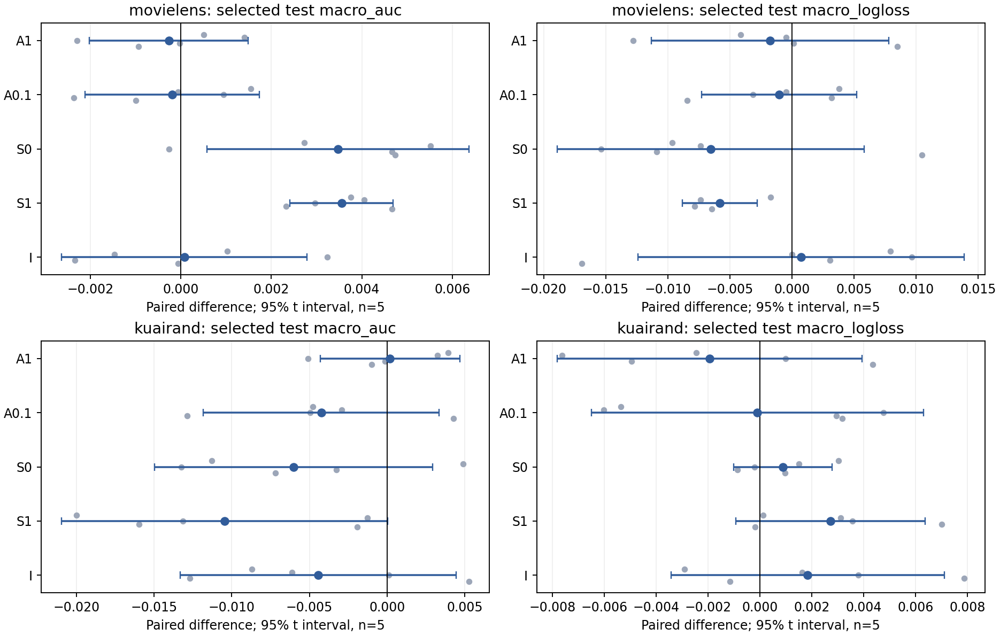
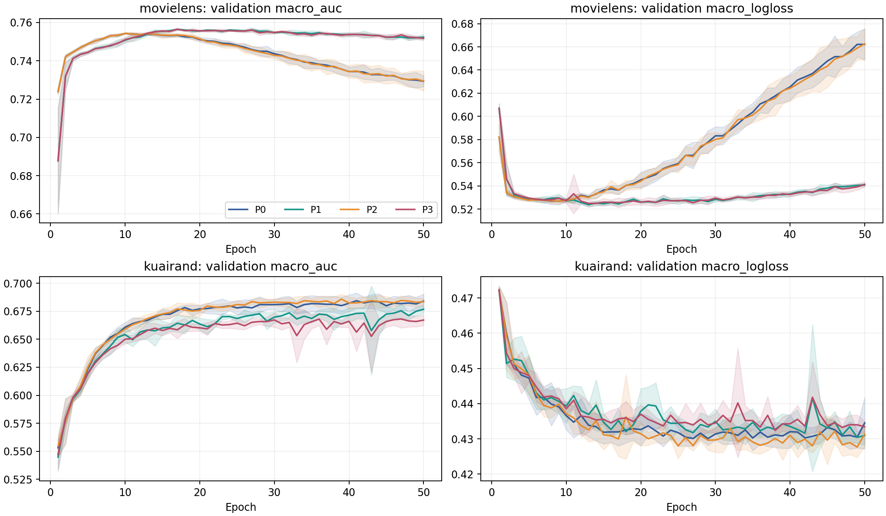

# GA31-v2 首轮完整实验与分析报告

**完成日期：2026-10-31。决定：结束首轮，当前 NR-Gauss-v1 不进入 SAGU/SAOS 扩展训练。** 两个数据集在两个损失尺度上的增强效应均未通过预定 selected AUC 推进门槛。MovieLens 保留 P1（无增强、loss_scale=0.1）为本轮简单基线；KuaiRand 保留 P0（无增强、loss_scale=1）。KuaiRand 的 P2 还触发最差 cell AUC 保护规则。

已完成 **2 数据集 × 4 臂 × 5 seeds = 40 次正式训练、2,000 epoch、69,000 次主 Adam 更新、120 条 test checkpoint 记录和 232 个只读探针 batch**；失败为0。测试在全体 selected checkpoint 与工作尺度冻结后统一进行。模型、Adam、RNG 与 loader 状态全程保存在 RAM，实验结束后释放。

**证据判断：** 当前增强缺少稳定实用宏 AUC 增量的研究决定为 **MEDIUM**；MovieLens 缩放对照改善 selected AUC 并显著减轻后期恶化的重复现象为 **STRONG**；把差异归因于域大小、梯度冲突或 Adam 历史污染的证据为 **WEAK**。

## 1. 协议、范围与验收

入口为 [首轮合同](../../research_plans/26-10-31/03_首轮实验与Codex实施规范.md)，本轮覆盖项冻结于 [设计规格](DESIGN_SPECIFICATION.md) 与 [执行配置](../../experiments/gradient_aug_20261031/resolved_protocol.json)。`start.md` 要求五种子2022–2026并禁止模型状态文件，覆盖原规划的四种子/磁盘 checkpoint：主分析方向门槛4/5、配对 t 区间df=4；原2022–2025另作3/4、df=3敏感性分析。效应量门槛保持 ΔAUC≥0.001，保护阈值保持0.002。

模型为固定融合系数全部等于1的 M3oE/MDMTRec，3域×2任务、4 shared experts、fcn_dims=[512,256,256,64]、sparse embedding_dim=16；保留 LayerNorm、gate输入detach。一个普通 Adam：lr=.01、β=(.9,.999)、eps=1e-8、coupled weight_decay=1e-5；FP32，TF32关闭，无AMP/调度器/裁剪/累积/参数EMA。batch40960，自然无放回 shuffle，每真实batch一次backward/step，完整50epoch不早停。选模为每epoch真实 validation 六格macro AUC严格大于当前最优，平局最早。

P0/P1无增强，分别 c=1/.1；P2/P3启用 NR-Gauss-v1，分别 c=1/.1。增强仅对最小训练域每次曝光的一份视图执行：ML=d0、KR=d2。每个非路由 sparse field 使用 `e + .1*stopgrad(RMS(e))*N(0,1)`；保护 domain embedding、dense、输入ID与标签。λ=.5，目标样本真实/增强权重各一半，非目标样本真实权重1，总分母始终为原始B×2。**保留的是原样本/域/任务权重预算；模型内扰动改变训练输入风险。**

训练初始化和每epoch原row_id顺序在同seed四臂完全一致；P2/P3噪声种子独立且配对。数据沿冻结原始行序80/10/10，只在train拟合编码器/缩放器，KR先全局切分再过滤tab。两个数据集全部raw/六数组/split/encoder/scaler身份匹配。[来源收据](SOURCE_FETCH_RECEIPT.json)记录规划commit `60c45e60e6b9aa35eccaa2bd3d0898b72ac72acc`，模型/预处理冻结commit `540171f865d3f80b7b46abdba69d0939cab49d80`。当前工作区为无本地Git元数据的源码导出；发布分支保存本轮实际实现。

完成 DESIGN→独立 IMPLEMENT→独立 REVIEW→RUN→ANALYZE。审查判定为 [PASS WITH FIXES](REVIEW_REPORT.md)，阻塞项均已修正。3项CPU语义测试、8个原batch CUDA检查、独立探针与真实单epoch fork/内存IPC验收通过；开发短run只用1/8。实现与修订见 [coder报告](CODER_IMPLEMENTATION_REPORT.md)，执行计数见 [runner报告](RUNNER_REPORT.md)。

## 2. 主结果与四臂因子效应

统计单位为seed，均值±sample SD。macro是六个域任务cell等权；pooled是每任务跨域AUC后任务等权；traffic为评价split域份额加权cell指标。LL均为真实输入、未缩放概率BCE。原始逐seed全cell数值见 [TEST_METRICS.csv](analysis/TEST_METRICS.csv) 与 [VALIDATION_METRICS.csv](analysis/VALIDATION_METRICS.csv)。


| 数据 | 臂 | macro AUC | macro LL | pooled AUC | traffic cell AUC | worst AUC | 总体LL |
| --- | --- | --- | --- | --- | --- | --- | --- |
| ML | P0 | 0.771519 ± 0.001196 | 0.499922 ± 0.005861 | 0.772257 | 0.772814 | 0.748634 | 0.498203 |
| ML | P1 | 0.774992 ± 0.001604 | 0.493372 ± 0.005437 | 0.776334 | 0.776233 | 0.752056 | 0.491780 |
| ML | P2 | 0.771252 ± 0.000539 | 0.498169 ± 0.002761 | 0.771924 | 0.772384 | 0.748840 | 0.496436 |
| ML | P3 | 0.774804 ± 0.001275 | 0.492357 ± 0.001727 | 0.775960 | 0.776110 | 0.751180 | 0.490568 |
| KR | P0 | 0.671907 ± 0.006145 | 0.437172 ± 0.002751 | 0.716990 | 0.711621 | 0.634325 | 0.426397 |
| KR | P1 | 0.665881 ± 0.002983 | 0.438053 ± 0.003541 | 0.701575 | 0.695657 | 0.633301 | 0.430712 |
| KR | P2 | 0.672094 ± 0.004496 | 0.435229 ± 0.002796 | 0.717392 | 0.711889 | 0.625788 | 0.422245 |
| KR | P3 | 0.661638 ± 0.004674 | 0.437950 ± 0.002524 | 0.700568 | 0.694601 | 0.622823 | 0.429872 |


工作尺度只由P0/P1的selected validation均值决定：ML P0=0.754591、P1=0.756850，冻结c*=.1；KR P0=0.686278、P1=0.679155，冻结c*=1。test没有改变工作尺度或选点。

定义 A1=P2−P0，A0.1=P3−P1，S0=P1−P0，S1=P3−P2，I=A0.1−A1。AUC正差和LL负差有利。下表均为selected test配对效应；区间是描述性95%配对t区间。


| 数据 | 效应 | ΔAUC | AUC区间 | AUC正向 | ΔLL | LL区间 | LL改善 |
| --- | --- | --- | --- | --- | --- | --- | --- |
| ML | A1 | -0.000267 | [-0.002021, +0.001488] | 2/5 | -0.001753 | [-0.011316, +0.007810] | 3/5 |
| ML | A0.1 | -0.000188 | [-0.002117, +0.001741] | 2/5 | -0.001015 | [-0.007255, +0.005226] | 3/5 |
| ML | S0 | +0.003473 | [+0.000581, +0.006366] | 4/5 | -0.006550 | [-0.018917, +0.005816] | 4/5 |
| ML | S1 | +0.003552 | [+0.002410, +0.004694] | 5/5 | -0.005812 | [-0.008839, -0.002785] | 5/5 |
| ML | I | +0.000078 | [-0.002635, +0.002792] | 2/5 | +0.000739 | [-0.012418, +0.013895] | 2/5 |
| KR | A1 | +0.000188 | [-0.004309, +0.004684] | 2/5 | -0.001943 | [-0.007828, +0.003941] | 3/5 |
| KR | A0.1 | -0.004243 | [-0.011833, +0.003346] | 1/5 | -0.000103 | [-0.006508, +0.006302] | 2/5 |
| KR | S0 | -0.006026 | [-0.014981, +0.002930] | 1/5 | +0.000881 | [-0.001014, +0.002776] | 2/5 |
| KR | S1 | -0.010457 | [-0.020959, +0.000046] | 0/5 | +0.002721 | [-0.000925, +0.006368] | 1/5 |
| KR | I | -0.004431 | [-0.013309, +0.004447] | 2/5 | +0.001840 | [-0.003428, +0.007109] | 2/5 |




**ML：** 两个增强均值分别−0.000267、−0.000188，均只有2/5 seed正向，validation均值也低于0.001。S0却为+0.003473（4/5，区间[+0.000581,+0.006366]），S1为+0.003552（5/5）。I接近0：当前主要可重复收益来自缩放对照，增强没有呈现额外的实用宏AUC增量。这里依据的是A1/A0.1与S0/S1的直接比较，I本身只描述交互。ML的增强宏LL平均下降，但各只有2/5 seed改善，幅度区间较宽。

**KR：** c=1增强validation ΔAUC=+0.002078，但仅3/5 seed正向，test降至+0.000188、2/5正向；c=.1增强test为−0.004243、4/5下降。缩放无增强S0为−0.006026、4/5下降；有增强S1为−0.010457、5/5下降。validation交互I=−0.008587、5/5负向，test I=−0.004431、3/5负向，后者区间跨0。缩放与增强的条件关系在KR更不利，强度估计仍受种子波动影响。

四个增强比较的宏AUC区间均跨0。ML的平均差接近0，但逐seed可达约0.002，未满足合同“效果很小”的逐seed约束；KR也未满足。因此决定为停止当前版本投入，数值判断保留种子分裂和局部收益。[全部效应/SD/区间](analysis/EFFECT_SUMMARY.csv)、[全部逐seed配对差](analysis/PAIRED_EFFECTS.csv)均随报告发布。

## 3. 域大小、基线难度与性能交换

ML训练域人口为155949/318599/325619；KR为172782/1743898/89452。增强目标的自然曝光份额分别19.4896%和4.4589%，增强视图在原样本预算中的有效份额为其一半。原始人口与标签基率见 [DOMAIN_PROFILE.csv](analysis/DOMAIN_PROFILE.csv)。下表列同任务基线AUC和两尺度增强差，括号是正向seed数。


| 数据 | cell | train n | test n | test正例率 | P0 AUC | P1 AUC | ΔA1 AUC | ΔA0.1 AUC |
| --- | --- | --- | --- | --- | --- | --- | --- | --- |
| ML | d0t0 | 155,949 | 27687 | 0.5158 | 0.766481 | 0.770386 | +0.001296 (5/5) | -0.000669 (2/5) |
| ML | d0t1 | 155,949 | 27687 | 0.1793 | 0.780846 | 0.785008 | +0.000712 (3/5) | -0.000497 (2/5) |
| ML | d1t0 | 318,599 | 41434 | 0.5327 | 0.775393 | 0.777947 | -0.001172 (2/5) | +0.000433 (3/5) |
| ML | d1t1 | 318,599 | 41434 | 0.1697 | 0.793546 | 0.797240 | -0.001680 (1/5) | +0.000192 (2/5) |
| ML | d2t0 | 325,619 | 30900 | 0.5857 | 0.748634 | 0.752056 | +0.000206 (4/5) | -0.000876 (0/5) |
| ML | d2t1 | 325,619 | 30900 | 0.2047 | 0.764213 | 0.767316 | -0.000963 (2/5) | +0.000288 (2/5) |
| KR | d0t0 | 172,782 | 2613 | 0.0873 | 0.635617 | 0.635098 | -0.006655 (1/5) | -0.012275 (1/5) |
| KR | d0t1 | 172,782 | 2613 | 0.0459 | 0.645909 | 0.651557 | -0.004989 (3/5) | -0.005386 (2/5) |
| KR | d1t0 | 1,743,898 | 246284 | 0.2105 | 0.698833 | 0.682245 | +0.000424 (2/5) | -0.001227 (2/5) |
| KR | d1t1 | 1,743,898 | 246284 | 0.1113 | 0.726663 | 0.710755 | +0.000151 (1/5) | -0.000690 (2/5) |
| KR | d2t0 | 89,452 | 1870 | 0.5882 | 0.653260 | 0.642927 | +0.006094 (3/5) | -0.001042 (4/5) |
| KR | d2t1 | 89,452 | 1870 | 0.4422 | 0.671157 | 0.672705 | +0.006100 (4/5) | -0.004839 (3/5) |


未缩放真实LogLoss，括号为改善seed数：

| 数据 | cell | P0 LL | P1 LL | ΔA1 LL | ΔA0.1 LL |
| --- | --- | --- | --- | --- | --- |
| ML | d0t0 | 0.594145 | 0.583069 | -0.005988 (3/5) | +0.001477 (2/5) |
| ML | d0t1 | 0.410486 | 0.405187 | -0.001996 (3/5) | -0.001206 (2/5) |
| ML | d1t0 | 0.578742 | 0.569970 | -0.001404 (2/5) | -0.000559 (3/5) |
| ML | d1t1 | 0.389913 | 0.387010 | -0.003733 (3/5) | -0.004523 (4/5) |
| ML | d2t0 | 0.589066 | 0.579750 | +0.000743 (2/5) | +0.000636 (2/5) |
| ML | d2t1 | 0.437183 | 0.435245 | +0.001860 (2/5) | -0.001914 (3/5) |
| KR | d0t0 | 0.289725 | 0.287786 | +0.000658 (1/5) | +0.001564 (1/5) |
| KR | d0t1 | 0.181561 | 0.180869 | +0.001608 (3/5) | +0.000213 (2/5) |
| KR | d1t0 | 0.506479 | 0.511743 | -0.003906 (2/5) | -0.000545 (3/5) |
| KR | d1t1 | 0.346981 | 0.350538 | -0.004532 (2/5) | -0.001178 (2/5) |
| KR | d2t0 | 0.649400 | 0.650557 | -0.003575 (4/5) | -0.001189 (4/5) |
| KR | d2t1 | 0.648886 | 0.646827 | -0.001915 (3/5) | +0.000516 (3/5) |


**大小与难度分离。** ML最差cell始终是最大训练域d2/task0；最小域d0的基线AUC更高。KR最小域d2的两任务基线AUC也高于d0，d0/task1的test正例只有120个；其较低LL又受低正例率影响。域规模、AUC难度与LL不能互相替代。

**交换关系。** ML c=1在最小域d0/task0有+0.001296、5/5正向的局部收益，但中域d1两任务下降，最大域d2两任务异向；工作尺度c=.1下d0两任务均为负均值，d2/task0下降0.000876且5/5同向。KR c=1最小域d2两任务平均分别+0.006094/+0.006100（3/5、4/5正向），代价主要集中在中等规模d0，最大域d1两任务均值接近0。**跨数据集稳定的“小域改善/大域下降”规律没有形成。域大小是主要单一解释的证据：WEAK。** 增强目标选择、自然增强曝光份额、标签支持和字段语义与规模共同变化。

KR c*=1的worst-cell AUC变化为−0.008536，5/5 seed下降，触发预定保护（≤−.002且≥4/5下降）；区间[−0.018578,+0.001506]。c=.1的worst变化为−0.010478、4/5下降。每run的最差cell可以变化，完整cell表保留这种变化；P2/P3的最差cell全部落在d0。因此JSON记TRADEOFF，实际含义是局部d2收益伴随最弱cell损失，宏收益本身未通过门槛。最大域和pooled保护在c*未触发。

按任务聚合后的AUC/LL差如下；task-macro是三域等权，task-pooled为跨域排序。


| 数据 | 任务 | 效应 | Δtask macro AUC | Δtask pooled AUC | Δtask macro LL |
| --- | --- | --- | --- | --- | --- |
| ML | 0 | A1 | +0.000110 | -0.000354 | -0.002217 |
| ML | 0 | A0.1 | -0.000371 | -0.000511 | +0.000518 |
| ML | 1 | A1 | -0.000643 | -0.000312 | -0.001290 |
| ML | 1 | A0.1 | -0.000006 | -0.000236 | -0.002548 |
| KR | 0 | A1 | -0.000045 | +0.000480 | -0.002274 |
| KR | 0 | A0.1 | -0.004848 | -0.001293 | -0.000057 |
| KR | 1 | A1 | +0.000421 | +0.000325 | -0.001613 |
| KR | 1 | A0.1 | -0.003639 | -0.000722 | -0.000149 |


## 4. 训练阶段、选点与种子一致性



ML的P0 selected在E10–14，P1在E14–29；P2在E10–18，P3在E17–27。KR的selected范围分别P0 E18–50、P1 E26–50、P2 E37–47、P3 E30–49。完整身份与原始指标见下节及 [SELECTED_RUNS.csv](analysis/SELECTED_RUNS.csv)。

ML缩放对照S0在E10的test AUC为−0.004169（5/5下降），selected为+0.003473，E50为+0.026978（5/5上升）。E50 P0 AUC/LL=0.744611/0.616473，P1=0.771589/0.502408；其后期优势明显大于selected增量。曲线支持早期推进较慢、后期恶化减轻的阶段现象。KR E50仍没有稳定增强AUC增量，不能把ML后期收益外推为两数据集共同机制。

以下为共同E10、各自selected、共同E50的宏效应；AUC括号为正向数，LL括号为改善数。


| 数据 | checkpoint | 效应 | Δmacro AUC | Δmacro LL |
| --- | --- | --- | --- | --- |
| ML | E10 | A1 | +0.000160 (4/5) | -0.001887 (3/5) |
| ML | E10 | A0.1 | +0.000368 (3/5) | -0.000759 (4/5) |
| ML | E10 | S0 | -0.004169 (0/5) | -0.002140 (3/5) |
| ML | selected | A1 | -0.000267 (2/5) | -0.001753 (3/5) |
| ML | selected | A0.1 | -0.000188 (2/5) | -0.001015 (3/5) |
| ML | selected | S0 | +0.003473 (4/5) | -0.006550 (4/5) |
| ML | E50 | A1 | -0.000667 (2/5) | -0.001119 (3/5) |
| ML | E50 | A0.1 | +0.000008 (3/5) | +0.001058 (2/5) |
| ML | E50 | S0 | +0.026978 (5/5) | -0.114065 (5/5) |
| KR | E10 | A1 | +0.000155 (3/5) | +0.000304 (1/5) |
| KR | E10 | A0.1 | -0.002698 (1/5) | -0.001567 (3/5) |
| KR | E10 | S0 | -0.003479 (2/5) | +0.003589 (0/5) |
| KR | selected | A1 | +0.000188 (2/5) | -0.001943 (3/5) |
| KR | selected | A0.1 | -0.004243 (1/5) | -0.000103 (2/5) |
| KR | selected | S0 | -0.006026 (1/5) | +0.000881 (2/5) |
| KR | E50 | A1 | -0.000444 (3/5) | -0.003832 (3/5) |
| KR | E50 | A0.1 | -0.003004 (1/5) | +0.002261 (2/5) |
| KR | E50 | S0 | -0.007805 (1/5) | -0.005988 (4/5) |


**四seed敏感性。** 仅2022–2025时，ML selected A0.1=+0.000015、2/4正向，KR A1=+0.000481、2/4正向，KR A0.1=−0.006375、0/4正向。五seed主分析与四seed敏感性都不支持增强推进。KR四seed validation A1=+0.003577、3/4正向，原门槛通过；加入2026后变为+0.002078、3/5正向，主门槛不通过。test门槛与worst-cell保护决定保持一致。这一变化说明validation正向信号对seed组成敏感。

## 5. 逐seed原始主指标与配对差

每行使用该run自身validation-selected状态；完整六格AUC/LL、pooled/traffic/worst及E10/E50逐seed值保存在 [TEST_METRICS.csv](analysis/TEST_METRICS.csv)，对应validation位于 [VALIDATION_METRICS.csv](analysis/VALIDATION_METRICS.csv)。


| 数据 | 臂 | seed | selected E | selected step | val AUC | test AUC | test LL |
| --- | --- | --- | --- | --- | --- | --- | --- |
| KR | P0 | 2022 | 44 | 2156 | 0.688511 | 0.673696 | 0.439326 |
| KR | P1 | 2022 | 26 | 1274 | 0.677247 | 0.662393 | 0.442360 |
| KR | P2 | 2022 | 45 | 2205 | 0.691488 | 0.677620 | 0.436876 |
| KR | P3 | 2022 | 47 | 2303 | 0.678107 | 0.657624 | 0.436993 |
| KR | P0 | 2023 | 18 | 882 | 0.676205 | 0.662913 | 0.438938 |
| KR | P1 | 2023 | 50 | 2450 | 0.679037 | 0.667796 | 0.440431 |
| KR | P2 | 2023 | 47 | 2303 | 0.687103 | 0.666136 | 0.431292 |
| KR | P3 | 2023 | 30 | 1470 | 0.671787 | 0.664884 | 0.434406 |
| KR | P0 | 2024 | 40 | 1960 | 0.693477 | 0.679916 | 0.433965 |
| KR | P1 | 2024 | 43 | 2107 | 0.677264 | 0.666664 | 0.433752 |
| KR | P2 | 2024 | 37 | 1813 | 0.691506 | 0.674831 | 0.434942 |
| KR | P3 | 2024 | 43 | 2107 | 0.669193 | 0.661699 | 0.438510 |
| KR | P0 | 2025 | 50 | 2450 | 0.685375 | 0.672610 | 0.439262 |
| KR | P1 | 2025 | 40 | 1960 | 0.678761 | 0.669346 | 0.438381 |
| KR | P2 | 2025 | 43 | 2107 | 0.687781 | 0.672471 | 0.434318 |
| KR | P3 | 2025 | 49 | 2401 | 0.669006 | 0.656491 | 0.441321 |
| KR | P0 | 2026 | 43 | 2107 | 0.687823 | 0.670398 | 0.434369 |
| KR | P1 | 2026 | 47 | 2303 | 0.683469 | 0.663207 | 0.435342 |
| KR | P2 | 2026 | 44 | 2156 | 0.683900 | 0.669413 | 0.438715 |
| KR | P3 | 2026 | 47 | 2303 | 0.675138 | 0.667490 | 0.438520 |
| ML | P0 | 2022 | 11 | 220 | 0.754618 | 0.771585 | 0.499067 |
| ML | P1 | 2022 | 29 | 580 | 0.756448 | 0.774309 | 0.489438 |
| ML | P2 | 2022 | 11 | 220 | 0.755127 | 0.772094 | 0.494931 |
| ML | P3 | 2022 | 19 | 380 | 0.756562 | 0.775849 | 0.493230 |
| ML | P0 | 2023 | 10 | 200 | 0.754617 | 0.769845 | 0.498834 |
| ML | P1 | 2023 | 16 | 320 | 0.756679 | 0.775361 | 0.491489 |
| ML | P2 | 2023 | 13 | 260 | 0.754923 | 0.771247 | 0.498352 |
| ML | P3 | 2023 | 27 | 540 | 0.756212 | 0.775295 | 0.491005 |
| ML | P0 | 2024 | 14 | 280 | 0.754399 | 0.772953 | 0.508620 |
| ML | P1 | 2024 | 14 | 280 | 0.756847 | 0.772687 | 0.493258 |
| ML | P2 | 2024 | 10 | 200 | 0.754415 | 0.770664 | 0.495840 |
| ML | P3 | 2024 | 17 | 340 | 0.756813 | 0.773630 | 0.490117 |
| ML | P0 | 2025 | 10 | 200 | 0.754530 | 0.770955 | 0.500849 |
| ML | P1 | 2025 | 19 | 380 | 0.756726 | 0.775618 | 0.489950 |
| ML | P2 | 2025 | 10 | 200 | 0.754394 | 0.770934 | 0.500999 |
| ML | P3 | 2025 | 23 | 460 | 0.756981 | 0.773258 | 0.493159 |
| ML | P0 | 2026 | 14 | 280 | 0.754790 | 0.772256 | 0.492243 |
| ML | P1 | 2026 | 27 | 540 | 0.757552 | 0.776987 | 0.502725 |
| ML | P2 | 2026 | 18 | 360 | 0.754921 | 0.771321 | 0.500725 |
| ML | P3 | 2026 | 27 | 540 | 0.757494 | 0.775988 | 0.494275 |


五效应的逐seed test AUC差；LL全部配对差及所有指标见 [PAIRED_EFFECTS.csv](analysis/PAIRED_EFFECTS.csv)。

| 数据 | seed | A1 | A0.1 | S0 | S1 | I |
| --- | --- | --- | --- | --- | --- | --- |
| ML | 2022 | +0.000509 | +0.001541 | +0.002724 | +0.003755 | +0.001032 |
| ML | 2023 | +0.001402 | -0.000066 | +0.005516 | +0.004047 | -0.001469 |
| ML | 2024 | -0.002289 | +0.000943 | -0.000265 | +0.002966 | +0.003231 |
| ML | 2025 | -0.000021 | -0.002359 | +0.004662 | +0.002324 | -0.002338 |
| ML | 2026 | -0.000936 | -0.000999 | +0.004731 | +0.004667 | -0.000064 |
| KR | 2022 | +0.003924 | -0.004769 | -0.011303 | -0.019996 | -0.008693 |
| KR | 2023 | +0.003224 | -0.002912 | +0.004883 | -0.001252 | -0.006136 |
| KR | 2024 | -0.005085 | -0.004965 | -0.013253 | -0.013132 | +0.000120 |
| KR | 2025 | -0.000139 | -0.012855 | -0.003264 | -0.015980 | -0.012716 |
| KR | 2026 | -0.000985 | +0.004284 | -0.007191 | -0.001923 | +0.005268 |


## 6. 只读机制探针

E1/E10/selected锚点重复时去重，最终232个训练probe batch、928次额外梯度计算、696次反事实Adam单步。每个branch从同一联合model+Adam副本出发，raw梯度不含c/decay，实际Adam输入包含c并保留原decay、m/v/step与None语义；固定真实validation batch上比较BCE。源状态不变、全局RNG恢复检查全部通过。

下表先在每seed内平均两个probe batch，再在5seed间汇总。Δprobe BCE是 `mix单步后的BCE − real单步后的BCE`，负数有利；各arm使用自身selected参数和历史。全batch梯度的高cosine被非目标的相同梯度稀释，目标子集cosine单列。


| 数据 | 来源状态 | shared raw cosine | target raw cosine | Adam更新cosine | Δprobe BCE | seed SD | BCE有利seed |
| --- | --- | --- | --- | --- | --- | --- | --- |
| ML | P0 | 0.998627 | 0.991178 | 0.999569 | -0.00001080 | 0.00003582 | 2/5 |
| ML | P1 | 0.998553 | 0.989546 | 0.999444 | -0.00001899 | 0.00004311 | 3/5 |
| ML | P2 | 0.998623 | 0.991522 | 0.999568 | -0.00003317 | 0.00004878 | 4/5 |
| ML | P3 | 0.997558 | 0.985603 | 0.999311 | +0.00001476 | 0.00008604 | 2/5 |
| KR | P0 | 0.998598 | 0.957003 | 0.998875 | -0.00000376 | 0.00005785 | 4/5 |
| KR | P1 | 0.998537 | 0.953918 | 0.999336 | +0.00002902 | 0.00005598 | 2/5 |
| KR | P2 | 0.998220 | 0.946125 | 0.998739 | +0.00003993 | 0.00003736 | 1/5 |
| KR | P3 | 0.998363 | 0.949346 | 0.999432 | +0.00003708 | 0.00006197 | 2/5 |


ML工作尺度P1的shared真实/扩展梯度cosine从E1的0.999954到E10的0.999601、selected的0.998553；目标子集从0.999291到0.997149、0.989546。KR P0对应shared为0.999998/0.999634/0.998598，target为0.999929/0.985077/0.957003。扰动的梯度差随阶段增大，目标局部差异明显大于全batch角度所暗示的差异。

selected时shared差梯度的正交分量几乎占满其范数：例如ML P1为0.011691/0.011778，KR P0为0.007995/0.008017。两种来源梯度整体仍高度正相关，现有探针没有提供按负cosine硬裁剪的动机。实际Adam更新cosine也接近1，而小差异的单步BCE方向随阶段、seed和来源arm变化：ML P1 selected平均有利，P3 selected平均不利；KR P0 selected均值接近0，P2/P3 selected均值不利。

**机制证据：MEDIUM（几何和局部更新），WEAK（长期泛化归因）。** 高cosine没有转化为稳定宏AUC增量，单步自然BCE也不等于六格macro AUC。该probe batch在KR主要由大域构成；其效用目标与宏指标权重不同。各arm的selected参数和历史共同变化，表中来源差异不能拆成独立历史效应。完整shared/all/slot/domain_expert/task_expert/gate/tower及目标子集norm、正交分量、m/v、更新和阶段汇总见 [PROBE_SEED.csv](analysis/PROBE_SEED.csv) 与 [PROBE_SUMMARY.csv](analysis/PROBE_SUMMARY.csv)。

## 7. 稳定现象、矛盾与竞争解释

| 观察/判断 | 强度 | 依据与适用范围 |
| --- | --- | --- |
| ML缩放对照改善selected排序且减轻后期恶化 | STRONG | S0 test 4/5正、S1 5/5正；selected与E50效应、validation曲线相互支持 |
| 当前固定增强缺少稳定实用宏AUC增量 | MEDIUM | 两数据×两尺度均未过预定门槛；存在cell收益与跨seed分裂，宏效应区间跨0 |
| KR增强伴随最差cell损害 | MEDIUM | c=1 worst Δ=−.008536，5/5下降且保护触发；幅度区间仍较宽 |
| loss_scale=.1普遍有效 | WEAK | ML收益与KR负向结果相矛盾；早期与后期方向也不同 |
| 小域就是困难域/规模决定收益 | WEAK | ML最大域基线较难，KR中域d0弱于最小域d2；大小域交换不跨数据集稳定 |
| 负梯度冲突或历史污染是主因 | WEAK | 来源梯度高度同向；未干预持久历史，单步BCE没有稳定对应长期AUC |

主要竞争解释与已观察证据：

1. **相对正则化与ε。** c只缩放数据梯度，Adam内coupled L2不缩放。将递推中的梯度统一除以固定c，可得实数算术下等价的未缩放目标Adam，其 `weight_decay=ω/c`、`eps=ε/c`。因此P1相当于更强的相对L2与ε组合；ML明显后期过拟合减轻与该解释相容。本轮没有独立识别两者的贡献，不能把结果解释为简单十倍减小学习率。
2. **阶段与选点。** ML E10的缩放效应负、selected与E50正，说明有限预算轨迹与泛化衰退是关键；KR仍处于不同学习阶段。仅比较final会夸大ML selected收益。
3. **增强支持与语义。** ML增强6个字段、KR33个字段，目标自然曝光份额也不同；绝对扰动幅度随各自Embedding RMS变化。κ相同不能隔离跨数据集的增强语义、曝光预算和参数尺度。
4. **局部收益与域间传播。** KR最小域d2有c=1局部收益，未增强的d0损失；这是共享参数传播/目标权重的候选解释。d1没有同步大幅下降，规模单因子解释不足。
5. **有限标签支持与选点波动。** KR d0/task1 test只有120个正例，配对效应和selected epoch随seed变化较大；validation正向信号没有稳定延续到test。当前只有一个冻结划分，seed反映训练随机性。

与历史的关系：10-21 D组合在ML曾有约+0.006303 macro AUC均值，但它采用legacy_group_sum，并同时包含specificity、复制、绝对展平噪声与尺度变化；本轮为Sample、归一化权重、相对非路由噪声和新fixed1初始化。当前结果识别这一个新增强定义的独立价值。历史G调幅和S5 Equal history carrier的结论不代替本轮Sample证据；本轮没有课程或新动量算法训练臂。

## 8. 决策与最有区分力的下一实验

[DECISIONS.json](DECISIONS.json)给出冻结规则的五seed与四seed结果。ML=NO_PROMOTION；KR=TRADEOFF。两者都没有获得增强正式首轮支持，也没有通过另一尺度候选门。按合同在本轮结束，停止以当前NR-Gauss-v1为基础继续堆叠SAGU/SAOS；不自动追加seed、门控、EMA或优化器状态拆分。

**优先的证伪实验：新增一个未缩放、仅提高L2的简单控制臂**：c=1、weight_decay=1e-4、eps=1e-8，其余完全沿用本轮P0/P1、同五seed与自然人口；先在ML逐seed比较selected及E10/E50。该臂若不能复现P1的主要收益和阶段曲线，则“相对L2足以解释缩放收益”被削弱；若基本复现，应优先保留普通Adam强正则化基线。P1对应的完整代数匹配还包括eps=1e-7，这一匹配本身不构成新的优化器机制。只有L2控制不足时再冻结ε单因子检验。KR可作为预注册迁移反例，检验同一增强正则化为何呈相反方向。

若未来重新研究增强，最有区分力的是在固定简单基线下轮换增强目标域，并显式匹配自然增强权重预算，区分域大小、增强曝光量和基线难度；这需要独立合同。当前探针不足以直接支持persistent moments分拆投入。

未解决的问题是L2与ε的独立贡献、目标域与字段语义/曝光量的作用、局部d2收益如何传播到d0、单步BCE与长期排序之间的关系，以及固定划分之外的稳定性。这些缺口决定后续对照，不阻止当前首轮停止决定。

## 9. 成本、工件与复算


| 数据 | 臂 | 平均训练worker秒 | 平均probe worker秒 | 峰值allocated GiB | 每run额外视图 | 每run训练+val forward |
| --- | --- | --- | --- | --- | --- | --- |
| KR | P0 | 1649.3 | 111.2 | 1.000 | 0 | 2800 |
| KR | P1 | 1598.9 | 96.7 | 1.000 | 0 | 2800 |
| KR | P2 | 2097.1 | 83.2 | 1.001 | 4,472,600 | 5250 |
| KR | P3 | 1720.3 | 85.7 | 1.001 | 4,472,600 | 5250 |
| ML | P0 | 546.7 | 116.4 | 0.908 | 0 | 1150 |
| ML | P1 | 433.0 | 92.9 | 0.908 | 0 | 1150 |
| ML | P2 | 564.0 | 78.2 | 0.907 | 7,797,450 | 2150 |
| ML | P3 | 728.7 | 118.5 | 0.907 | 7,797,450 | 2150 |


原样本曝光总计2,806,299,000，额外视图122,700,500。主训练backward/Adam step均为69,000；probe另计928次梯度计算、696次反事实Adam step。训练worker秒累计46,690.24，probe worker秒3,913.54；这些是并发任务的累加时间。从首个worker启动至统一test完成约61.48分钟，包含并发训练/探针/测试。硬件为两张RTX3090，GPU0与已有17GiB作业共享；任务分配和并发数不同，逐臂wall time据实记录，额外计算量同时以forward/曝光计数表示。

PyTorch 2.9.0+cu126、Python3.13.5，项目环境 `phase0-3-env`；每卡按启动时显存与功耗均低于85%独立增加worker，并等待首batch完成分配。没有OOM、重跑或缩小batch。完整RAM快照tensor合计3,367,302,960字节（约3.136GiB），selected/E1/E5/E10/E20/E50与Adam/RNG/loader全部留存至测试结束。没有模型或checkpoint文件。

训练曲线中的train指标来自同epoch各batch更新前在线预测，validation为每epoch结束后的完整真实评分；二者参数时点不同。全部2,000行epoch曲线见 [EPOCH_METRICS.csv](analysis/EPOCH_METRICS.csv)，逐run成本见 [COSTS.csv](analysis/COSTS.csv)，汇总事实见 [ANALYSIS_FACTS.json](analysis/ANALYSIS_FACTS.json)。数据/批次/增强/优化器/梯度探针日志与split row_id收录于 [原始工件索引](RAW_ARTIFACTS.md)。

发现并修订的两项实现问题：κ=0双forward的浮点累计使少量单步Adam坐标超过既定容差，改为相同视图精确折叠；selected冻结清单最初误配E50 global_step，改读selected快照真实step。两项均在正式训练前修复并独立复核。正式attempt零失败，历史结果未改写。

分析复算（在仓库根目录，先按工件索引恢复数值文件）：

```bash
/home_new/xzf/envs/miniconda3/envs/phase0-3-env/bin/python -m experiments.gradient_aug_20261031.analyze --run-dir artifacts/gradient_aug_20261031/GA31-v2/attempt_20261031_181603
/home_new/xzf/envs/miniconda3/envs/phase0-3-env/bin/python research_reports/2026-10-31/analyze_results.py --run-dir artifacts/gradient_aug_20261031/GA31-v2/attempt_20261031_181603 --output research_reports/2026-10-31/analysis
```

训练复现使用 [coder报告](CODER_IMPLEMENTATION_REPORT.md) 的完整40run命令和新的attempt目录。模型状态已按要求释放，重新评价模型需要重新训练。未运行第二阶段候选或额外超参网格；所有规定首轮训练、探针、统一测试和分析均已完成。
