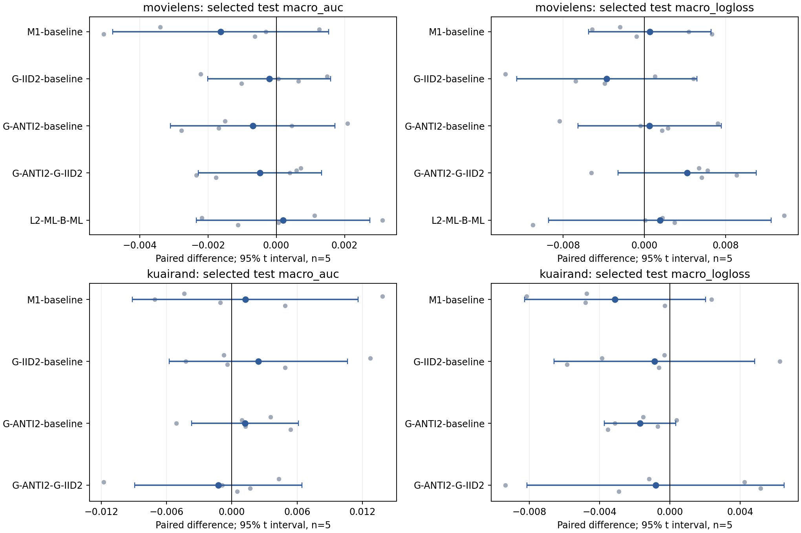
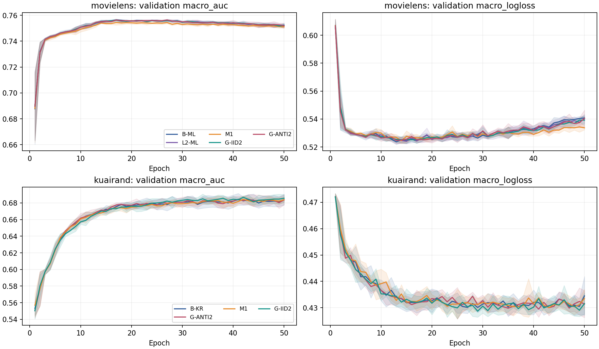
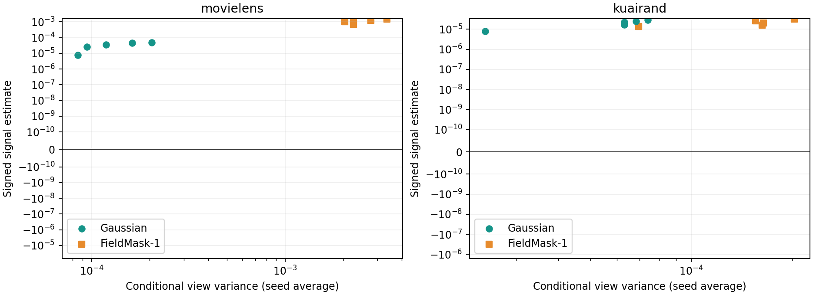

# GA31-R3｜完整实验与研究分析报告

**完成日期：2026-11-01。执行方案：research_plans/26-10-31_v2，R3-r1。决定：完成本轮后停止，不启动来源动量、差分滤波或自适应 MASK。** MovieLens 采用普通 L2-ML 工作基线；KuaiRand 保留 B-KR，并保留 ANTI2 相对基线的条件性测试收益。三个新方法均未满足各自完整推进规则：KR 的 ANTI2 达到相对基线的 test 门，但没有超过同 K 的 IID2，validation 方向也存在分裂。

已完成 **45 次正式训练、2,250 epoch、74,000 次正式 Adam 更新、135 条 test checkpoint 记录**。在线时间探针为120个状态/360次额外梯度；离线为60个观察/840次梯度/300次反事实 Adam 单步。全体选择冻结后统一测试，模型与 Adam/RNG/loader 快照全程仅存 RAM，已释放。正式有效 attempt 失败训练数为0；另保留一次训练启动前的数据加载中断。

主要判断：**STRONG**——基线锚点的反向配对确实降低条件视图方差；**MEDIUM**——本轮没有支持反向配对相对同预算 IID2 的独有 selected AUC 增量；**MEDIUM**——KR 保留相对普通基线的局部收益；**WEAK**——域大小或 Adam 历史污染足以解释全部结果。

## 1. 方案、来源和实际执行

入口为 [05 实施合同](../../research_plans/26-10-31_v2/05_CODEX实施合同.md)，预算与决策取自 [04 实验矩阵](../../research_plans/26-10-31_v2/04_实验矩阵与决策树.md) 和 [phase1_protocol.json](../../research_plans/26-10-31_v2/phase1_protocol.json)。规划固定于 main@a08d1045390f55b3047017ed8e0487d7198c1ea4；底座取自 ee6e81fdfd37284e6447e8149cb93d04736dba02 的 GA31-v2 实际代码与配置。本轮研究 ID 是 GA31-R3，旧 P0–P3 实验保持原样。

根 start.md 的入口已改为本方案。05 的接口段残留“25–45”按04/JSON一致的35次必要、45次上限执行，解释在 [设计规格](DESIGN_SPECIFICATION.md) 中于实现前冻结。两数据集均通过 ANTI 方差门，因此最终矩阵为：

| 阶段 | 内容 | 正式 run | 正式 Adam 更新 |
| --- | --- | --- | --- |
| A | ML B-ML、ML L2-ML、KR B-KR，各五种子 | 15 | 22,250 |
| B-M | 两数据集 M1，各五种子 | 10 | 17,250 |
| B-IID | 两数据集 G-IID2，各五种子 | 10 | 17,250 |
| B-ANTI | 两数据集 G-ANTI2，各五种子 | 10 | 17,250 |
| 总计 | seeds 2022–2026，各50 epoch | 45 | 74,000 |

完成 DESIGN→IMPLEMENT→独立 REVIEW→RUN→ANALYZE。[实施报告](CODER_IMPLEMENTATION_REPORT.md) 与 [独立审查 PASS](REVIEW_REPORT.md) 保存必要验收：固定源预测/loss/梯度/实际Adam一步、视图与原样本预算、None/RNG/RAM恢复、在线探针四步 on/off 轨迹、离线探针端到端和门逻辑。CPU四项合并语义测试通过，两个数据集原 batch CUDA 检查通过；开发每数据13次真实更新，未访问 test 指标。没有增加正式训练臂或超参搜索。

当前工作区为源码导出，未包含本地 Git 元数据。24个旧包源文件已与固定远端逐一核对 blob；新包的17个 vendor 文件保留原字节。[来源收据](SOURCE_FETCH_RECEIPT.json)、[执行代码身份清单](EXECUTION_SOURCE_MANIFEST.json) 和最终发布分支共同标识本轮源码。新代码位于 experiments/gradient_aug_20261031_v2/；报告发布分支按完成日期命名为 **26-11-01**。

### 固定数据、模型和目标

自然 MovieLens train/validation/test 为800167/100021/100021，训练域人口155949/318599/325619；KuaiRand为2006132/250767/250767，训练域人口172782/1743898/89452。沿原始行序80/10/10，KR先全局切分再过滤 tab0/1/4；仅train拟合编码和scaler，OOV=0。实际CSV位于 /home_new/xzf/datasets/ 下，raw/六数组/split/encoder/scaler身份全部匹配。所有臂自然无放回shuffle，同seed初始化及50个epoch原行序相同。

主干为 fixed1 MDMTRec/M3oE，3域×2任务、4 shared experts、Embedding16、fcn_dims=[512,256,256,64]；四融合系数均为Python标量1，保留LayerNorm及gate输入detach。ML/KR参数773470/1614254。一个普通耦合L2 Adam，lr=.01、betas=(.9,.999)、eps=1e-8；B-ML数据loss乘.1且wd=1e-5，L2-ML数据loss乘1且wd=1e-4，B-KR乘1且wd=1e-5。B阶段继承各自冻结工作基线。FP32、batch40960、50epoch、不早停；无AMP、TF32、scheduler、梯度裁剪、累积或参数EMA。

原始两个任务的概率BCE等权，分母始终是原始 B×2。增强目标ML=d0、KR=d2，λ=.5：
L_K=[sum(real BCE)+.5×(sum_v sum(target augmented BCE)/K−sum(target real BCE))]/(B×2)。
每原样本总系数保持1。M1随机均匀删除一个非路由 sparse field 的完整Embedding，不反缩放其余字段；Gaussian为 clean Embedding+.1×stopgrad(RMS)×标准高斯，IID2使用两份独立噪声，ANTI2使用 ξ/−ξ 的两次独立前向。ML eligible6字段，KR33字段；ID、标签、domain Embedding与dense不变。Gaussian与MASK改变输入风险，保留的是原样本/域/任务权重预算。

每epoch完整真实validation，macro六格AUC严格提升选点、平局最早、E0排除。全体 selected/E10/E50 与候选集合冻结后，一次统一test阶段评估真实输入，重合epoch复用。test使用原冻结历史划分；五个seed衡量该划分上的训练随机性。

## 2. 强普通基线：ML 的 L2 控制

ML基线只由阶段A的selected validation决定。L2−B 的平均 Δval AUC=−0.000185；五个seed的绝对差均≤.001，平均绝对条件≤.0005，validation保护项未触发。因此按预定优先规则选择L2-ML，尽管它的validation均值略低。KR固定B-KR。test没有参与此选择。

| seed | B-ML val AUC | L2-ML val AUC | Δval AUC | Δtest AUC | Δtest LL |
| --- | --- | --- | --- | --- | --- |
| 2022 | 0.756448 | 0.756911 | +0.000462 | +0.001123 | +0.013765 |
| 2023 | 0.756679 | 0.756404 | -0.000275 | -0.002182 | +0.001766 |
| 2024 | 0.756847 | 0.756061 | -0.000786 | +0.003112 | +0.000075 |
| 2025 | 0.756726 | 0.756669 | -0.000057 | +0.000057 | +0.002983 |
| 2026 | 0.757552 | 0.757282 | -0.000270 | -0.001124 | -0.010994 |

L2−B的selected test ΔAUC=+0.000197，3/5正；ΔLL=+0.001519，4/5恶化。普通L2在本轮规定AUC精度下足以作为工作基线，概率损失与选点差异仍保留。B-ML与历史P1、B-KR与历史P0的selected数值重建一致；新ML方法直接与本轮L2-ML配对比较。

固定c时，耦合Adam的尺度映射为 Adam(cL,ω,ε) 对应 Adam(L,ω/c,ε/c)，并映射 m/c、v/c² 和相同步计数。.1缩放的完整匹配对象是wd=1e-4、eps=1e-7；L2-ML使用eps=1e-8。该完整状态映射已通过单步验收，没有占用额外正式训练臂。

下面是各seed自身selected epoch最后一个真实更新的尺度摘要，再以seed等权平均。ε份额定义为 ε/(sqrt(v_hat)+ε)，能量权重为实际参数更新平方。

| 数据 | 臂 | decay/data范数比 | ε份额坐标median | ε份额坐标p99 | ε份额更新能量加权 |
| --- | --- | --- | --- | --- | --- |
| KR | B-KR | 0.00691 | 39.4072% | 88.1788% | 0.4813% |
| ML | B-ML | 0.02487 | 1.3505% | 67.5156% | 0.7456% |
| ML | L2-ML | 0.02932 | 0.1416% | 14.7061% | 0.0718% |

坐标计数与更新作用的差别很大：KR的ε份额坐标median约39.4%，更新能量加权约0.481%；ML B-ML分别约1.35%与0.746%，L2-ML约0.142%与0.0718%。因此大批近零坐标不能直接解释为ε主导整体性能。这些是各臂已形成的参数/历史状态上的诊断；本轮主要识别“普通L2能否替代工作缩放”，没有独立分离全部长期ε和浮点轨迹影响。

## 3. Selected 主结果与 seed 配对效应

统计单位为seed，表中均值±sample SD。macro为六格等权；traffic cell按评价split的域人口份额、任务等权；pooled逐任务跨域计算AUC再平均两任务。worst为每run六格最小AUC后跨seed平均。LL为真实输入、未缩放LogLoss。

| 数据 | 臂 | val AUC | test macro AUC | test macro LL | pooled AUC | traffic cell AUC | worst AUC | 总体LL |
| --- | --- | --- | --- | --- | --- | --- | --- | --- |
| ML | B-ML | 0.756850 | 0.774992 ± 0.001604 | 0.493372 ± 0.005437 | 0.776334 | 0.776233 | 0.752056 | 0.491780 |
| ML | L2-ML | 0.756665 | 0.775190 ± 0.001136 | 0.494891 ± 0.004690 | 0.776760 | 0.776435 | 0.752263 | 0.493229 |
| ML | M1 | 0.755417 | 0.773563 ± 0.002137 | 0.495424 ± 0.005588 | 0.775272 | 0.775080 | 0.751150 | 0.493437 |
| ML | G-IID2 | 0.756876 | 0.774983 ± 0.001205 | 0.491190 ± 0.004939 | 0.775828 | 0.776244 | 0.751807 | 0.489521 |
| ML | G-ANTI2 | 0.756798 | 0.774503 ± 0.001251 | 0.495393 ± 0.003002 | 0.775739 | 0.775725 | 0.750398 | 0.493733 |
| KR | B-KR | 0.686278 | 0.671907 ± 0.006145 | 0.437172 ± 0.002751 | 0.716990 | 0.711621 | 0.634325 | 0.426397 |
| KR | M1 | 0.687673 | 0.673137 ± 0.002955 | 0.434039 ± 0.002017 | 0.718590 | 0.713070 | 0.624311 | 0.419950 |
| KR | G-IID2 | 0.689571 | 0.674346 ± 0.001645 | 0.436282 ± 0.003121 | 0.716155 | 0.710714 | 0.636047 | 0.424193 |
| KR | G-ANTI2 | 0.687361 | 0.673109 ± 0.005334 | 0.435463 ± 0.004266 | 0.717987 | 0.712522 | 0.632917 | 0.423208 |

相对工作基线，selected test配对结果如下。AUC正值有利、LL负值有利；区间为df=4的描述性95%配对t区间。

| 数据 | 对照 | Δtest AUC | 95%配对区间 | AUC正向 | Δtest LL | 95%配对区间 | LL改善 |
| --- | --- | --- | --- | --- | --- | --- | --- |
| ML | M1-baseline | -0.001627 | [-0.004790, +0.001535] | 1/5 | +0.000533 | [-0.005509, +0.006574] | 3/5 |
| ML | G-IID2-baseline | -0.000206 | [-0.002004, +0.001591] | 3/5 | -0.003701 | [-0.012579, +0.005177] | 3/5 |
| ML | G-ANTI2-baseline | -0.000687 | [-0.003095, +0.001721] | 2/5 | +0.000502 | [-0.006554, +0.007559] | 2/5 |
| ML | G-ANTI2-G-IID2 | -0.000480 | [-0.002285, +0.001324] | 3/5 | +0.004203 | [-0.002603, +0.011010] | 1/5 |
| ML | L2-ML-B-ML | +0.000197 | [-0.002346, +0.002740] | 3/5 | +0.001519 | [-0.009426, +0.012464] | 1/5 |
| KR | M1-baseline | +0.001231 | [-0.009129, +0.011590] | 2/5 | -0.003133 | [-0.008281, +0.002016] | 4/5 |
| KR | G-IID2-baseline | +0.002439 | [-0.005747, +0.010626] | 2/5 | -0.000890 | [-0.006605, +0.004826] | 4/5 |
| KR | G-ANTI2-baseline | +0.001202 | [-0.003709, +0.006113] | 4/5 | -0.001709 | [-0.003748, +0.000329] | 4/5 |
| KR | G-ANTI2-G-IID2 | -0.001237 | [-0.008926, +0.006451] | 3/5 | -0.000820 | [-0.008140, +0.006500] | 3/5 |



**MovieLens：** M1 ΔAUC=−.001627，4/5下降；validation为−.001248、5/5下降，区间[−.002185,−.000311]。IID2和ANTI2的test均值分别−.000206、−.000687，都没有实用增量。IID2的macro LL平均下降.003701、3/5改善，但没有对应排序增益；不据此认定校准是唯一机制。

**KuaiRand：** M1与IID2平均ΔAUC分别+.001231、+.002439，却各只有2/5正向。IID2的2023增益约+.012701，2024为−.004224；全部seed保留。IID2最终AUC的跨seed SD=.001645，低于B-KR的.006145，存在输出波动缩小的观察；相对基线的收益方向仍未过预定门。

ANTI2相对B-KR的test ΔAUC=+.001202，4/5正，ΔLL=−.001709，4/5改善，**达到相对基线的test收益门**。对应validation只有2/5 AUC正向，且worst-cell平均下降.003056、4/5下降。ANTI2−IID2的test ΔAUC=−.001237，3/5正、均值为负；它没有满足“超过普通基线且超过同K IID2”的完整配对方法门。自动裁决为NO_PROMOTION，保留上述条件性测试收益。

validation配对方向：

| 数据 | 对照 | Δval AUC（正向） | Δval LL（改善） |
| --- | --- | --- | --- |
| ML | M1-baseline | -0.001248 (0/5) | -0.000077 (3/5) |
| ML | G-IID2-baseline | +0.000211 (3/5) | -0.001669 (3/5) |
| ML | G-ANTI2-baseline | +0.000133 (3/5) | -0.000769 (4/5) |
| ML | G-ANTI2-G-IID2 | -0.000078 (2/5) | +0.000900 (3/5) |
| ML | L2-ML-B-ML | -0.000185 (1/5) | +0.000645 (2/5) |
| KR | M1-baseline | +0.001395 (2/5) | -0.001367 (3/5) |
| KR | G-IID2-baseline | +0.003293 (3/5) | -0.000951 (3/5) |
| KR | G-ANTI2-baseline | +0.001083 (2/5) | -0.001029 (2/5) |
| KR | G-ANTI2-G-IID2 | -0.002210 (2/5) | -0.000078 (3/5) |

所有主要selected test宏AUC配对区间均跨0，效应幅度仍有较大不确定性。当前决定依据预定效应量与seed方向门，不能把未过门转换为总体等效于零。[全部配对原值](analysis/PAIRED_EFFECTS.csv)、[均值/SD/区间](analysis/EFFECT_SUMMARY.csv)包含所有六格、域、任务与聚合指标。

## 4. 域、任务、规模和性能交换

下表的baseline是ML的L2-ML和KR的B-KR。括号为AUC正向seed数；train n按域列出，test正例按任务列出。

| 数据 | cell | train域n | test n | test正例 | baseline AUC | M1 ΔAUC | IID2 ΔAUC | ANTI2 ΔAUC |
| --- | --- | --- | --- | --- | --- | --- | --- | --- |
| ML | d0t0 | 155,949 | 27687 | 14281 | 0.770298 | -0.004787 (0/5) | +0.000112 (2/5) | -0.000471 (2/5) |
| ML | d0t1 | 155,949 | 27687 | 4964 | 0.785173 | -0.003631 (1/5) | +0.000000 (3/5) | +0.000784 (3/5) |
| ML | d1t0 | 318,599 | 41434 | 22072 | 0.778130 | +0.000706 (3/5) | +0.000342 (2/5) | -0.000358 (2/5) |
| ML | d1t1 | 318,599 | 41434 | 7031 | 0.797449 | -0.000374 (3/5) | -0.000305 (2/5) | -0.000951 (2/5) |
| ML | d2t0 | 325,619 | 30900 | 18099 | 0.752263 | -0.001113 (2/5) | -0.000456 (3/5) | -0.001865 (1/5) |
| ML | d2t1 | 325,619 | 30900 | 6324 | 0.767825 | -0.000562 (3/5) | -0.000932 (2/5) | -0.001259 (2/5) |
| KR | d0t0 | 172,782 | 2613 | 228 | 0.635617 | -0.005681 (1/5) | +0.002241 (2/5) | -0.001328 (2/5) |
| KR | d0t1 | 172,782 | 2613 | 120 | 0.645909 | -0.008634 (2/5) | +0.010345 (4/5) | -0.001888 (3/5) |
| KR | d1t0 | 1,743,898 | 246284 | 51847 | 0.698833 | +0.001353 (1/5) | -0.000826 (1/5) | +0.001118 (2/5) |
| KR | d1t1 | 1,743,898 | 246284 | 27415 | 0.726663 | +0.001607 (2/5) | -0.001185 (1/5) | +0.000684 (3/5) |
| KR | d2t0 | 89,452 | 1870 | 1100 | 0.653260 | +0.009454 (4/5) | -0.001440 (3/5) | +0.003588 (4/5) |
| KR | d2t1 | 89,452 | 1870 | 827 | 0.671157 | +0.009284 (5/5) | +0.005502 (4/5) | +0.005038 (3/5) |

LogLoss配对差，括号为改善seed数：

| 数据 | cell | baseline LL | M1 ΔLL | IID2 ΔLL | ANTI2 ΔLL |
| --- | --- | --- | --- | --- | --- |
| ML | d0t0 | 0.584358 | +0.003703 (3/5) | -0.001473 (3/5) | +0.002058 (1/5) |
| ML | d0t1 | 0.407449 | +0.003308 (2/5) | -0.006238 (3/5) | -0.001014 (3/5) |
| ML | d1t0 | 0.572689 | -0.001239 (3/5) | -0.002045 (4/5) | -0.000273 (2/5) |
| ML | d1t1 | 0.386143 | -0.002045 (3/5) | -0.005587 (4/5) | +0.001320 (1/5) |
| ML | d2t0 | 0.581804 | +0.000367 (3/5) | -0.002539 (5/5) | +0.000585 (2/5) |
| ML | d2t1 | 0.436902 | -0.000897 (4/5) | -0.004324 (3/5) | +0.000339 (2/5) |
| KR | d0t0 | 0.289725 | +0.001628 (3/5) | -0.001400 (3/5) | +0.000947 (2/5) |
| KR | d0t1 | 0.181561 | +0.002554 (1/5) | -0.000383 (4/5) | +0.000602 (3/5) |
| KR | d1t0 | 0.506479 | -0.006704 (3/5) | -0.002325 (2/5) | -0.003368 (3/5) |
| KR | d1t1 | 0.346981 | -0.006394 (3/5) | -0.002152 (2/5) | -0.003104 (4/5) |
| KR | d2t0 | 0.649400 | -0.005280 (4/5) | +0.002664 (1/5) | -0.002369 (3/5) |
| KR | d2t1 | 0.648886 | -0.004599 (3/5) | -0.001741 (2/5) | -0.002965 (4/5) |

任务macro及pooled/worst的AUC配对差，括号为正向seed数：

| 数据 | 臂 | task0 ΔAUC | task1 ΔAUC | pooled ΔAUC | worst ΔAUC |
| --- | --- | --- | --- | --- | --- |
| ML | M1 | -0.001732 (1/5) | -0.001523 (1/5) | -0.001489 (1/5) | -0.001113 (2/5) |
| ML | G-IID2 | -0.000001 (3/5) | -0.000412 (2/5) | -0.000932 (2/5) | -0.000456 (3/5) |
| ML | G-ANTI2 | -0.000898 (2/5) | -0.000475 (1/5) | -0.001021 (2/5) | -0.001865 (1/5) |
| KR | M1 | +0.001709 (2/5) | +0.000752 (2/5) | +0.001600 (2/5) | -0.010013 (2/5) |
| KR | G-IID2 | -0.000008 (2/5) | +0.004887 (4/5) | -0.000835 (1/5) | +0.001722 (2/5) |
| KR | G-ANTI2 | +0.001126 (3/5) | +0.001278 (4/5) | +0.000997 (3/5) | -0.001408 (2/5) |

**域大小没有给出统一解释。** ML最大训练域d2的基线task0 AUC=.7523，低于最小域d0的.7703；KR中域d0的.6356也低于最小域d2的.6533。这里的基线AUC只描述当前模型的排序表现；绝对LogLoss还受正例率影响，例如KR d0/task1 test正例只有120/2613。

M1在ML的增强目标d0两任务均值下降.004787/.003631，分别5/5和4/5下降。KR的同一方法却在目标d2提升.009454/.009284，分别4/5和5/5正向，代价主要在未增强的d0；最大域d1两任务均值为正。这个交换发生在两个较小域之间，不能概括为统一的“小域受益、大域受损”。

KR IID2出现另一种模式：d0/task1提升.010345、4/5正，d2/task1提升.005502、4/5正；最大域d1两任务分别−.000826/−.001185，均4/5下降，pooled均值−.000835、4/5下降。这里存在幅度较小的“小域/大域”交换，但没有达到预定.002保护幅度。ANTI2相对IID2则在pooled上+.001833、4/5正，同时task1 macro下降.003609、4/5下降；不同聚合目标确实给出不同判断。

保护规则要求均值达到.002且至少4/5不利。六个方法/数据集的selected test均未触发自动保护项；**KR M1的worst均值−.010013（3/5下降）**。validation中KR M1和ANTI2的worst均触发保护。完整数据人口、正例率及标签熵见 [DOMAIN_PROFILE.csv](analysis/DOMAIN_PROFILE.csv)。

领域大小与增强对象在本轮绑定，ML/KR目标曝光份额约19.49%/4.46%，MASK又分别删除1/6与1/33个eligible字段。域人口、基线难度、标签基率、曝光预算及字段语义尚未独立操纵。**规模可解释某些局部模式，作为主要统一解释的证据为WEAK。**

## 5. 训练阶段与 checkpoint

下表为test配对差；AUC括号为正向seed数，LL括号为改善seed数。selected是各run自身validation选点，E10/E50为共同epoch。

| 数据 | 对照 | E10 ΔAUC | selected ΔAUC | E50 ΔAUC | E10 ΔLL | selected ΔLL | E50 ΔLL |
| --- | --- | --- | --- | --- | --- | --- | --- |
| ML | M1-baseline | -0.001111 (1/5) | -0.001627 (1/5) | +0.000129 (3/5) | +0.003097 (1/5) | +0.000533 (3/5) | -0.005357 (5/5) |
| ML | G-IID2-baseline | +0.000121 (4/5) | -0.000206 (3/5) | +0.000547 (3/5) | +0.000790 (2/5) | -0.003701 (3/5) | -0.001908 (4/5) |
| ML | G-ANTI2-baseline | -0.000077 (2/5) | -0.000687 (2/5) | +0.000105 (2/5) | -0.002468 (4/5) | +0.000502 (2/5) | -0.000083 (3/5) |
| ML | G-ANTI2-G-IID2 | -0.000198 (3/5) | -0.000480 (3/5) | -0.000442 (2/5) | -0.003258 (4/5) | +0.004203 (1/5) | +0.001825 (2/5) |
| ML | L2-ML-B-ML | +0.000231 (3/5) | +0.000197 (3/5) | -0.000139 (1/5) | +0.000092 (2/5) | +0.001519 (1/5) | -0.000090 (2/5) |
| KR | M1-baseline | +0.001126 (3/5) | +0.001231 (2/5) | +0.003738 (2/5) | +0.001807 (2/5) | -0.003133 (4/5) | -0.004264 (4/5) |
| KR | G-IID2-baseline | +0.003084 (2/5) | +0.002439 (2/5) | +0.000540 (2/5) | -0.002417 (3/5) | -0.000890 (4/5) | -0.004442 (3/5) |
| KR | G-ANTI2-baseline | +0.001091 (4/5) | +0.001202 (4/5) | -0.000247 (4/5) | +0.000223 (2/5) | -0.001709 (4/5) | -0.004631 (3/5) |
| KR | G-ANTI2-G-IID2 | -0.001993 (2/5) | -0.001237 (3/5) | -0.000787 (2/5) | +0.002640 (2/5) | -0.000820 (3/5) | -0.000189 (4/5) |



ML M1在E10与selected排序均负向，E50宏AUC均差接近0；E50 LL下降.005357、5/5改善。这支持末期概率损失较低的阶段现象，selected排序目标仍未达到。ML IID2的E50 ΔAUC=+.000547，小于推进阈值；selected均值为负。

KR ANTI2相对基线在E10和selected均为约+.0011至+.0012、各4/5正向；E50均值变为−.000247，仍4/5正向，说明单个负向seed的幅度会改变均值。KR M1的E50均值+.003738仍只有2/5正向。不能用final均值替代selected判断。

ML通常在14–31轮选点，KR多在24–50轮；B-KR有seed2023在18轮选点。完整2250行轨迹见 [EPOCH_METRICS.csv](analysis/EPOCH_METRICS.csv)。train指标来自每batch更新前在线预测，validation来自epoch结束后的固定模型；两种参数时点不同。

## 6. 同参数多视图：可重复差分与条件方差

只在所选普通基线E1/E10/selected快照，使用两个自然1024行训练batch；目标行平均ML189.5、KR41.5。每观察固定θ、Adam历史和B，计算四个独立Gaussian、四个负伙伴及四个独立MASK；raw梯度排除loss scale和decay，target项分母同为原B×2。

独立组统计V为向量样本方差trace，S=||mean δ||²−V/4，半组cos比较两个独立二视图均值。负S原样保留。表中先在seed内平均两个batch，再跨五seed等权平均。

| 数据 | 锚点 | G meanδ norm | G V | G S | G 半组cos | M meanδ norm | M V | M S | M 半组cos |
| --- | --- | --- | --- | --- | --- | --- | --- | --- | --- |
| ML | E1 | 4.869e-05 | 9.661e-09 | 2.956e-09 | 0.2484 | 0.0008454 | 4.391e-07 | 1.215e-06 | 0.8271 |
| ML | E10 | 0.002484 | 1.616e-05 | 2.615e-06 | 0.2415 | 0.02891 | 0.000976 | 0.0006265 | 0.5629 |
| ML | selected | 0.00796 | 0.000133 | 3.338e-05 | 0.2955 | 0.04185 | 0.002535 | 0.001142 | 0.4511 |
| KR | E1 | 1.101e-06 | 5.313e-12 | 1.166e-12 | 0.1026 | 2.141e-06 | 4.749e-11 | -7.112e-13 | 0.2135 |
| KR | E10 | 0.001962 | 6.029e-06 | 2.548e-06 | 0.4063 | 0.002993 | 2.218e-05 | 3.508e-06 | 0.2395 |
| KR | selected | 0.005773 | 5.861e-05 | 2.008e-05 | 0.3948 | 0.007561 | 0.000151 | 2.147e-05 | 0.2133 |



selected时两种视图都有可重复差分分量；MASK在ML的差分均值和方差明显大于Gaussian。KR E1的MASK S均值为负，之后转正；差分统计随θ与训练阶段显著变化。Gaussian的绝对扰动还随clean Embedding RMS变化，不能把同一κ视为所有阶段同一绝对噪声。

ANTI门仅使用E10/selected有效观察，先分别平均Vanti和Viid再求每seed比值R。每seed4个有效观察：

| 数据 | seed | 有效门观察 | R=mean Vanti / mean Viid |
| --- | --- | --- | --- |
| ML | 2022 | 4 | 0.370981 |
| ML | 2023 | 4 | 0.332520 |
| ML | 2024 | 4 | 0.403492 |
| ML | 2025 | 4 | 0.358301 |
| ML | 2026 | 4 | 0.276888 |
| KR | 2022 | 4 | 0.529081 |
| KR | 2023 | 4 | 0.508015 |
| KR | 2024 | 4 | 0.543410 |
| KR | 2025 | 4 | 0.487491 |
| KR | 2026 | 4 | 0.544342 |

ML mean R=.348436，KR=.522468，均5/5小于1，满足mean≤.8、至少4/5 R<1。即这些基线锚点上，配对均值方差相对同边际独立平均分别约降低65.16%与47.75%。方差干预已实际发生；正式ANTI2仍未超过IID2，**降低这一条件方差没有转化为已检出的独有selected宏AUC增量**。

## 7. 真实连续步与实际Adam反事实

### 时间探针

阶段A全部15run在ML E10/E20、KR E10/E40各前4个真实更新前采样，固定1024行参考batch，两份跨步独立噪声。S估计同状态差分均值能量，C为相邻真实参数状态的差分均值点积。下面只使用最终冻结工作基线；每seed先平均同窗口，再对五seed平均。

| 数据 | 工作基线 | epoch | mean S | S正向seed | mean 相邻C | C正向seed | mean view V |
| --- | --- | --- | --- | --- | --- | --- | --- |
| ML | L2-ML | 10 | 2.9037e-06 | 5/5 | 2.7121e-07 | 3/5 | 1.3684e-05 |
| ML | L2-ML | 20 | 2.0402e-05 | 5/5 | 4.1501e-06 | 4/5 | 0.00011444 |
| KR | B-KR | 10 | 1.8331e-06 | 5/5 | 5.1874e-07 | 5/5 | 6.0402e-06 |
| KR | B-KR | 40 | 2.762e-05 | 5/5 | 1.436e-05 | 5/5 | 7.8929e-05 |

KR在两个窗口的C均5/5为正，晚期幅度更大，存在短窗条件持续性；ML在E10只有3/5、E20为4/5。固定参考B排除了参考行变动，θ仍沿真实训练变化。四步窗不能确定合适的EMA时间常数，也没有干预持久Adam历史。**短窗持续性证据MEDIUM；据此推断差分动量会提高泛化的证据WEAK。**

全部120个观测、各窗口S/C及未选ML B-ML背景控制见 [TEMPORAL_OBSERVATIONS.csv](analysis/TEMPORAL_OBSERVATIONS.csv)、[TEMPORAL_SEED.csv](analysis/TEMPORAL_SEED.csv)、[TEMPORAL_SUMMARY.csv](analysis/TEMPORAL_SUMMARY.csv)。归一化量在信号非正或零范数时记NA，未把估计比值当作有界相关系数。

### 单步真实验证效用

五个分支从同一model+Adam联合副本独立执行一次实际step，包含原c、耦合decay、m/v与每参数step。两不交叠validation panel逐域取至多1024行，同时算六格macro与完整validation人口份额加权BCE。下表是selected时各增强分支的“更新后减更新前BCE变化”再减real分支；负值更有利，括号为有利seed数。

| 数据 | 分支 | panel1 Δmacro BCE | panel1 Δtraffic BCE | panel2 Δmacro BCE | panel2 Δtraffic BCE |
| --- | --- | --- | --- | --- | --- |
| ML | G-single | +2.96235e-05 (3/5) | +2.60533e-05 (3/5) | +2.61193e-05 (2/5) | +2.05306e-05 (2/5) |
| ML | G-IID2 | +2.68231e-05 (1/5) | +2.28541e-05 (2/5) | +2.96647e-05 (1/5) | +2.34345e-05 (1/5) |
| ML | G-ANTI2 | +2.80241e-06 (3/5) | +1.51232e-06 (3/5) | +9.18905e-08 (3/5) | -1.38961e-06 (3/5) |
| ML | M-single | -0.000873905 (5/5) | -0.000828147 (5/5) | -0.000900789 (5/5) | -0.000837046 (5/5) |
| KR | G-single | +6.80462e-05 (2/5) | +5.33355e-05 (1/5) | +4.46921e-05 (2/5) | +6.01342e-05 (1/5) |
| KR | G-IID2 | +3.73468e-05 (2/5) | +3.11095e-05 (1/5) | +1.45304e-05 (3/5) | +2.18752e-05 (2/5) |
| KR | G-ANTI2 | +1.52469e-05 (1/5) | +1.19017e-05 (1/5) | +7.85987e-06 (2/5) | +1.71095e-05 (1/5) |
| KR | M-single | +6.45469e-07 (3/5) | +6.83918e-05 (1/5) | -4.08317e-05 (3/5) | +7.23074e-05 (2/5) |

**最清楚的矛盾在ML MASK：** 两panel的macro与人口加权单步BCE均5/5优于real，macro额外下降约.000874/.000901；完整M1训练的selected validation AUC却5/5下降，test为4/5下降。固定状态的局部BCE改善并不能替代多步排序收益。

Gaussian在selected上的局部效用多为很小或均值不利；KR MASK的macro两panel均值符号不同，人口加权均值都不利。panel目标、全量macro AUC、训练轨迹和checkpoint选择衡量不同问题。当前结果不支持用这些单步BCE直接训练增强选择器。完整参数更新、m/v变化、逐cell/两panel及全部阶段见 [COUNTERFACTUAL_SEED.csv](analysis/COUNTERFACTUAL_SEED.csv)、[COUNTERFACTUAL_SUMMARY.csv](analysis/COUNTERFACTUAL_SUMMARY.csv)；视图BCE/预测变化见 [VIEW_OBSERVATIONS.csv](analysis/VIEW_OBSERVATIONS.csv)。

## 8. 证据、竞争解释与下一步

| 现象或解释 | 强度 | 证据和适用条件 |
| --- | --- | --- |
| ANTI降低基线锚点条件视图方差 | STRONG | 两数据五seed全部R<1，均值.348/.522，FP64配对方差恒等式验收通过 |
| 普通L2可提供ML工作基线 | MEDIUM | validation全部五seed在预定替代精度内、保护未触发；test的AUC与LL差异另列 |
| ML当前M1不满足selected排序目标 | STRONG | validation 5/5下降且配对区间全负，test 4/5下降，目标域task0 5/5下降 |
| KR ANTI相对基线有条件测试收益 | MEDIUM | test AUC/LL均4/5有利；validation方向分裂且worst保护触发 |
| ANTI相对同K IID2有独有方法价值 | WEAK | 两数据selected均差为负、均未过独有增量门；区间较宽 |
| 视图差分可重复或单步BCE改善就能提升AUC | WEAK | ML MASK给出直接矛盾；方差下降也没有产生相应方法增量 |
| 域规模是统一主因 | WEAK | ML小目标域受损、KR存在小域间交换；IID2的大小域交换有条件性 |
| 增强污染Adam历史，需要来源分流 | WEAK | 只测局部副本和短窗，没有持久历史干预；本轮未训练新动量 |

竞争解释按现有证据保留：

1. **强普通正则化已吸收一部分增量。** ML的L2控制达到工作替代精度；Gaussian双视图在该基线上没有独立selected排序增量。ε影响和长期数值轨迹仍存在，不能把本轮解释为简单降低学习率。
2. **可重复差分可能是偏差或改变目标。** MASK有较大的稳定差分，仍损害ML目标域排序。前向字段删除和输入Jacobian变化同时发生，当前没有分开识别它们。
3. **条件噪声不是完整优化噪声。** ANTI降低固定θ/B下的视图方差，正式训练还包含自然batch、参数漂移、选点及Adam预条件化；μ本身也未被证明具有泛化价值。
4. **基线seed和选点波动影响KR均值。** B-KR的2023 selected AUC=.662913，IID2在此seed提升.012701；较强2024基线则下降.004224。IID2绝对输出的seed SD较小，但配对方向只有2/5正向。
5. **曝光、字段语义和评估人口不同。** 两数据的增强域份额与单字段删除比例不同；KR test d0/task1只有120正例，d1占test流量约98.21%。macro、pooled和人口加权BCE不会给出同一种排序。
6. **阶段性正则化与主端点分离。** ML M1的E50 LL改善5/5，selected AUC仍下降；KR ANTI的E10/selected与E50方向也不同。

### 本轮决策

[DECISIONS.json](DECISIONS.json)保留全部自动规则及validation/test保护项。六项方法/数据集组合的完整方法裁决均为NO_PROMOTION。保留KR ANTI相对B-KR的test收益及M1在KR d2的局部收益；暂停将当前候选继续组合成来源动量或差分滤波。35–45次合同已全部执行，本轮结束。

若继续追踪KR局部信号，**最有区分力的下一实验是冻结B-KR、IID2、ANTI2三个配置，在预先选定的新自然时间划分上做配对复核**，保持五seed、预算、λ/κ和普通Adam不变，继续同时检查selected、共同epoch、两任务和域间代价。它区分“配对设计具有可迁移的排序增量”与“当前划分、较弱baseline seed或选点产生局部收益”。只有ANTI稳定超过同K IID2及普通基线，才继续配对方法化；若普通IID2足够，保留普通方法。当前test已用于历史研究，新的时间划分比继续围绕该test挑种子或调强度更能区分这两种解释。本建议未在本轮执行。

尚未解决：KR条件收益能否迁移，MASK前向删除与Jacobian各自作用，短窗差分持续性对应何种有效时间尺度，局部BCE与长期排序的联系，以及域人口/难度/曝光/字段语义的分离。这些是后续合同要区分的变量。

## 9. 成本、异常与复算

| 数据 | 臂 | 均训练worker秒 | 其中online秒 | 每run额外视图 | 每run训练+val forward | 最大peak GiB | selected epoch范围 |
| --- | --- | --- | --- | --- | --- | --- | --- |
| KR | B-KR | 1076.3 | 2.37 | 0 | 2,800 | 1.006 | 18–50 |
| KR | G-ANTI2 | 2067.6 | 0.00 | 8,945,200 | 7,700 | 1.011 | 31–48 |
| KR | G-IID2 | 2362.6 | 0.00 | 8,945,200 | 7,700 | 1.011 | 24–45 |
| KR | M1 | 1908.8 | 0.00 | 4,472,600 | 5,250 | 1.001 | 37–48 |
| ML | B-ML | 594.7 | 2.73 | 0 | 1,150 | 0.910 | 14–29 |
| ML | G-ANTI2 | 805.1 | 0.00 | 15,594,900 | 3,150 | 1.057 | 15–23 |
| ML | G-IID2 | 806.5 | 0.00 | 15,594,900 | 3,150 | 1.057 | 15–31 |
| ML | L2-ML | 600.3 | 2.66 | 0 | 1,150 | 0.910 | 17–29 |
| ML | M1 | 670.3 | 0.00 | 7,797,450 | 2,150 | 0.907 | 16–31 |

共曝光原样本3,006,340,750次，额外视图306,751,250次；主训练+validation forward调用171,000次、正式backward/Adam调用74,000次。K2两视图合成一个scalar，但计算图包含额外目标视图，计算量不能只按Adam次数比较。

训练worker秒累计54,460.78，已包含在线探针38.81秒；离线探针另计166.62 worker秒。在线360次额外梯度、0额外真实step；离线840次梯度、300次独立反事实step。首次worker启动至统一test完成约76.50分钟。两张RTX3090，GPU0与既有约17GiB作业共享，各卡按显存/功耗阈值独立并发；逐臂worker时间受到实际并发分配影响。峰值allocated为1,134,811,648字节（约1.057GiB），RAM快照tensor合计2,462,184,896字节（约2.293GiB）。PyTorch2.9.0+cu126、Python3.13.5，环境phase0-3-env。

首入口attempt_20261031_230801在KuaiRand预处理期间原生allocator中断，exit134，正式更新为0。相同入口data-only audit随后通过；代码、环境、数据和配置未改，用faulthandler启动新attempt完整完成。首中断、审计和最终日志均保留，详见 [恢复记录](NATIVE_ABORT_RECOVERY.md)。正式attempt没有OOM、删seed、缩batch或重试训练。必要验收曾把两种FP32 BCE求和次序混用，已在正式训练前统一oracle为冻结的任务均值再样本均值；冻结训练目标和验收容差保持原样。

所有正式输出位于 artifacts/gradient_aug_20261031_v2/GA31-R3/attempt_20261031_151645；[原始工件索引](RAW_ARTIFACTS.md)提供打包的完整训练/探针/选点/来源日志与split行号。逐run成本见 [COSTS.csv](analysis/COSTS.csv)，完成计数见 [ANALYSIS_FACTS.json](analysis/ANALYSIS_FACTS.json)，纯执行事实见 [runner报告](RUNNER_REPORT.md)。

数值复算命令（先按原始工件索引恢复数据）：

```bash
/home_new/xzf/envs/miniconda3/envs/phase0-3-env/bin/python -m experiments.gradient_aug_20261031_v2.analyze --run-dir artifacts/gradient_aug_20261031_v2/GA31-R3/attempt_20261031_151645
/home_new/xzf/envs/miniconda3/envs/phase0-3-env/bin/python research_reports/2026-10-31_v2/analyze_results.py --run-dir artifacts/gradient_aug_20261031_v2/GA31-R3/attempt_20261031_151645 --output research_reports/2026-10-31_v2/analysis
```

训练复现使用 [coder报告](CODER_IMPLEMENTATION_REPORT.md) 的完整all命令和新attempt目录；统一测试需要该次coordinator中的RAM状态。状态已经释放，重新评价模型需要重新完整训练。本轮没有运行合同外候选或新增超参网格。

## 附录：逐seed selected原始值与 checkpoint 身份

下表step/epoch标识同一run的选中RAM快照；source由执行清单固定，attempt均为上述正式attempt的attempt1。完整135行selected/E10/E50以及每一域任务AUC/LL见 [TEST_METRICS.csv](analysis/TEST_METRICS.csv) 和 [VALIDATION_METRICS.csv](analysis/VALIDATION_METRICS.csv)。

| 数据 | 臂 | seed | epoch | step | val AUC | val LL | test AUC | test LL |
| --- | --- | --- | --- | --- | --- | --- | --- | --- |
| KR | B-KR | 2022 | 44 | 2156 | 0.688511 | 0.431608 | 0.673696 | 0.439326 |
| KR | B-KR | 2023 | 18 | 882 | 0.676205 | 0.435294 | 0.662913 | 0.438938 |
| KR | B-KR | 2024 | 40 | 1960 | 0.693477 | 0.426897 | 0.679916 | 0.433965 |
| KR | B-KR | 2025 | 50 | 2450 | 0.685375 | 0.431793 | 0.672610 | 0.439262 |
| KR | B-KR | 2026 | 43 | 2107 | 0.687823 | 0.427230 | 0.670398 | 0.434369 |
| KR | G-ANTI2 | 2022 | 44 | 2156 | 0.692807 | 0.428882 | 0.677243 | 0.437793 |
| KR | G-ANTI2 | 2023 | 31 | 1519 | 0.691744 | 0.428959 | 0.663832 | 0.439314 |
| KR | G-ANTI2 | 2024 | 35 | 1715 | 0.685084 | 0.427073 | 0.674827 | 0.430828 |
| KR | G-ANTI2 | 2025 | 48 | 2352 | 0.681709 | 0.434356 | 0.673867 | 0.438551 |
| KR | G-ANTI2 | 2026 | 47 | 2303 | 0.685462 | 0.428409 | 0.675774 | 0.430826 |
| KR | G-IID2 | 2022 | 38 | 1862 | 0.687305 | 0.431574 | 0.672951 | 0.438995 |
| KR | G-IID2 | 2023 | 34 | 1666 | 0.690924 | 0.427646 | 0.675614 | 0.435070 |
| KR | G-IID2 | 2024 | 38 | 1862 | 0.691111 | 0.431419 | 0.675692 | 0.440204 |
| KR | G-IID2 | 2025 | 24 | 1176 | 0.686590 | 0.428874 | 0.672201 | 0.433403 |
| KR | G-IID2 | 2026 | 45 | 2205 | 0.691926 | 0.428555 | 0.675271 | 0.433740 |
| KR | M1 | 2022 | 44 | 2156 | 0.686400 | 0.429627 | 0.669307 | 0.434583 |
| KR | M1 | 2023 | 43 | 2107 | 0.685079 | 0.429565 | 0.676750 | 0.430778 |
| KR | M1 | 2024 | 38 | 1862 | 0.691402 | 0.430269 | 0.672819 | 0.436312 |
| KR | M1 | 2025 | 48 | 2352 | 0.684653 | 0.425971 | 0.671539 | 0.434448 |
| KR | M1 | 2026 | 37 | 1813 | 0.690832 | 0.430554 | 0.675270 | 0.434075 |
| ML | B-ML | 2022 | 29 | 580 | 0.756448 | 0.525403 | 0.774309 | 0.489438 |
| ML | B-ML | 2023 | 16 | 320 | 0.756679 | 0.523326 | 0.775361 | 0.491489 |
| ML | B-ML | 2024 | 14 | 280 | 0.756847 | 0.523088 | 0.772687 | 0.493258 |
| ML | B-ML | 2025 | 19 | 380 | 0.756726 | 0.526193 | 0.775618 | 0.489950 |
| ML | B-ML | 2026 | 27 | 540 | 0.757552 | 0.531253 | 0.776987 | 0.502725 |
| ML | G-ANTI2 | 2022 | 15 | 300 | 0.756650 | 0.523704 | 0.773931 | 0.494853 |
| ML | G-ANTI2 | 2023 | 23 | 460 | 0.756657 | 0.530559 | 0.775265 | 0.500482 |
| ML | G-ANTI2 | 2024 | 21 | 420 | 0.756725 | 0.525742 | 0.776253 | 0.492927 |
| ML | G-ANTI2 | 2025 | 17 | 340 | 0.756818 | 0.525033 | 0.773984 | 0.495246 |
| ML | G-ANTI2 | 2026 | 18 | 360 | 0.757137 | 0.523602 | 0.773082 | 0.493457 |
| ML | G-IID2 | 2022 | 15 | 300 | 0.756801 | 0.521792 | 0.773217 | 0.489505 |
| ML | G-IID2 | 2023 | 16 | 320 | 0.756651 | 0.524427 | 0.774671 | 0.494282 |
| ML | G-IID2 | 2024 | 31 | 620 | 0.756745 | 0.528985 | 0.775860 | 0.498168 |
| ML | G-IID2 | 2025 | 27 | 540 | 0.756484 | 0.525033 | 0.776326 | 0.486180 |
| ML | G-IID2 | 2026 | 17 | 340 | 0.757698 | 0.523902 | 0.774843 | 0.487815 |
| ML | L2-ML | 2022 | 29 | 580 | 0.756911 | 0.531181 | 0.775432 | 0.503202 |
| ML | L2-ML | 2023 | 17 | 340 | 0.756404 | 0.524254 | 0.773179 | 0.493254 |
| ML | L2-ML | 2024 | 24 | 480 | 0.756061 | 0.526846 | 0.775800 | 0.493334 |
| ML | L2-ML | 2025 | 26 | 520 | 0.756669 | 0.525911 | 0.775675 | 0.492933 |
| ML | L2-ML | 2026 | 17 | 340 | 0.757282 | 0.524295 | 0.775863 | 0.491731 |
| ML | M1 | 2022 | 17 | 340 | 0.754900 | 0.529574 | 0.772038 | 0.500800 |
| ML | M1 | 2023 | 16 | 320 | 0.754576 | 0.524601 | 0.774438 | 0.488090 |
| ML | M1 | 2024 | 31 | 620 | 0.755371 | 0.528827 | 0.775489 | 0.497682 |
| ML | M1 | 2025 | 17 | 340 | 0.756422 | 0.525092 | 0.770616 | 0.499580 |
| ML | M1 | 2026 | 17 | 340 | 0.755816 | 0.524004 | 0.775232 | 0.490966 |
