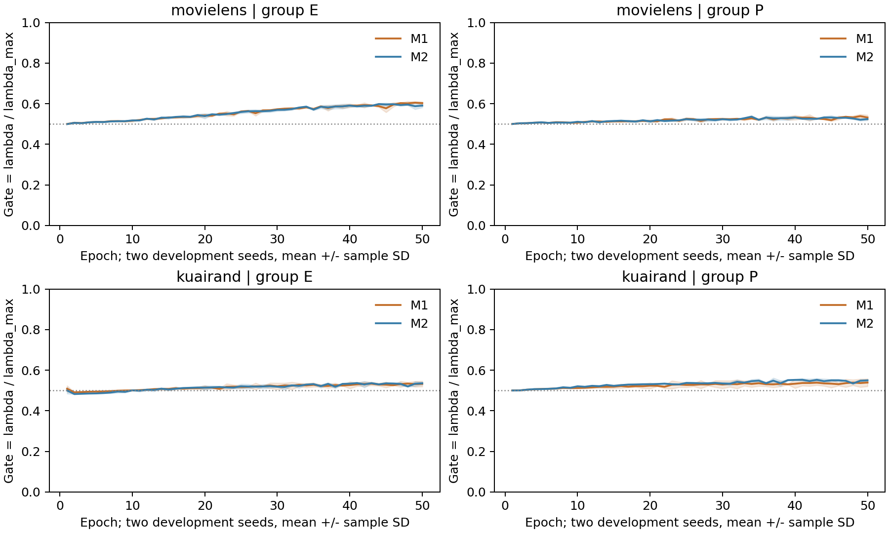
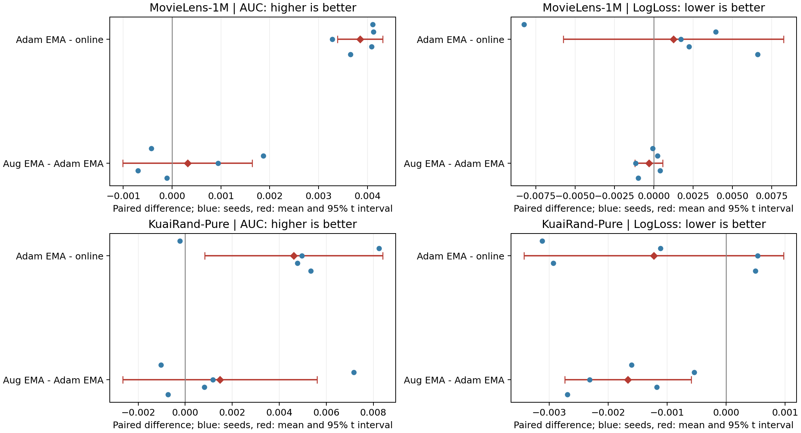

# AIGM01：优化器校准、增强差分与创新量门控完整实验

完成日期：2026-11-01。**56条唯一完整训练、2800 epoch、96600次参数更新，训练失败/OOM均为0；90条正式selected/E10/E50测试记录齐全。** 名义64条中8条以完整身份一致的RAM轨迹复用，实际56条；设计、实现、独立审查PASS、真实CUDA Stage0、开发搜索、正式五seed、统一测试和数值汇总均完成。

**结论：EMA是本轮可靠的排序参考；固定SAD与AIG-M没有建立推进所需的独立增量。普通增强在ML未晋级，在KR出现明确的域/任务交换。AIG-M停止在开发阶段，正式比较保留A0、A0+EMA和A1+EMA。**

| 研究对象 | 当前证据 | 决策 |
|---|---|---|
| ML EMA，H2 | selected test AUC +.003849，5/5正；LL +.001249，4/5恶化，均值未达+.002保护线 | GO；排序STRONG，损失收益未建立 |
| KR EMA，ρ=.995 | AUC +.004616，4/5正；最大域两任务各5/5改善，保护项为空 | GO；整体排序MEDIUM |
| ML普通增强+EMA | 相对A0+EMA AUC +.000318，2/5正；validation均值+.000010 | NO_PROMOTION，WEAK |
| KR普通增强+EMA | macro AUC +.001476，3/5正；LL −.001664，5/5改善；最大域两任务稳定下降 | TRADEOFF；域损害STRONG，macro增量WEAK |
| 固定SAD与AIG-M | 两数据集有限开发搜索均未通过+.001且2/2正向的增量门 | STOP；未建立候选推进证据 |

## 1. 来源、数据和评价身份

入口为start.md和[规划00–06](../../research_plans/26-11-1_v2/06_Codex完整执行提示词.md)。实际规划main为`0973fa5f1a804aec34f88ccb2ffdd8c0231b602b`；GAM01发布HEAD为`ee4cf0512a7723624c9ee6a1ef192f0f7f17686b`。本轮已审执行代码commit为 **`2cec25ab5b32411855a13ab3143678a5e980ea3f`**，训练源码manifest SHA256为`d297bea130cae8fedaeef47ae35239fd9af4f4d7f3076416eaf50670bcdae02c`，完成后再次核对一致。

计划、GAM01/GA31-R3依赖和GAM01报告90份文件逐blob匹配；PROJECT_ARCHITECTURE另行核验。原始CSV、六数组、split/行号、encoder/scaler与固定来源一致，见[SOURCE_FETCH_RECEIPT](SOURCE_FETCH_RECEIPT.json)、[LOCAL_SOURCE_VERIFICATION](LOCAL_SOURCE_VERIFICATION.json)、[RAW_DATA_VERIFICATION](RAW_DATA_VERIFICATION.json)和[实际数据manifest](raw_attempt_tables/attempt_20261101_1720/data_manifest.json)。保留旧代码/报告，历史勘误只在新[证据审查](EVIDENCE_REVIEW.md)中记录。

| 数据 | train / validation / test | train域d0/d1/d2 | 增强目标 | 任务 |
|---|---|---|---|---|
| ML | 800167 / 100021 / 100021 | 155949 / 318599 / 325619 | d0 | rating>3、rating>4 |
| KR | 2006132 / 250767 / 250767 | 172782 / 1743898 / 89452 | d2 | is_click、long_view |

ML域为ages1/18、age25、ages35/45/50/56；KR域为tab0/1/4。自然原行序80/10/10，KR先全局划分再过滤，train拟合编码器/scaler，OOV0。CSV路径分别为`/home_new/xzf/datasets/ml-1m/ml-1m.csv`和`/home_new/xzf/datasets/kuairand/processed/kuai_rand.csv`。不改变人口、标签、采样比例、原Sample权重预算或网络结构。

模型fixed1 MDMTRec/M3oE，3域×2任务、4 shared experts、embedding16、fcn_dims=[512,256,256,64]，四个融合系数为1。batch40960、50epoch、FP32、loss_scale1、自然shuffle，无早停/AMP/TF32。环境Python3.13.5、PyTorch2.9.0+cu126、CUDA12.6、两张RTX3090；[依赖锁](../../requirements-phase0-3.lock)和[环境记录](raw_attempt_tables/attempt_20261101_1720/environment.json)保留实际版本。GPU0既有外部训练保留，逐卡按显存和功耗85%门并发。

两数据集均由开发搜索选择Adam lr=.01、betas(.9,.999)、eps1e−8，coupled wd分别1e−4/1e−5；wd同时进入m/v。ML正式EMA半衰期H2，对应ρ=.982820598545；KR保留ρ=.995，约2.82epoch半衰期。ML增强参考κ=.05、λ=.5；KR κ=.1、λ=.5。Gaussian K1仅扰动目标域非路由sparse embedding，RMS尺度stopgrad；其他数据字段与标签保持原值。

online与各shadow独立按完整validation六格macro AUC严格提升选epoch，平局最早，E0排除。S5前冻结方法、ρ、超参、代码/数据身份；全体训练后冻结90个端点，再统一test。[配置冻结](raw_attempt_tables/attempt_20261101_1720/formal_configuration_frozen.json)、[选点冻结](raw_attempt_tables/attempt_20261101_1720/selection_frozen.json)、[逐seed身份](raw_attempt_tables/attempt_20261101_1720/selected_metrics.csv)提供epoch、step、model/optimizer hash。

macro为六格等权；pooled先按任务跨域计算AUC再平均；traffic为域人口加权cell AUC。LL为真实输入概率LogLoss，不乘loss_scale。seed为重复单位，sample SD和df4配对t95%区间由五个seed计算。2022/2024参与开发选参并在正式阶段复用，五seed不称独立确认；历史test已参与既往研究判断。区间描述固定划分上的训练随机性，不增加task/epoch为样本。

## 2. 有限搜索、算法和阶段去留

完整原值、配对区间、保护项、阈值与各shadow网格见[SEARCH_REPORT](SEARCH_REPORT.md)、[开发checkpoint原值](development_checkpoints.csv)和[开发汇总](development_summary.csv)。

| 阶段 | 完整训练 | 选择/结果 |
|---|---:|---|
| S1 Adam四联合lr/wd点×两seed×两数据 | 16 | 两数据均C；ML H2，KR .995（近似平局顺序） |
| S2 Gaussian三κ/λ点 | 12 | ML G1/H2，KR G2/.995；开发增量门均未通过，仍保留正式参考 |
| S3 固定SAD βδ=.95/.99、λ=.5 | 8 | ML所选观察与KR所选观察各只有1/2 seed正向，停止固定记忆晋级 |
| S4 AIG-M两个组合 | 8 | 两数据均无晋级候选 |
| S5 A0/A1两online×两数据×五seed | 20个online输出 | 8条严格RAM缓存、12条新训练；30个逻辑模型-seed输出 |

SAD真实通道累计g+wd·θ，q只累计增强差分d；v使用当前(g+wd·θ+λd)²，分子用各自偏差修正的m+λq。d来自同θ、同batch的target-aug减target-clean，分母为原B×2。AIG-M固定βδ=.95，按预注册E/P参数组计算u=||d−q_old||/(||q_old||+||g||+1e−12)，λ=λmax·sigmoid(4(u−τ))；U组严格Adam，无q。首版仅动态λ，未实施动态β或AIG-SWA，完整公式与退化关系见[设计](DESIGN_SPECIFICATION.md)。

M1=(训练q50,λmax.25)、M2=(q75,λmax.5)。τ来自S95的E1、两个开发seed、E/P两组共276条训练统计，未用validation/test拟合阈值数值。开发门为相对所选增强+EMA mean ΔAUC≥.001、2/2正且保护为空；正式主门为≥.001、至少4/5正及validation支持。保护为LL mean恶化≥.002，或worst/最大域任一任务AUC mean下降≥.002，并达到开发2/2或正式4/5不利seed。

ML最好的AIG观察M1/H2：两个ΔAUC为[+.000512915,+.000006961]，mean+.000259938，未达门；KR M2/.995为[+.006292613,−.006321216]，mean−.000014301，方向不稳定。停止条件已满足，未为被拒AIG增加五seed测试或额外搜索。基础lr/wd只做共享底座校准，没有逐方法独立lr/wd搜索；各方法计算成本另列。



曲线是两个开发seed的epoch平均gate，阴影为sample SD；E为embedding、P为目标路径。gate多数在.48–.61，ML E组从约.51上升到.59，其他组上升较缓。平均λ为M1约.13、M2约.26，q注入非零；门改变了更新，但没有达到收益门。实际剂量、训练时钟与创新信号效用没有被分离：没有与平均剂量/时程匹配的恒定或回放控制。故“创新度包含有效额外信息”的证据WEAK。逐组分阶段值见[aig_mechanism_summary.csv](aig_mechanism_summary.csv)。

## 3. 正式selected结果

AUC/LL为五seed均值±sample SD，其他列为均值。A0与A0_EMA共享online轨迹。

| 数据 | 臂 | val AUC | test macro AUC | test macro LL | pooled AUC | traffic AUC | worst AUC |
| --- | --- | --- | --- | --- | --- | --- | --- |
| ML | A0 | 0.756665 | 0.775190 ± 0.001136 | 0.494891 ± 0.004690 | 0.776760 | 0.776435 | 0.752263 |
| ML | A0_EMA | 0.759512 | 0.779039 ± 0.001003 | 0.496140 ± 0.001543 | 0.780596 | 0.780253 | 0.756329 |
| ML | A1_EMA | 0.759522 | 0.779357 ± 0.000393 | 0.495822 ± 0.001550 | 0.780950 | 0.780600 | 0.756629 |
| KR | A0 | 0.686278 | 0.671907 ± 0.006145 | 0.437172 ± 0.002751 | 0.716990 | 0.711621 | 0.634325 |
| KR | A0_EMA | 0.688454 | 0.676523 ± 0.005227 | 0.435947 ± 0.001323 | 0.723348 | 0.718165 | 0.636835 |
| KR | A1_EMA | 0.687826 | 0.677999 ± 0.005117 | 0.434283 ± 0.002164 | 0.718855 | 0.713542 | 0.634346 |

### 五个配对差与区间

AUC正值有利，LL负值有利；seed顺序2022–2026。

| 数据 | 对照 | 指标 | 五个原始差 | mean / sample SD | df4 95%配对区间 | 有利seed |
| --- | --- | --- | --- | --- | --- | --- |
| ML | EMA_A0 | macro_auc | [+0.004107, +0.004121, +0.003278, +0.004086, +0.003653] | +0.003849 / 0.000374 | [+0.003384,+0.004314] | 5/5 |
| ML | EMA_A0 | macro_logloss | [-0.008260, +0.003941, +0.001716, +0.002235, +0.006611] | +0.001249 / 0.005648 | [-0.005764,+0.008262] | 1/5 |
| ML | augmentation | macro_auc | [-0.000421, +0.001870, +0.000941, -0.000696, -0.000102] | +0.000318 / 0.001066 | [-0.001006,+0.001642] | 2/5 |
| ML | augmentation | macro_logloss | [-0.000077, +0.000240, -0.001151, +0.000396, -0.000994] | -0.000317 / 0.000713 | [-0.001202,+0.000568] | 3/5 |
| KR | EMA_A0 | macro_auc | [-0.000224, +0.008235, +0.004955, +0.004779, +0.005337] | +0.004616 / 0.003049 | [+0.000831,+0.008402] | 4/5 |
| KR | EMA_A0 | macro_logloss | [-0.003122, -0.001109, +0.000536, -0.002933, +0.000501] | -0.001225 / 0.001775 | [-0.003430,+0.000979] | 3/5 |
| KR | augmentation | macro_auc | [-0.001036, +0.007172, +0.001170, +0.000807, -0.000731] | +0.001476 / 0.003323 | [-0.002649,+0.005602] | 3/5 |
| KR | augmentation | macro_logloss | [-0.001601, -0.000538, -0.002311, -0.001173, -0.002694] | -0.001664 / 0.000865 | [-0.002738,-0.000590] | 5/5 |



ML EMA的selected val AUC也5/5正、mean+.002847；test五差很集中，排序证据STRONG。LL mean+.001249、4/5恶化，区间跨0；GO来自排序门和预设保护，不代表LL已经改善。KR EMA val5/5、test4/5正，AUC区间正；pooled和traffic均5/5改善，最大域两任务均5/5改善，当前协议排序证据MEDIUM，稀有域与LL一致性更弱。

ML增强相对A0_EMA的test AUC只有2/5正，均值+.000318、区间跨0，未达门。KR增强test macro+.001476但3/5正、区间跨0；validation mean−.000629、2/5正。test LL五seed都改善，mean−.001664、区间全负；排序与损失、validation与test的方向分裂必须保留，不能用macro均值单独推进。

### 逐seed绝对值及选点

下表每个AUC/LL单元格对应同一validation-selected模型；完整model/optimizer hash与所有共同epoch在selected_metrics.csv和selection_frozen.json。

| 数据 | seed | epoch A0/EMA/A1 | A0 AUC/LL | A0_EMA AUC/LL | A1_EMA AUC/LL |
| --- | --- | --- | --- | --- | --- |
| ML | 2022 | 29/26/23 | 0.775432 / 0.503202 | 0.779538 / 0.494942 | 0.779117 / 0.494865 |
| ML | 2023 | 17/18/20 | 0.773179 / 0.493254 | 0.777300 / 0.497195 | 0.779170 / 0.497435 |
| ML | 2024 | 24/20/25 | 0.775800 / 0.493334 | 0.779078 / 0.495050 | 0.780018 / 0.493899 |
| ML | 2025 | 26/28/23 | 0.775675 / 0.492933 | 0.779760 / 0.495169 | 0.779064 / 0.495565 |
| ML | 2026 | 17/22/22 | 0.775863 / 0.491731 | 0.779516 / 0.498342 | 0.779414 / 0.497348 |
| KR | 2022 | 44/33/28 | 0.673696 / 0.439326 | 0.673472 / 0.436204 | 0.672436 / 0.434604 |
| KR | 2023 | 18/50/22 | 0.662913 / 0.438938 | 0.671147 / 0.437828 | 0.678319 / 0.437290 |
| KR | 2024 | 40/50/36 | 0.679916 / 0.433965 | 0.684871 / 0.434501 | 0.686041 / 0.432189 |
| KR | 2025 | 50/50/47 | 0.672610 / 0.439262 | 0.677389 / 0.436329 | 0.678196 / 0.435156 |
| KR | 2026 | 43/47/36 | 0.670398 / 0.434369 | 0.675735 / 0.434871 | 0.675004 / 0.432176 |

## 4. 所有域任务、规模、难度与交换

下表均为selected test五seed均值；ΔEMA=A0_EMA−A0，ΔAug=A1_EMA−A0_EMA；括号为AUC正向seed数。

| cell | train域n | test n/正例 | A0 AUC | ΔEMA AUC (+seed) | ΔAug AUC (+seed) | A0 LL | ΔEMA LL | ΔAug LL |
| --- | --- | --- | --- | --- | --- | --- | --- | --- |
| ML d0t0 | 155949 | 27687/14281 | 0.770298 | +0.004095 (5) | +0.000022 (2) | 0.584358 | +0.000909 | -0.000121 |
| ML d0t1 | 155949 | 27687/4964 | 0.785173 | +0.004425 (5) | +0.000060 (2) | 0.407449 | +0.000242 | -0.000609 |
| ML d1t0 | 318599 | 41434/22072 | 0.778130 | +0.003891 (5) | +0.000546 (3) | 0.572689 | +0.001745 | -0.000560 |
| ML d1t1 | 318599 | 41434/7031 | 0.797449 | +0.003473 (5) | +0.000468 (3) | 0.386143 | +0.004417 | -0.000148 |
| ML d2t0 | 325619 | 30900/18099 | 0.752263 | +0.004065 (5) | +0.000301 (3) | 0.581804 | -0.000904 | -0.000211 |
| ML d2t1 | 325619 | 30900/6324 | 0.767825 | +0.003145 (5) | +0.000512 (2) | 0.436902 | +0.001083 | -0.000255 |
| KR d0t0 | 172782 | 2613/228 | 0.635617 | +0.001374 (3) | -0.002645 (2) | 0.289725 | -0.000081 | -0.000251 |
| KR d0t1 | 172782 | 2613/120 | 0.645909 | +0.004037 (4) | +0.011964 (5) | 0.181561 | +0.000844 | -0.001725 |
| KR d1t0 | 1743898 | 246284/51847 | 0.698833 | +0.006473 (5) | -0.004654 (0) | 0.506479 | -0.004022 | +0.002134 |
| KR d1t1 | 1743898 | 246284/27415 | 0.726663 | +0.006726 (5) | -0.004929 (1) | 0.346981 | -0.002648 | +0.001357 |
| KR d2t0 | 89452 | 1870/1100 | 0.653260 | +0.002417 (4) | +0.003172 (3) | 0.649400 | +0.001314 | -0.005262 |
| KR d2t1 | 89452 | 1870/827 | 0.671157 | +0.006672 (5) | +0.005950 (4) | 0.648886 | -0.002760 | -0.006235 |

**KR存在小域收益/大域损害交换。** 增强相对A0_EMA：d1t0下降.004654、5/5，d1t1下降.004929、4/5，validation/test都触发最大域保护。目标最小域d2两任务均值提高，同时d0t1提高约.011964；d0t0下降约.002645，说明小域也不是统一受益。test最大域占约98.21%，pooled−.004494、traffic−.004623，各4/5下降；macro+.001476不能覆盖这项损害。域损害证据STRONG，最小域每任务稳定程度见上表。

EMA没有同样的AUC交易：KR最大域两任务各5/5改善，ML worst-cell也5/5改善。KR EMA worst-cell只有3/5改善，稀有域效果仍有seed差异。ML增强的所有cell均差较小，未建立稳定的域级独立收益。

**域规模作为主解释变量的证据WEAK。** ML最大的d2 baseline AUC低于最小d0；KR最低AUC的d0比最小d2更大。任务难度、正例率、增强目标、共享路径和自然train/test人口变化都与规模混杂。KR d0t1测试只有120正例，d1流量极高；LL也受标签基率影响。本轮没有独立操纵规模，不能把小域等同难域，或用规模统一解释效果。

按任务三域等权汇总如下；完整逐seed域/任务AUC和LL在原始指标CSV。

| 数据 | task | 对照 | ΔAUC | AUC正向 | ΔLL |
| --- | --- | --- | --- | --- | --- |
| ML | 0 | EMA_A0 | +0.004017 | 5/5 | +0.000583 |
| ML | 0 | augmentation | +0.000289 | 2/5 | -0.000297 |
| ML | 1 | EMA_A0 | +0.003681 | 5/5 | +0.001914 |
| ML | 1 | augmentation | +0.000347 | 2/5 | -0.000337 |
| KR | 0 | EMA_A0 | +0.003421 | 4/5 | -0.000929 |
| KR | 0 | augmentation | -0.001376 | 2/5 | -0.001126 |
| KR | 1 | EMA_A0 | +0.005812 | 5/5 | -0.001521 |
| KR | 1 | augmentation | +0.004328 | 5/5 | -0.002201 |

KR增强收益集中task1：mean ΔAUC+.004328、5/5正；task0为−.001376，只有2/5正。目标域、标签语义与任务共享是比单一规模变量更具体的竞争解释。

## 5. 训练阶段、时间尺度与历史对照

共同epoch与各自selected分开报告，以下为test配对均值。

| 数据 | 对照 | 端点 | ΔAUC | AUC正向 | ΔLL |
| --- | --- | --- | --- | --- | --- |
| ML | EMA_A0 | E10 | +0.001146 | 5/5 | -0.007187 |
| ML | EMA_A0 | selected | +0.003849 | 5/5 | +0.001249 |
| ML | EMA_A0 | E50 | +0.004787 | 5/5 | +0.003301 |
| ML | augmentation | E10 | +0.000223 | 4/5 | -0.000272 |
| ML | augmentation | selected | +0.000318 | 2/5 | -0.000317 |
| ML | augmentation | E50 | +0.000349 | 4/5 | +0.000570 |
| KR | EMA_A0 | E10 | -0.009126 | 0/5 | +0.013318 |
| KR | EMA_A0 | selected | +0.004616 | 4/5 | -0.001225 |
| KR | EMA_A0 | E50 | +0.005690 | 5/5 | -0.005712 |
| KR | augmentation | E10 | -0.002263 | 2/5 | -0.006670 |
| KR | augmentation | selected | +0.001476 | 3/5 | -0.001664 |
| KR | augmentation | E50 | +0.001600 | 4/5 | -0.002174 |

KR .995 EMA在E10仍5/5排序下降，E50则5/5排序和LL改善；平均的启动和训练时钟是明确因素。ML H2在E10排序已5/5改善，E50排序也5/5改善，但E50 LL mean+.003301、4/5恶化；selected LL代价不能仅归因于选点。

本轮A0 online的两数据×五seed×三个端点共30条model hash和AUC/LL与GAM01完全相同。KR保留历史C/.995及G2/.995配置，历史与本轮不合并增加n；复现证明来源/非反馈语义一致，仍是固定历史划分的五个seed。

ML H2相对历史A0 .995 selected：test AUC mean−.000550201，只有1/5正；LL mean−.006550953。开发两seed的validation却倾向H2，说明时间尺度在validation/test上的排序不同。原.995半衰期约6.91epoch，H2更快，E10和E50的损失代价都明显缩小；当前选择保留排序收益并降低LL代价，但仍有4/5 seed的selected LL恶化。没有根据新test改回.995或追加温度拟合。

历史Polyak的旧协议结果只作研究动机，不与当前数值合并。可核验旧摘要，原始v2_momentum日志不在工作区；该缺口已在EVIDENCE_REVIEW注明。GAM01报告中ML A1−A0、A2−A1的LL改善seed数均为2/5；原表3/5在新审查中勘误，历史文件不改。规划EMA半衰期69/28epoch的算术误差也只在新规格修正为6.91/2.82。

## 6. 证据、竞争解释与下一判别实验

| 判断 | 强度 | 证据与剩余解释 |
|---|---|---|
| ML EMA提高当前协议排序 | STRONG | val/test均5/5正、AUC区间全正、worst5/5改善；LL收益未建立 |
| KR EMA在当前协议可用 | MEDIUM | val5/5、test4/5正，最大域两任务5/5改善；稀有域与损失较不一致 |
| KR增强损害最大域 | STRONG | d1t0五seed下降、d1t1四seed下降，val/test均触发保护 |
| 普通增强提供稳定独立macro增量 | WEAK | ML2/5正，KR3/5且val/test反向；KR的LL改善与域损害并存 |
| 注册AIG-M值得推进 | WEAK | ML增量太小，KR种子方向抵消；预定停止门成立 |
| 创新度信号本身有额外效用 | WEAK | 门有动态和非零q，但剂量/训练日程未匹配控制，未达实用收益门 |
| 规模统一解释域效果 | WEAK | baseline难度排序与规模不一致，任务/目标/人口混杂 |

稳定现象是EMA排序收益、KR普通增强的最大域代价，以及有限差分候选未建立推进增量。矛盾包括KR增强validation/test反向、ML时间尺度validation/test排序反向、ML小幅AUC收益与LL代价，以及SAD短记忆在两数据上没有统一优势。新规则的非零注入说明实现改变了更新；q、正cos或创新量大都不是效用指标。历史A2的实数等价/长期FP32分离也要求区分数值轨迹差异与机制收益。

竞争解释按当前证据保留：EMA的参数轨迹平均及启动滞后；AUC选点与概率校准的差别；目标增强的标签/特征语义及共享参数引起的域交换；差分历史的滤波滞后与参数漂移；AIG较低平均剂量和近似epoch日程，而非创新信号；小测试cell和自然人口变化引起的指标方向差异。共享lr/wd校准没有识别每个新规则的独立最优lr/wd，本轮结论对应注册有限设置。

**最有区分力的下一实验**：保持当前公式、自然人口、κ/β/ρ和总注入剂量，把AIG的u驱动门替换为开发训练曲线的逐epoch/参数组平均λ回放日程，与u门及简单EMA参考并列。先冻结全部规则，再在未参与方法选择的新自然留出评价，并先核验行号、时间和人口身份。若u门不能超过剂量/时钟匹配的回放，拒绝“创新信号提供独立信息”的解释。该实验区分当前主要竞争解释，不为现有失败候选扩大搜索；本轮到预注册停止点结束。

## 7. 成本、验收与实际交付

| 成本 | 实际合计 |
| --- | --- |
| 原始自然样本曝光次数 | 3,928,818,600 |
| 目标增强视图曝光次数 | 208,590,850 |
| 训练forward | 155,250 |
| backward/autograd遍历 | 124,200 |
| optimizer更新 | 96,600 |
| 四shadow累计更新 | 386,400 |
| validation forward（online+四shadow） | 70,000 |
| 选点比较次数 | 14,000 |

累计训练worker 63268.67秒；all_stages至统一test/数表完成wall 8504.30秒（141.74分钟），不含前期设计、Stage0、数据预处理和本报告。训练CUDA-event累计46708.85秒，validation forward event累计8998.92秒；这些是各进程stream elapsed合计，训练区间含host/并发等待，不能当作独占kernel GPU小时或算法加速结论。test去重后422次forward，worker wall29.87秒、forward event22.43秒。峰值allocated 1.265GiB、reserved 1.502GiB；RAM快照tensor合计9,576,073,648bytes，结束后已释放。

开发44条、正式20个online输出及8次缓存的身份/原因分别在[trial ledger](raw_attempt_tables/attempt_20261101_1720/trial_ledger.csv)、[launch ledger](raw_attempt_tables/attempt_20261101_1720/launch_ledger.csv)、[costs](raw_attempt_tables/attempt_20261101_1720/costs.csv)。失败账本为空表，失败/OOM0；没有删seed、缩batch、缩epoch或训练期提前剪枝。

必要验收：coder CPU测试3 passed、独立reviewer复核3 passed、最终PASS；真实CUDA Stage0每数据集19次原batch更新，源预测/BCE/梯度/Adam一步误差0，U差分精确零，四shadow非干扰和完整RAM恢复下一步PASS。完成后核对56条×50epoch、90条测试身份、成本计数与冻结源码一致。没有因本轮实现缺陷重训的记录。公式歧义、β0哨兵与历史勘误在[设计](DESIGN_SPECIFICATION.md)、[实施](IMPLEMENTATION_REPORT.md)、[独立审查](REVIEW_REPORT.md)、[Stage0](STAGE0_REPORT.md)中保留修订依据。

所有模型、optimizer/q、shadow与RNG快照仅RAM；[state_release](raw_attempt_tables/attempt_20261101_1720/state_release.json)确认测试和数表后释放。磁盘保留数值、配置、hash、代码与日志，模型复评需按冻结入口重训。

## 8. 复算与重训

全套原始数值/日志归档为`raw_attempts_2026-11-01_aig_m.tar.gz`，含check和all两个attempt；逐文件SHA256为`raw_attempts_2026-11-01_aig_m_SHA256SUMS.txt`。直接可读顶层数表在[raw_attempt_tables](raw_attempt_tables/attempt_20261101_1720/)，详细工件说明见[README](README.md)。不随包上传原始CSV或权重。

在仓库根目录解包恢复原attempt后，可复算数表、开发表、图与本文：

```bash
mkdir -p artifacts/gradient_aug_aig_m_20261101
tar -xzf research_reports/2026-11-01_aig_m/raw_attempts_2026-11-01_aig_m.tar.gz -C artifacts/gradient_aug_aig_m_20261101
/home_new/xzf/envs/miniconda3/envs/phase0-3-env/bin/python -m experiments.gradient_aug_aig_m_20261101.analyze --run-dir artifacts/gradient_aug_aig_m_20261101/attempt_20261101_1720
/home_new/xzf/envs/miniconda3/envs/phase0-3-env/bin/python research_reports/2026-11-01_aig_m/development_tables.py --run-dir artifacts/gradient_aug_aig_m_20261101/attempt_20261101_1720
/home_new/xzf/envs/miniconda3/envs/phase0-3-env/bin/python research_reports/2026-11-01_aig_m/make_figures.py --run-dir artifacts/gradient_aug_aig_m_20261101/attempt_20261101_1720
/home_new/xzf/envs/miniconda3/envs/phase0-3-env/bin/python research_reports/2026-11-01_aig_m/build_report.py --run-dir artifacts/gradient_aug_aig_m_20261101/attempt_20261101_1720
```

完整重新训练使用新的空attempt目录，按[代码运行入口](../../experiments/gradient_aug_aig_m_20261101/README.md)先执行Stage0，再传入同一已审commit及PASS receipt运行all；完整配置、数据hash、阈值原值和候选清单均在本交付中。当前结论与研究去留是：保留EMA基线，KR增强按TRADEOFF保留描述，停止本轮固定SAD/AIG-M推进。
