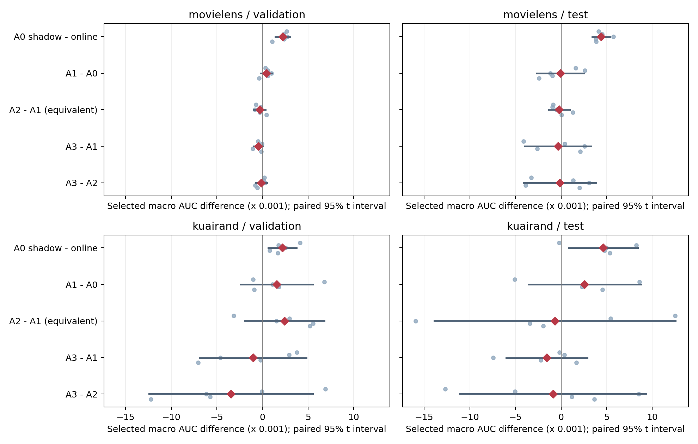
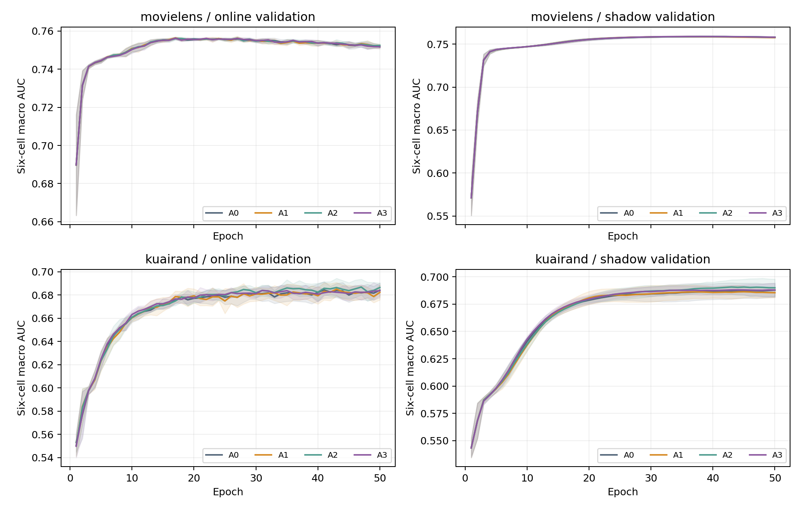
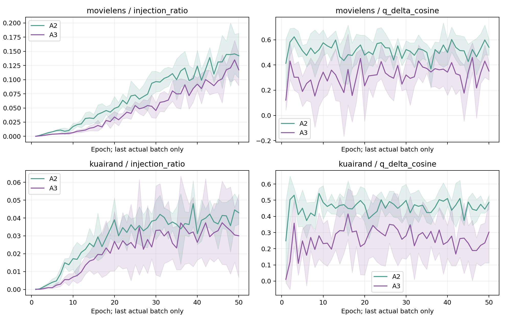

# GAM01：参数轨迹平均与增强差分动量完整分析

完成日期：2026-11-01。正式实验 **40/40 条、2000 epoch、69000 次参数更新**，五个种子均保留，失败训练数为0。统一测试输出240条 online/shadow 的 selected/E10/E50记录。两个数据集的P2门均为 `NOT_TRIGGERED`，本轮结束，不追加RDI或超参搜索。

**当前接受的结论：参数shadow EMA具有排序价值；MovieLens存在明确LogLoss代价，KuaiRand通过预设推进门。增强差分的独立长记忆没有建立超越普通增强Adam的selected收益。**

| 研究问题 | 当前证据与决定 |
|---|---|
| P0，MovieLens | selected test ΔAUC **+0.004399**，5/5正，95%配对区间[+0.003423,+0.005375]；ΔLogLoss **+0.007800**，4/5恶化。**TRADEOFF**。排序收益证据STRONG，概率损失代价证据MEDIUM。 |
| P0，KuaiRand | selected test ΔAUC **+0.004616**，4/5正，区间[+0.000831,+0.008402]；validation 5/5正，预设保护均未触发。**GO**，当前协议下证据MEDIUM。 |
| P1，βδ=.99 | 相对普通增强Adam，ML test ΔAUC−0.000336、KR−0.001554；validation分别0/5、2/5正向。未建立独有增量，停止当前长差分记忆路线。证据MEDIUM。 |
| P2 | 正向趋势与重复阶段失配条件均未满足；不实现、不训练。 |

## 1. 来源、协议和执行身份

方案入口是[本轮规划](../../research_plans/26-11-1/README.md)；实际设计、实施与审查分别见[设计规格](DESIGN_SPECIFICATION.md)、[实施报告](IMPLEMENTATION_REPORT.md)、[审查PASS](REVIEW_REPORT.md)。执行由独立runner完成，科学解释由协调者完成。

规划main固定于 `e65ceb4735d533f3a9035a9199c30f68b4bde98d`；GA31-R3实际发布源码为 `26-11-01@a6f496b54f467cdf7b814b6bb8defdbdd457bc38`，其底座为 `ee6e81fdfd37284e6447e8149cb93d04736dba02`。本轮执行代码commit为 **`89edb99a389c56fde86460af677a48e14fbcf116`**。六份计划及源包已按远端blob核对，见[SOURCE_FETCH_RECEIPT.json](SOURCE_FETCH_RECEIPT.json)；实际文件SHA256见[source_manifest.json](source_manifest.json)。本地工作区没有`.git`，执行commit由GitHub Git对象创建并传入运行入口。

自然数据沿GA31-R3，80/10/10原行序划分；KR先全局划分再过滤tab0/1/4，train单独拟合encoder/scaler，OOV=0。raw、六数组、split、行号、encoder/scaler身份全部匹配[data_manifest.json](data_manifest.json)。不改变自然人口、采样比例、标签或原始CSV。

| 数据 | train/validation/test | train域计数d0/d1/d2 | 增强目标 | 参数量 | 每epoch步数 |
|---|---|---|---:|---:|---:|
| MovieLens | 800167/100021/100021 | 155949/318599/325619 | d0 | 773470 | 20 |
| KuaiRand | 2006132/250767/250767 | 172782/1743898/89452 | d2 | 1614254 | 49 |

模型为fixed1 MDMTRec/M3oE，3域×2任务，4 shared experts、embedding16、fcn_dims=[512,256,256,64]，四个融合系数均为1。ML任务为rating>3与rating>4；KR为存储的is_click与long_view。ML使用L2-ML：loss scale1、coupled wd1e−4；KR使用B-KR：scale1、wd1e−5。所有臂Adam lr.01、betas(.9,.999)、eps1e−8，FP32、batch40960、50epoch，无早停、AMP或TF32。种子固定2022–2026。A0 online在selected/E10/E50的30条记录、全部共同AUC/LL与GA31-R3对应基线重建值完全一致。

| 臂 | 在线训练 | 参数shadow |
|---|---|---|
| A0 | 无增强标准Adam | ρ=.995 |
| A1 | Gaussian K1标准混合梯度Adam，λ=.5、κ=.1 | ρ=.995 |
| A2 | 分源SAD，βδ=.90，代数等价实现对照 | ρ=.995 |
| A3 | 分源SAD，βδ=.99，长差分记忆 | ρ=.995 |

Gaussian仅扰动指定目标域的非路由sparse embedding，ML6/KR33字段，scale为stopgrad的逐行逐字段RMS；dense、domain embedding、ID、标签不动。差分为同θ同batch的 **target-aug梯度−target-clean梯度**，两项均除原B×2；全batch真实梯度另行保留。增强改变输入风险，原样本/域/任务权重预算不变。A3保留真实通道β1=.9、独立差分βδ=.99和当前混合梯度的Adam二阶矩；每batch只更新一次参数。

shadow从θ0初始化，每次在线更新后做φ←.995φ+.005θ，不反馈训练。两类模型各自按完整validation六格macro AUC严格提升选点，平局最早、E0排除。40条全部完成后，先冻结validation+D1的P2门与选点，再统一test。所有模型/Adam/q/shadow/RNG快照仅存RAM，结束后已释放。完整epoch/step/model与optimizer哈希见[selection_frozen.json](selection_frozen.json)及[逐seed原值和选点](SELECTED_SEEDS.md)。

统计单位是seed，均值、sample SD和df4配对t95%区间由五个配对差计算；task/cell/epoch不充当额外重复。macro为六格等权，pooled为两个任务各自跨域AUC再平均，traffic为域人口加权cell AUC；LL为未缩放真实输入损失。五seed区间衡量固定历史划分上的训练随机性。

## 2. Selected主结果

下表AUC/LL为test均值±sample SD，validation列为各自selected AUC均值。完整六格、域/任务、pooled、traffic、worst原值见[test_metrics.csv](test_metrics.csv)与[validation_metrics.csv](validation_metrics.csv)。

| 数据 | 臂/模型 | val AUC | test macro AUC | test macro LL | pooled AUC | traffic AUC | worst AUC |
|---|---|---:|---:|---:|---:|---:|---:|
| ML | A0 online | .756665 | .775190±.001136 | .494891±.004690 | .776760 | .776435 | .752263 |
| ML | A0 shadow | .758890 | .779589±.001357 | .502691±.006878 | .781067 | .780718 | .757156 |
| ML | A1 online | .757091 | .775129±.001355 | .493643±.003991 | .776369 | .776452 | .753607 |
| ML | A1 shadow | .758882 | .779679±.000850 | .499816±.006786 | .781120 | .780798 | .756801 |
| ML | A2 online | .756783 | .774927±.001171 | .492380±.002469 | .775512 | .776112 | .752521 |
| ML | A2 shadow | .758929 | .779567±.001041 | .501305±.006378 | .780951 | .780687 | .757117 |
| ML | A3 online | .756640 | .774793±.002160 | .495428±.005867 | .776077 | .776081 | .751720 |
| ML | A3 shadow | .758941 | .779512±.000574 | .499888±.005731 | .780733 | .780585 | .757096 |
| KR | A0 online | .686278 | .671907±.006145 | .437172±.002751 | .716990 | .711621 | .634325 |
| KR | A0 shadow | .688454 | .676523±.005227 | .435947±.001323 | .723348 | .718165 | .636835 |
| KR | A1 online | .687824 | .674491±.005178 | .430971±.005113 | .714759 | .709303 | .634508 |
| KR | A1 shadow | .687826 | .677999±.005117 | .434283±.002164 | .718855 | .713542 | .634346 |
| KR | A2 online | .690232 | .673812±.005533 | .437577±.002444 | .716950 | .711633 | .637374 |
| KR | A2 shadow | .692765 | .677174±.003928 | .434686±.001650 | .721568 | .716314 | .635604 |
| KR | A3 online | .686782 | .672937±.003129 | .434816±.001482 | .716581 | .711133 | .636437 |
| KR | A3 shadow | .689575 | .675644±.003839 | .436425±.001793 | .721490 | .716213 | .636232 |

关键selected配对效应如下。AUC正值有利，LL负值有利；“正/改善”均按五seed计。

| 数据 | 对照 | Δtest AUC | 95%配对区间 | AUC正向 | Δtest LL | LL改善 |
|---|---|---:|---|---:|---:|---:|
| ML | A0 shadow−online | +.004399 | [.003423,.005375] | 5/5 | +.007800 | 1/5 |
| ML | A1−A0 online | −.000061 | [−.002657,.002536] | 2/5 | −.001248 | 3/5 |
| ML | A2−A1 online | −.000202 | [−.001340,.000936] | 2/5 | −.001263 | 3/5 |
| ML | A3−A1 online | −.000336 | [−.003969,.003298] | 3/5 | +.001784 | 3/5 |
| ML | A3−A2 online | −.000134 | [−.004113,.003846] | 3/5 | +.003048 | 2/5 |
| KR | A0 shadow−online | +.004616 | [.000831,.008402] | 4/5 | −.001225 | 3/5 |
| KR | A1−A0 online | +.002584 | [−.003577,.008745] | 4/5 | −.006201 | 5/5 |
| KR | A2−A1 online | −.000678 | [−.013891,.012534] | 2/5 | +.006606 | 1/5 |
| KR | A3−A1 online | −.001554 | [−.005998,.002890] | 2/5 | +.003845 | 1/5 |
| KR | A3−A2 online | −.000875 | [−.011057,.009306] | 3/5 | −.002761 | 4/5 |



蓝点是五个seed原始差，红点是均值，横线是配对区间。全部指标的五个原始差、均值/SD/区间保留在[paired_effects.csv](paired_effects.csv)和[effect_summary.csv](effect_summary.csv)。

### P0：排序收益与LogLoss分开判断

ML的P0 test五差为[+.004121,+.004503,+.005715,+.003809,+.003848]；validation也5/5正。六个cell在全部seed均正，共30/30。与此同时test LL差为[−.006883,+.006806,+.004673,+.012983,+.021418]，validation mean+.005836、4/5恶化，test mean+.007800、4/5恶化，均触发预设LL保护。因此保留稳定排序收益，裁决TRADEOFF。

KR test五差为[−.000224,+.008235,+.004955,+.004779,+.005337]，validation mean+.002176、5/5正。test pooled+.006358、5/5正，traffic+.006543，最大域d1两个任务均5/5改善；LL均差−.001225，3/5改善，区间[−.003430,+.000979]。validation worst-cell均差−.002267，但只有2/5下降，未触发“至少4/5下降”的保护；test worst+.002511、3/5改善。当前协议P0为GO，稀有域与LL的稳定程度弱于整体排序。

ML的原始BCE目标与在线训练未改变，shadow没有接受BCE梯度。online按AUC选出的epoch为[29,17,24,26,17]，shadow为[34,29,39,42,42]；E50同epoch比较仍有LL+.010442、5/5恶化，选点差异不足以单独解释概率损失代价。全局概率尺度、样本条件校准和参数平均后的损失几何尚未分开识别。

### P1：普通增强与差分记忆的增量

A1在ML没有实用selected收益；KR相对A0的test AUC+.002584、4/5正，LL−.006201、5/5改善，LL配对区间[−.010942,−.001460]。对应KR validation AUC只有3/5正；pool/traffic下降另见下节，保留为条件性增强收益。

A3在ML相对A1的validation五差全部负；KR只有2/5正且均值−.001042。test相对A1均差两数据均负，KR LL还恶化+.003845、4/5。因此未建立差分长记忆的独有增量。A3相对等预算分源A2的test AUC均差也分别为−.000134/−.000875，方向各3/5正、区间较宽，当前证据不足以确定普遍有害，继续门未通过。

A2=.9与A1在实数代数上等价。CPU连续三步最大误差FP32为1.49e−8、FP64为8.67e−19；正式D1中A2的同映射状态局部Adam相对差最大7.32e−8。但长期FP32轨迹与选点发生分离：KR A2−A1单seed test AUC可达+.012502/−.015945，validation均值+.002408、4/5正，test却−.000678、2/5正。该对照说明长期差异不能自动解释为新机制；A3−A2与A3−A1必须一起观察。本轮两项均未提供稳定正增量。

组合结果也没有改变这一判断：ML各shadow test AUC集中在.779512–.779679，A0 shadow已为.779589；KR A3 shadow相对A0 shadow为−.000879、相对A1 shadow为−.002355。

## 3. 域、任务、规模与性能交换

下表为selected test均值。Δ列括号为AUC正向seed数。完整LL及域/任务均值、原始cell值都在CSV与[runner事实表](RUNNER_REPORT.md)。

| 数据/cell | train域n | test n/正例 | A0 AUC | P0 ΔAUC | A1−A0 ΔAUC | A3−A1 ΔAUC |
|---|---:|---|---:|---:|---:|---:|
| ML d0t0 | 155949 | 27687/14281 | .770298 | +.005590(5) | −.001066(2) | −.000234(3) |
| ML d0t1 | 155949 | 27687/4964 | .785173 | +.005080(5) | −.000972(2) | +.000983(3) |
| ML d1t0 | 318599 | 41434/22072 | .778130 | +.003670(5) | +.000867(3) | −.000294(2) |
| ML d1t1 | 318599 | 41434/7031 | .797449 | +.003490(5) | −.000095(2) | −.000618(2) |
| ML d2t0 | 325619 | 30900/18099 | .752263 | +.004893(5) | +.001344(3) | −.001887(2) |
| ML d2t1 | 325619 | 30900/6324 | .767825 | +.003672(5) | −.000441(2) | +.000036(3) |
| KR d0t0 | 172782 | 2613/228 | .635617 | +.001374(3) | −.001109(3) | +.001929(4) |
| KR d0t1 | 172782 | 2613/120 | .645909 | +.004037(4) | +.006974(3) | −.000057(4) |
| KR d1t0 | 1743898 | 246284/51847 | .698833 | +.006473(5) | −.002470(2) | +.002153(4) |
| KR d1t1 | 1743898 | 246284/27415 | .726663 | +.006726(5) | −.002424(2) | +.001669(4) |
| KR d2t0 | 89452 | 1870/1100 | .653260 | +.002417(4) | +.004523(2) | −.006569(0) |
| KR d2t1 | 89452 | 1870/827 | .671157 | +.006672(5) | +.010011(5) | −.008447(0) |

ML P0六格LL均差依次为[+.004700,+.005868,+.010548,+.012331,+.005994,+.007357]；KR为[−.000081,+.000844,−.004022,−.002648,+.001314,−.002760]。KR A3−A1目标域d2两任务AUC均5/5下降，LL分别+.005908（4/5恶化）/+.009305（5/5恶化）。这是当前长差分记忆最重复的局部退化。

按任务平均，P0的ML task0/task1 AUC约+.004717/+.004081，KR约+.003421/+.005812（后者按三域cell均值；精确值见effect_summary）。KR普通增强的主要提升集中在task1，目标域d2t1为+.010011、5/5正；这与源标签语义和增强对象相关，不能单由“域小”解释。

**是否存在小域改善/大域下降交换？** KR A1相对A0存在描述性的交换：目标小域d2两任务均值提升，最大域d1两任务均值约−.00245，各3/5下降；macro+.002584，pooled−.002231、traffic−.002319。未达到4/5一致下降的预设保护门，仍应保留这项代价。A3相对A1则出现反向交换：最大域两任务各4/5改善，目标最小域两任务各5/5下降。P0最大域与小域同时改善，没有呈现同样的AUC交换。

**域规模是主解释变量的证据WEAK。** ML最大域d2的baseline AUC低于最小d0；KR baseline AUC最低的d0比最小d2更大。规模、任务、目标域增强和baseline难度没有被独立操纵；KR test最大域占约98.21%，d0/task1只有120正例。主指标权重、测试人口与任务语义均能影响汇总方向。现有结果支持“方法与数据/任务条件相关”，不支持用规模统一解释。

## 4. 训练阶段、D1与P2决定

共同epoch与各自selected分开报告。下表ΔAUC/ΔLL均为test配对均值。

| 数据/对照 | E10 ΔAUC / ΔLL | selected ΔAUC / ΔLL | E50 ΔAUC / ΔLL |
|---|---|---|---|
| ML P0 shadow−online | −.002244 / +.040416 | +.004399 / +.007800 | +.007808 / +.010442 |
| KR P0 shadow−online | −.009126 / +.013318 | +.004616 / −.001225 | +.005690 / −.005712 |
| ML A3−A1 online | −.000582 / +.001626 | −.000336 / +.001784 | −.000513 / +.000618 |
| KR A3−A1 online | −.003742 / +.000719 | −.001554 / +.003845 | −.003078 / +.006722 |

P0在E10滞后，E50排序两数据均5/5改善；KR E50 LL也5/5改善。ML E50的LL代价仍5/5存在。ρ=.995按step更新，半衰期约138步，相当于ML6.9/KR2.8个epoch；φ0含初始参数，平均的启动与相对训练时钟是合理竞争解释。P0 selected已改善，不属于只在final上升的现象；A3也没有共同末期排序收益。



曲线是五seed均值，阴影为sample SD。D1仅测每epoch最后真实batch；ML末batch21927行、KR40052行，绝对范数不作为跨数据难度指标。A3早/中/晚三阶段注入比分别为ML .00345/.03188/.09062，KR .00265/.02198/.03177；q与当前δ平均cos分别ML .264/.309/.348、KR .198/.295/.254。相同映射状态局部标准Adam更新的相对L2差从约.005–.006增至ML .0361、KR .0224，说明A3确实改变更新，状态没有坍缩为零。局部对照不是A1整条轨迹。



两个数据的注入阶段变化均5/5，但ML A3−A1 validation 0/5正，KR2/5正、均差为负；没有重复的早正晚负cos失配。KR注入均值跨seed CV=.517仍不足以单独触发。按预冻结规则，P2两门均未满足，记录[phase1_validation_decision.json](phase1_validation_decision.json)。P2未触发，与RDI效果阴性分开记载。

## 5. 证据、矛盾和竞争解释

| 判断 | 强度 | 支持与边界 |
|---|---|---|
| ML P0提高selected排序 | STRONG | validation/test均5/5正，test30/30 cell-seed正，配对区间全正；LL代价并列保留。 |
| KR P0在当前协议可推进 | MEDIUM | validation5/5、test4/5，AUC区间正、最大域两任务5/5改善；稀有域及LL并非同等一致。 |
| ML P0有概率损失代价 | MEDIUM | selected val/test均4/5恶化且触发保护；E50 LL5/5恶化；selected LL区间仍跨0。 |
| 当前A3没有建立独立排序增量 | MEDIUM | 相对A1、A2两数据test均差为负；ML validation5/5下降，KR目标域两任务test5/5下降；总体区间较宽。 |
| A2长期差异源于新机制 | WEAK | 实数公式等价、局部误差极小；FP32轨迹与选点放大数值差异的解释仍存在。 |
| 持续差分必然有泛化价值 | WEAK | D1状态非零且改变方向，selected收益未建立。 |
| 域规模可统一解释效果 | WEAK | baseline难度排序与规模不一致，且存在任务/流量/增强目标等竞争解释。 |

历史Polyak旧ML的+.004022是本轮动机。当前ML排序方向重复，但LL方向出现代价；历史KR未复现同等收益，当前KR则过门，说明迁移取决于协议/模型/人口及选点条件。两轮效应不合并统计。[历史来源](https://github.com/Caelestis1903/My-Research-Project/blob/a6f496b54f467cdf7b814b6bb8defdbdd457bc38/PROJECT_ARCHITECTURE.md)与[GA31-R3报告](https://github.com/Caelestis1903/My-Research-Project/blob/a6f496b54f467cdf7b814b6bb8defdbdd457bc38/research_reports/2026-10-31_v2/REPORT.md)提供背景。

直接对照支持P0改变评价模型而不改变在线训练的效果；它没有识别收益究竟来自参数空间平均、相对训练时钟或更合适的选点。ML的排序/LL分离提示概率尺度或条件校准变化；现有日志没有逐行概率校准分解。A3的差分可以非零、与当前δ保持正cos，同时缺乏目标收益；有害偏差、跨自然batch不可比、参数漂移和滤波滞后仍是竞争解释。长差分状态的正cos不能替代AUC对照。

未解决的问题包括：ML的LL代价能否由全局概率尺度修复；KR稀有域效果能否稳定；当前历史划分的收益能否迁移到新自然数据；FP32数值轨迹与时间尺度干预各占多少长期差异；不同数据的step/epoch时钟是否解释EMA差别。P2预算文本仍有“四臂×五seed”与“每数据集10条”的算术冲突，本轮未进入该阶段。

**唯一优先后续实验：验证ML的EMA损失代价是否只是全局概率温度。** 下一轮只重训ML A0五seed，RAM保留online/shadow各自selected；分别仅用validation拟合一个正温度，再统一test。正温度保持两任务及各cell的排序，检验LL代价能否在保留AUC收益时消失。若不能消除，则否定“只需全局概率尺度修复”的解释，继续保留TRADEOFF。本轮不执行该实验。

## 6. 成本、缺陷修订与复算

正式原样本曝光2806299000次，增强目标视图184050750次；训练forward120750、梯度遍历103500、真实参数更新69000。online/shadow validation各10000次forward，test1158次。shadow没有额外训练backward。SAD每增强batch两次autograd.grad，普通Adam一次backward，视图预算相同、梯度计算预算分别记录。

| 数据/臂 | 平均训练worker秒 | 训练forward/run | 梯度遍历/run | 额外视图/run | peak allocated GiB |
|---|---:|---:|---:|---:|---:|
| ML A0 | 408.2 | 1000 | 1000 | 0 | .910 |
| ML A1 | 537.5 | 2000 | 1000 | 7797450 | .913 |
| ML A2 | 1438.0 | 2000 | 2000 | 7797450 | 1.168 |
| ML A3 | 1241.8 | 2000 | 2000 | 7797450 | 1.168 |
| KR A0 | 1378.0 | 2450 | 2450 | 0 | 1.004 |
| KR A1 | 1772.6 | 4900 | 2450 | 4472600 | 1.011 |
| KR A2 | 2775.4 | 4900 | 4900 | 4472600 | 1.248 |
| KR A3 | 3018.1 | 4900 | 4900 | 4472600 | 1.248 |

累计训练worker秒62848.05，test worker秒84.40；正式训练至测试/数表完成elapsed5304.65秒，约88.41分钟，不含Stage0预处理。RAM快照tensor合计3203080124字节。两张RTX3090逐卡按显存/功耗门调度，GPU0同时有外部既有作业；不同臂worker时间受并发分配影响。计算次数支持成本判断，共享GPU计时不用于算法加速结论。环境Python3.13.5、PyTorch2.9.0+cu126，详见[environment.json](environment.json)。

修订/问题记录：

1. 规范βδ=0的退化简写与分源通式不一致，在设计前明确为标准混合Adam分支；βδ=.9保留等价控制，未改成额外算法。
2. reviewer发现自动GO遗漏validation支持及保护项（B1），正式训练前由原coder修复，定向检查通过，最终PASS。当前裁决检查validation/test双方保护，未仅凭test晋升。
3. CPU四项检查通过；真实Stage0两数据原batch40960、各12次开发更新，源预测/loss/梯度/Adam步误差0，shadow非干扰/RAM恢复PASS，未评价test。见[stage0_checks.json](stage0_checks.json)和[恢复检查](checkpoint_restore_checks.json)。
4. 正式训练失败/OOM/删seed/缩batch均为0；stderr只有PyTorch TF32 API弃用提示。没有影响公式或研究结论的未修复Critical问题。

逐run原始日志、batch/view哈希和split行号见[原始工件索引](RAW_ARTIFACTS.md)；[costs.csv](costs.csv)、[run_ledger.csv](run_ledger.csv)、[decision.json](decision.json)保留完整数值与裁决。完整原值及每个配对差可直接从CSV复算，图由下列命令生成：

```bash
/home_new/xzf/envs/miniconda3/envs/phase0-3-env/bin/python -m experiments.gradient_aug_momentum_20261101.analyze --run-dir artifacts/gradient_aug_momentum_20261101/attempt_20261101_1340
/home_new/xzf/envs/miniconda3/envs/phase0-3-env/bin/python research_reports/2026-11-01_momentum/make_figures.py --run-dir artifacts/gradient_aug_momentum_20261101/attempt_20261101_1340
```

实际训练命令与恢复工件方法见[README](README.md)。数表和图可离线复算；模型状态已按要求释放，重新评价预测模型需重训。
