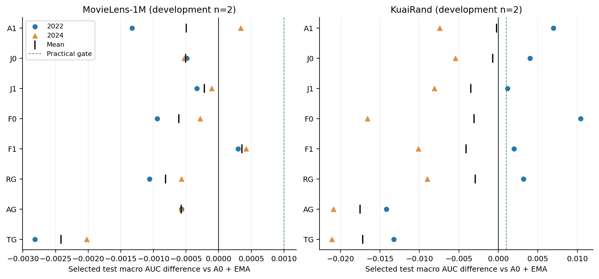
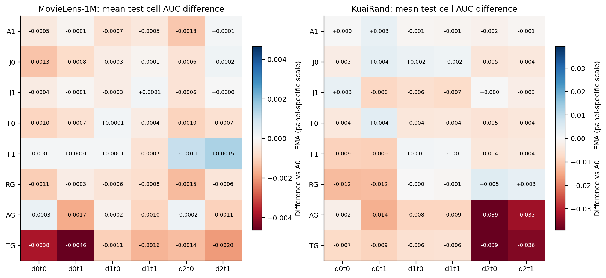
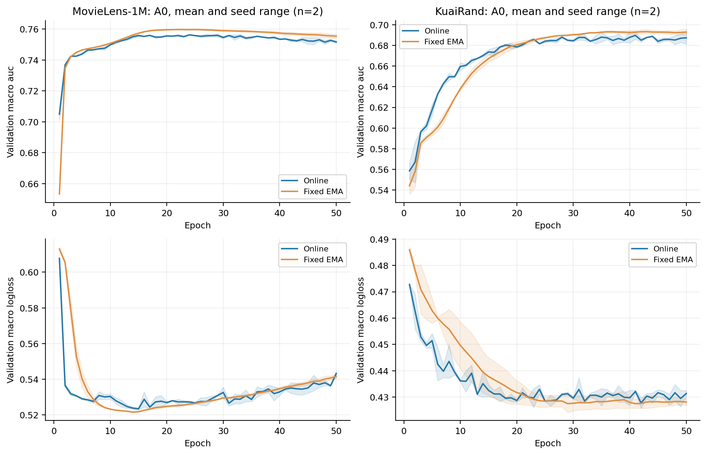

# EMA02V2：联合标签插值、教师约束字段增强与任务双视图实验报告

**完成日期：2026-11-02。36/36 条正式轨迹均完成 50 epoch，统一 test 的 144/144 个端点完成；训练和评价无失败、无重试。最终研究决定：停止当前新增视图候选，保留 A0＋固定 EMA。**

本轮没有方法达到预注册的验证推进门。MovieLens 的 F1 在测试上有小幅一致正信号：相对 A0＋EMA 的 macro AUC 两 seed 分别为 +0.000298657、+0.000418438，均值 +0.000358547；验证均值为 −0.000424325，且测试幅度低于 0.001 实用门。KuaiRand 的所有增强臂测试 macro AUC 均值均低于 A0；TG/AG 的 AUC、LogLoss 和目标域表现同时退化。测试结果保留了这些差异，阶段决定保持冻结。

本轮科学重复为开发 seed **2022、2024，n=2**。确认 seed2023/2025/2026 与 W1 额外窗口均未触发。新视图稳定增量的证据强度为 **WEAK**；当前 TG/AG 配置在 KuaiRand 的明显退化具有 **MEDIUM** 强度。适用范围为当前 fixed1 骨干、自然原行序划分和固定参数；全部逐 seed、六格与端点数值随报告提供。

## 1. 问题、来源与实现

研究问题是：改变增强视图的构造，能否超过无增强＋固定 EMA，并超过相应简单视图控制。EMA 作为已有强基线计，不将其收益记为新视图增量。优化器保持普通单 Adam；参数 EMA 与 Adam 一阶矩分别记录。

方案来自 [26-11-2_v2](../../research_plans/26-11-2_v2/06_Codex完整执行提示词.md)，完整公式、停止门和接口见 [DESIGN](DESIGN_SPECIFICATION.md)。GATS 来源为 `e59efa2fd954c4d2231b679a742406cfbe2a1077`；原始 main 为 `fb74c40cad9c22ce3abdfb8348da7e98d726a61a`。21 份所需 vendor 源文件按原字节保留，59 份本地来源代码/报告与固定 Git blob 相同。实际正式执行代码提交为 **`e3ca50380fff0535d16b73888cc6e462391021ca`**，40 文件 manifest SHA256 为 **`f2658c2163902e6e69d0ea562b0aded9ba0c635477c19edb140d6353bcb15e82`**，远端 40/40 blob 与本地相符。详见 [SOURCE_RECEIPT](SOURCE_RECEIPT.json)、[执行身份](EXECUTION_IDENTITY.json)、[远端核验](REMOTE_EXECUTION_VERIFICATION.json)。

设计、两个独立实现分工、另一审查者、机械 runner、协调者分析依次完成。初始独立审查为 [PASS WITH FIXES](REVIEW_REPORT.md)，阻塞修正为成本准入与完整评价成本记账；10 组 CPU 检查通过。后续仅对 FP64 小矩阵 SVD 的计算设备作 [设计补充](DESIGN_ADDENDUM_SVD_PLACEMENT.md)，经 [独立 PASS](SVD_REVIEW_REPORT.md) 和两数据集 F1 全 batch Stage0 通过后开始正式训练。

| 臂 | 视图与控制含义 |
|---|---|
| A0 | 无增强真实 BCE，固定 EMA 非反馈 |
| A1 | 来源 Gaussian，逐字段 RMS 缩放，目标域一个视图 |
| J0 | 同域、完整双任务标签相同的两个供体，等半径后随机择一 |
| J1 | 相同供体和半径，用两任务归一化输入响应的最小值择向 |
| F0 | 无教师约束的监督字段增益梯度视图 |
| F1 | 旧 EMA 两个 raw-logit 响应的联合零空间内择监督方向；必要时随机回退 |
| RG | 两个等半径随机视图，每个视图只计对应任务 |
| AG | 两任务梯度相加形成一个共享视图 |
| TG | 两任务各自形成输入梯度视图，每个视图只计对应任务 |

真实训练保留原 gate 的 `emb.detach()`；只读 probe 冻结参数，移除该输入断图，返回真实 tower raw logits。最终扰动整体 detach，训练使用 `h+δ`。J 的 donor 不接收监督梯度；F 教师只用于输入响应和固定 EMA 更新。F1 的同一 EMA 同时反馈视图并参与平均模型评价，因此该轨迹的 EMA−online 差描述估计器差异，教师反馈效用由与 F0 等独立轨迹的比较评估。

实际原 batch 大小为 B，目标域为 S，单视图目标为：

\[
L=\frac{\sum_{i,t}\ell_{it}+0.5\sum_{i\in S,t}(\widetilde\ell_{it}-\ell_{it})}{2B}.
\]

尾批按实际 B；TG/RG 两视图分别只贡献各自任务。一次监督 backward、一次标准 Adam.step、随后一次固定 EMA；coupled decay 只进入 Adam，保留 None/显式零及参数 step 语义。增强构造只读 train 信息。

## 2. 数据、配置和完成范围

自然 CSV 按全局原行号 80/10/10 划分；KR 先切分再筛 tab0/1/4。只有 train 拟合编码器/scaler，OOV=0。raw、六数组、行号、encoder/scaler 与固定来源一致；没有改变自然人口、标签或采样比例。原行号划分不含已核实的时间外推含义；该 test 在历史研究中使用过。

| 数据 | train d0/d1/d2 | validation/test | 增强目标 | 参数量 | 每 epoch step | κ / rho / coupled wd |
|---|---|---|---|---:|---:|---|
| MovieLens-1M | 155949 / 318599 / 325619 | 各100021 | d0 | 773470 | 20 | .05 / .9828205985452511 / 1e−4 |
| KuaiRand | 172782 / 1743898 / 89452 | 各250767 | d2 | 1614254 | 49 | .1 / .995 / 1e−5 |

fixed1：3域×2任务、4共享专家、embedding16、fcn_dims=[512,256,256,64]、固定融合1，无 learned fusion/AutoML/DARTS/DBO；batch40960，50 epoch，FP32，AMP/TF32关闭，无早停。Adam lr=.01、betas=(.9,.999)、eps=1e−8、foreach/fused/amsgrad=False。Python3.13.5、PyTorch2.9.0+cu126，使用项目显式环境；两张 RTX3090 与外部作业共享。

ML 的 d0/d1/d2 分别对应 age∈{1,18}、age25、age∈{35,45,50,56}；KR 分别对应 tab0/tab1/tab4。

ML 的标签为 rating>3 / rating>4，训练联合标签01计数为0。KR 使用 is_click / long_view，d0/d1/d2 的01计数为0/696/77，供体按实际完整标签分组。各域四格计数与数据身份保存在 [Stage0](raw/STAGE0_REPORT.json) 的 data 字段。

| 阶段 | 正式轨迹 | 完成与决定 |
|---|---:|---|
| S1 | 24 | A0/A1/J0/J1/F0/F1 × 两数据 × 两开发seed，全部50epoch |
| S1R / S2M / S3M | 0 | F1不具备FR触发条件；主家族无边界校准信号，未启动主分支 |
| S2B | 12 | 全局锁为backup；TG/RG/AG全部50epoch |
| S4 / S5 | 0 | 所有候选及简单替代未达验证门，确认与W1未触发 |
| 统一 test | 144端点 | 全部36轨迹的online/EMA、selected/E50，均完成 |

合计 **1,800 正式 epoch、62,100 optimizer step、62,100 EMA update**。每种估计器独立按完整 validation 六格 macro AUC 严格提升选最早最佳，排除E0，另保留共同E50。主门要求对A0平均≥.001且2/2正，对A1/必要控制平均≥.0005且2/2正；逐格AUC及macro LL保护另行阻止晋级。完整阶段裁决见 [S1分析](S1_VALIDATION_ANALYSIS.md)、[S2B分析](S2B_VALIDATION_ANALYSIS.md)、[最终验证决定](FINAL_VALIDATION_DECISION.json)。

统一 test 前冻结所有配置、选点与模型 hash，[冻结清单](raw/selection_frozen.json) SHA256 为 `5df920da4d5af03824ed7c1a64674834110de0b89b8e954c393688ef122dce0c`。随后144端点全部得到真实输入指标，预算内完成，最后释放RAM状态并关闭guardian。

## 3. 总体结果与逐 seed 数值

主口径为 fixed EMA 的 validation-selected test；AUC越高越好，LogLoss越低越好。macro为六格等权，traffic为按评估域人口加权的格指标，pooled先跨域合并预测后分任务计算。n为seed，以下±为sample SD。

| 数据 | 臂 | test macro AUC | test macro LL | 对A0 ΔAUC（正seed） | 对A0 ΔLL |
| --- | --- | --- | --- | --- | --- |
| ML | A0 | 0.779308 ± 0.000326 | 0.494996 ± 0.000076 | — | — |
| ML | A1 | 0.778812 ± 0.000852 | 0.495236 ± 0.000635 | -0.000496 (1/2) | +0.000240 |
| ML | J0 | 0.778801 ± 0.000356 | 0.496094 ± 0.001308 | -0.000507 (0/2) | +0.001098 |
| ML | J1 | 0.779088 ± 0.000167 | 0.494527 ± 0.000081 | -0.000220 (0/2) | -0.000469 |
| ML | F0 | 0.778697 ± 0.000140 | 0.493081 ± 0.000025 | -0.000611 (0/2) | -0.001915 |
| ML | F1 | 0.779667 ± 0.000241 | 0.494895 ± 0.004755 | +0.000359 (2/2) | -0.000101 |
| ML | RG | 0.778495 ± 0.000022 | 0.494023 ± 0.001820 | -0.000813 (0/2) | -0.000973 |
| ML | AG | 0.778736 ± 0.000330 | 0.491193 ± 0.002096 | -0.000572 (0/2) | -0.003804 |
| ML | TG | 0.776890 ± 0.000236 | 0.490176 ± 0.000418 | -0.002418 (0/2) | -0.004820 |
| KR | A0 | 0.679172 ± 0.008061 | 0.435353 ± 0.001205 | — | — |
| KR | A1 | 0.678944 ± 0.002125 | 0.435624 ± 0.000588 | -0.000227 (1/2) | +0.000271 |
| KR | J0 | 0.678465 ± 0.001362 | 0.436306 ± 0.001143 | -0.000707 (1/2) | +0.000953 |
| KR | J1 | 0.675689 ± 0.001511 | 0.435808 ± 0.001273 | -0.003483 (1/2) | +0.000456 |
| KR | F0 | 0.676093 ± 0.011053 | 0.433862 ± 0.000280 | -0.003078 (1/2) | -0.001491 |
| KR | F1 | 0.675096 ± 0.000501 | 0.433447 ± 0.001426 | -0.004076 (1/2) | -0.001906 |
| KR | RG | 0.676259 ± 0.000578 | 0.434398 ± 0.002297 | -0.002913 (1/2) | -0.000954 |
| KR | AG | 0.661637 ± 0.003325 | 0.447718 ± 0.002769 | -0.017534 (0/2) | +0.012365 |
| KR | TG | 0.661998 ± 0.002514 | 0.447871 ± 0.002467 | -0.017174 (0/2) | +0.012519 |



图中每个点是一个seed，竖杠是均值，虚线为+.001实用门。selected、E50、online、EMA的全部原值见 [test_metrics.csv](tables/test_metrics.csv)；验证值见 [validation_metrics.csv](tables/validation_metrics.csv)。以下为两个seed的selected epoch与测试绝对值：

| 数据 | 臂 | 2022 epoch | 2022 AUC | 2022 LL | 2024 epoch | 2024 AUC | 2024 LL |
| --- | --- | --- | --- | --- | --- | --- | --- |
| ML | A0 | 26 | 0.779538428 | 0.494942234 | 20 | 0.779077615 | 0.495050014 |
| ML | A1 | 20 | 0.778209364 | 0.495685096 | 22 | 0.779414199 | 0.494786558 |
| ML | J0 | 23 | 0.779052987 | 0.497018796 | 20 | 0.778549918 | 0.495169625 |
| ML | J1 | 23 | 0.779206358 | 0.494469232 | 20 | 0.778969660 | 0.494584254 |
| ML | F0 | 20 | 0.778597832 | 0.493099103 | 20 | 0.778795400 | 0.493063613 |
| ML | F1 | 27 | 0.779837085 | 0.498257587 | 25 | 0.779496053 | 0.491532431 |
| ML | RG | 20 | 0.778478958 | 0.495309528 | 20 | 0.778510342 | 0.492735960 |
| ML | AG | 26 | 0.778969319 | 0.489710329 | 39 | 0.778502102 | 0.492674885 |
| ML | TG | 23 | 0.776722837 | 0.489880694 | 20 | 0.777056987 | 0.490472046 |
| KR | A0 | 33 | 0.673472090 | 0.436204447 | 50 | 0.684871430 | 0.434500840 |
| KR | A1 | 33 | 0.680447251 | 0.436039371 | 39 | 0.677441605 | 0.435207756 |
| KR | J0 | 44 | 0.677501829 | 0.437113723 | 44 | 0.679427994 | 0.435497768 |
| KR | J1 | 23 | 0.674620877 | 0.436708450 | 40 | 0.676757260 | 0.434908442 |
| KR | F0 | 32 | 0.683909090 | 0.434059540 | 28 | 0.668277666 | 0.433664193 |
| KR | F1 | 50 | 0.675449946 | 0.434455417 | 36 | 0.674741403 | 0.432438200 |
| KR | RG | 50 | 0.676667231 | 0.436022910 | 35 | 0.675850105 | 0.432773926 |
| KR | AG | 26 | 0.659286291 | 0.449675553 | 28 | 0.663988673 | 0.445759866 |
| KR | TG | 30 | 0.660220014 | 0.449615287 | 29 | 0.663775715 | 0.446127042 |

关键配对差及未校正 df=1 的 t95% 区间如下。完整逐格AUC/LL、SD、区间与正向数见 [配对数表](tables/paired_effects.csv.gz)。开发筛选使用n=2；任务、epoch、视图和端点均不增加n。

| 数据 | 对照 | 2022 ΔAUC | 2024 ΔAUC | 配对mean | sample SD | t95% CI | 正seed |
| --- | --- | --- | --- | --- | --- | --- | --- |
| ML | J1−A0 | -0.000332070 | -0.000107955 | -0.000220012 | 0.000158473 | [-0.001644, +0.001204] | 0/2 |
| ML | J1−J0 | +0.000153371 | +0.000419742 | +0.000286557 | 0.000188353 | [-0.001406, +0.001979] | 2/2 |
| ML | F1−A0 | +0.000298657 | +0.000418438 | +0.000358547 | 0.000084698 | [-0.000402, +0.001120] | 2/2 |
| ML | F1−F0 | +0.001239254 | +0.000700653 | +0.000969953 | 0.000380848 | [-0.002452, +0.004392] | 2/2 |
| ML | TG−A0 | -0.002815591 | -0.002020628 | -0.002418109 | 0.000562124 | [-0.007469, +0.002632] | 0/2 |
| ML | TG−RG | -0.001756120 | -0.001453355 | -0.001604738 | 0.000214087 | [-0.003528, +0.000319] | 0/2 |
| KR | J1−A0 | +0.001148787 | -0.008114170 | -0.003482691 | 0.006549900 | [-0.062331, +0.055366] | 1/2 |
| KR | J1−J0 | -0.002880952 | -0.002670734 | -0.002775843 | 0.000148647 | [-0.004111, -0.001440] | 0/2 |
| KR | F1−A0 | +0.001977856 | -0.010130028 | -0.004076086 | 0.008561566 | [-0.080999, +0.072847] | 1/2 |
| KR | F1−F0 | -0.008459144 | +0.006463736 | -0.000997704 | 0.010552070 | [-0.095804, +0.093809] | 1/2 |
| KR | TG−A0 | -0.013252076 | -0.021095716 | -0.017173896 | 0.005546291 | [-0.067005, +0.032658] | 0/2 |
| KR | TG−RG | -0.016447217 | -0.012074390 | -0.014260803 | 0.003092055 | [-0.042042, +0.013520] | 0/2 |

**J1：停止当前max-min择向候选。** ML验证对A0仅+.000102，测试−.000220，两个测试seed均负；相对J0的测试小幅+.000287、2/2正，低于新增模块门。KR相对J0从验证均值+.000925、1/2正，转为测试−.002776、0/2正；相对A0测试−.003483、1/2正。择向的稳定实用价值未建立，证据 **WEAK**。

**F1：保留ML的小测试信号，停止本轮晋级。** ML相对F0测试+.000970、2/2正；相对A0仅+.000359、2/2正，CI[−.000402,+.001120]，与验证对A0两seed均负形成反例。KR相对A0测试−.004076、1/2正，相对F0−.000998、1/2正。当前数据支持ML约束包对F0部分损害的缓解，稳定强基线增量证据 **WEAK**。FR/F_PR没有触发，能量与教师子空间的进一步归因留空。

**TG/AG：停止当前梯度视图配置。** ML TG相对RG测试−.001605、0/2正，相对AG−.001846、0/2正。KR TG相对RG−.014261、0/2正，相对AG+.000360、1/2正；TG/AG相对A0的测试AUC均值分别−.017174/−.017534，macro LL分别+.012519/+.012365，两seed均恶化。该配置内的明显下降证据为 **MEDIUM**。两个任务方向不同没有带来任务条件双视图的效用。

**简单控制：保留A0＋EMA。** J0/RG在KR的测试方向分裂；RG相对A1的开发两seed正增益没有形成对A0的稳定优势。A1本身也未在两数据集建立强基线增量，较弱增强控制上的胜利不足以推进新方法。

## 4. 域任务、规模、难度与效用交换

下表为 selected test 两seed均值。基线列为A0＋EMA，其他列为其差；表中训练规模来自自然train。

| 数据 | cell | train域N | A0 AUC / LL | J1 ΔAUC | F1 ΔAUC | TG ΔAUC | test N/正例 |
| --- | --- | --- | --- | --- | --- | --- | --- |
| ML | d0t0 | 155949 | 0.774743 / 0.584929 | -0.000374 | +0.000073 | -0.003793 | 27687/14281 |
| ML | d0t1 | 155949 | 0.789599 / 0.405250 | -0.000099 | +0.000105 | -0.004632 | 27687/4964 |
| ML | d1t0 | 318599 | 0.782404 / 0.573633 | -0.000345 | +0.000092 | -0.001118 | 41434/22072 |
| ML | d1t1 | 318599 | 0.800817 / 0.388432 | +0.000130 | -0.000672 | -0.001579 | 41434/7031 |
| ML | d2t0 | 325619 | 0.757187 / 0.580154 | -0.000631 | +0.001080 | -0.001415 | 30900/18099 |
| ML | d2t1 | 325619 | 0.771098 / 0.437580 | +0.000001 | +0.001473 | -0.001972 | 30900/6324 |
| KR | d0t0 | 172782 | 0.640627 / 0.288398 | +0.002950 | -0.008951 | -0.007464 | 2613/228 |
| KR | d0t1 | 172782 | 0.660977 / 0.179542 | -0.007966 | -0.009256 | -0.008596 | 2613/120 |
| KR | d1t0 | 1743898 | 0.704018 / 0.504487 | -0.006231 | +0.001210 | -0.005839 | 246284/51847 |
| KR | d1t1 | 1743898 | 0.732405 / 0.345373 | -0.007294 | +0.000897 | -0.005691 | 246284/27415 |
| KR | d2t0 | 89452 | 0.656823 / 0.649734 | +0.000148 | -0.004413 | -0.039160 | 1870/1100 |
| KR | d2t1 | 89452 | 0.680181 / 0.644583 | -0.002503 | -0.003943 | -0.036295 | 1870/827 |



完整六格LL及逐seed数值在原始指标CSV，全部方法的格均值/差和正向数在 [cell_effects.csv](tables/cell_effects.csv)。[minimum_cell_gains.csv](tables/minimum_cell_gains.csv) 同时保留每seed的 `min_cell(candidate−A0)` 与两个worst值的差，二者分列。

**规模不是当前已识别的主解释变量（WEAK）。** ML最大训练域d2的基线AUC低于小域d0；KR最难基线域d0比最小域d2更大。KR d0t1 test只有120正例，而d1占test约98.21%，基率、评估支持量与训练规模分别影响指标及波动。跨数据集还改变标签、字段数、κ、每epoch步数和EMA的epoch等价窗口。

**没有统一的小域改善／大域下降模式。** ML F1的主要正差来自最大域d2，目标小域只接近持平；KR F1在最大域d1均值略正，却在目标小域d2两个任务均下降。KR RG确有目标小域收益，但另一个小域d0下降更大，最大域接近持平。TG/AG在KR同时伤害目标域与最大域，属于广泛退化。以上具体格现象见原值，整体规模决定论证据 **WEAK**。

KR F1的pooled/traffic AUC均值约+.001199/+.000908，而macro为−.004076；这反映最大域与稀有域的交换。J1的KR最大域两任务测试下降约.006231/.007294，且两seed均负。TG/AG的目标域任务下降达到约.033–.039，不能由macro平均掩盖。

KR J1 的平均worst-cell AUC差为+.003338，但两个seed的最小配对cell差分别为−.011039、−.034804。worst格身份的变化与某个固定域任务受损可同时发生，需用逐格配对差判断保护。

按任务三域等权：ML F1的task0/task1 AUC均值差约+.000415/+.000302；KR为−.004051/−.004101。ML TG为−.002109/−.002728，KR为−.017487/−.016861。TG下降涉及两个任务；ML TG的两个任务LL却均改善，排序与概率风险分开变化。

## 5. 训练阶段、选点与EMA

A0同轨迹EMA−online的selected test AUC均值为ML+.003692（2/2正）、KR+.002366（1/2正）；共同E50为ML+.006151、KR+.005279，均2/2正。历史同seed的重复结果不追加统计n。当前ML排序支持较一致，KR selected与E50有阶段差异；本轮证据为 **WEAK**，历史EMA证据用于强基线定位。

| 数据 | epoch | online val AUC | EMA val AUC | EMA−online | online val LL | EMA val LL |
| --- | --- | --- | --- | --- | --- | --- |
| ML | 10 | 0.749753 | 0.750744 | +0.000990 | 0.530364 | 0.523227 |
| ML | 50 | 0.751644 | 0.755388 | +0.003744 | 0.543179 | 0.541472 |
| KR | 10 | 0.659634 | 0.638007 | -0.021627 | 0.436181 | 0.449653 |
| KR | 50 | 0.687435 | 0.693038 | +0.005603 | 0.431371 | 0.428127 |



图中线为两seed均值、阴影为seed范围。KR E10的EMA相对online AUC约−.021627，E50转为+.005603；早期滞后与后期收益并存。ML selected EMA的test LL两seed一升一降，不能将排序提升直接当成稳定校准改善。

共同E50也改变增强判断：ML TG相对A0的test AUC为+.000376、2/2正，LL−.008930，而selected AUC为−.002418、2/2负；J1的ML E50 AUC均值+.000660但方向分裂。F1的ML小正差在selected与E50均约+.00035，幅度仍小。KR E50的F1/J1/TG AUC差分别−.005312/−.009401/−.048930，均0/2正。选点与训练阶段解释部分差异，不能单独解释KR的持续损害。所有端点保留，阶段门以预注册selected验证为准。

## 6. 机制证据、矛盾与竞争解释

J0/J1四组共6,900个配对step的供体身份hash全部相同；ML供体覆盖100%，KR约99.9815%，双供体率约99.9545%。候选同一当前模型内等能量，已分离轨迹的实际RMS略有差异。供体稀缺不足以解释KR损害。

F1全训练的随机回退率为ML约0.1021%–0.1025%、KR约0.0412%–0.0434%，教师Jacobian秩均为2；平均投影保留比ML .256–.270、KR .422–.432，FP64归一化约束残差最大约9.61e−14。诊断步有限教师logit平均绝对变化为ML .00161–.00177、KR .01386–.01469。一阶约束成立与有限响应、泛化效用分别记录；长期零扰动的解释与日志不符。

TG两任务输入方向的平均cosine约为ML .297–.300、KR .076–.083，AG对应约ML .300–.305、KR .062。TG/RG/AG的有效视图覆盖率为100%。方向差异确实存在，当前双视图仍不胜共享或随机控制。所有量由既有标量日志汇总，见 [diagnostics_by_run.csv](tables/diagnostics_by_run.csv) 和 [供体配对记录](tables/donor_pairing.json)。

稳定现象与矛盾按以下层次解释：

- **MEDIUM：** 当前TG/AG在KR的AUC、LL、目标域及共同E50同时退化，普通随机控制更好；优先停止该配置。
- **WEAK：** F1在ML相对F0缓解损害，测试对A0有微小正差，但验证相反、无确认；J1在ML相对J0的小差也不足实用门。
- **WEAK：** KR强seed反转、稀有格支持量有限，macro与traffic/pooled方向可不同；不能用单个正seed选择方法。
- **WEAK：** 域规模单独解释不了跨域与跨方法的效应；基线可预测性、标签语义、干预对象及自然人口漂移共同存在。

竞争解释包括：梯度视图的局部升loss方向未保持泛化标签语义；教师约束主要减轻部分有害方向/实际能量；共享参数使目标域干预传到未增强域；BCE风险、排序和checkpoint阶段不同；ML F1小信号由窗口特化或seed波动产生。当前证据能排除“候选一直没有实际扰动”及“完全由供体缺失导致”，尚未区分前述机制贡献。

最有判别力的后续问题是ML F1的弱测试信号能否迁移到一个预先固定的自然窗口。若下一轮注册该问题，应冻结当前κ/λ/rho，对A0/F0/F1作配对自然窗口比较，沿用selected与E50，并以对A0≥.001且胜简单对照为反证门；不通过即停止，不再以测试调κ。当前S4未触发，本轮到此关闭，未追加该实验。

## 7. 成本、实现修订与复现

| 臂 | ML mean worker秒 | KR mean worker秒 | 每步监督F / 学生probeF / 教师F / 输入梯度遍历 |
| --- | --- | --- | --- |
| A0 | 211.490 | 947.707 | 1 / 0 / 0 / 0 |
| A1 | 503.982 | 1021.702 | 2 / 0 / 0 / 0 |
| J0 | 530.686 | 1208.254 | 2 / 0 / 0 / 0 |
| J1 | 553.948 | 1003.576 | 2 / 1 / 0 / 2 |
| F0 | 507.775 | 1055.581 | 2 / 1 / 0 / 1 |
| F1 | 235.936 | 1484.422 | 2 / 1 / 1 / 3 |
| RG | 799.248 | 1761.768 | 3 / 0 / 0 / 0 |
| AG | 661.779 | 1566.183 | 2 / 1 / 0 / 2 |
| TG | 767.299 | 1715.467 | 3 / 1 / 0 / 2 |

累计物理成本 **33,521.086秒**，上限 **39,024.452秒**。其中Stage0/SVD校准353.442秒，36条正式训练33,074.314秒，最终评价93.330秒。训练共18,000个validation batch forward、631,418,400验证行曝光和245,401,000额外视图行曝光；曝光不增加独立seed数。

worker秒是各进程墙钟之和，包含数据/初始化、训练、验证和RAM IPC。外部GPU负载、卡分配和并发在任务间变化，操作计数与实测秒数并列；这些运行秒数不用于宣称受控的算法速度倍率。设备门按每张卡当前显存和功耗85%分别判断，保留原batch/精度/epoch；外部任务未终止。

唯一性能修订发生在正式训练前：初始CUDA Stage0的KR F1每步14.49–18.02秒。对同一真实1843×2×33 Jacobian，CUDA FP64 SVD为2.6933秒，CPU含传输为.0058秒；秩、回退、cap和最终FP32 δ相同，投影误差最大2.22e−15。只将SVD固定移到CPU，原公式、阈值、随机流和优化器保持。原始/新Stage0、校准成本、设计/实现/审查记录均保留；没有丢弃正式科研轨迹。细节见 [CODER_SVD_REPORT](CODER_SVD_REPORT.md) 与 [SVD_MICROCHECK](SVD_MICROCHECK.json)。

模型、Adam、EMA、RNG、loader与selected状态均通过RAM guardian/BytesIO IPC保留；磁盘保留标量数据、日志、hash、代码和报告。每epoch接收后ACK，所需端点持久化后释放状态，guardian已干净关闭。训练权重与恢复状态未落盘；复现从原CSV及固定种子重新训练。

复现环境和原数据：

```text
Python: /home_new/xzf/envs/miniconda3/envs/phase0-3-env/bin/python
ML CSV: /home_new/xzf/datasets/ml-1m/ml-1m.csv
  SHA256 f060ecb8fb7745f1e24998837ca5a1ec3e18b610f288e73549c0203a9822b5e4
KR CSV: /home_new/xzf/datasets/kuairand/processed/kuai_rand.csv
  SHA256 a1872911e49cb9324a89faf84df1dbed2077357496edd760ba0ab7b8f4fc681f
```

从仓库根运行新包CLI，先核对数据身份、source manifest与review receipt，再按本轮冻结派发文件运行。准确参数和命令在 [RUNNER_REPORT](RUNNER_REPORT.md)、原始 invocation、[批准S1](raw/APPROVED_S1_DISPATCH.json) 与 [批准S2B](raw/APPROVED_S2B_DISPATCH.json)。三份分析脚本 `build_tables.py`、`summarize_diagnostics.py`、`make_figures.py` 从标量记录生成本报告数表和PNG/PDF。

本轮最简单可保留方案为 **A0＋固定EMA**。新增J/F/TG视图及简单替代均停止；ML F1小正信号、ML排序/LL反向和KR各域交换作为后续证据保留，确认范围未扩展到留出seed、W1或其他骨干。

## 8. 交付记录

[完整标量原始记录归档](RAW_SCALAR_RECORDS.tar.xz) 包含2,254份配置、每batch/epoch日志、决策、成本、模型hash和评价文件；SHA256为 `a9734b9b335433aa72b85fa2e83b0a1bef1c79ec5b1c128308696ebbc9d82bc9`，见 [归档收据](RAW_ARCHIVE_RECEIPT.json)。解压命令为 `tar -xJf RAW_SCALAR_RECORDS.tar.xz`。常用冻结、Stage0、派发和数据身份另可直接从 [raw](raw/) 读取。

图表同时提供可导出的PDF：[逐seed差](figures/selected_seed_effects.pdf)、[六格差](figures/cell_effects.pdf)、[训练阶段](figures/baseline_training_stages.pdf)。[README](README.md) 汇总源码、审查、完整数表与执行入口。
