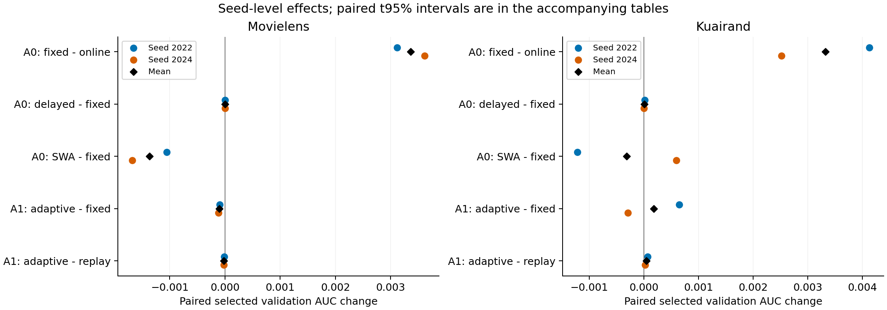

# A1与C2：增强参考及自适应时间信号

A0/A1共8条唯一轨迹已完成；A1的4条轨迹各有完整50 epoch首遍及50 epoch独立rho回放。开发seed为2022/2024。以下只分析validation，各估计器独立选epoch；全部48个A1 selected/E10/E50端点、域任务AUC/LogLoss、人口和checkpoint身份在 [原值CSV](a1_c2_validation_endpoints.csv)，逐seed差、全部指标和df1配对95%区间在 [原始阶段裁决](A1_C2_VALIDATION_DECISION.json)。可用 `analyze_a_group.py --run-dir <attempt>` 从原始状态身份JSON复算。

| 数据 | 比较 | ΔAUC：2022 / 2024 | mean ΔAUC | mean ΔLogLoss | AUC正向 |
|---|---|---|---:|---:|---:|
| ML | A1固定EMA−A0固定EMA | −.000375538 / +.000083848 | −.000145845 | +.000114526 | 1/2 |
| KR | A1固定EMA−A0固定EMA | −.002924620 / +.000704537 | −.001110041 | −.001473133 | 1/2 |
| ML | adaptive−固定EMA | −.000091966 / −.000115797 | −.000103882 | −.000201649 | 0/2 |
| KR | adaptive−固定EMA | +.000650363 / −.000290769 | +.000179797 | −.000562134 | 1/2 |
| ML | adaptive−replay | −.000013391 / −.000022599 | −.000017995 | +.000533938 | 0/2 |
| KR | adaptive−replay | +.000068440 / +.000022818 | +.000045629 | −.000079706 | 2/2 |

普通增强没有建立超过A0固定EMA的开发排序增量，仍保留为新规则的直接对照。KR的A1 LogLoss两seed改善，但pooled/traffic AUC两seed均下降，均值分别−.001064580/−.001221061；最大域d1两任务AUC均2/2下降，均值−.001135651/−.001304973。目标小域d2的任务0均值+.001820863、任务1−.001721080，均只有1/2正向；当前validation没有统一的小域获益模式。ML最大域d2的两个任务也略降，最差cell均值−.000330741。

C2在两数据集都未过相对固定EMA的实用门。ML排序两seed下降；KR方向相反。KR相对replay虽然2/2正向，均值+.000045629低于注册的.0005近似平局尺度和.001实用门；ML相对replay两seed下降。C2各AUC差的df1区间均跨0。当前“梯度CV时序提供独立收益”的证据为 **WEAK**，停止本公式晋级；没有据此取消B2/B1/B3。

rho确有变化：ML两个seed的逐step范围合计为[.969889,.984437]，各seed均值.975543/.974582；KR范围[.987921,.996664]，各seed均值.990216/.990604。它们通常比固定rho的记忆更短。Replay保持各自rho多重集合精确相同，online每step参数hash、最终Adam/行序/视图一致后才计入比较。非零CV和动态rho验证实现行为，不能代替效用证据。

竞争解释包括平均记忆长度、时间日程、rho自相关和早期启动位置。全序列排列同时改变这些时间结构；A0的delayed/SWA与A1 adaptive来自不同online轨迹，也不能把跨轨迹差异全部归于平均规则。若后续研究保留该方向，最有区分力的控制是保持时间块与自相关结构的rho回放；本轮按固定队列继续，不新增该试验。
