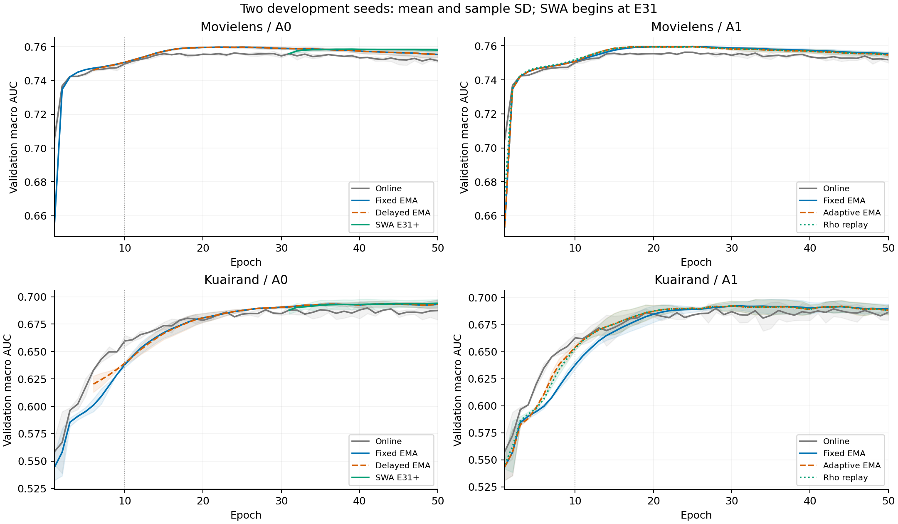

# A组：完整开发训练后的验证集分析

A0四条轨迹均完成50 epoch。开发seed为2022/2024，以下selected均由各估计器自己的validation六格macro AUC选定；本阶段没有test结果。全部域任务AUC/LogLoss、selected/E10/E50、模型/optimizer hash与epoch见 [44个有效端点原值](a_group_validation_endpoints.csv)，[逐seed配对](a_group_validation_paired.csv)和[均值、sample SD、df1配对95%区间](a_group_validation_summary.csv)。SWA E10未形成，记N/A；selected时ML两个seed均为E39，即E31–39九个epoch末参数的平均，KR均为E50，即完整20点平均。

| 数据 | 比较 | mean ΔAUC | AUC正向seed | mean ΔLogLoss | 当前证据 |
|---|---|---:|---:|---:|---|
| MovieLens | 固定EMA−online | +.003364339 | 2/2 | −.003119646 | 当前validation排序改善；WEAK |
| KuaiRand | 固定EMA−online | +.003321644 | 2/2 | −.000572303 | 当前validation排序改善；WEAK |
| MovieLens | 延迟EMA−固定EMA | +.000000100 | 1/2 | +.000166802 | 未建立独立增量；WEAK |
| KuaiRand | 延迟EMA−固定EMA | +.000008573 | 1/2 | +.000027517 | 未建立独立增量；WEAK |
| MovieLens | SWA−固定EMA | −.001364696 | 0/2 | +.001541833 | 当前晚窗口不优于固定EMA；WEAK |
| KuaiRand | SWA−固定EMA | −.000311462 | 1/2 | −.000637034 | 排序方向分裂、损失两seed改善；WEAK |

稳定的开发现象是固定EMA两数据集均2/2提高selected AUC，延迟5 epoch对selected AUC影响很小。ML的SWA两seed低于固定EMA；KR的SWA一个seed提高、一个降低，LogLoss均下降，不能由平均AUC单独描述。两seed区间仍宽，全部原值与区间保留在CSV。

训练阶段存在明确反转：KR固定EMA相对online在E10的validation AUC均值为−.021627、0/2正向，LogLoss +.013472；E50则AUC +.005603、2/2正向，LogLoss −.003244。ML的E10/E50 AUC分别+.000990/+.003744，均2/2正向，LogLoss分别−.007137/−.001706。KR早期滞后不能替代完整训练结果，当前两个数据集也不支持相同的早期时间尺度表现。

晚窗口位置、累计窗口长度及各模型独立validation选点是竞争解释。ML固定EMA最佳epoch为26/20，而SWA从E31才开始，当前差异同时包含平均规则和训练阶段；不把它归因于等权平均的一般性质。延迟EMA到最佳epoch已有多轮更新，早期初始化的影响可能已经衰减。机制判别仍需观察后续A1 adaptive与同轨迹rho随机回放，A0窗口结果作为背景，不跨online轨迹归因。

研究决策：保留固定EMA参考，继续规定的A1/B1/B2/B3及条件控制。当前A组结果不触发新增平均窗口搜索。最终test在完整队列、候选和端点冻结后统一执行。
