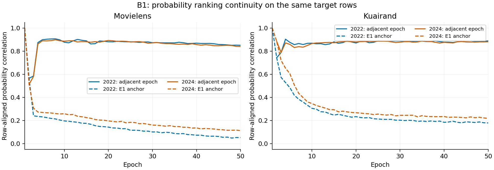

# B1：难度字段选择的完整开发分析

四条B1轨迹及各自50 epoch rho回放均完成。开发seed为2022/2024；全部48个selected/E10/E50端点、四种估计器、各域任务AUC/LogLoss及checkpoint身份见 [原值CSV](b1_validation_endpoints.csv)，原始配对、区间和门见 [B1_VALIDATION_DECISION.json](B1_VALIDATION_DECISION.json)。以下主比较均为B1固定EMA减A1固定EMA。

| 数据 | seed | selected epoch | B1 AUC | B1 LogLoss | ΔAUC | ΔLogLoss |
|---|---:|---:|---:|---:|---:|---:|
| ML | 2022 | 26 | .759634504 | .527474959 | −.000016425 | +.000981726 |
| ML | 2024 | 20 | .759733176 | .523628355 | −.000024156 | −.001894972 |
| KR | 2022 | 47 | .697860422 | .425568941 | +.008146882 | −.004631062 |
| KR | 2024 | 50 | .687968911 | .425524433 | −.008729137 | +.001309885 |

**当前结论：两数据集均不晋级，效用证据为WEAK。** ML平均ΔAUC−.000020291，0/2正；KR−.000291128，1/2正且两个差近乎抵消。ML/KR的ΔLogLoss均值为−.000456623/−.001660588，两个数据集都只有1/2改善。selected、E10和E50的结果须分别阅读：ML E50平均ΔAUC−.000342306、0/2正；KR E50平均+.002930490但仍1/2正。KR E10平均ΔLL+.009949555，E50为−.003591971；时间阶段改变损失表现，没有建立跨seed排序增量。没有使用E10或E50替换已冻结的validation选点规则。

局部权衡不能被macro概括。ML最差cell两seed改善，平均+.000721956；最大域d2两任务平均+.000838309/+.000721956，均2/2正，但d1两任务均2/2下降，目标d0两任务均值也下降。该worst-cell现象触发ML随机字段控制R1的后续判别，不满足整体排序门。

KR的最大域d1t0/d1t1分别+.003520260/+.004479574，均2/2正；pooled/traffic AUC+.003870681/+.003841012，也均2/2正。目标最小域d2t1平均+.014789033、2/2正，d2t0平均+.005445703、1/2正；另一个小域d0t0平均−.007326756、1/2正，d0t1平均−.022654581、0/2正。worst-cell两个差为+.017149697/−.020234136。这是流量指标改善与稀有域损害、seed反向并存的结果，不支持统一的小域获益或大域下降规律。KR未满足主门、探索门或稳定LL/worst-cell保留条件，注册队列不触发该数据集R1；其难度相对随机位置的独立价值仍未判别。

难度概率按真实row ID逐epoch对齐，200个NPZ文件各自覆盖该seed/epoch的全部目标域样本，见 [b1_probability_stability.csv](b1_probability_stability.csv)。以下相关系数描述同一训练seed内的概率排序变化，重复单位仍为seed。

| 数据 | seed | 相邻epoch Pearson中位数 | E1对E50 Pearson |
|---|---:|---:|---:|
| ML | 2022 | .874114 | .051953 |
| ML | 2024 | .874951 | .112248 |
| KR | 2022 | .881186 | .178783 |
| KR | 2024 | .879641 | .218494 |

概率均值约.5、四分位数约.275/.725来自batch内线性rank公式；分位数稳定不能证明难度长期稳定。相邻epoch排序高度相关，而早期与末期相关较弱，说明当前clean-loss相对次序随训练变化。这里同时包含参数漂移、batch组成和批内归一化，不将它解释为样本的固定内在难度。规则可运行、分数有动态及短期连续性，也没有替代AUC效用证据。

**机制边界与决策**：B1相对A1同时改变Gaussian的字段覆盖和实际扰动量；ML的R1将匹配每step/field的实测数量与总能量，检验规则是否超过均匀随机位置选择。该控制没有保持每个样本的字段数/能量异质性，若有增量，难度关联与异质分配仍是不同解释。B1/R1能量来自mask分支实测，普通Gaussian臂的能量未计量；不把原始占位0解释为无扰动，详见 [独立计量复核](DIAGNOSTIC_ACCOUNTING_REVIEW.md)。当前停止B1的整体晋级，不增加τ2搜索；继续B3与已注册匹配控制。规模、标签/任务语义、较低覆盖、训练时程和共享路径都是竞争解释，不能由“难样本低噪声”直接推出有效性。
