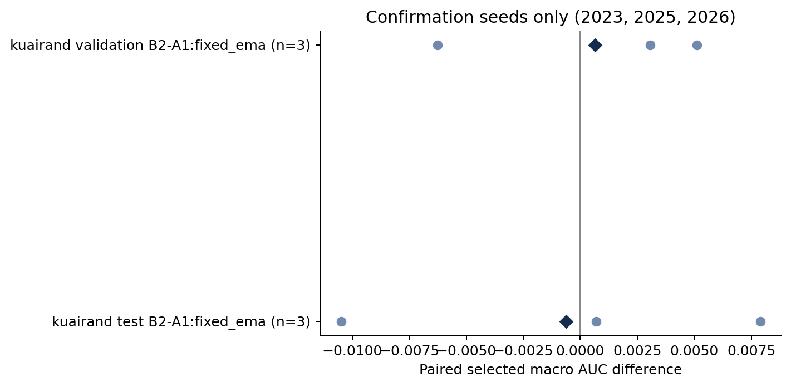
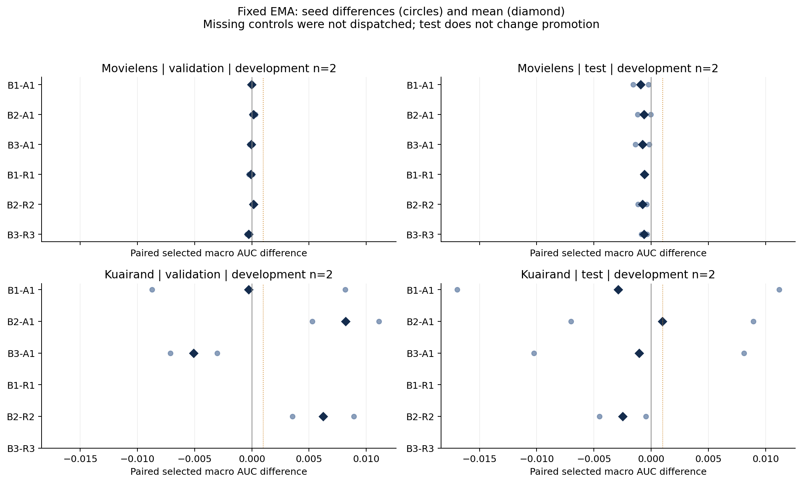
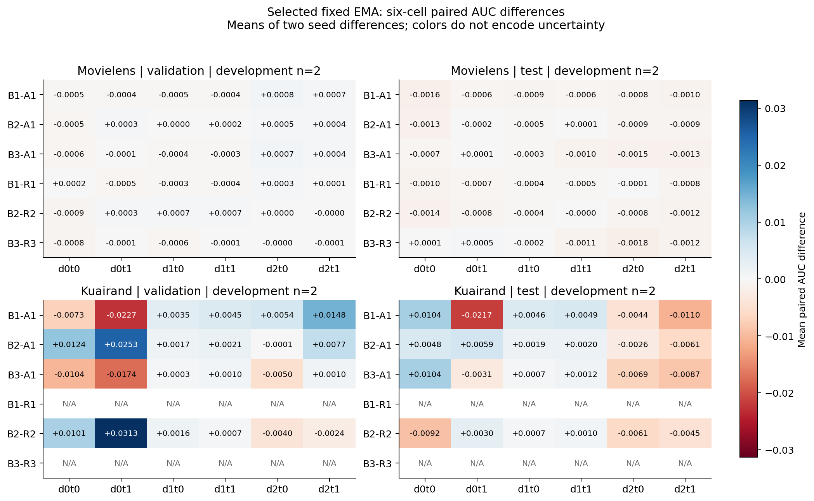
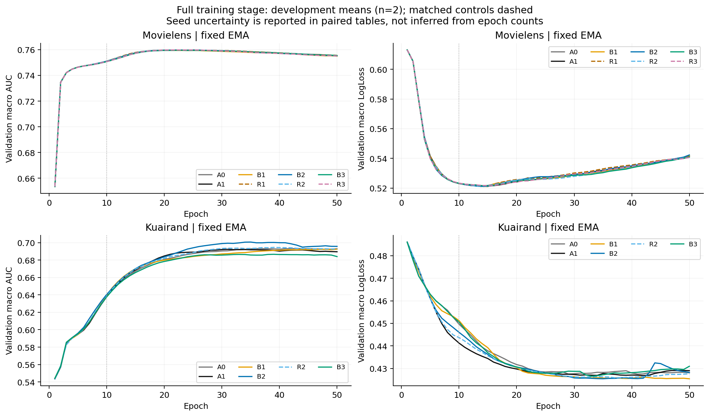

# GATS02：增强覆盖、任务投影与时间平均

> Main-branch report archive created 2026-11-08. Source branch: 26-11-02. Supporting CSV/JSON files, figures, execution artifacts and implementation files remain on the source branch; relative links below resolve there. No source code or raw training artifacts were copied. Sections outside the current research scope are omitted from this main-branch archive; source-branch originals are unchanged.

**状态：COMPLETE。31条新增科学轨迹全部完成50 epoch；统一test完成，RAM训练状态已释放。**

本轮没有得到稳健超过强固定EMA基线的新主候选。KuaiRand B2虽然通过开发门，但保留seed的验证macro增益缩小且最差格下降；测试相对A1的合并五seed macro AUC差仅+.000005156，相对R2的两个开发seed测试AUC均下降。停止把B2作为已确认的整体改进，保留明确的指标/域权衡作为研究现象；B1、B3与当前C2规则停止晋级。固定EMA继续作为基线，而非本轮创新。

## 研究合同与重复单位

问题是难度相关Gaussian覆盖B1、同任务差分投影B2、延迟增强B3及梯度范数CV驱动的时间平均C2，能否超过强固定EMA基线和必要匹配控制。固定EMA本身是已选强基线，不作为本轮创新。

自然原行序80/10/10；KR先全局划分再筛tab0/1/4，仅train拟合encoder/scaler，OOV=0。原CSV、六数组、行号、encoder/scaler均与冻结来源一致，未重采样、改标签或复制人口。完整数据/方法见 [METHODS](https://github.com/Caelestis1903/My-Research-Project/blob/26-11-02/research_reports/2026-11-02_gradient_aug_time_select/METHODS_AND_REPRODUCIBILITY.md) 与 [核验](https://github.com/Caelestis1903/My-Research-Project/blob/26-11-02/research_reports/2026-11-02_gradient_aug_time_select/DATA_VERIFICATION.json)。

| 数据 | train d0/d1/d2 | 增强目标 | 模型参数 | 每epoch更新 |
|---|---|---|---:|---:|
| MovieLens | 155949 / 318599 / 325619 | d0 | 773470 | 20 |
| KuaiRand | 172782 / 1743898 / 89452 | d2 | 1614254 | 49 |

模型为本仓库fixed1 MDMTRec/M3oE，3域×2任务、4共享专家、embedding16、固定融合系数1。ML任务rating>3/rating>4；KR任务click/long_view。ML的d0/d1/d2分别为ages1/18、age25、ages35/45/50/56；KR分别为tab0/tab1/tab4。标准Adam，lr=.01、betas=(.9,.999)、eps=1e−8，coupled wd ML1e−4/KR1e−5；batch40960、50epoch、FP32，AMP/TF32关闭。

A1的κ为ML.05/KR.1、λ=.5，target loss始终按原B×2归一化；B2逐任务先除原B、投影后只平均一次。固定rho为ML .9828205985452511、KR .995。全部配置、门和公式在 [DESIGN](https://github.com/Caelestis1903/My-Research-Project/blob/26-11-02/research_reports/2026-11-02_gradient_aug_time_select/DESIGN_SPECIFICATION.md) 中先行冻结。

开发seed2022/2024为n=2；确认seed2023/2025/2026为n=3，合并最多n=5。epoch、六格、训练步、行、shadow和重算均不增加n。每种估计器独立按validation六格macro AUC严格提升选择最早最佳epoch；保留selected/E10/E50，SWA E10为N/A。主门为两seed ΔAUC均正且mean≥.001，无LL/worst/最大域保护损害；匹配门mean≥.0005且两seed均正。区间为配对seed的t95%，未作多重比较修正；它描述固定数据划分下的训练seed变化，不覆盖数据划分或人群变化的不确定性。

## 开发主比较与匹配控制

Δ为候选−参考；AUC越高越好、LogLoss越低越好。下表均为固定EMA各自validation-selected端点。

| 数据/候选−A1 | mean ΔAUC | 正向seed | mean ΔLogLoss | 开发主门 |
|---|---:|---:|---:|---|
| ML B1 | −.000020291 | 0/2 | −.000456623 | 未过 |
| ML B2 | +.000145433 | 1/2 | +.000417972 | 未过 |
| ML B3 | −.000057887 | 1/2 | −.000873503 | 未过 |
| KR B1 | −.000291128 | 1/2 | −.001660588 | 未过 |
| KR B2 | +.008183500 | 2/2 | −.001695087 | 通过 |
| KR B3 | −.005078048 | 0/2 | +.000623546 | 未过 |

| 匹配比较 | 2022 ΔAUC | 2024 ΔAUC | mean ΔAUC | 配对t95%区间 | mean ΔLL | 匹配门 |
|---|---:|---:|---:|---|---:|---|
| ML B1−R1 | −.000248957 | +.000055946 | −.000096506 | [−.002033586,+.001840575] | −.000543656 | 未过 |
| ML B2−R2 | +.000221447 | +.000035397 | +.000128422 | [−.001053571,+.001310415] | +.000615500 | 未过 |
| KR B2−R2 | +.008904978 | +.003558130 | +.006231554 | [−.027737515,+.040200622] | +.000059047 | 通过 |
| ML B3−R3 | −.000147573 | −.000400831 | −.000274202 | [−.001883171,+.001334767] | −.001279782 | 未过 |

完整样本SD、逐seed原值、全部域任务与端点在 `tables/paired_effects.csv`、`effect_summary.csv`、`validation_metrics.csv`；阶段解释见 [匹配控制分析](https://github.com/Caelestis1903/My-Research-Project/blob/26-11-02/research_reports/2026-11-02_gradient_aug_time_select/CONTROL_VALIDATION_ANALYSIS.md)。这些开发效用与归因证据均为 **WEAK**：n=2，KR大增益仍有宽区间。注册门是执行规则，不是统计确认已经成功的声明。

**B1开发验证结论**：ML没有相对A1或R1的macro增量，KR相对A1方向分裂。ML相对R1的worst-cell AUC有微小2/2改善，mean+.000086914、SD .000002339，但幅度远低于实用门；LL方向分裂。R1在两seed各1000步、每字段的数量精确匹配，最大相对能量误差≤1.1910e−7。难度p_i均值约.5由rank构造决定；邻epoch同row概率相关约.88，E1至E50仅约.05–.22。局部连续性不等于效用，也不支持固定难易集合。KR未触发R1，难度选择的独立效用在KR未判别；τ2未触发。**决策：停止当前主排序候选。**

**B2开发验证结论**：ML近似平局且相对R2的LL两seed均更差；KR有超过A1、A0固定EMA及所测R2的开发macro收益。KR相对A0固定EMA的开发mean ΔAUC约+.007073458，因此并非只胜过一个较弱A1。R2的冻结q为ML E/P=.997124975/.977767675、KR=.983978471/.987313531，是训练norm和之比，不看val/test。**决策：ML停止；KR进入C1确认，尚不能凭n=2写成稳定一般效用。**

**B3开发验证结论**：ML的LL相对A1两seed均改善，macro无实用增量；对随机日程R3的AUC反而0/2正。KR的selected与共同E50 macro均下降，R3未触发。B3与A1只匹配Σepochλ=25；R3匹配B3的45个活跃epoch及λ直方图，关闭日程固定为[2,9,18,36,50]，只代表这一日程。**决策：停止delay5；delay10未触发。**

**C2开发验证结论**：锚定A1，adaptive−fixed的selected mean ΔAUC为ML−.000103882（0/2）、KR+.000179797（1/2）；adaptive−replay为ML−.000017995（0/2）、KR+.000045629（2/2）。KR后一个方向虽一致，幅度远低于近似平局门。平均窗口变化与时序信息必须分开；rho随机排列同时改变自相关和warm-up位置。B臂adaptive只是诊断。**决策：当前CV/rho规则不进入确认，证据WEAK；不推广为所有adaptive EMA均无效。**

## 域任务、规模与训练阶段

KR B2−R2的六格开发结果清楚显示效用分配：

| 域任务 | mean ΔAUC | 正向seed |
|---|---:|---:|
| d0t0 | +.010069389 | 2/2 |
| d0t1 | +.031340398 | 2/2 |
| 最大域 d1t0 | +.001592270 | 2/2 |
| 最大域 d1t1 | +.000695626 | 2/2 |
| 最小域/增强目标 d2t0 | −.003954700 | 0/2 |
| 最小域/增强目标 d2t1 | −.002353659 | 0/2 |

pooled/traffic AUC分别mean+.001150233/+.001322347，均2/2正；worst-cell差+.001426888/−.003636298，mean−.001104705。目标域两个任务下降没有触发既定的最大域/最小格均值保护，但必须作为实质权衡报告。

训练阶段也会改变判断。A0固定EMA相对online在KR E10的mean ΔAUC约−.021627，而E50约+.005603；ML为+.000990/+.003744。不能用早期滞后判断完整训练失败。A0 selected固定EMA−online为ML+.003364339、KR+.003321644；delayed5相对fixed近零；SWA−fixed为ML−.001364696、KR−.000311462，KR LL却改善。ML selected SWA E39只平均E31–39的9个epoch末参数，E50才有20个，E10不可用。当前n=2加同seed池历史n=5提供固定EMA排序价值的 **MEDIUM** 背景，不能把两组记录加成n=7。

KR开发validation中B2−A1的fixed EMA共同E50 AUC两seed均正、mean+.006177413；online共同E50却一正一负，EMA增量差中差两seed均正。selected差中差又方向分裂。当前收益依赖模型、阶段、估计器及选点，不能全部归给单独投影。完整时间曲线与selected/E10/E50原值分别见 `figures/`、`tables/` 和 [A组](https://github.com/Caelestis1903/My-Research-Project/blob/26-11-02/research_reports/2026-11-02_gradient_aug_time_select/A_GROUP_VALIDATION_ANALYSIS.md)、[B2阶段分析](https://github.com/Caelestis1903/My-Research-Project/blob/26-11-02/research_reports/2026-11-02_gradient_aug_time_select/B2_VALIDATION_ANALYSIS.md)。

## 确认与统一测试

确认主训练的固定EMA验证结果如下。A1与B2均按各自validation选点，epoch写为B2/A1；重复单位是seed。

| seed / 阶段 | selected epoch | B2 AUC | A1 AUC | ΔAUC | ΔLogLoss |
|---|---:|---:|---:|---:|---:|
| 2022 / 开发 | 34/28 | 0.700804530 | 0.689713540 | +0.011090990 | -0.003028397 |
| 2023 / 确认 | 50/22 | 0.688335431 | 0.683212102 | +0.005123329 | -0.006580937 |
| 2024 / 开发 | 39/36 | 0.701974057 | 0.696698048 | +0.005276009 | -0.000361777 |
| 2025 / 确认 | 48/47 | 0.688625864 | 0.685561903 | +0.003063961 | -0.001307977 |
| 2026 / 确认 | 40/36 | 0.677677444 | 0.683943872 | -0.006266427 | -0.000042438 |

| 集合 / B2−A1 | mean ΔAUC | SD | 配对t95%区间 | AUC正向 | mean ΔLL / 改善数 |
|---|---:|---:|---|---:|---:|
| 确认 n=3 | +0.000640287 | 0.006069372 | [-0.014436870,+0.015717444] | 2/3 | -0.002643784 / 3/3 |
| 合并 n=5 | +0.003657572 | 0.006302016 | [-0.004167414,+0.011482559] | 4/5 | -0.002264305 / 5/5 |

确认macro增益明显低于开发，seed2026反向；确认worst-cell差均值−.006727639（1/3正），合并为−.002574165（2/5正）。seed2023的最差格由A1的d2t1变成B2的d0t0；2025/2026两模型均为d0t0。worst统计比较各模型的最小值，不必是同一格。因此合并正均值不能替代保留seed的一致性与脆弱格保护。预登记数值门适用于开发阶段；这里据确认矛盾证据作研究判断，不另造test筛选门。

确认pooled/traffic AUC相对A1分别mean+.004351252/+.004368839，均3/3正；但相对更强A0固定EMA均3/3负（−.001305557/−.001459195）。相对A0的确认macro均值仅+.000332756（2/3正）。B2相对A0的selected LL五seed均下降、mean−.003446844，t95%[−.004656511,−.002237176]；这支持该配置下的损失权衡，不能替代macro/最差格的一般改善。

确认B2−A1的d0t0 AUC由开发mean+.012439639转为−.009894943（1/3正）；最大域d1t0/t1为+.004201546（2/3）/+.004772435（3/3），目标d2t0/t1为−.001057119（1/3）/+.006645206（3/3）。合并d2t1为+.007078584（5/5），但相对R2的该目标任务仅有开发2/2下降。确认task0/task1 macro分别−.002250172（1/3）/+.003530747（2/3），不支持跨任务一致增益。

共同E10的确认macro ΔAUC+.001342630（3/3），LL反而+.001083278；E50 macro+.001951441（2/3）、LL−.001526383（3/3改善）。E50 pooled/traffic均值又略负，不能把selected的流量排序收益概括成全部训练阶段。

测试使用原validation选点，未重新挑epoch、shadow或超参数。以下所有selected测试值均来自统一冻结评估；历史A0/A1确认基线只复用通过身份核验的数值。

| seed / 阶段 | B2 test AUC | A1 test AUC | ΔAUC | ΔLogLoss |
|---|---:|---:|---:|---:|
| 2022 / 开发 | 0.681361004 | 0.672436024 | +0.008924980 | +0.000464624 |
| 2023 / 确认 | 0.667846536 | 0.678318871 | -0.010472334 | +0.000224725 |
| 2024 / 开发 | 0.679043354 | 0.686041082 | -0.006997728 | +0.001643744 |
| 2025 / 确认 | 0.686078672 | 0.678196076 | +0.007882596 | -0.003038737 |
| 2026 / 确认 | 0.675692661 | 0.675004394 | +0.000688267 | +0.000136725 |

| test比较 / 集合 | mean ΔAUC | SD | 配对t95%区间 | AUC正向 | mean ΔLL / 改善数 |
|---|---:|---:|---|---:|---:|
| B2-A1 / 开发 n=2 | +0.000963626 | 0.011259055 | [-0.100194969,+0.102122221] | 1/2 | +0.001054184 / 0/2 |
| B2-A1 / 确认 n=3 | -0.000633824 | 0.009248611 | [-0.023608647,+0.022341000] | 2/3 | -0.000892429 / 1/3 |
| B2-A1 / 合并 n=5 | +0.000005156 | 0.008673266 | [-0.010764125,+0.010774438] | 3/5 | -0.000113784 / 1/5 |
| B2-A0 / 开发 n=2 | +0.001030419 | 0.009699377 | [-0.086115030,+0.088175868] | 1/2 | -0.000901916 / 2/2 |
| B2-A0 / 确认 n=3 | +0.001782133 | 0.006199724 | [-0.013618836,+0.017183102] | 1/3 | -0.002361018 / 3/3 |
| B2-A0 / 合并 n=5 | +0.001481447 | 0.006550366 | [-0.006651906,+0.009614801] | 2/5 | -0.001777377 / 5/5 |

B2−A1测试macro五seed近零并伴随大幅seed分裂；LogLoss虽均值略降，却仅1/5 seed改善，不能将验证LL五seed全降推广到测试。相对A0固定EMA，测试macro仅2/5正，pooled/traffic均值−.001231053/−.001321300（均2/5正），LL则5/5下降、mean−.001777377，但t95%[−.003771981,+.000217227]仍跨零。损失方向一致性是可保留的条件现象，不是整体优势。

相对A1的pooled/traffic测试AUC五seed均正，mean+.003262863/+.003301997，区间仍跨零。这个流量主导的局部收益与macro近零、目标域下降并存，也没有超过A0的流量基线。

KR B2−A1各域任务合并n=5如下；完整SD、区间、逐seed值与人口在tables中。

| 域任务 | validation ΔAUC / 正向 | test ΔAUC / 正向 | validation ΔLL | test ΔLL |
|---|---:|---:|---:|---:|
| d0t0 | -0.000961110 / 3/5 | +0.004037111 / 3/5 | -0.000415937 | -0.000696989 |
| d0t1 | +0.009615921 / 4/5 | -0.001377858 / 2/5 | -0.001589350 | +0.000497890 |
| d1t0 | +0.003198471 / 4/5 | +0.003225254 / 4/5 | -0.004496514 | -0.004532158 |
| d1t1 | +0.003699580 / 5/5 | +0.003542075 / 5/5 | -0.004005670 | -0.003887086 |
| d2t0 | -0.000686012 / 2/5 | -0.003104959 / 1/5 | +0.001001924 | +0.003233210 |
| d2t1 | +0.007078584 / 5/5 | -0.006290686 / 1/5 | -0.004080284 | +0.004702429 |

目标d2t1的validation 5/5上升与test 4/5下降是直接反例；test task0/task1 macro差为+.001385802/−.001375489，均3/5正。最大的d1t1在val/test相对A1均5/5改善，但不代表所有域任务获益。KR test的d0t1正例120、d2t1正例827；其A0固定EMA基线AUC均值分别.64994652/.67782893。人口、任务可预测性和改变量仍不是同一个量。

共同E50的B2−A1测试macro合并mean−.002086887（2/5正）、LL+.001361142（1/5改善）；确认子集macro−.003532592（1/3正）。E10合并macro+.001929729（4/5正）却LL+.002340834（1/5改善）。selected、早期和训练末期不能混成一个稳定效用声明。

其他开发候选与匹配控制的测试摘要如下；测试不改变既定派发队列。

| 数据 / 比较 | mean ΔAUC | AUC正向 | mean ΔLL | LL改善 | mean Δworst AUC |
|---|---:|---:|---:|---:|---:|
| ML B1-A1 | -0.000913297 | 0/2 | +0.000273877 | 1/2 | -0.000781012 |
| ML B2-A1 | -0.000614076 | 0/2 | +0.002108880 | 0/2 | -0.000882748 |
| ML B3-A1 | -0.000766581 | 0/2 | -0.000021578 | 1/2 | -0.001450998 |
| ML B1-R1 | -0.000579747 | 0/2 | -0.000783248 | 1/2 | -0.000060638 |
| ML B2-R2 | -0.000762730 | 0/2 | +0.002788466 | 0/2 | -0.000766817 |
| ML B3-R3 | -0.000617227 | 0/2 | -0.001313617 | 1/2 | -0.001795708 |
| KR B1-A1 | -0.002880778 | 1/2 | +0.002414861 | 0/2 | -0.001816840 |
| KR B2-A1 | +0.000963626 | 1/2 | +0.001054184 | 0/2 | +0.004810309 |
| KR B3-A1 | -0.001058389 | 1/2 | +0.001067211 | 0/2 | +0.010434827 |
| KR B2-R2 | -0.002506339 | 0/2 | +0.001734163 | 0/2 | -0.009194895 |

KR B2−R2由开发validation的macro +.006231554（2/2正）转为test −.002506339（0/2正）；test LL两seed均更差、mean+.001734163，worst两seed均下降、mean−.009194895。最大域两任务AUC仍2/2上升（+.000731998/+.000976396），但两个目标任务2/2下降（−.006072609/−.004519101）；另一个小域d0t0也2/2下降。这既反对统一的小域改善，也反对统一的大域下降，更削弱超出简单缩放控制的普遍投影效用。

C2测试adaptive−fixed AUC为ML−.000140981、KR−.000089110，均1/2正；adaptive−replay为ML+.000259742、KR−.000179944，均1/2正。adaptive−fixed的LL两数据都2/2改善，但不足以建立信息性时序或macro优势，不根据测试改选C2。A0固定EMA−online测试AUC为ML+.003692358（2/2）、KR开发+.002365580（1/2）；KR含历史同seed池的n=5为+.004616399（4/5）。强基线也有seed/指标边界，不能写成每次必然有效。

图中圆点为单seed、菱形为均值；热图是n=2均值而非显著性。所有图另有同名PDF，时间平均专项曲线见 [时间曲线](https://github.com/Caelestis1903/My-Research-Project/blob/26-11-02/research_reports/2026-11-02_gradient_aug_time_select/figures/time_validation_curves.png) 与 [时间选点差](https://github.com/Caelestis1903/My-Research-Project/blob/26-11-02/research_reports/2026-11-02_gradient_aug_time_select/figures/time_selected_validation_effects.png)。

配置冻结仅含C1=KR B2固定EMA，确认seed2023/2025/2026；训练、重放、全局模型/optimizer/端点冻结、统一test已完成。A0/A1历史数值复用以数据/有效训练规则和48个当前开发端点hash相同为依据，当前核验48/48 PASS，未加载旧权重。n=3与合并n=5分开；B2−R2仍只有开发n=2。

## 证据综合与最能证伪的下一实验

1. **稳定现象**：固定EMA完整训练后的排序收益反复出现；本轮ML没有新macro候选通过，KR B2开发macro在A1和R2两参考上均2/2正。R3重算的20条轨迹逐step及端点身份相同，是数值复现的 **STRONG** 工程证据，重复执行不增加效用统计n。
2. **矛盾证据**：早期EMA滞后与晚期收益并存，AUC与LL可能相反；B1 KR的macro均值近零，但不同域任务格与traffic方向不同；B2−R2的开发validation正收益在test反向，d2t1相对A1的val/test方向也反转。B2的confirmation macro没有稳定复现开发幅度。selected和共同epoch、online和shadow不能混为一个结论。
3. **证据强度**：新机制的整体效用为 **WEAK**，开发n=2、确认macro矛盾、五seed测试近零且区间宽；B2超出R2的归因为 **WEAK**，仅n=2且测试反向。B2相对A0的LL在val/test五seed均改善是 **MEDIUM** 的本配置方向现象，测试区间仍跨零；固定EMA作为已有排序基线的证据为 **MEDIUM**。数值同轨迹重现为 **STRONG** 工程证据。没有新增机制的一般性STRONG效用证据。
4. **竞争解释**：validation选点特化、自然序不同区段的人口差异、稀有格/种子方差，以及方向处理、动态梯度剂量、任务合成抵消、Adam预条件、共享表示迁移都可能参与。当前未独立识别这些解释。逐任务δ对自身clean梯度的约束不约束另一任务交叉项，Adam后也无相同内积符号保证；训练局部几何成立不保证validation任务获益。
7. **下一判别**：测试反向后，优先于继续调η或追加方向归因的是预注册新自然序划分窗口，固定当前B2与简单R2、A0固定EMA及50epoch规则，比较validation-selected与共同E50，检验“可跨划分窗口效用”对“validation选点/窗口特化”的解释。若B2仍不能稳定超过R2，则停止当前投影效用主张；若反复超过，再设计逐step合成δ范数匹配的raw-δ方向控制，区分方向信息与动态剂量/任务抵消。这里提出的是下一轮判别，本轮没有追加训练。

## 逐候选最终研究决策

| 候选 | 当前结论与核心证据 | 适用边界 | 决策 |
|---|---|---|---|
| A组固定EMA / delayed / SWA | 固定EMA完整训练排序收益重复出现；delayed近零，SWA未稳定超过fixed | 同一模型/固定split/同五seed池；早期可滞后，LL与AUC不同 | 保留fixed为简单强基线；不把它计作本轮创新 |
| B1难度覆盖 | 两数据无稳定macro增量；ML不胜R1，test对R1 AUC 0/2正 | R1只在ML触发；数量/能量匹配不等于每行异质覆盖匹配 | 停止当前τ=1；τ=2未触发 |
| B2同任务投影 / C1 | KR开发过门，确认与test未稳定；五seed test相对A1近零，test不胜R2 | 仅fixed1 M3oE/当前E-P分组；R2机制对照n=2，动态剂量未匹配 | 停止作为稳健主候选；只保留指标权衡与可证伪条件方向，不晋级通用改进 |
| B3 delay5 | ML对R3无AUC增量；KR开发下降，ML测试AUC也0/2正 | 仅一个random-off日程；Σλ相同不等于A1噪声能量相同 | 停止delay5；delay10未触发 |
| C2 CV/rho adaptive | A1锚定验证未过门，测试AUC仍无一致增量；LL有具体改善 | rho排列也改变自相关/warm-up；B臂shadow只是诊断 | 停止当前规则；不改用测试最好的shadow |

## 运行可靠性、成本与交付

协调器exit code为0，最终状态COMPLETE。20条基础开发+8条匹配控制+3条KR确认=31条新增科学轨迹；另复用已验证的KR确认A0/A1历史数值，不计新训练。两数据每条正式轨迹均完成50epoch、原batch40960/FP32。R3没有新增失败；27条增强/控制轨迹的完整replay均核验通过。

| 成本项 | 已记录值 / 范围 |
|---|---:|
| 当前成功执行完整pass | 58 |
| 跨三attempt完整pass / partial | 113 / 1 |
| 正式执行墙钟（原始起点至完成） | 29992.620秒，约8小时19分53秒 |
| 累计worker elapsed（含各worker内验证） | ≥63039.440秒，约17.511 worker小时 |
| 其中R3成功执行worker elapsed | 31808.936秒 |
| optimizer steps（已记录） | 194836 |
| 原始样本曝光（已记录） | 7922751724 |
| 额外增强视图（已记录下界） | ≥615497907 |
| training forwards / gradient calls（已记录） | 365812 / 431580 |
| shadow updates / validation forwards（已记录） | 468482 / 60444 |
| worker内validation wall（已含在elapsed中） | ≥4144.642秒 |
| CUDA training / validation event（已记录ms） | 53614962.757 / 3081924.865 |
| 统一test单列 | 1732 forwards；115.129 worker秒；85816.507 CUDA event ms |
| R3成功worker峰值allocated / reserved | 1373224448 / 1732247552 bytes |
| 释放前RAM snapshot tensor bytes | 3620067408；最终released=true |

这些物理合计含失败重算与重放，不增加n；部分故障尾段未观测，完整计数只代表已记录工作，实际成本可更高。GPU事件和worker时间可重叠，不当作独占整卡小时；显存峰值只涵盖R3成功worker，不声称整个GPU或历史失败全程峰值。Stage0/CPU检查另外保留收据，未加进正式训练计数；test单列，不再加到worker内validation。64条正式物理来源按原始目录去重，combined替代其子pass，完整来源与未知量见 [成本总表](https://github.com/Caelestis1903/My-Research-Project/blob/26-11-02/research_reports/2026-11-02_gradient_aug_time_select/tables/all_attempt_cost_totals.json) 和 [物理账本](https://github.com/Caelestis1903/My-Research-Project/blob/26-11-02/research_reports/2026-11-02_gradient_aug_time_select/tables/physical_cost_ledger.csv)。

最后已重新核验main仍为`0bf3e970ca47da44b129e67bb4c84a653ba6a20b`；新增交付以此为基线保留已有提交，日期分支为`26-11-02`。设计、实现、独立review、Stage0、实际执行和分析按顺序完成。主数表395条validation端点、395条test端点；selected/E10/E50的六格AUC/LL、pooled、traffic、worst、域/任务均值及人数/正例计数均可逐条追溯。

首次ac2ec5c执行完成20条基础、36个物理pass后，历史encoder/scaler字段路径错误使协调器退出、RAM丢失，test未开始。R2修复采用真实features路径及共享48端点前置核验。第二次3a164c6执行完成11条完整job、另一个B2 primary与partial replay后，worker在nvidiactl中SIGSEGV(-11)；调度器将它判为不可恢复，协调器再次退出、RAM丢失。未检出同期Xid，native根因未定。

R3经独立review PASS，12项CPU检查及两数据集真实CUDA Stage0 PASS后，以 `be0227e510f00864b8c7ec7565def0b5a813be4f` 执行，manifest `7f7a0eecb052ca0be1f5f7ffc07433e85d5e2d73bcbfd7e2f6f0ff4efac328a1`，56/56源码blob匹配。仅确认的-11无RAM退出新增有限恢复；已失败job额度延续为attempt2、独占重算且最多再一次retry。实际该job完整重试成功，4900/4900步primary+replay模型/行序/view hash与首次相同，初始化、最终Adam及选点/验证也相同。不能据此声称已定位或消除底层native根因。

旧两attempt已有55完整pass+1 partial、worker≥31230.50346410036秒，全部计入本任务。部分失败只有已提交trace和完整epoch秒的下界，GPU event及shadow尾部未知处标N/A；不按E42外推为50epoch。原始起点为2026-11-02 00:07:22 Asia/Shanghai，10h/12h截止不重置。正式成本以 `physical_cost_ledger.csv`、`execution_cost_continuity.json` 为准；combined与primary/replay不双计，历史数值复用无本轮GPU训练成本。

还存在两项诊断范围：unmasked增强臂的原始energy=0仅表示mask通道未测，展示表标N/A；B2只记录逐task/组范数和full optimizer-input norm，没有单独保存两任务合成增强项范数。R1数量/能量匹配、效用指标与rho同轨迹核验不受这两项记录缺口影响，归因解释仍需保留限制。详见 [诊断复审](https://github.com/Caelestis1903/My-Research-Project/blob/26-11-02/research_reports/2026-11-02_gradient_aug_time_select/DIAGNOSTIC_ACCOUNTING_REVIEW.md)。

全部现存数值、配置、运行日志及概率数组分片归档并逐文件SHA-256核验；首次wrapper空目录拒绝的原始stderr被覆盖，只保留当时消息转录，不能称原始traceback。原始数据CSV、model/Adam/shadow/RNG权重未落盘归档。完整恢复说明见 [README](https://github.com/Caelestis1903/My-Research-Project/blob/26-11-02/research_reports/2026-11-02_gradient_aug_time_select/README.md) 与 [raw archive](https://github.com/Caelestis1903/My-Research-Project/blob/26-11-02/research_reports/2026-11-02_gradient_aug_time_select/raw_archive/README.md)。

本轮固定划分的test已参与历史研究，seed池也已存在；当前统一test隔离只约束本轮选点/派发，不能称全新未见数据。所有效用结论限定于本配置、本划分、这些种子与实际对照，不推导Curriculum Learning或momentum普遍有效，也不推导M3oE必然在难域失败。
