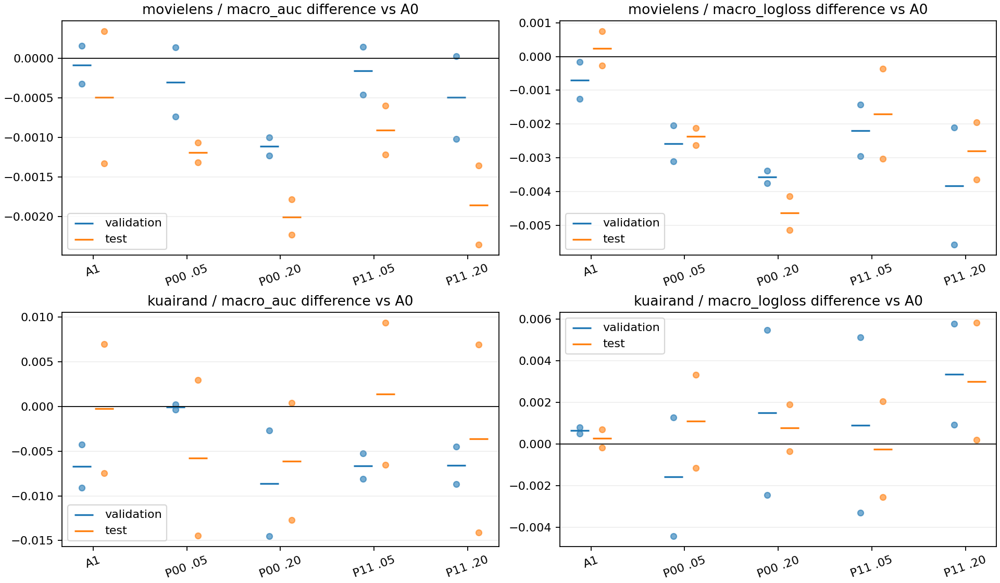

# 条件监督与动量实验报告：保留 A0，关闭本轮候选

本轮完成两个自然数据集上的 **24 条正式训练、1,200 epoch、41,400 次 optimizer/EMA 更新，以及冻结后的144个测试端点**。S1中，P00（静态PAIR＋Adam）与P11（动态PAIR＋ECCM）在两个λ下均未获得正的平均验证宏AUC，且没有配置两个开发种子同时提升。两个数据集均触发预注册停止条件；S2、额外λ搜索和S3为 **NOT_TRIGGERED**。当前决定是保留无增强固定EMA的A0，结束这一版候选。

MovieLens呈现重复的AUC与LogLoss分歧：四个PAIR配置的测试AUC均下降、LogLoss均改善。KuaiRand的P11 λ=.05测试宏AUC均值增加.001404，但seed2022改善、2024下降，验证方向相反，traffic/pooled AUC及最差格均下降。这个测试均值不足以改变已冻结的停止决定。

## 核心证据

主端点为固定非反馈EMA、完整validation六格macro AUC选择的最早最佳epoch。下表是相对A0的配对均值；AUC差正值较好，LogLoss差负值较好。n=2，seed为2022/2024。

| 数据 | 方法 | λ | validation ΔAUC | test ΔAUC | test AUC正seed | test ΔLogLoss |
| --- | --- | --- | --- | --- | --- | --- |
| ML | A1 | — | -.000085 | -.000496 | 1/2 | +.000240 |
| ML | P00 | .05 | -.000302 | -.001190 | 0/2 | -.002374 |
| ML | P00 | .20 | -.001116 | -.002008 | 0/2 | -.004642 |
| ML | P11 | .05 | -.000160 | -.000912 | 0/2 | -.001701 |
| ML | P11 | .20 | -.000498 | -.001855 | 0/2 | -.002798 |
| KR | A1 | — | -.006675 | -.000227 | 1/2 | +.000271 |
| KR | P00 | .05 | -.000052 | -.005741 | 1/2 | +.001092 |
| KR | P00 | .20 | -.008596 | -.006144 | 1/2 | +.000778 |
| KR | P11 | .05 | -.006653 | +.001404 | 1/2 | -.000259 |
| KR | P11 | .20 | -.006569 | -.003583 | 1/2 | +.003004 |

A0测试宏AUC/LogLoss为ML **.779308±.000326 / .494996±.000076**，KR **.679172±.008061 / .435353±.001205**（样本SD）。P00 .05对应ML .778118±.000150/.492622±.000438，KR .673431±.004274/.436444±.001958；P11 .05对应ML .778396±.000762/.493295±.001965，KR .680575±.003190/.435093±.002045。

所有24条轨迹的原始seed数值、选中epoch及全部72组域任务均值/SD见[数值附录](NUMERICAL_APPENDIX.md)。完整逐seed六格、domain/task、macro、traffic、pooled、worst、online/EMA和selected/E10/E50见[端点CSV](tables/endpoints.csv)；[逐seed配对差](tables/paired_seed.csv.gz)及[配对均值、SD、95% t区间](tables/paired_summary.csv.gz)保留全部匹配比较。selected模型身份及state hash见[选点冻结文件](SELECTION_FROZEN.json)。

## 执行范围与方法

底座固定为EMA02V2提交`38a53bc1aa6e0c16c0b6d2b0e24e07018f91ab27`；40个vendor文件逐一匹配原字节。fixed1 MDMTRec/M3oE，3域2任务，embedding16、4共享专家、FCN [512,256,256,64]，无learned fusion或额外架构优化器。真实CSV沿原全局行号80/10/10划分，KR先切分再保留tab0/1/4，编码与scaler仅拟合train，OOV=0。数据数组、原行号、编码器及scaler均通过固定manifest核验。

batch40960、50epoch、无早停，尾批按实际B。真实BCE为sum/(B×2)；Adam lr=.01、β=(.9,.999)、eps=1e-8，coupled wd为ML1e-4/KR1e-5。FP32，AMP/TF32关闭。固定EMA从初始参数开始，ML rho=.9828205985452511，KR .995，buffer复制且不反馈在线训练。

PAIR只在当前真实batch内按同域、任务及实际联合标签正负边界选择2048对，不生成输入、不改变自然采样比例、不把标签输入模型。辅助目标为λΣwR，λ∈{.05,.2}；条件采样q与目标质量w分开，当前梯度乘w/q。真实tower hook保留训练图和原gate的emb.detach。P11用旧需求D选择条件，ECCM只覆盖指定全局共享dense参数：条件历史按.01/q刷新，有效条件时钟作偏差修正，一阶矩真实通道与条件通道组合，当前混合梯度进入单一二阶矩；其余参数普通Adam。A1沿用源Gaussian及随机流。完整公式与参数分组见[设计](DESIGN_SPECIFICATION.md)及[实现映射](DESIGN_IMPLEMENTATION_MAP.md)。

| 阶段 | 实际执行 | 状态 |
| --- | --- | --- |
| DESIGN / IMPLEMENT / REVIEW | 设计、独立coder、独立reviewer | PASS，14项CPU检查通过 |
| S0 | 两真实数据的完整batch、lambda0/基线一致与恢复检查 | PASS，非正式科学重复 |
| S1 | 2数据×2seed×6配置 | 24/24，全部50epoch，0失败 |
| S2 / S2_EXTRA / S3 | 0条 | 两数据均触发S1停止门 |
| 冻结后test | 24×online/EMA×selected/E10/E50 | 144/144 |

start.md的覆盖规则仅允许2022–2026，替代原方案确认seed2027–2031。S3未触发，因此2023/2025/2026没有正式训练；本轮样本量为两个开发seed。A0/A1旧状态未保留E10，本轮全部重跑，计为24条新增物理轨迹；与历史同seed基线不构成独立科学重复。模型、优化器和评价快照全部在RAM中，测试完成后释放，磁盘只保留标量数据、日志、配置、代码和报告。

## 稳定现象、矛盾与证据强度

**MEDIUM：MovieLens的排序与概率损失收益分离。** 四种PAIR配置在两个seed的测试宏AUC均低于A0，而LogLoss均改善；验证集LogLoss同样全部改善。四配置共享数据和种子，不能把它们算成八个独立重复。这个重复模式支持“当前排序辅助目标改变了概率损失及训练轨迹，但没有带来selected AUC增益”。它不能单独区分校准、优化路径和选点效应。没有额外做校准拟合。

**WEAK：KuaiRand P11 .05的测试宏均值阳性。** 逐seed ΔAUC为约+.009359/−.006551，均值+.001404，95%配对t区间[−.099681,+.102488]。验证均值−.006653且2/2下降；测试的正均值不稳定。A0两个seed本身相差约.0114，基线变动是解释配对差的重要背景。P11 .20的测试LL均值恶化+.003004且2/2不利，与验证保护项一致。

**WEAK：条件历史的独立增量。** S1只比较P00和P11，二者同时改变信息选择和历史更新，不能把P11−P00归因为ECCM。P10/P01/PCV/PCOLL完整训练与2×2交互未触发；CV/PCOLL只有正确性smoke。当前无法回答“ECCM是否胜collapsed-history”“CV是否足够”或“动态需求本身有无增量”。这些问题的缺口来自预定停止门，而非已测阴性。

**STRONG（执行事实）：** 固定矩阵24/24完成、完整预算、数据身份、更新计数、独立审查、冻结先于test及144端点齐备都有对应记录。此标签不提升两seed性能证据的强度。主口径EMA selected中，各候选相对A0的测试宏AUC配对区间均跨0；区间按seed计算，自由度1，未以epoch/task扩充样本量。阶段停止依据预注册效应/方向门，不依赖事后显著性判据。

## 域大小、难度与收益代价

| 数据 | 域 | train行数 | A0 test域macro AUC |
| --- | --- | --- | --- |
| ML | d0 | 155949 | .782171 |
| ML | d1 | 318599 | .791611 |
| ML | d2 | 325619 | .764143 |
| KR | d0 | 172782 | .650802 |
| KR | d1 | 1743898 | .718211 |
| KR | d2 | 89452 | .668502 |

ML最小d0不是最低AUC域，最大d2反而最低；KR最小d2也不是最低AUC域，中等大小d0更低。这里用基线AUC描述可观测预测难度，不把它解释为已控制标签、人群后的因果难度。大小与难度没有等价关系。

ML的四个PAIR配置在三个域的测试AUC均值全部下降，未出现小域改善/大域下降的平均权衡。KR P11 .05的d0/d1/d2 AUC差为 **+.006901/−.002779/+.000089**：宏均值主要由中等域d0推动，最小域近零，最大域下降。task0/task1宏AUC差为−.001788/+.004595，主要正项是d0t1的+.017014；六格均为一正一负seed。

同一KR P11 .05的traffic AUC **−.002657**、pooled AUC **−.002601**、worst-cell AUC **−.002824**，traffic/pooled LL **+.001696**，均与宏AUC正值构成冲突。它是平均层面的域任务收益代价，seed一致性为WEAK，尚不支持稳定的小域救援机制。domain size可影响流量权重与宏/traffic分歧，但没有被独立操纵，且观察不随大小单调；现有证据不支持把大小当作主要原因。

## 训练阶段与替代解释

下表为EMA测试宏AUC相对A0的平均差。E10/E50是共同epoch，selected按各自验证曲线选点。

| 数据 | 配置 | E10 | selected | E50 |
| --- | --- | --- | --- | --- |
| ML | P00 .05 | +.000664 | −.001190 | −.000899 |
| ML | P00 .20 | −.001035 | −.002008 | +.001058 |
| ML | P11 .05 | +.001008 | −.000912 | −.000376 |
| ML | P11 .20 | −.000236 | −.001855 | +.001195 |
| KR | P00 .05 | +.000951 | −.005741 | −.006609 |
| KR | P00 .20 | −.006496 | −.006144 | −.008235 |
| KR | P11 .05 | +.000563 | +.001404 | −.003361 |
| KR | P11 .20 | −.002603 | −.003583 | −.000035 |

阶段差异说明局部epoch收益不能替代selected结论。ML较大λ的E50改善与selected下降并存；KR P11 .05的selected测试阳性没有延续到E50。online selected测试宏AUC中所有PAIR配置均低于online A0，KR P11 .05为.674865、A0 .676806；这进一步限定阳性结果为特定EMA评价与选点。

竞争解释包括：新增辅助监督改变优化目标与有效梯度尺度；λ改变正则化及训练阶段；验证/test人口和标签关系不同；D可能偏向噪声或能力不足边界；ECCM历史滞后与当前参数不匹配；少量seed及A0波动。当前比较没有逐一识别这些原因。训练pair loss降低、历史非零或CPU期望恒等式均不能替代泛化证据。

## 成本、缺陷与修订

S1调度墙钟约 **2380秒（39分40秒）**；24条训练累计worker时间 **16495.39秒（4.58小时）**，其中包含各worker数据读取、训练、验证和状态交接，不能称为独占GPU时间。两张RTX3090与外部任务共享，按每卡显存/功耗85%准入并发。S0约51.83秒，峰值reserved约1.52GiB。逐方法/seed时间、显存和计数见[成本表](tables/costs.csv)，完整测试成本见raw评价记录及[运行报告](RUNNER_REPORT.md)。没有新增可训练参数，ECCM增加条件历史和一次共享参数autograd；实测成本受并发和启动顺序影响，不把worker秒直接当同硬件串行速度比。

入口本地缺少v3计划和Git元数据，从固定远程方案取回；最新研究上下文从固定96d21fcc读取并存于source_context，历史文件未覆盖。用户覆盖了确认seed与磁盘checkpoint政策，设计据此采用允许seed和RAM状态；PCOLL无有效pair时的clock冻结及S2额外λ触发界在训练前明确。实现及独立审查CPU检查均PASS，真实S0 PASS，正式运行无故障、无batch调整、无算法热修复。源码身份见[清单](IMPLEMENTATION_SOURCE_MANIFEST.json)，裁决见[DEVELOPMENT_DECISION](DEVELOPMENT_DECISION.json)。

## 研究决定与下一步

**保留A0，停止本轮P00/P11候选，不补S2/S3，不从已见test阳性追搜λ。** 新监督没有通过当前AUC晋级门；动态选择和分条件历史的独立价值尚未进入可判别的正式对照阶段。ML的LogLoss改善可以作为目标取舍的观察，但当前预注册主目标是AUC，不能事后更换主指标宣布成功。

如后续确有独立研究需求，最有判别力的是在新的自然用户/时间测试人口中，预先固定P00/P10/P01/P11与PCOLL/CV的同λ对照，并保留A0：前四者区分信息选择、历史与交互，后两者检验是否需要分条件动量。采用验证集冻结的配置，禁止根据本轮KR测试阳性挑λ=.05。若问题改为ML概率质量，则另立以LL为主的协议，并与同训练预算的简单loss尺度/正则化控制比较，以区分监督结构与普通尺度效应。本轮没有追加这些实验。
