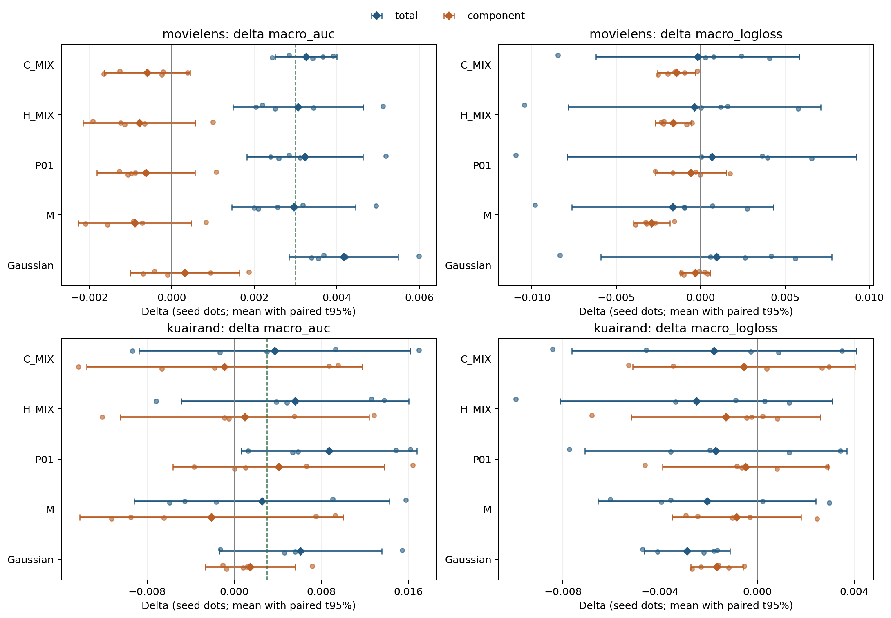
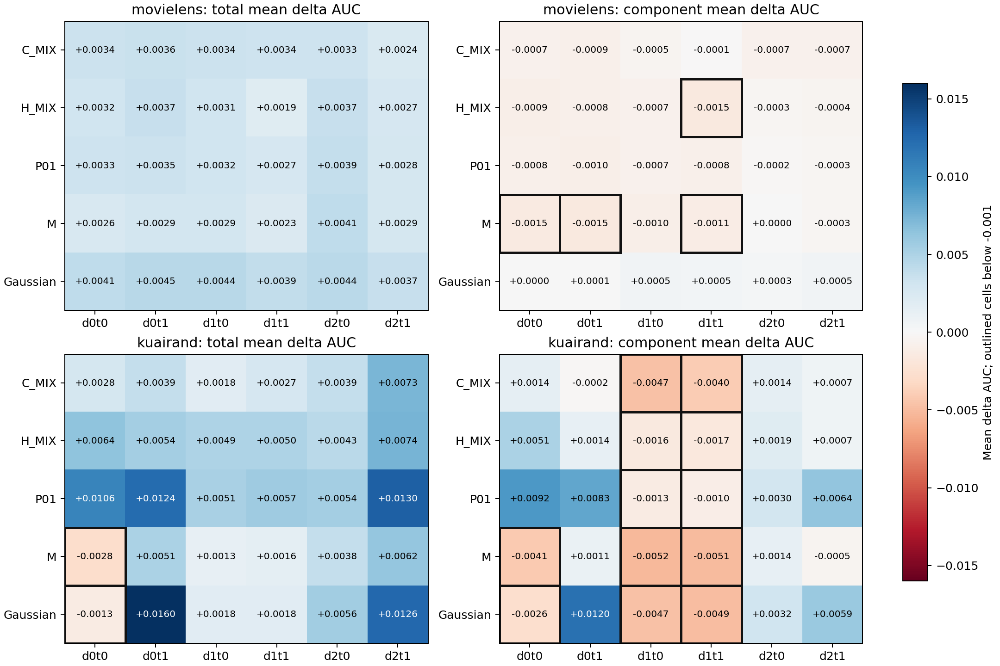

# 四候选五 seed 补全：完整结果与正式模型比较安排

研究启动与训练/测试完成日期：2026-11-03；分析与发布：2026-11-04。协议、配置与完整矩阵见[设计](../../research_plans/26-11-03_v2/DESIGN_SPECIFICATION.md)。

**C_MIX、H_MIX、P01＋固定EMA在两个数据集上，相对普通训练的五seed总AUC收益均达标，且满足六格约束。M在两个数据集上未达到+.003，LogLoss均值改善保留。** KuaiRand P01相对固定EMA的组件增量为+.004086，但最大域两格越过−.001保护线，应记录为“宏AUC达标、逐格约束未满足”。

## 1. 完成范围与判定对象

完成两数据×四候选×2022–2026共40条候选轨迹：10条合法历史复用、30条新增训练，全部50epoch。新增1500epoch、51750次optimizer更新；全体训练完成后统一冻结，完成180个新增test端点。候选test共240个端点，加入validation与历史控制后共660行；1080行逐seed配对、5500行validation epoch记录齐全。失败、OOM和重跑均为0，两个RAM guardian已关闭。详见[运行报告](RUNNER_REPORT.md)及[完成记录](COMPLETION.json)。

模型为fixed1 M3oE/MDMTRec，embedding16、4共享专家、FCN[512,256,256,64]；自然原行序80/10/10，train-only预处理，KR先切分再筛tab0/1/4。batch40960、50epoch、Adam lr=.01、耦合wd ML1e−4/KR1e−5、FP32；固定EMAρ为ML .9828205985452511、KR .995。每个估计器独立按validation六格macro AUC最早严格最大值选点；E10/E50是固定阶段。C/H修复当前梯度/旧一阶历史，M与P01沿用原冻结的条件插值/静态PAIR＋ECCM配置。

“总收益”比较方法fixedEMA与同seed普通A0 online；“组件增量”比较方法fixedEMA与同seed A0 fixedEMA。每项n=5，seed是统计单位。AUC均差≥.003、六格各均差≥−.001分别判断；LL均差<0独立判断，方向数与CI不设淘汰门。普通/EMA/Gaussian五seed控制通过数据身份及模型hash桥接复用，未增加训练。历史1–2seed旧停止记录保留，当前按完整五seed重新裁定。

## 2. selected主结果

以下为五seed配对均值，AUC正值、LL负值有利。绝对AUC/LL是方法fixedEMA selected test均值；完整SD、区间和全部原值见[数值附录](NUMERICAL_APPENDIX.md)、[端点](endpoints.csv)、[配对统计](paired_summary.csv)。

| 数据 | 方法 | 绝对Macro AUC / LL | 总ΔAUC | 总ΔLL | 组件ΔAUC | 组件ΔLL | 总AUC裁定 |
|---|---|---|---:|---:|---:|---:|---|
| ML | C_MIX | .778443 / .494711 | +.003253 | −.000180 | −.000596 | −.001428 | 达标、六格满足 |
| ML | H_MIX | .778249 / .494519 | +.003059 | −.000372 | −.000789 | −.001620 | 达标、六格满足 |
| ML | P01 | .778415 / .495552 | +.003225 | +.000661 | −.000624 | −.000588 | 达标、六格满足 |
| ML | M | .778146 / .493233 | +.002956 | −.001658 | −.000892 | −.002907 | 未达+.003 |
| KR | C_MIX | .675626 / .435394 | +.003720 | −.001778 | −.000897 | −.000552 | 达标、六格满足 |
| KR | H_MIX | .677486 / .434661 | +.005579 | −.002511 | +.000963 | −.001286 | 达标、六格满足 |
| KR | P01 | .680609 / .435469 | +.008702 | −.001703 | +.004086 | −.000478 | 达标、六格满足 |
| KR | M | .674441 / .435099 | +.002534 | −.002073 | −.002082 | −.000847 | 未达+.003；d0t0−.002767 |

ML M的总ΔAUC原值为 **+.002956435**，不能先四舍五入为+.003再判定。ML H_MIX为+.003059436，按冻结阈值达标。ML P01总LL未改善，但其AUC资格保留；C/H/M两数据的总LL均值均下降。机器裁定的比较对象、六格均差和越线值完整保存在[DECISIONS.json](DECISIONS.json)。

## 3. seed一致性与证据强度

**STRONG：当前协议内的重复排序现象。** ML四个候选的总AUC均为5/5正；但四者相对固定EMA的AUC都只有1/5正、均值均负。总排序收益与新增组件的排序价值必须分别记录。ML C/H/M相对固定EMA的LL为5/5下降，均差分别−.001428/−.001620/−.002907，t95%区间均低于0，形成较稳定的概率损失改善。

**STRONG（本协议的总排序收益），MEDIUM（组件收益）：KR P01。** 总ΔAUC五个seed依次为+.016169、+.014864、+.001278、+.005839、+.005360，均值+.008702125，SD .006485，t95%[+.000650,+.016754]。组件ΔAUC为+.016393、+.006630、−.003677、+.001060、+.000023，均值+.004085725，区间[−.005609,+.013781]，同时存在明确单格代价。区间跨0不取消均值达标裁定，表明组件大小仍有较大训练随机性。

**MEDIUM：KR C/H总AUC达标；WEAK：其组件排序增量的稳定性。** C总收益3/5正、H为4/5正，总ΔAUC区间分别[−.008735,+.016175]、[−.004836,+.015994]；相对EMA两者都只有2/5正。旧2022组件增益+.009531/+.012815在五seed后变为−.000897/+.000963，未复现为稳定的强增量。KR M的组件均值−.002082，完整五seed后不优先进入AUC主比较。

LL采用均值规则，仍保留seed差异：ML C/H总LL仅seed2022下降，其余四seed上升，均值下降幅度很小；KR各新增候选总LL均3/5下降、2/5上升，配对区间均跨0。它们满足均值改善标准，重复性弱于ML的组件LL结果。所有置信区间描述同一固定划分上的训练seed变化。

## 4. 六格、任务与域规模

**MEDIUM：KR相对固定EMA存在小域改善/大域排序下降的交换，取决于比较对象。** P01六格组件ΔAUC依次为+.009220、+.008328、−.001334、−.001047、+.002995、+.006352；两个较小域四格提升，最大域两格越线。其macro提升+.004086，但traffic AUC−.001043、pooled AUC−.001057。两个任务的域等权平均均提升（+.003627/+.004544），仍会掩盖同一大域内两任务的退化。P01组件LL的域0/1/2均差为+.000144/+.000620/−.002199，宏LL下降与最大流量域LL上升并存。

KR C/H/M相对EMA的大域两格也平均下降；Gaussian相对EMA的d1两格为−.004654/−.004929。相对普通训练，C/H/P01却是六格AUC平均全部提升，P01的traffic/pooled也分别+.005500/+.005301。因此“小域受益、大域下降”是特定内部增量比较中的现象，不能替代完整方法的总体收益。最差格同样不能替代逐格检查：KR P01最差格均值由普通训练.634325、固定EMA .636835升至.645211，仍存在相对EMA的大域损失。全部六格绝对值、逐seed差与domain/task指标见[端点表](endpoints.csv)及[六格均值](absolute_test_means.csv)。

| 数据/域 | train行数 | test行数 | 普通A0任务0/1 AUC均值 |
|---|---:|---:|---|
| ML d0 | 155949 | 27687 | .770298 / .785173 |
| ML d1 | 318599 | 41434 | .778130 / .797449 |
| ML d2 | 325619 | 30900 | .752263 / .767825 |
| KR d0 | 172782 | 2613 | .635617 / .645909 |
| KR d1 | 1743898 | 246284 | .698833 / .726663 |
| KR d2 | 89452 | 1870 | .653260 / .671157 |

**WEAK：域规模作为主要因果解释。** ML最大域d2的普通AUC最低；KR最小域d2反而比d0更易预测。三个域的身份、标签基率、特征支持和样本量共变，当前没有独立操纵N。KR d0t1仅有validation101、test120个正例，是小格波动的具体来源；其test人口只2613行。KR最大域占test约98.21%，使traffic主要随d1变化；macro与traffic分歧的权重分解是STRONG算术证据，训练规模造成损伤的解释尚未识别。详见[人口与基线难度](POPULATION_AND_DIFFICULTY.csv)。

## 5. 训练阶段、损失与竞争解释

**STRONG：阶段和估计器会改变观察方向。** KR四候选固定EMA的E10总ΔAUC均负（C−.008298、H−.010228、P01−.007643、M−.019638），到selected均为正。ML M在共同E50的总ΔAUC+.005945、组件+.001158，但主selected只有+.002956/−.000892。不能用测试E50替换已冻结的validation选点。

KR P01在E50的组件宏AUC+.003331，d1两格−.000997/−.000906，满足共同E50约束；selected组件则越线。其validation-selected组件AUC也为+.003238，test为+.004086；H_MIX的validation为−.001591、test+.000963。新结果保留了选点/人口差异，且P01的宏信号同时见于validation和test。全部阶段数值见[stage_effects.csv](stage_effects.csv)。

H_MIX在KR的online selected本身也有总ΔAUC+.003952，六格均差为+.006932、+.014152、+.000344、+.000239、+.000475、+.001568，满足总收益和逐格约束；LL均值−.001404，但下降由seed2022的大幅改善承载，其余四seed上升。ML四候选online的总AUC则均负。EMA之外的H历史更新仍有KR排序信号，证据为MEDIUM；旧历史修复的普遍必要性为WEAK：H−C固定EMA宏AUC在ML−.000193（2/5正）、KR+.001859（4/5正），数据集与指标并不统一。

训练目标也不能直接混比。KR E50的M混合loss .483564低于A0 .488906，但真实监督loss .498113更高；P01总目标 .513441、真实loss .488114。ML M的真实loss .430710高于A0 .417906，selected test LL却更低。LL改变可包含表示、正则化、排序与概率质量变化，本轮没有独立校准测量。

当前证据支持三类解释并存：EMA时间平滑提供大量整体排序收益；PAIR/历史修复改变域任务收益分配；优化轨迹、选点及小格支持影响seed稳定性。C/H的投影同时改变预条件空间中的一阶状态与范数，缺少同范数方向打乱控制，尚不能把收益独归于约束方向。P01完整配置的收益也未单独识别PAIR和ECCM的必要性。ML各组件AUC均负而LL改善，以及KR P01宏指标提升而traffic下降，是这些解释必须共同解释的反例。

## 6. Gaussian与GATS B2已有五seed的重新定位

Gaussian＋EMA的ML总ΔAUC+.004166933，六格满足，LL+.000931348；KR总ΔAUC+.006092690、LL−.002888935，但d0t0平均−.001271286，标记“宏AUC达标、逐格约束未满足”。KR LL总收益五seed均下降，区间[−.004657,−.001121]，是STRONG的本协议概率损失结果。其相对固定EMA的组件AUC只有ML+.000318/KR+.001476；算法简单不影响其整体候选资格。

GATS B2的KR历史五seed相对普通训练，总ΔAUC **+.006097847**、LL **−.003002719**，六格AUC均值均正，符合总收益与逐格规则；总AUC为4/5正。相对固定EMA是+.001481447/−.001777377，相对Gaussian是+.000005156/−.000113784。整体排序收益证据MEDIUM，投影相对Gaussian的排序增量证据WEAK。它应进入正式比较候选，旧报告对内部增量的停止不取消其总收益。全部逐seed原值和控制hash见[GATS_B2_HISTORICAL_PAIRED.csv](GATS_B2_HISTORICAL_PAIRED.csv)；来自[GATS冻结原表](https://github.com/Caelestis1903/My-Research-Project/blob/e59efa2fd954c4d2231b679a742406cfbe2a1077/research_reports/2026-11-02_gradient_aug_time_select/tables/test_metrics.csv)，未新增训练。

内部直接比较也有代价：P01−Gaussian的ML宏AUC−.000942（0/5正）；KR+.002609（3/5正），LL反而+.001185。P01在KR值得继续正式比较，当前结果没有建立其对Gaussian的普遍全面优势。

## 7. 正式模型比较名单与判别性下一步

采用本轮主端点，正式候选如下，均直接复用已有五seed，不追加候选训练：

| 数据 | 满足总AUC及六格约束的候选 | 总AUC达标但有单格代价 | 保留LL结果、当前AUC主比较不优先 |
|---|---|---|---|
| ML | C_MIX、H_MIX、P01、Gaussian＋EMA | — | M |
| KR | P01、H_MIX、C_MIX、GATS B2＋EMA | Gaussian＋EMA | M |

正式发表模型仅M3oE、HyperGate、AutoIFS；EMA及自研配置都是候选/内部控制。10/29模型人口是T0∪F、预处理只拟合T0、按V LogLoss选点，与近期全train和AUC选点有实质差异。下一阶段按[统一比较协议](../../research_plans/26-11-03_v2/PHASE2_PUBLISHED_MODEL_PROTOCOL.md)重新运行HyperGate/AutoIFS两数据五seed，共20条新增；普通M3十条与全部入选候选可复用。模型自身的门控、辅助目标与AutoIFS search/rewind/ticket/reuse流程保留，成本分列。当前新协议下这20条发表模型训练尚未执行。

**最有区分力的机制后续**是补齐KR静态PAIR＋普通Adam（P00 λ=.05）至五seed，与已完成P01配对；原2022/2024若合法则复用，只补缺失三seed。它能直接检验ECCM是否在相同PAIR、EMA、数据和选点下增加收益。若增量消失，ECCM必要性解释被削弱；若仍改善且保护逐格，则增强其独立价值。该实验应沿用既定五seed规则，不做单seed筛选。当前优先交付已定义的正式模型比较，不在本轮追加这项机制实验。

## 8. 成本、修订与复算

30条新增worker wall合计 **46800.278秒（13.0001小时）**；端到端训练、冻结和测试队列 **6236.235秒（103.94分钟）**，其中训练队列5931.878秒。每条新增轨迹均attempt1，失败/恢复0。单worker最大reserved显存约1.52GiB；整卡包含其他MPS训练，逐卡按显存和功耗85%条件派发，不能把共享负载下worker时长解释成独占硬件速度。[costs.csv](costs.csv)按新增训练、历史引用、物理attempt和测试分列，历史耗时未计为新增。

设计→独立实现→独立review PASS→runner→本报告分析均完成；新增3项CPU检查通过，原算法/Vendor未修改。训练source hash为`db8d3385f3acabb11e2f10207e6adafb88cc949b51b7b9553a5117434366b7d6`，源码/计划首批发布main提交`92a592418d3f11a588f1e628fbe9364ceab71e18`。本轮没有改变训练或评价的缺陷、预算调整或重放。研究解释更新为完整五seed裁定、区分总收益与组件增量，并重新纳入Gaussian/B2整体成绩；历史原报告保留。

仍开放的具体问题包括：P01大域代价能否在validation-only选点下保留宏收益同时改善；ECCM与PAIR各自的独立价值；C/H方向约束与范数/历史轨迹贡献；KR小格与固定划分上的seed波动；对正式模型的统一协议优势。上述问题没有被当前总体AUC达标替代。

原始训练/评估标量与历史复用输入的恢复见[RAW_ARTIFACTS.md](RAW_ARTIFACTS.md)。模型、optimizer和checkpoint状态仅驻RAM，测试结束后已释放；epoch、配置、source/model hash保留为选点身份。恢复标量后，可使用项目Python运行新包`summarize`，再运行本目录`analyze.py`重建数表、台账片段与两张图；两条命令不重新训练。
