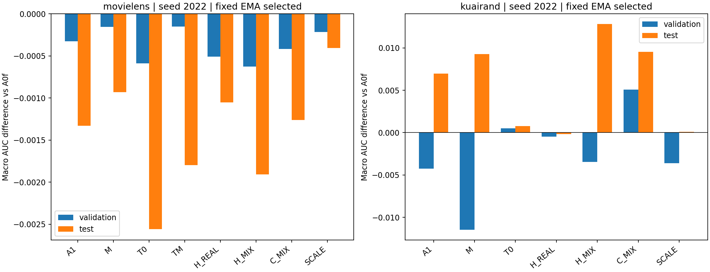

# 条件信息增强与真实历史更新：完整实验报告

> Main-branch report archive created 2026-11-08. Source branch: 26-11-03_history_information. Supporting CSV/JSON files, figures, execution artifacts and implementation files remain on the source branch; relative links below resolve there. No source code or raw training artifacts were copied. Sections outside the current research scope are omitted from this main-branch archive; source-branch originals are unchanged.

日期：2026-11-03。执行分支：`26-11-03_history_information`。研究方案：[冻结计划](https://github.com/Caelestis1903/My-Research-Project/blob/26-11-03_history_information/research_plans/26-11-03/06_CODEX_PROMPT.md)。

**当前保留固定无增强 EMA 的 A0f。** MovieLens 的全部候选均未超过验证集主端点；KuaiRand 的 C_MIX 有明显宏指标收益，但验证集域0任务0退化，触发预设保护门。两数据在 D0 停止，后续有界基线 A0b、组件控制及多seed确认均未触发。因此，本轮未接受新的总体工作方案，也没有形成超过 A0b 的实证比较。

测试集保留了有价值的分化：KuaiRand C_MIX 相对 A0f 的 selected EMA 宏 AUC **+0.009531**、LogLoss **−0.005302**，六格 AUC 全正；H_MIX 的宏 AUC 增幅更大，但 traffic/pooled 下降；M 同样以最大域退化换取两个较小域收益。MovieLens 则所有候选 selected test 宏 AUC 都下降，其中 T0/TM 的 LogLoss 改善最明显。**新候选只有 seed 2022，泛化收益与机制必要性的证据强度均为 WEAK。** 本轮完成了预定停止条件，不据测试集追加配置或恢复后续阶段。

## 1. 实际完成的范围

| 项目 | 实际执行 |
| --- | --- |
| S0 | 两数据×A0f/M/H_MIX/TM，每项预热2步、测量3步，完整40960 batch；PASS |
| D0 MovieLens | A0f/A1历史复用；M/T0/TM/H_REAL/H_MIX/C_MIX/SCALE新增7条 |
| D0 KuaiRand | A0f/A1历史复用；M/T0/H_REAL/H_MIX/C_MIX/SCALE新增6条 |
| KuaiRand默认TM | S0成本4.61×A0f，`COST_BLOCKED`，没有正式性能结果 |
| 新增训练合计 | **13条×50 epoch=650 epoch；21,700次optimizer及EMA更新** |
| D0比较身份 | 17条：13新增、4历史引用；另1个计划身份成本阻塞 |
| 报告中的历史引用 | A0f/A1×两数据×2022/2024共8条；2024引用没有新增候选与其配对 |
| D1 / REPLICATE / D2 / CONFIRM | 两数据均 `NOT_TRIGGERED`；没有预算暂缓家族 |
| 冻结与评估 | 21条报告轨迹，126个validation选点对应的test端点；新增前向78个、历史数值引用48个 |
| 导出 | validation/test端点252行、六格1512行、配对原值及差14,256行 |
| 故障 / 重放 | 0 / 0；全部已调度轨迹完成 |

新候选均用seed2022；2024候选复现、2023/2025/2026确认由阶段门控制，未触发。单个候选的配对均值就是其单seed差，正/负方向数为1/1或0/1；样本SD及95%配对t区间为空，不能用六格、epoch或validation/test充当独立seed。历史A1与A0f有两seed配对，导出表单独保存，不能提高新方法的重复次数。五seed合计和本轮未开发三seed的候选统计均不存在。

## 2. 协议与可复现来源

模型为fixed1 M3oE，3域2任务、embedding16、4共享专家、FCN[512,256,256,64]。自然原行序80/10/10切分，train-only编码/scaler，KuaiRand切分后保留tab0/1/4；不改变人口与原batch采样。ML任务为rating>3、rating>4，KR为is_click、long_view。

全部正式轨迹batch40960、50epoch、FP32、无早停，AMP/TF32关闭。Adam lr=.01、β=(.9,.999)、eps1e−8，coupled wd为ML1e−4、KR1e−5；固定非反馈EMA rho分别为.9828205985452511/.995。增强发生在虚拟嵌入，不向原CSV插入或重采样记录。M使用λ=.1、τ=.1；H使用κ=1、γ=.2；T使用κ=.25；SCALE为.9×真实loss。完整身份见[RUN_MANIFEST.json](https://github.com/Caelestis1903/My-Research-Project/blob/26-11-03_history_information/research_reports/2026-11-03_mdmt_history_information/RUN_MANIFEST.json)。

主端点为**fixed_ema、按每epoch验证六格macro AUC最早严格最大值选择的selected**。online独立选点；E10/E50为共同阶段比较。traffic按当前评价人口加权六格，pooled先合并各域再按任务计算并平均，二者与macro分别报告。模型、optimizer及端点状态全程仅驻内存，统一test结束后释放。

底座固定提交`a06f9d3e544a8658b2d24ddc8f7d10d3f20f0288`，37个实际vendor依赖原字节复制；最终审查源hash为`7f16a451f5f0e41d9082d18bf548ad29d1d31f6c350175c5fb9f06ddc8813685`。历史归档与本地1535个标量文件逐项匹配，A0/A1按完整配置、数据、50epoch和端点hash复用。ML CSV SHA256为`f060ecb8fb7745f1e24998837ca5a1ec3e18b610f288e73549c0203a9822b5e4`，KR为`a1872911e49cb9324a89faf84df1dbed2077357496edd760ba0ab7b8f4fc681f`。

环境为Python3.13.5、PyTorch2.9.0+cu126、两张RTX3090，运行时还有其他GPU任务。设计、两名实现者、独立reviewer和机械runner分工记录完整；审查为PASS WITH FIXES，11项必要CPU检查及真实S0通过。见[实现映射](https://github.com/Caelestis1903/My-Research-Project/blob/26-11-03_history_information/research_reports/2026-11-03_mdmt_history_information/DESIGN_IMPLEMENTATION_MAP.md)、[审查报告](https://github.com/Caelestis1903/My-Research-Project/blob/26-11-03_history_information/research_reports/2026-11-03_mdmt_history_information/REVIEW_REPORT.md)、[运行报告](https://github.com/Caelestis1903/My-Research-Project/blob/26-11-03_history_information/research_reports/2026-11-03_mdmt_history_information/RUNNER_REPORT.md)。

## 3. 主端点与冻结决策

以下均为seed2022、fixed EMA selected，相对同seed A0f；AUC正值有利，LogLoss负值有利。原值、选点epoch与全部六格见[数值附录](https://github.com/Caelestis1903/My-Research-Project/blob/26-11-03_history_information/research_reports/2026-11-03_mdmt_history_information/NUMERICAL_APPENDIX.md)。

| 数据 | 方法 | validation ΔAUC | test ΔAUC | test ΔLogLoss | test Δtraffic AUC | test Δpooled AUC |
| --- | --- | ---: | ---: | ---: | ---: | ---: |
| ML | A1 | −.000327 | −.001329 | +.000743 | −.001346 | −.001393 |
| ML | M | −.000153 | −.000930 | −.001546 | −.000954 | −.001067 |
| ML | T0 | −.000589 | −.002560 | −.007020 | −.002715 | −.003070 |
| ML | TM | −.000150 | −.001798 | −.005805 | −.001922 | −.002324 |
| ML | H_REAL | −.000507 | −.001053 | +.000464 | −.000929 | −.000881 |
| ML | H_MIX | −.000625 | −.001910 | −.002187 | −.001989 | −.002205 |
| ML | C_MIX | −.000417 | −.001263 | −.000190 | −.001196 | −.001289 |
| ML | SCALE | −.000214 | −.000406 | +.001054 | −.000327 | −.000481 |
| KR | A1 | −.004265 | +.006975 | −.000165 | −.001139 | −.001265 |
| KR | M | −.011458 | +.009268 | −.002938 | −.004075 | −.004067 |
| KR | T0 | +.000506 | +.000767 | −.001214 | −.001358 | −.001477 |
| KR | H_REAL | −.000489 | −.000164 | −.000122 | +.003066 | +.003118 |
| KR | H_MIX | −.003447 | +.012815 | −.006820 | −.000647 | −.000643 |
| KR | C_MIX | +.005088 | +.009531 | −.005302 | +.001498 | +.001525 |
| KR | SCALE | −.003596 | +.000078 | −.002153 | +.001562 | +.001747 |

A0f原值：ML validation/test AUC为.760026/.779538，LogLoss为.526644/.494942；KR为.692638/.673472，LogLoss为.430601/.436204。

ML所有主AUC差为负；TM相对M的validation增量仅+.000003，也未满足联合候选的近失条件。KR有两个正宏AUC候选，但C_MIX的validation d0t0为−.006295；T0的d0t0为−.006749、d2t0为−.002155，均触发同格下降≥.002保护门。其余家族没有合格信号。因此机器状态为`NO_GAIN`，这里指**未达到准入规则**，不表示每个宏指标都下降。规则、逐格触发值与原始决定见[DECISION_D0.json](https://github.com/Caelestis1903/My-Research-Project/blob/26-11-03_history_information/research_reports/2026-11-03_mdmt_history_information/DECISION_D0.json)。

KR C_MIX的test六格差为+.002554、+.042686、+.001208、+.001292、+.004179、+.005264，呈现值得后续区分来源的当前梯度处理信号。但validation d0t0仍是此次停止的具体原因；冻结后的test不能改写该门或补跑本轮确认。A0b没有进入四配置搜索，不能声称任何方法已超过公平调参基线。

## 4. 机制比较、损失与训练阶段

**旧历史修复的必要性未成立（WEAK）。** H_MIX−H_REAL的selected test宏AUC：ML−.000856，KR+.012979；对应validation为−.000119、−.002958。KR测试收益与验证方向相反，不能据此认定增强probe普遍优于真实probe。C_MIX只修复当前梯度，在KR的validation宏AUC、traffic和pooled优于H_MIX；其test宏AUC虽比H_MIX低.003284，但traffic高.002145。数据支持“处理位置会改变收益结构”，不支持“修旧历史是必要条件”。

**正交互不足以保留联合T机制（WEAK）。** ML在同λ/τ/κ下，TM−T0−M+A0的selected宏AUC交互为validation+.000592、test+.001691；但TM test仍低于M .000869、低于A0f .001798。LogLoss交互为validation+.005258、test+.002761，表示联合收益也没有简单相加。KR TM成本阻塞，无法计算该数据的完整2×2。运输机制有真实干预，尚未带来获准的排名收益。

**损失下降与排序提升分离（WEAK）。** ML T0的selected test LogLoss改善.007020，同时AUC下降.002560；TM也出现同方向分离。E50真实训练loss：A0f .417756、T0 .425872、TM .475116；较低test LogLoss并不对应更低最终真实训练loss。KR M的E50混合训练目标.484962、真实loss .498866，而A0f真实loss .486320，二者优化目标不同，不能把混合loss的下降直接算作真实监督改善。未测ECE或独立校准曲线，LogLoss变化可能包含校准、正则化与选点差异，不能只归因为校准。

**阶段和估计器会改变结论（WEAK）。** ML M/T0/TM在共同E50的EMA test ΔAUC分别+.001003/+.000869/+.001658，而selected均为负；H_MIX在E10为+.001273，到selected为−.001910。KR M从E10−.013092变为E50+.005507、selected+.009268；KR C_MIX三个端点宏AUC均正，但E50 traffic为−.002231。KR T0的EMA selected为+.000767，online selected为−.005766。相同阶段比较与各自validation选点回答不同问题，不能用其中的正点替换主端点。

诊断来自首步及每20步的样本，ML每轨迹51条、KR123条，不代表全步比例。H_MIX采样投影非零比例ML86.3%、KR83.7%；H_REAL为29.4%、22.8%；C_MIX为41.2%、35.0%。T0采样裁剪比例ML62.7%、KR72.4%，TM在ML为72.5%。因此没有“机制完全没动”的接线解释；这些数字本身不构成泛化收益。M的优先跨另一任务标签donor使用率：ML任务0/1约57.5%/77.2%，KR约67.4%/95.8%；记录中无self回退。任务支持不同，不能把两个任务视作同一种增强难度。U与NORM控制未触发，**另一任务条件增量、方向性相对等范数缩放的价值均未解决**。详见[sampled_diagnostics.csv](https://github.com/Caelestis1903/My-Research-Project/blob/26-11-03_history_information/research_reports/2026-11-03_mdmt_history_information/sampled_diagnostics.csv)。

> 本main归档版本仅保留当前研究范围内的报告内容；来源分支原始报告保持不变。

## 6. 重复现象、矛盾与竞争解释

本轮没有新候选的跨seed重复，不能声称稳定性已证实。以下是同一seed内跨端点或方法的重复现象及其边界：

| 观察 | 证据与强度 | 竞争解释 / 研究决定 |
| --- | --- | --- |
| ML主AUC普遍不增，T类LL改善 | 各候选validation与test selected AUC均负；T0/TM两split LL均下降。WEAK | 排名与概率质量分离、优化轨迹或选点影响；保留A0f排序方案 |
| KR当前梯度控制有宏收益 | C_MIX validation/test selected为+.005088/+.009531，E10/E50 test宏差也正。WEAK | 域0另一任务驱动、人口差异、单seed偶然；未跨保护门，不升级为已接受算法 |
| KR增强类validation/test反转 | M/H_MIX/A1的宏AUC验证负、测试正。WEAK | 原行序切分的人口差异与少量正例估计波动；不解释成历史机制必然有效 |
| 干预强度不等于泛化价值 | H_MIX频繁投影，ML主端点仍负；T明显裁剪但未获准。WEAK | 调整方向、范数、目标信息均可能作用，缺U/NORM控制不能区分 |

KR A0f同一selected模型在d0的validation两任务AUC为.683124/.700360，test降至.633017/.632240；d1则从.701968/.728232变为.703322/.731653。d0任务1只有validation101个、test120个正例，正例率约3.75%/4.59%。这提供人口差异与估计波动的具体线索，但不能仅据原行序断言时间漂移。保护门使用的某一格可能对seed、人口和checkpoint敏感：C_MIX d0t0在selected验证−.006295、测试+.002554；共同E50时则验证+.002580、测试−.008757。因此，选点/训练阶段也是必须保留的竞争解释。

**最有判别力的后续实验建议**是独立冻结KR C_MIX与A0f，追加seed2024，不搜索超参数；预先固定检查d0t0的validation/test方向、两任务六格、traffic，以及selected/E10/E50。若反转随seed重复，支持人口/选点解释；若消失或反向，则削弱当前正信号的稳定性。只有这一步支持继续时，才考虑匹配NORM/U以区分方向与任务条件。此建议需要下一轮独立任务，不在本轮补跑；比沿test最优H_MIX继续堆组件更直接检验当前证据。

本轮没有达到新候选跨seed的MEDIUM或STRONG证据等级；既有固定EMA历史结论按计划继承，不计作本轮新证据。

## 7. 成本、修订与交付

S0中位训练步秒：ML A0f/M/H_MIX/TM=.585455/.929591/.822010/1.239829；KR=.377959/.740132/.584381/1.742561。KR默认TM的4.61倍成本触发冻结上限，仅该身份成本阻塞。测量发生在共享GPU负载下，三个测量步确定本轮准入结果，不推断其他硬件上的固定比值。

13条新训练worker wall time合计20,133.744秒（5.593 worker小时），CUDA训练事件耗时合计16,352.054秒（4.542小时），validation合计1,800.738秒；新test端点总耗时325.586秒，包含数据初次加载和状态准备。S0 worker另计215.416秒。各worker并发运行，以上合计均不等于独占GPU时间。新训练最大reserved显存1,457,520,640字节；各类forward、probe、旧点、autograd和更新计数见[costs.csv](https://github.com/Caelestis1903/My-Research-Project/blob/26-11-03_history_information/research_reports/2026-11-03_mdmt_history_information/costs.csv)。

审查前修订包括：成本阻塞精确到已测配置、单配置失败不终止其他授权任务、缺控制时不支持联合主张、H_NORM极小分母、逐任务支持率和重放成本分列。修订在正式训练前完成，最终代码hash未变化。实际运行无失败/重放。调度器曾同attempt重启，已登记workers未中断，科学身份未重复；CLI本来默认双卡，早期“漏传双卡参数”的口头判断已按日志更正。评估后内存状态释放，guardian正常关闭。

完整交付包括源码/vendor manifest、设计/实现/独立审查记录、数据/参数manifest、S0、阶段决定、配置/选点冻结、全部标量结果、配对统计、成本、数值附录及[问题处置表](https://github.com/Caelestis1903/My-Research-Project/blob/26-11-03_history_information/research_reports/2026-11-03_mdmt_history_information/QUESTION_DISPOSITION.md)。原始标量归档的恢复方式见[RAW_ARTIFACTS.md](https://github.com/Caelestis1903/My-Research-Project/blob/26-11-03_history_information/research_reports/2026-11-03_mdmt_history_information/RAW_ARTIFACTS.md)。不包含模型、优化器、梯度或checkpoint文件。

重算数表：`python -m experiments.mdmt_history_information_20261103.run report --attempt artifacts/mdmt_history_information_20261103/attempt1`；重算本报告附表与图片：`python research_reports/2026-11-03_mdmt_history_information/analyze.py`。两条命令均应显式使用项目Python `/home_new/xzf/envs/miniconda3/envs/phase0-3-env/bin/python`。重算只读取已完成的标量结果；重新训练需重新按完整冻结协议执行。
