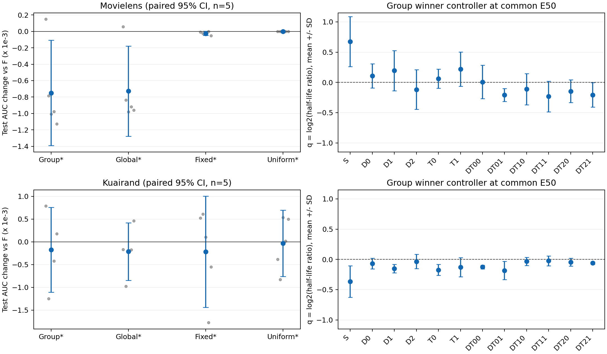

# A阶段实验分析：实际路径分组EMA

A完成两自然数据集各五seed、每条50epoch及15个影子。新增分组/自适应家族的validation赢家在test selected的平均AUC均低于F；ML统一家族选择F。MovieLens选择F继续C；KuaiRand按validation保留固定profile，但test增量未复现。B/A对应500个epoch的online参数hash与数据顺序hash逐一完全相同，新增差异来自参数估计和合法选点。

## 身份和矩阵

- 实施提交 `f00b5ce6b9e6476ca689b781667a5d698742aa70`；source hash `afecc8dcef7f1687d61383af0ca69176eb7b7ec26d0700eb43836a827b5e2ff9`。
- selection hash `ba672ccb017266847085f3de6ccd72cbec8115c93489b4c89b84517b21d8a4c2`；ENDPOINTS SHA-256 `0c8d113e88214c60e3555b92e809c238d8d8bd274e8bd872b7052f38d377e226`。
- 10次父online完整重放、500个提交epoch、17250次真实Adam；每条15影子，包括统一3、固定分组4、GROUP4、GLOBAL4；五seed2022–2026。
- selected由validation六格Macro AUC最早严格最大值确定。每数据全五seed共用同一候选，六格保护优先；ML主发表参照M3oE，KR为HyperGate。
- test沿用历史研究划分，本轮在HPO/选点/下一动作冻结后访问。决定仅用validation，后续动作不按test改派。

左：各家族validation赢家对F的test配对均差、95%CI及逐seed点，单位10⁻³ AUC；右：GROUP赢家共同E50的q均值±SD，q=log₂(半衰期倍率)，虚线为F的q0。

## 家族结果

| 数据集 | 家族/配置 | V Macro AUC | test AUC均值±SD | test LL均值±SD | ΔAUC对F | 配对95%CI | ΔLL对F | AUC正向seed |
|---|---|---:|---:|---:|---:|---|---:|---:|
| movielens | A_GROUP/A_GROUP_020_K20 | 0.759544313 | 0.778606827±0.000505310 | 0.495009159±0.002118924 | -0.000749775 | [-0.001392364, -0.000107187] | -0.000813106 | 1/5 |
| movielens | A_GLOBAL/A_GLOBAL_020_K20 | 0.759538242 | 0.778628691±0.000451434 | 0.494350338±0.001129155 | -0.000727912 | [-0.001276337, -0.000179486] | -0.001471927 | 1/5 |
| movielens | A_FIXED/A_FIXED_T_FAST | 0.759563915 | 0.779332161±0.000379656 | 0.496717561±0.002115346 | -0.000024441 | [-0.000050541, +0.000001658] | +0.000895296 | 1/5 |
| movielens | U/F | 0.759522014 | 0.779356602±0.000393344 | 0.495822265±0.001550074 | +0.000000000 | [+0.000000000, +0.000000000] | +0.000000000 | 0/5 |
| kuairand | A_GROUP/A_GROUP_005_K40 | 0.691086211 | 0.679005435±0.003769764 | 0.435420120±0.003049741 | -0.000174743 | [-0.001107962, +0.000758476] | -0.000097733 | 2/5 |
| kuairand | A_GLOBAL/A_GLOBAL_020_K20 | 0.690902459 | 0.678967236±0.003837989 | 0.435107427±0.002785241 | -0.000212942 | [-0.000847055, +0.000421171] | -0.000410427 | 1/5 |
| kuairand | A_FIXED/A_FIXED_S_FAST | 0.691812284 | 0.678962915±0.003045590 | 0.435829423±0.001534499 | -0.000217263 | [-0.001439406, +0.001004881] | +0.000311569 | 3/5 |
| kuairand | U/U_FAST | 0.690861175 | 0.679148066±0.004037659 | 0.434824535±0.002531886 | -0.000032112 | [-0.000758112, +0.000693888] | -0.000693319 | 3/5 |

## 冻结选择和逐seed结果

ML的最佳家族V分数来自A_FIXED_T_FAST，比F高0.000041901；F成本更低且差在0.0002内，按规则选择F，增量为0，触发C。KR的A_FIXED_S_FAST为V最佳、对F +0.001009861且六格保护通过，按规则停止KR的后续训练。该profile半衰期为S×0.5、D/T/DT×2。

| 数据集 | 被选方案 | seed | epoch | test AUC | test LL | ΔAUC对F | ΔLL对F |
|---|---|---:|---:|---:|---:|---:|---:|
| movielens | F | 2022 | 23 | 0.779117309 | 0.494864985 | +0.000000000 | +0.000000000 |
| movielens | F | 2023 | 20 | 0.779169675 | 0.497435308 | +0.000000000 | +0.000000000 |
| movielens | F | 2024 | 25 | 0.780018162 | 0.493898744 | +0.000000000 | +0.000000000 |
| movielens | F | 2025 | 23 | 0.779063832 | 0.495564772 | +0.000000000 | +0.000000000 |
| movielens | F | 2026 | 22 | 0.779414034 | 0.497347516 | +0.000000000 | +0.000000000 |
| kuairand | A_FIXED_S_FAST | 2022 | 25 | 0.677420017 | 0.437109001 | +0.000525397 | -0.000635547 |
| kuairand | A_FIXED_S_FAST | 2023 | 44 | 0.674972363 | 0.437538566 | +0.000608419 | -0.001654790 |
| kuairand | A_FIXED_S_FAST | 2024 | 43 | 0.683082724 | 0.433819831 | +0.000106673 | +0.000586792 |
| kuairand | A_FIXED_S_FAST | 2025 | 33 | 0.679027308 | 0.435753651 | -0.001774398 | +0.001855557 |
| kuairand | A_FIXED_S_FAST | 2026 | 50 | 0.680312164 | 0.434926066 | -0.000552403 | +0.001405835 |

## 总收益、内部对照与六格

正式AUC收益≥+.003、六格均差≥−.001、LL均差<0分别判断；内部组件不新增+.003门。置信区间和同向数为描述统计，单位为seed。发表模型沿用各自冻结源配置，HyperGate保留UNVERIFIED_PROPOSAL超参标记。

| 数据集 | 方案 | 比较对象 | ΔAUC | 95%CI | ΔLL | 最差格ΔAUC | 正式AUC资格/六格保护/LL下降 |
|---|---|---|---:|---|---:|---:|---|
| movielens | F | F | +0.000000000 | [+0.000000000, +0.000000000] | +0.000000000 | +0.000000000 | 内部增量/True/False |
| movielens | F | M3oE_fixed1 | +0.004166933 | [+0.002843384, +0.005490482] | +0.000931348 | +0.003656641 | True/True/False |
| movielens | F | HyperGate | +0.007944846 | [+0.006156237, +0.009733455] | -0.002731649 | +0.007405600 | True/True/True |
| movielens | F | AutoIFS | +0.006932013 | [+0.006069073, +0.007794954] | -0.000271961 | +0.004785159 | True/True/True |
| movielens | A_GROUP_020_K20 | F | -0.000749775 | [-0.001392364, -0.000107187] | -0.000813106 | -0.001056077 | 内部增量/False/True |
| movielens | A_GROUP_020_K20 | A_GLOBAL_020_K20 | -0.000021864 | [-0.000148015, +0.000104288] | +0.000658821 | -0.000241328 | 内部增量/True/False |
| movielens | A_GROUP_020_K20 | A_FIXED_T_FAST | -0.000725334 | [-0.001354960, -0.000095708] | -0.001708401 | -0.001263412 | 内部增量/False/True |
| kuairand | A_FIXED_S_FAST | F | -0.000217263 | [-0.001439406, +0.001004881] | +0.000311569 | -0.001824793 | 内部增量/False/False |
| kuairand | A_FIXED_S_FAST | M3oE_fixed1 | +0.007056316 | [+0.002253548, +0.011859085] | -0.001342581 | +0.000519126 | True/True/True |
| kuairand | A_FIXED_S_FAST | HyperGate | -0.003149636 | [-0.008424588, +0.002125317] | -0.004760317 | -0.014506418 | False/False/True |
| kuairand | A_FIXED_S_FAST | AutoIFS | +0.000365910 | [-0.004360914, +0.005092734] | +0.002837415 | -0.007372845 | False/False/False |
| kuairand | A_GROUP_005_K40 | F | -0.000174743 | [-0.001107962, +0.000758476] | -0.000097733 | -0.000561328 | 内部增量/True/True |
| kuairand | A_GROUP_005_K40 | A_GLOBAL_020_K20 | +0.000038199 | [-0.000620959, +0.000697357] | +0.000312693 | -0.000052227 | 内部增量/True/False |
| kuairand | A_GROUP_005_K40 | A_FIXED_S_FAST | +0.000042519 | [-0.001470869, +0.001555908] | -0.000409303 | -0.001627864 | 内部增量/False/True |
| kuairand | A_GROUP_005_K40 | U_FAST | -0.000142631 | [-0.001071914, +0.000786652] | +0.000595586 | -0.000520457 | 内部增量/True/False |
| kuairand | A_GROUP_005_K40 | A_GLOBAL_005_K40 | +0.000034321 | [-0.000616778, +0.000685421] | +0.000034556 | -0.000385883 | 内部增量/True/False |

| 数据集 | 方案 | cell | AUC | LL | ΔAUC对F | ΔLL对F |
|---|---|---|---:|---:|---:|---:|
| movielens | F | d0t0 | 0.774414558 | 0.585145462 | +0.000000000 | +0.000000000 |
| movielens | F | d0t1 | 0.789657772 | 0.407081084 | +0.000000000 | +0.000000000 |
| movielens | F | d1t0 | 0.782566698 | 0.573874408 | +0.000000000 | +0.000000000 |
| movielens | F | d1t1 | 0.801389608 | 0.390412338 | +0.000000000 | +0.000000000 |
| movielens | F | d2t0 | 0.756629165 | 0.580689218 | +0.000000000 | +0.000000000 |
| movielens | F | d2t1 | 0.771481814 | 0.437731079 | +0.000000000 | +0.000000000 |
| movielens | A_GROUP_020_K20 | d0t0 | 0.773358481 | 0.584577515 | -0.001056077 | -0.000567947 |
| movielens | A_GROUP_020_K20 | d0t1 | 0.789057157 | 0.406528376 | -0.000600615 | -0.000552708 |
| movielens | A_GROUP_020_K20 | d1t0 | 0.781851784 | 0.572743647 | -0.000714914 | -0.001130761 |
| movielens | A_GROUP_020_K20 | d1t1 | 0.800981604 | 0.389596550 | -0.000408004 | -0.000815788 |
| movielens | A_GROUP_020_K20 | d2t0 | 0.755740483 | 0.579376949 | -0.000888683 | -0.001312268 |
| movielens | A_GROUP_020_K20 | d2t1 | 0.770651454 | 0.437231917 | -0.000830359 | -0.000499162 |
| kuairand | A_FIXED_S_FAST | d0t0 | 0.645007540 | 0.287148286 | +0.001086469 | -0.000503427 |
| kuairand | A_FIXED_S_FAST | d0t1 | 0.663616459 | 0.180541132 | +0.000807595 | -0.000495659 |
| kuairand | A_FIXED_S_FAST | d1t0 | 0.702640287 | 0.506048717 | +0.000188999 | +0.001426431 |
| kuairand | A_FIXED_S_FAST | d1t1 | 0.730530478 | 0.345784832 | -0.000192086 | +0.000084520 |
| kuairand | A_FIXED_S_FAST | d2t0 | 0.653778867 | 0.650253347 | -0.001824793 | +0.000593723 |
| kuairand | A_FIXED_S_FAST | d2t1 | 0.678203860 | 0.645200224 | -0.001369758 | +0.000763827 |
| kuairand | A_GROUP_005_K40 | d0t0 | 0.643379676 | 0.287707135 | -0.000541395 | +0.000055422 |
| kuairand | A_GROUP_005_K40 | d0t1 | 0.662922851 | 0.180863582 | +0.000113986 | -0.000173210 |
| kuairand | A_GROUP_005_K40 | d1t0 | 0.701906233 | 0.504977203 | -0.000545054 | +0.000354916 |
| kuairand | A_GROUP_005_K40 | d1t1 | 0.730161236 | 0.345746256 | -0.000561328 | +0.000045944 |
| kuairand | A_GROUP_005_K40 | d2t0 | 0.655901181 | 0.648893869 | +0.000297521 | -0.000765754 |
| kuairand | A_GROUP_005_K40 | d2t1 | 0.679761431 | 0.644332677 | +0.000187813 | -0.000103720 |

## 任务和共同阶段

| 数据集 | 方案 | endpoint | ΔMacro AUC对F | ΔMacro LL | Δtask0 AUC | Δtask1 AUC | ΔTraffic AUC | ΔPooled AUC |
|---|---|---|---:|---:|---:|---:|---:|---:|
| movielens | F | selected | +0.000000000 | +0.000000000 | +0.000000000 | +0.000000000 | +0.000000000 | +0.000000000 |
| movielens | F | E10 | +0.000000000 | +0.000000000 | +0.000000000 | +0.000000000 | +0.000000000 | +0.000000000 |
| movielens | F | E50 | +0.000000000 | +0.000000000 | +0.000000000 | +0.000000000 | +0.000000000 | +0.000000000 |
| movielens | A_GROUP_020_K20 | selected | -0.000749775 | -0.000813106 | -0.000886558 | -0.000612993 | -0.000727418 | -0.000822365 |
| movielens | A_GROUP_020_K20 | E10 | +0.000849077 | +0.004934843 | +0.000981192 | +0.000716962 | +0.000835989 | +0.000887026 |
| movielens | A_GROUP_020_K20 | E50 | +0.000548266 | +0.000345419 | +0.000606529 | +0.000490002 | +0.000540692 | +0.000505438 |
| kuairand | A_FIXED_S_FAST | selected | -0.000217263 | +0.000311569 | -0.000183108 | -0.000251417 | -0.000003559 | -0.000035234 |
| kuairand | A_FIXED_S_FAST | E10 | +0.004165468 | +0.001062522 | +0.003211571 | +0.005119366 | +0.007966003 | +0.007698719 |
| kuairand | A_FIXED_S_FAST | E50 | -0.000302681 | +0.000116834 | -0.000294686 | -0.000310676 | +0.000242281 | +0.000255011 |
| kuairand | A_GROUP_005_K40 | selected | -0.000174743 | -0.000097733 | -0.000262976 | -0.000086510 | -0.000543719 | -0.000505131 |
| kuairand | A_GROUP_005_K40 | E10 | +0.003810864 | -0.001595584 | +0.002943616 | +0.004678113 | +0.004648965 | +0.004466620 |
| kuairand | A_GROUP_005_K40 | E50 | -0.000188033 | -0.000086512 | -0.000163506 | -0.000212561 | +0.000075522 | +0.000089673 |

## 控制器实际运行与成本

| 数据集 | GROUP赢家 | 共享probe次数 | 全部控制器调用数 | E50平均q（S,D0,D1,D2,T0,T1,DT00,DT01,DT10,DT11,DT20,DT21） |
|---|---|---:|---:|---|
| movielens | A_GROUP_020_K20 | 250 | 1500 | +0.6721, +0.1078, +0.1939, -0.1189, +0.0602, +0.2198, +0.0069, -0.2082, -0.1128, -0.2324, -0.1462, -0.2067 |
| kuairand | A_GROUP_005_K40 | 610 | 3660 | -0.3674, -0.0680, -0.1506, -0.0344, -0.1734, -0.1298, -0.1262, -0.1832, -0.0336, -0.0229, -0.0442, -0.0613 |

| 数据集 | training秒 | probe秒（含sampling） | sampling子项秒 | validation秒 | 核心worker计时合计秒 |
|---|---:|---:|---:|---:|---:|
| movielens | 2882.775 | 456.737 | 21.871 | 3660.535 | 7000.048 |
| kuairand | 7574.929 | 1334.413 | 132.325 | 10061.501 | 18970.843 |

## 证据与竞争解释

- **STRONG，描述性事实：** 新增分组/自适应家族validation赢家的test selected均值低于F；两个数据集的GROUP均未超过独立调参GLOBAL/固定profile/统一EMA的全部关键控制。500个对应epoch的online/order hash完全一致，隔离了online训练变化。
- **MEDIUM：** ML GROUP和GLOBAL对F的selected AUC分别约−0.000750/−0.000728，LL分别下降约0.000813/0.001472；4/5 seed AUC下降，排序与概率损失出现取舍。KR固定profile V增量+0.001010转为test−0.000217、LL+0.000312，3/5 seed AUC正向、区间跨0，增量稳定性证据弱。
- **WEAK，机制归因：** train排序探针可能偏好与holdout不同的时间尺度；路径差异可能有作用但当前控制器未提取稳定收益；部分细小差异来自选点。probe实际触发、q更新且源online不变，不能把结果归因于未运行控制器。固定profile的V胜出没有同步转成test胜出。
- 域人口没有因A改变，分组依据实际模型路径而非大小。六格表需结合基准AUC、标签基率与阶段考察；当前结果不支持用小域等同困难域解释。存在的单格改变量和保护违例保留于上表及PAIRED_SUMMARY，宏均值不替代它们。
- 下一项区分实验为已定义的MovieLens C：让历史漂移进入增强协方差，比较任务条件、合并及固定旋转控制。KR按validation停止后续C，保留V/test分化事实；不按test追加搜索。

运行中两次必要RAM轮换及一次不需要的重复轮换均保留已提交状态；全部控制器日志的q_before逐次等于上次q_after，含恢复边界。额外未提交开销无完整计时。原始记录见RUNNER_REPORT_A及ADMISSIONS/RETRIES；最终每seed恰好50个提交epoch。参数与checkpoint仅RAM，冻结评价后已释放。完整六格逐seed、epoch/model/source/data/hash见ENDPOINTS、HPO、曲线和配对CSV。
