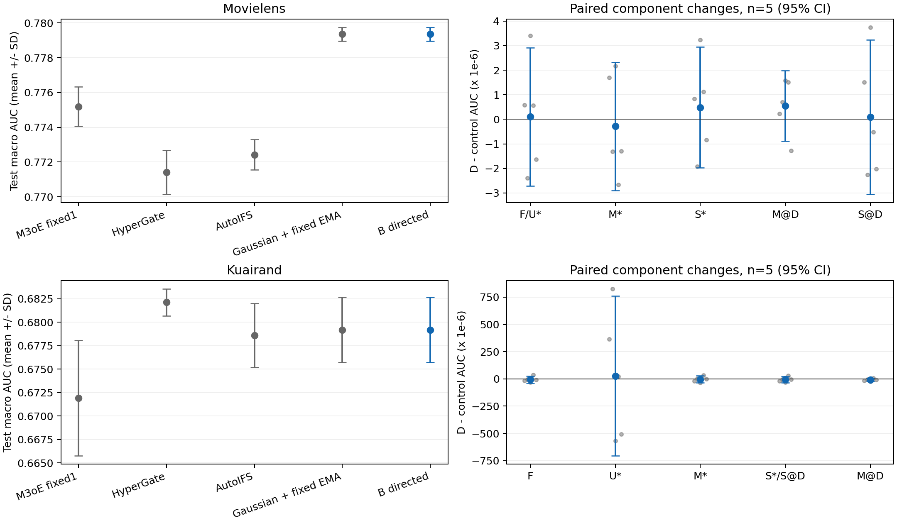

# B阶段实验分析：增强响应定向参数EMA

B完成两数据集各五seed、每条50epoch和15个非反馈影子。test的D−F平均Macro AUC为MovieLens +0.000000104、KuaiRand −0.000004946。本轮未建立具有实用幅度的独立方向增量；针对当前模型、网格和预算的证据强度为 **STRONG**。两数据按冻结的validation规则进入A_FULL，test未改变下一路线。

## 身份与完整性

- PLAN_REF `2645f1f724f52f5ed5dea4b479335c0dc12fabcd`；父源码 `c8675ae2923c15b6965884b140b5b646690cd95e`；B实施提交 `79690772dedefafa24b80d1817aca8c61907be5b`。
- B source hash `9baac157d4574ccc2ec02a9db42cd365ec918346c32b1b3ace2dcc6f65893f2a`；selection hash `fce00de767c5e95b0cb627f53eb5851d43a6c1e64a8c4786db73e57c0ff202a4`。
- ENDPOINTS.csv SHA-256 `6d9b9cb7b1c188c732018b416b946386170834aa664b19f3ed5180976bc2b935`。
- 10条独立online、500个连续epoch、17250次真实Adam；7500次影子validation与500次online validation。每候选每数据完整五seed，2022–2026。
- FULLTRAIN_NATURAL80_10_10、train-only预处理、batch40960、50epoch、fixed1、原Gaussian d0、普通coupled Adam；validation六格Macro AUC最早严格最大值选点。模型/Adam/Q/checkpoint仅RAM。

- test沿用历史研究划分；本轮在配置与选点冻结后统一评价，阶段动作于test前冻结。

左图为五seed均值±样本SD；右图为D与各控制的配对差均值、seed级95%CI及逐seed点，单位为微AUC（10⁻⁶）。

## 家族选择

各家族同预算独立调参；数值为五seed selected均值。全部候选见HPO_SUMMARY与VALIDATION_CURVES。

| 数据集 | 家族/配置 | validation AUC | test AUC均值±SD | test LL均值±SD |
|---|---|---:|---:|---:|
| movielens | F/F | 0.759522014 | 0.779356602±0.000393344 | 0.495822265±0.001550074 |
| movielens | D/D_H05_K10 | 0.759522499 | 0.779356706±0.000394810 | 0.495809924±0.001541423 |
| movielens | U/F | 0.759522014 | 0.779356602±0.000393344 | 0.495822265±0.001550074 |
| movielens | M/M_H05_K20 | 0.759522419 | 0.779356990±0.000393552 | 0.495815890±0.001546356 |
| movielens | S/S_H20_K20 | 0.759522303 | 0.779356221±0.000393583 | 0.495822053±0.001550092 |
| kuairand | F/F | 0.690802423 | 0.679180178±0.003474732 | 0.435517854±0.002752362 |
| kuairand | D/D_H05_K20 | 0.690812402 | 0.679175231±0.003473183 | 0.435521943±0.002749672 |
| kuairand | U/U_FAST | 0.690861175 | 0.679148066±0.004037659 | 0.434824535±0.002531886 |
| kuairand | M/M_H20_K10 | 0.690814621 | 0.679178530±0.003476803 | 0.435518545±0.002752293 |
| kuairand | S/S_H05_K20 | 0.690803640 | 0.679180644±0.003474799 | 0.435518111±0.002752241 |

## 逐seed D与F

| 数据集 | seed | epoch D/F | D AUC | F AUC | ΔAUC | D LL | F LL | ΔLL |
|---|---:|---|---:|---:|---:|---:|---:|---:|
| movielens | 2022 | 23/23 | 0.779117894 | 0.779117309 | 0.000000585 | 0.494849842 | 0.494864985 | -0.000015143 |
| movielens | 2023 | 20/20 | 0.779167281 | 0.779169675 | -0.000002394 | 0.497405747 | 0.497435308 | -0.000029561 |
| movielens | 2024 | 25/25 | 0.780021563 | 0.780018162 | 0.000003401 | 0.493894965 | 0.493898744 | -0.000003779 |
| movielens | 2025 | 23/23 | 0.779064391 | 0.779063832 | 0.000000558 | 0.495569120 | 0.495564772 | 0.000004348 |
| movielens | 2026 | 22/22 | 0.779412404 | 0.779414034 | -0.000001630 | 0.497329949 | 0.497347516 | -0.000017568 |
| kuairand | 2022 | 25/25 | 0.676877021 | 0.676894620 | -0.000017600 | 0.437742135 | 0.437744548 | -0.000002414 |
| kuairand | 2023 | 44/44 | 0.674360680 | 0.674363944 | -0.000003264 | 0.439198561 | 0.439193356 | 0.000005205 |
| kuairand | 2024 | 43/43 | 0.682942901 | 0.682976051 | -0.000033150 | 0.433249724 | 0.433233039 | 0.000016685 |
| kuairand | 2025 | 38/38 | 0.680838823 | 0.680801706 | 0.000037117 | 0.433888799 | 0.433898094 | -0.000009295 |
| kuairand | 2026 | 50/50 | 0.680856732 | 0.680864568 | -0.000007835 | 0.433530495 | 0.433520231 | 0.000010263 |

## 总收益与组件增量

单位为seed，SD为配对差样本SD，95%区间为Student-t(df4)。区间与同向数用于描述。正式AUC均差≥+.003、六格均差≥−.001、LL均差<0分别判断；内部控制报告实际组件增量，不增加+.003门。ML主发表参照为M3oE，KR为HyperGate；三发表模型全部保留，各自训练设置沿用源报告，HyperGate保留UNVERIFIED_PROPOSAL超参标记。

| 数据集 | D比较对象 | ΔAUC | SD | 95% CI | ΔLL | AUC正向seed | 最差格ΔAUC | 正式AUC资格/格保护/LL下降 |
|---|---|---:|---:|---|---:|---:|---:|---|
| movielens | F | +0.000000104 | 0.000002267 | [-0.000002711, +0.000002919] | -0.000012341 | 3/5 | -0.000002711 | 内部增量/True/True |
| movielens | M_H05_K20 | -0.000000283 | 0.000002104 | [-0.000002896, +0.000002330] | -0.000005965 | 2/5 | -0.000001055 | 内部增量/True/True |
| movielens | S_H20_K20 | +0.000000486 | 0.000001979 | [-0.000001972, +0.000002943] | -0.000012128 | 3/5 | -0.000001529 | 内部增量/True/True |
| movielens | M_H05_K10 | +0.000000549 | 0.000001164 | [-0.000000896, +0.000001994] | -0.000005075 | 4/5 | -0.000000985 | 内部增量/True/True |
| movielens | S_H05_K10 | +0.000000094 | 0.000002536 | [-0.000003055, +0.000003243] | -0.000012826 | 2/5 | -0.000002245 | 内部增量/True/True |
| movielens | M3oE_fixed1 | +0.004167037 | 0.001065035 | [+0.002844621, +0.005489453] | +0.000919008 | 5/5 | +0.003656885 | True/True/False |
| movielens | HyperGate | +0.007944950 | 0.001442301 | [+0.006154097, +0.009735803] | -0.002743990 | 5/5 | +0.007406434 | True/True/True |
| movielens | AutoIFS | +0.006932117 | 0.000692992 | [+0.006071654, +0.007792581] | -0.000284302 | 5/5 | +0.004785994 | True/True/True |
| kuairand | F | -0.000004946 | 0.000026154 | [-0.000037420, +0.000027528] | +0.000004089 | 1/5 | -0.000021700 | 内部增量/True/False |
| kuairand | U_FAST | +0.000027166 | 0.000590607 | [-0.000706169, +0.000760501] | +0.000697408 | 3/5 | -0.000641463 | 内部增量/True/False |
| kuairand | M_H20_K10 | -0.000003299 | 0.000024946 | [-0.000034273, +0.000027676] | +0.000003398 | 2/5 | -0.000031630 | 内部增量/True/False |
| kuairand | S_H05_K20 | -0.000005412 | 0.000023360 | [-0.000034417, +0.000023593] | +0.000003831 | 1/5 | -0.000038251 | 内部增量/True/False |
| kuairand | M_H05_K20 | -0.000009692 | 0.000012073 | [-0.000024683, +0.000005299] | +0.000002418 | 1/5 | -0.000038441 | 内部增量/True/False |
| kuairand | M3oE_fixed1 | +0.007268632 | 0.003977130 | [+0.002330373, +0.012206892] | -0.001650061 | 5/5 | +0.002341795 | True/True/True |
| kuairand | HyperGate | -0.002937320 | 0.004683081 | [-0.008752132, +0.002877493] | -0.005067797 | 1/5 | -0.015614587 | False/False/True |
| kuairand | AutoIFS | +0.000578226 | 0.003865012 | [-0.004220820, +0.005377273] | +0.002529935 | 3/5 | -0.005550177 | False/False/False |

## 六格、任务与训练阶段

| 数据集 | cell | D AUC | D LL | ΔAUC对F | ΔLL对F |
|---|---|---:|---:|---:|---:|
| movielens | d0t0 | 0.774411847 | 0.585126039 | -0.000002711 | -0.000019423 |
| movielens | d0t1 | 0.789658606 | 0.407050272 | +0.000000834 | -0.000030813 |
| movielens | d1t0 | 0.782567481 | 0.573868461 | +0.000000783 | -0.000005948 |
| movielens | d1t1 | 0.801391528 | 0.390402813 | +0.000001919 | -0.000009525 |
| movielens | d2t0 | 0.756628719 | 0.580686971 | -0.000000446 | -0.000002247 |
| movielens | d2t1 | 0.771482057 | 0.437724991 | +0.000000244 | -0.000006089 |
| kuairand | d0t0 | 0.643899371 | 0.287665469 | -0.000021700 | +0.000013756 |
| kuairand | d0t1 | 0.662801845 | 0.181028405 | -0.000007020 | -0.000008386 |
| kuairand | d1t0 | 0.702450864 | 0.504633156 | -0.000000424 | +0.000010869 |
| kuairand | d1t1 | 0.730722300 | 0.345708248 | -0.000000264 | +0.000007936 |
| kuairand | d2t0 | 0.655601535 | 0.649661983 | -0.000002125 | +0.000002360 |
| kuairand | d2t1 | 0.679575474 | 0.644434396 | +0.000001855 | -0.000002002 |

| 数据集 | endpoint | D AUC | ΔAUC对F | ΔLL对F | Δtask0 AUC | Δtask1 AUC | ΔTraffic AUC | ΔPooled AUC |
|---|---|---:|---:|---:|---:|---:|---:|---:|
| movielens | selected | +0.779356706 | +0.000000104 | -0.000012341 | -0.000000791 | +0.000000999 | +0.000000269 | +0.000000867 |
| movielens | E10 | +0.768155369 | +0.000000755 | +0.000003961 | +0.000000483 | +0.000001026 | +0.000000567 | -0.000000049 |
| movielens | E50 | +0.776585893 | -0.000000628 | +0.000004858 | -0.000000544 | -0.000000712 | -0.000000403 | -0.000001028 |
| kuairand | selected | +0.679175231 | -0.000004946 | +0.000004089 | -0.000008083 | -0.000001810 | -0.000000488 | -0.000000275 |
| kuairand | E10 | +0.647159528 | +0.000047667 | +0.000001155 | +0.000024155 | +0.000071180 | +0.000002785 | +0.000002303 |
| kuairand | E50 | +0.678923515 | -0.000012907 | -0.000001553 | -0.000025340 | -0.000000473 | +0.000000493 | +0.000001189 |

## 证据、竞争解释和后续

1. **STRONG：D/M/S与F几乎重合。** ML selected D的AUC有3/5 seed正向，KR为1/5；共同E10/E50亦未出现有实用幅度的方向收益。固定F重现历史均值，完整Gaussian+EMA相对普通M3oE的总收益继续保留。
2. **STRONG：响应分支实际启用。** ML500次、KR1225次刷新全部D秩2/M秩1，反事实前后state hash全部相同；最大FP32正交误差5.25e−8/3.54e−8。没有Q始终为空或分支未运行的现象。
3. **MEDIUM：验证、test和阶段方向有分化。** KR D−F validation +9.98e−6、test selected −4.95e−6；E10 +4.77e−5、E50 −1.29e−5。ML selected LL微降，E10/E50微升。微小差异对阶段与选点敏感。
4. **WEAK：域大小是本组件效果的主解释。** ML域人口155949/318599/325619，KR为172782/1743898/89452。D−F六格没有明显小域改善/大域下降的分配，两数据d0t0均微降。ML最大d2普通M3oE AUC低于较小d0；KR最小d2亦不总是基准AUC最低的域。域大小、基准排序难度和任务正例率分别考察。
5. **竞争解释。** 全局时间尺度已足够；当前低秩投影对历史修正幅度小；当前Adam响应方向没有额外有效信息。日志支持响应非零且满秩；innovation投影能量尚无充分日志区分后两者，解释强度为WEAK。
6. **区分实验为已定义A。** 两数据匹配B_SIMPLE_SUFFICIENT，继续同预算分组自适应/全局自适应/固定profile/统一EMA比较，不扩大B网格、不按test追加候选。

## 成本与修订

累计worker时间20563.108秒：训练8206.223、响应1117.640、完整验证11239.245秒；并发阶段墙钟由RUNNER_REPORT起止时间另记。GPU allocated峰值ML/KR约1.329/1.544GB，reserved约1.669/1.873GB；nvidia-smi总占用包含其他共享作业。
首轮独立审查修复resume入口、存活owner保护、冲突事务RAM回滚三个问题。运行中因内存占用增长轮换四个worker，分别从KR2023 E27、2022 E35、2024 E39、2025 E40恢复；最终各seed恰好50个正式提交epoch。未提交部分物理成本见RUNNER_REPORT。配置、batch、候选和数学规则保持冻结。
全部原值、逐seed六格、源/数据/模型hash和选点身份见 `artifacts/aug_history_20261105/attempt1/B/ENDPOINTS.csv`；全部候选曲线、HPO、配对与成本见同目录CSV，原始epoch标量见attempt1/runs。B模型RAM已按授权在评价后释放。A/C及完整任务结论由最终报告汇总。
