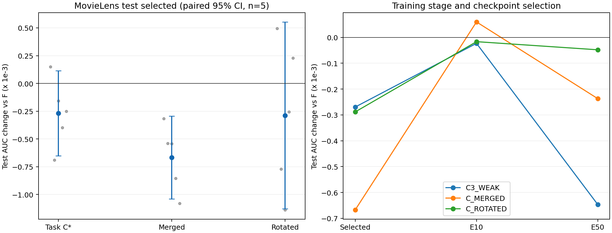

# C阶段实验分析：历史漂移条件增强

MovieLens C_FULL四阶段全部完成，六配置各五seed、每条50epoch。下表严格采用冻结的validation选择及test端点；KuaiRand C为DEFERRED_NOT_RUN。

## 身份和选择

- 实施提交 `933cb2f02790722af2fa4ea704f993b79df29afa`；source hash `d78a938330e5eb8334213c7f0beed66926956c35e1cff90c180260d12fd331e2`。
- selection hash `6f1e7c7f9f72c33efa11fee40b1d22f306cd1fad544c0323b024fb090136286d`；ENDPOINTS SHA-256 `c74a65284cdb4bda8eab94ed73f590716667e6556ae0ef62907712807e3b79ba`。
- 搜索赢家 `C3_WEAK`；最终validation保留 `C_MERGED`；下一动作为 `STOP_AND_REPORT`。
- 新增30条独立online/Adam/teacher轨迹、1500epoch、30000次Adam和3000次模型validation；γ0父F/online仅复用五seed冻结端点。每条轨迹的online与fixedEMA是同一训练的两种估计器。
- 四阶段依次完成后冻结W12、W123、C_WINNER；仅最终C*及同γ/K的MERGED、ROTATED进入test，未按test重选符号、强度或刷新频率。

左为test selected对F的五seed配对均差、95%CI与逐seed点，单位10⁻³ AUC；右为相同方案在selected/E10/E50的增量。

## 有限搜索与validation选择

| 配置 | γ | K | V AUC均值±SD | 对F最差格ΔAUC | 六格保护 | selected epochs | 核心worker秒 |
|---|---:|---:|---:|---:|---|---|---:|
| C1_NEG | -2 | 20 | 0.759482867±0.000404409 | -0.000413810 | True | [23, 18, 20, 23, 22] | 2745.549 |
| C2_POS | 2 | 20 | 0.759526546±0.000390553 | -0.000177524 | True | [23, 18, 25, 26, 22] | 2609.461 |
| C3_WEAK | 0.5 | 20 | 0.759604346±0.000388144 | -0.000277577 | True | [23, 18, 22, 22, 22] | 2833.015 |
| C4_CADENCE | 0.5 | 40 | 0.759523104±0.000508983 | -0.000350009 | True | [23, 19, 25, 21, 20] | 2663.835 |
| C_MERGED | 0.5 | 20 | 0.759502839±0.000402752 | -0.000609718 | True | [23, 18, 25, 21, 18] | 2390.088 |
| C_ROTATED | 0.5 | 20 | 0.759524256±0.000357901 | -0.000495258 | True | [23, 20, 20, 23, 22] | 2207.749 |

## 冻结test与总收益/组件增量

置信区间为seed配对Student-t(df4)，同向数仅描述。正式模型比较独立报告平均AUC≥+.003、每格均差≥−.001及平均LL下降；内部组件比较不另设+.003门。

| 方法 | 比较对象 | test AUC均值±SD | ΔAUC | 配对95%CI | test LL | ΔLL | AUC正向seed | 最差格ΔAUC | AUC资格/格保护/LL下降 |
|---|---|---:|---:|---|---:|---:|---:|---:|---|
| C3_WEAK | F | 0.779087147±0.000544062 | -0.000269455 | [-0.000653171, +0.000114261] | 0.496417590 | +0.000595325 | 1/5 | -0.000523184 | 内部增量/True/False |
| C3_WEAK | M3oE_fixed1 | 0.779087147±0.000544062 | +0.003897478 | [+0.002790133, +0.005004823] | 0.496417590 | +0.001526673 | 5/5 | +0.003257845 | True/True/False |
| C3_WEAK | HyperGate | 0.779087147±0.000544062 | +0.007675391 | [+0.005641162, +0.009709620] | 0.496417590 | -0.002136324 | 5/5 | +0.007127220 | True/True/True |
| C3_WEAK | AutoIFS | 0.779087147±0.000544062 | +0.006662558 | [+0.005982652, +0.007342464] | 0.496417590 | +0.000323364 | 5/5 | +0.004820018 | True/True/False |
| C3_WEAK | C_MERGED | 0.779087147±0.000544062 | +0.000397735 | [-0.000039255, +0.000834724] | 0.496417590 | +0.000237514 | 4/5 | +0.000192119 | 内部增量/True/False |
| C3_WEAK | C_ROTATED | 0.779087147±0.000544062 | +0.000018904 | [-0.000699134, +0.000736942] | 0.496417590 | +0.000101474 | 2/5 | -0.000171146 | 内部增量/True/False |
| C_MERGED | F | 0.778689413±0.000497437 | -0.000667190 | [-0.001039767, -0.000294612] | 0.496180076 | +0.000357811 | 0/5 | -0.000856723 | 内部增量/True/False |
| C_MERGED | M3oE_fixed1 | 0.778689413±0.000497437 | +0.003499743 | [+0.001998320, +0.005001167] | 0.496180076 | +0.001289159 | 5/5 | +0.003065726 | True/True/False |
| C_MERGED | HyperGate | 0.778689413±0.000497437 | +0.007277656 | [+0.005542196, +0.009013117] | 0.496180076 | -0.002373838 | 5/5 | +0.006793681 | True/True/True |
| C_MERGED | AutoIFS | 0.778689413±0.000497437 | +0.006264824 | [+0.005479915, +0.007049733] | 0.496180076 | +0.000085850 | 5/5 | +0.004430209 | True/True/False |
| C_ROTATED | F | 0.779068244±0.000543068 | -0.000288359 | [-0.001130366, +0.000553648] | 0.496316116 | +0.000493851 | 2/5 | -0.000579481 | 内部增量/True/False |
| C_ROTATED | M3oE_fixed1 | 0.779068244±0.000543068 | +0.003878574 | [+0.002787852, +0.004969297] | 0.496316116 | +0.001425199 | 5/5 | +0.003428991 | True/True/False |
| C_ROTATED | HyperGate | 0.779068244±0.000543068 | +0.007656487 | [+0.005677907, +0.009635067] | 0.496316116 | -0.002237798 | 5/5 | +0.007212060 | True/True/True |
| C_ROTATED | AutoIFS | 0.779068244±0.000543068 | +0.006643655 | [+0.005435465, +0.007851844] | 0.496316116 | +0.000221890 | 5/5 | +0.004591620 | True/True/False |

## 逐seed端点

| 方法 | seed | epoch | AUC | LL | ΔAUC对F | ΔLL对F |
|---|---:|---:|---:|---:|---:|---:|
| C3_WEAK | 2022 | 23 | 0.779266950 | 0.495711744 | +0.000149642 | +0.000846759 |
| C3_WEAK | 2023 | 18 | 0.778480060 | 0.497982365 | -0.000689615 | +0.000547057 |
| C3_WEAK | 2024 | 22 | 0.779860801 | 0.493682181 | -0.000157361 | -0.000216563 |
| C3_WEAK | 2025 | 22 | 0.778664359 | 0.495160340 | -0.000399473 | -0.000404432 |
| C3_WEAK | 2026 | 22 | 0.779163567 | 0.499551322 | -0.000250467 | +0.002203805 |
| C_MERGED | 2022 | 23 | 0.778799971 | 0.497329426 | -0.000317338 | +0.002464442 |
| C_MERGED | 2023 | 18 | 0.778630239 | 0.495621340 | -0.000539435 | -0.001813968 |
| C_MERGED | 2024 | 25 | 0.779474538 | 0.494793563 | -0.000543624 | +0.000894819 |
| C_MERGED | 2025 | 21 | 0.778208888 | 0.495678835 | -0.000854945 | +0.000114062 |
| C_MERGED | 2026 | 18 | 0.778333428 | 0.497477216 | -0.001080606 | +0.000129699 |
| C_ROTATED | 2022 | 23 | 0.779612180 | 0.495165413 | +0.000494871 | +0.000300428 |
| C_ROTATED | 2023 | 20 | 0.778397131 | 0.497316564 | -0.000772544 | -0.000118744 |
| C_ROTATED | 2024 | 20 | 0.778879779 | 0.494470793 | -0.001138383 | +0.000572049 |
| C_ROTATED | 2025 | 23 | 0.778808871 | 0.495022318 | -0.000254961 | -0.000542455 |
| C_ROTATED | 2026 | 22 | 0.779643257 | 0.499605494 | +0.000229223 | +0.002257978 |

## 六格与任务/训练阶段

| 方法 | cell | AUC | LL | ΔAUC对F | ΔLL对F |
|---|---|---:|---:|---:|---:|
| C3_WEAK | d0t0 | 0.774010452 | 0.586269434 | -0.000404106 | +0.001123972 |
| C3_WEAK | d0t1 | 0.789793535 | 0.407358281 | +0.000135763 | +0.000277197 |
| C3_WEAK | d1t0 | 0.782273752 | 0.574448975 | -0.000292946 | +0.000574567 |
| C3_WEAK | d1t1 | 0.801256146 | 0.390664068 | -0.000133462 | +0.000251730 |
| C3_WEAK | d2t0 | 0.756105982 | 0.581466909 | -0.000523184 | +0.000777692 |
| C3_WEAK | d2t1 | 0.771083018 | 0.438297873 | -0.000398796 | +0.000566793 |
| C_MERGED | d0t0 | 0.773642047 | 0.586446758 | -0.000772511 | +0.001301296 |
| C_MERGED | d0t1 | 0.789302822 | 0.406808245 | -0.000354950 | -0.000272839 |
| C_MERGED | d1t0 | 0.781817303 | 0.574993252 | -0.000749394 | +0.001118844 |
| C_MERGED | d1t1 | 0.800710964 | 0.390572911 | -0.000678644 | +0.000160572 |
| C_MERGED | d2t0 | 0.755772442 | 0.581321823 | -0.000856723 | +0.000632606 |
| C_MERGED | d2t1 | 0.770890899 | 0.436937467 | -0.000590915 | -0.000793612 |
| C_ROTATED | d0t0 | 0.773835077 | 0.586282006 | -0.000579481 | +0.001136544 |
| C_ROTATED | d0t1 | 0.789464232 | 0.407449869 | -0.000193540 | +0.000368785 |
| C_ROTATED | d1t0 | 0.782286157 | 0.574722777 | -0.000280541 | +0.000848368 |
| C_ROTATED | d1t1 | 0.801340839 | 0.390579408 | -0.000048769 | +0.000167070 |
| C_ROTATED | d2t0 | 0.756228994 | 0.581234296 | -0.000400171 | +0.000545078 |
| C_ROTATED | d2t1 | 0.771254163 | 0.437628342 | -0.000227650 | -0.000102738 |

| 方法 | endpoint | ΔMacro AUC | ΔMacro LL | Δtask0 AUC | Δtask1 AUC | ΔTraffic AUC | ΔPooled AUC |
|---|---|---:|---:|---:|---:|---:|---:|
| C3_WEAK | selected | -0.000269455 | +0.000595325 | -0.000406745 | -0.000132165 | -0.000267877 | -0.000267186 |
| C3_WEAK | E10 | -0.000023219 | +0.000078331 | -0.000018190 | -0.000028248 | -0.000024018 | -0.000080693 |
| C3_WEAK | E50 | -0.000646720 | +0.000648847 | -0.000654490 | -0.000638949 | -0.000673559 | -0.000713347 |
| C_MERGED | selected | -0.000667190 | +0.000357811 | -0.000792876 | -0.000541503 | -0.000675445 | -0.000737343 |
| C_MERGED | E10 | +0.000059686 | +0.000083888 | +0.000088462 | +0.000030910 | +0.000057548 | +0.000108179 |
| C_MERGED | E50 | -0.000237074 | -0.000096398 | -0.000330082 | -0.000144065 | -0.000219240 | -0.000256019 |
| C_ROTATED | selected | -0.000288359 | +0.000493851 | -0.000420064 | -0.000156653 | -0.000272178 | -0.000322049 |
| C_ROTATED | E10 | -0.000016656 | -0.000216095 | -0.000014081 | -0.000019231 | -0.000022838 | -0.000010644 |
| C_ROTATED | E50 | -0.000048075 | -0.001232843 | +0.000086788 | -0.000182938 | -0.000092272 | -0.000079766 |

## online与固定EMA

各估计器分别按自身validation曲线选点；下表的online比较改变训练轨迹，EMA−online同时含估计与选点差异。

| 方法online | test AUC | test LL | ΔAUC对父online | ΔLL对父online | fixedEMA−online AUC | fixedEMA−online LL |
|---|---:|---:|---:|---:|---:|---:|
| C3_WEAK_online | +0.774609192 | +0.497458586 | -0.000890609 | +0.006970603 | +0.004477956 | -0.001040996 |
| C_MERGED_online | +0.774227786 | +0.495143391 | -0.001272015 | +0.004655408 | +0.004461627 | +0.001036685 |
| C_ROTATED_online | +0.775025920 | +0.491403187 | -0.000473881 | +0.000915204 | +0.004042324 | +0.004912929 |

## 实际机制与成本

| 配置 | epoch | Adam | V次数 | 刷新 | 非零统计刷新 | 非零漂移刷新 | 最大mean drift norm | 最大mean statistic trace |
|---|---:|---:|---:|---:|---:|---:|---:|---:|
| C1_NEG | 250 | 5000 | 500 | 250 | 245 | 245 | 4.16958061 | 1 |
| C2_POS | 250 | 5000 | 500 | 250 | 245 | 245 | 4.06012724 | 1 |
| C3_WEAK | 250 | 5000 | 500 | 250 | 245 | 245 | 4.17000509 | 1 |
| C4_CADENCE | 250 | 5000 | 500 | 125 | 120 | 120 | 4.04836746 | 1 |
| C_MERGED | 250 | 5000 | 500 | 250 | 245 | 245 | 3.97538813 | 1 |
| C_ROTATED | 250 | 5000 | 500 | 250 | 245 | 245 | 4.30543561 | 1 |

| 配置 | training秒 | probe秒 | validation秒 | 核心worker计时合计秒 |
|---|---:|---:|---:|---:|
| C1_NEG | 2485.836 | 19.546 | 240.167 | 2745.549 |
| C2_POS | 2299.272 | 23.677 | 286.512 | 2609.461 |
| C3_WEAK | 2544.054 | 23.672 | 265.289 | 2833.015 |
| C4_CADENCE | 2404.344 | 13.138 | 246.353 | 2663.835 |
| C_MERGED | 2137.610 | 20.062 | 232.417 | 2390.088 |
| C_ROTATED | 1965.333 | 18.452 | 223.965 | 2207.749 |

30条轨迹对应seed的250个epoch数据顺序、5000个step的基础Gaussian noise hash跨六配置一致。teacher/online preupdate时钟在全部30000步均为当前step−1。各轨迹用自身θ/φ/statistic，不能从共享噪声或相同γ/K推断不同轨迹实际协方差谱相同。ROTATED只对自身统计做固定正交旋转；MERGED独立重算合并任务统计。

成本为各进程记录的training+probe+validation时间之和，包含并发等待，不是整机elapsed或CUDA kernel独占时间；源字段gpu_seconds/wall_seconds均使用该合计。未额外加总sampling子项。RAM-only参数保留至冻结评价完成，原始逐seed、全曲线、配对差与运行事件见本attempt。

## 科学判断

- **STRONG，描述性事实：** C3_WEAK、MERGED、ROTATED的test selected AUC均值均低于F，LL均值均高于F；全部1375次刷新中1345次统计和漂移非零，其余30次对应各轨迹初始化。条件分支实际运行。
- **MEDIUM：** 冻结最终方案MERGED对F的AUC均差−0.000667190，五seed均负，95%CI[−0.001039767,−0.000294612]，LL+0.000357811。当前C方案未建立对固定EMA的稳定组件增量；完整方案对普通M3oE的AUC+0.003499743、六格保护通过、LL+0.001289159，整体排序收益仍成立。
- **WEAK，任务分解必要性：** 任务C*对MERGED AUC+0.000397735、4/5正向，但95%CI跨0且LL+0.000237514；对ROTATED仅+0.000018904、2/5正向、CI跨0，LL+0.000101474。两组必要性比较没有一致支持。
- **MEDIUM，阶段与指标分化：** C3_WEAK对F的validation+0.000082331转为test selected−0.000269455；MERGED在E10 AUC+0.000059686、selected−0.000667190、E50−0.000237074。ROTATED的E50 LL−0.001232843，而selected LL+0.000493851。单阶段改善不能代替所定义的selected目标。
- **WEAK，竞争解释：** 漂移方向可能没有提供超出固定EMA的排序信息；各向异性可能主要改变平滑/正则强度；闭环统计随自身训练变化可能放大选点差异。三个online均值相对父Gaussian online下降，说明变化已进入训练轨迹，不能全部归因于EMA读出。
- MERGED及ROTATED六格AUC对F均下降，C3_WEAK仅d0t1略升；没有稳定的小域改善/大域下降模式。最能分辨方向信息与各向异性强度的下一实验，是固定train-only参考统计与每步谱后配对真实方向/固定旋转方向，并保留F；新一轮需预注册、五seed及封存自然人口评价。本轮按冻结规则STOP_AND_REPORT。
