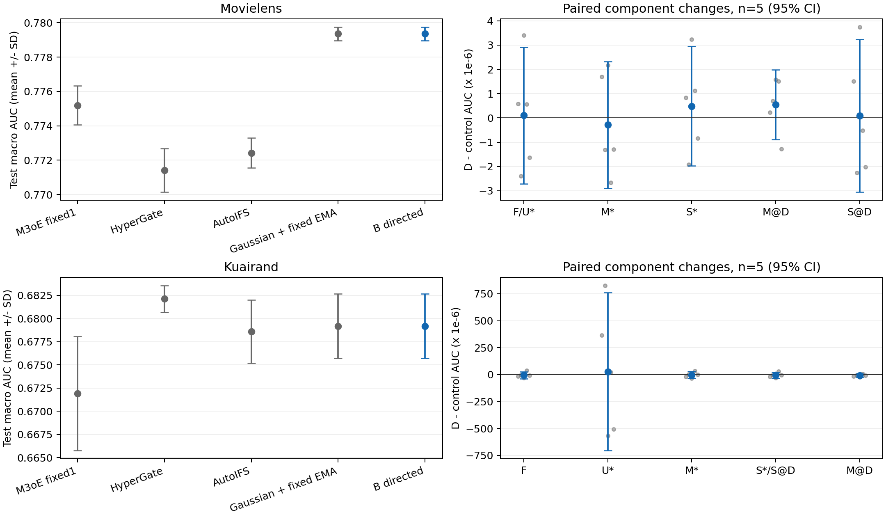
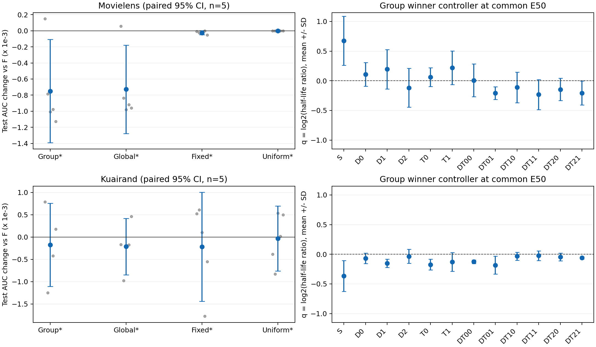
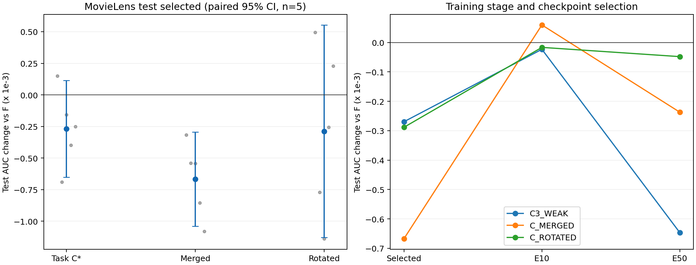

# 增强响应、参数历史与条件增强实验报告

实验身份：`AUG_HISTORY_20261105`。规划入口为[07_FINAL_CODEX_ENTRY](../../research_plans/26-11-5/07_FINAL_CODEX_ENTRY.md)，固定方案来自main的`research_plans/26-11-5/`。本报告将完整方案的收益、内部组件增量和运行事实分别记录；AUC与LogLoss独立判断。

## 主要结果

2026-11-05至11-06完成冻结路线：B两数据 → A两数据 → C仅MovieLens，所有科学候选均为五seed、50epoch。合计50次物理全预算训练、2500epoch、64500次Adam、19000次模型validation。**当前B/A/C均未建立对固定EMA控制F的稳定新增收益。** B方向增量接近零；A出现validation/test和早期/selected分化；C最终MERGED对F的test AUC五seed均下降。完整Gaussian+EMA方案对普通M3oE的既有AUC总收益保留，新组件的独立必要性未获支持。

| 数据集/冻结最终方案 | test AUC / LL | ΔAUC对F / ΔLL对F | 对主发表模型ΔAUC / ΔLL | 正式AUC/六格/LL下降 |
|---|---|---|---|---|
| ML C_MERGED | .778689413 / .496180076 | −.000667190 / +.000357811 | 对M3oE +.003499743 / +.001289159 | 通过 / 通过 / 未下降 |
| KR A_FIXED_S_FAST | .678962915 / .435829423 | −.000217263 / +.000311569 | 对HyperGate −.003149636 / −.004760317 | 未达标 / 未通过 / 下降 |

上表方案由validation和预定简化规则冻结；test用于评价。ML C、KR A均已到各自规定的停止节点；KR C为`DEFERRED_NOT_RUN`，B+C及计划外搜索未运行。

## 研究问题与比较结构

本轮检验三个有限设计。B用增强项对真实Adam更新的反事实响应确定低秩方向，在这些方向改变参数EMA半衰期；D为两任务方向，M为合并方向，S为固定符号打散控制，U为全参数统一时间尺度，F为源固定EMA。A依据模型实际计算路径划分S/D/T/DT十二组，比较固定profile、分组控制器、全局控制器及统一EMA。C让自身online与旧teacher的输入导数漂移进入增强协方差，比较任务条件、合并任务和固定正交旋转控制。

B/A的online训练不接受影子反馈；同一seed中所有影子共用一条online路径。C每个配置独立训练自身online、Adam和teacher。三个阶段均执行DESIGN → IMPLEMENT → 独立REVIEW → RUN → 主代理ANALYZE；实施和审查由不同agent完成。设计、实施报告及审查签名位于本目录，运行器只记录原始结果。

正式模型参照为M3oE fixed1、HyperGate和AutoIFS的已发表模型适配。主比较固定ML=M3oE、KR=HyperGate；全部三模型均保留。发表模型端点来自固定源`c8675ae2923c15b6965884b140b5b646690cd95e`，人口和AUC选点对应；各模型沿用自身batch、优化器和预算，HyperGate部分超参为`UNVERIFIED_PROPOSAL`。F及所有EMA/增强改造为内部方法和控制。

## 数据、训练与评价

采用自然人口`FULLTRAIN_NATURAL80_10_10`，原行序80/10/10划分，编码和缩放仅拟合train；KR先划分再筛tab0/1/4。现有只读缓存经原CSV、数组、行号、编码器/缩放器和split hash核验后复用。缺失的strict_v1目录不参与本流程。

| 项目 | MovieLens | KuaiRand |
|---|---:|---:|
| train / validation / test | 800167 / 100021 / 100021 | 2006132 / 250767 / 250767 |
| d0 / d1 / d2 train人口 | 155949 / 318599 / 325619 | 172782 / 1743898 / 89452 |
| 域定义 | 年龄{1,18} / {25} / {35,45,50,56} | tab0 / tab1 / tab4 |
| task0 / task1 | rating>3 / rating>4 | click / long_view |
| 参数量 | 773470 | 1614254 |
| Gaussian κ / λ / 增强域 | .05 / .5 / d0 | .1 / .5 / d0 |
| F的ρ | .9828205985452511 | .995 |
| 每epoch Adam步数 | 20 | 49 |

候选均为M3oE fixed1，embedding16、FCN[512,256,256,64]、4 shared experts、原融合系数1。训练50epoch、batch40960、FP32、普通coupled Adam(lr=.01, betas=.9/.999, eps=1e-8)，weight decay为ML1e-4/KR1e-5；AMP、TF32、clipping关闭。每一科学候选均完成seed2022–2026五seed全预算，未用单seed性能预筛。Python3.13.5、PyTorch2.9.0+cu126，使用项目Conda环境；两张共享RTX3090按单卡显存及功耗门派发。

每条完整validation曲线按六格等权macro AUC的最早严格最大值选checkpoint；全五seed共用同一HPO候选，六格保护和预定简化规则用于选择。配置、选点和下一动作在本阶段test访问前冻结。test沿用历史研究划分，泛化证据覆盖该人口。Macro为六格等权；Traffic为按人口加权cell指标；Pooled为跨域池化后按任务平均，三者分别报告。

统计单位为seed；报告均值、样本SD、配对差、Student-t(df4)95%CI及方向数。正式总收益按平均ΔAUC≥+.003、每格平均ΔAUC≥−.001判断；平均ΔLL<0独立认定LL下降。CI和同向seed数为描述统计。内部组件保留实际增量，不附加+.003门。

## B：方向确实启用，独立增量接近零

两数据各五条online、每条15影子均完成50epoch。D赢家为ML `D_H05_K10`、KR `D_H05_K20`。ML D−F的test selected ΔAUC为 **+0.000000104**、ΔLL **−0.000012341**；KR为 **−0.000004946 / +0.000004089**。ML有3/5、KR有1/5 seed AUC正向。共同E10/E50也未出现有实用幅度的方向优势；D/M/S及F曲线几乎重合。此结论对当前模型、有限h/K网格和预算的证据为 **STRONG**。

这保留了完整Gaussian+EMA对普通模型的既有收益。例如ML F的test AUC/LL为 **0.779356602 / 0.495822265**，对普通M3oE的AUC **+0.004166933**，六格均改善至少0.003656641，LL **+0.000931348**。其AUC总收益与LL代价分别成立。KR F为 **0.679180178 / 0.435517854**，对主参照HyperGate的AUC仍较低；不得把对较弱普通M3oE的收益等同于战胜KR主参照。

实际诊断显示ML500次、KR1225次刷新全部D秩2/M秩1；反事实前后state hash一致，最大FP32正交误差分别5.25e−8/3.54e−8。响应分支运行和秩成立的证据为 **STRONG**。现有日志尚未记录innovation投影能量，不能区分“方向无额外预测信息”与“方向修正只作用于很小的innovation”；机制解释强度为 **WEAK**。

B在validation上的D−F仅ML +4.84e−7、KR +9.98e−6，两数据均符合`B_SIMPLE_SUFFICIENT`并触发A。下一动作在test前冻结。逐seed、所有家族独立调参/同hK匹配控制、六格/任务和共同阶段结果见[B分析](B_STAGE_ANALYSIS.md)及[原数表](../../artifacts/aug_history_20261105/attempt1/B/ENDPOINTS.csv)。

## A：时间尺度改变结果，当前分组规则没有稳定selected增量

A两数据各五seed、每条15影子完成50epoch；500个对应epoch的online参数hash和数据顺序hash与B逐一相同。所有控制器q_before均等于上次q_after，包含RAM恢复边界。ML1500/KR3660次控制器调用实际发生，六格探针有效，q确实更新。新增差异来自估计器和合法选点，源训练变化已由逐epoch身份核对排除。

| 数据集/validation赢家 | test ΔAUC对F | 配对95%CI | ΔLL对F | AUC正向seed |
|---|---:|---|---:|---:|
| ML GROUP_020_K20 | −0.000749775 | [−0.001392364, −0.000107187] | −0.000813106 | 1/5 |
| ML GLOBAL_020_K20 | −0.000727912 | [−0.001276337, −0.000179486] | −0.001471927 | 1/5 |
| ML FIXED_T_FAST | −0.000024441 | [−0.000050541, +0.000001658] | +0.000895296 | 1/5 |
| KR GROUP_005_K40 | −0.000174743 | [−0.001107962, +0.000758476] | −0.000097733 | 2/5 |
| KR GLOBAL_020_K20 | −0.000212942 | [−0.000847055, +0.000421171] | −0.000410427 | 1/5 |
| KR FIXED_S_FAST | −0.000217263 | [−0.001439406, +0.001004881] | +0.000311569 | 3/5 |

ML最佳家族validation值来自FIXED_T_FAST，仅比F高0.000041901，F落在0.0002容忍度内且更便宜，最终选F并触发C。KR FIXED_S_FAST在validation对F **+0.001009861**且六格保护通过，按规则保留该profile并停止KR后续C；其半衰期S×.5、D/T/DT×2。test增量没有复现：平均AUC下降0.000217263，最差格d2t0下降0.001824793，内部六格保护未通过。KR C状态为`DEFERRED_NOT_RUN`，不作性能阴性解释。

新增分组/自适应家族的validation赢家在test selected均低于F，这是本矩阵的 **STRONG** 描述性事实。ML GROUP/GLOBAL的AUC下降伴随LL下降、4/5 seed AUC为负，排序与概率损失取舍的证据为 **MEDIUM**。KR固定profile的CI跨零、三seed正向，稳定增量的证据为 **WEAK**。GROUP对独立调参及必要匹配GLOBAL/固定/统一控制未建立一致优势。

阶段结果有明确矛盾：ML GROUP对F在E10/E50为+0.000849/+0.000548，selected却为−0.000750；KR固定profile在E10为+0.004165、E50为−0.000303、selected为−0.000217。早期加速或固定epoch优势没有转为所定义的selected目标收益。train排序探针偏好的时间尺度可能与holdout不同，路径差异也可能尚未被当前控制律利用；两项为竞争解释，当前证据均为 **WEAK**。

完整家族结果、逐seed选点、六格及task0/task1/Traffic/Pooled的selected/E10/E50比较见[A分析](A_STAGE_ANALYSIS.md)及[原数表](../../artifacts/aug_history_20261105/attempt_A1/A/ENDPOINTS.csv)。

## C：条件统计非零，当前版本未超过F或建立真实方向必要性

ML完成六配置×五seed的30条独立训练。阶段I在γ=−2/+2、K20间选+2；阶段II加入同号弱γ=.5后选C3_WEAK；阶段III加入γ=.5/K40后仍选C3_WEAK。四个搜索配置均满足validation六格保护。阶段IV按C*的γ=.5/K20独立训练MERGED和ROTATED五seed；本阶段所有50epoch均完成后才冻结最终选择和test端点。

| 配置 | validation AUC | test AUC均值±SD | ΔAUC对F（95%CI） | ΔLL对F | AUC正向seed |
|---|---:|---|---|---:|---:|
| C3_WEAK，任务条件 | .759604346 | .779087147±.000544062 | −.000269455 [−.000653171,+.000114261] | +.000595325 | 1/5 |
| C_MERGED | .759502839 | .778689413±.000497437 | −.000667190 [−.001039767,−.000294612] | +.000357811 | 0/5 |
| C_ROTATED | .759524256 | .779068244±.000543068 | −.000288359 [−.001130366,+.000553648] | +.000493851 | 2/5 |

最终validation按规定选择更便宜、距最高分不超过.0002的MERGED，尽管其V分数略低于F。该简化在test上付出相对任务C*约0.000398 AUC的差值；test结果不回写冻结选择。MERGED对F五seed AUC均负、配对区间全负，当前版本没有稳定增量的证据为 **MEDIUM**。三个冻结C方案test selected的AUC均值低于F、LL均值高于F是 **STRONG** 描述性事实；C3/ROTATED的配对区间跨0，当前五seed尚不能确定其平均效应方向。

任务C*相对MERGED的AUC **+0.000397735**、4/5 seed正向、95%CI[−0.000039255,+0.000834724]，LL **+0.000237514**；相对ROTATED仅 **+0.000018904**、2/5 seed正向、CI[−0.000699134,+0.000736942]，LL **+0.000101474**。任务分解及真实方向独立必要性的证据为 **WEAK**。MERGED、ROTATED各自产生自身统计并改变自身训练，固定γ/K与共享基础噪声不意味着轨迹间具有相同协方差谱。

C3_WEAK对F的V增量+0.000082331转为test selected−0.000269455；MERGED的E10为+0.000059686、E50为−0.000237074、selected为−0.000667190。ROTATED在E50的LL下降0.001232843，selected LL却上升0.000493851，阶段和选点分化证据为 **MEDIUM**。selected两任务AUC均下降，C3 task0/task1为−0.000406745/−0.000132165，MERGED为−0.000792876/−0.000541503；Traffic和Pooled方向也为负。

完整MERGED+EMA对普通M3oE AUC **+0.003499743**、最差格 **+0.003065726**，满足正式AUC及六格门；LL **+0.001289159**。对HyperGate和AutoIFS分别AUC+0.007277656/+0.006264824，LL−0.002373838/+0.000085850。该整体AUC资格与“新条件增强优于F”是不同命题，后者未获支持。

机制诊断显示1375次刷新中1345次漂移和统计非零，另30次是各轨迹初始化；30000步teacher/online preupdate时钟均为当前step−1。30条轨迹同seed的250个epoch顺序和5000个基础噪声hash跨六配置一致。条件分支确实启用的证据为 **STRONG**。三个C online的selected AUC对父Gaussian online也分别下降0.000891/0.001272/0.000474，训练路径已经发生变化。竞争解释包括：输入导数漂移没有增加所需的排序信息、各向异性主要改变平滑强度、闭环统计演化与选点共同改变结果；目前归因强度均为 **WEAK**。

完整搜索V曲线、逐seed、六格、模型/数据/选点身份、online/EMA、共同阶段及成本见[C分析](C_STAGE_ANALYSIS.md)、[标量核对](C_SCALAR_AUDIT.json)及[原数表](../../artifacts/aug_history_20261105/attempt_C1/C/ENDPOINTS.csv)。

## 域规模、难度与收益分配

| 数据/域 | train人口 | train task0/task1正例率 | 普通M3oE test task0/task1 AUC |
|---|---:|---|---|
| ML d0 | 155949 | .5610 / .2348 | .770298 / .785173 |
| ML d1 | 318599 | .5633 / .2202 | .778130 / .797449 |
| ML d2 | 325619 | .6021 / .2396 | .752263 / .767825 |
| KR d0 | 172782 | .0909 / .0412 | .635617 / .645909 |
| KR d1 | 1743898 | .3778 / .2561 | .698833 / .726663 |
| KR d2 | 89452 | .6169 / .4848 | .653260 / .671157 |

ML最大域d2的普通模型AUC最低；KR最小域d2的AUC高于较大d0。域规模不能直接替代基准排序难度。KR基率差异很大，跨域LL还受标签熵与校准影响。只有每数据三域且规模与身份、标签、特征及增强域共同变化，规模作为主要因果解释的证据为 **WEAK**。

B的D−F没有明显“小域改善/大域下降”模式。A在KR的GROUP相对F使最大域d1两任务下降约0.000545/0.000561，最小d2改善约0.000298/0.000188，存在该配置下的局部取舍；但固定profile反而使最小d2下降0.001825/0.001370，中等d0改善0.001086/0.000808。ML GROUP六格全部下降。取舍依赖具体规则、任务与阶段，不能提升为统一规模规律。

C的MERGED/ROTATED六格对F均下降；C3_WEAK仅最小d0的task1改善0.000135763，同域task0下降0.000404106，最大d2两任务下降0.000523184/0.000398796。任务条件性比单一规模分类更符合这些局部结果，规模作为主解释仍为 **WEAK**。

## 重复现象、矛盾与最有区分力的下一实验

重复现象是：固定EMA保留ML对普通M3oE的整体排序收益；新增方向/分组/漂移信息的实际启用没有自动带来对强F的独立增量。新增A的家族赢家和C的三个冻结方案test均值均低于F，支持本轮停止新增复杂度。与之并存的矛盾是A早期优势、KR validation优势、C任务条件对MERGED的小幅优势，以及部分共同阶段LL下降；它们保留为局部现象，不能被宏均值抹去，也未替代selected目标。

最有区分力的下一实验，是**在固定train-only参考统计、相同逐步协方差谱和强度下，配对真实方向与固定旋转方向，并保留F**。这可证伪“真实方向携带独立信息”，同时将方向语义与各向异性强度/闭环谱变化区分开；采用预注册配置、五seed和封存自然人口评价，可检验本轮validation信号是否迁移。该建议未加入当前矩阵；本轮已按`STOP_AND_REPORT`完成。

## 执行预算与工程检查

| 阶段 | 物理训练执行 | 提交epoch | 真实Adam | 模型validation记录 |
|---|---:|---:|---:|---:|
| B，两数据各五seed | 10 | 500 | 17250 | 8000 |
| A，两数据各五seed | 10 | 500 | 17250 | 8000 |
| C，ML六配置各五seed | 30 | 1500 | 30000 | 3000 |
| 合计 | 50 | 2500 | 64500 | 19000 |

B/A十个父路径各执行两次，逐epoch完全一致；合计为40个唯一配置×数据集×seed训练路径，统计上每候选始终n=5。影子、online/EMA、不同checkpoint和父端点复用均不新增seed。KR C未触发，B+C未运行；有限γ/h/K矩阵未扩展。

| 验收 | 已完成的最小检查 | 正式运行前审查 |
|---|---|---|
| B | 11项CPU检查；两GPU原batch40960源loss/梯度/Adam/EMA等价检查 | PASS WITH FIXES，三项生命周期阻塞修复后放行 |
| A | 8项A检查及11项共享/B检查；实际K20控制路径与源online hash一致 | PASS |
| C | 7项C检查及11项共享/B检查；独立7项复核和四阶段标量集成；原batch γ0精确退化及21步非零统计GPU smoke | PASS，ML-only |

smoke与标量集成标为ENGINEERING_ONLY，不参与性能选参或科学seed计数。正式训练没有按中途性能早停。

运行中B有四次经授权的RAM轮换；A有两次必要RAM轮换和一次不需要的重复轮换。重复事件发生于KR2024替换worker的E39/40、RAM可用约29%时；旧运行器重复使用了已消费授权，主代理停止其调度并交由新运行器完成。RAM中已提交状态全部保留，B/A对应500个online/order hash及A控制器q链最终逐一一致。未提交的部分epoch额外开销没有完整计时，成本表不对其补估。C训练完成期间未执行worker轮换。

| 阶段 | training秒 | probe秒 | validation秒 | 核心worker计时合计秒 |
|---|---:|---:|---:|---:|
| B | 8206.223 | 1117.640 | 11239.245 | 20563.108 |
| A | 10457.704 | 1791.151 | 13722.035 | 25970.890 |
| C | 13836.449 | 118.546 | 1494.703 | 15449.698 |
| 合计 | 32500.376 | 3027.337 | 26455.984 | 61983.696 |

这些数值是并发环境中各进程记录的training+probe+validation之和，包含GPU等待；源字段`gpu_seconds`/`wall_seconds`使用同一个合计，不能解释为独占CUDA kernel秒或整机elapsed。A sampling是probe子项，不重复加总。HPO简化中的成本也沿用这个实测口径。IPC/冻结评价/日志等额外耗时另见运行记录，不包含在本表。

B/A/C的RAM guardian均在冻结评价、报告完成后经明确授权释放，C释放命令退出0并返回`RELEASED`，PID118013已不存在。交付仅含源码、配置、hash、标量/曲线、图和报告；模型、优化器、Q/A/root/R及checkpoint没有写入磁盘。

## 来源与复核入口

- PLAN_REF：`2645f1f724f52f5ed5dea4b479335c0dc12fabcd`；SOURCE_REF：`c8675ae2923c15b6965884b140b5b646690cd95e`。
- manifest SHA-256：`76345194a8d09c8cadf3544e39c35174a452abb3827f071250da7f259c45749d`。
- raw ML SHA-256：`f060ecb8fb7745f1e24998837ca5a1ec3e18b610f288e73549c0203a9822b5e4`；KR：`a1872911e49cb9324a89faf84df1dbed2077357496edd760ba0ab7b8f4fc681f`。
- 设计/实施/独立审查：[B](DESIGN_SPECIFICATION.md)、[A](DESIGN_SPECIFICATION_A.md)、[C](DESIGN_SPECIFICATION_C.md)；对应`CODER_IMPLEMENTATION_REPORT*.md`、`REVIEW_REPORT*.md`及绑定source hash的`REVIEW_ACCEPTANCE*.json`。
- 运行记录：[B](RUNNER_REPORT.md)、[A](RUNNER_REPORT_A.md)、[C](RUNNER_REPORT_C.md)。每attempt包含PREPARED、SOURCE_RECEIPT、STAGE0_CHECKS、GPU_SMOKE、ADMISSIONS、RETRIES、IPC_COSTS、逐epoch标量、完整V曲线、HPO、冻结选点、decision、逐seed/配对数表和成本。
- B/A/C分析分别由[analyze_b.py](analyze_b.py)、[analyze_a.py](analyze_a.py)、[analyze_c.py](analyze_c.py)从冻结标量重建；[build_ledger_addition.py](build_ledger_addition.py)将96条配置×数据集×端点记录写入[主台账](../../MDMT_ALGORITHM_METRICS_LEDGER.md)，包括六格绝对AUC/LL及Macro/Traffic/Pooled。
- 三阶段source hash、selection hash及ENDPOINTS SHA-256均见对应阶段分析和RUN_MANIFEST；具体epoch/model/data/split/preprocessing/layout身份逐行保留。B/A端点hash分别`6d9b9cb7b1c188c732018b416b946386170834aa664b19f3ed5180976bc2b935` / `0c8d113e88214c60e3555b92e809c238d8d8bd274e8bd872b7052f38d377e226`，C为`c74a65284cdb4bda8eab94ed73f590716667e6556ae0ef62907712807e3b79ba`。
