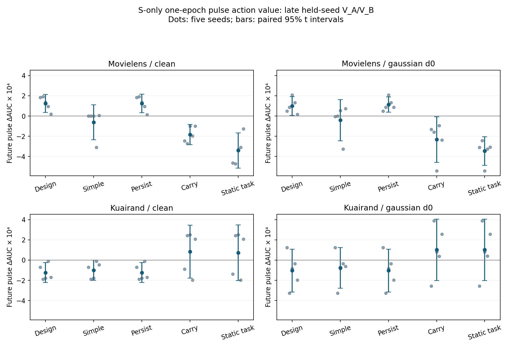

# MDMT 自适应 EMA：A0 收益持续性与控制价值实验报告

完成日期：2026-11-09。研究标识：`MDMT_ADAPTIVE_EMA_20261109`。交付分支：`26-11-09`。

## 1. 结论与阶段决定

**训练面板上的收益方向具有持续性；本轮指定的持续性预测器没有形成超越简单参照的稳定动作增量，静态任务策略也没有区别于统一动作。A0 决定为 `NO_ACTIONABLE_SIGNAL`，按预设停止条件结束本轮，保留固定 EMA F。** A1、闭环 B 和正式评价 C 均为 `NOT_TRIGGERED`。

主范围为 KuaiRand Gaussian D0、共享参数 S 的 GLOBAL/TASK0/TASK1。GLOBAL 的 C_persist 相对 F，未来训练审计面板 P_B 的 ΔAUC 为 **−0.000421092 ± 0.000109264**，五个 seed 均负；验证行侧均值为 **−0.000103584 ± 0.000169881**，1/5 正向。两侧的实际 LogLoss 分别增加 **0.000213991**、**0.000064208**。

直接沿用当前收益的 C_carry 保留了较好的方向预测：GLOBAL 的 P_B 方向准确率为0.96，验证侧为0.60。然而，它相对统一 Fast 的 GLOBAL 验证 ΔAUC 只有 **−0.000000478**；静态 task0/task1 策略在全部五折、两个训练面板上均选择 Fast，与统一策略的增量精确为0。当前数据支持保留这些简单机会参照，未给新增动态或任务专属历史状态提供足够增量依据。

| 判断 | 证据强度 | 依据与研究决定 |
| --- | --- | --- |
| KR Gaussian 训练观测的 Fast−Slow 方向反复保持 | STRONG（训练面板） | 晚期 P_A→P_B 符号一致率0.96；不能由此直接指定完整模型控制器 |
| 持续性迁移至晚期验证侧明显减弱 | MEDIUM | 符号率0.60，Pearson −0.012、Spearman −0.010；整体时序相关含较强阶段成分 |
| 冻结 C_persist 没有带来主范围动作增量 | STRONG（P_B）；MEDIUM（验证侧） | 三个主范围的 P_B 动作−F均为五seed负；验证均值均负，区间跨0；相对 C_design 的动作增量均为0 |
| 当前静态任务偏好没有区别于统一 Fast | STRONG（已选政策的增量） | 30个主条件政策记录的动作均为 Fast；全部逐seed task−uniform AUC/LL为0 |
| raw carry 的局部任务增量值得升级为动态控制 | WEAK | TASK0 的小幅均值增量在面板/seed之间反转，GLOBAL不胜统一策略；不触发后续训练 |

全部门值和逐seed输入见 [A0_DECISION.json](../../artifacts/ema_adaptive_20261109/attempt1/A0_DECISION.json)。本轮完成了设计、实现、独立审查、A0运行和分析，停止条件已满足。

## 2. 数据、模型与估计对象

复用11/07机制研究的20条真实自然人口轨迹：MovieLens/KuaiRand × Clean/Gaussian D0 × seeds **2022、2023、2024、2025、2026**。每个条件的独立统计样本为5。模型为 M3oE fixed1，embedding16、FCN [512,256,256,64]、4个共享expert；历史训练为50epoch、batch40960、coupled Adam lr=.01、betas=(.9,.999)、eps=1e−8，ML/KR weight decay分别1e−4/1e−5，FP32、AMP/TF32关闭。本轮新增训练、Adam步、GPU训练时间和Test评价均为0。

F 的每步 rho 为 ML 0.9828205985452511、KR 0.995；Fast=rho_F²，Slow=sqrt(rho_F)。只改变共享 S 的历史读出，非S参数沿用同窗F。每个pulse从该窗口起点F初始化，**持续恰好1个epoch**，结束于epoch5、10、…、50；相邻观测间隔5epoch。当前窗口信号预测的是e+5结束的新pulse收益。

P_A/P_B为互不重叠的训练观测面板，不改变训练Loader。其AUC来自固定正负排名探针，LL来自自然探针；V_A/V_B为固定自然验证行侧。验证侧结果先在同seed内等权平均，再计算五seed均值、样本SD及95%配对t区间 `mean ± 2.776445×SD/√5`。六格等权Macro、task三域等权聚合均在选动作前完成。窗口、六格、面板及参数组不增加独立样本数。

新预测器在其他四个seed的早期origin5/10/15拟合，用留出seed的晚期origin25/30/35/40/45评分。每dataset每折144行拟合、60行评分；特征和未来拟合标签均取P_A，P_B/V仅评分。C_design保留身份与epoch，C_persist仅在其上增加当前Fast−F和Slow−F；C_simple、M0、M2及M3按源特征定义重拟合。ridge alpha=1，连续量只按训练折标准化。C_carry直接用当前收益预测未来，无拟合。P_B反向拟合单列为对称性诊断。

源历史Validation-fit OOF另存于 [A0_HISTORICAL_VALIDATION_FIT.csv](../../artifacts/ema_adaptive_20261109/attempt1/A0_HISTORICAL_VALIDATION_FIT.csv)。它使用验证标签拟合，与本次训练面板拟合有不同标签人口和S-only范围，分别报告。

本轮没有新增selected checkpoint或完整模型端点。每窗F/Fast/Slow的epoch、state hash、轨迹身份、人数和绝对AUC/LL保存在 [A0_S_CONTRASTS.csv](../../artifacts/ema_adaptive_20261109/attempt1/A0_S_CONTRASTS.csv)。Traffic/Pooled和完整Test Macro沿用历史报告作为背景；A0的面板分数不替代这些终点。

## 3. 持续性：阶段趋势与晚期迁移

令D=Fast−Slow AUC收益。下表为KR Gaussian、GLOBAL的P_A(e)→另一侧(e+5)，先在seed内计算相关，再平均五seed。

| 时间范围 | 评分侧 | 非零方向一致率 | Pearson | Spearman | Kendall |
| --- | --- | ---: | ---: | ---: | ---: |
| 全部origin5…45 | P_B | 0.977778 | 0.833173 | 0.846667 | 0.688889 |
| 全部origin5…45 | V_A/V_B均值 | 0.755556 | 0.736244 | 0.645000 | 0.494444 |
| 晚期origin25…45 | P_B | 0.960000 | 0.142512 | 0.220000 | 0.160000 |
| 晚期origin25…45 | V_A/V_B均值 | 0.600000 | −0.012366 | −0.010000 | −0.020000 |

全阶段的高相关同时包含训练早期较大的Fast收益及随阶段缩小的趋势。限制到晚期后，方向偏好仍可保持，收益大小的排序和相关则明显降低。固定Fast方向可解释相当部分符号一致，预测局部幅度变化需要更多信息。

任务迁移也有差别：晚期TASK0/TASK1的P_B方向率为0.72/0.84，验证侧仅0.58/0.54；其他条件的GLOBAL验证方向率为KR Clean 0.64、ML Clean 0.32、ML Gaussian 0.24。跨数据集、任务和评价人口的方向不一致，证据不支持统一的“当前获益就应继续加速”规则。零值率、有效窗口数及各相关的逐seed结果见 [A0_SEED.csv](../../artifacts/ema_adaptive_20261109/attempt1/A0_SEED.csv) 与 [完整数值附表](NUMERICAL_TABLES.md)。主GLOBAL晚期D的零收益配对率为0。

## 4. 预测误差、动作与LogLoss

以下为主范围GLOBAL、V_A/V_B先在seed内平均后的五seed结果。ΔLL为真实LL差，负值表示改善。动作价值在未来新pulse评分，统一参照由同样四个训练seed的早期收益确定。

| 预测器 | D的MAE | 动作−F ΔAUC | 动作−F ΔLL | 动作−统一策略 ΔAUC |
| --- | ---: | ---: | ---: | ---: |
| C_design | 0.010658879 | −0.000103584 | +0.000064208 | −0.000205381 |
| C_persist | 0.010420103 | −0.000103584 | +0.000064208 | −0.000205381 |
| C_simple | 0.008258609 | −0.000076546 | +0.000072950 | −0.000178343 |
| M0 | 0.013285360 | −0.000103584 | +0.000064208 | −0.000205381 |
| M2_full | 0.008417248 | −0.000076546 | +0.000072950 | −0.000178343 |
| M2_detach | 0.008502164 | −0.000076546 | +0.000072950 | −0.000178343 |
| M3_direct | 0.009413602 | −0.000103584 | +0.000064208 | −0.000205381 |
| C_carry | 0.001261178 | +0.000101319 | −0.000136508 | −0.000000478 |

C_persist对C_design的MAE改善为+0.000238776，配对95%CI为[−0.000046586,+0.000524138]；对C_simple的MAE改善为−0.002161494，五seed均负。误差的小幅改善没有改变动作：GLOBAL/TASK0/TASK1全部25个留出窗口，C_persist与C_design都选择Slow。三个主范围相对C_design的动作增量均精确为0。

这组拟合存在明显的时间外推偏差。KR Gaussian GLOBAL的P_B未来平均真实Fast/Slow收益为+0.000498912/−0.000421092；C_persist预测均值为−0.006196/+0.004019，方向翻转且幅度放大。当前早期线性身份/阶段模型的外推是一个直接竞争解释。C_carry的预测均值更接近未来收益，支持保留实际方向信息；它的GLOBAL验证增量与固定统一动作几乎相同。当前数据同时约束了“收益完全瞬时”和“收益可直接升级为动态控制”两种解释。

### 主预测器逐seed

| seed | GLOBAL P_B ΔAUC | GLOBAL V均值 ΔAUC | GLOBAL V均值 ΔLL | TASK0 V均值 ΔAUC | TASK1 V均值 ΔAUC |
| --- | ---: | ---: | ---: | ---: | ---: |
| 2022 | -0.000554403 | +0.000123718 | +0.000050931 | +0.000009446 | +0.000237990 |
| 2023 | -0.000475311 | -0.000326756 | +0.000275150 | -0.000241521 | -0.000411991 |
| 2024 | -0.000355530 | -0.000083524 | -0.000010161 | -0.000026202 | -0.000140845 |
| 2025 | -0.000447591 | -0.000034222 | +0.000010769 | +0.000031199 | -0.000099642 |
| 2026 | -0.000272624 | -0.000197136 | -0.000005649 | -0.000326457 | -0.000067816 |

逐seed全精度值、所有模型和所有范围的配对差/SD/CI见 [NUMERICAL_TABLES.md](NUMERICAL_TABLES.md)；未来动作与预测值见 [A0_ACTIONS.csv](../../artifacts/ema_adaptive_20261109/attempt1/A0_ACTIONS.csv)。上述显示值保留9位小数。

## 5. 静态偏好与六格响应

KR Gaussian的五个留出折，无论使用P_A还是反向P_B拟合，GLOBAL/TASK0/TASK1都选择Fast。主P_A政策的静态GLOBAL相对F为：P_B ΔAUC **+0.000498912 ± 0.000199805**，验证 ΔAUC **+0.000101797 ± 0.000244191**，验证ΔLL **−0.000144011**。验证AUC95%CI为[−0.000201407,+0.000405000]。静态任务策略−统一策略在全部seed、每个cell及AUC/LL上均为0，因此静态门未通过。

晚期epoch30/35/40/45/50，验证两行侧等权、五seed平均的六格如下。Fast是静态政策所选的一epoch S pulse，Slow是主C_persist在主范围所选的pulse。

| cell | F AUC | F LogLoss | Fast−F ΔAUC | Fast−F ΔLL | Slow−F ΔAUC | Slow−F ΔLL |
| --- | ---: | ---: | ---: | ---: | ---: | ---: |
| d0t0 | 0.663725 | 0.291670 | −0.000052 | −0.000010 | −0.000040 | +0.000006 |
| d0t1 | 0.688066 | 0.152326 | +0.000069 | −0.000011 | −0.000087 | +0.000008 |
| d1t0 | 0.707735 | 0.493162 | +0.000281 | −0.000149 | −0.000226 | +0.000083 |
| d1t1 | 0.726953 | 0.343370 | +0.000240 | −0.000120 | −0.000173 | +0.000068 |
| d2t0 | 0.671877 | 0.642605 | +0.000099 | −0.000357 | −0.000067 | +0.000160 |
| d2t1 | 0.672007 | 0.648751 | −0.000026 | −0.000217 | −0.000030 | +0.000060 |

Fast的AUC在六格中四升两降，LL六格均下降；Slow的AUC六格均下降且LL均上升。任务均值的Fast AUC收益为TASK0 +0.000109337、TASK1 +0.000094257，分布不均；任务身份没有改变静态动作。完整四条件绝对值和收益见 [CELL_PULSE_SUMMARY.csv](CELL_PULSE_SUMMARY.csv)，每seed每窗值保留在S对比表。

ML训练三域人数为[155949,318599,325619]，KR为[172782,1743898,89452]。主条件最大域d1的Fast两任务均改善，最小域d2一升一降；当前六格未出现稳定的“小域普遍改善、大域普遍下降”模式。域人口在本轮固定，不提供域规模作为主要解释变量的识别证据。域任务的基线表现应直接读取上表：例如d0t0与d2t1分别是各任务较弱的格，人数不用于构造难度或控制信号。

## 6. 跨条件结果与历史证据的关系

下表均为GLOBAL未来验证pulse相对F的五seed平均ΔAUC；图中保留各seed及配对区间。

| 条件 | C_design | C_simple | C_persist | C_carry |
| --- | ---: | ---: | ---: | ---: |
| ML Clean | +0.000125 | −0.000061 | +0.000124 | −0.000183 |
| ML Gaussian D0 | +0.000099 | −0.000041 | +0.000113 | −0.000233 |
| KR Clean | −0.000124 | −0.000099 | −0.000124 | +0.000083 |
| KR Gaussian D0 | −0.000104 | −0.000077 | −0.000104 | +0.000101 |



图与[底表](figures/FORECAST_ACTION_VALUE_DATA.csv)表示一epoch S读出机会，静态政策在KR主条件与统一Fast相同。配对95%区间以seed为单位。

稳定重复的现象是：新增当前收益特征对KR指定拟合器的动作没有改变；静态任务选择退化为统一动作；训练面板正向信号向晚期验证迁移后变弱。相反证据同样保留：C_carry在KR优于拟合参照，而在ML的验证动作收益为负；ML的C_design/C_persist存在小幅正收益，却未表现出收益特征的稳定独立必要性。ML Clean的carry MAE低于design，但动作更差，进一步显示误差与动作价值需要分别判断。

11/07机制报告的C_design未来预测优势来自Validation标签拟合和24个可达cell/group组合；本轮是训练面板标签拟合且只取S。当前KR中carry的预测优势与历史总体结论形成条件差异，标签人口、参数范围及早晚分布改变提供了竞争解释。当前模型外推表现应以本轮数表为准。

既有完整模型参照继续采用[11/07机制报告](../2026-11-06_ema_mechanism/FINAL_REPORT.md)：固定F的selected Test Macro AUC为ML Clean 0.779038514、ML Gaussian 0.779356602、KR Clean 0.676522998、KR Gaussian 0.679180178。对应同轨迹F−online增量为+0.003848845/+0.003856802/+0.004616399/+0.007766927；ML的LL代价和KR的条件差异保留。发表模型的历史同人口参照为ML M3oE约0.775190、KR HyperGate约0.682113。本轮没有新增完整模型/发表模型比较，A0结果不改变这些已有端点。

## 7. 竞争解释、未解问题与最有判别力的后续实验

1. **稳定方向偏好解释：MEDIUM。** 主KR训练面板通常偏向Fast，carry几乎重复统一策略；这能解释高方向率与低动态增量并存。静态任务策略精确等于统一策略提供直接支持。
2. **早期到晚期的拟合外推解释：MEDIUM。** 指定ridge预测出现明显符号和量级偏差，所有主范围选择Slow。收益特征略降误差却不改动作；当前没有比较其他时间函数来单独分离外推形式和标签人口的作用。
3. **面板误差和人口迁移解释：MEDIUM。** P_B的持续方向与收益在V侧明显减弱，五seed验证动作分散；训练排名探针与自然验证支持不同。现有观测未分离有限探针误差与真实训练/验证函数差异。
4. **局部任务切换的独立价值：WEAK。** carry TASK0相对统一的平均ΔAUC为P_B +0.000006104、验证+0.000008343；seed2022验证为负、2025 P_B为负。TASK1的P_B增量为负而验证均值为正。局部现象不足以支持任务双历史状态。

本轮尚未观测逐epoch反馈、递归控制历史的长期累积、B/C真实task路由的完整模型性能，以及独立自然时间段上的迁移。5epoch间隔的一epochpulse不能识别这些量。

**最能区分现有解释的下一项实验**应先冻结无拟合carry、统一Fast和身份/阶段参照，在未用于A0的新自然时间切分上，以2022–2026五seed做前瞻比较：记录每次动作相对统一Fast的收益、切换发生的窗口、六格代价与完整Validation选点。它直接检验局部收益切换是否提供固定偏好之外的增量，并可检验早期线性外推的失败是否影响结论。该实验需另行设计；本轮在A0停止，不追加指标、控制器或训练。

## 8. 来源、审查、修订与成本

计划从main `21a7926945281333afa0b6ef6037d2428f1143a1` 拉取，原`research-plan/26-11-09`分支已不存在；源码基底为`26-11-07`的`ffa3de067fcda5a1293af83a465d741e069493f1`。共同祖先为`652ee0235fec2d0d4cfc67b4a6ef9977519619bf`，source相对main ahead17/behind83。当前main已有机制主报告，实现仍保留在来源分支。

[来源审计](../../artifacts/ema_adaptive_20261109/attempt1/SOURCE_AUDIT.md)核对102个来源文件、10组dataset×seed面板身份，以及原始归档的162000条pulse readout、14400条pulse metric。全部匹配，未恢复或替换来源数据。A0生成6000条S对比、21780条持续性配对、26400条预测OOF、39600条动作记录；完整输出目录约104.3MB。

| 修订 | 影响与处理 |
| --- | --- |
| 来源定位 | 远端未找到计划分支，按实际main目录读取；原规划字节、blob与main上下文快照均保留 |
| 预测方向零值约定 | 执行前明确使用共同target-D≠0分母；预测0计错；描述性持续性另保留nonzero-both统计 |
| R1，Critical，已关闭 | 独立review发现静态门误将TASK反向诊断当额外否决；GLOBAL保留正反向检查，TASK资格按前向稳定增量。修正和回归检查在科学运行前完成 |

[设计规范](DESIGN_SPECIFICATION.md)、[实现报告](CODER_IMPLEMENTATION_REPORT.md)、[独立审查](IMPLEMENTATION_REVIEW.md)和[执行记录](EXECUTION_REPORT.md)齐全。最终审查为`PASS WITH FIXES`，阻塞项已关闭，8项小型正确性检查通过；三条科学/报告命令均exit0，无失败seed。

来源audit墙钟7.150秒、A0数值分析56.768秒、数值报告0.156秒；进程RSS峰值1,306,411,008字节。源S坐标数ML483152、KR661920，对应FP32单状态payload1,932,608/2,647,680字节；A0只核验标量身份，新增参数状态0。本轮模型/optimizer/checkpoint文件写入0。

## 9. 复现与交付入口

在项目Conda环境对应Python下，从本分支工作目录运行：

```bash
/home_new/xzf/envs/miniconda3/envs/phase0-3-env/bin/python -m experiments.ema_adaptive_20261109.run audit --manifest research_plans/26-11-09/experiment_manifest.json --out artifacts/ema_adaptive_20261109/attempt1
OPENBLAS_NUM_THREADS=1 OMP_NUM_THREADS=1 /home_new/xzf/envs/miniconda3/envs/phase0-3-env/bin/python -m experiments.ema_adaptive_20261109.run analyze --stage A0 --manifest research_plans/26-11-09/experiment_manifest.json --out artifacts/ema_adaptive_20261109/attempt1
/home_new/xzf/envs/miniconda3/envs/phase0-3-env/bin/python -m experiments.ema_adaptive_20261109.run report --manifest research_plans/26-11-09/experiment_manifest.json --out artifacts/ema_adaptive_20261109/attempt1
```

代码：[experiments/ema_adaptive_20261109](../../experiments/ema_adaptive_20261109)。数值主入口：[NUMERICAL_TABLES.md](NUMERICAL_TABLES.md)。全部机器产物：[attempt1](../../artifacts/ema_adaptive_20261109/attempt1)。来源、设计、实现、动作和结果hash绑定于解析协议、审计与最终释放收据。
