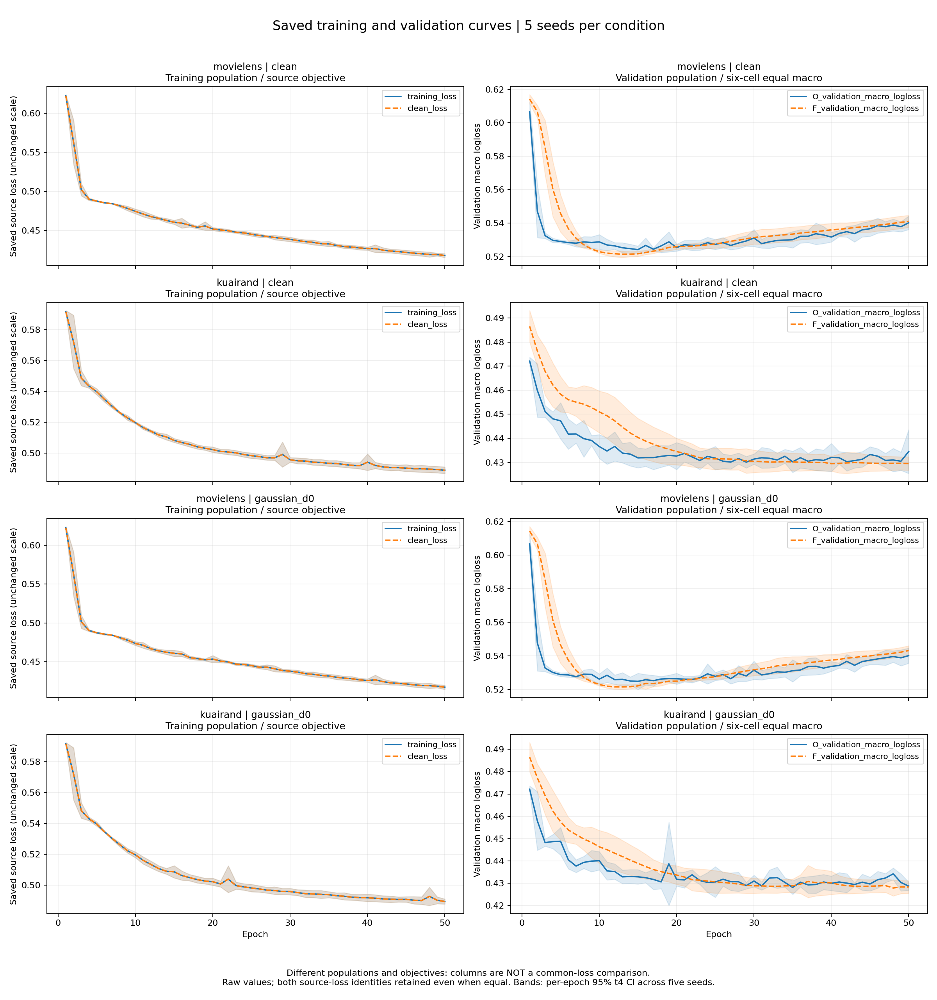

# 固定 EMA 的参数、历史与函数因果归因

完成日期：2026-11-11。模型：固定融合 M3oE；MovieLens-1M、KuaiRand-Pure × Clean、Gaussian D0 × seeds 2022–2026。20 条轨迹均完成 50 epoch；四块归因、预定 Test 读出已完成。

**主研究方向：C——针对 Clean/EMBED 一阶历史做最小短程反馈判别，保留坐标预调节与固定 EMA 对照。** 固定 EMA 的共享表示与历史互补机制已经形成参数干预—完整函数切口—真实 pair 净贡献的证据链。EMA 动作菜单没有显示可迁移的动态选择增量；同状态 Adam 方向替换则提供了另一条直接的正面证据。该方向的证据强度为 MEDIUM；若局部收益在反馈后消失或被 F 吸收，条件备选为 D。

| 独立 selected Test：F−O | Macro AUC | Macro LogLoss | AUC 正向 seed |
|---|---:|---:|---:|
| ML-C | +0.0038488 | +0.0012486 | 5/5 |
| KR-C | +0.0046164 | -0.0012253 | 4/5 |
| ML-G | +0.0038568 | +0.0053343 | 5/5 |
| KR-G | +0.0077669 | +0.0003277 | 5/5 |

| 问题 | 结论 | 证据强度 |
|---|---|---|
| Q1 收益来源 | 共享修正主导；EMBED 与近期修正稳定重要；recent×old 的正交互重复出现。 | STRONG |
| Q2 函数与排序 | 上游表示/融合状态改变正负分数差；纠正与破坏的净量闭合 AUC。task 输出项解释部分纠正；同权历史预测组合重现主要收益。 | STRONG（完整切口）；MEDIUM（细融合） |
| Q3 训练问题 | ML 的目标改善与验证排序受损并存；KR 来源链更弱。保留 vhat、替换一阶 numerator 的局部收益支持检验一阶历史。 | MEDIUM；ML 窗口链较强 |
| Q4 旧自适应 | 预测误差、动作变化、实际价值分离；rho 的 C_design/C_simple 预测器均退化为统一 Fast。KR 有空间但当前训练信号无法利用。 | STRONG（当前菜单）；历史覆盖缺口单列 |
| Q5 下一步 | 优先 C 的一个短程反馈实验；达到否证条件后转 D。 | MEDIUM |

结论在 Test 读取前冻结；Q4 中“预测器”的名称精确化见 [术语说明](FINDINGS_CLARIFICATIONS.md)：[MECHANISM_FINDINGS](../../artifacts/ema_causal_20261110/attempt2/MECHANISM_FINDINGS.json)、[冻结收据](../../artifacts/ema_causal_20261110/attempt2/MECHANISM_FREEZE.json)、[Test 收据](../../artifacts/ema_causal_20261110/attempt2/TEST_RECEIPT.json)。完整五 seed 原值、SD、区间、状态/人口/源行身份见 [定量附录](QUANTITATIVE_APPENDIX.md) 与 [机器可读数表](EVIDENCE_SUMMARY.json)。

## 1. 协议、对象与统计口径

源实现固定于 ffa3de067fcda5a1293af83a465d741e069493f1；本轮科学实现摘要为 4411eec43005a8e432f0de81d426c08a30f09960e84f7b1302e92b29ae4212e5。源配置、环境、数据身份与执行命令见 [PROVENANCE](PROVENANCE.md) 和 [冻结协议](../../artifacts/ema_causal_20261110/attempt2/RESOLVED_PROTOCOL.json)。

| 项目 | MovieLens | KuaiRand |
|---|---|---|
| batch / Adam lr | 40960 / 0.01 | 40960 / 0.01 |
| coupled weight decay | 1e-4 | 1e-5 |
| 每 epoch optimizer steps | 20 | 49 |
| 固定 rho | 0.9828205985452511 | 0.995 |
| 主历史窗口 h（optimizer steps） | 40 | 138 |
| 预设窗口 | 20, 40, 80, 160 | 69, 138, 277, 553 |
| Gaussian D0 | 目标域 0，lambda 0.5，kappa 0.05 | 目标域 0，lambda 0.5，kappa 0.1 |

O 为在线参数，F 为实际 FP32 固定 EMA，R=F−O。按步拆分 R_old=ρ^h R_(t−h)，R_recent=R−R_old；实际 FP32 递推的舍入差另审计。S 为共享坐标，N 为其余域/任务/域任务坐标；共享部分再分 EMBED、STAR_SKIP、EXPERT。所有替换使用同轨迹、同刻状态，观察不反馈在线训练。

Macro 为六个 domain×task 格等权均值。先在 seed 内平均六格及所列 anchors，再以五个 seed 计算样本 SD 和 95% t4 区间（系数 2.7764451052）；cell、epoch、pair 不增加独立 n。区间描述固定划分下的训练 seed 差异。early=E5/E10，middle=E20，late=E35/E50；tF 单列，融合项另标 E35+tF。AUC 正增量较好，LogLoss 负增量较好。V 为完整验证人口；V_A 用于预设选择，V_B 用于留出评价；V_mech 为固定自然有界面板。

固定 EMA 的总体有效性、早期滞后和年龄匹配证据来自已有研究；本轮新增完整 R 的参数/历史干预、同权预测组合、完整函数切口及精确 pair 账本。[继承证据与旧版本公式](../../research_plans/26-11-10_ema_causal_attribution/01_RESEARCH_CONTEXT.md)。

## 2. 阶段现象与 loss

| 条件 | 阶段 | F−O AUC | 95% CI | F−O LL | 95% CI |
|---|---|---|---|---|---|
| ML-C | early | +0.0010554 | [-0.0001490, +0.0022598] | +0.0054378 | [-0.0014488, +0.0123245] |
| ML-C | middle | +0.0038120 | [+0.0033212, +0.0043027] | +0.0005317 | [-0.0028447, +0.0039082] |
| ML-C | late | +0.0038399 | [+0.0032927, +0.0043871] | +0.0021197 | [-0.0000682, +0.0043076] |
| KR-C | early | -0.0229836 | [-0.0246081, -0.0213592] | +0.0127164 | [+0.0085785, +0.0168543] |
| KR-C | middle | +0.0014816 | [-0.0023822, +0.0053455] | +0.0018417 | [-0.0042915, +0.0079749] |
| KR-C | late | +0.0038439 | [+0.0001889, +0.0074990] | -0.0025189 | [-0.0066072, +0.0015693] |
| ML-G | early | +0.0010168 | [-0.0001978, +0.0022314] | +0.0071696 | [+0.0005214, +0.0138178] |
| ML-G | middle | +0.0037531 | [+0.0032752, +0.0042311] | -0.0014202 | [-0.0052456, +0.0024052] |
| ML-G | late | +0.0035975 | [+0.0029976, +0.0041974] | +0.0034348 | [+0.0001567, +0.0067129] |
| KR-G | early | -0.0230783 | [-0.0251560, -0.0210006] | +0.0074831 | [+0.0019292, +0.0130371] |
| KR-G | middle | +0.0019922 | [-0.0024860, +0.0064703] | +0.0019216 | [+0.0002282, +0.0036149] |
| KR-G | late | +0.0042662 | [+0.0006618, +0.0078707] | +0.0001705 | [-0.0030086, +0.0033495] |

KR 两目标的 early AUC 五 seed 均受损，晚期转为五 seed 均获益。ML 的 E5/E10 均值小且区间跨零；旧报告的 E1–10 包含更早起始点，不能用不同窗口的符号直接判断复现矛盾。

ML 两目标的训练 loss 持续下降，验证 Macro LL 先降后升，固定 F 晚期也未消除该趋势；KR 验证 LL 则总体下降后趋平。两个数据集的整体 loss 曲线不支持同一个“晚期验证 loss 上升”解释。局部训练来源判断使用后文固定 P_B 与同 pair 窗口证据。

图的两列使用不同人口/目标口径。全部 1,000 条 epoch 原值及源文件摘要见 [TRAINING_CURVES](TRAINING_CURVES.csv.gz)。

## 3. Q1：共享来源与历史互补

| 条件 | 晚期全 V F−O AUC | SD | 95% CI | 五 seed 配对差（2022→2026） |
|---|---|---|---|---|
| ML-C | +0.0038399 | +0.0004407 | [+0.0032927, +0.0043871] | +0.0040429, +0.0044880, +0.0035701, +0.0037412, +0.0033573 |
| KR-C | +0.0038439 | +0.0029436 | [+0.0001889, +0.0074990] | +0.0086017, +0.0010827, +0.0017822, +0.0036060, +0.0041470 |
| ML-G | +0.0035975 | +0.0004831 | [+0.0029976, +0.0041974] | +0.0029864, +0.0034892, +0.0042739, +0.0034067, +0.0038313 |
| KR-G | +0.0042662 | +0.0029029 | [+0.0006618, +0.0078707] | +0.0083735, +0.0040465, +0.0022026, +0.0056853, +0.0010233 |

| 删除损失 F−删除态，late V | ML-C | KR-C | ML-G | KR-G |
|---|---|---|---|---|
| S 删除 | +0.0040052 | +0.0043627 | +0.0037572 | +0.0042313 |
| N 删除 | -0.0001144 | -0.0001632 | -0.0001518 | +0.0001580 |
| EMBED 删除 | +0.0029602 | +0.0018738 | +0.0030311 | +0.0024302 |
| STAR_SKIP 删除 | +0.0006165 | +0.0014707 | +0.0005041 | +0.0016471 |
| EXPERT 删除 | -0.0000482 | +0.0003747 | -0.0000309 | -0.0002263 |
| recent 删除 | +0.0048642 | +0.0049918 | +0.0045636 | +0.0046705 |
| old 删除 | +0.0007898 | +0.0017536 | +0.0008662 | +0.0025160 |

C_PRIMARY/recent 的状态本身是 F−recent，表中 F 减该状态表示删除损失。ML 的 N 增量五 seed 均为负，同时增加 LL；KR 的 N 均值和留出侧不稳定。KR-C 在 V_A 选择出的 N 正效应没有迁移到 V_B，不能据选择侧结果判定私有修正必要。EMBED 在四条件完整 V 上删除均有正均值，V_B 在 ML 更稳定、KR 更宽。

| 条件 | 其余坐标背景 | recent 单独 | old 单独 | 交互 | 联合 | 交互 95% CI |
|---|---|---|---|---|---|---|
| ML-C | O | +0.0026713 | -0.0008996 | +0.0016492 | +0.0034209 | [+0.0014023, +0.0018961] |
| ML-C | F | +0.0021598 | -0.0005076 | +0.0013081 | +0.0029602 | [+0.0011697, +0.0014465] |
| KR-C | O | +0.0017484 | -0.0003869 | +0.0010015 | +0.0023630 | [+0.0007119, +0.0012911] |
| KR-C | F | +0.0010315 | -0.0002867 | +0.0011290 | +0.0018738 | [+0.0008935, +0.0013646] |
| ML-G | O | +0.0022973 | -0.0008828 | +0.0018578 | +0.0032723 | [+0.0017561, +0.0019596] |
| ML-G | F | +0.0021325 | -0.0005147 | +0.0014134 | +0.0030311 | [+0.0012267, +0.0016001] |
| KR-G | O | +0.0015884 | -0.0000653 | +0.0010125 | +0.0025356 | [+0.0004066, +0.0016185] |
| KR-G | F | +0.0010546 | +0.0000797 | +0.0012959 | +0.0024302 | [+0.0007157, +0.0018761] |

四条件两个背景的 EMBED recent×old 交互均五 seed 为正。ML 的 old 单独加入可降低 AUC，但从联合状态删除 old 又损失收益；KR 的 old 单独作用接近零且混合。较早历史的价值依赖与近期状态的组合，不能以单独负效应把它全部删除，也不能把参数的线性拆分当作 AUC 的可加分账。

## 4. Q2：完整函数切口、同 pair 与预测组合

| 条件 | 准确纠正贡献 | 准确破坏贡献 | 净 ΔAUC |
|---|---|---|---|
| ML-C | +0.0291105 | +0.0252706 | +0.0038399 |
| KR-C | +0.0467911 | +0.0429471 | +0.0038439 |
| ML-G | +0.0294655 | +0.0258680 | +0.0035975 |
| KR-G | +0.0480592 | +0.0437930 | +0.0042662 |

以上来自完整 V 的所有正负组合 3×3 转移计数；corrected/broken 已是归一化 AUC 贡献，包含平局半贡献，二者相减闭合 F−O。固定抽样 pair 表用于重叠和分层，具体例子来自固定 hash 子集，整体比例仍用全量计数。

| F−recent→F，late V | 完整切口 | 上游单独 | 下游单独 | 交互 | 总效应 |
|---|---|---|---|---|---|
| ML-C | h | +0.0049653 | -0.0001076 | +0.0000065 | +0.0048642 |
| ML-C | fused | +0.0048685 | -0.0000044 | +0.0000001 | +0.0048642 |
| KR-C | h | +0.0051622 | -0.0000857 | -0.0000848 | +0.0049918 |
| KR-C | fused | +0.0048945 | +0.0001829 | -0.0000856 | +0.0049918 |
| ML-G | h | +0.0046917 | -0.0001158 | -0.0000123 | +0.0045636 |
| ML-G | fused | +0.0045622 | +0.0000003 | +0.0000011 | +0.0045636 |
| KR-G | h | +0.0058484 | -0.0006813 | -0.0004966 | +0.0046705 |
| KR-G | fused | +0.0045593 | +0.0001296 | -0.0000184 | +0.0046705 |

同一 X 的完整 h/融合切口中，上游变化重现主要净收益；下游单独效应小或为负，交互不总是正向。F−recent→F 的幅度大于某些 F−O 总效应，是背景不同和历史互补的结果，不是超过 100% 的唯一贡献份额。

| 条件 | task 删除 O→F，V_B | task 删除 X→F，V_B | X→F 95% CI（E35+tF） |
|---|---|---|---|
| ML-C | +0.0009542 | +0.0012296 | [+0.0005374, +0.0019218] |
| KR-C | +0.0022822 | +0.0015909 | [-0.0000502, +0.0032319] |
| ML-G | +0.0004500 | +0.0005748 | [-0.0001590, +0.0013085] |
| KR-G | +0.0027446 | +0.0023805 | [-0.0012186, +0.0059796] |

task expert 输出项承载部分已定位 X 的纠正；Gaussian 留出侧区间跨零，KR-G seed2026 还有反向细融合效果，因此完整上游切口是更稳定的解释层次。task 输出能承载 EMBED 输入变化，不能据此推出 task-private 参数 EMA 本身有正收益。KR 两条件实际删除 STAR 乘法 cross-term 的 AUC 效应分别约 1.0e−8、−3.0e−11，不能用该特定项解释观察到的 h 交互。逐项融合和同 pair 连接见原 FUSION_EFFECTS/FUSION_CONNECTION；附加汇总见 [REPORT_ADDITIONAL_EVIDENCE](REPORT_ADDITIONAL_EVIDENCE.json)。

| 固定 V_mech，late | 同权全 step 预测组合−F | AUC | 95% CI | LL | 95% CI |
|---|---|---|---|---|---|
| ML-C | q_logit | +0.0007681 | [+0.0005823, +0.0009540] | -0.0055907 | [-0.0076106, -0.0035708] |
| ML-C | q_probability | +0.0006661 | [+0.0005231, +0.0008092] | -0.0077528 | [-0.0097123, -0.0057933] |
| KR-C | q_logit | +0.0021033 | [+0.0005824, +0.0036243] | -0.0037093 | [-0.0055361, -0.0018824] |
| KR-C | q_probability | +0.0021162 | [+0.0005923, +0.0036401] | -0.0035134 | [-0.0053521, -0.0016748] |
| ML-G | q_logit | +0.0007821 | [+0.0004954, +0.0010688] | -0.0063159 | [-0.0093495, -0.0032823] |
| ML-G | q_probability | +0.0006708 | [+0.0004386, +0.0009030] | -0.0085027 | [-0.0113375, -0.0056678] |
| KR-G | q_logit | +0.0026413 | [+0.0016064, +0.0036763] | -0.0032157 | [-0.0045518, -0.0018796] |
| KR-G | q_probability | +0.0025154 | [+0.0014209, +0.0036099] | -0.0029617 | [-0.0043126, -0.0016108] |

所有条件两种预测组合的 AUC 差五 seed 均正，LL 差均负。与 F 的大部分纠正重叠，支持历史预测组合是主要解释之一；本轮没有发现必须依赖参数均值独有总体优势才能解释的有界面板收益。q 没有独立选点完整 Test 比较，其面板效应不用于算法晋级。

### 同一 X 的真实 pair 穿零示例

| Clean / E35 / seed2022 / h | pair 行号(正/负) | margin00 | margin10(仅上游) | margin01(仅下游) | margin11 | rank四态 |
|---|---|---|---|---|---|---|
| ML-C corrected | 870596/806648 | -0.0096979 | +0.0464230 | -0.0257124 | +0.0370429 | [0.0, 1.0, 0.0, 1.0] |
| ML-C broken | 881922/849556 | +0.0573273 | +0.0028776 | +0.0625610 | -0.0019406 | [1.0, 1.0, 1.0, 0.0] |
| KR-C corrected | 2137203/2007840 | -0.0577734 | +0.0132455 | -0.0665148 | +0.0079291 | [0.0, 1.0, 0.0, 1.0] |
| KR-C broken | 2054497/2151121 | +0.0006670 | -0.0021401 | +0.0014709 | -0.0036028 | [1.0, 0.0, 1.0, 0.0] |

00=F−recent，11=F；中间两态只替换指定完整接口一侧。这里展示固定 hash 子集中一对纠正和一对破坏的概率 margin，不估计总体频率；pair_id、四态 state_ids 和每 pair 的 ±1/32768 净贡献保留在附加证据。相同 pair 上的上游改变可跨零纠正，也可能带来新的破坏；总体净量由准确转移账本决定。

## 5. Q3：训练窗口与 Adam 来源

| late E35/E50；h=ML40/KR138 | recent-only ΔAUC（全 V） | 净恢复贡献（V_mech 固定 pair） | 固定 P_B 自然面板目标变化 | Adam 来源诊断 |
|---|---|---|---|---|
| ML-C | +0.0030501 | +0.0035568 | -0.0029026 | TRIGGERED |
| KR-C | +0.0020904 | +0.0019475 | -0.0002332 | TRIGGERED |
| ML-G | +0.0027313 | +0.0029444 | -0.0021978 | NOT_TRIGGERED |
| KR-G | +0.0017502 | +0.0016612 | -0.0004933 | NOT_TRIGGERED |

ML 两目标的这三个窗口量在五 seed 上方向一致；KR 均值同向但区间跨零、部分 seed 反向。ML 支持近期实际训练目标改善与验证排序改善不一致；KR 的来源链为条件性证据。Gaussian 的 Adam 探针按方案不执行，NOT_TRIGGERED 表示设计边界。

| Clean / EMBED / E20+E35 | 人口 | 同状态同范数方向−O | AUC | 95% CI | LL |
|---|---|---|---|---|---|
| movielens | V_mech | current_preconditioned | +0.0004076 | [+0.0002099, +0.0006053] | -0.0004758 |
| movielens | V_mech | momentum_isotropic | -0.0127663 | [-0.0200517, -0.0054808] | +0.0266667 |
| movielens | V_B | current_preconditioned | +0.0003336 | [-0.0000363, +0.0007036] | -0.0004671 |
| movielens | V_B | momentum_isotropic | -0.0123103 | [-0.0186128, -0.0060078] | +0.0259992 |
| kuairand | V_mech | current_preconditioned | +0.0003183 | [-0.0000867, +0.0007232] | +0.0000513 |
| kuairand | V_mech | momentum_isotropic | -0.0111386 | [-0.0181320, -0.0041451] | +0.0311514 |
| kuairand | V_B | current_preconditioned | +0.0003559 | [+0.0000228, +0.0006890] | +0.0000846 |
| kuairand | V_B | momentum_isotropic | -0.0112120 | [-0.0189242, -0.0034998] | +0.0311683 |

current_preconditioned 使用当前 data gradient+coupled WD numerator，保留实际 vhat，并把 EMBED 位移范数匹配到真实一步；momentum_isotropic 保留一阶历史方向而移除坐标预调节，也匹配范数。后者明显变差，说明不能把“移除优化历史”统一视作改进。前者在两 Clean 的 V_B 平均有小幅正作用，是选择 C 的直接依据；它没有反馈到后续梯度/Adam 状态。

竞争解释仍包括：当前状态损失了有用历史组合信息、近期实际目标与验证排序不一致，以及一阶历史方向的局部滞后。预测组合和 old×recent 证据说明单一“坏 momentum”不能解释全部固定 EMA 收益；同状态方向实验又说明它值得一个有幅度对照的反馈判别。

## 6. Gaussian 边界、域规模与任务

| 同 seed 晚期差中差 | 指标 | (F−O)G−(F−O)C | 95% CI | 五 seed |
|---|---|---|---|---|
| movielens | auc | -0.0002424 | [-0.0012534, +0.0007686] | -0.0010565, -0.0009988, +0.0007038, -0.0003344, +0.0004740 |
| movielens | logloss | +0.0013152 | [-0.0013403, +0.0039706] | +0.0010190, +0.0019087, -0.0000623, +0.0046278, -0.0009174 |
| kuairand | auc | +0.0004223 | [-0.0025030, +0.0033476] | -0.0002282, +0.0029637, +0.0004204, +0.0020794, -0.0031238 |
| kuairand | logloss | +0.0026894 | [-0.0035436, +0.0089225] | -0.0005814, +0.0115469, +0.0013039, -0.0000818, +0.0012594 |

共享表示、近期修正及 EMBED 历史正交互在 Gaussian 下保持；精细私有/融合效应和训练来源一致性更弱。两个数据集晚期 Gaussian×EMA 交互的区间均跨零，不支持统一额外协同；独立选点 Test 的交互在后文另列。

| 数据 | D0 train n | D1 train n | D2 train n |
|---|---|---|---|
| ML | 155949 | 318599 | 325619 |
| KR | 172782 | 1743898 | 89452 |

| late V | cell | O 基线 AUC | F−O AUC | F−O LL | AUC 正向 seed |
|---|---|---|---|---|---|
| ML-C | D0T0 | 0.7589906 | +0.0044912 | +0.0011434 | 5/5 |
| ML-C | D0T1 | 0.7637682 | +0.0036462 | -0.0002950 | 5/5 |
| ML-C | D1T0 | 0.7519932 | +0.0041430 | +0.0004378 | 5/5 |
| ML-C | D1T1 | 0.7498422 | +0.0030547 | -0.0001231 | 5/5 |
| ML-C | D2T0 | 0.7473224 | +0.0038744 | +0.0081510 | 5/5 |
| ML-C | D2T1 | 0.7461360 | +0.0038299 | +0.0034037 | 5/5 |
| KR-C | D0T0 | 0.6632792 | +0.0035971 | -0.0012422 | 3/5 |
| KR-C | D0T1 | 0.6785262 | +0.0025205 | -0.0002246 | 3/5 |
| KR-C | D1T0 | 0.6980977 | +0.0048041 | -0.0047493 | 5/5 |
| KR-C | D1T1 | 0.7252954 | +0.0049169 | -0.0040150 | 5/5 |
| KR-C | D2T0 | 0.6656396 | +0.0037658 | -0.0006170 | 5/5 |
| KR-C | D2T1 | 0.6666110 | +0.0034592 | -0.0042657 | 5/5 |
| ML-G | D0T0 | 0.7588216 | +0.0041799 | +0.0045870 | 5/5 |
| ML-G | D0T1 | 0.7634508 | +0.0032530 | +0.0016481 | 5/5 |
| ML-G | D1T0 | 0.7519404 | +0.0039206 | +0.0016684 | 5/5 |
| ML-G | D1T1 | 0.7500662 | +0.0027340 | +0.0009373 | 5/5 |
| ML-G | D2T0 | 0.7472926 | +0.0041578 | +0.0077453 | 5/5 |
| ML-G | D2T1 | 0.7464349 | +0.0033397 | +0.0040229 | 5/5 |
| KR-G | D0T0 | 0.6553420 | +0.0075221 | -0.0019515 | 4/5 |
| KR-G | D0T1 | 0.6828462 | +0.0043421 | -0.0008041 | 3/5 |
| KR-G | D1T0 | 0.6974812 | +0.0046783 | +0.0003217 | 5/5 |
| KR-G | D1T1 | 0.7240939 | +0.0051719 | +0.0014435 | 5/5 |
| KR-G | D2T0 | 0.6701167 | +0.0019672 | +0.0009983 | 5/5 |
| KR-G | D2T1 | 0.6705393 | +0.0019158 | +0.0010150 | 3/5 |

四条件六格 AUC 平均都为正，没有“小域改善、最大域 AUC 下降”的权衡。ML 最小 D0 的基线 AUC 高于最大 D2；KR 最大 D1 的基线 AUC 又高于另外两域。域规模与模型基线表现的关联跨数据集不同，规模不能作为当前收益的主解释。数据集没有独立操纵域规模，标签比例、特征分布与任务差异仍并存；KR 小验证格正例较少，seed 区间更宽。原始 LL 的跨域大小受正例率影响，不直接等同困难度。

## 7. Q4 与 H1–H3：空间、信号和动作价值

| 留出 seed/未来窗口，V_mech | 菜单 | 同面板 oracle | 静态 | C_design | C_simple | carry/direct |
|---|---|---|---|---|---|---|
| ML-C | mechanism7 | +0.0001135 | -0.0008793 | -0.0004499 | -0.0000895 | -0.0004866 |
| ML-C | rho7 | +0.0001442 | -0.0003515 | -0.0003515 | -0.0003515 | -0.0002279 |
| KR-C | mechanism7 | +0.0011583 | -0.0017399 | +0.0000000 | -0.0013347 | -0.0009893 |
| KR-C | rho7 | +0.0002999 | +0.0001099 | +0.0001099 | +0.0001099 | +0.0001093 |
| ML-G | mechanism7 | +0.0001313 | -0.0009565 | -0.0003883 | -0.0000363 | -0.0005301 |
| ML-G | rho7 | +0.0001525 | -0.0003803 | -0.0003803 | -0.0003803 | -0.0003140 |
| KR-G | mechanism7 | +0.0012484 | -0.0017576 | +0.0000000 | -0.0013107 | -0.0012696 |
| KR-G | rho7 | +0.0003647 | +0.0000084 | +0.0000084 | +0.0000084 | +0.0000019 |

所有值为相对 F 的真实 AUC 效用。Oracle 使用同评分人口结果选动作，非可部署性能。ML 两菜单空间小；KR 机制 oracle 约 +0.0012，KR-G 的 V_A 选/V_B 评空间均值为 +0.0010492，说明存在标签侧空间，但训练可见规则未取得它。四条件 H2 匹配均未触发；其完整“有可用信息而 rho 无法执行”链未成立。

四条件 rho7 的 static、C_design、C_simple 均在 25/25 个未来窗口选择 all/fast，全部五 fold 退化为单一动作，熵为零，动态增量为零。KR 的机制 C_design 为 25/25 次 F：它可以超过有害静态删除，但对 F 没有增量。动作频率、熵、退化 fold、MAE 见附加证据表；每 seed 的 AUC/LL/对静态差与区间见附录第 08 节。

本轮 ML-G rho 的 V_B MAE 从 C_design 的 0.00118794 降为 C_simple 的 0.00083314，动作和价值却完全相同。这是预测误差与实际策略增量分离的直接例子。每个 LOSO fold 只有其他四 seed 的 12 个早期训练时序单元，模型能力/时间外推与动作空间大小共同限制结果；不把当前拟合器结果推广为全部训练信号不可用。

|历史版本|mechanism_alignment|signal_transfer|action_coverage|actual_value|remaining_gap|
|---|---|---|---|---|---|
|AUG_HISTORY B方向响应|增强响应子空间并不直接定义本轮EMBED近期/较早组合|旧日志未测本轮收益迁移|历史方向已启用；缺旧Q与innovation投影状态，不能补算覆盖率|历史D−F Test ML+0.000000104，KR−0.000004946，函数增量极小|无法判定旧Q究竟遗漏多少真实纠正；不因此重跑旧网格|
|AUG_HISTORY A组时间尺度|分组方向有关，但虚拟K步目标与实际一步递推不同|旧q探针保留gate detach，本轮完整函数切口包含输入值变化；这一差异不足以单独解释失败|可改变分组rho，没有直接检验本轮recent×old联合功能|历史GROUP/GLOBAL未稳定胜F；本轮可见策略另用真实动作和静态参照评分|未运行把当前有限读出动作反馈到长期训练|
|AUG_HISTORY C漂移条件增强|改变online训练噪声协方差，与固定轨迹上R归因对象不同|旧漂移统计不等于当前pair净纠正效用|输入增强可改变后续轨迹，本轮Gaussian只是预定边界|历史仅ML三控制均值未胜F|无法由读出归因反推所有训练增强的效果|
|11/06 M0–M3与单组pulse|局部快慢与完整R来源不同；本轮补齐共享/历史/函数链|当前桥接必须区分训练效用和留出验证效用|一epoch rho7与机制7时域不同，未触发H2时不判表达能力不足|按本轮oracle、static、visible对F与对static分列|有限菜单之外的动作未测|
|11/09 A0/persist/carry|确有训练方向持续性，不是收益全瞬时|旧KR-G训练方向一致率.96、验证.60；persist早晚预测反向|静态task全部统一Fast，动态规则可能退化成静态|旧carry验证+0.000101319但比统一Fast低0.000000478|A0没有新训练/Test，不能称闭环自适应模型失败|

历史数字和公式均来自冻结计划 [01_RESEARCH_CONTEXT](../../research_plans/26-11-10_ema_causal_attribution/01_RESEARCH_CONTEXT.md)，不与本轮 seed 重复计数。旧 B 缺失的 Q/innovation 状态无法补算；旧 A 保留 gate detach、虚拟 K 步与实际一步不同；11/09 A0 没有新训练/Test，不能写成完整闭环模型已经失败。

| 假设 | 裁定 | 强度 | 决策含义 |
|---|---|---|---|
| H1 旧指标错过来源 | NOT_MAIN_EXPLANATION | WEAK | 机制已定位，但新训练功能特征也没有稳定动作增量；不能把全部责任归于某一旧指标。 |
| H2 信息可用而 rho 不可执行 | NOT_MAIN_EXPLANATION | WEAK | 匹配未触发，KR 有标签侧空间却无可操作训练选择；不据此优先 B。 |
| H3 F 捕获当前可利用收益 | CONDITIONALLY_SUPPORTED | MEDIUM | ML 有限空间较小；KR 为 ROOM_WITHOUT_ACTIONABLE_SIGNAL，不能称空间耗尽。暂停扩展 A/B，但保留 C 的直接方向证据。 |

## 8. Q5：唯一优先方向与判别实验

**选择 C，证据 MEDIUM；条件备选 D。** 首个研究问题是：EMBED 一阶历史相对当前梯度的滞后，是否造成可以累积、且固定 F 尚未吸收的排序损失？

下一轮只需从预注册相同状态分出普通 Adam+F 与 EMBED 当前 numerator+F 的短程对照，保留 v 更新、coupled WD、学习率与 EMBED 实际步幅控制，其余参数更新不改。比较同 pair 净纠正、完整验证六格 AUC/LL，以及 online 和 F 两种读出。若仅 online 改善、F 没有增量，则固定 F 已吸收该可用部分，转 D；若反馈后局部收益消失，则否证由单步方向直接推长期改进的解释；只有 F 仍有可重复额外收益才继续 C。该反馈实验属于下一轮，本轮没有追加训练或 HPO。

## 9. 预定 Test：独立选点与同刻分开

O/F 各自在完整 Validation 50-epoch 曲线上选择最早严格最大 Macro AUC。OatF、S_atF、N_atF 都使用 F 选中时刻；它们没有各自重新选点。冻结后的五状态×20轨迹共 100 个逻辑读出，状态 hash 相同的物理读出复用。

| 独立 selected F−O | 指标 | 均值 | SD | 95% CI | 正向 seed | 五 seed 原差 |
|---|---|---|---|---|---|---|
| ML-C | auc | +0.0038488 | +0.0003744 | [+0.0033840, +0.0043137] | 5/5 | +0.0041067, +0.0041208, +0.0032780, +0.0040856, +0.0036531 |
| ML-C | logloss | +0.0012486 | +0.0056480 | [-0.0057643, +0.0082616] | 4/5 | -0.0082598, +0.0039408, +0.0017163, +0.0022353, +0.0066106 |
| KR-C | auc | +0.0046164 | +0.0030488 | [+0.0008308, +0.0084020] | 4/5 | -0.0002239, +0.0082345, +0.0049551, +0.0047793, +0.0053371 |
| KR-C | logloss | -0.0012253 | +0.0017754 | [-0.0034297, +0.0009791] | 2/5 | -0.0031216, -0.0011094, +0.0005358, -0.0029328, +0.0005013 |
| ML-G | auc | +0.0038568 | +0.0006452 | [+0.0030556, +0.0046580] | 5/5 | +0.0027161, +0.0040020, +0.0041492, +0.0041361, +0.0042805 |
| ML-G | logloss | +0.0053343 | +0.0029248 | [+0.0017027, +0.0089659] | 5/5 | +0.0070095, +0.0064522, +0.0011258, +0.0036495, +0.0084345 |
| KR-G | auc | +0.0077669 | +0.0042575 | [+0.0024805, +0.0130533] | 5/5 | +0.0150455, +0.0054367, +0.0048955, +0.0053690, +0.0080879 |
| KR-G | logloss | +0.0003277 | +0.0028556 | [-0.0032180, +0.0038734] | 3/5 | +0.0007385, +0.0036560, -0.0040133, -0.0004545, +0.0017118 |

| Test 状态均值 | 指标 | O own-selected | F own-selected | OatF | S_atF | N_atF |
|---|---|---|---|---|---|---|
| ML-C | auc | 0.7751897 | 0.7790385 | 0.7745677 | 0.7788448 | 0.7749826 |
| ML-C | logloss | 0.4948909 | 0.4961396 | 0.4948365 | 0.4949199 | 0.4963478 |
| KR-C | auc | 0.6719066 | 0.6765230 | 0.6714173 | 0.6759451 | 0.6715617 |
| KR-C | logloss | 0.4371720 | 0.4359467 | 0.4414643 | 0.4360068 | 0.4414953 |
| ML-G | auc | 0.7754998 | 0.7793566 | 0.7742220 | 0.7792246 | 0.7745725 |
| ML-G | logloss | 0.4904880 | 0.4958223 | 0.4918291 | 0.4943495 | 0.4944178 |
| KR-G | auc | 0.6714133 | 0.6791802 | 0.6715556 | 0.6785598 | 0.6726758 |
| KR-G | logloss | 0.4351902 | 0.4355179 | 0.4350684 | 0.4342606 | 0.4361780 |

| F-selected 同刻 Test | 对比 | AUC | 95% CI | LL | 95% CI |
|---|---|---|---|---|---|
| ML-C | F−OatF | +0.0044708 | [+0.0027444, +0.0061973] | +0.0013031 | [-0.0035970, +0.0062032] |
| ML-C | S_atF−OatF | +0.0042771 | [+0.0026404, +0.0059138] | +0.0000834 | [-0.0028200, +0.0029869] |
| ML-C | N_atF−OatF | +0.0004149 | [+0.0001405, +0.0006894] | +0.0015114 | [-0.0036750, +0.0066978] |
| KR-C | F−OatF | +0.0051057 | [+0.0013110, +0.0089005] | -0.0055176 | [-0.0124606, +0.0014254] |
| KR-C | S_atF−OatF | +0.0045279 | [+0.0022211, +0.0068346] | -0.0054575 | [-0.0098898, -0.0010251] |
| KR-C | N_atF−OatF | +0.0001444 | [-0.0027144, +0.0030033] | +0.0000310 | [-0.0049746, +0.0050367] |
| ML-G | F−OatF | +0.0051346 | [+0.0039485, +0.0063207] | +0.0039932 | [+0.0013859, +0.0066005] |
| ML-G | S_atF−OatF | +0.0050026 | [+0.0038080, +0.0061973] | +0.0025204 | [-0.0061478, +0.0111886] |
| ML-G | N_atF−OatF | +0.0003505 | [+0.0001703, +0.0005307] | +0.0025887 | [-0.0039984, +0.0091758] |
| KR-G | F−OatF | +0.0076245 | [+0.0005724, +0.0146767] | +0.0004495 | [-0.0020724, +0.0029713] |
| KR-G | S_atF−OatF | +0.0070041 | [+0.0016926, +0.0123157] | -0.0008078 | [-0.0035492, +0.0019336] |
| KR-G | N_atF−OatF | +0.0011202 | [-0.0013090, +0.0035493] | +0.0011096 | [+0.0002885, +0.0019307] |

| 独立 selected Test F−O | cell | AUC | LL | AUC 正向 seed |
|---|---|---|---|---|
| ML-C | D0T0 | +0.0040945 | +0.0009085 | 5/5 |
| ML-C | D0T1 | +0.0044251 | +0.0002418 | 5/5 |
| ML-C | D1T0 | +0.0038907 | +0.0017449 | 5/5 |
| ML-C | D1T1 | +0.0034726 | +0.0044171 | 5/5 |
| ML-C | D2T0 | +0.0040654 | -0.0009039 | 5/5 |
| ML-C | D2T1 | +0.0031447 | +0.0010835 | 5/5 |
| KR-C | D0T0 | +0.0013737 | -0.0000810 | 3/5 |
| KR-C | D0T1 | +0.0040373 | +0.0008445 | 4/5 |
| KR-C | D1T0 | +0.0064725 | -0.0040216 | 5/5 |
| KR-C | D1T1 | +0.0067260 | -0.0026481 | 5/5 |
| KR-C | D2T0 | +0.0024168 | +0.0013142 | 4/5 |
| KR-C | D2T1 | +0.0066721 | -0.0027602 | 5/5 |
| ML-G | D0T0 | +0.0026094 | +0.0038067 | 5/5 |
| ML-G | D0T1 | +0.0036735 | +0.0054119 | 5/5 |
| ML-G | D1T0 | +0.0048139 | +0.0026747 | 5/5 |
| ML-G | D1T1 | +0.0051115 | +0.0106882 | 5/5 |
| ML-G | D2T0 | +0.0037729 | +0.0031032 | 5/5 |
| ML-G | D2T1 | +0.0031596 | +0.0063210 | 5/5 |
| KR-G | D0T0 | +0.0122542 | -0.0018599 | 5/5 |
| KR-G | D0T1 | +0.0185623 | -0.0015531 | 5/5 |
| KR-G | D1T0 | +0.0058562 | +0.0006643 | 5/5 |
| KR-G | D1T1 | +0.0059415 | +0.0012244 | 5/5 |
| KR-G | D2T0 | +0.0029488 | +0.0018052 | 4/5 |
| KR-G | D2T1 | +0.0010385 | +0.0016852 | 2/5 |

| Test selected 目标交互 | 指标 | (F−O)G−(F−O)C | 95% CI | 五 seed |
|---|---|---|---|---|
| movielens | auc | +0.0000080 | [-0.0010856, +0.0011015] | -0.0013906, -0.0001188, +0.0008712, +0.0000505, +0.0006274 |
| movielens | logloss | +0.0040856 | [-0.0038083, +0.0119795] | +0.0152693, +0.0025114, -0.0005906, +0.0014142, +0.0018239 |
| kuairand | auc | +0.0031505 | [-0.0056134, +0.0119144] | +0.0152694, -0.0027978, -0.0000595, +0.0005898, +0.0027508 |
| kuairand | logloss | +0.0015530 | [-0.0030028, +0.0061089] | +0.0038601, +0.0047654, -0.0045491, +0.0024783, +0.0012104 |

| 条件 | O 选点 epoch（2022→2026） | F 选点 epoch（2022→2026） |
|---|---|---|
| ML-C | 29, 17, 24, 26, 17 | 26, 18, 20, 28, 22 |
| KR-C | 44, 18, 40, 50, 43 | 33, 50, 50, 50, 47 |
| ML-G | 31, 16, 25, 19, 17 | 23, 20, 25, 23, 22 |
| KR-G | 21, 31, 41, 37, 37 | 25, 44, 43, 38, 50 |

四条件独立选点的平均 AUC 增益均超过 +0.003，24 个域任务格的平均 AUC 差均为正；KR-C seed2022 的 Macro AUC 差为负，稳定性弱于 ML。ML-G 的 selected LL 五 seed 均增加且区间为正，排序收益伴随明确概率损失代价。KR-G 的 Test 目标交互均值 +0.0031505，但主要受 seed2022 的 +0.0152694 影响、五 seed 区间跨零；它不能替代固定晚期 anchor 的交互判断。

这些 O/F selected Test 均值与冻结历史来源一致，说明观察流程保留了源轨迹；本轮新增贡献是因果归因，历史与本轮端点不作为两组独立重复实验合并。Test 的总体与六格结果用于最终性能评价，不回改已冻结分组、窗口、菜单或主研究方向。逐状态、逐 seed、Traffic/Pooled 及状态 hash 见 [原 ENDPOINTS](../../artifacts/ema_causal_20261110/attempt2/ENDPOINTS.csv)；本报告主表仅使用六格等权 Macro。

## 10. 数值闭合、成本与可复现交付

| 条件 | 32点路径积分闭合/总数 | 未闭合 | 最大绝对 margin 残差 |
|---|---|---|---|
| ML-C | 1413/1920 | 507 | 0.0173706 |
| KR-C | 1132/1920 | 788 | 0.0238267 |
| ML-G | 1428/1920 | 492 | 0.0366204 |
| KR-G | 1071/1920 | 849 | 0.0404798 |

路径判据为绝对残差≤1e−5+0.01|实际Δmargin|。未闭合项不用于积分份额解释；主要结论使用真实有限切口、参数替换和准确 pair 计数。KR 的 STAR 单乘法项删除接近零，而完整 h 的 margin 交互非零，说明不能把一般功能交互直接归到该乘法项。

| 条件 | FP32/理想递推面板审计 | AUC 有变化的审计格 | 最大 |ΔAUC| |
|---|---|---|---|
| ML-C | 450 | 76 | 7.62939453e-06 |
| KR-C | 450 | 60 | 1.52587891e-05 |
| ML-G | 450 | 73 | 1.52587891e-05 |
| KR-G | 450 | 68 | 1.52587891e-05 |

FP32 舍入确实改变少量近边界排序/平局，实际 F 始终作为科学端点；FP64 理想递推只用于审计。两者没有被宣称逐位等同。

| 成本项 | 实际记录 |
|---|---|
| 正式 attempt2 | 20 jobs；1,000 epochs；34,500 Adam updates；无性能早停 |
| 四块归因 duration 总和 | 29168.764147 s |
| 1,000 epoch cost.wall_seconds 总和 | 29,280.573718 s，worker epoch 耗时之和，含训练期读出/观察 |
| attempt1 工程中止 | 250 epochs / 5,000 Adam 被丢弃；未拼入正式结果 |
| 已知正式训练物理更新合计 | 39,500（34,500有效 + 5,000丢弃）；工程 smoke 另列 |
| 当前实现两 smoke | 286 Adam；记录的 smoke_seconds 合计 288.669 s |
| Test | 100 逻辑状态；未追加优化器更新 |

归因时间与 epoch 时间是工作项耗时求和，存在进程重叠，不能当成整体墙钟或 GPU-hours。旧工程区保留六个 PASS 日志，但部分调用缺完整源 hash/计时，未伪造其精确总成本。详细记录见 [EXECUTION_COST_INVENTORY](../../artifacts/ema_causal_20261110/attempt2/EXECUTION_COST_INVENTORY.md)。

attempt1 的固定 pair 重复采样导致性能中止；确定性缓存修订经过独立等价性审查后，attempt2 完整重跑。调度修订保留原 guardian，按每卡显存/功耗<85%、host RAM<90%独立准入，并受原 4 GiB commit 预算与外部 7 GiB tensor 预算约束；实际达到过三训练进程并发。最后两 KR-G seed 曾因 commit 预算受限，2026 在 2025 的 E47 时预算下降后自动启动。所有训练均已完成，未因 GPU 空闲另加协议外轨迹。

设计、实现、独立审阅、运行及分析收据齐全。模型、Adam、EMA、R、梯度和 selected 参数只驻 RAM；最终状态释放见 [RELEASE_RECEIPT](../../artifacts/ema_causal_20261110/attempt2/RELEASE_RECEIPT.json)。发布排除 guardian 认证文件、进程锁、编译缓存和模型文件。代码/报告/原标量表的来源与摘要见 [PROVENANCE](PROVENANCE.md)。

## 11. 图表与原始证据索引

| 图族 | ML-C | KR-C | ML-G | KR-G |
|---|---|---|---|---|
| 阶段 O/F 与干预 | [图](results/movielens__clean/stage_O_F.png) | [图](results/kuairand__clean/stage_O_F.png) | [图](results/movielens__gaussian_d0/stage_O_F.png) | [图](results/kuairand__gaussian_d0/stage_O_F.png) |
| 纠正/破坏/净贡献 | [图](results/movielens__clean/corrected_broken_net.png) | [图](results/kuairand__clean/corrected_broken_net.png) | [图](results/movielens__gaussian_d0/corrected_broken_net.png) | [图](results/kuairand__gaussian_d0/corrected_broken_net.png) |
| 组×历史窗口 | [图](results/movielens__clean/group_time.png) | [图](results/kuairand__clean/group_time.png) | [图](results/movielens__gaussian_d0/group_time.png) | [图](results/kuairand__gaussian_d0/group_time.png) |
| h/fused margin与翻转 | [图](results/movielens__clean/h_fused_functional.png) | [图](results/kuairand__clean/h_fused_functional.png) | [图](results/movielens__gaussian_d0/h_fused_functional.png) | [图](results/kuairand__gaussian_d0/h_fused_functional.png) |
| 融合项删除 | [图](results/movielens__clean/fusion_deletion.png) | [图](results/kuairand__clean/fusion_deletion.png) | [图](results/movielens__gaussian_d0/fusion_deletion.png) | [图](results/kuairand__gaussian_d0/fusion_deletion.png) |
| 历史预测组合纠错重叠 | [图](results/movielens__clean/ensemble_overlap.png) | [图](results/kuairand__clean/ensemble_overlap.png) | [图](results/movielens__gaussian_d0/ensemble_overlap.png) | [图](results/kuairand__gaussian_d0/ensemble_overlap.png) |
| 桥接动作价值及LL | [图](results/movielens__clean/bridge_action_value.png) | [图](results/kuairand__clean/bridge_action_value.png) | [图](results/movielens__gaussian_d0/bridge_action_value.png) | [图](results/kuairand__gaussian_d0/bridge_action_value.png) |

| 条件 | 原始表索引 | 逐 seed 与 cell 派生表 |
|---|---|---|
| ML-C | [ARTIFACT_INDEX](../../artifacts/ema_causal_20261110/attempt2/blocks/movielens__clean/ARTIFACT_INDEX.json) | [目录](results/movielens__clean/) |
| KR-C | [ARTIFACT_INDEX](../../artifacts/ema_causal_20261110/attempt2/blocks/kuairand__clean/ARTIFACT_INDEX.json) | [目录](results/kuairand__clean/) |
| ML-G | [ARTIFACT_INDEX](../../artifacts/ema_causal_20261110/attempt2/blocks/movielens__gaussian_d0/ARTIFACT_INDEX.json) | [目录](results/movielens__gaussian_d0/) |
| KR-G | [ARTIFACT_INDEX](../../artifacts/ema_causal_20261110/attempt2/blocks/kuairand__gaussian_d0/ARTIFACT_INDEX.json) | [目录](results/kuairand__gaussian_d0/) |

[完整导出清单与源摘要](results/EXPORT_MANIFEST.json)；[附录生成器审阅](APPENDIX_REVIEW.md)；[数表/图导出审阅](EXPORT_REVIEW.md)。原始压缩数表只归档一次，附录和 CSV 保留可追溯的源行身份。
