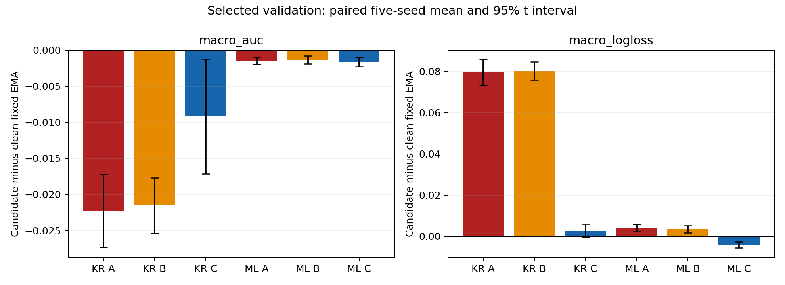
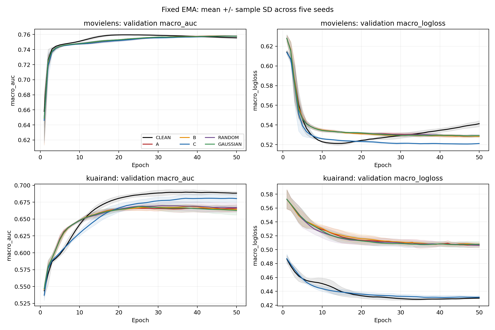

# 异质性感知训练优化实验报告 — 2026-11-15

**本轮完成，决策为 `NO_CONTINUATION_SIGNAL`。** MovieLens、KuaiRand 的六组对照均完成 seeds 2022–2026、每次 50 epoch：60 条训练、3000 epoch、103500 次 Adam 更新及同次数 EMA 更新，训练失败和缺失均为 0。A=DT-PGNA、B=TGA-Pair、C=TGA-Example 相对 clean 固定 EMA 的 selected validation Macro AUC，在两个数据集上均为 **0/5 seed 正向**。依照预设阶段门，本轮停止；HPO、正式确认、Test 与条件消融均为 `NOT_TRIGGERED`。

**STRONG：当前 α=.03、K=128、λ=.25 配置没有通过验证集续跑门。** 局部非目标输出约束已生效，但没有形成可观察的新增排序收益。MovieLens 的 C 保留稳定 LogLoss 改善，同时 AUC 下降。下文及全部附录均使用本轮 **validation** 指标。

## 1. 来源、实现与冻结协议

任务来源为 main 上的 `research_plans/26-11-14_heterogeneity_aware_training_optimization/`，执行 addendum 16、manifest v3 及本轮[设计规范](DESIGN_SPECIFICATION.md)。研究源码基点为 `79fbd441c6c87cff30838c65bf97ad6ec7f45abb`；通过独立复审的实现提交为 `bf36e454adc2d0c569218a7993834f6d56cfc97f`，训练源码 SHA256 为 `a67f446902642f0ce777ac7736474b00a1400902184ccf0d461581ace1b9a491`。用户明确覆盖开发种子池，本轮只使用 2022–2026。

| 项目 | 固定值 |
|---|---|
| 模型 | M3oE fixed1；3 域 × 2 任务；4 个共享专家；FCN `[512,256,256,64]`；四个融合系数均为 1 |
| 数据 | 原始行序自然 80/10/10；train-only 编码/缩放；split seed=2022；自然训练样本每 epoch 无放回遍历 |
| 任务 | ML：rating>3 / rating>4；KR：click / long_view |
| 训练 | batch=40960，50 epoch，FP32；无提前结束；每批一次普通 Adam 和一次 after-Adam EMA |
| Adam | lr=.01，betas=(.9,.999)，eps=1e-8；coupled WD：ML=1e-4、KR=1e-5；foreach/fused/amsgrad 均关闭 |
| 固定 EMA | ML ρ=.9828205985452511，KR ρ=.995；从初始参数初始化；作为内部读出对照 |
| 选点 | online、fixed EMA 各自取 epoch 1–50 验证六格 Macro AUC 的最早严格最大值 |
| 统计 | 五个 seed 配对；sample SD；95% t 区间 `mean ± 2.776445 SD/√5`；方向数只作描述 |
| 平台 | Python 3.13.5、PyTorch 2.9.0+cu126；两张 RTX 3090；[环境详情](PREFLIGHT.json)、[实际包版本](INSTALLED_PACKAGES.json) |

清洁目标沿用实际源代码：`L_clean = mean(BCE_probability(p,y))`，平均覆盖自然 batch 的样本和两个任务。旧规划中的 Equal/group-sum 表达式已在设计时纠正为当前源码语义。

增强目标为 `L=L_clean+.25 L_aug`。A/B 每个域任务最多取 128 个同域目标正负对，其他任务标签不作筛选；`L_aug=mean_pairs(BCE_positive+BCE_negative)`，即两倍增强行的目标任务 BCE 均值。C 在对应域任务内均匀取相同行数，无成对构造和 margin cap，沿目标 BCE 梯度作扰动，使用相同辅助损失尺度。自然 clean loader、标签、原始特征 ID 均保持原协议。

A 在完整输入 embedding 上，将目标 logit 梯度投影到另一任务 logit 梯度的正交补，半径为 `.03 RMS(e)`；应用预设 pair margin cap，以及最多两次半径减半，使接受行的实际非目标 logit 漂移不超过 .001。B 删除投影和非目标漂移限制。RANDOM 使用 Rademacher 方向，GAUSSIAN 使用归一化标准正态方向；两者使用各自当前模型下 A 策略得到的行支持与最终半径。不同方向分布、实际半径和接受行数均有日志。

原模型 gate 的 `detach()` 在训练反传中保留。只有敏感度探针临时恢复 gate 输入导数，得到实际数值前向函数的完整 Jacobian；生成的扰动 detach 后再进入普通训练。新增可训练参数、推理步骤和 optimizer 数量均为 0。

## 2. 主结果与阶段决策

比较口径：各臂独立按验证 AUC 选点，`Δ=候选 fixed EMA − CLEAN fixed EMA`。LL 越低越好。

| 数据集 | 路线 | ΔMacro AUC | 配对 SD | 95% CI | AUC 正向 seed | ΔMacro LL |
|---|---|---:|---:|---|---:|---:|
| ML | A | −.001436 | .000402 | [−.001935,−.000937] | 0/5 | +.004009 |
| ML | B | −.001353 | .000445 | [−.001906,−.000801] | 0/5 | +.003422 |
| ML | C | −.001643 | .000522 | [−.002291,−.000995] | 0/5 | −.004180 |
| KR | A | −.022282 | .004103 | [−.027377,−.017188] | 0/5 | +.079627 |
| KR | B | −.021557 | .003091 | [−.025395,−.017719] | 0/5 | +.080400 |
| KR | C | −.009188 | .006410 | [−.017147,−.001229] | 0/5 | +.002748 |

clean 固定 EMA 的验证 Macro AUC / LL：ML **.759768 / .524690**，KR **.691098 / .428640**。所有臂 online/EMA 的六格绝对值、Macro、Traffic、Pooled、样本 SD 和最差 cell 指标见[汇总数表](RESULT_TABLES.md)；每个 seed 的绝对值及配对差见[数值附录](NUMERICAL_APPENDIX.md)。

阶段门要求：至少一个数据集上，候选五 seed 的 selected EMA 验证 Macro AUC 均值同时高于 CLEAN、RANDOM 和 GAUSSIAN。三条路线均未满足。C 在 KR 相对 RANDOM、GAUSSIAN 分别 **+.009541 / +.011498**，均 5/5 正向，但仍低于 clean EMA **−.009188**；这条局部优势保留在结果中，未触发续跑。

正式发表模型比较所需的 Test `ΔMacro AUC≥.003` 和逐格 `Δ≥−.001` 门没有执行。本轮没有 Test 预测、Test 选点或与历史 Test 表跨 split 排名；α=.01/.05 没有进入 HPO。阶段状态与数值在 [PILOT_DECISION.json](../../artifacts/heterogeneity_aware_20261115/attempt1/PILOT_DECISION.json)、[COMPLETION.json](COMPLETION.json) 中记录。

### AUC 与 LogLoss 分开裁定

ML C 的 ΔLL=**−.004180**，95% CI [−.005708,−.002651]，五 seed 均下降；AUC 则五 seed 均下降。这支持当前 AUC 选点协议下的概率损失收益，不能替代排序续跑条件。ML A/B 的 LL 五 seed 均上升。KR 三条路线的 LL 五 seed 均上升；C 的 LL 区间跨 0，但其均值仍为正，按预设均值规则没有 LL 改善。

### 总收益与组件增量

ML 候选 fixed EMA 对 clean online 的总 ΔAUC：A **+.001560**、B **+.001643**、C **+.001353**，均 5/5 正向；对 clean EMA 的组件增量却全部为负。clean EMA 相对 clean online 为 **+.002996**，5/5 正向。KR 对 clean online 的总 ΔAUC 也为负：A **−.020639**、B **−.019913**、C **−.007544**。完整总差和新组件差按各自比较对象保留。

## 3. 六格、任务、域人口与参考表现

下表为 selected EMA 相对 clean EMA 的五 seed 平均 AUC 差。

| 数据集/路线 | d0t0 | d0t1 | d1t0 | d1t1 | d2t0 | d2t1 |
|---|---:|---:|---:|---:|---:|---:|
| ML A | −.000623 | +.000338 | −.002876 | −.001174 | −.000779 | −.003505 |
| ML B | −.000062 | −.000200 | −.002715 | −.001542 | −.000700 | −.002900 |
| ML C | −.001622 | −.000690 | −.003026 | −.001289 | −.000537 | −.002695 |
| KR A | −.024104 | −.025496 | −.031235 | −.031870 | −.010357 | −.010632 |
| KR B | −.021051 | −.023004 | −.029885 | −.030579 | −.010304 | −.014519 |
| KR C | −.009148 | −.007066 | −.017193 | −.017861 | −.000264 | −.003596 |

**STRONG：KR 三条路线的六格均值全部下降。** 最差单格代价为 A d1t1 −.031870、B d1t1 −.030579、C d1t1 −.017861。ML 的 d1t0、d1t1、d2t1 在三条路线中均下降超过 .001；C 还包含 d0t0。Traffic/Pooled 也没有挽回上述主结论：KR A 的 ΔTraffic/ΔPooled AUC 为 **−.031325/−.032605**，C 为 **−.017311/−.016851**。

按任务等权汇总，A/B/C 在两个数据集的 task0、task1 AUC 均下降。ML A 的 task0/task1 LL 差为 **−.006002 / +.014021**，B 为 **−.006115 / +.012958**；任务间概率损失方向相反。C 在 ML 两任务 LL 都改善。KR 各路线两任务平均 LL 都升高。[完整域任务与最差 cell 数值](../../artifacts/heterogeneity_aware_20261115/attempt1/tables/PAIRED_SUMMARY.csv)使用相同五 seed 配对。

| 数据集/域 | 自然 train 数 | train task0/task1 正例率 | clean EMA validation task0/task1 AUC |
|---|---:|---|---|
| ML d0 | 155949 | .5610 / .2348 | .764868 / .771049 |
| ML d1 | 318599 | .5633 / .2202 | .758080 / .755676 |
| ML d2 | 325619 | .6021 / .2396 | .755200 / .753736 |
| KR d0 | 172782 | .0909 / .0412 | .678220 / .694874 |
| KR d1 | 1743898 | .3778 / .2561 | .702408 / .729578 |
| KR d2 | 89452 | .6169 / .4848 | .668583 / .672924 |

域人口、标签支持、参考 AUC/LL 分开记录，详见 [POPULATION_AND_REFERENCE.csv](tables/POPULATION_AND_REFERENCE.csv)。当前分析用直接观测的参考表现讨论单元差异，不将域人数命名为困难度。

**小域改善 / 大域下降的域级取舍未出现。** 三条路线在两个数据集的三个域平均 AUC 都下降；ML A 的 d0t1 微小正值没有使 d0 域平均转正。KR 最大域 d1 降幅更大，但两个较小域也下降。各臂使用同一自然人口，域大小没有独立变化；本轮证据不能识别它为主要解释变量。标签先验、辅助损失权重和训练阶段有更直接的作用路径，仍需分别鉴别。

## 4. 训练阶段与相互矛盾的观察

曲线是五 seed 均值，阴影为 sample SD。阶段差先在每个 seed 内对 epoch 求平均，再对五 seed 作配对统计；epoch 不充当独立重复。

| 数据集/路线 | E1–10 ΔAUC | E11–30 ΔAUC | E31–50 ΔAUC |
|---|---:|---:|---:|
| ML A | −.003453 | −.005791 | +.000255 |
| ML B | −.003427 | −.005276 | +.000213 |
| ML C | −.004243 | −.006106 | −.000310 |
| KR A | +.013854 | −.014579 | −.023683 |
| KR B | +.013042 | −.014317 | −.022786 |
| KR C | −.002134 | −.014214 | −.009297 |

**MEDIUM：阶段方向会反转。** KR A/B 的早期 AUC 优势没有维持到中晚期；早期 LL 已分别高出 clean EMA 约 .0847/.0848。ML A/B 在晚期 common-epoch 比较略为正，但 selected 比较仍为负：clean EMA 的平均选点为 E22.2，A/B 为 E45.2/E46.8。晚期相对已经回落的 clean 曲线略好，与超过 clean 自身最佳点是两个不同结果。

**STRONG：AUC 与 LL 的方向并不一致。** ML C 的稳定 LL 收益与 AUC 损失同时存在。**MEDIUM：C 在 KR 超过泛化扰动控制，却没有超过正常 clean 训练。** 这几项观察共同限制了“增强更难”“漂移更小”直接意味着更好排序的解释。

阶段配对 CI、online 曲线、E10/E50 端点均见 [TRAINING_STAGE_PAIRS.csv](tables/TRAINING_STAGE_PAIRS.csv)、[VALIDATION_CURVES.csv](tables/VALIDATION_CURVES.csv) 与原始端点表。

## 5. 机制诊断与替代解释

### 局部投影确实生效

| 数据集/路线 | 平均扰动 L2 | 平均非目标 logit 漂移 | 平均实际 pair margin 变化 |
|---|---:|---:|---:|
| ML A | .002479 | .000009 | −.013807 |
| ML B | .002481 | .016546 | −.037804 |
| KR A | .003642 | .000015 | −.004997 |
| KR B | .003903 | .014192 | −.028737 |

**STRONG，数值机制：** A 的最大归一化投影残差为 ML **3.54e−8**、KR **1.67e−8**；接受行的实际非目标漂移始终 ≤.001。平均 skip 比例只有 ML **.0052%**、KR **.0331%**，控制 fallback 次数均为 0。候选方向 q 的平均范数为 ML **2.8302**、KR **.6352**，对应目标 g 为 **7.8690/3.9273**，实际 margin 均减小。当前方向可用，未出现“投影近零导致增强未执行”的工程状态。

**MEDIUM，排序增量：** A−B 的 selected EMA ΔAUC 为 ML **−.000083**，95% CI [−.000237,+.000071]；KR **−.000725**，CI [−.005324,+.003874]。点估计没有给出投影收益；KR 差异仍有较宽的不确定区间。A−C 在 KR 为 **−.013094**，CI [−.024278,−.001910]、0/5 正向。预设的 matched-norm B_MATCH 消融没有触发，因此这里比较的是相同名义 α 下的完整策略，实际半径已按日志列出。

### 辅助目标与标签先验是有据可查的竞争解释

RANDOM/GAUSSIAN 也低于 clean EMA：ML ΔAUC **−.001361/−.001624**，KR **−.018729/−.020686**，四项均 0/5 正向。这与 A/B 的损失方向重复，说明当前不良现象同时出现在使用目标梯度和不使用目标梯度的控制中。

**MEDIUM，目标组成解释：** pair 路线和两种泛化控制的目标标签正负各半，辅助分支还近似均衡六个域任务；C 保留域内自然标签比例。KR d0 的自然 long_view 正例率仅 .0412，而 pair 辅助分支为 .5；A/B 的 d0t1 LL 差达到 **+.231257/+.235505**。C 删除成对标签平衡后，相对 A 在 KR 的 Macro LL 改善 **.076879**，但 AUC 仍低于 clean。这个组合支持优先考察辅助损失的标签/域权重，而不是把全部代价归给扰动方向。

**WEAK，尚未分离的因果解释：** 当前同时存在额外 BCE 的总尺度、域任务覆盖、正负比例、扰动方向以及训练时序变化。C 与 RANDOM/GAUSSIAN 的行支持及半径策略也不完全相同，C 的优势尚不能单独归因于对抗方向。LogLoss 的变化提供概率损失证据，当前没有独立校准分解。只有 M3oE fixed1 被测试，跨模型结论未建立。

最有判别力的下一项实验是**同支持、同辅助 BCE 权重的零扰动对照**：对 pair 平衡采样和 C 的自然标签采样分别比较 δ=0 与当前方向，同时保留 clean。它直接区分“辅助目标/先验变化已造成大部分差异”与“扰动方向另有作用”。这是对现有解释的可证伪设计；本轮按停止门结束，没有增加这张矩阵，也没有扩大 α/K/λ 搜索。

## 6. 执行质量、成本和修订历史

- DESIGN → IMPLEMENT → 独立 REVIEW → RUN → 本报告 ANALYZE 全部完成；[设计与源码映射](SOURCE_MAP.md)、[实现报告](CODER_IMPLEMENTATION_REPORT.md)、[独立审查](IMPLEMENTATION_REVIEW.md)保留对应证据。
- R1：最初的实际数据 FP32 有限差分 smoke 在 KR 误差约 2.61%；更小步长又引入 ML 抵消误差。训练前改为同系数 float64 副本、固定 step=1e−5 做数值差分，并检查原 FP32 敏感度一致性。两数据的 FD 最大误差约 3.50e−11/2.96e−11，FP32/float64 最大梯度差约 2.60e−7/5.19e−7；差分采用设计中的 float64 容差，并保留原 FP32 一致性容差，训练保持 FP32。独立复审 `PASS WITH FIXES`，无阻塞项。
- 两数据集六臂完整 batch GPU smoke 通过；五项 CPU 检查通过。60 条完整 pilot 全部完成，没有 OOM、worker 失败、重跑或减少 batch/epoch。
- 原始 CSV、派生数组、编码器、scaler、行序身份均与源协议对应；见 [ML 收据](../../artifacts/heterogeneity_aware_20261115/attempt1/movielens_data_manifest.json)、[KR 收据](../../artifacts/heterogeneity_aware_20261115/attempt1/kuairand_data_manifest.json)。
- 分析脚本逐一核对 60×2 个读出的最早严格最大值、selected epoch、指标和模型 hash，并核对 103500 次 Adam/EMA 更新；无缺失 seed 或重复计数。
- pilot 墙钟 **5674.29 秒（94.57 分钟）**；各 worker 墙钟之和 **20.793 小时**，包含数据载入、训练、验证和内存提交。两张 GPU 与其他任务共享，下面的任务耗时是此并发条件下的观测值。

| 数据集 | CLEAN | A | B | C | RANDOM | GAUSSIAN |
|---|---:|---:|---:|---:|---:|---:|
| ML 平均 worker 秒 | 407.74 | 856.96 | 663.73 | 606.50 | 756.77 | 766.15 |
| KR 平均 worker 秒 | 1155.57 | 1996.16 | 2049.98 | 1682.78 | 1857.62 | 2170.85 |

GPU 峰值 allocated 约 **1.011 GiB**、reserved 约 **1.346 GiB**；逐 seed 原始成本见 [COSTS.csv](../../artifacts/heterogeneity_aware_20261115/attempt1/tables/COSTS.csv)。调度按每张 GPU 的显存/功耗 <85%、主机 RAM <90% 分别准入，运行期间观察到 23 条任务并发。模型、optimizer、EMA 和 selected state 保存在 RAM；磁盘仅保存数据缓存、指标、日志、代码与报告。

## 7. 数据附件与复现

- [完整逐 seed 附录](NUMERICAL_APPENDIX.md)、[汇总与六格表](RESULT_TABLES.md)、[主配对统计](tables/PRIMARY_PAIRED_COMPARISONS.csv)。
- [原始端点和模型 hash](../../artifacts/heterogeneity_aware_20261115/attempt1/tables/ENDPOINTS.csv)、[全部配对 seed 差](../../artifacts/heterogeneity_aware_20261115/attempt1/tables/PAIRED_SEEDS.csv)、[全部配对 CI](../../artifacts/heterogeneity_aware_20261115/attempt1/tables/PAIRED_SUMMARY.csv)。
- [机制逐 seed 表](tables/DIAGNOSTICS_SEEDS.csv)、[完整验证曲线](tables/VALIDATION_CURVES.csv)、[原始 epoch/batch 记录](../../artifacts/heterogeneity_aware_20261115/attempt1/runs/)。
- [运行清单](../../artifacts/heterogeneity_aware_20261115/attempt1/run_manifest.json)、[源码收据](../../artifacts/heterogeneity_aware_20261115/attempt1/source_receipt.json)、[runner 完成记录](RUNNER_REPORT.json)、[机器可读完成状态](COMPLETION.json)。
- [运行命令](../../experiments/heterogeneity_aware_20261115/README.md)。使用项目环境运行 `python research_reports/2026-11-15_heterogeneity_aware/ANALYSIS.py` 可从原始记录重新生成附录、表格和图；训练源码身份保持不变。

