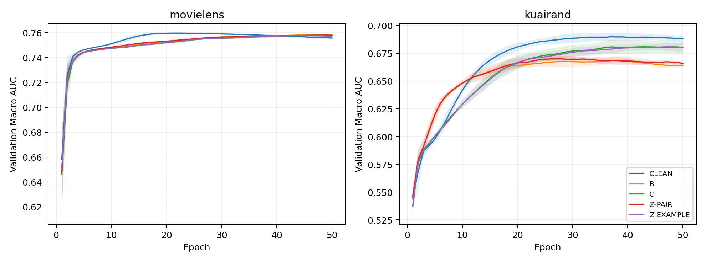
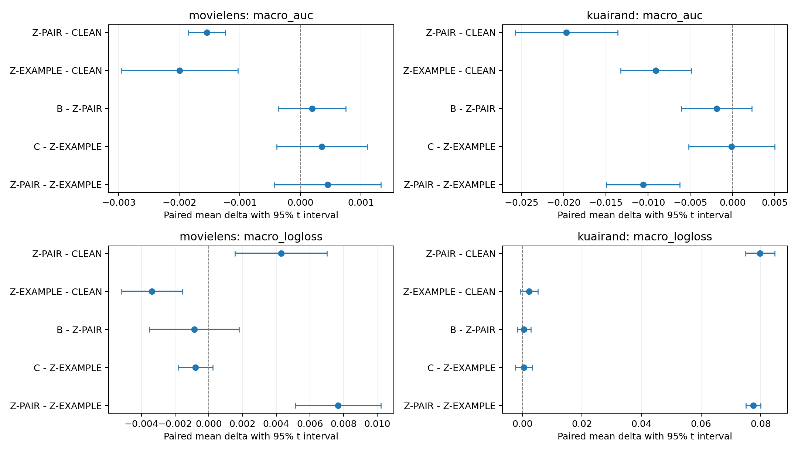

# Stage 1 数值汇总

统计单位为 seed；五 seed 为2022–2026。AUC 与 LogLoss分别列出。

完整绝对值见 [NUMERICAL_APPENDIX.md](NUMERICAL_APPENDIX.md)；机器可读原值和汇总见 [EVIDENCE.json](EVIDENCE.json)。

## Selected 五 seed 绝对值均值与 sample SD

| dataset | arm | kind | metric | mean | sample_sd |
| --- | --- | --- | --- | --- | --- |
| kuairand | B | fixed_ema | macro_auc | 0.6695410 | 0.0033447 |
| kuairand | B | fixed_ema | macro_logloss | 0.5090398 | 0.0026460 |
| kuairand | B | fixed_ema | pooled_logloss | 0.4496811 | 0.0044100 |
| kuairand | B | fixed_ema | pooled_task_mean_auc | 0.6890379 | 0.0027265 |
| kuairand | B | fixed_ema | sample_weighted_cell_auc | 0.6853314 | 0.0026462 |
| kuairand | B | fixed_ema | sample_weighted_cell_logloss | 0.4496811 | 0.0044100 |
| kuairand | B | fixed_ema | worst_cell_auc | 0.6525040 | 0.0068941 |
| kuairand | B | online | macro_auc | 0.6681639 | 0.0012280 |
| kuairand | B | online | macro_logloss | 0.5094647 | 0.0037360 |
| kuairand | B | online | pooled_logloss | 0.4483280 | 0.0051437 |
| kuairand | B | online | pooled_task_mean_auc | 0.6850795 | 0.0027185 |
| kuairand | B | online | sample_weighted_cell_auc | 0.6813259 | 0.0025408 |
| kuairand | B | online | sample_weighted_cell_logloss | 0.4483280 | 0.0051437 |
| kuairand | B | online | worst_cell_auc | 0.6537474 | 0.0040203 |
| kuairand | C | fixed_ema | macro_auc | 0.6819099 | 0.0060813 |
| kuairand | C | fixed_ema | macro_logloss | 0.4313874 | 0.0025162 |
| kuairand | C | fixed_ema | pooled_logloss | 0.4255006 | 0.0048548 |
| kuairand | C | fixed_ema | pooled_task_mean_auc | 0.7035384 | 0.0018009 |
| kuairand | C | fixed_ema | sample_weighted_cell_auc | 0.6980333 | 0.0017519 |
| kuairand | C | fixed_ema | sample_weighted_cell_logloss | 0.4255006 | 0.0048548 |
| kuairand | C | fixed_ema | worst_cell_auc | 0.6614977 | 0.0108351 |
| kuairand | C | online | macro_auc | 0.6776369 | 0.0034658 |
| kuairand | C | online | macro_logloss | 0.4323769 | 0.0021177 |
| kuairand | C | online | pooled_logloss | 0.4256766 | 0.0071249 |
| kuairand | C | online | pooled_task_mean_auc | 0.6975013 | 0.0019290 |
| kuairand | C | online | sample_weighted_cell_auc | 0.6918105 | 0.0020045 |
| kuairand | C | online | sample_weighted_cell_logloss | 0.4256766 | 0.0071249 |
| kuairand | C | online | worst_cell_auc | 0.6596144 | 0.0070153 |
| kuairand | CLEAN | fixed_ema | macro_auc | 0.6910980 | 0.0038205 |
| kuairand | CLEAN | fixed_ema | macro_logloss | 0.4286396 | 0.0015994 |
| kuairand | CLEAN | fixed_ema | pooled_logloss | 0.4188770 | 0.0014948 |
| kuairand | CLEAN | fixed_ema | pooled_task_mean_auc | 0.7203895 | 0.0010448 |
| kuairand | CLEAN | fixed_ema | sample_weighted_cell_auc | 0.7153445 | 0.0010780 |
| kuairand | CLEAN | fixed_ema | sample_weighted_cell_logloss | 0.4188770 | 0.0014948 |
| kuairand | CLEAN | fixed_ema | worst_cell_auc | 0.6655552 | 0.0044537 |
| kuairand | CLEAN | online | macro_auc | 0.6894542 | 0.0035757 |
| kuairand | CLEAN | online | macro_logloss | 0.4288290 | 0.0037441 |
| kuairand | CLEAN | online | pooled_logloss | 0.4191534 | 0.0083430 |
| kuairand | CLEAN | online | pooled_task_mean_auc | 0.7156200 | 0.0027726 |
| kuairand | CLEAN | online | sample_weighted_cell_auc | 0.7103899 | 0.0027965 |
| kuairand | CLEAN | online | sample_weighted_cell_logloss | 0.4191534 | 0.0083430 |
| kuairand | CLEAN | online | worst_cell_auc | 0.6639104 | 0.0045587 |
| kuairand | Z-EXAMPLE | fixed_ema | macro_auc | 0.6820231 | 0.0030366 |
| kuairand | Z-EXAMPLE | fixed_ema | macro_logloss | 0.4309200 | 0.0014523 |
| kuairand | Z-EXAMPLE | fixed_ema | pooled_logloss | 0.4221795 | 0.0030091 |
| kuairand | Z-EXAMPLE | fixed_ema | pooled_task_mean_auc | 0.7042500 | 0.0031384 |
| kuairand | Z-EXAMPLE | fixed_ema | sample_weighted_cell_auc | 0.6987485 | 0.0032347 |
| kuairand | Z-EXAMPLE | fixed_ema | sample_weighted_cell_logloss | 0.4221795 | 0.0030091 |
| kuairand | Z-EXAMPLE | fixed_ema | worst_cell_auc | 0.6645289 | 0.0056332 |
| kuairand | Z-EXAMPLE | online | macro_auc | 0.6781119 | 0.0030392 |
| kuairand | Z-EXAMPLE | online | macro_logloss | 0.4343837 | 0.0030953 |
| kuairand | Z-EXAMPLE | online | pooled_logloss | 0.4288035 | 0.0065005 |
| kuairand | Z-EXAMPLE | online | pooled_task_mean_auc | 0.6969628 | 0.0032229 |
| kuairand | Z-EXAMPLE | online | sample_weighted_cell_auc | 0.6914596 | 0.0032950 |
| kuairand | Z-EXAMPLE | online | sample_weighted_cell_logloss | 0.4288035 | 0.0065005 |
| kuairand | Z-EXAMPLE | online | worst_cell_auc | 0.6619233 | 0.0051760 |
| kuairand | Z-PAIR | fixed_ema | macro_auc | 0.6714257 | 0.0021698 |
| kuairand | Z-PAIR | fixed_ema | macro_logloss | 0.5084769 | 0.0029770 |
| kuairand | Z-PAIR | fixed_ema | pooled_logloss | 0.4533392 | 0.0043210 |
| kuairand | Z-PAIR | fixed_ema | pooled_task_mean_auc | 0.6831098 | 0.0035434 |
| kuairand | Z-PAIR | fixed_ema | sample_weighted_cell_auc | 0.6795146 | 0.0034836 |
| kuairand | Z-PAIR | fixed_ema | sample_weighted_cell_logloss | 0.4533392 | 0.0043210 |
| kuairand | Z-PAIR | fixed_ema | worst_cell_auc | 0.6564654 | 0.0029927 |
| kuairand | Z-PAIR | online | macro_auc | 0.6695293 | 0.0022907 |
| kuairand | Z-PAIR | online | macro_logloss | 0.5121179 | 0.0051524 |
| kuairand | Z-PAIR | online | pooled_logloss | 0.4520922 | 0.0060407 |
| kuairand | Z-PAIR | online | pooled_task_mean_auc | 0.6804596 | 0.0048432 |
| kuairand | Z-PAIR | online | sample_weighted_cell_auc | 0.6770424 | 0.0047010 |
| kuairand | Z-PAIR | online | sample_weighted_cell_logloss | 0.4520922 | 0.0060407 |
| kuairand | Z-PAIR | online | worst_cell_auc | 0.6507189 | 0.0032130 |
| movielens | B | fixed_ema | macro_auc | 0.7584149 | 0.0005669 |
| movielens | B | fixed_ema | macro_logloss | 0.5281116 | 0.0013055 |
| movielens | B | fixed_ema | pooled_logloss | 0.5285435 | 0.0013014 |
| movielens | B | fixed_ema | pooled_task_mean_auc | 0.7572384 | 0.0005946 |
| movielens | B | fixed_ema | sample_weighted_cell_auc | 0.7575163 | 0.0005940 |
| movielens | B | fixed_ema | sample_weighted_cell_logloss | 0.5285435 | 0.0013014 |
| movielens | B | fixed_ema | worst_cell_auc | 0.7507608 | 0.0011387 |
| movielens | B | online | macro_auc | 0.7544006 | 0.0003265 |
| movielens | B | online | macro_logloss | 0.5328086 | 0.0024768 |
| movielens | B | online | pooled_logloss | 0.5331935 | 0.0021964 |
| movielens | B | online | pooled_task_mean_auc | 0.7530120 | 0.0007577 |
| movielens | B | online | sample_weighted_cell_auc | 0.7535202 | 0.0003373 |
| movielens | B | online | sample_weighted_cell_logloss | 0.5331935 | 0.0021964 |
| movielens | B | online | worst_cell_auc | 0.7473313 | 0.0011381 |
| movielens | C | fixed_ema | macro_auc | 0.7581251 | 0.0005533 |
| movielens | C | fixed_ema | macro_logloss | 0.5205103 | 0.0003426 |
| movielens | C | fixed_ema | pooled_logloss | 0.5214652 | 0.0003273 |
| movielens | C | fixed_ema | pooled_task_mean_auc | 0.7575496 | 0.0004697 |
| movielens | C | fixed_ema | sample_weighted_cell_auc | 0.7572971 | 0.0005355 |
| movielens | C | fixed_ema | sample_weighted_cell_logloss | 0.5214652 | 0.0003273 |
| movielens | C | fixed_ema | worst_cell_auc | 0.7510413 | 0.0004350 |
| movielens | C | online | macro_auc | 0.7539240 | 0.0005687 |
| movielens | C | online | macro_logloss | 0.5262153 | 0.0021209 |
| movielens | C | online | pooled_logloss | 0.5272300 | 0.0021749 |
| movielens | C | online | pooled_task_mean_auc | 0.7528333 | 0.0008700 |
| movielens | C | online | sample_weighted_cell_auc | 0.7531002 | 0.0005837 |
| movielens | C | online | sample_weighted_cell_logloss | 0.5272300 | 0.0021749 |
| movielens | C | online | worst_cell_auc | 0.7466865 | 0.0010244 |
| movielens | CLEAN | fixed_ema | macro_auc | 0.7597682 | 0.0001587 |
| movielens | CLEAN | fixed_ema | macro_logloss | 0.5246900 | 0.0010251 |
| movielens | CLEAN | fixed_ema | pooled_logloss | 0.5257445 | 0.0010794 |
| movielens | CLEAN | fixed_ema | pooled_task_mean_auc | 0.7593059 | 0.0001005 |
| movielens | CLEAN | fixed_ema | sample_weighted_cell_auc | 0.7589806 | 0.0001343 |
| movielens | CLEAN | fixed_ema | sample_weighted_cell_logloss | 0.5257445 | 0.0010794 |
| movielens | CLEAN | fixed_ema | worst_cell_auc | 0.7537364 | 0.0003756 |
| movielens | CLEAN | online | macro_auc | 0.7567718 | 0.0001724 |
| movielens | CLEAN | online | macro_logloss | 0.5267180 | 0.0031814 |
| movielens | CLEAN | online | pooled_logloss | 0.5276072 | 0.0032366 |
| movielens | CLEAN | online | pooled_task_mean_auc | 0.7560369 | 0.0005101 |
| movielens | CLEAN | online | sample_weighted_cell_auc | 0.7560231 | 0.0001867 |
| movielens | CLEAN | online | sample_weighted_cell_logloss | 0.5276072 | 0.0032366 |
| movielens | CLEAN | online | worst_cell_auc | 0.7507396 | 0.0005057 |
| movielens | Z-EXAMPLE | fixed_ema | macro_auc | 0.7577730 | 0.0007864 |
| movielens | Z-EXAMPLE | fixed_ema | macro_logloss | 0.5213133 | 0.0006273 |
| movielens | Z-EXAMPLE | fixed_ema | pooled_logloss | 0.5222378 | 0.0006138 |
| movielens | Z-EXAMPLE | fixed_ema | pooled_task_mean_auc | 0.7572723 | 0.0007759 |
| movielens | Z-EXAMPLE | fixed_ema | sample_weighted_cell_auc | 0.7569748 | 0.0007589 |
| movielens | Z-EXAMPLE | fixed_ema | sample_weighted_cell_logloss | 0.5222378 | 0.0006138 |
| movielens | Z-EXAMPLE | fixed_ema | worst_cell_auc | 0.7509011 | 0.0005102 |
| movielens | Z-EXAMPLE | online | macro_auc | 0.7537035 | 0.0008101 |
| movielens | Z-EXAMPLE | online | macro_logloss | 0.5264958 | 0.0013097 |
| movielens | Z-EXAMPLE | online | pooled_logloss | 0.5273043 | 0.0012584 |
| movielens | Z-EXAMPLE | online | pooled_task_mean_auc | 0.7528054 | 0.0008244 |
| movielens | Z-EXAMPLE | online | sample_weighted_cell_auc | 0.7528998 | 0.0007410 |
| movielens | Z-EXAMPLE | online | sample_weighted_cell_logloss | 0.5273043 | 0.0012584 |
| movielens | Z-EXAMPLE | online | worst_cell_auc | 0.7466487 | 0.0007404 |
| movielens | Z-PAIR | fixed_ema | macro_auc | 0.7582217 | 0.0003881 |
| movielens | Z-PAIR | fixed_ema | macro_logloss | 0.5289779 | 0.0017578 |
| movielens | Z-PAIR | fixed_ema | pooled_logloss | 0.5293860 | 0.0015713 |
| movielens | Z-PAIR | fixed_ema | pooled_task_mean_auc | 0.7571661 | 0.0003857 |
| movielens | Z-PAIR | fixed_ema | sample_weighted_cell_auc | 0.7573544 | 0.0003978 |
| movielens | Z-PAIR | fixed_ema | sample_weighted_cell_logloss | 0.5293860 | 0.0015713 |
| movielens | Z-PAIR | fixed_ema | worst_cell_auc | 0.7507608 | 0.0005030 |
| movielens | Z-PAIR | online | macro_auc | 0.7538757 | 0.0006671 |
| movielens | Z-PAIR | online | macro_logloss | 0.5330457 | 0.0020224 |
| movielens | Z-PAIR | online | pooled_logloss | 0.5337206 | 0.0021900 |
| movielens | Z-PAIR | online | pooled_task_mean_auc | 0.7529664 | 0.0006519 |
| movielens | Z-PAIR | online | sample_weighted_cell_auc | 0.7529308 | 0.0006137 |
| movielens | Z-PAIR | online | sample_weighted_cell_logloss | 0.5337206 | 0.0021900 |
| movielens | Z-PAIR | online | worst_cell_auc | 0.7463500 | 0.0007776 |

## Selected 配对 Macro AUC / LogLoss

差值为arm−control；confidence interval为五 seed配对95% t区间。

| dataset | arm | control | kind | reference_kind | metric | mean | sample_sd | ci95_low | ci95_high | positive_seeds |
| --- | --- | --- | --- | --- | --- | --- | --- | --- | --- | --- |
| movielens | Z-PAIR | CLEAN | online | online | macro_auc | -0.0028961 | 0.0007316 | -0.0038045 | -0.0019876 | 0 |
| movielens | Z-PAIR | CLEAN | online | online | macro_logloss | 0.0063277 | 0.0046416 | 0.0005644 | 0.0120910 | 5 |
| movielens | Z-PAIR | CLEAN | fixed_ema | fixed_ema | macro_auc | -0.0015466 | 0.0002467 | -0.0018529 | -0.0012402 | 0 |
| movielens | Z-PAIR | CLEAN | fixed_ema | fixed_ema | macro_logloss | 0.0042879 | 0.0021997 | 0.0015566 | 0.0070191 | 5 |
| movielens | Z-PAIR | CLEAN | fixed_ema | online | macro_auc | 0.0014499 | 0.0004990 | 0.0008303 | 0.0020695 | 5 |
| movielens | Z-PAIR | CLEAN | fixed_ema | online | macro_logloss | 0.0022599 | 0.0042656 | -0.0030366 | 0.0075563 | 3 |
| movielens | Z-EXAMPLE | CLEAN | online | online | macro_auc | -0.0030683 | 0.0008011 | -0.0040629 | -0.0020737 | 0 |
| movielens | Z-EXAMPLE | CLEAN | online | online | macro_logloss | -0.0002222 | 0.0024451 | -0.0032582 | 0.0028137 | 2 |
| movielens | Z-EXAMPLE | CLEAN | fixed_ema | fixed_ema | macro_auc | -0.0019952 | 0.0007728 | -0.0029547 | -0.0010357 | 0 |
| movielens | Z-EXAMPLE | CLEAN | fixed_ema | fixed_ema | macro_logloss | -0.0033767 | 0.0014542 | -0.0051824 | -0.0015711 | 0 |
| movielens | Z-EXAMPLE | CLEAN | fixed_ema | online | macro_auc | 0.0010013 | 0.0007764 | 0.0000372 | 0.0019653 | 4 |
| movielens | Z-EXAMPLE | CLEAN | fixed_ema | online | macro_logloss | -0.0054047 | 0.0028042 | -0.0088865 | -0.0019229 | 0 |
| movielens | B | Z-PAIR | online | online | macro_auc | 0.0005249 | 0.0005881 | -0.0002053 | 0.0012550 | 4 |
| movielens | B | Z-PAIR | online | online | macro_logloss | -0.0002371 | 0.0025587 | -0.0034142 | 0.0029400 | 3 |
| movielens | B | Z-PAIR | fixed_ema | fixed_ema | macro_auc | 0.0001933 | 0.0004455 | -0.0003598 | 0.0007464 | 2 |
| movielens | B | Z-PAIR | fixed_ema | fixed_ema | macro_logloss | -0.0008663 | 0.0021489 | -0.0035345 | 0.0018019 | 1 |
| movielens | C | Z-EXAMPLE | online | online | macro_auc | 0.0002205 | 0.0008252 | -0.0008040 | 0.0012451 | 3 |
| movielens | C | Z-EXAMPLE | online | online | macro_logloss | -0.0002805 | 0.0030927 | -0.0041206 | 0.0035596 | 3 |
| movielens | C | Z-EXAMPLE | fixed_ema | fixed_ema | macro_auc | 0.0003521 | 0.0006016 | -0.0003949 | 0.0010991 | 4 |
| movielens | C | Z-EXAMPLE | fixed_ema | fixed_ema | macro_logloss | -0.0008030 | 0.0008305 | -0.0018341 | 0.0002282 | 0 |
| movielens | Z-PAIR | Z-EXAMPLE | online | online | macro_auc | 0.0001722 | 0.0011197 | -0.0012181 | 0.0015625 | 3 |
| movielens | Z-PAIR | Z-EXAMPLE | online | online | macro_logloss | 0.0065499 | 0.0025639 | 0.0033664 | 0.0097334 | 5 |
| movielens | Z-PAIR | Z-EXAMPLE | fixed_ema | fixed_ema | macro_auc | 0.0004486 | 0.0007056 | -0.0004274 | 0.0013247 | 4 |
| movielens | Z-PAIR | Z-EXAMPLE | fixed_ema | fixed_ema | macro_logloss | 0.0076646 | 0.0020477 | 0.0051220 | 0.0102072 | 5 |
| movielens | B | CLEAN | online | online | macro_auc | -0.0023712 | 0.0004491 | -0.0029288 | -0.0018136 | 0 |
| movielens | B | CLEAN | online | online | macro_logloss | 0.0060905 | 0.0041648 | 0.0009192 | 0.0112619 | 5 |
| movielens | B | CLEAN | fixed_ema | fixed_ema | macro_auc | -0.0013533 | 0.0004451 | -0.0019060 | -0.0008006 | 0 |
| movielens | B | CLEAN | fixed_ema | fixed_ema | macro_logloss | 0.0034216 | 0.0014256 | 0.0016514 | 0.0051917 | 5 |
| movielens | B | CLEAN | fixed_ema | online | macro_auc | 0.0016432 | 0.0006884 | 0.0007884 | 0.0024980 | 5 |
| movielens | B | CLEAN | fixed_ema | online | macro_logloss | 0.0013936 | 0.0043966 | -0.0040655 | 0.0068526 | 3 |
| movielens | C | CLEAN | online | online | macro_auc | -0.0028478 | 0.0005658 | -0.0035503 | -0.0021452 | 0 |
| movielens | C | CLEAN | online | online | macro_logloss | -0.0005027 | 0.0052292 | -0.0069957 | 0.0059903 | 3 |
| movielens | C | CLEAN | fixed_ema | fixed_ema | macro_auc | -0.0016431 | 0.0005217 | -0.0022910 | -0.0009953 | 0 |
| movielens | C | CLEAN | fixed_ema | fixed_ema | macro_logloss | -0.0041797 | 0.0012309 | -0.0057080 | -0.0026514 | 0 |
| movielens | C | CLEAN | fixed_ema | online | macro_auc | 0.0013533 | 0.0004728 | 0.0007662 | 0.0019404 | 5 |
| movielens | C | CLEAN | fixed_ema | online | macro_logloss | -0.0062077 | 0.0032647 | -0.0102614 | -0.0021540 | 0 |
| kuairand | Z-PAIR | CLEAN | online | online | macro_auc | -0.0199249 | 0.0053045 | -0.0265112 | -0.0133385 | 0 |
| kuairand | Z-PAIR | CLEAN | online | online | macro_logloss | 0.0832889 | 0.0039226 | 0.0784183 | 0.0881595 | 5 |
| kuairand | Z-PAIR | CLEAN | fixed_ema | fixed_ema | macro_auc | -0.0196724 | 0.0048773 | -0.0257283 | -0.0136165 | 0 |
| kuairand | Z-PAIR | CLEAN | fixed_ema | fixed_ema | macro_logloss | 0.0798373 | 0.0039020 | 0.0749924 | 0.0846823 | 5 |
| kuairand | Z-PAIR | CLEAN | fixed_ema | online | macro_auc | -0.0180285 | 0.0049018 | -0.0241149 | -0.0119422 | 0 |
| kuairand | Z-PAIR | CLEAN | fixed_ema | online | macro_logloss | 0.0796479 | 0.0030720 | 0.0758335 | 0.0834622 | 5 |
| kuairand | Z-EXAMPLE | CLEAN | online | online | macro_auc | -0.0113424 | 0.0036305 | -0.0158502 | -0.0068345 | 0 |
| kuairand | Z-EXAMPLE | CLEAN | online | online | macro_logloss | 0.0055547 | 0.0055877 | -0.0013834 | 0.0124927 | 4 |
| kuairand | Z-EXAMPLE | CLEAN | fixed_ema | fixed_ema | macro_auc | -0.0090749 | 0.0033560 | -0.0132419 | -0.0049080 | 0 |
| kuairand | Z-EXAMPLE | CLEAN | fixed_ema | fixed_ema | macro_logloss | 0.0022804 | 0.0023627 | -0.0006533 | 0.0052140 | 4 |
| kuairand | Z-EXAMPLE | CLEAN | fixed_ema | online | macro_auc | -0.0074311 | 0.0032591 | -0.0114778 | -0.0033844 | 0 |
| kuairand | Z-EXAMPLE | CLEAN | fixed_ema | online | macro_logloss | 0.0020909 | 0.0035645 | -0.0023349 | 0.0065168 | 4 |
| kuairand | B | Z-PAIR | online | online | macro_auc | -0.0013654 | 0.0026184 | -0.0046166 | 0.0018858 | 1 |
| kuairand | B | Z-PAIR | online | online | macro_logloss | -0.0026533 | 0.0060950 | -0.0102212 | 0.0049146 | 2 |
| kuairand | B | Z-PAIR | fixed_ema | fixed_ema | macro_auc | -0.0018847 | 0.0033657 | -0.0060638 | 0.0022944 | 3 |
| kuairand | B | Z-PAIR | fixed_ema | fixed_ema | macro_logloss | 0.0005629 | 0.0018434 | -0.0017259 | 0.0028518 | 3 |
| kuairand | C | Z-EXAMPLE | online | online | macro_auc | -0.0004749 | 0.0018797 | -0.0028089 | 0.0018591 | 2 |
| kuairand | C | Z-EXAMPLE | online | online | macro_logloss | -0.0020068 | 0.0015888 | -0.0039795 | -0.0000341 | 0 |
| kuairand | C | Z-EXAMPLE | fixed_ema | fixed_ema | macro_auc | -0.0001132 | 0.0040995 | -0.0052035 | 0.0049770 | 3 |
| kuairand | C | Z-EXAMPLE | fixed_ema | fixed_ema | macro_logloss | 0.0004674 | 0.0022897 | -0.0023756 | 0.0033105 | 3 |
| kuairand | Z-PAIR | Z-EXAMPLE | online | online | macro_auc | -0.0085825 | 0.0043274 | -0.0139557 | -0.0032094 | 0 |
| kuairand | Z-PAIR | Z-EXAMPLE | online | online | macro_logloss | 0.0777342 | 0.0056148 | 0.0707625 | 0.0847060 | 5 |
| kuairand | Z-PAIR | Z-EXAMPLE | fixed_ema | fixed_ema | macro_auc | -0.0105974 | 0.0035132 | -0.0149597 | -0.0062352 | 0 |
| kuairand | Z-PAIR | Z-EXAMPLE | fixed_ema | fixed_ema | macro_logloss | 0.0775570 | 0.0020311 | 0.0750350 | 0.0800789 | 5 |
| kuairand | B | CLEAN | online | online | macro_auc | -0.0212903 | 0.0031735 | -0.0252307 | -0.0173499 | 0 |
| kuairand | B | CLEAN | online | online | macro_logloss | 0.0806356 | 0.0067802 | 0.0722169 | 0.0890544 | 5 |
| kuairand | B | CLEAN | fixed_ema | fixed_ema | macro_auc | -0.0215571 | 0.0030910 | -0.0253950 | -0.0177191 | 0 |
| kuairand | B | CLEAN | fixed_ema | fixed_ema | macro_logloss | 0.0804003 | 0.0035903 | 0.0759423 | 0.0848582 | 5 |
| kuairand | B | CLEAN | fixed_ema | online | macro_auc | -0.0199132 | 0.0027105 | -0.0232788 | -0.0165477 | 0 |
| kuairand | B | CLEAN | fixed_ema | online | macro_logloss | 0.0802108 | 0.0025170 | 0.0770856 | 0.0833360 | 5 |
| kuairand | C | CLEAN | online | online | macro_auc | -0.0118173 | 0.0039021 | -0.0166623 | -0.0069722 | 0 |
| kuairand | C | CLEAN | online | online | macro_logloss | 0.0035479 | 0.0047395 | -0.0023370 | 0.0094327 | 4 |
| kuairand | C | CLEAN | fixed_ema | fixed_ema | macro_auc | -0.0091882 | 0.0064097 | -0.0171469 | -0.0012294 | 0 |
| kuairand | C | CLEAN | fixed_ema | fixed_ema | macro_logloss | 0.0027478 | 0.0025140 | -0.0003737 | 0.0058693 | 5 |
| kuairand | C | CLEAN | fixed_ema | online | macro_auc | -0.0075443 | 0.0058672 | -0.0148295 | -0.0002592 | 0 |
| kuairand | C | CLEAN | fixed_ema | online | macro_logloss | 0.0025584 | 0.0014857 | 0.0007137 | 0.0044031 | 5 |

## 训练阶段配对

先在每个seed内计算epoch均值，再对五seed配对。

| dataset | phase | arm | control | metric | mean | sample_sd | ci95_low | ci95_high | positive_seeds |
| --- | --- | --- | --- | --- | --- | --- | --- | --- | --- |
| movielens | E1-10 | Z-PAIR | CLEAN | macro_auc | -0.0028268 | 0.0032846 | -0.0069052 | 0.0012516 | 1 |
| movielens | E1-10 | Z-PAIR | CLEAN | macro_logloss | 0.0056045 | 0.0032332 | 0.0015900 | 0.0096190 | 5 |
| movielens | E1-10 | Z-EXAMPLE | CLEAN | macro_auc | -0.0033293 | 0.0021666 | -0.0060194 | -0.0006391 | 0 |
| movielens | E1-10 | Z-EXAMPLE | CLEAN | macro_logloss | -0.0026257 | 0.0016358 | -0.0046568 | -0.0005945 | 0 |
| movielens | E1-10 | B | Z-PAIR | macro_auc | -0.0006001 | 0.0012250 | -0.0021212 | 0.0009209 | 2 |
| movielens | E1-10 | B | Z-PAIR | macro_logloss | 0.0011188 | 0.0005751 | 0.0004047 | 0.0018329 | 5 |
| movielens | E1-10 | C | Z-EXAMPLE | macro_auc | -0.0009135 | 0.0008749 | -0.0019999 | 0.0001728 | 1 |
| movielens | E1-10 | C | Z-EXAMPLE | macro_logloss | 0.0007008 | 0.0016934 | -0.0014018 | 0.0028034 | 4 |
| movielens | E1-10 | Z-PAIR | Z-EXAMPLE | macro_auc | 0.0005025 | 0.0027444 | -0.0029052 | 0.0039101 | 3 |
| movielens | E1-10 | Z-PAIR | Z-EXAMPLE | macro_logloss | 0.0082302 | 0.0035693 | 0.0037983 | 0.0126620 | 5 |
| movielens | E1-10 | B | CLEAN | macro_auc | -0.0034269 | 0.0034047 | -0.0076544 | 0.0008006 | 0 |
| movielens | E1-10 | B | CLEAN | macro_logloss | 0.0067233 | 0.0031121 | 0.0028591 | 0.0105875 | 5 |
| movielens | E1-10 | C | CLEAN | macro_auc | -0.0042428 | 0.0028704 | -0.0078069 | -0.0006787 | 0 |
| movielens | E1-10 | C | CLEAN | macro_logloss | -0.0019248 | 0.0014020 | -0.0036657 | -0.0001840 | 0 |
| movielens | E11-30 | Z-PAIR | CLEAN | macro_auc | -0.0049891 | 0.0011179 | -0.0063772 | -0.0036011 | 0 |
| movielens | E11-30 | Z-PAIR | CLEAN | macro_logloss | 0.0066785 | 0.0004661 | 0.0060997 | 0.0072573 | 5 |
| movielens | E11-30 | Z-EXAMPLE | CLEAN | macro_auc | -0.0060487 | 0.0007819 | -0.0070195 | -0.0050779 | 0 |
| movielens | E11-30 | Z-EXAMPLE | CLEAN | macro_logloss | -0.0013092 | 0.0006784 | -0.0021516 | -0.0004669 | 0 |
| movielens | E11-30 | B | Z-PAIR | macro_auc | -0.0002865 | 0.0005430 | -0.0009607 | 0.0003877 | 1 |
| movielens | E11-30 | B | Z-PAIR | macro_logloss | -0.0000608 | 0.0011687 | -0.0015119 | 0.0013904 | 3 |
| movielens | E11-30 | C | Z-EXAMPLE | macro_auc | -0.0000569 | 0.0008268 | -0.0010835 | 0.0009698 | 2 |
| movielens | E11-30 | C | Z-EXAMPLE | macro_logloss | -0.0002306 | 0.0007376 | -0.0011464 | 0.0006852 | 2 |
| movielens | E11-30 | Z-PAIR | Z-EXAMPLE | macro_auc | 0.0010595 | 0.0007209 | 0.0001645 | 0.0019546 | 5 |
| movielens | E11-30 | Z-PAIR | Z-EXAMPLE | macro_logloss | 0.0079877 | 0.0010842 | 0.0066415 | 0.0093340 | 5 |
| movielens | E11-30 | B | CLEAN | macro_auc | -0.0052756 | 0.0007208 | -0.0061706 | -0.0043807 | 0 |
| movielens | E11-30 | B | CLEAN | macro_logloss | 0.0066178 | 0.0007246 | 0.0057180 | 0.0075175 | 5 |
| movielens | E11-30 | C | CLEAN | macro_auc | -0.0061055 | 0.0011461 | -0.0075286 | -0.0046825 | 0 |
| movielens | E11-30 | C | CLEAN | macro_logloss | -0.0015398 | 0.0003188 | -0.0019357 | -0.0011439 | 0 |
| movielens | E31-50 | Z-PAIR | CLEAN | macro_auc | 0.0000556 | 0.0007243 | -0.0008438 | 0.0009550 | 3 |
| movielens | E31-50 | Z-PAIR | CLEAN | macro_logloss | -0.0054703 | 0.0027216 | -0.0088497 | -0.0020910 | 0 |
| movielens | E31-50 | Z-EXAMPLE | CLEAN | macro_auc | -0.0003417 | 0.0009224 | -0.0014870 | 0.0008035 | 1 |
| movielens | E31-50 | Z-EXAMPLE | CLEAN | macro_logloss | -0.0134495 | 0.0021944 | -0.0161742 | -0.0107248 | 0 |
| movielens | E31-50 | B | Z-PAIR | macro_auc | 0.0001570 | 0.0007971 | -0.0008328 | 0.0011468 | 3 |
| movielens | E31-50 | B | Z-PAIR | macro_logloss | -0.0006469 | 0.0019728 | -0.0030964 | 0.0018026 | 2 |
| movielens | E31-50 | C | Z-EXAMPLE | macro_auc | 0.0000316 | 0.0007360 | -0.0008823 | 0.0009454 | 3 |
| movielens | E31-50 | C | Z-EXAMPLE | macro_logloss | -0.0006096 | 0.0006931 | -0.0014703 | 0.0002510 | 1 |
| movielens | E31-50 | Z-PAIR | Z-EXAMPLE | macro_auc | 0.0003973 | 0.0002958 | 0.0000300 | 0.0007645 | 5 |
| movielens | E31-50 | Z-PAIR | Z-EXAMPLE | macro_logloss | 0.0079792 | 0.0020800 | 0.0053966 | 0.0105618 | 5 |
| movielens | E31-50 | B | CLEAN | macro_auc | 0.0002125 | 0.0011958 | -0.0012722 | 0.0016973 | 2 |
| movielens | E31-50 | B | CLEAN | macro_logloss | -0.0061172 | 0.0026311 | -0.0093842 | -0.0028503 | 0 |
| movielens | E31-50 | C | CLEAN | macro_auc | -0.0003102 | 0.0004564 | -0.0008769 | 0.0002566 | 1 |
| movielens | E31-50 | C | CLEAN | macro_logloss | -0.0140591 | 0.0021379 | -0.0167137 | -0.0114046 | 0 |
| kuairand | E1-10 | Z-PAIR | CLEAN | macro_auc | 0.0135593 | 0.0066690 | 0.0052787 | 0.0218399 | 5 |
| kuairand | E1-10 | Z-PAIR | CLEAN | macro_logloss | 0.0840366 | 0.0074152 | 0.0748294 | 0.0932437 | 5 |
| kuairand | E1-10 | Z-EXAMPLE | CLEAN | macro_auc | -0.0024760 | 0.0037619 | -0.0071469 | 0.0021950 | 1 |
| kuairand | E1-10 | Z-EXAMPLE | CLEAN | macro_logloss | -0.0017660 | 0.0021941 | -0.0044904 | 0.0009583 | 1 |
| kuairand | E1-10 | B | Z-PAIR | macro_auc | -0.0005169 | 0.0011172 | -0.0019041 | 0.0008704 | 1 |
| kuairand | E1-10 | B | Z-PAIR | macro_logloss | 0.0007540 | 0.0013698 | -0.0009468 | 0.0024548 | 4 |
| kuairand | E1-10 | C | Z-EXAMPLE | macro_auc | 0.0003423 | 0.0007803 | -0.0006266 | 0.0013112 | 4 |
| kuairand | E1-10 | C | Z-EXAMPLE | macro_logloss | -0.0002313 | 0.0011213 | -0.0016236 | 0.0011610 | 3 |
| kuairand | E1-10 | Z-PAIR | Z-EXAMPLE | macro_auc | 0.0160353 | 0.0033197 | 0.0119133 | 0.0201573 | 5 |
| kuairand | E1-10 | Z-PAIR | Z-EXAMPLE | macro_logloss | 0.0858026 | 0.0063022 | 0.0779774 | 0.0936278 | 5 |
| kuairand | E1-10 | B | CLEAN | macro_auc | 0.0130424 | 0.0068708 | 0.0045112 | 0.0215737 | 5 |
| kuairand | E1-10 | B | CLEAN | macro_logloss | 0.0847906 | 0.0080970 | 0.0747368 | 0.0948443 | 5 |
| kuairand | E1-10 | C | CLEAN | macro_auc | -0.0021337 | 0.0038153 | -0.0068710 | 0.0026037 | 1 |
| kuairand | E1-10 | C | CLEAN | macro_logloss | -0.0019974 | 0.0013685 | -0.0036966 | -0.0002981 | 0 |
| kuairand | E11-30 | Z-PAIR | CLEAN | macro_auc | -0.0128778 | 0.0024779 | -0.0159545 | -0.0098011 | 0 |
| kuairand | E11-30 | Z-PAIR | CLEAN | macro_logloss | 0.0783959 | 0.0073842 | 0.0692273 | 0.0875646 | 5 |
| kuairand | E11-30 | Z-EXAMPLE | CLEAN | macro_auc | -0.0147683 | 0.0040856 | -0.0198412 | -0.0096954 | 0 |
| kuairand | E11-30 | Z-EXAMPLE | CLEAN | macro_logloss | -0.0004098 | 0.0040781 | -0.0054734 | 0.0046539 | 2 |
| kuairand | E11-30 | B | Z-PAIR | macro_auc | -0.0014391 | 0.0029074 | -0.0050491 | 0.0021709 | 1 |
| kuairand | E11-30 | B | Z-PAIR | macro_logloss | 0.0027502 | 0.0006600 | 0.0019307 | 0.0035696 | 5 |
| kuairand | E11-30 | C | Z-EXAMPLE | macro_auc | 0.0005540 | 0.0028721 | -0.0030122 | 0.0041202 | 2 |
| kuairand | E11-30 | C | Z-EXAMPLE | macro_logloss | 0.0010873 | 0.0035551 | -0.0033269 | 0.0055015 | 2 |
| kuairand | E11-30 | Z-PAIR | Z-EXAMPLE | macro_auc | 0.0018905 | 0.0037858 | -0.0028101 | 0.0065911 | 3 |
| kuairand | E11-30 | Z-PAIR | Z-EXAMPLE | macro_logloss | 0.0788057 | 0.0070011 | 0.0701127 | 0.0874987 | 5 |
| kuairand | E11-30 | B | CLEAN | macro_auc | -0.0143168 | 0.0031125 | -0.0181815 | -0.0104522 | 0 |
| kuairand | E11-30 | B | CLEAN | macro_logloss | 0.0811461 | 0.0068485 | 0.0726426 | 0.0896496 | 5 |
| kuairand | E11-30 | C | CLEAN | macro_auc | -0.0142143 | 0.0043194 | -0.0195776 | -0.0088510 | 0 |
| kuairand | E11-30 | C | CLEAN | macro_logloss | 0.0006775 | 0.0030995 | -0.0031710 | 0.0045261 | 4 |
| kuairand | E31-50 | Z-PAIR | CLEAN | macro_auc | -0.0213477 | 0.0033690 | -0.0255309 | -0.0171645 | 0 |
| kuairand | E31-50 | Z-PAIR | CLEAN | macro_logloss | 0.0788283 | 0.0022349 | 0.0760533 | 0.0816033 | 5 |
| kuairand | E31-50 | Z-EXAMPLE | CLEAN | macro_auc | -0.0098888 | 0.0029302 | -0.0135272 | -0.0062505 | 0 |
| kuairand | E31-50 | Z-EXAMPLE | CLEAN | macro_logloss | 0.0026010 | 0.0014921 | 0.0007483 | 0.0044538 | 5 |
| kuairand | E31-50 | B | Z-PAIR | macro_auc | -0.0014385 | 0.0015516 | -0.0033650 | 0.0004881 | 1 |
| kuairand | E31-50 | B | Z-PAIR | macro_logloss | 0.0007003 | 0.0030671 | -0.0031080 | 0.0045086 | 2 |
| kuairand | E31-50 | C | Z-EXAMPLE | macro_auc | 0.0005921 | 0.0036143 | -0.0038957 | 0.0050799 | 3 |
| kuairand | E31-50 | C | Z-EXAMPLE | macro_logloss | -0.0000649 | 0.0024064 | -0.0030529 | 0.0029231 | 2 |
| kuairand | E31-50 | Z-PAIR | Z-EXAMPLE | macro_auc | -0.0114589 | 0.0030160 | -0.0152038 | -0.0077140 | 0 |
| kuairand | E31-50 | Z-PAIR | Z-EXAMPLE | macro_logloss | 0.0762273 | 0.0013235 | 0.0745839 | 0.0778706 | 5 |
| kuairand | E31-50 | B | CLEAN | macro_auc | -0.0227862 | 0.0019096 | -0.0251572 | -0.0204151 | 0 |
| kuairand | E31-50 | B | CLEAN | macro_logloss | 0.0795286 | 0.0025200 | 0.0763996 | 0.0826575 | 5 |
| kuairand | E31-50 | C | CLEAN | macro_auc | -0.0092967 | 0.0055686 | -0.0162110 | -0.0023824 | 0 |
| kuairand | E31-50 | C | CLEAN | macro_logloss | 0.0025361 | 0.0020089 | 0.0000418 | 0.0050305 | 5 |

## Common epoch 配对 Macro AUC / LogLoss

| dataset | endpoint | arm | control | metric | mean | sample_sd | ci95_low | ci95_high | positive_seeds |
| --- | --- | --- | --- | --- | --- | --- | --- | --- | --- |
| movielens | E10 | Z-PAIR | CLEAN | macro_auc | -0.0027695 | 0.0011768 | -0.0042308 | -0.0013083 | 0 |
| movielens | E10 | Z-PAIR | CLEAN | macro_logloss | 0.0110844 | 0.0016048 | 0.0090919 | 0.0130770 | 5 |
| movielens | E10 | Z-EXAMPLE | CLEAN | macro_auc | -0.0036802 | 0.0012832 | -0.0052735 | -0.0020869 | 0 |
| movielens | E10 | Z-EXAMPLE | CLEAN | macro_logloss | 0.0029047 | 0.0012451 | 0.0013586 | 0.0044507 | 5 |
| movielens | E10 | B | Z-PAIR | macro_auc | -0.0004143 | 0.0004803 | -0.0010107 | 0.0001821 | 1 |
| movielens | E10 | B | Z-PAIR | macro_logloss | 0.0008143 | 0.0007303 | -0.0000925 | 0.0017211 | 5 |
| movielens | E10 | C | Z-EXAMPLE | macro_auc | 0.0000150 | 0.0001793 | -0.0002076 | 0.0002376 | 2 |
| movielens | E10 | C | Z-EXAMPLE | macro_logloss | 0.0001446 | 0.0003720 | -0.0003173 | 0.0006065 | 4 |
| movielens | E10 | Z-PAIR | Z-EXAMPLE | macro_auc | 0.0009106 | 0.0011514 | -0.0005190 | 0.0023403 | 4 |
| movielens | E10 | Z-PAIR | Z-EXAMPLE | macro_logloss | 0.0081798 | 0.0014158 | 0.0064219 | 0.0099376 | 5 |
| movielens | E10 | B | CLEAN | macro_auc | -0.0031839 | 0.0009727 | -0.0043917 | -0.0019761 | 0 |
| movielens | E10 | B | CLEAN | macro_logloss | 0.0118987 | 0.0013973 | 0.0101638 | 0.0136337 | 5 |
| movielens | E10 | C | CLEAN | macro_auc | -0.0036652 | 0.0012063 | -0.0051630 | -0.0021674 | 0 |
| movielens | E10 | C | CLEAN | macro_logloss | 0.0030493 | 0.0013619 | 0.0013583 | 0.0047403 | 5 |
| movielens | E30 | Z-PAIR | CLEAN | macro_auc | -0.0025070 | 0.0005875 | -0.0032365 | -0.0017776 | 0 |
| movielens | E30 | Z-PAIR | CLEAN | macro_logloss | 0.0005355 | 0.0034008 | -0.0036871 | 0.0047582 | 3 |
| movielens | E30 | Z-EXAMPLE | CLEAN | macro_auc | -0.0033159 | 0.0010266 | -0.0045906 | -0.0020412 | 0 |
| movielens | E30 | Z-EXAMPLE | CLEAN | macro_logloss | -0.0074846 | 0.0033536 | -0.0116487 | -0.0033206 | 0 |
| movielens | E30 | B | Z-PAIR | macro_auc | 0.0000918 | 0.0008781 | -0.0009985 | 0.0011821 | 3 |
| movielens | E30 | B | Z-PAIR | macro_logloss | -0.0003780 | 0.0019820 | -0.0028389 | 0.0020830 | 2 |
| movielens | E30 | C | Z-EXAMPLE | macro_auc | -0.0000315 | 0.0008749 | -0.0011179 | 0.0010549 | 2 |
| movielens | E30 | C | Z-EXAMPLE | macro_logloss | -0.0004331 | 0.0007425 | -0.0013551 | 0.0004889 | 2 |
| movielens | E30 | Z-PAIR | Z-EXAMPLE | macro_auc | 0.0008089 | 0.0011283 | -0.0005922 | 0.0022099 | 3 |
| movielens | E30 | Z-PAIR | Z-EXAMPLE | macro_logloss | 0.0080202 | 0.0023512 | 0.0051007 | 0.0109396 | 5 |
| movielens | E30 | B | CLEAN | macro_auc | -0.0024153 | 0.0007722 | -0.0033741 | -0.0014565 | 0 |
| movielens | E30 | B | CLEAN | macro_logloss | 0.0001575 | 0.0022745 | -0.0026667 | 0.0029818 | 3 |
| movielens | E30 | C | CLEAN | macro_auc | -0.0033474 | 0.0007704 | -0.0043039 | -0.0023908 | 0 |
| movielens | E30 | C | CLEAN | macro_logloss | -0.0079178 | 0.0031112 | -0.0117808 | -0.0040547 | 0 |
| movielens | E50 | Z-PAIR | CLEAN | macro_auc | 0.0022080 | 0.0015784 | 0.0002481 | 0.0041679 | 4 |
| movielens | E50 | Z-PAIR | CLEAN | macro_logloss | -0.0122640 | 0.0025813 | -0.0154692 | -0.0090589 | 0 |
| movielens | E50 | Z-EXAMPLE | CLEAN | macro_auc | 0.0015034 | 0.0015934 | -0.0004751 | 0.0034820 | 4 |
| movielens | E50 | Z-EXAMPLE | CLEAN | macro_logloss | -0.0189988 | 0.0034177 | -0.0232425 | -0.0147552 | 0 |
| movielens | E50 | B | Z-PAIR | macro_auc | 0.0001872 | 0.0004621 | -0.0003866 | 0.0007610 | 2 |
| movielens | E50 | B | Z-PAIR | macro_logloss | -0.0005634 | 0.0015797 | -0.0025248 | 0.0013980 | 1 |
| movielens | E50 | C | Z-EXAMPLE | macro_auc | 0.0006500 | 0.0007005 | -0.0002198 | 0.0015197 | 4 |
| movielens | E50 | C | Z-EXAMPLE | macro_logloss | -0.0011301 | 0.0008905 | -0.0022358 | -0.0000244 | 0 |
| movielens | E50 | Z-PAIR | Z-EXAMPLE | macro_auc | 0.0007046 | 0.0006323 | -0.0000805 | 0.0014897 | 5 |
| movielens | E50 | Z-PAIR | Z-EXAMPLE | macro_logloss | 0.0067348 | 0.0020000 | 0.0042514 | 0.0092181 | 5 |
| movielens | E50 | B | CLEAN | macro_auc | 0.0023952 | 0.0014487 | 0.0005965 | 0.0041939 | 5 |
| movielens | E50 | B | CLEAN | macro_logloss | -0.0128274 | 0.0032711 | -0.0168891 | -0.0087658 | 0 |
| movielens | E50 | C | CLEAN | macro_auc | 0.0021534 | 0.0012043 | 0.0006580 | 0.0036488 | 5 |
| movielens | E50 | C | CLEAN | macro_logloss | -0.0201290 | 0.0032256 | -0.0241340 | -0.0161239 | 0 |
| kuairand | E10 | Z-PAIR | CLEAN | macro_auc | 0.0064899 | 0.0021475 | 0.0038234 | 0.0091564 | 5 |
| kuairand | E10 | Z-PAIR | CLEAN | macro_logloss | 0.0752932 | 0.0125795 | 0.0596738 | 0.0909127 | 5 |
| kuairand | E10 | Z-EXAMPLE | CLEAN | macro_auc | -0.0127670 | 0.0044842 | -0.0183348 | -0.0071991 | 0 |
| kuairand | E10 | Z-EXAMPLE | CLEAN | macro_logloss | -0.0089812 | 0.0078168 | -0.0186871 | 0.0007247 | 1 |
| kuairand | E10 | B | Z-PAIR | macro_auc | -0.0002746 | 0.0020546 | -0.0028257 | 0.0022766 | 2 |
| kuairand | E10 | B | Z-PAIR | macro_logloss | 0.0042937 | 0.0053642 | -0.0023668 | 0.0109542 | 4 |
| kuairand | E10 | C | Z-EXAMPLE | macro_auc | 0.0001037 | 0.0026050 | -0.0031309 | 0.0033382 | 3 |
| kuairand | E10 | C | Z-EXAMPLE | macro_logloss | 0.0016510 | 0.0039901 | -0.0033034 | 0.0066053 | 3 |
| kuairand | E10 | Z-PAIR | Z-EXAMPLE | macro_auc | 0.0192568 | 0.0032714 | 0.0151949 | 0.0233188 | 5 |
| kuairand | E10 | Z-PAIR | Z-EXAMPLE | macro_logloss | 0.0842744 | 0.0111636 | 0.0704130 | 0.0981359 | 5 |
| kuairand | E10 | B | CLEAN | macro_auc | 0.0062153 | 0.0025319 | 0.0030715 | 0.0093590 | 5 |
| kuairand | E10 | B | CLEAN | macro_logloss | 0.0795869 | 0.0113243 | 0.0655260 | 0.0936478 | 5 |
| kuairand | E10 | C | CLEAN | macro_auc | -0.0126633 | 0.0057784 | -0.0198382 | -0.0054884 | 0 |
| kuairand | E10 | C | CLEAN | macro_logloss | -0.0073302 | 0.0081042 | -0.0173929 | 0.0027324 | 0 |
| kuairand | E30 | Z-PAIR | CLEAN | macro_auc | -0.0188115 | 0.0042332 | -0.0240678 | -0.0135552 | 0 |
| kuairand | E30 | Z-PAIR | CLEAN | macro_logloss | 0.0802014 | 0.0035552 | 0.0757870 | 0.0846158 | 5 |
| kuairand | E30 | Z-EXAMPLE | CLEAN | macro_auc | -0.0127234 | 0.0036569 | -0.0172640 | -0.0081827 | 0 |
| kuairand | E30 | Z-EXAMPLE | CLEAN | macro_logloss | 0.0030085 | 0.0011791 | 0.0015444 | 0.0044726 | 5 |
| kuairand | E30 | B | Z-PAIR | macro_auc | -0.0023916 | 0.0045772 | -0.0080750 | 0.0032918 | 3 |
| kuairand | E30 | B | Z-PAIR | macro_logloss | 0.0014144 | 0.0045341 | -0.0042154 | 0.0070442 | 2 |
| kuairand | E30 | C | Z-EXAMPLE | macro_auc | 0.0011700 | 0.0022925 | -0.0016766 | 0.0040165 | 2 |
| kuairand | E30 | C | Z-EXAMPLE | macro_logloss | 0.0004579 | 0.0028530 | -0.0030845 | 0.0040004 | 2 |
| kuairand | E30 | Z-PAIR | Z-EXAMPLE | macro_auc | -0.0060881 | 0.0049016 | -0.0121743 | -0.0000020 | 1 |
| kuairand | E30 | Z-PAIR | Z-EXAMPLE | macro_logloss | 0.0771929 | 0.0027121 | 0.0738253 | 0.0805604 | 5 |
| kuairand | E30 | B | CLEAN | macro_auc | -0.0212031 | 0.0025722 | -0.0243969 | -0.0180093 | 0 |
| kuairand | E30 | B | CLEAN | macro_logloss | 0.0816158 | 0.0040926 | 0.0765341 | 0.0866974 | 5 |
| kuairand | E30 | C | CLEAN | macro_auc | -0.0115534 | 0.0053353 | -0.0181780 | -0.0049288 | 0 |
| kuairand | E30 | C | CLEAN | macro_logloss | 0.0034665 | 0.0020543 | 0.0009157 | 0.0060172 | 5 |
| kuairand | E50 | Z-PAIR | CLEAN | macro_auc | -0.0224317 | 0.0010804 | -0.0237732 | -0.0210901 | 0 |
| kuairand | E50 | Z-PAIR | CLEAN | macro_logloss | 0.0766590 | 0.0017969 | 0.0744279 | 0.0788901 | 5 |
| kuairand | E50 | Z-EXAMPLE | CLEAN | macro_auc | -0.0079181 | 0.0027825 | -0.0113730 | -0.0044632 | 0 |
| kuairand | E50 | Z-EXAMPLE | CLEAN | macro_logloss | 0.0010474 | 0.0012966 | -0.0005626 | 0.0026573 | 4 |
| kuairand | E50 | B | Z-PAIR | macro_auc | -0.0018999 | 0.0023721 | -0.0048453 | 0.0010455 | 2 |
| kuairand | E50 | B | Z-PAIR | macro_logloss | 0.0009941 | 0.0032616 | -0.0030557 | 0.0050440 | 3 |
| kuairand | E50 | C | Z-EXAMPLE | macro_auc | -0.0001158 | 0.0029998 | -0.0038405 | 0.0036089 | 3 |
| kuairand | E50 | C | Z-EXAMPLE | macro_logloss | 0.0002411 | 0.0016373 | -0.0017919 | 0.0022741 | 1 |
| kuairand | E50 | Z-PAIR | Z-EXAMPLE | macro_auc | -0.0145135 | 0.0037175 | -0.0191294 | -0.0098976 | 0 |
| kuairand | E50 | Z-PAIR | Z-EXAMPLE | macro_logloss | 0.0756116 | 0.0017050 | 0.0734947 | 0.0777286 | 5 |
| kuairand | E50 | B | CLEAN | macro_auc | -0.0243315 | 0.0030701 | -0.0281436 | -0.0205195 | 0 |
| kuairand | E50 | B | CLEAN | macro_logloss | 0.0776531 | 0.0017181 | 0.0755199 | 0.0797863 | 5 |
| kuairand | E50 | C | CLEAN | macro_auc | -0.0080339 | 0.0051543 | -0.0144338 | -0.0016340 | 0 |
| kuairand | E50 | C | CLEAN | macro_logloss | 0.0012884 | 0.0016085 | -0.0007088 | 0.0032856 | 3 |

## 选点epoch

| dataset | arm | kind | mean | sample_sd |
| --- | --- | --- | --- | --- |
| kuairand | C | online | 38.4000000 | 3.6469165 |
| kuairand | C | fixed_ema | 43.2000000 | 4.7644517 |
| movielens | Z-EXAMPLE | online | 43.2000000 | 4.9699095 |
| movielens | Z-EXAMPLE | fixed_ema | 45.0000000 | 3.8078866 |
| kuairand | Z-PAIR | online | 28.8000000 | 7.7910205 |
| kuairand | Z-PAIR | fixed_ema | 25.6000000 | 6.2689712 |
| kuairand | Z-EXAMPLE | online | 43.6000000 | 5.5045436 |
| kuairand | Z-EXAMPLE | fixed_ema | 46.0000000 | 3.5355339 |
| movielens | B | online | 42.0000000 | 5.0497525 |
| movielens | B | fixed_ema | 46.8000000 | 2.5884358 |
| movielens | C | online | 43.6000000 | 5.1768716 |
| movielens | C | fixed_ema | 45.4000000 | 4.0373258 |
| kuairand | B | online | 36.4000000 | 8.9050547 |
| kuairand | B | fixed_ema | 34.4000000 | 5.5946403 |
| movielens | Z-PAIR | online | 45.4000000 | 2.7018512 |
| movielens | Z-PAIR | fixed_ema | 46.6000000 | 3.7815341 |
| movielens | CLEAN | online | 21.0000000 | 3.2403703 |
| movielens | CLEAN | fixed_ema | 22.2000000 | 3.5637059 |
| kuairand | CLEAN | online | 37.0000000 | 8.5440037 |
| kuairand | CLEAN | fixed_ema | 40.4000000 | 6.8774995 |

## Support overlap

| dataset | treatment | zero | seed | batches | mean_jaccard | min_jaccard | different_support_batches | different_support_batch_fraction | symmetric_difference_entries |
| --- | --- | --- | --- | --- | --- | --- | --- | --- | --- |
| movielens | B | Z-PAIR | 2022 | 1000 | 0.9999987 | 0.9986979 | 1 | 0.0010000 | 2 |
| movielens | B | Z-PAIR | 2023 | 1000 | 0.9999974 | 0.9986979 | 2 | 0.0020000 | 4 |
| movielens | B | Z-PAIR | 2024 | 1000 | 0.9999987 | 0.9986979 | 1 | 0.0010000 | 2 |
| movielens | B | Z-PAIR | 2025 | 1000 | 0.9999987 | 0.9986979 | 1 | 0.0010000 | 2 |
| movielens | B | Z-PAIR | 2026 | 1000 | 0.9999948 | 0.9986979 | 4 | 0.0040000 | 8 |
| movielens | C | Z-EXAMPLE | 2022 | 1000 | 1.0000000 | 1.0000000 | 0 | 0.0000000 | 0 |
| movielens | C | Z-EXAMPLE | 2023 | 1000 | 1.0000000 | 1.0000000 | 0 | 0.0000000 | 0 |
| movielens | C | Z-EXAMPLE | 2024 | 1000 | 1.0000000 | 1.0000000 | 0 | 0.0000000 | 0 |
| movielens | C | Z-EXAMPLE | 2025 | 1000 | 1.0000000 | 1.0000000 | 0 | 0.0000000 | 0 |
| movielens | C | Z-EXAMPLE | 2026 | 1000 | 1.0000000 | 1.0000000 | 0 | 0.0000000 | 0 |
| kuairand | B | Z-PAIR | 2022 | 2450 | 0.9999059 | 0.9908854 | 69 | 0.0281633 | 354 |
| kuairand | B | Z-PAIR | 2023 | 2450 | 0.9999676 | 0.9921875 | 35 | 0.0142857 | 122 |
| kuairand | B | Z-PAIR | 2024 | 2450 | 0.9999521 | 0.9908854 | 47 | 0.0191837 | 180 |
| kuairand | B | Z-PAIR | 2025 | 2450 | 0.9999660 | 0.9960938 | 41 | 0.0167347 | 128 |
| kuairand | B | Z-PAIR | 2026 | 2450 | 0.9999761 | 0.9947917 | 29 | 0.0118367 | 90 |
| kuairand | C | Z-EXAMPLE | 2022 | 2450 | 1.0000000 | 1.0000000 | 0 | 0.0000000 | 0 |
| kuairand | C | Z-EXAMPLE | 2023 | 2450 | 1.0000000 | 1.0000000 | 0 | 0.0000000 | 0 |
| kuairand | C | Z-EXAMPLE | 2024 | 2450 | 1.0000000 | 1.0000000 | 0 | 0.0000000 | 0 |
| kuairand | C | Z-EXAMPLE | 2025 | 2450 | 1.0000000 | 1.0000000 | 0 | 0.0000000 | 0 |
| kuairand | C | Z-EXAMPLE | 2026 | 2450 | 1.0000000 | 1.0000000 | 0 | 0.0000000 | 0 |

## 每domain/task的自然与辅助正例率

由全部50epochs的计数分别聚合，保留seed。

| dataset | arm | seed | cell | clean_count | aux_count | natural_positive_rate | auxiliary_positive_rate |
| --- | --- | --- | --- | --- | --- | --- | --- |
| kuairand | C | 2023 | d0t0 | 8639100 | 627200 | 0.0908891 | 0.0906441 |
| kuairand | C | 2023 | d0t1 | 8639100 | 625578 | 0.0412138 | 0.0409254 |
| kuairand | C | 2023 | d1t0 | 87194900 | 627200 | 0.3778323 | 0.3783626 |
| kuairand | C | 2023 | d1t1 | 87194900 | 627200 | 0.2560832 | 0.2561272 |
| kuairand | C | 2023 | d2t0 | 4472600 | 627200 | 0.6168671 | 0.6161240 |
| kuairand | C | 2023 | d2t1 | 4472600 | 627200 | 0.4848075 | 0.4848166 |
| movielens | Z-EXAMPLE | 2025 | d0t0 | 7797450 | 256000 | 0.5610424 | 0.5627539 |
| movielens | Z-EXAMPLE | 2025 | d0t1 | 7797450 | 256000 | 0.2347883 | 0.2361875 |
| movielens | Z-EXAMPLE | 2025 | d1t0 | 15929950 | 256000 | 0.5632629 | 0.5631875 |
| movielens | Z-EXAMPLE | 2025 | d1t1 | 15929950 | 256000 | 0.2202078 | 0.2200156 |
| movielens | Z-EXAMPLE | 2025 | d2t0 | 16280950 | 256000 | 0.6021485 | 0.6029062 |
| movielens | Z-EXAMPLE | 2025 | d2t1 | 16280950 | 256000 | 0.2395653 | 0.2401836 |
| kuairand | Z-PAIR | 2024 | d0t0 | 8639100 | 627200 | 0.0908891 | 0.5000000 |
| kuairand | Z-PAIR | 2024 | d0t1 | 8639100 | 625586 | 0.0412138 | 0.5000000 |
| kuairand | Z-PAIR | 2024 | d1t0 | 87194900 | 627196 | 0.3778323 | 0.5000000 |
| kuairand | Z-PAIR | 2024 | d1t1 | 87194900 | 627196 | 0.2560832 | 0.5000000 |
| kuairand | Z-PAIR | 2024 | d2t0 | 4472600 | 627130 | 0.6168671 | 0.5000000 |
| kuairand | Z-PAIR | 2024 | d2t1 | 4472600 | 627198 | 0.4848075 | 0.5000000 |
| kuairand | Z-EXAMPLE | 2026 | d0t0 | 8639100 | 627200 | 0.0908891 | 0.0911751 |
| kuairand | Z-EXAMPLE | 2026 | d0t1 | 8639100 | 625560 | 0.0412138 | 0.0414732 |
| kuairand | Z-EXAMPLE | 2026 | d1t0 | 87194900 | 627200 | 0.3778323 | 0.3780867 |
| kuairand | Z-EXAMPLE | 2026 | d1t1 | 87194900 | 627200 | 0.2560832 | 0.2564349 |
| kuairand | Z-EXAMPLE | 2026 | d2t0 | 4472600 | 627200 | 0.6168671 | 0.6167251 |
| kuairand | Z-EXAMPLE | 2026 | d2t1 | 4472600 | 627200 | 0.4848075 | 0.4855692 |
| movielens | B | 2022 | d0t0 | 7797450 | 256000 | 0.5610424 | 0.5000000 |
| movielens | B | 2022 | d0t1 | 7797450 | 256000 | 0.2347883 | 0.5000000 |
| movielens | B | 2022 | d1t0 | 15929950 | 256000 | 0.5632629 | 0.5000000 |
| movielens | B | 2022 | d1t1 | 15929950 | 256000 | 0.2202078 | 0.5000000 |
| movielens | B | 2022 | d2t0 | 16280950 | 256000 | 0.6021485 | 0.5000000 |
| movielens | B | 2022 | d2t1 | 16280950 | 256000 | 0.2395653 | 0.5000000 |
| movielens | C | 2024 | d0t0 | 7797450 | 256000 | 0.5610424 | 0.5603008 |
| movielens | C | 2024 | d0t1 | 7797450 | 256000 | 0.2347883 | 0.2335898 |
| movielens | C | 2024 | d1t0 | 15929950 | 256000 | 0.5632629 | 0.5622500 |
| movielens | C | 2024 | d1t1 | 15929950 | 256000 | 0.2202078 | 0.2208125 |
| movielens | C | 2024 | d2t0 | 16280950 | 256000 | 0.6021485 | 0.6017344 |
| movielens | C | 2024 | d2t1 | 16280950 | 256000 | 0.2395653 | 0.2403594 |
| movielens | C | 2025 | d0t0 | 7797450 | 256000 | 0.5610424 | 0.5627539 |
| movielens | C | 2025 | d0t1 | 7797450 | 256000 | 0.2347883 | 0.2361875 |
| movielens | C | 2025 | d1t0 | 15929950 | 256000 | 0.5632629 | 0.5631875 |
| movielens | C | 2025 | d1t1 | 15929950 | 256000 | 0.2202078 | 0.2200156 |
| movielens | C | 2025 | d2t0 | 16280950 | 256000 | 0.6021485 | 0.6029062 |
| movielens | C | 2025 | d2t1 | 16280950 | 256000 | 0.2395653 | 0.2401836 |
| kuairand | B | 2024 | d0t0 | 8639100 | 627200 | 0.0908891 | 0.5000000 |
| kuairand | B | 2024 | d0t1 | 8639100 | 625590 | 0.0412138 | 0.5000000 |
| kuairand | B | 2024 | d1t0 | 87194900 | 627192 | 0.3778323 | 0.5000000 |
| kuairand | B | 2024 | d1t1 | 87194900 | 627198 | 0.2560832 | 0.5000000 |
| kuairand | B | 2024 | d2t0 | 4472600 | 627138 | 0.6168671 | 0.5000000 |
| kuairand | B | 2024 | d2t1 | 4472600 | 627196 | 0.4848075 | 0.5000000 |
| movielens | C | 2023 | d0t0 | 7797450 | 256000 | 0.5610424 | 0.5609844 |
| movielens | C | 2023 | d0t1 | 7797450 | 256000 | 0.2347883 | 0.2349961 |
| movielens | C | 2023 | d1t0 | 15929950 | 256000 | 0.5632629 | 0.5642500 |
| movielens | C | 2023 | d1t1 | 15929950 | 256000 | 0.2202078 | 0.2181836 |
| movielens | C | 2023 | d2t0 | 16280950 | 256000 | 0.6021485 | 0.6020508 |
| movielens | C | 2023 | d2t1 | 16280950 | 256000 | 0.2395653 | 0.2389375 |
| movielens | Z-PAIR | 2025 | d0t0 | 7797450 | 256000 | 0.5610424 | 0.5000000 |
| movielens | Z-PAIR | 2025 | d0t1 | 7797450 | 256000 | 0.2347883 | 0.5000000 |
| movielens | Z-PAIR | 2025 | d1t0 | 15929950 | 256000 | 0.5632629 | 0.5000000 |
| movielens | Z-PAIR | 2025 | d1t1 | 15929950 | 256000 | 0.2202078 | 0.5000000 |
| movielens | Z-PAIR | 2025 | d2t0 | 16280950 | 256000 | 0.6021485 | 0.5000000 |
| movielens | Z-PAIR | 2025 | d2t1 | 16280950 | 256000 | 0.2395653 | 0.5000000 |
| kuairand | Z-EXAMPLE | 2024 | d0t0 | 8639100 | 627200 | 0.0908891 | 0.0914031 |
| kuairand | Z-EXAMPLE | 2024 | d0t1 | 8639100 | 625604 | 0.0412138 | 0.0413568 |
| kuairand | Z-EXAMPLE | 2024 | d1t0 | 87194900 | 627200 | 0.3778323 | 0.3783849 |
| kuairand | Z-EXAMPLE | 2024 | d1t1 | 87194900 | 627200 | 0.2560832 | 0.2560826 |
| kuairand | Z-EXAMPLE | 2024 | d2t0 | 4472600 | 627200 | 0.6168671 | 0.6167921 |
| kuairand | Z-EXAMPLE | 2024 | d2t1 | 4472600 | 627200 | 0.4848075 | 0.4843957 |
| kuairand | C | 2026 | d0t0 | 8639100 | 627200 | 0.0908891 | 0.0911751 |
| kuairand | C | 2026 | d0t1 | 8639100 | 625560 | 0.0412138 | 0.0414732 |
| kuairand | C | 2026 | d1t0 | 87194900 | 627200 | 0.3778323 | 0.3780867 |
| kuairand | C | 2026 | d1t1 | 87194900 | 627200 | 0.2560832 | 0.2564349 |
| kuairand | C | 2026 | d2t0 | 4472600 | 627200 | 0.6168671 | 0.6167251 |
| kuairand | C | 2026 | d2t1 | 4472600 | 627200 | 0.4848075 | 0.4855692 |
| movielens | Z-EXAMPLE | 2023 | d0t0 | 7797450 | 256000 | 0.5610424 | 0.5609844 |
| movielens | Z-EXAMPLE | 2023 | d0t1 | 7797450 | 256000 | 0.2347883 | 0.2349961 |
| movielens | Z-EXAMPLE | 2023 | d1t0 | 15929950 | 256000 | 0.5632629 | 0.5642500 |
| movielens | Z-EXAMPLE | 2023 | d1t1 | 15929950 | 256000 | 0.2202078 | 0.2181836 |
| movielens | Z-EXAMPLE | 2023 | d2t0 | 16280950 | 256000 | 0.6021485 | 0.6020508 |
| movielens | Z-EXAMPLE | 2023 | d2t1 | 16280950 | 256000 | 0.2395653 | 0.2389375 |
| kuairand | C | 2022 | d0t0 | 8639100 | 627200 | 0.0908891 | 0.0907207 |
| kuairand | C | 2022 | d0t1 | 8639100 | 625632 | 0.0412138 | 0.0414621 |
| kuairand | C | 2022 | d1t0 | 87194900 | 627200 | 0.3778323 | 0.3777025 |
| kuairand | C | 2022 | d1t1 | 87194900 | 627200 | 0.2560832 | 0.2564812 |
| kuairand | C | 2022 | d2t0 | 4472600 | 627200 | 0.6168671 | 0.6167905 |
| kuairand | C | 2022 | d2t1 | 4472600 | 627200 | 0.4848075 | 0.4848804 |
| kuairand | Z-EXAMPLE | 2022 | d0t0 | 8639100 | 627200 | 0.0908891 | 0.0907207 |
| kuairand | Z-EXAMPLE | 2022 | d0t1 | 8639100 | 625632 | 0.0412138 | 0.0414621 |
| kuairand | Z-EXAMPLE | 2022 | d1t0 | 87194900 | 627200 | 0.3778323 | 0.3777025 |
| kuairand | Z-EXAMPLE | 2022 | d1t1 | 87194900 | 627200 | 0.2560832 | 0.2564812 |
| kuairand | Z-EXAMPLE | 2022 | d2t0 | 4472600 | 627200 | 0.6168671 | 0.6167905 |
| kuairand | Z-EXAMPLE | 2022 | d2t1 | 4472600 | 627200 | 0.4848075 | 0.4848804 |
| movielens | Z-EXAMPLE | 2026 | d0t0 | 7797450 | 256000 | 0.5610424 | 0.5599570 |
| movielens | Z-EXAMPLE | 2026 | d0t1 | 7797450 | 256000 | 0.2347883 | 0.2350391 |
| movielens | Z-EXAMPLE | 2026 | d1t0 | 15929950 | 256000 | 0.5632629 | 0.5632266 |
| movielens | Z-EXAMPLE | 2026 | d1t1 | 15929950 | 256000 | 0.2202078 | 0.2203828 |
| movielens | Z-EXAMPLE | 2026 | d2t0 | 16280950 | 256000 | 0.6021485 | 0.6013164 |
| movielens | Z-EXAMPLE | 2026 | d2t1 | 16280950 | 256000 | 0.2395653 | 0.2394688 |
| kuairand | Z-EXAMPLE | 2025 | d0t0 | 8639100 | 627200 | 0.0908891 | 0.0910746 |
| kuairand | Z-EXAMPLE | 2025 | d0t1 | 8639100 | 625318 | 0.0412138 | 0.0413038 |
| kuairand | Z-EXAMPLE | 2025 | d1t0 | 87194900 | 627200 | 0.3778323 | 0.3783386 |
| kuairand | Z-EXAMPLE | 2025 | d1t1 | 87194900 | 627200 | 0.2560832 | 0.2553205 |
| kuairand | Z-EXAMPLE | 2025 | d2t0 | 4472600 | 627200 | 0.6168671 | 0.6160922 |
| kuairand | Z-EXAMPLE | 2025 | d2t1 | 4472600 | 627200 | 0.4848075 | 0.4847816 |
| kuairand | Z-PAIR | 2023 | d0t0 | 8639100 | 627180 | 0.0908891 | 0.5000000 |
| kuairand | Z-PAIR | 2023 | d0t1 | 8639100 | 625566 | 0.0412138 | 0.5000000 |
| kuairand | Z-PAIR | 2023 | d1t0 | 87194900 | 627198 | 0.3778323 | 0.5000000 |
| kuairand | Z-PAIR | 2023 | d1t1 | 87194900 | 627198 | 0.2560832 | 0.5000000 |
| kuairand | Z-PAIR | 2023 | d2t0 | 4472600 | 627198 | 0.6168671 | 0.5000000 |
| kuairand | Z-PAIR | 2023 | d2t1 | 4472600 | 627178 | 0.4848075 | 0.5000000 |
| kuairand | C | 2025 | d0t0 | 8639100 | 627200 | 0.0908891 | 0.0910746 |
| kuairand | C | 2025 | d0t1 | 8639100 | 625318 | 0.0412138 | 0.0413038 |
| kuairand | C | 2025 | d1t0 | 87194900 | 627200 | 0.3778323 | 0.3783386 |
| kuairand | C | 2025 | d1t1 | 87194900 | 627200 | 0.2560832 | 0.2553205 |
| kuairand | C | 2025 | d2t0 | 4472600 | 627200 | 0.6168671 | 0.6160922 |
| kuairand | C | 2025 | d2t1 | 4472600 | 627200 | 0.4848075 | 0.4847816 |
| kuairand | Z-PAIR | 2026 | d0t0 | 8639100 | 627194 | 0.0908891 | 0.5000000 |
| kuairand | Z-PAIR | 2026 | d0t1 | 8639100 | 625556 | 0.0412138 | 0.5000000 |
| kuairand | Z-PAIR | 2026 | d1t0 | 87194900 | 627198 | 0.3778323 | 0.5000000 |
| kuairand | Z-PAIR | 2026 | d1t1 | 87194900 | 627198 | 0.2560832 | 0.5000000 |
| kuairand | Z-PAIR | 2026 | d2t0 | 4472600 | 627178 | 0.6168671 | 0.5000000 |
| kuairand | Z-PAIR | 2026 | d2t1 | 4472600 | 627190 | 0.4848075 | 0.5000000 |
| movielens | Z-PAIR | 2026 | d0t0 | 7797450 | 256000 | 0.5610424 | 0.5000000 |
| movielens | Z-PAIR | 2026 | d0t1 | 7797450 | 256000 | 0.2347883 | 0.5000000 |
| movielens | Z-PAIR | 2026 | d1t0 | 15929950 | 255998 | 0.5632629 | 0.5000000 |
| movielens | Z-PAIR | 2026 | d1t1 | 15929950 | 256000 | 0.2202078 | 0.5000000 |
| movielens | Z-PAIR | 2026 | d2t0 | 16280950 | 256000 | 0.6021485 | 0.5000000 |
| movielens | Z-PAIR | 2026 | d2t1 | 16280950 | 256000 | 0.2395653 | 0.5000000 |
| movielens | Z-EXAMPLE | 2022 | d0t0 | 7797450 | 256000 | 0.5610424 | 0.5602969 |
| movielens | Z-EXAMPLE | 2022 | d0t1 | 7797450 | 256000 | 0.2347883 | 0.2342773 |
| movielens | Z-EXAMPLE | 2022 | d1t0 | 15929950 | 256000 | 0.5632629 | 0.5633438 |
| movielens | Z-EXAMPLE | 2022 | d1t1 | 15929950 | 256000 | 0.2202078 | 0.2197422 |
| movielens | Z-EXAMPLE | 2022 | d2t0 | 16280950 | 256000 | 0.6021485 | 0.5995234 |
| movielens | Z-EXAMPLE | 2022 | d2t1 | 16280950 | 256000 | 0.2395653 | 0.2391914 |
| movielens | Z-PAIR | 2023 | d0t0 | 7797450 | 255998 | 0.5610424 | 0.5000000 |
| movielens | Z-PAIR | 2023 | d0t1 | 7797450 | 256000 | 0.2347883 | 0.5000000 |
| movielens | Z-PAIR | 2023 | d1t0 | 15929950 | 256000 | 0.5632629 | 0.5000000 |
| movielens | Z-PAIR | 2023 | d1t1 | 15929950 | 256000 | 0.2202078 | 0.5000000 |
| movielens | Z-PAIR | 2023 | d2t0 | 16280950 | 255998 | 0.6021485 | 0.5000000 |
| movielens | Z-PAIR | 2023 | d2t1 | 16280950 | 256000 | 0.2395653 | 0.5000000 |
| movielens | C | 2022 | d0t0 | 7797450 | 256000 | 0.5610424 | 0.5602969 |
| movielens | C | 2022 | d0t1 | 7797450 | 256000 | 0.2347883 | 0.2342773 |
| movielens | C | 2022 | d1t0 | 15929950 | 256000 | 0.5632629 | 0.5633438 |
| movielens | C | 2022 | d1t1 | 15929950 | 256000 | 0.2202078 | 0.2197422 |
| movielens | C | 2022 | d2t0 | 16280950 | 256000 | 0.6021485 | 0.5995234 |
| movielens | C | 2022 | d2t1 | 16280950 | 256000 | 0.2395653 | 0.2391914 |
| kuairand | B | 2025 | d0t0 | 8639100 | 627180 | 0.0908891 | 0.5000000 |
| kuairand | B | 2025 | d0t1 | 8639100 | 625316 | 0.0412138 | 0.5000000 |
| kuairand | B | 2025 | d1t0 | 87194900 | 627196 | 0.3778323 | 0.5000000 |
| kuairand | B | 2025 | d1t1 | 87194900 | 627192 | 0.2560832 | 0.5000000 |
| kuairand | B | 2025 | d2t0 | 4472600 | 627188 | 0.6168671 | 0.5000000 |
| kuairand | B | 2025 | d2t1 | 4472600 | 627174 | 0.4848075 | 0.5000000 |
| movielens | B | 2025 | d0t0 | 7797450 | 256000 | 0.5610424 | 0.5000000 |
| movielens | B | 2025 | d0t1 | 7797450 | 256000 | 0.2347883 | 0.5000000 |
| movielens | B | 2025 | d1t0 | 15929950 | 256000 | 0.5632629 | 0.5000000 |
| movielens | B | 2025 | d1t1 | 15929950 | 256000 | 0.2202078 | 0.5000000 |
| movielens | B | 2025 | d2t0 | 16280950 | 255998 | 0.6021485 | 0.5000000 |
| movielens | B | 2025 | d2t1 | 16280950 | 256000 | 0.2395653 | 0.5000000 |
| kuairand | B | 2022 | d0t0 | 8639100 | 627112 | 0.0908891 | 0.5000000 |
| kuairand | B | 2022 | d0t1 | 8639100 | 625624 | 0.0412138 | 0.5000000 |
| kuairand | B | 2022 | d1t0 | 87194900 | 627188 | 0.3778323 | 0.5000000 |
| kuairand | B | 2022 | d1t1 | 87194900 | 627156 | 0.2560832 | 0.5000000 |
| kuairand | B | 2022 | d2t0 | 4472600 | 627172 | 0.6168671 | 0.5000000 |
| kuairand | B | 2022 | d2t1 | 4472600 | 627182 | 0.4848075 | 0.5000000 |
| kuairand | B | 2023 | d0t0 | 8639100 | 627188 | 0.0908891 | 0.5000000 |
| kuairand | B | 2023 | d0t1 | 8639100 | 625566 | 0.0412138 | 0.5000000 |
| kuairand | B | 2023 | d1t0 | 87194900 | 627194 | 0.3778323 | 0.5000000 |
| kuairand | B | 2023 | d1t1 | 87194900 | 627200 | 0.2560832 | 0.5000000 |
| kuairand | B | 2023 | d2t0 | 4472600 | 627196 | 0.6168671 | 0.5000000 |
| kuairand | B | 2023 | d2t1 | 4472600 | 627168 | 0.4848075 | 0.5000000 |
| movielens | Z-EXAMPLE | 2024 | d0t0 | 7797450 | 256000 | 0.5610424 | 0.5603008 |
| movielens | Z-EXAMPLE | 2024 | d0t1 | 7797450 | 256000 | 0.2347883 | 0.2335898 |
| movielens | Z-EXAMPLE | 2024 | d1t0 | 15929950 | 256000 | 0.5632629 | 0.5622500 |
| movielens | Z-EXAMPLE | 2024 | d1t1 | 15929950 | 256000 | 0.2202078 | 0.2208125 |
| movielens | Z-EXAMPLE | 2024 | d2t0 | 16280950 | 256000 | 0.6021485 | 0.6017344 |
| movielens | Z-EXAMPLE | 2024 | d2t1 | 16280950 | 256000 | 0.2395653 | 0.2403594 |
| kuairand | Z-PAIR | 2022 | d0t0 | 8639100 | 627130 | 0.0908891 | 0.5000000 |
| kuairand | Z-PAIR | 2022 | d0t1 | 8639100 | 625628 | 0.0412138 | 0.5000000 |
| kuairand | Z-PAIR | 2022 | d1t0 | 87194900 | 627190 | 0.3778323 | 0.5000000 |
| kuairand | Z-PAIR | 2022 | d1t1 | 87194900 | 627170 | 0.2560832 | 0.5000000 |
| kuairand | Z-PAIR | 2022 | d2t0 | 4472600 | 627160 | 0.6168671 | 0.5000000 |
| kuairand | Z-PAIR | 2022 | d2t1 | 4472600 | 627186 | 0.4848075 | 0.5000000 |
| kuairand | B | 2026 | d0t0 | 8639100 | 627194 | 0.0908891 | 0.5000000 |
| kuairand | B | 2026 | d0t1 | 8639100 | 625552 | 0.0412138 | 0.5000000 |
| kuairand | B | 2026 | d1t0 | 87194900 | 627196 | 0.3778323 | 0.5000000 |
| kuairand | B | 2026 | d1t1 | 87194900 | 627200 | 0.2560832 | 0.5000000 |
| kuairand | B | 2026 | d2t0 | 4472600 | 627182 | 0.6168671 | 0.5000000 |
| kuairand | B | 2026 | d2t1 | 4472600 | 627192 | 0.4848075 | 0.5000000 |
| movielens | B | 2024 | d0t0 | 7797450 | 256000 | 0.5610424 | 0.5000000 |
| movielens | B | 2024 | d0t1 | 7797450 | 256000 | 0.2347883 | 0.5000000 |
| movielens | B | 2024 | d1t0 | 15929950 | 255998 | 0.5632629 | 0.5000000 |
| movielens | B | 2024 | d1t1 | 15929950 | 256000 | 0.2202078 | 0.5000000 |
| movielens | B | 2024 | d2t0 | 16280950 | 256000 | 0.6021485 | 0.5000000 |
| movielens | B | 2024 | d2t1 | 16280950 | 256000 | 0.2395653 | 0.5000000 |
| movielens | B | 2023 | d0t0 | 7797450 | 256000 | 0.5610424 | 0.5000000 |
| movielens | B | 2023 | d0t1 | 7797450 | 256000 | 0.2347883 | 0.5000000 |
| movielens | B | 2023 | d1t0 | 15929950 | 256000 | 0.5632629 | 0.5000000 |
| movielens | B | 2023 | d1t1 | 15929950 | 256000 | 0.2202078 | 0.5000000 |
| movielens | B | 2023 | d2t0 | 16280950 | 256000 | 0.6021485 | 0.5000000 |
| movielens | B | 2023 | d2t1 | 16280950 | 256000 | 0.2395653 | 0.5000000 |
| movielens | Z-PAIR | 2024 | d0t0 | 7797450 | 256000 | 0.5610424 | 0.5000000 |
| movielens | Z-PAIR | 2024 | d0t1 | 7797450 | 256000 | 0.2347883 | 0.5000000 |
| movielens | Z-PAIR | 2024 | d1t0 | 15929950 | 256000 | 0.5632629 | 0.5000000 |
| movielens | Z-PAIR | 2024 | d1t1 | 15929950 | 256000 | 0.2202078 | 0.5000000 |
| movielens | Z-PAIR | 2024 | d2t0 | 16280950 | 256000 | 0.6021485 | 0.5000000 |
| movielens | Z-PAIR | 2024 | d2t1 | 16280950 | 256000 | 0.2395653 | 0.5000000 |
| movielens | Z-PAIR | 2022 | d0t0 | 7797450 | 256000 | 0.5610424 | 0.5000000 |
| movielens | Z-PAIR | 2022 | d0t1 | 7797450 | 256000 | 0.2347883 | 0.5000000 |
| movielens | Z-PAIR | 2022 | d1t0 | 15929950 | 255998 | 0.5632629 | 0.5000000 |
| movielens | Z-PAIR | 2022 | d1t1 | 15929950 | 256000 | 0.2202078 | 0.5000000 |
| movielens | Z-PAIR | 2022 | d2t0 | 16280950 | 256000 | 0.6021485 | 0.5000000 |
| movielens | Z-PAIR | 2022 | d2t1 | 16280950 | 256000 | 0.2395653 | 0.5000000 |
| kuairand | C | 2024 | d0t0 | 8639100 | 627200 | 0.0908891 | 0.0914031 |
| kuairand | C | 2024 | d0t1 | 8639100 | 625604 | 0.0412138 | 0.0413568 |
| kuairand | C | 2024 | d1t0 | 87194900 | 627200 | 0.3778323 | 0.3783849 |
| kuairand | C | 2024 | d1t1 | 87194900 | 627200 | 0.2560832 | 0.2560826 |
| kuairand | C | 2024 | d2t0 | 4472600 | 627200 | 0.6168671 | 0.6167921 |
| kuairand | C | 2024 | d2t1 | 4472600 | 627200 | 0.4848075 | 0.4843957 |
| movielens | B | 2026 | d0t0 | 7797450 | 255998 | 0.5610424 | 0.5000000 |
| movielens | B | 2026 | d0t1 | 7797450 | 255998 | 0.2347883 | 0.5000000 |
| movielens | B | 2026 | d1t0 | 15929950 | 256000 | 0.5632629 | 0.5000000 |
| movielens | B | 2026 | d1t1 | 15929950 | 256000 | 0.2202078 | 0.5000000 |
| movielens | B | 2026 | d2t0 | 16280950 | 255998 | 0.6021485 | 0.5000000 |
| movielens | B | 2026 | d2t1 | 16280950 | 256000 | 0.2395653 | 0.5000000 |
| kuairand | Z-EXAMPLE | 2023 | d0t0 | 8639100 | 627200 | 0.0908891 | 0.0906441 |
| kuairand | Z-EXAMPLE | 2023 | d0t1 | 8639100 | 625578 | 0.0412138 | 0.0409254 |
| kuairand | Z-EXAMPLE | 2023 | d1t0 | 87194900 | 627200 | 0.3778323 | 0.3783626 |
| kuairand | Z-EXAMPLE | 2023 | d1t1 | 87194900 | 627200 | 0.2560832 | 0.2561272 |
| kuairand | Z-EXAMPLE | 2023 | d2t0 | 4472600 | 627200 | 0.6168671 | 0.6161240 |
| kuairand | Z-EXAMPLE | 2023 | d2t1 | 4472600 | 627200 | 0.4848075 | 0.4848166 |
| kuairand | Z-PAIR | 2025 | d0t0 | 8639100 | 627186 | 0.0908891 | 0.5000000 |
| kuairand | Z-PAIR | 2025 | d0t1 | 8639100 | 625316 | 0.0412138 | 0.5000000 |
| kuairand | Z-PAIR | 2025 | d1t0 | 87194900 | 627194 | 0.3778323 | 0.5000000 |
| kuairand | Z-PAIR | 2025 | d1t1 | 87194900 | 627200 | 0.2560832 | 0.5000000 |
| kuairand | Z-PAIR | 2025 | d2t0 | 4472600 | 627190 | 0.6168671 | 0.5000000 |
| kuairand | Z-PAIR | 2025 | d2t1 | 4472600 | 627176 | 0.4848075 | 0.5000000 |
| movielens | C | 2026 | d0t0 | 7797450 | 256000 | 0.5610424 | 0.5599570 |
| movielens | C | 2026 | d0t1 | 7797450 | 256000 | 0.2347883 | 0.2350391 |
| movielens | C | 2026 | d1t0 | 15929950 | 256000 | 0.5632629 | 0.5632266 |
| movielens | C | 2026 | d1t1 | 15929950 | 256000 | 0.2202078 | 0.2203828 |
| movielens | C | 2026 | d2t0 | 16280950 | 256000 | 0.6021485 | 0.6013164 |
| movielens | C | 2026 | d2t1 | 16280950 | 256000 | 0.2395653 | 0.2394688 |

## 目标系数质量

每batch质量先在各seed内由50epoch账本聚合，表中为五seed均值与sample SD。

| dataset | arm | cell_label | metric | mean | sample_sd |
| --- | --- | --- | --- | --- | --- |
| kuairand | C | d0t0y0 | clean_weight_mass_per_batch | 0.0391495 | 0.0000000 |
| kuairand | C | d0t0y0 | aux_weight_mass_per_batch | 0.0757838 | 0.0000261 |
| kuairand | C | d0t0y0 | aux_to_clean_mass_ratio | 1.9357548 | 0.0006679 |
| kuairand | C | d0t0y1 | clean_weight_mass_per_batch | 0.0039140 | 0.0000000 |
| kuairand | C | d0t0y1 | aux_weight_mass_per_batch | 0.0075868 | 0.0000265 |
| kuairand | C | d0t0y1 | aux_to_clean_mass_ratio | 1.9383663 | 0.0067641 |
| kuairand | C | d0t1y0 | clean_weight_mass_per_batch | 0.0412887 | 0.0000000 |
| kuairand | C | d0t1y0 | aux_weight_mass_per_batch | 0.0797132 | 0.0000224 |
| kuairand | C | d0t1y0 | aux_to_clean_mass_ratio | 1.9306305 | 0.0005421 |
| kuairand | C | d0t1y1 | clean_weight_mass_per_batch | 0.0017748 | 0.0000000 |
| kuairand | C | d0t1y1 | aux_weight_mass_per_batch | 0.0034341 | 0.0000186 |
| kuairand | C | d0t1y1 | aux_to_clean_mass_ratio | 1.9349175 | 0.0104982 |
| kuairand | C | d1t0y0 | clean_weight_mass_per_batch | 0.2704201 | 0.0000001 |
| kuairand | C | d1t0y0 | aux_weight_mass_per_batch | 0.0518420 | 0.0000235 |
| kuairand | C | d1t0y0 | aux_to_clean_mass_ratio | 0.1917093 | 0.0000869 |
| kuairand | C | d1t0y1 | clean_weight_mass_per_batch | 0.1642218 | 0.0000001 |
| kuairand | C | d1t0y1 | aux_weight_mass_per_batch | 0.0315285 | 0.0000246 |
| kuairand | C | d1t0y1 | aux_to_clean_mass_ratio | 0.1919874 | 0.0001501 |
| kuairand | C | d1t1y0 | clean_weight_mass_per_batch | 0.3233373 | 0.0000001 |
| kuairand | C | d1t1y0 | aux_weight_mass_per_batch | 0.0620203 | 0.0000407 |
| kuairand | C | d1t1y0 | aux_to_clean_mass_ratio | 0.1918130 | 0.0001260 |
| kuairand | C | d1t1y1 | clean_weight_mass_per_batch | 0.1113045 | 0.0000001 |
| kuairand | C | d1t1y1 | aux_weight_mass_per_batch | 0.0213502 | 0.0000381 |
| kuairand | C | d1t1y1 | aux_to_clean_mass_ratio | 0.1918182 | 0.0003423 |
| kuairand | C | d2t0y0 | clean_weight_mass_per_batch | 0.0085418 | 0.0000000 |
| kuairand | C | d2t0y0 | aux_weight_mass_per_batch | 0.0319723 | 0.0000310 |
| kuairand | C | d2t0y0 | aux_to_clean_mass_ratio | 3.7430343 | 0.0036392 |
| kuairand | C | d2t0y1 | clean_weight_mass_per_batch | 0.0137528 | 0.0000000 |
| kuairand | C | d2t0y1 | aux_weight_mass_per_batch | 0.0513982 | 0.0000291 |
| kuairand | C | d2t0y1 | aux_to_clean_mass_ratio | 3.7372802 | 0.0021183 |
| kuairand | C | d2t1y0 | clean_weight_mass_per_batch | 0.0114860 | 0.0000000 |
| kuairand | C | d2t1y0 | aux_weight_mass_per_batch | 0.0429451 | 0.0000355 |
| kuairand | C | d2t1y0 | aux_to_clean_mass_ratio | 3.7388964 | 0.0030906 |
| kuairand | C | d2t1y1 | clean_weight_mass_per_batch | 0.0108086 | 0.0000000 |
| kuairand | C | d2t1y1 | aux_weight_mass_per_batch | 0.0404254 | 0.0000354 |
| kuairand | C | d2t1y1 | aux_to_clean_mass_ratio | 3.7401100 | 0.0032814 |
| movielens | Z-EXAMPLE | d0t0y0 | clean_weight_mass_per_batch | 0.0427754 | 0.0000031 |
| movielens | Z-EXAMPLE | d0t0y0 | aux_weight_mass_per_batch | 0.0365951 | 0.0000936 |
| movielens | Z-EXAMPLE | d0t0y0 | aux_to_clean_mass_ratio | 0.8555179 | 0.0022190 |
| movielens | Z-EXAMPLE | d0t0y1 | clean_weight_mass_per_batch | 0.0546737 | 0.0000028 |
| movielens | Z-EXAMPLE | d0t0y1 | aux_weight_mass_per_batch | 0.0467382 | 0.0000936 |
| movielens | Z-EXAMPLE | d0t0y1 | aux_to_clean_mass_ratio | 0.8548576 | 0.0016996 |
| movielens | Z-EXAMPLE | d0t1y0 | clean_weight_mass_per_batch | 0.0745681 | 0.0000021 |
| movielens | Z-EXAMPLE | d0t1y0 | aux_weight_mass_per_batch | 0.0637652 | 0.0000808 |
| movielens | Z-EXAMPLE | d0t1y0 | aux_to_clean_mass_ratio | 0.8551271 | 0.0010711 |
| movielens | Z-EXAMPLE | d0t1y1 | clean_weight_mass_per_batch | 0.0228810 | 0.0000028 |
| movielens | Z-EXAMPLE | d0t1y1 | aux_weight_mass_per_batch | 0.0195682 | 0.0000808 |
| movielens | Z-EXAMPLE | d0t1y1 | aux_to_clean_mass_ratio | 0.8552133 | 0.0034486 |
| movielens | Z-EXAMPLE | d1t0y0 | clean_weight_mass_per_batch | 0.0869488 | 0.0000029 |
| movielens | Z-EXAMPLE | d1t0y0 | aux_weight_mass_per_batch | 0.0363957 | 0.0000591 |
| movielens | Z-EXAMPLE | d1t0y0 | aux_to_clean_mass_ratio | 0.4185876 | 0.0006862 |
| movielens | Z-EXAMPLE | d1t0y1 | clean_weight_mass_per_batch | 0.1121320 | 0.0000018 |
| movielens | Z-EXAMPLE | d1t0y1 | aux_weight_mass_per_batch | 0.0469376 | 0.0000591 |
| movielens | Z-EXAMPLE | d1t0y1 | aux_to_clean_mass_ratio | 0.4185925 | 0.0005208 |
| movielens | Z-EXAMPLE | d1t1y0 | clean_weight_mass_per_batch | 0.1552434 | 0.0000037 |
| movielens | Z-EXAMPLE | d1t1y0 | aux_weight_mass_per_batch | 0.0650144 | 0.0000836 |
| movielens | Z-EXAMPLE | d1t1y0 | aux_to_clean_mass_ratio | 0.4187900 | 0.0005325 |
| movielens | Z-EXAMPLE | d1t1y1 | clean_weight_mass_per_batch | 0.0438374 | 0.0000020 |
| movielens | Z-EXAMPLE | d1t1y1 | aux_weight_mass_per_batch | 0.0183189 | 0.0000836 |
| movielens | Z-EXAMPLE | d1t1y1 | aux_to_clean_mass_ratio | 0.4178836 | 0.0019204 |
| movielens | Z-EXAMPLE | d2t0y0 | clean_weight_mass_per_batch | 0.0809520 | 0.0000038 |
| movielens | Z-EXAMPLE | d2t0y0 | aux_weight_mass_per_batch | 0.0332078 | 0.0001044 |
| movielens | Z-EXAMPLE | d2t0y0 | aux_to_clean_mass_ratio | 0.4102158 | 0.0012761 |
| movielens | Z-EXAMPLE | d2t0y1 | clean_weight_mass_per_batch | 0.1225180 | 0.0000035 |
| movielens | Z-EXAMPLE | d2t0y1 | aux_weight_mass_per_batch | 0.0501255 | 0.0001044 |
| movielens | Z-EXAMPLE | d2t0y1 | aux_to_clean_mass_ratio | 0.4091278 | 0.0008561 |
| movielens | Z-EXAMPLE | d2t1y0 | clean_weight_mass_per_batch | 0.1547267 | 0.0000045 |
| movielens | Z-EXAMPLE | d2t1y0 | aux_weight_mass_per_batch | 0.0633643 | 0.0000516 |
| movielens | Z-EXAMPLE | d2t1y0 | aux_to_clean_mass_ratio | 0.4095243 | 0.0003348 |
| movielens | Z-EXAMPLE | d2t1y1 | clean_weight_mass_per_batch | 0.0487434 | 0.0000040 |
| movielens | Z-EXAMPLE | d2t1y1 | aux_weight_mass_per_batch | 0.0199690 | 0.0000516 |
| movielens | Z-EXAMPLE | d2t1y1 | aux_to_clean_mass_ratio | 0.4096763 | 0.0010617 |
| kuairand | Z-PAIR | d0t0y0 | clean_weight_mass_per_batch | 0.0391495 | 0.0000000 |
| kuairand | Z-PAIR | d0t0y0 | aux_weight_mass_per_batch | 0.0416848 | 0.0000022 |
| kuairand | Z-PAIR | d0t0y0 | aux_to_clean_mass_ratio | 1.0647590 | 0.0000570 |
| kuairand | Z-PAIR | d0t0y1 | clean_weight_mass_per_batch | 0.0039140 | 0.0000000 |
| kuairand | Z-PAIR | d0t0y1 | aux_weight_mass_per_batch | 0.0416848 | 0.0000022 |
| kuairand | Z-PAIR | d0t0y1 | aux_to_clean_mass_ratio | 10.6501815 | 0.0005548 |
| kuairand | Z-PAIR | d0t1y0 | clean_weight_mass_per_batch | 0.0412887 | 0.0000000 |
| kuairand | Z-PAIR | d0t1y0 | aux_weight_mass_per_batch | 0.0415740 | 0.0000073 |
| kuairand | Z-PAIR | d0t1y0 | aux_to_clean_mass_ratio | 1.0069118 | 0.0001762 |
| kuairand | Z-PAIR | d0t1y1 | clean_weight_mass_per_batch | 0.0017748 | 0.0000000 |
| kuairand | Z-PAIR | d0t1y1 | aux_weight_mass_per_batch | 0.0415740 | 0.0000073 |
| kuairand | Z-PAIR | d0t1y1 | aux_to_clean_mass_ratio | 23.4245737 | 0.0040883 |
| kuairand | Z-PAIR | d1t0y0 | clean_weight_mass_per_batch | 0.2704201 | 0.0000001 |
| kuairand | Z-PAIR | d1t0y0 | aux_weight_mass_per_batch | 0.0416859 | 0.0000012 |
| kuairand | Z-PAIR | d1t0y0 | aux_to_clean_mass_ratio | 0.1541524 | 0.0000043 |
| kuairand | Z-PAIR | d1t0y1 | clean_weight_mass_per_batch | 0.1642218 | 0.0000001 |
| kuairand | Z-PAIR | d1t0y1 | aux_weight_mass_per_batch | 0.0416859 | 0.0000012 |
| kuairand | Z-PAIR | d1t0y1 | aux_to_clean_mass_ratio | 0.2538390 | 0.0000072 |
| kuairand | Z-PAIR | d1t1y0 | clean_weight_mass_per_batch | 0.3233373 | 0.0000001 |
| kuairand | Z-PAIR | d1t1y0 | aux_weight_mass_per_batch | 0.0416857 | 0.0000016 |
| kuairand | Z-PAIR | d1t1y0 | aux_to_clean_mass_ratio | 0.1289233 | 0.0000049 |
| kuairand | Z-PAIR | d1t1y1 | clean_weight_mass_per_batch | 0.1113045 | 0.0000001 |
| kuairand | Z-PAIR | d1t1y1 | aux_weight_mass_per_batch | 0.0416857 | 0.0000016 |
| kuairand | Z-PAIR | d1t1y1 | aux_to_clean_mass_ratio | 0.3745196 | 0.0000145 |
| kuairand | Z-PAIR | d2t0y0 | clean_weight_mass_per_batch | 0.0085418 | 0.0000000 |
| kuairand | Z-PAIR | d2t0y0 | aux_weight_mass_per_batch | 0.0416843 | 0.0000025 |
| kuairand | Z-PAIR | d2t0y0 | aux_to_clean_mass_ratio | 4.8800270 | 0.0002971 |
| kuairand | Z-PAIR | d2t0y1 | clean_weight_mass_per_batch | 0.0137528 | 0.0000000 |
| kuairand | Z-PAIR | d2t0y1 | aux_weight_mass_per_batch | 0.0416843 | 0.0000025 |
| kuairand | Z-PAIR | d2t0y1 | aux_to_clean_mass_ratio | 3.0309592 | 0.0001781 |
| kuairand | Z-PAIR | d2t1y0 | clean_weight_mass_per_batch | 0.0114860 | 0.0000000 |
| kuairand | Z-PAIR | d2t1y0 | aux_weight_mass_per_batch | 0.0416853 | 0.0000010 |
| kuairand | Z-PAIR | d2t1y0 | aux_to_clean_mass_ratio | 3.6292103 | 0.0000877 |
| kuairand | Z-PAIR | d2t1y1 | clean_weight_mass_per_batch | 0.0108086 | 0.0000000 |
| kuairand | Z-PAIR | d2t1y1 | aux_weight_mass_per_batch | 0.0416853 | 0.0000010 |
| kuairand | Z-PAIR | d2t1y1 | aux_to_clean_mass_ratio | 3.8566692 | 0.0000890 |
| kuairand | Z-EXAMPLE | d0t0y0 | clean_weight_mass_per_batch | 0.0391495 | 0.0000000 |
| kuairand | Z-EXAMPLE | d0t0y0 | aux_weight_mass_per_batch | 0.0757838 | 0.0000261 |
| kuairand | Z-EXAMPLE | d0t0y0 | aux_to_clean_mass_ratio | 1.9357548 | 0.0006679 |
| kuairand | Z-EXAMPLE | d0t0y1 | clean_weight_mass_per_batch | 0.0039140 | 0.0000000 |
| kuairand | Z-EXAMPLE | d0t0y1 | aux_weight_mass_per_batch | 0.0075868 | 0.0000265 |
| kuairand | Z-EXAMPLE | d0t0y1 | aux_to_clean_mass_ratio | 1.9383663 | 0.0067641 |
| kuairand | Z-EXAMPLE | d0t1y0 | clean_weight_mass_per_batch | 0.0412887 | 0.0000000 |
| kuairand | Z-EXAMPLE | d0t1y0 | aux_weight_mass_per_batch | 0.0797132 | 0.0000224 |
| kuairand | Z-EXAMPLE | d0t1y0 | aux_to_clean_mass_ratio | 1.9306305 | 0.0005421 |
| kuairand | Z-EXAMPLE | d0t1y1 | clean_weight_mass_per_batch | 0.0017748 | 0.0000000 |
| kuairand | Z-EXAMPLE | d0t1y1 | aux_weight_mass_per_batch | 0.0034341 | 0.0000186 |
| kuairand | Z-EXAMPLE | d0t1y1 | aux_to_clean_mass_ratio | 1.9349175 | 0.0104982 |
| kuairand | Z-EXAMPLE | d1t0y0 | clean_weight_mass_per_batch | 0.2704201 | 0.0000001 |
| kuairand | Z-EXAMPLE | d1t0y0 | aux_weight_mass_per_batch | 0.0518420 | 0.0000235 |
| kuairand | Z-EXAMPLE | d1t0y0 | aux_to_clean_mass_ratio | 0.1917093 | 0.0000869 |
| kuairand | Z-EXAMPLE | d1t0y1 | clean_weight_mass_per_batch | 0.1642218 | 0.0000001 |
| kuairand | Z-EXAMPLE | d1t0y1 | aux_weight_mass_per_batch | 0.0315285 | 0.0000246 |
| kuairand | Z-EXAMPLE | d1t0y1 | aux_to_clean_mass_ratio | 0.1919874 | 0.0001501 |
| kuairand | Z-EXAMPLE | d1t1y0 | clean_weight_mass_per_batch | 0.3233373 | 0.0000001 |
| kuairand | Z-EXAMPLE | d1t1y0 | aux_weight_mass_per_batch | 0.0620203 | 0.0000407 |
| kuairand | Z-EXAMPLE | d1t1y0 | aux_to_clean_mass_ratio | 0.1918130 | 0.0001260 |
| kuairand | Z-EXAMPLE | d1t1y1 | clean_weight_mass_per_batch | 0.1113045 | 0.0000001 |
| kuairand | Z-EXAMPLE | d1t1y1 | aux_weight_mass_per_batch | 0.0213502 | 0.0000381 |
| kuairand | Z-EXAMPLE | d1t1y1 | aux_to_clean_mass_ratio | 0.1918182 | 0.0003423 |
| kuairand | Z-EXAMPLE | d2t0y0 | clean_weight_mass_per_batch | 0.0085418 | 0.0000000 |
| kuairand | Z-EXAMPLE | d2t0y0 | aux_weight_mass_per_batch | 0.0319723 | 0.0000310 |
| kuairand | Z-EXAMPLE | d2t0y0 | aux_to_clean_mass_ratio | 3.7430343 | 0.0036392 |
| kuairand | Z-EXAMPLE | d2t0y1 | clean_weight_mass_per_batch | 0.0137528 | 0.0000000 |
| kuairand | Z-EXAMPLE | d2t0y1 | aux_weight_mass_per_batch | 0.0513982 | 0.0000291 |
| kuairand | Z-EXAMPLE | d2t0y1 | aux_to_clean_mass_ratio | 3.7372802 | 0.0021183 |
| kuairand | Z-EXAMPLE | d2t1y0 | clean_weight_mass_per_batch | 0.0114860 | 0.0000000 |
| kuairand | Z-EXAMPLE | d2t1y0 | aux_weight_mass_per_batch | 0.0429451 | 0.0000355 |
| kuairand | Z-EXAMPLE | d2t1y0 | aux_to_clean_mass_ratio | 3.7388964 | 0.0030906 |
| kuairand | Z-EXAMPLE | d2t1y1 | clean_weight_mass_per_batch | 0.0108086 | 0.0000000 |
| kuairand | Z-EXAMPLE | d2t1y1 | aux_weight_mass_per_batch | 0.0404254 | 0.0000354 |
| kuairand | Z-EXAMPLE | d2t1y1 | aux_to_clean_mass_ratio | 3.7401100 | 0.0032814 |
| movielens | B | d0t0y0 | clean_weight_mass_per_batch | 0.0427754 | 0.0000031 |
| movielens | B | d0t0y0 | aux_weight_mass_per_batch | 0.0416667 | 0.0000001 |
| movielens | B | d0t0y0 | aux_to_clean_mass_ratio | 0.9740799 | 0.0000698 |
| movielens | B | d0t0y1 | clean_weight_mass_per_batch | 0.0546737 | 0.0000028 |
| movielens | B | d0t0y1 | aux_weight_mass_per_batch | 0.0416667 | 0.0000001 |
| movielens | B | d0t0y1 | aux_to_clean_mass_ratio | 0.7620971 | 0.0000382 |
| movielens | B | d0t1y0 | clean_weight_mass_per_batch | 0.0745681 | 0.0000021 |
| movielens | B | d0t1y0 | aux_weight_mass_per_batch | 0.0416667 | 0.0000001 |
| movielens | B | d0t1y0 | aux_to_clean_mass_ratio | 0.5587735 | 0.0000149 |
| movielens | B | d0t1y1 | clean_weight_mass_per_batch | 0.0228810 | 0.0000028 |
| movielens | B | d0t1y1 | aux_weight_mass_per_batch | 0.0416667 | 0.0000001 |
| movielens | B | d0t1y1 | aux_to_clean_mass_ratio | 1.8210134 | 0.0002206 |
| movielens | B | d1t0y0 | clean_weight_mass_per_batch | 0.0869488 | 0.0000029 |
| movielens | B | d1t0y0 | aux_weight_mass_per_batch | 0.0416667 | 0.0000002 |
| movielens | B | d1t0y0 | aux_to_clean_mass_ratio | 0.4792089 | 0.0000169 |
| movielens | B | d1t0y1 | clean_weight_mass_per_batch | 0.1121320 | 0.0000018 |
| movielens | B | d1t0y1 | aux_weight_mass_per_batch | 0.0416667 | 0.0000002 |
| movielens | B | d1t0y1 | aux_to_clean_mass_ratio | 0.3715857 | 0.0000055 |
| movielens | B | d1t1y0 | clean_weight_mass_per_batch | 0.1552434 | 0.0000037 |
| movielens | B | d1t1y0 | aux_weight_mass_per_batch | 0.0416667 | 0.0000001 |
| movielens | B | d1t1y0 | aux_to_clean_mass_ratio | 0.2683960 | 0.0000067 |
| movielens | B | d1t1y1 | clean_weight_mass_per_batch | 0.0438374 | 0.0000020 |
| movielens | B | d1t1y1 | aux_weight_mass_per_batch | 0.0416667 | 0.0000001 |
| movielens | B | d1t1y1 | aux_to_clean_mass_ratio | 0.9504824 | 0.0000427 |
| movielens | B | d2t0y0 | clean_weight_mass_per_batch | 0.0809520 | 0.0000038 |
| movielens | B | d2t0y0 | aux_weight_mass_per_batch | 0.0416666 | 0.0000001 |
| movielens | B | d2t0y0 | aux_to_clean_mass_ratio | 0.5147071 | 0.0000243 |
| movielens | B | d2t0y1 | clean_weight_mass_per_batch | 0.1225180 | 0.0000035 |
| movielens | B | d2t0y1 | aux_weight_mass_per_batch | 0.0416666 | 0.0000001 |
| movielens | B | d2t0y1 | aux_to_clean_mass_ratio | 0.3400854 | 0.0000096 |
| movielens | B | d2t1y0 | clean_weight_mass_per_batch | 0.1547267 | 0.0000045 |
| movielens | B | d2t1y0 | aux_weight_mass_per_batch | 0.0416667 | 0.0000001 |
| movielens | B | d2t1y0 | aux_to_clean_mass_ratio | 0.2692924 | 0.0000079 |
| movielens | B | d2t1y1 | clean_weight_mass_per_batch | 0.0487434 | 0.0000040 |
| movielens | B | d2t1y1 | aux_weight_mass_per_batch | 0.0416667 | 0.0000001 |
| movielens | B | d2t1y1 | aux_to_clean_mass_ratio | 0.8548179 | 0.0000692 |
| movielens | C | d0t0y0 | clean_weight_mass_per_batch | 0.0427754 | 0.0000031 |
| movielens | C | d0t0y0 | aux_weight_mass_per_batch | 0.0365951 | 0.0000936 |
| movielens | C | d0t0y0 | aux_to_clean_mass_ratio | 0.8555179 | 0.0022190 |
| movielens | C | d0t0y1 | clean_weight_mass_per_batch | 0.0546737 | 0.0000028 |
| movielens | C | d0t0y1 | aux_weight_mass_per_batch | 0.0467382 | 0.0000936 |
| movielens | C | d0t0y1 | aux_to_clean_mass_ratio | 0.8548576 | 0.0016996 |
| movielens | C | d0t1y0 | clean_weight_mass_per_batch | 0.0745681 | 0.0000021 |
| movielens | C | d0t1y0 | aux_weight_mass_per_batch | 0.0637652 | 0.0000808 |
| movielens | C | d0t1y0 | aux_to_clean_mass_ratio | 0.8551271 | 0.0010711 |
| movielens | C | d0t1y1 | clean_weight_mass_per_batch | 0.0228810 | 0.0000028 |
| movielens | C | d0t1y1 | aux_weight_mass_per_batch | 0.0195682 | 0.0000808 |
| movielens | C | d0t1y1 | aux_to_clean_mass_ratio | 0.8552133 | 0.0034486 |
| movielens | C | d1t0y0 | clean_weight_mass_per_batch | 0.0869488 | 0.0000029 |
| movielens | C | d1t0y0 | aux_weight_mass_per_batch | 0.0363957 | 0.0000591 |
| movielens | C | d1t0y0 | aux_to_clean_mass_ratio | 0.4185876 | 0.0006862 |
| movielens | C | d1t0y1 | clean_weight_mass_per_batch | 0.1121320 | 0.0000018 |
| movielens | C | d1t0y1 | aux_weight_mass_per_batch | 0.0469376 | 0.0000591 |
| movielens | C | d1t0y1 | aux_to_clean_mass_ratio | 0.4185925 | 0.0005208 |
| movielens | C | d1t1y0 | clean_weight_mass_per_batch | 0.1552434 | 0.0000037 |
| movielens | C | d1t1y0 | aux_weight_mass_per_batch | 0.0650144 | 0.0000836 |
| movielens | C | d1t1y0 | aux_to_clean_mass_ratio | 0.4187900 | 0.0005325 |
| movielens | C | d1t1y1 | clean_weight_mass_per_batch | 0.0438374 | 0.0000020 |
| movielens | C | d1t1y1 | aux_weight_mass_per_batch | 0.0183189 | 0.0000836 |
| movielens | C | d1t1y1 | aux_to_clean_mass_ratio | 0.4178836 | 0.0019204 |
| movielens | C | d2t0y0 | clean_weight_mass_per_batch | 0.0809520 | 0.0000038 |
| movielens | C | d2t0y0 | aux_weight_mass_per_batch | 0.0332078 | 0.0001044 |
| movielens | C | d2t0y0 | aux_to_clean_mass_ratio | 0.4102158 | 0.0012761 |
| movielens | C | d2t0y1 | clean_weight_mass_per_batch | 0.1225180 | 0.0000035 |
| movielens | C | d2t0y1 | aux_weight_mass_per_batch | 0.0501255 | 0.0001044 |
| movielens | C | d2t0y1 | aux_to_clean_mass_ratio | 0.4091278 | 0.0008561 |
| movielens | C | d2t1y0 | clean_weight_mass_per_batch | 0.1547267 | 0.0000045 |
| movielens | C | d2t1y0 | aux_weight_mass_per_batch | 0.0633643 | 0.0000516 |
| movielens | C | d2t1y0 | aux_to_clean_mass_ratio | 0.4095243 | 0.0003348 |
| movielens | C | d2t1y1 | clean_weight_mass_per_batch | 0.0487434 | 0.0000040 |
| movielens | C | d2t1y1 | aux_weight_mass_per_batch | 0.0199690 | 0.0000516 |
| movielens | C | d2t1y1 | aux_to_clean_mass_ratio | 0.4096763 | 0.0010617 |
| kuairand | B | d0t0y0 | clean_weight_mass_per_batch | 0.0391495 | 0.0000000 |
| kuairand | B | d0t0y0 | aux_weight_mass_per_batch | 0.0416846 | 0.0000025 |
| kuairand | B | d0t0y0 | aux_to_clean_mass_ratio | 1.0647559 | 0.0000636 |
| kuairand | B | d0t0y1 | clean_weight_mass_per_batch | 0.0039140 | 0.0000000 |
| kuairand | B | d0t0y1 | aux_weight_mass_per_batch | 0.0416846 | 0.0000025 |
| kuairand | B | d0t0y1 | aux_to_clean_mass_ratio | 10.6501505 | 0.0006151 |
| kuairand | B | d0t1y0 | clean_weight_mass_per_batch | 0.0412887 | 0.0000000 |
| kuairand | B | d0t1y0 | aux_weight_mass_per_batch | 0.0415741 | 0.0000072 |
| kuairand | B | d0t1y0 | aux_to_clean_mass_ratio | 1.0069128 | 0.0001751 |
| kuairand | B | d0t1y1 | clean_weight_mass_per_batch | 0.0017748 | 0.0000000 |
| kuairand | B | d0t1y1 | aux_weight_mass_per_batch | 0.0415741 | 0.0000072 |
| kuairand | B | d0t1y1 | aux_to_clean_mass_ratio | 23.4245965 | 0.0040623 |
| kuairand | B | d1t0y0 | clean_weight_mass_per_batch | 0.2704201 | 0.0000001 |
| kuairand | B | d1t0y0 | aux_weight_mass_per_batch | 0.0416859 | 0.0000014 |
| kuairand | B | d1t0y0 | aux_to_clean_mass_ratio | 0.1541523 | 0.0000051 |
| kuairand | B | d1t0y1 | clean_weight_mass_per_batch | 0.1642218 | 0.0000001 |
| kuairand | B | d1t0y1 | aux_weight_mass_per_batch | 0.0416859 | 0.0000014 |
| kuairand | B | d1t0y1 | aux_to_clean_mass_ratio | 0.2538388 | 0.0000085 |
| kuairand | B | d1t1y0 | clean_weight_mass_per_batch | 0.3233373 | 0.0000001 |
| kuairand | B | d1t1y0 | aux_weight_mass_per_batch | 0.0416856 | 0.0000016 |
| kuairand | B | d1t1y0 | aux_to_clean_mass_ratio | 0.1289229 | 0.0000050 |
| kuairand | B | d1t1y1 | clean_weight_mass_per_batch | 0.1113045 | 0.0000001 |
| kuairand | B | d1t1y1 | aux_weight_mass_per_batch | 0.0416856 | 0.0000016 |
| kuairand | B | d1t1y1 | aux_to_clean_mass_ratio | 0.3745185 | 0.0000147 |
| kuairand | B | d2t0y0 | clean_weight_mass_per_batch | 0.0085418 | 0.0000000 |
| kuairand | B | d2t0y0 | aux_weight_mass_per_batch | 0.0416847 | 0.0000023 |
| kuairand | B | d2t0y0 | aux_to_clean_mass_ratio | 4.8800693 | 0.0002713 |
| kuairand | B | d2t0y1 | clean_weight_mass_per_batch | 0.0137528 | 0.0000000 |
| kuairand | B | d2t0y1 | aux_weight_mass_per_batch | 0.0416847 | 0.0000023 |
| kuairand | B | d2t0y1 | aux_to_clean_mass_ratio | 3.0309854 | 0.0001628 |
| kuairand | B | d2t1y0 | clean_weight_mass_per_batch | 0.0114860 | 0.0000000 |
| kuairand | B | d2t1y0 | aux_weight_mass_per_batch | 0.0416851 | 0.0000012 |
| kuairand | B | d2t1y0 | aux_to_clean_mass_ratio | 3.6291998 | 0.0001044 |
| kuairand | B | d2t1y1 | clean_weight_mass_per_batch | 0.0108086 | 0.0000000 |
| kuairand | B | d2t1y1 | aux_weight_mass_per_batch | 0.0416851 | 0.0000012 |
| kuairand | B | d2t1y1 | aux_to_clean_mass_ratio | 3.8566581 | 0.0001081 |
| movielens | Z-PAIR | d0t0y0 | clean_weight_mass_per_batch | 0.0427754 | 0.0000031 |
| movielens | Z-PAIR | d0t0y0 | aux_weight_mass_per_batch | 0.0416666 | 0.0000001 |
| movielens | Z-PAIR | d0t0y0 | aux_to_clean_mass_ratio | 0.9740797 | 0.0000712 |
| movielens | Z-PAIR | d0t0y1 | clean_weight_mass_per_batch | 0.0546737 | 0.0000028 |
| movielens | Z-PAIR | d0t0y1 | aux_weight_mass_per_batch | 0.0416666 | 0.0000001 |
| movielens | Z-PAIR | d0t0y1 | aux_to_clean_mass_ratio | 0.7620969 | 0.0000385 |
| movielens | Z-PAIR | d0t1y0 | clean_weight_mass_per_batch | 0.0745681 | 0.0000021 |
| movielens | Z-PAIR | d0t1y0 | aux_weight_mass_per_batch | 0.0416667 | 0.0000000 |
| movielens | Z-PAIR | d0t1y0 | aux_to_clean_mass_ratio | 0.5587743 | 0.0000158 |
| movielens | Z-PAIR | d0t1y1 | clean_weight_mass_per_batch | 0.0228810 | 0.0000028 |
| movielens | Z-PAIR | d0t1y1 | aux_weight_mass_per_batch | 0.0416667 | 0.0000000 |
| movielens | Z-PAIR | d0t1y1 | aux_to_clean_mass_ratio | 1.8210158 | 0.0002224 |
| movielens | Z-PAIR | d1t0y0 | clean_weight_mass_per_batch | 0.0869488 | 0.0000029 |
| movielens | Z-PAIR | d1t0y0 | aux_weight_mass_per_batch | 0.0416666 | 0.0000002 |
| movielens | Z-PAIR | d1t0y0 | aux_to_clean_mass_ratio | 0.4792080 | 0.0000145 |
| movielens | Z-PAIR | d1t0y1 | clean_weight_mass_per_batch | 0.1121320 | 0.0000018 |
| movielens | Z-PAIR | d1t0y1 | aux_weight_mass_per_batch | 0.0416666 | 0.0000002 |
| movielens | Z-PAIR | d1t0y1 | aux_to_clean_mass_ratio | 0.3715850 | 0.0000056 |
| movielens | Z-PAIR | d1t1y0 | clean_weight_mass_per_batch | 0.1552434 | 0.0000037 |
| movielens | Z-PAIR | d1t1y0 | aux_weight_mass_per_batch | 0.0416667 | 0.0000000 |
| movielens | Z-PAIR | d1t1y0 | aux_to_clean_mass_ratio | 0.2683960 | 0.0000063 |
| movielens | Z-PAIR | d1t1y1 | clean_weight_mass_per_batch | 0.0438374 | 0.0000020 |
| movielens | Z-PAIR | d1t1y1 | aux_weight_mass_per_batch | 0.0416667 | 0.0000000 |
| movielens | Z-PAIR | d1t1y1 | aux_to_clean_mass_ratio | 0.9504822 | 0.0000419 |
| movielens | Z-PAIR | d2t0y0 | clean_weight_mass_per_batch | 0.0809520 | 0.0000038 |
| movielens | Z-PAIR | d2t0y0 | aux_weight_mass_per_batch | 0.0416666 | 0.0000001 |
| movielens | Z-PAIR | d2t0y0 | aux_to_clean_mass_ratio | 0.5147078 | 0.0000230 |
| movielens | Z-PAIR | d2t0y1 | clean_weight_mass_per_batch | 0.1225180 | 0.0000035 |
| movielens | Z-PAIR | d2t0y1 | aux_weight_mass_per_batch | 0.0416666 | 0.0000001 |
| movielens | Z-PAIR | d2t0y1 | aux_to_clean_mass_ratio | 0.3400859 | 0.0000092 |
| movielens | Z-PAIR | d2t1y0 | clean_weight_mass_per_batch | 0.1547267 | 0.0000045 |
| movielens | Z-PAIR | d2t1y0 | aux_weight_mass_per_batch | 0.0416667 | 0.0000000 |
| movielens | Z-PAIR | d2t1y0 | aux_to_clean_mass_ratio | 0.2692924 | 0.0000080 |
| movielens | Z-PAIR | d2t1y1 | clean_weight_mass_per_batch | 0.0487434 | 0.0000040 |
| movielens | Z-PAIR | d2t1y1 | aux_weight_mass_per_batch | 0.0416667 | 0.0000000 |
| movielens | Z-PAIR | d2t1y1 | aux_to_clean_mass_ratio | 0.8548177 | 0.0000701 |

## 成本

| dataset | arm | metric | mean | sample_sd |
| --- | --- | --- | --- | --- |
| kuairand | C | worker_seconds | 1966.1171539 | 404.9624062 |
| kuairand | C | peak_allocated_bytes | 1318827520.0000000 | 0.0000000 |
| kuairand | C | peak_reserved_bytes | 1639972864.0000000 | 0.0000000 |
| movielens | Z-EXAMPLE | worker_seconds | 845.4422315 | 163.2977430 |
| movielens | Z-EXAMPLE | peak_allocated_bytes | 1123123200.0000000 | 0.0000000 |
| movielens | Z-EXAMPLE | peak_reserved_bytes | 1367343104.0000000 | 0.0000000 |
| kuairand | Z-PAIR | worker_seconds | 2047.9879415 | 353.1437504 |
| kuairand | Z-PAIR | peak_allocated_bytes | 1318839808.0000000 | 0.0000000 |
| kuairand | Z-PAIR | peak_reserved_bytes | 1639972864.0000000 | 0.0000000 |
| kuairand | Z-EXAMPLE | worker_seconds | 1849.4094665 | 52.5388718 |
| kuairand | Z-EXAMPLE | peak_allocated_bytes | 1318827520.0000000 | 0.0000000 |
| kuairand | Z-EXAMPLE | peak_reserved_bytes | 1639972864.0000000 | 0.0000000 |
| movielens | B | worker_seconds | 905.0271297 | 166.3875740 |
| movielens | B | peak_allocated_bytes | 1123135488.0000000 | 0.0000000 |
| movielens | B | peak_reserved_bytes | 1367343104.0000000 | 0.0000000 |
| movielens | C | worker_seconds | 819.6913018 | 128.8900878 |
| movielens | C | peak_allocated_bytes | 1123123200.0000000 | 0.0000000 |
| movielens | C | peak_reserved_bytes | 1367343104.0000000 | 0.0000000 |
| kuairand | B | worker_seconds | 2197.2328607 | 513.5134925 |
| kuairand | B | peak_allocated_bytes | 1317276774.4000001 | 873762.3451791 |
| kuairand | B | peak_reserved_bytes | 1639972864.0000000 | 0.0000000 |
| movielens | Z-PAIR | worker_seconds | 891.4921941 | 159.1745395 |
| movielens | Z-PAIR | peak_allocated_bytes | 1123135488.0000000 | 0.0000000 |
| movielens | Z-PAIR | peak_reserved_bytes | 1367343104.0000000 | 0.0000000 |
| movielens | CLEAN | worker_seconds | 407.7384877 | 28.7346414 |
| movielens | CLEAN | peak_allocated_bytes | 977082368.0000000 | 0.0000000 |
| movielens | CLEAN | peak_reserved_bytes | 1050673152.0000000 | 0.0000000 |
| kuairand | CLEAN | worker_seconds | 1155.5687927 | 225.4606972 |
| kuairand | CLEAN | peak_allocated_bytes | 1078304768.0000000 | 0.0000000 |
| kuairand | CLEAN | peak_reserved_bytes | 1317011456.0000000 | 0.0000000 |

新增40条worker时间合计：16.003334小时；峰值reserved：1639972864 bytes。

## 完整训练损失与权重诊断

原始2000个epoch的loss、B/M、目标质量、计时、RAM、吞吐和状态/hash见 [TRAINING_CURVES.csv](tables/TRAINING_CURVES.csv)。ratio_of_totals_B_over_M为每seed全部batch的B总计除以M总计；不计算逐batch比值的均值。

| dataset | arm | metric | mean | sample_sd |
| --- | --- | --- | --- | --- |
| kuairand | C | ratio_of_totals_B_over_M | 26.6663767 | 0.0008945 |
| kuairand | C | mean_batch_total_weight_mass | 1.5000000 | 0.0000000 |
| kuairand | C | probe_seconds | 269.4686417 | 55.1901317 |
| kuairand | C | training_seconds | 1486.9479479 | 356.1466930 |
| kuairand | C | mean_loss | 0.7543263 | 0.0013207 |
| kuairand | C | mean_clean_loss | 0.5206902 | 0.0008865 |
| kuairand | C | mean_auxiliary_loss | 0.9345442 | 0.0018485 |
| kuairand | C | skip_fraction | 0.0000000 | 0.0000000 |
| movielens | Z-EXAMPLE | ratio_of_totals_B_over_M | 26.0471029 | 0.0000000 |
| movielens | Z-EXAMPLE | mean_batch_total_weight_mass | 1.5000000 | 0.0000000 |
| movielens | Z-EXAMPLE | probe_seconds | 128.7216344 | 23.7810351 |
| movielens | Z-EXAMPLE | training_seconds | 642.6701057 | 140.5983210 |
| movielens | Z-EXAMPLE | mean_loss | 0.7178557 | 0.0027781 |
| movielens | Z-EXAMPLE | mean_clean_loss | 0.4785411 | 0.0017942 |
| movielens | Z-EXAMPLE | mean_auxiliary_loss | 0.9572585 | 0.0040059 |
| movielens | Z-EXAMPLE | skip_fraction | 0.0000000 | 0.0000000 |
| kuairand | Z-PAIR | ratio_of_totals_B_over_M | 26.6669836 | 0.0007714 |
| kuairand | Z-PAIR | mean_batch_total_weight_mass | 1.5000000 | 0.0000000 |
| kuairand | Z-PAIR | probe_seconds | 282.3460267 | 49.7341682 |
| kuairand | Z-PAIR | training_seconds | 1547.5770931 | 319.5079402 |
| kuairand | Z-PAIR | mean_loss | 0.8562561 | 0.0028293 |
| kuairand | Z-PAIR | mean_clean_loss | 0.5410518 | 0.0009208 |
| kuairand | Z-PAIR | mean_auxiliary_loss | 1.2608169 | 0.0076584 |
| kuairand | Z-PAIR | skip_fraction | 0.0000228 | 0.0000133 |
| kuairand | Z-EXAMPLE | ratio_of_totals_B_over_M | 26.6663767 | 0.0008945 |
| kuairand | Z-EXAMPLE | mean_batch_total_weight_mass | 1.5000000 | 0.0000000 |
| kuairand | Z-EXAMPLE | probe_seconds | 252.4331152 | 6.2361238 |
| kuairand | Z-EXAMPLE | training_seconds | 1393.5136397 | 57.2646523 |
| kuairand | Z-EXAMPLE | mean_loss | 0.7523604 | 0.0019151 |
| kuairand | Z-EXAMPLE | mean_clean_loss | 0.5206481 | 0.0013227 |
| kuairand | Z-EXAMPLE | mean_auxiliary_loss | 0.9268494 | 0.0023837 |
| kuairand | Z-EXAMPLE | skip_fraction | 0.0000000 | 0.0000000 |
| movielens | B | ratio_of_totals_B_over_M | 26.0471368 | 0.0000415 |
| movielens | B | mean_batch_total_weight_mass | 1.5000000 | 0.0000000 |
| movielens | B | probe_seconds | 136.1699584 | 24.8298015 |
| movielens | B | training_seconds | 691.4700003 | 141.3285276 |
| movielens | B | mean_loss | 0.7659206 | 0.0024734 |
| movielens | B | mean_clean_loss | 0.4836645 | 0.0015259 |
| movielens | B | mean_auxiliary_loss | 1.1290245 | 0.0039000 |
| movielens | B | skip_fraction | 0.0000013 | 0.0000016 |
| movielens | C | ratio_of_totals_B_over_M | 26.0471029 | 0.0000000 |
| movielens | C | mean_batch_total_weight_mass | 1.5000000 | 0.0000000 |
| movielens | C | probe_seconds | 122.2794737 | 20.8511632 |
| movielens | C | training_seconds | 621.6692946 | 110.4821307 |
| movielens | C | mean_loss | 0.7209087 | 0.0023748 |
| movielens | C | mean_clean_loss | 0.4786788 | 0.0015204 |
| movielens | C | mean_auxiliary_loss | 0.9689196 | 0.0034766 |
| movielens | C | skip_fraction | 0.0000000 | 0.0000000 |
| kuairand | B | ratio_of_totals_B_over_M | 26.6670431 | 0.0008238 |
| kuairand | B | mean_batch_total_weight_mass | 1.5000000 | 0.0000000 |
| kuairand | B | probe_seconds | 307.2809049 | 70.9095490 |
| kuairand | B | training_seconds | 1678.0619084 | 462.7737494 |
| kuairand | B | mean_loss | 0.8593491 | 0.0026137 |
| kuairand | B | mean_clean_loss | 0.5409275 | 0.0011523 |
| kuairand | B | mean_auxiliary_loss | 1.2736865 | 0.0059258 |
| kuairand | B | skip_fraction | 0.0000250 | 0.0000161 |
| movielens | Z-PAIR | ratio_of_totals_B_over_M | 26.0471300 | 0.0000284 |
| movielens | Z-PAIR | mean_batch_total_weight_mass | 1.5000000 | 0.0000000 |
| movielens | Z-PAIR | probe_seconds | 133.9846515 | 25.1609552 |
| movielens | Z-PAIR | training_seconds | 686.0922988 | 132.5114235 |
| movielens | Z-PAIR | mean_loss | 0.7628555 | 0.0034771 |
| movielens | Z-PAIR | mean_clean_loss | 0.4838496 | 0.0021436 |
| movielens | Z-PAIR | mean_auxiliary_loss | 1.1160236 | 0.0054088 |
| movielens | Z-PAIR | skip_fraction | 0.0000010 | 0.0000011 |

## 每epoch首batch梯度与扰动诊断

每seed固定50个首batch；先在seed内对这些batch等权求均值，再报告五seed描述统计。逐条数据见 [FIRST_BATCH_DIAGNOSTICS.csv](tables/FIRST_BATCH_DIAGNOSTICS.csv)。

| dataset | arm | metric | mean | sample_sd |
| --- | --- | --- | --- | --- |
| kuairand | C | skipped_rows | 0.0000000 | 0.0000000 |
| kuairand | C | delta_norm_mean | 0.0033032 | 0.0000456 |
| kuairand | C | delta_norm_max | 0.0044177 | 0.0000430 |
| kuairand | C | non_target_drift_mean | 0.0098118 | 0.0001700 |
| kuairand | C | non_target_drift_max | 0.0437653 | 0.0012344 |
| kuairand | C | clean_gradient_norm | 0.0870097 | 0.0105879 |
| kuairand | C | auxiliary_gradient_norm | 0.2170762 | 0.0099861 |
| kuairand | C | clean_auxiliary_gradient_cosine | 0.2978724 | 0.0646803 |
| movielens | Z-EXAMPLE | skipped_rows | 0.0000000 | 0.0000000 |
| movielens | Z-EXAMPLE | delta_norm_mean | 0.0000000 | 0.0000000 |
| movielens | Z-EXAMPLE | delta_norm_max | 0.0000000 | 0.0000000 |
| movielens | Z-EXAMPLE | non_target_drift_mean | 0.0000000 | 0.0000000 |
| movielens | Z-EXAMPLE | non_target_drift_max | 0.0000000 | 0.0000000 |
| movielens | Z-EXAMPLE | clean_gradient_norm | 0.0955148 | 0.0090627 |
| movielens | Z-EXAMPLE | auxiliary_gradient_norm | 0.3302320 | 0.0121743 |
| movielens | Z-EXAMPLE | clean_auxiliary_gradient_cosine | 0.5046485 | 0.0336645 |
| kuairand | Z-PAIR | skipped_rows | 0.0320000 | 0.0334664 |
| kuairand | Z-PAIR | delta_norm_mean | 0.0000000 | 0.0000000 |
| kuairand | Z-PAIR | delta_norm_max | 0.0000000 | 0.0000000 |
| kuairand | Z-PAIR | non_target_drift_mean | 0.0000000 | 0.0000000 |
| kuairand | Z-PAIR | non_target_drift_max | 0.0000000 | 0.0000000 |
| kuairand | Z-PAIR | clean_gradient_norm | 0.1607702 | 0.0081462 |
| kuairand | Z-PAIR | auxiliary_gradient_norm | 0.4639293 | 0.0159162 |
| kuairand | Z-PAIR | clean_auxiliary_gradient_cosine | -0.8245447 | 0.0166481 |
| kuairand | Z-PAIR | capped_pairs | 12.4080000 | 0.3321445 |
| kuairand | Z-EXAMPLE | skipped_rows | 0.0000000 | 0.0000000 |
| kuairand | Z-EXAMPLE | delta_norm_mean | 0.0000000 | 0.0000000 |
| kuairand | Z-EXAMPLE | delta_norm_max | 0.0000000 | 0.0000000 |
| kuairand | Z-EXAMPLE | non_target_drift_mean | 0.0000000 | 0.0000000 |
| kuairand | Z-EXAMPLE | non_target_drift_max | 0.0000000 | 0.0000000 |
| kuairand | Z-EXAMPLE | clean_gradient_norm | 0.0909858 | 0.0113570 |
| kuairand | Z-EXAMPLE | auxiliary_gradient_norm | 0.2261487 | 0.0115328 |
| kuairand | Z-EXAMPLE | clean_auxiliary_gradient_cosine | 0.2945446 | 0.0756755 |
| movielens | B | skipped_rows | 0.0080000 | 0.0178885 |
| movielens | B | delta_norm_mean | 0.0024539 | 0.0000519 |
| movielens | B | delta_norm_max | 0.0039977 | 0.0000515 |
| movielens | B | non_target_drift_mean | 0.0161390 | 0.0002708 |
| movielens | B | non_target_drift_max | 0.0549657 | 0.0022280 |
| movielens | B | clean_gradient_norm | 0.1958233 | 0.0022381 |
| movielens | B | auxiliary_gradient_norm | 0.7090063 | 0.0341402 |
| movielens | B | clean_auxiliary_gradient_cosine | -0.7744626 | 0.0187710 |
| movielens | B | capped_pairs | 21.5400000 | 1.3493702 |
| movielens | C | skipped_rows | 0.0000000 | 0.0000000 |
| movielens | C | delta_norm_mean | 0.0023232 | 0.0000179 |
| movielens | C | delta_norm_max | 0.0038497 | 0.0000302 |
| movielens | C | non_target_drift_mean | 0.0155450 | 0.0003296 |
| movielens | C | non_target_drift_max | 0.0548381 | 0.0025636 |
| movielens | C | clean_gradient_norm | 0.0952618 | 0.0067081 |
| movielens | C | auxiliary_gradient_norm | 0.3217778 | 0.0135950 |
| movielens | C | clean_auxiliary_gradient_cosine | 0.5066142 | 0.0335869 |
| kuairand | B | skipped_rows | 0.0560000 | 0.0829458 |
| kuairand | B | delta_norm_mean | 0.0038470 | 0.0000454 |
| kuairand | B | delta_norm_max | 0.0051957 | 0.0000675 |
| kuairand | B | non_target_drift_mean | 0.0131333 | 0.0003816 |
| kuairand | B | non_target_drift_max | 0.0886072 | 0.0057362 |
| kuairand | B | clean_gradient_norm | 0.1548697 | 0.0076652 |
| kuairand | B | auxiliary_gradient_norm | 0.4479345 | 0.0049047 |
| kuairand | B | clean_auxiliary_gradient_cosine | -0.8327740 | 0.0186722 |
| kuairand | B | capped_pairs | 12.1120000 | 0.5476495 |
| movielens | Z-PAIR | skipped_rows | 0.0000000 | 0.0000000 |
| movielens | Z-PAIR | delta_norm_mean | 0.0000000 | 0.0000000 |
| movielens | Z-PAIR | delta_norm_max | 0.0000000 | 0.0000000 |
| movielens | Z-PAIR | non_target_drift_mean | 0.0000000 | 0.0000000 |
| movielens | Z-PAIR | non_target_drift_max | 0.0000000 | 0.0000000 |
| movielens | Z-PAIR | clean_gradient_norm | 0.1964504 | 0.0059200 |
| movielens | Z-PAIR | auxiliary_gradient_norm | 0.7144898 | 0.0127254 |
| movielens | Z-PAIR | clean_auxiliary_gradient_cosine | -0.7706273 | 0.0182031 |
| movielens | Z-PAIR | capped_pairs | 21.7200000 | 1.0249878 |

## 图表

