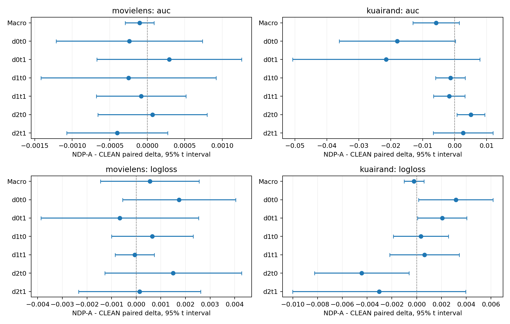
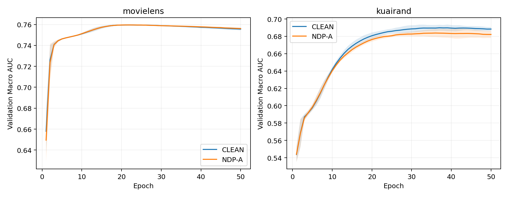

# 辅助目标归因与自然权重任务视图实验报告

## 决策与完成情况

**停止当前任务敏感对抗输入增强路线。** 按预设主比较，NDP-A相对CLEAN fixed EMA的selected验证Macro AUC在MovieLens为−.000101、KuaiRand为−.005775，两个数据集均没有正均值增量。已完成Stage0审计、Stage1零扰动归因、Stage2自然权重检验及各自的设计、实现、独立审查、完整运行和分析。HPO、冻结Test与额外机制消融均为**NOT_TRIGGERED**。

本轮新增**50条完整训练、2500epochs、86250次Adam及EMA更新**；复用10条经精确身份审计的CLEAN。合计60条唯一轨迹，对应两数据集×六臂×五seed。CLEAN在两阶段共用，只计一次；统计独立单位始终是seeds2022–2026的五个配对值。没有失败、重试、缺失或预算缩减，没有磁盘模型/optimizer/checkpoint文件。

两个主要发现分别成立：**零扰动辅助BCE已经重现旧配方的大部分AUC退化；纠正自然权重后，当前非零扰动仍未提供固定EMA之上的排序收益。** MovieLens online的小增量、KuaiRand部分cell收益及微小LogLoss下降保留如下，不替代主AUC门。

## 研究链条与可辨识问题

| 证据阶段 | 干预与已观测结果 | 本轮约束/结论 |
|---|---|---|
| 11/10固定EMA归因 | 已有五seed证据将主要收益定位到共享参数，尤其embedding及历史互补 | 固定EMA保留为强内部参照，组件增量单独报告 |
| 11/11反馈/读出 | 单步正值未稳定转化为持续反馈收益；AUC与LogLoss结果分离 | 不把局部导数或概率损失当排序成功 |
| 11/15原pilot | A/B/C在两个数据集的固定配置均未超过CLEAN EMA；输入视图与额外辅助目标同时变化 | 先做零扰动归因，不救援式扩大α搜索 |
| 本轮Stage1 | 两种Z在两数据集均降低AUC；ML C−Z小幅正均值，KR和阶段结果不一致 | 识别整个辅助构造效应，进入一次自然权重判别 |
| 本轮Stage2 | 全自然2B支持与总质量1核验通过；NDP-A对CLEAN EMA两数据集均无正AUC均值 | 达到预设停止条件，后续阶段不触发 |

历史结论与来源见[main研究上下文](../../EXP_AI_CONTEXT.md)、[本轮Stage0审计](STAGE0_AUDIT.md)及[原pilot报告](https://github.com/Caelestis1903/My-Research-Project/blob/26-11-15/research_reports/2026-11-15_heterogeneity_aware/REPORT.md)。本轮没有重启PAIR/ECCM、参数梯度平衡、动态EMA、PUB或架构/共享机制路线。

## 协议与身份

MovieLens与KuaiRand均使用真实自然人口、继承的80/10/10划分及train-only预处理。M3oE fixed1，3域×2任务、固定融合系数1，无DARTS/learned fusion；FP32，50epochs，batch40960且保留尾batch。单coupled Adam：lr=.01、betas(.9,.999)、eps1e-8、WD为ML1e-4/KR1e-5；固定EMA rho为.9828205985452511/.995，每次Adam后更新一次。online/EMA分别以验证六格Macro AUC最早严格最大值选点；Test没有推理或指标计算，Stage0只核验其数据身份。

仓库基点为main `e5738e52294f064c23a9b953fe74abb84de713df`；原pilot分支只读、未合并。Stage1训练源码SHA256为`a78bce2f713cf62f9af32548b50bc360b134420ff9ed6ac6990dca22d76a2ad0`；Stage2为`831cba9947738652cc6d4e5abf864e1ab4e32545b304936cb39aba28b227893b`。新代码只import冻结main utilities和已审查adapter，未改vendor或历史台账。Python3.13.5、PyTorch2.9.0+cu126及数据数组/行序/split/encoder/scaler身份均与审计记录一致；详见[源映射](SOURCE_MAP.md)、两阶段source/run/data收据和[Stage0 JSON](STAGE0_AUDIT.json)。

所有均值和sample SD以五seed计算；95%配对t区间为`mean±2.776445×SD/√5`。epoch、六格和两个readout不作为新增重复数。Macro等权六格；Traffic为sample-weighted cell指标；Pooled AUC为每task合并人口AUC后取均值，三者分别保留。

## Stage1：辅助目标已造成主要退化

完整结果、逐seed差、六格/域任务/Traffic/Pooled、共同epoch及checkpoint hash见[Stage1分析](STAGE1_ANALYSIS.md)、[逐seed附录](NUMERICAL_APPENDIX.md)、[数值汇总](GENERATED_TABLES.md)、[机器证据](EVIDENCE.json)。

**STRONG：** Z-PAIR/Z-EXAMPLE相对CLEAN EMA，ML AUC差为−.001547/−.001995，KR为−.019672/−.009075；四个比较均0/5正向、六格均值全部负。对应B/C的完整AUC损失为ML−.001353/−.001643、KR−.021557/−.009188。输入不变仍有损失，说明整个额外辅助构造足以产生主要退化。

实际目标为`clean_mean+.25×(2×selected_target_mean)`。辅助均值总系数为.5，M>0时总质量1.5，每个辅助entry相对一个clean entry的系数为B/M。KR pair对d0t1正例的额外系数质量约为clean的23.4倍；example虽然保留域内自然标签比例，三个域的aux/clean质量仍约为1.94/.192/3.74。标签比例、域覆盖和总尺度共同变化，不能只按名义λ解释。

**WEAK：** ML C−Z-EXAMPLE为+.000352、4/5正向、五个cell均值正，CI跨零；KR为−.000113。C/Z在所有步骤accepted row-task完全相同，排除了支持差异解释。B/Z只存在极少接受差异，平均Jaccard大于.99995。ML C的selected正值没有在全部共同阶段重复；KR相反，阶段小正值与selected负值并存。这一条件信号和已测权重缺陷触发了NDP-A，没有触发参数搜索。

## Stage2：自然权重修正没有产生主AUC增量

NDP-A对每个原始row-task使用自身task的detached BCE上升视图，只将该task的BCE计入该view：

`L = mean_(2B)[.75*BCE(clean) + .25*BCE(task_specific_view)]`

固定α=.03、λ=.25，无pair、投影、acceptance删除、标签平衡或额外辅助均值。每个原始entry总系数保持1/(2B)，每task质量.5，总质量1；近零方向仅令δ=0。零扰动canonical路径与source clean的model/Adam/EMA状态精确一致，因而复用CLEAN作为零扰动对照。全17250个batch、500个epoch的全2B支持和自然分层系数均已核验；两task在本轮全部实际entry上zero fraction为0，扰动确实执行。

主结果和全seed原值见下方附表；完整六格AUC/LL、两readout、Traffic/Pooled、E10/E30/E50、selected hash和诊断见[Stage2附录](STAGE2_NUMERICAL_APPENDIX.md)、[数值汇总](STAGE2_GENERATED_TABLES.md)、[机器证据](STAGE2_EVIDENCE.json)。

**ML，WEAK的新增排序信号：** NDP-A EMA−CLEAN EMA为−.000101，1/5正向，95%CI[−.000293,+.000090]；LL均值+.000553。online−clean online的AUC为+.000360、4/5正，LL均值−.003262。完整NDP-A+EMA对clean online的总AUC为+.002895、5/5正，但clean EMA自身已有+.002996。在线小收益没有叠加为固定EMA之上的收益。

**KR，MEDIUM的退化证据：** NDP-A EMA−CLEAN EMA AUC为−.005775，0/5正，95%CI[−.013028,+.001477]；两task的平均AUC差为−.004729/−.006822，均0/5正。Traffic/Pooled差为−.001658/−.001438，最差cell AUC差为−.006763。Macro LL均值−.000213，按预设均值规则保留概率损失下降，但其CI跨零，不能替代AUC晋级。

**MEDIUM，域任务取舍：** KR d2t0/d2t1 AUC分别+.005083/+.002652，d0t0/d0t1却为−.017959/−.021425，d1两任务为−.001311/−.001692。d2t0五seed均改善，d0t0五seed均下降。纠正自然权重后，排序收益仍在不同cell间移动。ML六格变化较小，四负两正，最差均值为d2t1−.000400。

## 训练阶段、矛盾与竞争解释

ML NDP-A−CLEAN EMA的早/中/晚期AUC为−.001094/+.000013/+.000308，selected为−.000101；正的晚期差不等于超过clean自己的最佳checkpoint。KR三个阶段为−.000113/−.004439/−.006087，中晚期五seed均负。NDP-A EMA平均选点为ML E21.8/KR E36.2，CLEAN为E22.2/E40.4。

相互约束的观察有四项：零扰动已经退化；ML在线小收益未叠加到EMA；KR d2改善而其他域付出代价；LL与AUC方向不同。**STRONG的数值事实**是自然权重与视图机制按定义执行；**MEDIUM的机制解释**是旧辅助目标的重权贡献了原损失，但权重并不是全部问题；**WEAK的解释**是BCE对抗方向与排序目标不匹配、跨task输出变化或与EMA正则效果重叠。当前结果没有把后三者逐一隔离，不以局部logit变化或梯度强度替代AUC证据。

自然train域人口为ML155949/318599/325619、KR172782/1743898/89452。人口、标签支持与CLEAN参考表现分别记录。Stage1没有“小域改善/大域下降”的域级模式；Stage2 KR出现d2改善与d1下降的局部取舍，同时另一个较小域d0下降最大。域大小没有被独立操纵，且相近人口角色并非同方向，不能把它作为本轮的主解释变量，更不作为困难度代理。

## 结果裁定与后续状态

按冻结Stage2设计第10节，两个数据集的主比较均值都不为正，因此停止当前α=.03/λ=.25自然权重任务视图版本和本轮增强路线。停止依据是完整五seed主指标均值，未增加CI排零、全seed正向或单格一票否决条件。HPO、α搜索、NDP-B、冻结Test、投影/保护与机制消融均NOT_TRIGGERED；本轮不进行发表模型Test验收。

当前执行的下一步是归档与发布代码和报告。若另立后续研究，最有判别力的一项实验是在相同自然支持、凸混合与实际半径下比较当前BCE上升方向和随机方向，区分“方向的作用”与“扰动训练本身的作用”；本轮不新增这一矩阵。严格投影在旧pilot中未呈现相对B的AUC优势，本轮也没有触发保留投影的证据。

## 实现、审查、成本和修订

两个阶段均完成DESIGN→IMPLEMENT→独立REVIEW→RUN→ANALYZE。Stage1的7项CPU检查与8次full-batch smoke通过；Stage2的5项CPU检查、两数据真实full-batch NDP和zero/source exact-state检查通过。实现审查及Stage1最终证据审查PASS，Stage2最终证据审查见STAGE2_FINAL_REVIEW。所有源码、数据、row order、选点及日志hash和配对算术有对应审查收据。

Stage1训练墙钟5296.97秒、worker合计16.0033小时、峰值reserved约1.527GiB；Stage2墙钟4937.87秒、worker合计6.5164小时、峰值reserved约2.813GiB。两阶段新增worker合计22.5198小时。两张3090与既有作业共享；按每卡显存与功耗<85%、主机RAM<90%准入，没有更改batch/epoch/人口来适配资源。模型、optimizer、RNG、loader和selected状态在RAM guardian中维护，磁盘只有数据日志、代码与报告。

R1：Stage1证据审查修正了decision中selection hash的编码，使其与运行清单的JSON digest一致；规则、selected epoch和指标未变。Stage2没有训练语义修订或失败重跑。原历史源、报告、台账及数据未改动。

## 证据与复现入口

- [Stage1科学分析与机器决策](STAGE1_ANALYSIS.md)、[decision.json](decision.json)、[Stage1最终审查](STAGE1_FINAL_REVIEW.md)。
- [Stage2设计](STAGE2_DESIGN_SPECIFICATION.md)、[实现报告](STAGE2_CODER_IMPLEMENTATION_REPORT.md)、[实现审查](STAGE2_IMPLEMENTATION_REVIEW.md)、[运行报告](STAGE2_RUNNER_REPORT.md)。
- [Stage1代码入口](../../experiments/auxiliary_objective_attribution_20261115/README.md)、[Stage2代码入口](../../experiments/auxiliary_objective_attribution_20261115/stage2/README.md)。
- [Stage1全部CSV](../../artifacts/auxiliary_objective_attribution_20261115/attempt1/tables/ENDPOINTS.csv)、[Stage2全部CSV](../../artifacts/auxiliary_objective_attribution_20261115/stage2_attempt1/tables/ENDPOINTS.csv)及各自run/source/data/reuse/zero-counterpart收据。

Stage1完整逐批支持日志共5,774,198,156 bytes，保存在服务器工作区`artifacts/auxiliary_objective_attribution_20261115/attempt1/runs/`；每epoch JSON及TRAINING_CURVES.csv保存路径与SHA256，全部已经独立校验。仓库保留完整数表、逐epoch/逐seed证据和日志hash；Stage2 compact原始日志共30,292,308 bytes。所有原始日志继续保留，模型/checkpoint不落盘。

## NDP-A完整主要配对统计

| dataset | kind | reference_kind | metric | mean | sample_sd | ci95_low | ci95_high | positive_seeds |
| --- | --- | --- | --- | --- | --- | --- | --- | --- |
| movielens | online | online | macro_auc | 0.000359628 | 0.000338965 | -0.000061253 | 0.000780509 | 4 |
| movielens | online | online | macro_logloss | -0.003262382 | 0.003434812 | -0.007527263 | 0.001002500 | 1 |
| movielens | fixed_ema | fixed_ema | macro_auc | -0.000101256 | 0.000154325 | -0.000292875 | 0.000090363 | 1 |
| movielens | fixed_ema | fixed_ema | macro_logloss | 0.000552562 | 0.001610529 | -0.001447174 | 0.002552297 | 3 |
| movielens | fixed_ema | online | macro_auc | 0.002895193 | 0.000357483 | 0.002451320 | 0.003339066 | 5 |
| movielens | fixed_ema | online | macro_logloss | -0.001475409 | 0.002244365 | -0.004262156 | 0.001311338 | 1 |
| kuairand | online | online | macro_auc | -0.004704736 | 0.006572674 | -0.012865788 | 0.003456317 | 1 |
| kuairand | online | online | macro_logloss | 0.000279312 | 0.004789099 | -0.005667140 | 0.006225764 | 3 |
| kuairand | fixed_ema | fixed_ema | macro_auc | -0.005775319 | 0.005840882 | -0.013027732 | 0.001477093 | 0 |
| kuairand | fixed_ema | fixed_ema | macro_logloss | -0.000212518 | 0.000644051 | -0.001012213 | 0.000587177 | 2 |
| kuairand | fixed_ema | online | macro_auc | -0.004131492 | 0.005583728 | -0.011064605 | 0.002801621 | 1 |
| kuairand | fixed_ema | online | macro_logloss | -0.000401976 | 0.003641786 | -0.004923851 | 0.004119899 | 2 |

## NDP-A逐seed主要差值

| dataset | kind | reference_kind | metric | seed | delta |
| --- | --- | --- | --- | --- | --- |
| movielens | online | online | macro_auc | 2022 | 0.000808323 |
| movielens | online | online | macro_auc | 2023 | 0.000342964 |
| movielens | online | online | macro_auc | 2024 | -0.000031979 |
| movielens | online | online | macro_auc | 2025 | 0.000567244 |
| movielens | online | online | macro_auc | 2026 | 0.000111588 |
| movielens | online | online | macro_logloss | 2022 | -0.006225957 |
| movielens | online | online | macro_logloss | 2023 | -0.006842563 |
| movielens | online | online | macro_logloss | 2024 | -0.003199436 |
| movielens | online | online | macro_logloss | 2025 | 0.001492426 |
| movielens | online | online | macro_logloss | 2026 | -0.001536377 |
| movielens | fixed_ema | fixed_ema | macro_auc | 2022 | -0.000196875 |
| movielens | fixed_ema | fixed_ema | macro_auc | 2023 | -0.000090829 |
| movielens | fixed_ema | fixed_ema | macro_auc | 2024 | 0.000131268 |
| movielens | fixed_ema | fixed_ema | macro_auc | 2025 | -0.000277616 |
| movielens | fixed_ema | fixed_ema | macro_auc | 2026 | -0.000072230 |
| movielens | fixed_ema | fixed_ema | macro_logloss | 2022 | 0.000832743 |
| movielens | fixed_ema | fixed_ema | macro_logloss | 2023 | 0.002821845 |
| movielens | fixed_ema | fixed_ema | macro_logloss | 2024 | 0.000993043 |
| movielens | fixed_ema | fixed_ema | macro_logloss | 2025 | -0.001433914 |
| movielens | fixed_ema | fixed_ema | macro_logloss | 2026 | -0.000450908 |
| movielens | fixed_ema | online | macro_auc | 2022 | 0.003095037 |
| movielens | fixed_ema | online | macro_auc | 2023 | 0.003080054 |
| movielens | fixed_ema | online | macro_auc | 2024 | 0.003269207 |
| movielens | fixed_ema | online | macro_auc | 2025 | 0.002447462 |
| movielens | fixed_ema | online | macro_auc | 2026 | 0.002584205 |
| movielens | fixed_ema | online | macro_logloss | 2022 | -0.002994552 |
| movielens | fixed_ema | online | macro_logloss | 2023 | -0.004279857 |
| movielens | fixed_ema | online | macro_logloss | 2024 | -0.000261167 |
| movielens | fixed_ema | online | macro_logloss | 2025 | -0.001274907 |
| movielens | fixed_ema | online | macro_logloss | 2026 | 0.001433439 |
| kuairand | online | online | macro_auc | 2022 | -0.000671128 |
| kuairand | online | online | macro_auc | 2023 | -0.014610475 |
| kuairand | online | online | macro_auc | 2024 | -0.008261581 |
| kuairand | online | online | macro_auc | 2025 | 0.000816776 |
| kuairand | online | online | macro_auc | 2026 | -0.000797270 |
| kuairand | online | online | macro_logloss | 2022 | 0.002406789 |
| kuairand | online | online | macro_logloss | 2023 | 0.003391312 |
| kuairand | online | online | macro_logloss | 2024 | -0.000981478 |
| kuairand | online | online | macro_logloss | 2025 | 0.004122063 |
| kuairand | online | online | macro_logloss | 2026 | -0.007542124 |
| kuairand | fixed_ema | fixed_ema | macro_auc | 2022 | -0.002636183 |
| kuairand | fixed_ema | fixed_ema | macro_auc | 2023 | -0.014723548 |
| kuairand | fixed_ema | fixed_ema | macro_auc | 2024 | -0.008675324 |
| kuairand | fixed_ema | fixed_ema | macro_auc | 2025 | -0.001101049 |
| kuairand | fixed_ema | fixed_ema | macro_auc | 2026 | -0.001740493 |
| kuairand | fixed_ema | fixed_ema | macro_logloss | 2022 | 0.000528725 |
| kuairand | fixed_ema | fixed_ema | macro_logloss | 2023 | 0.000147078 |
| kuairand | fixed_ema | fixed_ema | macro_logloss | 2024 | -0.001133029 |
| kuairand | fixed_ema | fixed_ema | macro_logloss | 2025 | -0.000544401 |
| kuairand | fixed_ema | fixed_ema | macro_logloss | 2026 | -0.000060963 |
| kuairand | fixed_ema | online | macro_auc | 2022 | -0.003266710 |
| kuairand | fixed_ema | online | macro_auc | 2023 | -0.012942737 |
| kuairand | fixed_ema | online | macro_auc | 2024 | -0.005438729 |
| kuairand | fixed_ema | online | macro_auc | 2025 | 0.001444516 |
| kuairand | fixed_ema | online | macro_auc | 2026 | -0.000453799 |
| kuairand | fixed_ema | online | macro_logloss | 2022 | 0.002622447 |
| kuairand | fixed_ema | online | macro_logloss | 2023 | -0.000673253 |
| kuairand | fixed_ema | online | macro_logloss | 2024 | -0.001971964 |
| kuairand | fixed_ema | online | macro_logloss | 2025 | 0.003515599 |
| kuairand | fixed_ema | online | macro_logloss | 2026 | -0.005502707 |

## NDP-A六格AUC与LogLoss配对均值

| dataset | metric | mean | sample_sd | ci95_low | ci95_high | positive_seeds |
| --- | --- | --- | --- | --- | --- | --- |
| movielens | d0t0_auc | -0.000239648 | 0.000786156 | -0.001215790 | 0.000736494 | 2 |
| movielens | d0t0_logloss | 0.001740552 | 0.001849616 | -0.000556049 | 0.004037154 | 4 |
| movielens | d0t1_auc | 0.000292985 | 0.000776240 | -0.000670845 | 0.001256815 | 2 |
| movielens | d0t1_logloss | -0.000663820 | 0.002577122 | -0.003863740 | 0.002536100 | 3 |
| movielens | d1t0_auc | -0.000249051 | 0.000939331 | -0.001415384 | 0.000917282 | 2 |
| movielens | d1t0_logloss | 0.000654549 | 0.001333043 | -0.001000642 | 0.002309740 | 4 |
| movielens | d1t1_auc | -0.000081458 | 0.000480922 | -0.000678601 | 0.000515685 | 2 |
| movielens | d1t1_logloss | -0.000059940 | 0.000637039 | -0.000850928 | 0.000731049 | 3 |
| movielens | d2t0_auc | 0.000070119 | 0.000587305 | -0.000659117 | 0.000799355 | 3 |
| movielens | d2t0_logloss | 0.001503111 | 0.002234260 | -0.001271089 | 0.004277311 | 4 |
| movielens | d2t1_auc | -0.000400485 | 0.000540965 | -0.001072181 | 0.000271211 | 2 |
| movielens | d2t1_logloss | 0.000140917 | 0.001995900 | -0.002337320 | 0.002619154 | 2 |
| kuairand | d0t0_auc | -0.017958850 | 0.014649497 | -0.036148602 | 0.000230902 | 0 |
| kuairand | d0t0_logloss | 0.003163885 | 0.002417455 | 0.000162218 | 0.006165551 | 5 |
| kuairand | d0t1_auc | -0.021424504 | 0.023591391 | -0.050717084 | 0.007868075 | 1 |
| kuairand | d0t1_logloss | 0.002063102 | 0.001601345 | 0.000074769 | 0.004051434 | 5 |
| kuairand | d1t0_auc | -0.001311194 | 0.003719565 | -0.005929644 | 0.003307256 | 3 |
| kuairand | d1t0_logloss | 0.000331140 | 0.001792857 | -0.001894986 | 0.002557266 | 3 |
| kuairand | d1t1_auc | -0.001692366 | 0.003950136 | -0.006597106 | 0.003212375 | 2 |
| kuairand | d1t1_logloss | 0.000634780 | 0.002261159 | -0.002172820 | 0.003442380 | 3 |
| kuairand | d2t0_auc | 0.005083339 | 0.003479333 | 0.000763177 | 0.009403501 | 5 |
| kuairand | d2t0_logloss | -0.004438666 | 0.003070055 | -0.008250643 | -0.000626689 | 0 |
| kuairand | d2t1_auc | 0.002651658 | 0.007545533 | -0.006717357 | 0.012020674 | 3 |
| kuairand | d2t1_logloss | -0.003029349 | 0.005628263 | -0.010017760 | 0.003959062 | 2 |
