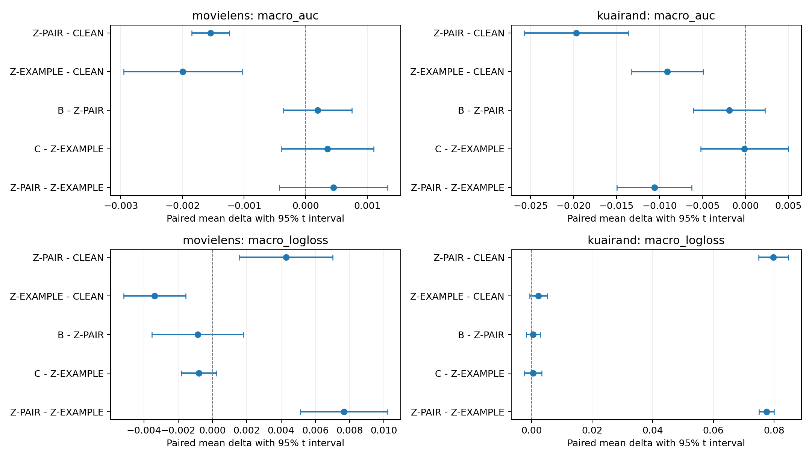
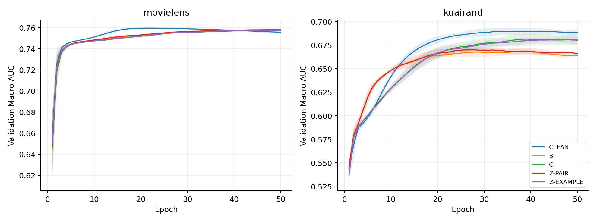

# Stage 1：零扰动辅助目标归因

## 决策

**ADVANCE_NDP_A：进入一次保持自然 row-task 权重的目标检验。** 当前 B/C 和两个零扰动臂在两数据集的 selected fixed-EMA Macro AUC 都低于 CLEAN。零扰动已经重现主要退化，输入扰动不是解释这些损失所必需的条件。停止旧的额外辅助 BCE 构造、pair 平衡和投影路线；下一步只检验固定 α=.03、λ=.25 的 NDP-A，不直接展开 HPO。

推进依据是 MovieLens C−Z-EXAMPLE 的五 seed 平均 AUC 为 +.000352，4/5 正向、六格中五格均值正，同时实测账本确认了自然目标权重的明显偏移。这个增量的95%区间跨零，common-stage 增量很小，证据标为 **WEAK**；它满足计划的正均值门，用于支持一次判别实验。KuaiRand 的相同 selected 对比均值为 −.000113，不能写成跨数据集重复的扰动收益。

## 协议、身份与完成量

本轮新增40条训练：B、C、Z-PAIR、Z-EXAMPLE × MovieLens/KuaiRand × seeds2022–2026，每条50epochs、batch40960；共2000epochs、69000次Adam和69000次EMA更新。另复用10条经审计的CLEAN轨迹，分析共50条。无失败、重试或缺失；Test评价未触发。Stage0允许读取Test数组进行身份核验，没有Test预测或指标计算。

模型为M3oE fixed1，3域×2任务，FP32，自然80/10/10人口和train-only预处理；单Adam lr=.01、betas(.9,.999)、eps1e-8、coupled WD（ML1e-4/KR1e-5）。固定EMA rho分别为.9828205985452511/.995，在每次Adam后更新一次。online与EMA分别按验证六格Macro AUC的最早严格最大值选点。所有比较以seed为统计单位，区间为mean±2.776445×sampleSD/√5。

仓库基点为main `e5738e52294f064c23a9b953fe74abb84de713df`；运行代码由完整文件SHA256冻结，训练源总hash为`a78bce2f713cf62f9af32548b50bc360b134420ff9ed6ac6990dca22d76a2ad0`。原pilot分支`26-11-15@52b48c9`只读，未合并；52个公共utility文件与main逐字节一致。旧B/C没有行级支持日志，因此本轮重跑必要匹配臂；CLEAN原始证据537文件按原字节复制并记录SHA256。

原始CSV SHA256：ML `f060ecb8fb7745f1e24998837ca5a1ec3e18b610f288e73549c0203a9822b5e4`；KR `a1872911e49cb9324a89faf84df1dbed2077357496edd760ba0ab7b8f4fc681f`。数组、行序、split、encoder/scaler身份均匹配。完整审计、环境与源映射见[STAGE0_AUDIT.md](STAGE0_AUDIT.md)、[SOURCE_MAP.md](SOURCE_MAP.md)、[CODER_IMPLEMENTATION_REPORT.md](CODER_IMPLEMENTATION_REPORT.md)。

## 主要结果与证据强度

下方自动附表给出绝对值、五seed差、sample SD、95%区间和六格差；完整online/EMA、Traffic、Pooled、逐seed六格AUC/LogLoss与选点hash见[数值附录](NUMERICAL_APPENDIX.md)、[全部数值汇总](GENERATED_TABLES.md)、[EVIDENCE.json](EVIDENCE.json)。

**STRONG：辅助构造本身足以造成当前排序退化。** 两种Z相对CLEAN的Macro AUC在两个数据集均0/5正向，六格均值也全部下降。ML Z-PAIR/Z-EXAMPLE为−.001547/−.001995；KR为−.019672/−.009075。完整B/C的相应损失为ML−.001353/−.001643、KR−.021557/−.009188。这些端点差可作算术分解；Z估计的是额外BCE尺度、域任务覆盖和标签构造的整体效应，尚未把三个机制逐个拆开。

**STRONG：pair与example的差异具有数据集和指标条件。** KR Z-PAIR−Z-EXAMPLE AUC为−.010597、5/5负向，LL为+.077557、5/5上升。ML同一AUC差为+.000449、4/5正向，而LL为+.007665、5/5上升。不能把标签自然采样概括为在两个数据集上同时改善排序与概率损失。

**WEAK：扰动独立排序增量。** ML B−Z-PAIR为+.000193（2/5正），C−Z-EXAMPLE为+.000352（4/5正）；KR分别−.001885/−.000113（均3/5正）。四个区间均跨零，KR的seed间变动尤其明显。ML C的五个正均值格为d0t0、d0t1、d1t1、d2t0、d2t1，d1t0为−.000200。KR B改善d1两任务，却损害d0和d2；C改善d0，却在d1和d2t1付出代价。当前没有跨数据集稳定的独立AUC收益。

**STRONG：AUC与LogLoss分离。** ML Z-EXAMPLE的LL下降.003377、C下降.004180，均五seed下降，AUC却均五seed下降；ML pair的LL升高。KR两种Z的LL均值分别上升.079837/.002280。LL收益按自身指标保留，不替代AUC裁定。

## 支持、权重和目标解释

候选行来自相同键控随机流，所有配对步骤候选身份一致。C/Z-EXAMPLE的accepted row-task在两个数据集、全部seed和步骤完全一致，Jaccard=1。因此C−Z的差异没有接受支持变化。B/Z-PAIR仍是同候选与同规则下的自适应策略比较：ML平均Jaccard=.999997656，五seed共18个对称差entry；KR平均=.999953525，共874个，最低单batch Jaccard=.990885。完整逐batch重叠及逐cell/label数量差保留在SUPPORT_OVERLAP.csv；这些差异不足以改变本轮NDP-A选择，不触发额外支持控制。

旧目标是`mean(2B个clean BCE)+.25×2×mean(M个aux BCE)`。M>0时总系数质量为1.5；每个辅助entry系数为.5/M，相对clean的1/(2B)为B/M。λ=.25不是每个样本只增重25%。

账本显示两个可区分的偏移：pair近似平衡六格并把每格标签改成1:1；example保留域内自然标签率，但辅助质量仍近似六格等权。KR example按域汇总的aux/clean质量约1.94、.192、3.74；pair的d0t1正例额外系数质量约为clean的23.4倍，负例约1.01倍。ML example三个域约为.855/.419/.410。每个seed、cell、label的实测系数、BCE分子、质量与损失贡献均在WEIGHTS.csv及数值汇总中。

**MEDIUM：自然权重偏移是主要竞争解释。** 零扰动退化与实测权重变化共同支持优先改变目标；标签平衡、总尺度及Adam/WD相对作用尚未单独分离。NDP-A固定自然row-task质量，直接检验去掉额外均值和子集重权后是否还存在扰动增量。这比继续搜索旧α更能推翻“只要换扰动方向就能改善”的解释。

## 训练阶段、域与任务

KR Z-PAIR−CLEAN的E1–10平均AUC为+.013559（5/5正），E11–30和E31–50分别−.012878/−.021348（均0/5正）。旧pilot的早期pair优势无需非零扰动即可出现，不能把它归因于梯度方向。

ML C−Z-EXAMPLE的早/中/晚期为−.000914/−.000057/+.000032，而selected为+.000352；KR阶段均值为+.000342/+.000554/+.000592，selected却为−.000113。选点与共同训练阶段回答不同问题，正增量没有在两个视图一致重复。ML clean EMA平均选点E22.2，Z-PAIR/Z-EXAMPLE为E46.6/E45；KR分别E40.4/E25.6/E46。完整epoch曲线及E10/E30/E50结果均保留。

三个自然域的train人口：ML155949/318599/325619；KR172782/1743898/89452。CLEAN EMA的六格AUC，ML为.764868/.771049/.758080/.755676/.755200/.753736；KR为.678220/.694874/.702408/.729578/.668583/.672924。参考表现、标签支持和人口分别描述，不把人口作为困难度代理。

两种Z和完整B/C相对CLEAN的三个域平均AUC都下降，未出现“小域改善补偿大域下降”的域级取舍；扰动相对Z的局部取舍则随数据集、任务和阶段改变。各臂人口相同，没有独立规模干预，因此本轮不能把域大小识别为主解释变量；明确被改变并被计量的是目标系数和标签构造。

## 执行质量与下一阶段

设计→实现→独立实现审查PASS→完整运行→本分析依序完成。7项CPU检查、8次真实40960 batch smoke通过，实际Jacobian/有限差分符合冻结容差；reviewer另确认B/C同初态一步的loss、model、EMA和Adam状态与旧实现精确一致。100个选点、2500份epoch记录、40数据manifest、全部支持日志SHA256及配对CSV算术均独立核对通过。训练源无运行中修改，无OOM或预算缩减。

训练墙钟5296.97秒（88.28分钟），新增worker时间合计16.0033小时；峰值reserved约1.527GiB。两卡与既有作业共享，调度按每卡显存/功耗及主机RAM准入。模型、optimizer、RNG和selected state保存在RAM guardian，磁盘只保存数据日志、代码和报告。

下一项实验是**全自然batch的任务专属凸混合NDP-A**：每个原始row-task总系数1/(2B)，α=.03、λ=.25，无投影，近零方向仅令δ=0而不删行。先验证零delta严格回到CLEAN，再跑两数据集×五seed；只有实际验证增量满足计划才进入有界HPO。NDP-A在两个数据集都没有正验证AUC信号时停止这条输入增强分支。HPO、冻结Test和机制消融当前NOT_TRIGGERED。

独立阶段证据审查见STAGE1_FINAL_REVIEW.md/json；机器决策见[decision.json](decision.json)。本阶段不进行正式发表模型Test验收。严格投影的旧pilot没有相对B的AUC优势；本轮没有新增证据要求保留投影，NDP-A从无投影开始。

## 完整selected主要配对数值

| dataset | arm | control | metric | mean | sample_sd | ci95_low | ci95_high | positive_seeds |
| --- | --- | --- | --- | --- | --- | --- | --- | --- |
| movielens | Z-PAIR | CLEAN | macro_auc | -0.001546555 | 0.000246731 | -0.001852912 | -0.001240198 | 0 |
| movielens | Z-PAIR | CLEAN | macro_logloss | 0.004287852 | 0.002199654 | 0.001556621 | 0.007019083 | 5 |
| movielens | Z-EXAMPLE | CLEAN | macro_auc | -0.001995199 | 0.000772765 | -0.002954713 | -0.001035685 | 0 |
| movielens | Z-EXAMPLE | CLEAN | macro_logloss | -0.003376729 | 0.001454200 | -0.005182357 | -0.001571101 | 0 |
| movielens | B | Z-PAIR | macro_auc | 0.000193271 | 0.000445456 | -0.000359836 | 0.000746378 | 2 |
| movielens | B | Z-PAIR | macro_logloss | -0.000866302 | 0.002148903 | -0.003534516 | 0.001801913 | 1 |
| movielens | C | Z-EXAMPLE | macro_auc | 0.000352080 | 0.000601624 | -0.000394935 | 0.001099094 | 4 |
| movielens | C | Z-EXAMPLE | macro_logloss | -0.000802967 | 0.000830468 | -0.001834130 | 0.000228196 | 0 |
| movielens | Z-PAIR | Z-EXAMPLE | macro_auc | 0.000448644 | 0.000705554 | -0.000427417 | 0.001324705 | 4 |
| movielens | Z-PAIR | Z-EXAMPLE | macro_logloss | 0.007664581 | 0.002047727 | 0.005121992 | 0.010207170 | 5 |
| movielens | B | CLEAN | macro_auc | -0.001353284 | 0.000445124 | -0.001905978 | -0.000800589 | 0 |
| movielens | B | CLEAN | macro_logloss | 0.003421550 | 0.001425614 | 0.001651417 | 0.005191684 | 5 |
| movielens | C | CLEAN | macro_auc | -0.001643119 | 0.000521750 | -0.002290957 | -0.000995282 | 0 |
| movielens | C | CLEAN | macro_logloss | -0.004179696 | 0.001230860 | -0.005708011 | -0.002651381 | 0 |
| kuairand | Z-PAIR | CLEAN | macro_auc | -0.019672372 | 0.004877258 | -0.025728288 | -0.013616456 | 0 |
| kuairand | Z-PAIR | CLEAN | macro_logloss | 0.079837343 | 0.003901978 | 0.074992397 | 0.084682289 | 5 |
| kuairand | Z-EXAMPLE | CLEAN | macro_auc | -0.009074927 | 0.003355952 | -0.013241891 | -0.004907963 | 0 |
| kuairand | Z-EXAMPLE | CLEAN | macro_logloss | 0.002280388 | 0.002362672 | -0.000653256 | 0.005214033 | 4 |
| kuairand | B | Z-PAIR | macro_auc | -0.001884694 | 0.003365730 | -0.006063799 | 0.002294411 | 3 |
| kuairand | B | Z-PAIR | macro_logloss | 0.000562910 | 0.001843381 | -0.001725950 | 0.002851769 | 3 |
| kuairand | C | Z-EXAMPLE | macro_auc | -0.000113225 | 0.004099544 | -0.005203481 | 0.004977032 | 3 |
| kuairand | C | Z-EXAMPLE | macro_logloss | 0.000467443 | 0.002289703 | -0.002375599 | 0.003310485 | 3 |
| kuairand | Z-PAIR | Z-EXAMPLE | macro_auc | -0.010597445 | 0.003513200 | -0.014959659 | -0.006235230 | 0 |
| kuairand | Z-PAIR | Z-EXAMPLE | macro_logloss | 0.077556955 | 0.002031106 | 0.075035004 | 0.080078906 | 5 |
| kuairand | B | CLEAN | macro_auc | -0.021557066 | 0.003090994 | -0.025395042 | -0.017719091 | 0 |
| kuairand | B | CLEAN | macro_logloss | 0.080400253 | 0.003590329 | 0.075942271 | 0.084858235 | 5 |
| kuairand | C | CLEAN | macro_auc | -0.009188152 | 0.006409726 | -0.017146878 | -0.001229426 | 0 |
| kuairand | C | CLEAN | macro_logloss | 0.002747831 | 0.002513969 | -0.000373673 | 0.005869336 | 5 |

## 六格AUC平均差

| dataset | arm | control | metric | mean | positive_seeds |
| --- | --- | --- | --- | --- | --- |
| movielens | Z-PAIR | CLEAN | d0t0_auc | -0.001037696 | 1 |
| movielens | Z-PAIR | CLEAN | d0t1_auc | -0.000394567 | 1 |
| movielens | Z-PAIR | CLEAN | d1t0_auc | -0.002492298 | 0 |
| movielens | Z-PAIR | CLEAN | d1t1_auc | -0.001207720 | 1 |
| movielens | Z-PAIR | CLEAN | d2t0_auc | -0.001171518 | 0 |
| movielens | Z-PAIR | CLEAN | d2t1_auc | -0.002975530 | 0 |
| movielens | Z-EXAMPLE | CLEAN | d0t0_auc | -0.002169125 | 0 |
| movielens | Z-EXAMPLE | CLEAN | d0t1_auc | -0.001496109 | 2 |
| movielens | Z-EXAMPLE | CLEAN | d1t0_auc | -0.002825652 | 1 |
| movielens | Z-EXAMPLE | CLEAN | d1t1_auc | -0.001814965 | 1 |
| movielens | Z-EXAMPLE | CLEAN | d2t0_auc | -0.000830081 | 1 |
| movielens | Z-EXAMPLE | CLEAN | d2t1_auc | -0.002835262 | 0 |
| movielens | B | Z-PAIR | d0t0_auc | 0.000975403 | 5 |
| movielens | B | Z-PAIR | d0t1_auc | 0.000194260 | 3 |
| movielens | B | Z-PAIR | d1t0_auc | -0.000222772 | 2 |
| movielens | B | Z-PAIR | d1t1_auc | -0.000334562 | 1 |
| movielens | B | Z-PAIR | d2t0_auc | 0.000471414 | 4 |
| movielens | B | Z-PAIR | d2t1_auc | 0.000075883 | 3 |
| movielens | C | Z-EXAMPLE | d0t0_auc | 0.000546862 | 4 |
| movielens | C | Z-EXAMPLE | d0t1_auc | 0.000806310 | 4 |
| movielens | C | Z-EXAMPLE | d1t0_auc | -0.000200236 | 1 |
| movielens | C | Z-EXAMPLE | d1t1_auc | 0.000526325 | 3 |
| movielens | C | Z-EXAMPLE | d2t0_auc | 0.000292970 | 4 |
| movielens | C | Z-EXAMPLE | d2t1_auc | 0.000140247 | 3 |
| movielens | Z-PAIR | Z-EXAMPLE | d0t0_auc | 0.001131429 | 4 |
| movielens | Z-PAIR | Z-EXAMPLE | d0t1_auc | 0.001101542 | 3 |
| movielens | Z-PAIR | Z-EXAMPLE | d1t0_auc | 0.000333354 | 2 |
| movielens | Z-PAIR | Z-EXAMPLE | d1t1_auc | 0.000607246 | 3 |
| movielens | Z-PAIR | Z-EXAMPLE | d2t0_auc | -0.000341437 | 1 |
| movielens | Z-PAIR | Z-EXAMPLE | d2t1_auc | -0.000140268 | 2 |
| movielens | B | CLEAN | d0t0_auc | -0.000062294 | 3 |
| movielens | B | CLEAN | d0t1_auc | -0.000200307 | 2 |
| movielens | B | CLEAN | d1t0_auc | -0.002715070 | 0 |
| movielens | B | CLEAN | d1t1_auc | -0.001542281 | 1 |
| movielens | B | CLEAN | d2t0_auc | -0.000700104 | 1 |
| movielens | B | CLEAN | d2t1_auc | -0.002899647 | 0 |
| movielens | C | CLEAN | d0t0_auc | -0.001622263 | 0 |
| movielens | C | CLEAN | d0t1_auc | -0.000689799 | 1 |
| movielens | C | CLEAN | d1t0_auc | -0.003025889 | 0 |
| movielens | C | CLEAN | d1t1_auc | -0.001288640 | 1 |
| movielens | C | CLEAN | d2t0_auc | -0.000537111 | 2 |
| movielens | C | CLEAN | d2t1_auc | -0.002695014 | 0 |
| kuairand | Z-PAIR | CLEAN | d0t0_auc | -0.013029699 | 2 |
| kuairand | Z-PAIR | CLEAN | d0t1_auc | -0.012228926 | 1 |
| kuairand | Z-PAIR | CLEAN | d1t0_auc | -0.035721373 | 0 |
| kuairand | Z-PAIR | CLEAN | d1t1_auc | -0.036830636 | 0 |
| kuairand | Z-PAIR | CLEAN | d2t0_auc | -0.007751405 | 2 |
| kuairand | Z-PAIR | CLEAN | d2t1_auc | -0.012472193 | 0 |
| kuairand | Z-EXAMPLE | CLEAN | d0t0_auc | -0.010922829 | 0 |
| kuairand | Z-EXAMPLE | CLEAN | d0t1_auc | -0.008091222 | 2 |
| kuairand | Z-EXAMPLE | CLEAN | d1t0_auc | -0.016757183 | 0 |
| kuairand | Z-EXAMPLE | CLEAN | d1t1_auc | -0.016824418 | 0 |
| kuairand | Z-EXAMPLE | CLEAN | d2t0_auc | -0.000314784 | 3 |
| kuairand | Z-EXAMPLE | CLEAN | d2t1_auc | -0.001539128 | 2 |
| kuairand | B | Z-PAIR | d0t0_auc | -0.008021150 | 1 |
| kuairand | B | Z-PAIR | d0t1_auc | -0.010775304 | 1 |
| kuairand | B | Z-PAIR | d1t0_auc | 0.005835837 | 4 |
| kuairand | B | Z-PAIR | d1t1_auc | 0.006251947 | 4 |
| kuairand | B | Z-PAIR | d2t0_auc | -0.002552283 | 2 |
| kuairand | B | Z-PAIR | d2t1_auc | -0.002047214 | 2 |
| kuairand | C | Z-EXAMPLE | d0t0_auc | 0.001774434 | 3 |
| kuairand | C | Z-EXAMPLE | d0t1_auc | 0.001024873 | 3 |
| kuairand | C | Z-EXAMPLE | d1t0_auc | -0.000435512 | 2 |
| kuairand | C | Z-EXAMPLE | d1t1_auc | -0.001036706 | 2 |
| kuairand | C | Z-EXAMPLE | d2t0_auc | 0.000050293 | 2 |
| kuairand | C | Z-EXAMPLE | d2t1_auc | -0.002056731 | 2 |
| kuairand | Z-PAIR | Z-EXAMPLE | d0t0_auc | -0.002106870 | 3 |
| kuairand | Z-PAIR | Z-EXAMPLE | d0t1_auc | -0.004137704 | 2 |
| kuairand | Z-PAIR | Z-EXAMPLE | d1t0_auc | -0.018964190 | 0 |
| kuairand | Z-PAIR | Z-EXAMPLE | d1t1_auc | -0.020006218 | 0 |
| kuairand | Z-PAIR | Z-EXAMPLE | d2t0_auc | -0.007436621 | 1 |
| kuairand | Z-PAIR | Z-EXAMPLE | d2t1_auc | -0.010933065 | 1 |
| kuairand | B | CLEAN | d0t0_auc | -0.021050849 | 0 |
| kuairand | B | CLEAN | d0t1_auc | -0.023004230 | 0 |
| kuairand | B | CLEAN | d1t0_auc | -0.029885535 | 0 |
| kuairand | B | CLEAN | d1t1_auc | -0.030578689 | 0 |
| kuairand | B | CLEAN | d2t0_auc | -0.010303688 | 1 |
| kuairand | B | CLEAN | d2t1_auc | -0.014519406 | 0 |
| kuairand | C | CLEAN | d0t0_auc | -0.009148395 | 2 |
| kuairand | C | CLEAN | d0t1_auc | -0.007066349 | 2 |
| kuairand | C | CLEAN | d1t0_auc | -0.017192695 | 0 |
| kuairand | C | CLEAN | d1t1_auc | -0.017861123 | 0 |
| kuairand | C | CLEAN | d2t0_auc | -0.000264491 | 1 |
| kuairand | C | CLEAN | d2t1_auc | -0.003595858 | 1 |

逐seed全部配对差见[PAIRED_SEEDS.csv](../../artifacts/auxiliary_objective_attribution_20261115/attempt1/tables/PAIRED_SEEDS.csv)，六格LogLoss、Traffic/Pooled及共同epoch见[全部原始数表](../../artifacts/auxiliary_objective_attribution_20261115/attempt1/tables/ENDPOINTS.csv)。

## 修订记录

R1：独立证据审查发现decision的selection hash使用原始文本SHA256，而运行清单采用同文本的JSON序列化digest；已统一为运行清单的hash编码。选点规则、训练代码、selected epoch和指标未改变。
