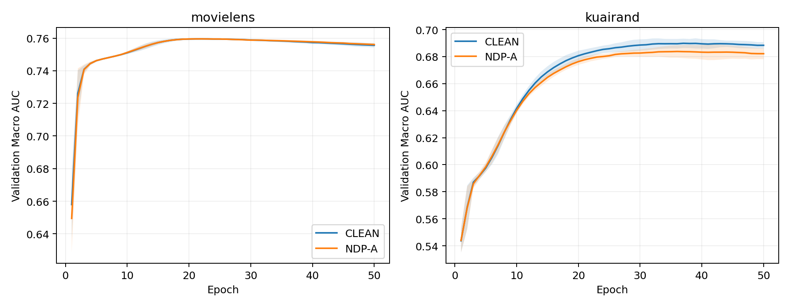
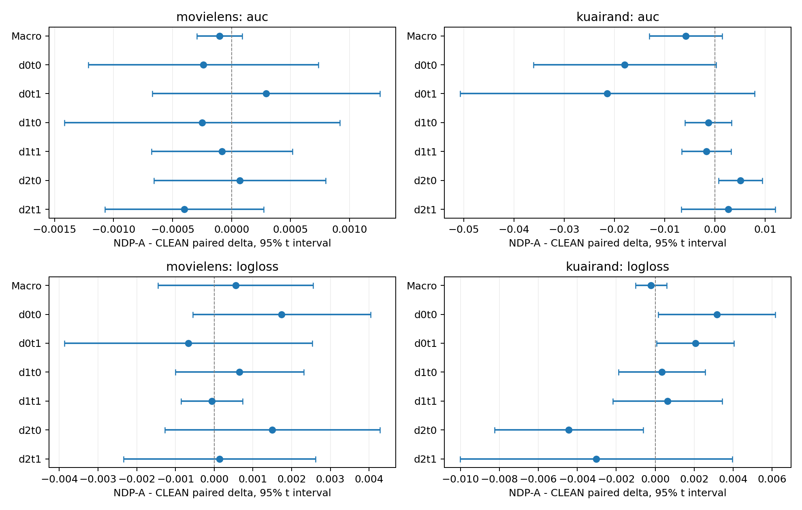

# Stage 2 数值汇总

统计单位为seed；五seed为2022–2026。主配对为NDP-A−CLEAN，online/online、EMA/EMA和EMA/clean-online总收益分别列出。

## Selected 绝对值

| dataset | arm | kind | metric | mean | sample_sd |
| --- | --- | --- | --- | --- | --- |
| kuairand | CLEAN | fixed_ema | macro_auc | 0.6910980 | 0.0038205 |
| kuairand | CLEAN | fixed_ema | macro_logloss | 0.4286396 | 0.0015994 |
| kuairand | CLEAN | fixed_ema | pooled_logloss | 0.4188770 | 0.0014948 |
| kuairand | CLEAN | fixed_ema | pooled_task_mean_auc | 0.7203895 | 0.0010448 |
| kuairand | CLEAN | fixed_ema | sample_weighted_cell_auc | 0.7153445 | 0.0010780 |
| kuairand | CLEAN | fixed_ema | sample_weighted_cell_logloss | 0.4188770 | 0.0014948 |
| kuairand | CLEAN | fixed_ema | worst_cell_auc | 0.6655552 | 0.0044537 |
| kuairand | CLEAN | online | macro_auc | 0.6894542 | 0.0035757 |
| kuairand | CLEAN | online | macro_logloss | 0.4288290 | 0.0037441 |
| kuairand | CLEAN | online | pooled_logloss | 0.4191534 | 0.0083430 |
| kuairand | CLEAN | online | pooled_task_mean_auc | 0.7156200 | 0.0027726 |
| kuairand | CLEAN | online | sample_weighted_cell_auc | 0.7103899 | 0.0027965 |
| kuairand | CLEAN | online | sample_weighted_cell_logloss | 0.4191534 | 0.0083430 |
| kuairand | CLEAN | online | worst_cell_auc | 0.6639104 | 0.0045587 |
| kuairand | NDP-A | fixed_ema | macro_auc | 0.6853227 | 0.0028776 |
| kuairand | NDP-A | fixed_ema | macro_logloss | 0.4284271 | 0.0020608 |
| kuairand | NDP-A | fixed_ema | pooled_logloss | 0.4193518 | 0.0033637 |
| kuairand | NDP-A | fixed_ema | pooled_task_mean_auc | 0.7189519 | 0.0030671 |
| kuairand | NDP-A | fixed_ema | sample_weighted_cell_auc | 0.7136869 | 0.0031794 |
| kuairand | NDP-A | fixed_ema | sample_weighted_cell_logloss | 0.4193518 | 0.0033637 |
| kuairand | NDP-A | fixed_ema | worst_cell_auc | 0.6587919 | 0.0050300 |
| kuairand | NDP-A | online | macro_auc | 0.6847495 | 0.0040963 |
| kuairand | NDP-A | online | macro_logloss | 0.4291083 | 0.0031909 |
| kuairand | NDP-A | online | pooled_logloss | 0.4204348 | 0.0083881 |
| kuairand | NDP-A | online | pooled_task_mean_auc | 0.7144674 | 0.0030990 |
| kuairand | NDP-A | online | sample_weighted_cell_auc | 0.7091424 | 0.0032204 |
| kuairand | NDP-A | online | sample_weighted_cell_logloss | 0.4204348 | 0.0083881 |
| kuairand | NDP-A | online | worst_cell_auc | 0.6617377 | 0.0049303 |
| movielens | CLEAN | fixed_ema | macro_auc | 0.7597682 | 0.0001587 |
| movielens | CLEAN | fixed_ema | macro_logloss | 0.5246900 | 0.0010251 |
| movielens | CLEAN | fixed_ema | pooled_logloss | 0.5257445 | 0.0010794 |
| movielens | CLEAN | fixed_ema | pooled_task_mean_auc | 0.7593059 | 0.0001005 |
| movielens | CLEAN | fixed_ema | sample_weighted_cell_auc | 0.7589806 | 0.0001343 |
| movielens | CLEAN | fixed_ema | sample_weighted_cell_logloss | 0.5257445 | 0.0010794 |
| movielens | CLEAN | fixed_ema | worst_cell_auc | 0.7537364 | 0.0003756 |
| movielens | CLEAN | online | macro_auc | 0.7567718 | 0.0001724 |
| movielens | CLEAN | online | macro_logloss | 0.5267180 | 0.0031814 |
| movielens | CLEAN | online | pooled_logloss | 0.5276072 | 0.0032366 |
| movielens | CLEAN | online | pooled_task_mean_auc | 0.7560369 | 0.0005101 |
| movielens | CLEAN | online | sample_weighted_cell_auc | 0.7560231 | 0.0001867 |
| movielens | CLEAN | online | sample_weighted_cell_logloss | 0.5276072 | 0.0032366 |
| movielens | CLEAN | online | worst_cell_auc | 0.7507396 | 0.0005057 |
| movielens | NDP-A | fixed_ema | macro_auc | 0.7596670 | 0.0001863 |
| movielens | NDP-A | fixed_ema | macro_logloss | 0.5252426 | 0.0010319 |
| movielens | NDP-A | fixed_ema | pooled_logloss | 0.5263033 | 0.0010244 |
| movielens | NDP-A | fixed_ema | pooled_task_mean_auc | 0.7590154 | 0.0002917 |
| movielens | NDP-A | fixed_ema | sample_weighted_cell_auc | 0.7588674 | 0.0002226 |
| movielens | NDP-A | fixed_ema | sample_weighted_cell_logloss | 0.5263033 | 0.0010244 |
| movielens | NDP-A | fixed_ema | worst_cell_auc | 0.7533359 | 0.0003228 |
| movielens | NDP-A | online | macro_auc | 0.7571314 | 0.0004139 |
| movielens | NDP-A | online | macro_logloss | 0.5234556 | 0.0022705 |
| movielens | NDP-A | online | pooled_logloss | 0.5243449 | 0.0022331 |
| movielens | NDP-A | online | pooled_task_mean_auc | 0.7561728 | 0.0005938 |
| movielens | NDP-A | online | sample_weighted_cell_auc | 0.7563659 | 0.0003555 |
| movielens | NDP-A | online | sample_weighted_cell_logloss | 0.5243449 | 0.0022331 |
| movielens | NDP-A | online | worst_cell_auc | 0.7512332 | 0.0008047 |

## Selected 配对 Macro AUC / LogLoss

| dataset | kind | reference_kind | metric | mean | sample_sd | ci95_low | ci95_high | positive_seeds |
| --- | --- | --- | --- | --- | --- | --- | --- | --- |
| movielens | online | online | macro_auc | 0.0003596 | 0.0003390 | -0.0000613 | 0.0007805 | 4 |
| movielens | online | online | macro_logloss | -0.0032624 | 0.0034348 | -0.0075273 | 0.0010025 | 1 |
| movielens | fixed_ema | fixed_ema | macro_auc | -0.0001013 | 0.0001543 | -0.0002929 | 0.0000904 | 1 |
| movielens | fixed_ema | fixed_ema | macro_logloss | 0.0005526 | 0.0016105 | -0.0014472 | 0.0025523 | 3 |
| movielens | fixed_ema | online | macro_auc | 0.0028952 | 0.0003575 | 0.0024513 | 0.0033391 | 5 |
| movielens | fixed_ema | online | macro_logloss | -0.0014754 | 0.0022444 | -0.0042622 | 0.0013113 | 1 |
| kuairand | online | online | macro_auc | -0.0047047 | 0.0065727 | -0.0128658 | 0.0034563 | 1 |
| kuairand | online | online | macro_logloss | 0.0002793 | 0.0047891 | -0.0056671 | 0.0062258 | 3 |
| kuairand | fixed_ema | fixed_ema | macro_auc | -0.0057753 | 0.0058409 | -0.0130277 | 0.0014771 | 0 |
| kuairand | fixed_ema | fixed_ema | macro_logloss | -0.0002125 | 0.0006441 | -0.0010122 | 0.0005872 | 2 |
| kuairand | fixed_ema | online | macro_auc | -0.0041315 | 0.0055837 | -0.0110646 | 0.0028016 | 1 |
| kuairand | fixed_ema | online | macro_logloss | -0.0004020 | 0.0036418 | -0.0049239 | 0.0041199 | 2 |

## 训练阶段配对

每seed先对对应epoch求均值，再计算五seed配对差。

| dataset | phase | kind | reference_kind | metric | mean | sample_sd | ci95_low | ci95_high | positive_seeds |
| --- | --- | --- | --- | --- | --- | --- | --- | --- | --- |
| movielens | E1-10 | online | online | macro_auc | 0.0001451 | 0.0006495 | -0.0006613 | 0.0009516 | 3 |
| movielens | E1-10 | online | online | macro_logloss | -0.0002727 | 0.0017001 | -0.0023837 | 0.0018383 | 4 |
| movielens | E1-10 | fixed_ema | fixed_ema | macro_auc | -0.0010938 | 0.0010445 | -0.0023908 | 0.0002031 | 1 |
| movielens | E1-10 | fixed_ema | fixed_ema | macro_logloss | 0.0000995 | 0.0027666 | -0.0033356 | 0.0035347 | 4 |
| movielens | E1-10 | fixed_ema | online | macro_auc | -0.0040323 | 0.0022085 | -0.0067746 | -0.0012901 | 0 |
| movielens | E1-10 | fixed_ema | online | macro_logloss | 0.0164306 | 0.0026613 | 0.0131262 | 0.0197351 | 5 |
| movielens | E11-30 | online | online | macro_auc | 0.0001137 | 0.0005212 | -0.0005334 | 0.0007609 | 3 |
| movielens | E11-30 | online | online | macro_logloss | -0.0005494 | 0.0011825 | -0.0020177 | 0.0009189 | 1 |
| movielens | E11-30 | fixed_ema | fixed_ema | macro_auc | 0.0000126 | 0.0004499 | -0.0005461 | 0.0005712 | 3 |
| movielens | E11-30 | fixed_ema | fixed_ema | macro_logloss | 0.0000531 | 0.0011196 | -0.0013371 | 0.0014432 | 4 |
| movielens | E11-30 | fixed_ema | online | macro_auc | 0.0028558 | 0.0005198 | 0.0022103 | 0.0035013 | 5 |
| movielens | E11-30 | fixed_ema | online | macro_logloss | -0.0018785 | 0.0015112 | -0.0037549 | -0.0000021 | 1 |
| movielens | E31-50 | online | online | macro_auc | 0.0004246 | 0.0007700 | -0.0005315 | 0.0013807 | 4 |
| movielens | E31-50 | online | online | macro_logloss | -0.0005886 | 0.0020566 | -0.0031422 | 0.0019651 | 2 |
| movielens | E31-50 | fixed_ema | fixed_ema | macro_auc | 0.0003080 | 0.0008788 | -0.0007831 | 0.0013992 | 3 |
| movielens | E31-50 | fixed_ema | fixed_ema | macro_logloss | -0.0000705 | 0.0013523 | -0.0017496 | 0.0016085 | 2 |
| movielens | E31-50 | fixed_ema | online | macro_auc | 0.0037513 | 0.0009657 | 0.0025522 | 0.0049503 | 5 |
| movielens | E31-50 | fixed_ema | online | macro_logloss | 0.0017632 | 0.0018324 | -0.0005120 | 0.0040385 | 4 |
| kuairand | E1-10 | online | online | macro_auc | -0.0009607 | 0.0019017 | -0.0033219 | 0.0014005 | 2 |
| kuairand | E1-10 | online | online | macro_logloss | -0.0002073 | 0.0020853 | -0.0027966 | 0.0023819 | 3 |
| kuairand | E1-10 | fixed_ema | fixed_ema | macro_auc | -0.0001126 | 0.0012736 | -0.0016939 | 0.0014688 | 2 |
| kuairand | E1-10 | fixed_ema | fixed_ema | macro_logloss | -0.0013846 | 0.0033212 | -0.0055084 | 0.0027392 | 2 |
| kuairand | E1-10 | fixed_ema | online | macro_auc | -0.0207095 | 0.0035234 | -0.0250844 | -0.0163346 | 0 |
| kuairand | E1-10 | fixed_ema | online | macro_logloss | 0.0130361 | 0.0033054 | 0.0089319 | 0.0171404 | 5 |
| kuairand | E11-30 | online | online | macro_auc | -0.0037646 | 0.0036621 | -0.0083116 | 0.0007825 | 0 |
| kuairand | E11-30 | online | online | macro_logloss | -0.0007842 | 0.0014833 | -0.0026259 | 0.0010576 | 1 |
| kuairand | E11-30 | fixed_ema | fixed_ema | macro_auc | -0.0044393 | 0.0020822 | -0.0070247 | -0.0018539 | 0 |
| kuairand | E11-30 | fixed_ema | fixed_ema | macro_logloss | -0.0009763 | 0.0024134 | -0.0039730 | 0.0020203 | 1 |
| kuairand | E11-30 | fixed_ema | online | macro_auc | -0.0054871 | 0.0024046 | -0.0084729 | -0.0025014 | 0 |
| kuairand | E11-30 | fixed_ema | online | macro_logloss | 0.0021814 | 0.0030500 | -0.0016056 | 0.0059685 | 4 |
| kuairand | E31-50 | online | online | macro_auc | -0.0049377 | 0.0054769 | -0.0117382 | 0.0018628 | 0 |
| kuairand | E31-50 | online | online | macro_logloss | -0.0001183 | 0.0009394 | -0.0012847 | 0.0010481 | 3 |
| kuairand | E31-50 | fixed_ema | fixed_ema | macro_auc | -0.0060873 | 0.0067279 | -0.0144411 | 0.0022665 | 0 |
| kuairand | E31-50 | fixed_ema | fixed_ema | macro_logloss | -0.0000013 | 0.0014702 | -0.0018267 | 0.0018242 | 3 |
| kuairand | E31-50 | fixed_ema | online | macro_auc | -0.0003097 | 0.0062505 | -0.0080707 | 0.0074513 | 3 |
| kuairand | E31-50 | fixed_ema | online | macro_logloss | -0.0015691 | 0.0019519 | -0.0039927 | 0.0008545 | 1 |

## Common epoch

| dataset | endpoint | kind | reference_kind | metric | mean | sample_sd | ci95_low | ci95_high | positive_seeds |
| --- | --- | --- | --- | --- | --- | --- | --- | --- | --- |
| movielens | E10 | online | online | macro_auc | 0.0005472 | 0.0020793 | -0.0020346 | 0.0031290 | 3 |
| movielens | E10 | online | online | macro_logloss | -0.0002431 | 0.0032862 | -0.0043236 | 0.0038373 | 4 |
| movielens | E10 | fixed_ema | fixed_ema | macro_auc | 0.0001452 | 0.0007862 | -0.0008310 | 0.0011215 | 3 |
| movielens | E10 | fixed_ema | fixed_ema | macro_logloss | 0.0002186 | 0.0006523 | -0.0005914 | 0.0010285 | 4 |
| movielens | E10 | fixed_ema | online | macro_auc | 0.0007919 | 0.0019070 | -0.0015760 | 0.0031598 | 3 |
| movielens | E10 | fixed_ema | online | macro_logloss | -0.0041597 | 0.0031917 | -0.0081227 | -0.0001968 | 0 |
| movielens | E30 | online | online | macro_auc | 0.0000871 | 0.0004173 | -0.0004311 | 0.0006053 | 4 |
| movielens | E30 | online | online | macro_logloss | -0.0018265 | 0.0035018 | -0.0061745 | 0.0025215 | 1 |
| movielens | E30 | fixed_ema | fixed_ema | macro_auc | -0.0000837 | 0.0005727 | -0.0007948 | 0.0006274 | 3 |
| movielens | E30 | fixed_ema | fixed_ema | macro_logloss | 0.0002231 | 0.0031850 | -0.0037316 | 0.0041778 | 3 |
| movielens | E30 | fixed_ema | online | macro_auc | 0.0036216 | 0.0007161 | 0.0027325 | 0.0045107 | 5 |
| movielens | E30 | fixed_ema | online | macro_logloss | -0.0014770 | 0.0035908 | -0.0059355 | 0.0029816 | 1 |
| movielens | E50 | online | online | macro_auc | 0.0006554 | 0.0010298 | -0.0006233 | 0.0019341 | 4 |
| movielens | E50 | online | online | macro_logloss | -0.0016931 | 0.0039371 | -0.0065816 | 0.0031954 | 3 |
| movielens | E50 | fixed_ema | fixed_ema | macro_auc | 0.0004991 | 0.0012539 | -0.0010578 | 0.0020560 | 3 |
| movielens | E50 | fixed_ema | fixed_ema | macro_logloss | -0.0012461 | 0.0026601 | -0.0045491 | 0.0020569 | 2 |
| movielens | E50 | fixed_ema | online | macro_auc | 0.0037394 | 0.0013081 | 0.0021152 | 0.0053636 | 5 |
| movielens | E50 | fixed_ema | online | macro_logloss | 0.0004279 | 0.0052249 | -0.0060596 | 0.0069155 | 3 |
| kuairand | E10 | online | online | macro_auc | -0.0030731 | 0.0022757 | -0.0058988 | -0.0002474 | 0 |
| kuairand | E10 | online | online | macro_logloss | 0.0011449 | 0.0035989 | -0.0033237 | 0.0056135 | 4 |
| kuairand | E10 | fixed_ema | fixed_ema | macro_auc | -0.0014367 | 0.0026789 | -0.0047630 | 0.0018896 | 2 |
| kuairand | E10 | fixed_ema | fixed_ema | macro_logloss | -0.0031444 | 0.0101154 | -0.0157043 | 0.0094155 | 3 |
| kuairand | E10 | fixed_ema | online | macro_auc | -0.0221528 | 0.0040999 | -0.0272434 | -0.0170621 | 0 |
| kuairand | E10 | fixed_ema | online | macro_logloss | 0.0133812 | 0.0060153 | 0.0059122 | 0.0208502 | 5 |
| kuairand | E30 | online | online | macro_auc | -0.0026307 | 0.0072640 | -0.0116502 | 0.0063888 | 2 |
| kuairand | E30 | online | online | macro_logloss | -0.0007395 | 0.0028309 | -0.0042544 | 0.0027755 | 2 |
| kuairand | E30 | fixed_ema | fixed_ema | macro_auc | -0.0059230 | 0.0049988 | -0.0121298 | 0.0002837 | 1 |
| kuairand | E30 | fixed_ema | fixed_ema | macro_logloss | 0.0002807 | 0.0015291 | -0.0016180 | 0.0021793 | 2 |
| kuairand | E30 | fixed_ema | online | macro_auc | 0.0018788 | 0.0047720 | -0.0040464 | 0.0078040 | 3 |
| kuairand | E30 | fixed_ema | online | macro_logloss | -0.0019553 | 0.0052413 | -0.0084632 | 0.0045526 | 2 |
| kuairand | E50 | online | online | macro_auc | -0.0030158 | 0.0066787 | -0.0113085 | 0.0052769 | 2 |
| kuairand | E50 | online | online | macro_logloss | -0.0031034 | 0.0012992 | -0.0047165 | -0.0014902 | 0 |
| kuairand | E50 | fixed_ema | fixed_ema | macro_auc | -0.0061961 | 0.0057975 | -0.0133947 | 0.0010024 | 1 |
| kuairand | E50 | fixed_ema | fixed_ema | macro_logloss | -0.0007102 | 0.0021970 | -0.0034381 | 0.0020178 | 2 |
| kuairand | E50 | fixed_ema | online | macro_auc | 0.0006239 | 0.0068383 | -0.0078670 | 0.0091147 | 3 |
| kuairand | E50 | fixed_ema | online | macro_logloss | -0.0041156 | 0.0008472 | -0.0051676 | -0.0030637 | 0 |

## 自然分层质量

| dataset | arm | cell_label | metric | mean | sample_sd |
| --- | --- | --- | --- | --- | --- |
| movielens | NDP-A | d0t0y0 | natural_weight_mass_per_batch | 0.0427754 | 0.0000031 |
| movielens | NDP-A | d0t0y0 | clean_weight_mass_per_batch | 0.0320815 | 0.0000023 |
| movielens | NDP-A | d0t0y0 | view_weight_mass_per_batch | 0.0106938 | 0.0000008 |
| movielens | NDP-A | d0t0y0 | total_weight_mass_per_batch | 0.0427754 | 0.0000031 |
| movielens | NDP-A | d0t0y1 | natural_weight_mass_per_batch | 0.0546737 | 0.0000028 |
| movielens | NDP-A | d0t0y1 | clean_weight_mass_per_batch | 0.0410053 | 0.0000021 |
| movielens | NDP-A | d0t0y1 | view_weight_mass_per_batch | 0.0136684 | 0.0000007 |
| movielens | NDP-A | d0t0y1 | total_weight_mass_per_batch | 0.0546737 | 0.0000028 |
| movielens | NDP-A | d0t1y0 | natural_weight_mass_per_batch | 0.0745681 | 0.0000021 |
| movielens | NDP-A | d0t1y0 | clean_weight_mass_per_batch | 0.0559260 | 0.0000016 |
| movielens | NDP-A | d0t1y0 | view_weight_mass_per_batch | 0.0186420 | 0.0000005 |
| movielens | NDP-A | d0t1y0 | total_weight_mass_per_batch | 0.0745681 | 0.0000021 |
| movielens | NDP-A | d0t1y1 | natural_weight_mass_per_batch | 0.0228810 | 0.0000028 |
| movielens | NDP-A | d0t1y1 | clean_weight_mass_per_batch | 0.0171608 | 0.0000021 |
| movielens | NDP-A | d0t1y1 | view_weight_mass_per_batch | 0.0057203 | 0.0000007 |
| movielens | NDP-A | d0t1y1 | total_weight_mass_per_batch | 0.0228810 | 0.0000028 |
| movielens | NDP-A | d1t0y0 | natural_weight_mass_per_batch | 0.0869488 | 0.0000029 |
| movielens | NDP-A | d1t0y0 | clean_weight_mass_per_batch | 0.0652116 | 0.0000022 |
| movielens | NDP-A | d1t0y0 | view_weight_mass_per_batch | 0.0217372 | 0.0000007 |
| movielens | NDP-A | d1t0y0 | total_weight_mass_per_batch | 0.0869488 | 0.0000029 |
| movielens | NDP-A | d1t0y1 | natural_weight_mass_per_batch | 0.1121320 | 0.0000018 |
| movielens | NDP-A | d1t0y1 | clean_weight_mass_per_batch | 0.0840990 | 0.0000014 |
| movielens | NDP-A | d1t0y1 | view_weight_mass_per_batch | 0.0280330 | 0.0000005 |
| movielens | NDP-A | d1t0y1 | total_weight_mass_per_batch | 0.1121320 | 0.0000018 |
| movielens | NDP-A | d1t1y0 | natural_weight_mass_per_batch | 0.1552434 | 0.0000037 |
| movielens | NDP-A | d1t1y0 | clean_weight_mass_per_batch | 0.1164326 | 0.0000028 |
| movielens | NDP-A | d1t1y0 | view_weight_mass_per_batch | 0.0388109 | 0.0000009 |
| movielens | NDP-A | d1t1y0 | total_weight_mass_per_batch | 0.1552434 | 0.0000037 |
| movielens | NDP-A | d1t1y1 | natural_weight_mass_per_batch | 0.0438374 | 0.0000020 |
| movielens | NDP-A | d1t1y1 | clean_weight_mass_per_batch | 0.0328781 | 0.0000015 |
| movielens | NDP-A | d1t1y1 | view_weight_mass_per_batch | 0.0109594 | 0.0000005 |
| movielens | NDP-A | d1t1y1 | total_weight_mass_per_batch | 0.0438374 | 0.0000020 |
| movielens | NDP-A | d2t0y0 | natural_weight_mass_per_batch | 0.0809520 | 0.0000038 |
| movielens | NDP-A | d2t0y0 | clean_weight_mass_per_batch | 0.0607140 | 0.0000028 |
| movielens | NDP-A | d2t0y0 | view_weight_mass_per_batch | 0.0202380 | 0.0000009 |
| movielens | NDP-A | d2t0y0 | total_weight_mass_per_batch | 0.0809520 | 0.0000038 |
| movielens | NDP-A | d2t0y1 | natural_weight_mass_per_batch | 0.1225180 | 0.0000035 |
| movielens | NDP-A | d2t0y1 | clean_weight_mass_per_batch | 0.0918885 | 0.0000026 |
| movielens | NDP-A | d2t0y1 | view_weight_mass_per_batch | 0.0306295 | 0.0000009 |
| movielens | NDP-A | d2t0y1 | total_weight_mass_per_batch | 0.1225180 | 0.0000035 |
| movielens | NDP-A | d2t1y0 | natural_weight_mass_per_batch | 0.1547267 | 0.0000045 |
| movielens | NDP-A | d2t1y0 | clean_weight_mass_per_batch | 0.1160450 | 0.0000034 |
| movielens | NDP-A | d2t1y0 | view_weight_mass_per_batch | 0.0386817 | 0.0000011 |
| movielens | NDP-A | d2t1y0 | total_weight_mass_per_batch | 0.1547267 | 0.0000045 |
| movielens | NDP-A | d2t1y1 | natural_weight_mass_per_batch | 0.0487434 | 0.0000040 |
| movielens | NDP-A | d2t1y1 | clean_weight_mass_per_batch | 0.0365575 | 0.0000030 |
| movielens | NDP-A | d2t1y1 | view_weight_mass_per_batch | 0.0121858 | 0.0000010 |
| movielens | NDP-A | d2t1y1 | total_weight_mass_per_batch | 0.0487434 | 0.0000040 |
| kuairand | NDP-A | d0t0y0 | natural_weight_mass_per_batch | 0.0391495 | 0.0000000 |
| kuairand | NDP-A | d0t0y0 | clean_weight_mass_per_batch | 0.0293621 | 0.0000000 |
| kuairand | NDP-A | d0t0y0 | view_weight_mass_per_batch | 0.0097874 | 0.0000000 |
| kuairand | NDP-A | d0t0y0 | total_weight_mass_per_batch | 0.0391495 | 0.0000000 |
| kuairand | NDP-A | d0t0y1 | natural_weight_mass_per_batch | 0.0039140 | 0.0000000 |
| kuairand | NDP-A | d0t0y1 | clean_weight_mass_per_batch | 0.0029355 | 0.0000000 |
| kuairand | NDP-A | d0t0y1 | view_weight_mass_per_batch | 0.0009785 | 0.0000000 |
| kuairand | NDP-A | d0t0y1 | total_weight_mass_per_batch | 0.0039140 | 0.0000000 |
| kuairand | NDP-A | d0t1y0 | natural_weight_mass_per_batch | 0.0412887 | 0.0000000 |
| kuairand | NDP-A | d0t1y0 | clean_weight_mass_per_batch | 0.0309665 | 0.0000000 |
| kuairand | NDP-A | d0t1y0 | view_weight_mass_per_batch | 0.0103222 | 0.0000000 |
| kuairand | NDP-A | d0t1y0 | total_weight_mass_per_batch | 0.0412887 | 0.0000000 |
| kuairand | NDP-A | d0t1y1 | natural_weight_mass_per_batch | 0.0017748 | 0.0000000 |
| kuairand | NDP-A | d0t1y1 | clean_weight_mass_per_batch | 0.0013311 | 0.0000000 |
| kuairand | NDP-A | d0t1y1 | view_weight_mass_per_batch | 0.0004437 | 0.0000000 |
| kuairand | NDP-A | d0t1y1 | total_weight_mass_per_batch | 0.0017748 | 0.0000000 |
| kuairand | NDP-A | d1t0y0 | natural_weight_mass_per_batch | 0.2704201 | 0.0000001 |
| kuairand | NDP-A | d1t0y0 | clean_weight_mass_per_batch | 0.2028150 | 0.0000001 |
| kuairand | NDP-A | d1t0y0 | view_weight_mass_per_batch | 0.0676050 | 0.0000000 |
| kuairand | NDP-A | d1t0y0 | total_weight_mass_per_batch | 0.2704201 | 0.0000001 |
| kuairand | NDP-A | d1t0y1 | natural_weight_mass_per_batch | 0.1642218 | 0.0000001 |
| kuairand | NDP-A | d1t0y1 | clean_weight_mass_per_batch | 0.1231664 | 0.0000001 |
| kuairand | NDP-A | d1t0y1 | view_weight_mass_per_batch | 0.0410555 | 0.0000000 |
| kuairand | NDP-A | d1t0y1 | total_weight_mass_per_batch | 0.1642218 | 0.0000001 |
| kuairand | NDP-A | d1t1y0 | natural_weight_mass_per_batch | 0.3233373 | 0.0000001 |
| kuairand | NDP-A | d1t1y0 | clean_weight_mass_per_batch | 0.2425030 | 0.0000000 |
| kuairand | NDP-A | d1t1y0 | view_weight_mass_per_batch | 0.0808343 | 0.0000000 |
| kuairand | NDP-A | d1t1y0 | total_weight_mass_per_batch | 0.3233373 | 0.0000001 |
| kuairand | NDP-A | d1t1y1 | natural_weight_mass_per_batch | 0.1113045 | 0.0000001 |
| kuairand | NDP-A | d1t1y1 | clean_weight_mass_per_batch | 0.0834784 | 0.0000000 |
| kuairand | NDP-A | d1t1y1 | view_weight_mass_per_batch | 0.0278261 | 0.0000000 |
| kuairand | NDP-A | d1t1y1 | total_weight_mass_per_batch | 0.1113045 | 0.0000001 |
| kuairand | NDP-A | d2t0y0 | natural_weight_mass_per_batch | 0.0085418 | 0.0000000 |
| kuairand | NDP-A | d2t0y0 | clean_weight_mass_per_batch | 0.0064064 | 0.0000000 |
| kuairand | NDP-A | d2t0y0 | view_weight_mass_per_batch | 0.0021355 | 0.0000000 |
| kuairand | NDP-A | d2t0y0 | total_weight_mass_per_batch | 0.0085418 | 0.0000000 |
| kuairand | NDP-A | d2t0y1 | natural_weight_mass_per_batch | 0.0137528 | 0.0000000 |
| kuairand | NDP-A | d2t0y1 | clean_weight_mass_per_batch | 0.0103146 | 0.0000000 |
| kuairand | NDP-A | d2t0y1 | view_weight_mass_per_batch | 0.0034382 | 0.0000000 |
| kuairand | NDP-A | d2t0y1 | total_weight_mass_per_batch | 0.0137528 | 0.0000000 |
| kuairand | NDP-A | d2t1y0 | natural_weight_mass_per_batch | 0.0114860 | 0.0000000 |
| kuairand | NDP-A | d2t1y0 | clean_weight_mass_per_batch | 0.0086145 | 0.0000000 |
| kuairand | NDP-A | d2t1y0 | view_weight_mass_per_batch | 0.0028715 | 0.0000000 |
| kuairand | NDP-A | d2t1y0 | total_weight_mass_per_batch | 0.0114860 | 0.0000000 |
| kuairand | NDP-A | d2t1y1 | natural_weight_mass_per_batch | 0.0108086 | 0.0000000 |
| kuairand | NDP-A | d2t1y1 | clean_weight_mass_per_batch | 0.0081065 | 0.0000000 |
| kuairand | NDP-A | d2t1y1 | view_weight_mass_per_batch | 0.0027022 | 0.0000000 |
| kuairand | NDP-A | d2t1y1 | total_weight_mass_per_batch | 0.0108086 | 0.0000000 |

## 自然与view标签先验

| dataset | arm | seed | cell | natural_count | view_count | natural_positive_rate | view_positive_rate |
| --- | --- | --- | --- | --- | --- | --- | --- |
| movielens | NDP-A | 2026 | d0t0 | 7797450 | 7797450 | 0.5610424 | 0.5610424 |
| movielens | NDP-A | 2026 | d0t1 | 7797450 | 7797450 | 0.2347883 | 0.2347883 |
| movielens | NDP-A | 2026 | d1t0 | 15929950 | 15929950 | 0.5632629 | 0.5632629 |
| movielens | NDP-A | 2026 | d1t1 | 15929950 | 15929950 | 0.2202078 | 0.2202078 |
| movielens | NDP-A | 2026 | d2t0 | 16280950 | 16280950 | 0.6021485 | 0.6021485 |
| movielens | NDP-A | 2026 | d2t1 | 16280950 | 16280950 | 0.2395653 | 0.2395653 |
| kuairand | NDP-A | 2024 | d0t0 | 8639100 | 8639100 | 0.0908891 | 0.0908891 |
| kuairand | NDP-A | 2024 | d0t1 | 8639100 | 8639100 | 0.0412138 | 0.0412138 |
| kuairand | NDP-A | 2024 | d1t0 | 87194900 | 87194900 | 0.3778323 | 0.3778323 |
| kuairand | NDP-A | 2024 | d1t1 | 87194900 | 87194900 | 0.2560832 | 0.2560832 |
| kuairand | NDP-A | 2024 | d2t0 | 4472600 | 4472600 | 0.6168671 | 0.6168671 |
| kuairand | NDP-A | 2024 | d2t1 | 4472600 | 4472600 | 0.4848075 | 0.4848075 |
| movielens | NDP-A | 2025 | d0t0 | 7797450 | 7797450 | 0.5610424 | 0.5610424 |
| movielens | NDP-A | 2025 | d0t1 | 7797450 | 7797450 | 0.2347883 | 0.2347883 |
| movielens | NDP-A | 2025 | d1t0 | 15929950 | 15929950 | 0.5632629 | 0.5632629 |
| movielens | NDP-A | 2025 | d1t1 | 15929950 | 15929950 | 0.2202078 | 0.2202078 |
| movielens | NDP-A | 2025 | d2t0 | 16280950 | 16280950 | 0.6021485 | 0.6021485 |
| movielens | NDP-A | 2025 | d2t1 | 16280950 | 16280950 | 0.2395653 | 0.2395653 |
| kuairand | NDP-A | 2023 | d0t0 | 8639100 | 8639100 | 0.0908891 | 0.0908891 |
| kuairand | NDP-A | 2023 | d0t1 | 8639100 | 8639100 | 0.0412138 | 0.0412138 |
| kuairand | NDP-A | 2023 | d1t0 | 87194900 | 87194900 | 0.3778323 | 0.3778323 |
| kuairand | NDP-A | 2023 | d1t1 | 87194900 | 87194900 | 0.2560832 | 0.2560832 |
| kuairand | NDP-A | 2023 | d2t0 | 4472600 | 4472600 | 0.6168671 | 0.6168671 |
| kuairand | NDP-A | 2023 | d2t1 | 4472600 | 4472600 | 0.4848075 | 0.4848075 |
| movielens | NDP-A | 2023 | d0t0 | 7797450 | 7797450 | 0.5610424 | 0.5610424 |
| movielens | NDP-A | 2023 | d0t1 | 7797450 | 7797450 | 0.2347883 | 0.2347883 |
| movielens | NDP-A | 2023 | d1t0 | 15929950 | 15929950 | 0.5632629 | 0.5632629 |
| movielens | NDP-A | 2023 | d1t1 | 15929950 | 15929950 | 0.2202078 | 0.2202078 |
| movielens | NDP-A | 2023 | d2t0 | 16280950 | 16280950 | 0.6021485 | 0.6021485 |
| movielens | NDP-A | 2023 | d2t1 | 16280950 | 16280950 | 0.2395653 | 0.2395653 |
| kuairand | NDP-A | 2026 | d0t0 | 8639100 | 8639100 | 0.0908891 | 0.0908891 |
| kuairand | NDP-A | 2026 | d0t1 | 8639100 | 8639100 | 0.0412138 | 0.0412138 |
| kuairand | NDP-A | 2026 | d1t0 | 87194900 | 87194900 | 0.3778323 | 0.3778323 |
| kuairand | NDP-A | 2026 | d1t1 | 87194900 | 87194900 | 0.2560832 | 0.2560832 |
| kuairand | NDP-A | 2026 | d2t0 | 4472600 | 4472600 | 0.6168671 | 0.6168671 |
| kuairand | NDP-A | 2026 | d2t1 | 4472600 | 4472600 | 0.4848075 | 0.4848075 |
| kuairand | NDP-A | 2022 | d0t0 | 8639100 | 8639100 | 0.0908891 | 0.0908891 |
| kuairand | NDP-A | 2022 | d0t1 | 8639100 | 8639100 | 0.0412138 | 0.0412138 |
| kuairand | NDP-A | 2022 | d1t0 | 87194900 | 87194900 | 0.3778323 | 0.3778323 |
| kuairand | NDP-A | 2022 | d1t1 | 87194900 | 87194900 | 0.2560832 | 0.2560832 |
| kuairand | NDP-A | 2022 | d2t0 | 4472600 | 4472600 | 0.6168671 | 0.6168671 |
| kuairand | NDP-A | 2022 | d2t1 | 4472600 | 4472600 | 0.4848075 | 0.4848075 |
| kuairand | NDP-A | 2025 | d0t0 | 8639100 | 8639100 | 0.0908891 | 0.0908891 |
| kuairand | NDP-A | 2025 | d0t1 | 8639100 | 8639100 | 0.0412138 | 0.0412138 |
| kuairand | NDP-A | 2025 | d1t0 | 87194900 | 87194900 | 0.3778323 | 0.3778323 |
| kuairand | NDP-A | 2025 | d1t1 | 87194900 | 87194900 | 0.2560832 | 0.2560832 |
| kuairand | NDP-A | 2025 | d2t0 | 4472600 | 4472600 | 0.6168671 | 0.6168671 |
| kuairand | NDP-A | 2025 | d2t1 | 4472600 | 4472600 | 0.4848075 | 0.4848075 |
| movielens | NDP-A | 2024 | d0t0 | 7797450 | 7797450 | 0.5610424 | 0.5610424 |
| movielens | NDP-A | 2024 | d0t1 | 7797450 | 7797450 | 0.2347883 | 0.2347883 |
| movielens | NDP-A | 2024 | d1t0 | 15929950 | 15929950 | 0.5632629 | 0.5632629 |
| movielens | NDP-A | 2024 | d1t1 | 15929950 | 15929950 | 0.2202078 | 0.2202078 |
| movielens | NDP-A | 2024 | d2t0 | 16280950 | 16280950 | 0.6021485 | 0.6021485 |
| movielens | NDP-A | 2024 | d2t1 | 16280950 | 16280950 | 0.2395653 | 0.2395653 |
| movielens | NDP-A | 2022 | d0t0 | 7797450 | 7797450 | 0.5610424 | 0.5610424 |
| movielens | NDP-A | 2022 | d0t1 | 7797450 | 7797450 | 0.2347883 | 0.2347883 |
| movielens | NDP-A | 2022 | d1t0 | 15929950 | 15929950 | 0.5632629 | 0.5632629 |
| movielens | NDP-A | 2022 | d1t1 | 15929950 | 15929950 | 0.2202078 | 0.2202078 |
| movielens | NDP-A | 2022 | d2t0 | 16280950 | 16280950 | 0.6021485 | 0.6021485 |
| movielens | NDP-A | 2022 | d2t1 | 16280950 | 16280950 | 0.2395653 | 0.2395653 |

## 训练损失、质量和时间

| dataset | arm | metric | mean | sample_sd |
| --- | --- | --- | --- | --- |
| movielens | NDP-A | mean_loss | 0.4554461 | 0.0019079 |
| movielens | NDP-A | mean_clean_loss | 0.4528873 | 0.0019396 |
| movielens | NDP-A | mean_view_loss | 0.4631226 | 0.0018165 |
| movielens | NDP-A | probe_seconds | 224.3054301 | 9.4050754 |
| movielens | NDP-A | construction_seconds | 133.5628871 | 18.7395088 |
| movielens | NDP-A | training_seconds | 912.7275774 | 85.1219791 |
| movielens | NDP-A | validation_seconds | 37.9876052 | 1.7358623 |
| movielens | NDP-A | mean_batch_total_weight_mass | 1.0000000 | 0.0000000 |
| kuairand | NDP-A | mean_loss | 0.5081360 | 0.0018939 |
| kuairand | NDP-A | mean_clean_loss | 0.5065982 | 0.0018081 |
| kuairand | NDP-A | mean_view_loss | 0.5127494 | 0.0021589 |
| kuairand | NDP-A | probe_seconds | 597.4914934 | 73.0145755 |
| kuairand | NDP-A | construction_seconds | 297.7716216 | 101.1839484 |
| kuairand | NDP-A | training_seconds | 2318.6835667 | 516.0318403 |
| kuairand | NDP-A | validation_seconds | 91.3547501 | 2.6595831 |
| kuairand | NDP-A | mean_batch_total_weight_mass | 1.0000000 | 0.0000000 |

## 全量task诊断

mean按全部entry数加权；分位数字段为各batch已记录分位数的均值。

| dataset | arm | task | metric | mean | sample_sd |
| --- | --- | --- | --- | --- | --- |
| movielens | NDP-A | 0 | delta_norm_maximum | 0.0041791 | 0.0000627 |
| movielens | NDP-A | 0 | non_target_absolute_drift_maximum | 0.4042560 | 0.0196541 |
| movielens | NDP-A | 0 | zero_fraction | 0.0000000 | 0.0000000 |
| movielens | NDP-A | 0 | delta_norm_entry_weighted_mean | 0.0021163 | 0.0000128 |
| movielens | NDP-A | 0 | target_logit_change_entry_weighted_mean | -0.0053128 | 0.0000410 |
| movielens | NDP-A | 0 | non_target_absolute_drift_entry_weighted_mean | 0.0309988 | 0.0007618 |
| movielens | NDP-A | 1 | delta_norm_maximum | 0.0041791 | 0.0000627 |
| movielens | NDP-A | 1 | non_target_absolute_drift_maximum | 0.3516664 | 0.0146084 |
| movielens | NDP-A | 1 | zero_fraction | 0.0000000 | 0.0000000 |
| movielens | NDP-A | 1 | delta_norm_entry_weighted_mean | 0.0021163 | 0.0000128 |
| movielens | NDP-A | 1 | target_logit_change_entry_weighted_mean | 0.0204992 | 0.0005467 |
| movielens | NDP-A | 1 | non_target_absolute_drift_entry_weighted_mean | 0.0288674 | 0.0007017 |
| kuairand | NDP-A | 0 | delta_norm_maximum | 0.0049346 | 0.0001624 |
| kuairand | NDP-A | 0 | non_target_absolute_drift_maximum | 0.2800129 | 0.0520727 |
| kuairand | NDP-A | 0 | zero_fraction | 0.0000000 | 0.0000000 |
| kuairand | NDP-A | 0 | delta_norm_entry_weighted_mean | 0.0028112 | 0.0000882 |
| kuairand | NDP-A | 0 | target_logit_change_entry_weighted_mean | 0.0048926 | 0.0001963 |
| kuairand | NDP-A | 0 | non_target_absolute_drift_entry_weighted_mean | 0.0185955 | 0.0010476 |
| kuairand | NDP-A | 1 | delta_norm_maximum | 0.0049346 | 0.0001624 |
| kuairand | NDP-A | 1 | non_target_absolute_drift_maximum | 0.2319826 | 0.0406115 |
| kuairand | NDP-A | 1 | zero_fraction | 0.0000000 | 0.0000000 |
| kuairand | NDP-A | 1 | delta_norm_entry_weighted_mean | 0.0028112 | 0.0000882 |
| kuairand | NDP-A | 1 | target_logit_change_entry_weighted_mean | 0.0101271 | 0.0004670 |
| kuairand | NDP-A | 1 | non_target_absolute_drift_entry_weighted_mean | 0.0174860 | 0.0009337 |

首batch数据固定为每epoch首个自然batch，每seed50条；该表保存task zero-direction、delta及drift摘要。Stage2未采集参数gradient norm/cos。

## 成本

| dataset | arm | metric | mean | sample_sd |
| --- | --- | --- | --- | --- |
| movielens | NDP-A | worker_seconds | 1328.8470586 | 111.9924196 |
| movielens | NDP-A | peak_allocated_bytes | 2507098112.0000000 | 0.0000000 |
| movielens | NDP-A | peak_reserved_bytes | 2527068160.0000000 | 0.0000000 |
| kuairand | NDP-A | worker_seconds | 3362.9754775 | 680.6260869 |
| kuairand | NDP-A | peak_allocated_bytes | 2919604224.0000000 | 0.0000000 |
| kuairand | NDP-A | peak_reserved_bytes | 3019898880.0000000 | 0.0000000 |
| movielens | CLEAN | worker_seconds | 407.7384877 | 28.7346414 |
| movielens | CLEAN | peak_allocated_bytes | 977082368.0000000 | 0.0000000 |
| movielens | CLEAN | peak_reserved_bytes | 1050673152.0000000 | 0.0000000 |
| kuairand | CLEAN | worker_seconds | 1155.5687927 | 225.4606972 |
| kuairand | CLEAN | peak_allocated_bytes | 1078304768.0000000 | 0.0000000 |
| kuairand | CLEAN | peak_reserved_bytes | 1317011456.0000000 | 0.0000000 |

新增10条worker时间合计：6.516420小时。

## 数值附件

[逐seed附录](STAGE2_NUMERICAL_APPENDIX.md)、[完整机器数值](STAGE2_EVIDENCE.json)、[epoch训练表](tables/STAGE2_TRAINING_CURVES.csv)、[首batch诊断](tables/STAGE2_FIRST_BATCH_DIAGNOSTICS.csv)、[全batch自然质量核对](tables/STAGE2_BATCH_AUDIT.csv)。

